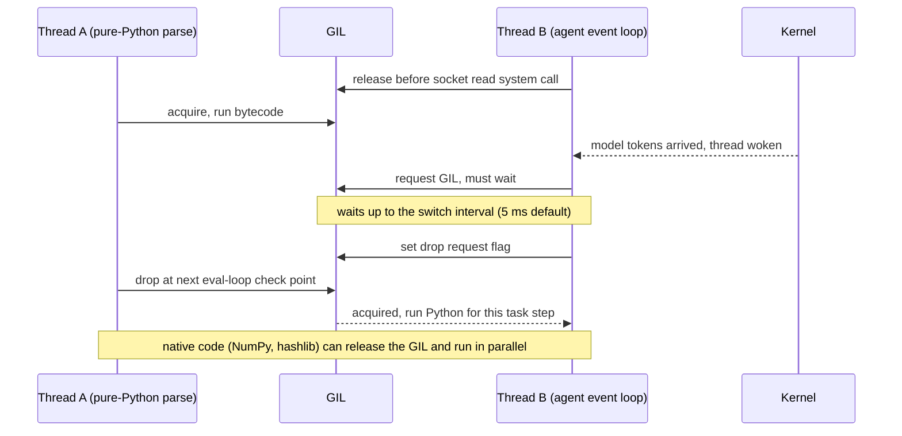

## TL;DR
The GIL is CPython's mutex letting one thread run bytecode at a time. Threads help agent I/O and
GIL-releasing native code, not pure-Python parsing, which also jitters token streams. It does not make
code thread-safe.

## For agent builders
- **Why it matters for agents.** Agent workers mix network waits (model, tools) with CPU work (chunking
  retrieved documents, validating big JSON tool outputs, local scoring). The GIL decides whether that CPU
  work can share the process with the event loop or must move out, and it explains slow, jittery streams.
- **Where it shows up in your stack.** `asyncio.to_thread` around CPU-heavy tools, thread pools in eval and
  ingestion scripts, local embedding or reranking models in PyTorch, and Uvicorn worker counts.
- **What you control.** Which executor runs each CPU-heavy step, native thread counts (`OMP_NUM_THREADS`,
  `torch.set_num_threads(...)`), locks around shared agent state, and whether you deploy a free-threaded
  build.
- **What you can skip.** Eval-loop internals and the C API beyond knowing that native code can release the
  GIL. Learn the CPU/wall diagnostic and the threads-versus-processes rule.

## Lab
### Task
Build the measurement your agent worker uses to place a CPU-heavy tool. The starter assumes every tool
belongs in a thread pool; you will measure process CPU time over wall time with N threads and let that
number pick threads or processes. Time box: 45 minutes. Do **asyncio vs threads vs multiprocessing**
first.
- **Goal:** `cpu_wall_ratio` returns about 1.0 for the pure-Python cleaner and close to 4 for hashing,
  and `choose_executor` sends the cleaner to a process pool.
- **Constraints:** standard library only; a machine with 4 or more cores. Checked on standard CPython
  3.12.14 (10-core laptop) with pytest 9.1; the pure-Python tests skip on a free-threaded build.

### Starter code
Save as `lab_gil.py`. It runs as given and reports both tools as thread-pool tools.

```python
import hashlib, sys, sysconfig, threading, time

def clean_docs():                       # pure-Python cleaning of retrieved docs: holds the GIL
    return sum(i * i % 7 for i in range(2_000_000))

BLOB = b"x" * 100_000_000               # built once, outside the threads
def hash_blob():                        # dedup hashing of a big attachment: hashlib releases the GIL
    return hashlib.sha256(BLOB).hexdigest()

def gil_enabled() -> bool:
    return sys._is_gil_enabled() if hasattr(sys, "_is_gil_enabled") else True   # 3.13+ has the check

def cpu_wall_ratio(fn, n_threads=4) -> float:
    """Start n_threads threads that each call fn once; return process CPU time / wall time.
    LAB 1: about 1.0 means the GIL serialised the threads; close to n_threads means fn releases it."""
    raise NotImplementedError("LAB 1")

def choose_executor(fn, n_threads=4) -> str:
    """Return "thread" when fn scales across threads (ratio above n_threads / 2), else "process".
    LAB 2: decide from a measurement, not from an assumption."""
    return "thread"                     # the assumption this lab replaces: threads always help

if __name__ == "__main__":
    build = "free-threaded" if sysconfig.get_config_var("Py_GIL_DISABLED") else "standard"
    print(f"{build} build, GIL enabled: {gil_enabled()}")
    for tool in (clean_docs, hash_blob):
        try:
            ratio = f"{cpu_wall_ratio(tool):.1f}"
        except NotImplementedError:
            ratio = "not measured yet"
        print(f"{tool.__name__}: CPU/wall with 4 threads = {ratio}, run it in a {choose_executor(tool)} pool")
```

### Expected output
On standard CPython with 4+ free cores (the hashing ratio was 3.5 to 3.9 across runs):

```
standard build, GIL enabled: True
clean_docs: CPU/wall with 4 threads = 1.0, run it in a process pool
hash_blob: CPU/wall with 4 threads = 3.9, run it in a thread pool
```

### Tests
Save as `test_lab_gil.py` and run `pytest -q`. On the starter three tests fail with
`NotImplementedError` and the placement test fails with `'thread' == 'process'`; the last one guards
against "always process".

```python
import pytest
import lab_gil as lab

needs_gil = pytest.mark.skipif(not lab.gil_enabled(), reason="free-threaded run: pure Python scales")

@needs_gil
def test_pure_python_is_serialised():
    ratio = lab.cpu_wall_ratio(lab.clean_docs, 4)
    assert 0.5 < ratio < 1.5, f"ratio {ratio:.2f}: expected about 1.0 under the GIL"

def test_hashlib_scales_across_threads():
    ratio = lab.cpu_wall_ratio(lab.hash_blob, 4)
    assert ratio > 2.5, f"ratio {ratio:.2f}: expected close to 4 (needs 4+ free cores)"

def test_ratio_reflects_the_thread_count():
    one, four = lab.cpu_wall_ratio(lab.hash_blob, 1), lab.cpu_wall_ratio(lab.hash_blob, 4)
    assert one < 1.3 and four > one + 1, f"1 thread {one:.2f}, 4 threads {four:.2f}"

@needs_gil
def test_cpu_bound_tool_goes_to_processes():
    assert lab.choose_executor(lab.clean_docs) == "process"

def test_gil_releasing_tool_stays_in_threads():
    assert lab.choose_executor(lab.hash_blob) == "thread"
```

### Failure scenarios
- **Inject `time.time()` for CPU instead of `time.process_time()`.** Every ratio becomes 1.0, so hashing
  is sent to processes. Debug: print both clocks; process CPU time must sum across all threads.
- **Inject building the blob inside `hash_blob`** (`hashlib.sha256(b"x" * 100_000_000)`). The hashing
  ratio drops well below 4, because creating the bytes is Python-level work that holds the GIL. Debug:
  time the allocation and the hash separately.
- **Run the tests on a busy machine or a 2-core CI runner.** The hashing tests fail on timing, not on
  logic. Debug: check `os.cpu_count()` and load; the diagnostic is only meaningful with idle cores.
- **Measure starting the threads outside the timed region.** Ratios jump around between runs. Debug:
  start the wall and CPU clocks before `start()` and stop them after the last `join()`.

### Submission
- **Your `lab_gil.py`** with both LAB markers resolved, plus a `pytest -q` run showing 5 passed.
- **The script's output on your machine**, with core count and Python build noted.
- **A three-row table in `NOTES.md`** placing three tools from your own agent (one I/O-bound, one
  pure-Python CPU, one native) with the ratio you measured for each.
- **Evaluation:** the ratio uses `process_time` over `perf_counter`, placement comes from the
  measurement, and the note explains why the cleaner gains nothing from threads under the GIL.

## Why it exists
- **Reference counts change constantly.** Every CPython object's count is updated on nearly every
  assignment, call and attribute access. Two threads updating one count without coordination corrupt it:
  the object is freed while in use (a crash) or never freed (a leak).
- **Interpreter internals are shared too:** dicts backing modules and classes, the allocator's free lists,
  the import machinery.
- **The alternatives are expensive.** Fine-grained locks on every object, or atomic instructions on every
  refcount change, slow single-threaded code, which was and is the common case. They also force every C
  extension author to reason about concurrency.
- **One lock bought simplicity and speed.** The interpreter and its huge C ecosystem (NumPy, database
  drivers, compression) stayed easy to write correctly and single-threaded Python stayed fast. The cost
  came with multi-core machines: a CPU-bound Python program using threads still uses roughly one core.
- **Agent workloads straddle the line.** Calling LLM APIs and tools is I/O-bound, fine with threads or
  asyncio. Tokenising a corpus, parsing documents or a pure-Python scoring loop is CPU-bound, and threads
  give almost nothing. Knowing the side decides threads, processes or native code.

## How it works
### Background: holding and handing over
A thread must hold the GIL to run bytecode or touch Python objects. It gives the GIL up in two ways:

| Handover | When | Why |
|---|---|---|
| **Voluntary** | Around blocking operations: socket reads, file I/O, `time.sleep`, waiting on a lock. I/O code releases before the system call and reacquires after | No reason to block other threads while the kernel waits |
| **On request** | Another thread has waited longer than the switch interval (`sys.getswitchinterval()`, 5 ms by default); it sets a flag and the running thread drops the GIL at its next eval-loop check point | Keeps threads fair |

- **The forced handover is also why CPU-bound threads add switching overhead rather than speed.**
- **Model and tool calls are the voluntary case:** a thread waiting on a provider socket holds no GIL, so
  sync SDK calls in a thread pool overlap fine.

### The hidden cost: CPU threads slow down the agent's event loop
1. An I/O thread's socket becomes ready (the next model tokens arrived) and the kernel wakes it.
2. It must still reacquire the GIL before running any Python.
3. If a CPU-bound thread holds the GIL, the I/O thread waits until that thread reaches a check point and
   yields, roughly bounded by the switch interval each time it needs the lock back.

- **The event loop pays this on every task step**, because it needs the GIL for each one.
- **So `asyncio.to_thread` for pure-Python CPU work** keeps the loop *unblocked* but not *unaffected*: each
  step can be delayed by milliseconds and streaming agent responses get visibly jittery. The work belongs
  in a process.

### Native code can opt out
- **How.** C, C++ and Rust extensions can release the GIL while working on their own memory, as long as
  they touch no Python objects. In C this is the `Py_BEGIN_ALLOW_THREADS` / `Py_END_ALLOW_THREADS` pair
  around the native work; the extension must reacquire the GIL before building the Python result.
- **Who does it.** NumPy for many operations on large arrays, PyTorch for most tensor ops, `hashlib` for
  large inputs, compression libraries for large buffers.
- **So "Python is single-core" is wrong here:** a thread pool running NumPy-heavy or PyTorch CPU work (a
  local embedding model, a cosine-similarity pass over retrieved vectors) can use several cores.
- **It is per function.** Whether a call releases the GIL is a property of that library and function, so
  check or measure rather than assume.

### What the GIL does not give you
- **It protects the interpreter, not your invariants.** `counter += 1` compiles to several bytecodes
  (load, add, store), and a switch can occur between them, so two threads can lose an update to a shared
  token counter.
- **Check-then-act on a dict across threads needs a `threading.Lock`.**
- **Reproducibility varies** with Python version and timing, which makes the race more dangerous, not less.
- **Some single operations are atomic by accident.** One `list.append` or one `d[key] = value` cannot be
  torn. Code relying on this "works" by accident of implementation.
- **Hence the documented tools** are `queue.Queue` and explicit locks, and the free-threaded build had to add
  per-object locking inside built-in containers to keep such single operations safe.

### Ways around it, and its future
| Route | What it gives | Status |
|---|---|---|
| Processes (`multiprocessing`, `ProcessPoolExecutor`) | Own interpreter and GIL each | Always available |
| PEP 684 per-interpreter GIL (Python 3.12) | Parallelism within one process, isolated state | C API only in 3.12; Python-level `concurrent.interpreters` in 3.14 (PEP 734) |
| PEP 703 free-threaded build | No GIL; biased reference counting and other techniques | Experimental in 3.13; officially supported but still a separate build in 3.14 |

- **Free-threaded caveats:** extensions must be built and marked compatible, and there is some
  single-threaded overhead.
- **Status changes by release**, so check the docs for your version and dependencies before planning
  around it.

## Diagram
Handover between a CPU-bound thread and the agent's event-loop thread: the loop is woken by the kernel
but still waits for the GIL, and only a drop request after the switch interval gets it back.



## Examples
### Worked scenario: a streaming agent worker with a CPU-heavy tool
One Uvicorn worker streams answers for 40 sessions. A new tool post-processes retrieved documents with a
pure-Python cleaning loop taking about 400 ms per call. Figures are illustrative.

| Placement of the cleaning tool | Event loop | What users see |
|---|---|---|
| Called directly in the coroutine | Blocked about 400 ms per call | Every stream on the worker freezes during each call |
| `asyncio.to_thread` | Unblocked, but each task step may wait up to about 5 ms for the GIL | Streams keep moving but tokens arrive in uneven bursts |
| `ProcessPoolExecutor` via `run_in_executor` | Unblocked and not contending for this process's GIL | Smooth streams; the tool pays pickling for its input and output |
| Rewritten with vectorised native code that releases the GIL | Unblocked | Smooth, and the tool may also get faster |

The diagnostic below tells you which row you are in before you pick a fix.

### Threads vs processes vs GIL-releasing C code
```python
import hashlib, time
from concurrent.futures import ProcessPoolExecutor, ThreadPoolExecutor

def py_work(n: int) -> int:            # pure Python: holds the GIL throughout
    total = 0
    for i in range(n):
        total += i * i % 7
    return total

def c_work(data: bytes) -> str:        # hashlib releases the GIL on large inputs
    return hashlib.sha256(data).hexdigest()

def timed(label, run):
    t = time.perf_counter()
    run()
    print(f"{label:<20}{time.perf_counter() - t:6.2f}s")

def pool(cls, fn, args):
    with cls(max_workers=4) as ex:
        list(ex.map(fn, args))

if __name__ == "__main__":
    nums, blobs = [5_000_000] * 4, [b"x" * 200_000_000] * 4
    timed("python, sequential", lambda: [py_work(n) for n in nums])
    timed("python, 4 threads", lambda: pool(ThreadPoolExecutor, py_work, nums))
    timed("python, 4 procs", lambda: pool(ProcessPoolExecutor, py_work, nums))
    timed("sha256, sequential", lambda: [c_work(b) for b in blobs])
    timed("sha256, 4 threads", lambda: pool(ThreadPoolExecutor, c_work, blobs))
```

On standard (GIL) CPython on a multi-core laptop:
| Run | Relative to sequential | Why |
|---|---|---|
| Pure Python, 4 threads | about the same | GIL serialises bytecode |
| Pure Python, 4 processes | roughly a third (less than 4× faster) | Process startup is included |
| sha256, 4 threads | about 4× faster | `hashlib` releases the GIL |

Absolute times depend on the machine; the ratios are the lesson.

### A two-number GIL diagnostic
Ask the interpreter whether a GIL is active, then measure process CPU time over wall time with N threads:
about 1.0 means the GIL is serialising you, close to N means the work releases it. Run it on each
CPU-heavy tool before deciding where it runs.

```python
import hashlib, sys, sysconfig, threading, time

def gil_status() -> str:
    build = "free-threaded" if sysconfig.get_config_var("Py_GIL_DISABLED") else "standard"
    enabled = sys._is_gil_enabled() if hasattr(sys, "_is_gil_enabled") else True   # 3.13+
    return f"{build} build, GIL enabled: {enabled}"

def cpu_wall_ratio(fn, n_threads: int = 4) -> float:
    threads = [threading.Thread(target=fn) for _ in range(n_threads)]
    wall, cpu = time.perf_counter(), time.process_time()
    for t in threads: t.start()
    for t in threads: t.join()
    return (time.process_time() - cpu) / (time.perf_counter() - wall)

def py_loop():  sum(i * i % 7 for i in range(3_000_000))       # holds the GIL
BLOB = b"x" * 200_000_000                                      # allocate outside the threads
def hashing():  hashlib.sha256(BLOB).hexdigest()                # releases it

print(gil_status())
print(f"pure Python, 4 threads: CPU/wall = {cpu_wall_ratio(py_loop):.1f}")   # about 1.0
print(f"sha256,      4 threads: CPU/wall = {cpu_wall_ratio(hashing):.1f}")   # close to 4
```
Note `BLOB` is built once outside the threads: building a 200 MB bytes object inside each thread is
Python-level work that holds the GIL, and in testing it pulled the hashing ratio well below 4.

## Production patterns
- **Keep CPU-heavy tools away from the agent's event loop process.** Run pure-Python preprocessing
  (chunking, cleaning, scoring retrieved documents) in a process pool or a separate worker service, not in
  `to_thread` beside a streaming loop. Monitor loop lag and inter-token jitter on streams.
- **Profile CPU/wall before adding threads.** For any slow batch stage (RAG ingestion, eval scoring),
  record process CPU time against wall time with the planned thread count. Ratio near 1.0: move to
  processes or native code; near N: threads are fine. Track the ratio per stage in benchmarks.
- **Cap native thread pools when you also use Python threads.** NumPy and PyTorch run their own thread pools;
  set `OMP_NUM_THREADS` or `torch.set_num_threads(...)` so Python threads × native threads does not exceed
  the cores, which matters when a local embedding model shares a box with the agent API. Monitor CPU
  saturation and run-queue length.
- **Verify the GIL state on free-threaded deploys.** Log `sys._is_gil_enabled()` at startup and fail the
  health check if it is `True` where you expected `False`, because an incompatible extension re-enables the
  GIL at runtime with only a warning.
- **Lock shared state anyway.** Guard usage counters, caches and check-then-act sequences with
  `threading.Lock` or hand work through `queue.Queue`, so the code stays correct under any interpreter.
  Look for lost updates in load tests, not unit tests.

## Trade-offs
- **Simple, fast single thread vs one core.** The GIL keeps single-threaded code and C extensions simple
  and fast, but caps pure-Python CPU work at one core per process. It flips when your hot loop lives in
  GIL-releasing native code.
- **Full parallelism vs process overhead.** Processes sidestep the GIL completely, at the cost of separate
  memory, pickled arguments and slower startup. They win when each task carries far more compute than data.
- **Native speed vs maintenance.** Moving a hot loop into NumPy, a compiled extension or a Rust library
  removes the GIL limit and interpreter overhead, but adds a build and maintenance burden worth paying only
  for real hot spots.
- **Free threading vs ecosystem risk.** A free-threaded build allows true thread parallelism for Python
  code, but trades some single-thread speed and depends on every compiled dependency supporting it, so it
  suits measured, controlled deployments.

## Pitfalls
- **Threads to speed up a pure-Python tokenising or parsing loop.** Symptom: CPU pinned near 100% of one
  core and no wall-clock improvement. Fix: a process pool, or move the hot loop into native code.
- **Assuming the GIL makes shared counters or dicts thread-safe.** Symptom: occasional lost updates or
  inconsistent state that disappears when you add logging. Fix: a `threading.Lock` or `queue.Queue`.
- **Blaming the GIL for a slow I/O-bound agent.** If CPU is low and latency high, the problem is waiting
  or blocking calls; the GIL is not the bottleneck. Fix: find the blocking call or the slow dependency.
- **Assuming a library releases the GIL because it is written in C.** Some hold it for the whole call, and
  profiling shows threads queuing instead of running in parallel. Fix: measure CPU/wall per call first.
- **A free-threaded build plus an extension not marked compatible.** CPython re-enables the GIL at runtime
  (with a warning), threads stop scaling, and `sys._is_gil_enabled()` (3.13+) returns `True` where you
  expected `False`. Fix: use free-threaded wheels for every compiled dependency, and check the flag at startup.

## When to use
You do not use the GIL; you design around it.
- **First ask:** is the slow agent step waiting (I/O) or computing (CPU)?
- **I/O:** threads or asyncio are fine and the GIL is irrelevant.
- **CPU-bound pure Python:** processes, vectorise with NumPy or Polars, or move the hot loop to native code.
- **CPU work inside NumPy or PyTorch:** threads can work; measure with a quick timing like the examples.
- **Measure:** the ratio of process CPU time to wall time with N threads (about 1.0 means the GIL is
  serialising you, close to N means the work releases it). A sampling profiler such as py-spy shows which
  thread holds the GIL when that ratio surprises you.
- **Track** the free-threaded build's status if you run CPU-heavy Python at scale.
- **Interviews:** explain why the GIL exists (refcounting), when it bites (CPU-bound bytecode), and why it
  does not make code thread-safe.

## Role lens
- **Engineer:** Profiles before parallelising, uses processes or vectorised libraries for CPU-bound
  preprocessing, and still guards shared state across threads with locks.
- **Architect:** Plans process-level scaling for CPU-heavy stages and pushes heavy compute into native
  libraries or separate services instead of fighting the GIL in one process.
- **FDE:** Explains to a customer why their sixteen-thread ingestion script uses one core, and fixes
  it with a process pool or a vectorised rewrite on their hardware.

## Check yourself
**Q:** A colleague's embedding-prep script runs a pure-Python text-cleaning function over 1M documents with a
32-thread pool on a 32-core machine and sees no speed-up. They propose 64 threads. What do you say?
**A:** The cleaning function is pure-Python CPU work, so in standard CPython the GIL lets only one thread
execute bytecode at a time; more threads only add switching overhead, which is why 32 threads barely beat
one. The fix is a `ProcessPoolExecutor` with roughly one worker per core, sending documents in chunks so
pickling is amortised, or moving the hot loop into native code: Polars string expressions or a compiled
library. Fewer, larger `re` calls also cut per-document interpreter overhead, but the `re` module holds the
GIL, so regex work still does not parallelise across threads. I would time a small sample sequentially and with processes to confirm the gain before running
the full million. Threads would be right only if the work were I/O or GIL-releasing native code.

## Interview questions
### What is the GIL, and why does CPython have one?
- **A single interpreter mutex:** a thread must hold it to run bytecode or touch Python objects, so only
  one thread executes Python at a time per interpreter.
- **It protects reference counts and shared internals**, which change on nearly every operation; without
  coordination objects get freed while in use or leak.
- **One lock was the cheap option**, because fine-grained locks or atomic refcounts slow the common
  single-threaded case and burden every C extension author.

### Agent streams get jittery after a teammate moved a document-cleaning tool into asyncio.to_thread. Why?
- **The loop is unblocked but not unaffected.** The cleaning thread holds the GIL running pure Python,
  and the event loop needs the GIL for every task step.
- **Each loop step can wait** up to about the switch interval (5 ms by default) for a handover, so token
  delivery becomes uneven across every session on the worker.
- **Fix:** move the CPU work to a process pool or a separate worker service, and monitor loop lag and
  inter-token jitter.

### Your agent service runs many tool calls in a thread pool. Does the GIL limit its throughput?
- **Not for I/O-bound tools.** Threads waiting on model, search or database sockets release the GIL, so
  they overlap; the limits are pool size and provider quotas.
- **Yes for pure-Python CPU tools**, which serialise on one core however many threads you add; measure
  CPU/wall per tool and move those to processes.
- **Shared state still needs locks** (usage counters, caches), because the GIL does not protect
  multi-bytecode updates.

### Does the GIL make my shared dict or counter thread-safe?
- **No, it protects the interpreter, not your invariants.** `counter += 1` is several bytecodes (load,
  add, store), and a switch between them loses updates.
- **Check-then-act needs a `threading.Lock`**, or hand work through `queue.Queue`.
- **Single operations like `list.append` happen to be atomic**, but relying on that is an implementation
  accident; the free-threaded build had to add per-object locks to preserve it.

### When are Python threads a good choice for CPU-heavy AI work despite the GIL?
- **When the hot path is GIL-releasing native code:** NumPy on large arrays, most PyTorch tensor ops,
  `hashlib` and compression on large buffers.
- **Threads then share memory and weights**, avoiding process pickling and duplicated models.
- **Verify per function**, because some C libraries hold the GIL for the whole call; and cap native pools
  with `OMP_NUM_THREADS` or `torch.set_num_threads(...)` to avoid oversubscribing cores.

### How do you prove, with numbers, that the GIL is your bottleneck?
- **Measure process CPU time over wall time with N threads.** A ratio near 1.0 means the GIL serialises
  you; close to N means the work releases it.
- **Confirm with a sampling profiler** such as py-spy to see which thread holds the GIL.
- **On free-threaded builds**, also log `sys._is_gil_enabled()` (3.13+), since an incompatible
  extension can silently re-enable it.

## Quiz
### Q: Why did CPython adopt a single global lock rather than fine-grained locks?
- [ ] Because operating systems in the 1990s did not support threads
- [x] Because reference counting and C extensions needed protection, and one lock kept single-threaded code fast and simple
- [ ] Because a global lock makes all user code thread-safe automatically
- [ ] Because fine-grained locks are impossible to implement in C
> Every object's refcount changes constantly; protecting each one individually would slow the common
> single-threaded case and complicate every extension. The GIL protects interpreter state, not user invariants.

### Q: A thread pool running large NumPy matrix multiplications uses several cores. Why is that possible under the GIL?
- [ ] NumPy spawns hidden subprocesses for each call
- [ ] The GIL is only enforced for I/O operations
- [x] NumPy releases the GIL inside its native code while it works on its own buffers
- [ ] Threads automatically bypass the GIL after the switch interval
> C extensions may drop the GIL while not touching Python objects, so NumPy's compiled kernels run in
> parallel across threads. The switch interval only governs handover between threads running bytecode.

### Q: Two threads each run `counter += 1` a million times on a shared int. What can happen in standard CPython?
- [ ] The result is always exactly two million because of the GIL
- [ ] The program raises a RuntimeError for concurrent modification
- [ ] The result is always one million because the threads serialise
- [x] Updates can be lost, because the increment spans several bytecodes and a switch can occur between them
> The GIL makes each bytecode safe, not each statement. Load, add and store are separate steps, so an
> interleaving can overwrite another thread's increment; whether it shows up depends on version and timing.

## Use cases & projects
### Use cases
- **Diagnosing jittery token streams.** A CPU-heavy step on the same process holds the GIL and delays
  every stream; the CPU-versus-wall diagnostic finds it.
- **Choosing threads or processes for agent tools.** Threads suit model and tool I/O and GIL-releasing
  native code; pure-Python parsing or scoring needs processes.
- **Local embedding or reranking models.** PyTorch releases the GIL inside its kernels, so the real knob is
  native thread counts per worker, not Python threads.
- **Shared agent state across threads.** The GIL does not make check-then-act safe, so budgets and caches
  touched by worker threads still need locks.

### Mini project
**Measure the GIL on an agent worker (1-2 hours).**
- **Goal:** show which agent workloads threads speed up and which they do not.
- **Steps:** write a pure-Python chunker over a large text, a `hashlib`-based hashing step (which
  releases the GIL for large inputs) and a fake model call using `time.sleep`; run each with 1 and 4
  threads, then the chunker with 4 processes; record wall time and CPU time for each run.
- **Done when:** a table shows the speed-up per workload, the chunker gains little from threads but scales
  with processes, and you can state which executor each step of your agent should use.
