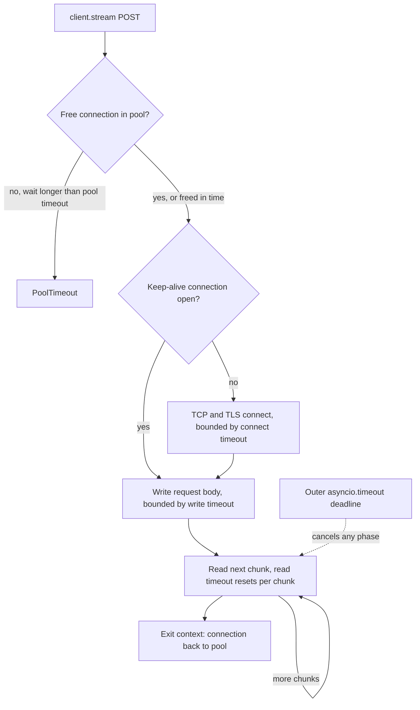

## TL;DR
An agent is mostly HTTP: model calls, tool APIs, vector stores. httpx is the sync and `async`/`await`
client underneath the OpenAI and Anthropic Python SDKs, so its timeouts, pooling and streaming decide how
your agent waits, fans out and fails.

## For agent builders
- **Why it matters for agents.** One agent step can stream a completion and then run three tool calls
  in parallel. Whether that step takes 2 s or hangs for ten minutes is decided by the connection pool
  and per-phase timeouts (httpx settings) plus the outer deadline you add with `asyncio.timeout`.
- **Where it shows up in your stack.** Inside provider SDKs (`AsyncOpenAI(http_client=...)`), in your
  own tool functions that call internal APIs, in streaming from self-hosted model servers, and in tests
  through `MockTransport`.
- **What you control.** One shared `AsyncClient` per upstream, `httpx.Timeout` per phase,
  `httpx.Limits` sized for your concurrency, a total deadline per tool call, and where retries live.
- **What you can skip.** HTTP/2 internals and transport plumbing beyond the three transports below.
  Know that a read timeout is not a deadline and that the pool is your concurrency limit.

## Lab
### Task
Build the tool executor for one agent step: run every tool call the model requested in parallel on one
shared `AsyncClient`, give each call a total deadline that covers its retries, retry 429 and 5xx with
`Retry-After`, and turn every failure into text the model can read. A `MockTransport` plays the tools
service. Time box: 60 minutes.
- **Prerequisites:** the asyncio and async/await lessons; the Tenacity lesson for retry policy ideas.
- **Setup:** Python 3.11+ (for `asyncio.timeout`), `pip install "httpx==0.28.1" pytest` (checked against
  httpx 0.28.1). Save the starter as `executor.py` and the tests as `test_executor.py`.

### Starter code
```python
"""Lab: the tool executor for one agent step: parallel, deadlined, retrying 429/5xx (Python 3.11+)."""
import asyncio
import time

import httpx

RETRYABLE = {429, 500, 502, 503, 504}


def make_client(transport: httpx.AsyncBaseTransport | None = None) -> httpx.AsyncClient:
    """The one shared client for tool calls; tests inject a MockTransport here."""
    return httpx.AsyncClient(base_url="https://tools.internal", transport=transport,
                             timeout=httpx.Timeout(connect=2.0, read=10.0, write=5.0, pool=1.0),
                             limits=httpx.Limits(max_connections=50, max_keepalive_connections=20))


async def call_tool(client: httpx.AsyncClient, name: str, args: dict,
                    deadline_s: float = 8.0, max_attempts: int = 3) -> str:
    """POST /tools/<name>. Return the body text on 2xx. Never raise; return "ERROR: ..." text:
    - the whole call, retries included, gets deadline_s -> "ERROR: <name> took longer than <deadline_s>s"
    - retry 429 and 5xx up to max_attempts calls in total, sleeping Retry-After seconds when present
      (else 0.1 * 2**attempt, attempt counting from 1); after the last attempt -> "ERROR: <name> returned <status>"
    - other 4xx are not retried -> "ERROR: <name> returned <status>: <first 200 chars of body>"
    - network failures -> "ERROR: <name> unreachable (<exception class name>)" """
    raise NotImplementedError("YOUR CODE")


async def run_step(client: httpx.AsyncClient, calls: list[tuple[str, dict]], **kw) -> list[str]:
    """Run every tool call the model asked for in this step; results in request order."""
    return [await call_tool(client, n, a, **kw) for n, a in calls]     # works, but is it fast?


async def demo() -> None:
    hits: dict[str, int] = {}

    async def upstream(request: httpx.Request) -> httpx.Response:     # a fake tools service
        name = request.url.path.rsplit("/", 1)[-1]
        hits[name] = hits.get(name, 0) + 1
        if name == "get_invoices":
            await asyncio.sleep(30)                                       # hangs
        if name == "get_customer" and hits[name] == 1:
            return httpx.Response(429, headers={"Retry-After": "0.2"})
        await asyncio.sleep(0.3)
        return httpx.Response(200, text=f'{{"tool": "{name}"}}')

    async with make_client(httpx.MockTransport(upstream)) as client:
        t0 = time.perf_counter()
        results = await run_step(client, [("search_docs", {"q": "vpn"}), ("get_customer", {"id": 7}),
                                          ("get_invoices", {"id": 7})], deadline_s=1.0)
        for r in results:
            print(r)
        print(f"step took under 1.5 s: {time.perf_counter() - t0 < 1.5}, calls: {hits}")


if __name__ == "__main__":
    asyncio.run(demo())
```

### Expected output
```
{"tool": "search_docs"}
{"tool": "get_customer"}
ERROR: get_invoices took longer than 1.0s
step took under 1.5 s: True, calls: {'search_docs': 1, 'get_customer': 2, 'get_invoices': 1}
```
The step costs the slowest call's deadline (1.0 s), not the sum, and the 429 was absorbed by one retry.
`pytest -q test_executor.py` reports `7 passed`.

### Tests
```python
import asyncio, time
import httpx
from executor import call_tool, make_client, run_step


def scripted(*responses, delay=0.0):
    """A fake upstream that replays (status, headers) pairs and counts calls."""
    seen = []

    async def handler(request):
        seen.append(request.url.path)
        await asyncio.sleep(delay)
        status, headers = responses[min(len(seen), len(responses)) - 1]
        return httpx.Response(status, headers=headers, text="ok" if status == 200 else "nope")
    return handler, seen


async def call(handler, **kw):
    async with make_client(httpx.MockTransport(handler)) as client:
        return await call_tool(client, "search_docs", {"q": "vpn"}, **kw)


def test_429_is_retried_after_retry_after():
    handler, seen = scripted((429, {"Retry-After": "0.5"}), (200, {}))
    t0 = time.perf_counter()
    assert asyncio.run(call(handler)) == "ok" and len(seen) == 2
    assert time.perf_counter() - t0 >= 0.5                         # honoured the header


def test_persistent_503_stops_at_max_attempts():
    handler, seen = scripted((503, {"Retry-After": "0"}))
    assert asyncio.run(call(handler, max_attempts=3)) == "ERROR: search_docs returned 503"
    assert len(seen) == 3


def test_400_is_not_retried():
    handler, seen = scripted((400, {}))
    assert asyncio.run(call(handler)).startswith("ERROR: search_docs returned 400: nope")
    assert len(seen) == 1


def test_hanging_tool_fails_at_its_deadline():
    handler, _ = scripted((200, {}), delay=30)
    t0 = time.perf_counter()
    out = asyncio.run(call(handler, deadline_s=0.3))
    assert out == "ERROR: search_docs took longer than 0.3s" and time.perf_counter() - t0 < 1.0


def test_deadline_covers_retries():
    handler, seen = scripted((503, {"Retry-After": "0.25"}))       # each attempt is fast
    t0 = time.perf_counter()
    out = asyncio.run(call(handler, deadline_s=0.3, max_attempts=3))
    assert out == "ERROR: search_docs took longer than 0.3s"       # the sleeps count too
    assert len(seen) == 2 and time.perf_counter() - t0 < 0.45


def test_network_error_becomes_text():
    def handler(request):
        raise httpx.ConnectError("refused", request=request)
    assert asyncio.run(call(handler)) == "ERROR: search_docs unreachable (ConnectError)"


def test_step_runs_calls_in_parallel():
    handler, seen = scripted((200, {}), delay=0.3)

    async def go():
        async with make_client(httpx.MockTransport(handler)) as client:
            return await run_step(client, [("a", {}), ("b", {}), ("c", {})])
    t0 = time.perf_counter()
    assert asyncio.run(go()) == ["ok", "ok", "ok"]
    assert time.perf_counter() - t0 < 0.6                          # slowest call, not the sum (0.9 s)
```

### Failure scenarios
- **Leave `run_step` as the starter's list comprehension.** Everything passes except the parallel test,
  which takes about 0.9 s, the sum of three 0.3 s calls. Debug by timing the step; switch to
  `asyncio.gather` over the same client.
- **Rely on the client's `read=10.0` instead of `asyncio.timeout`.** The hanging-tool test waits the
  full 30 s and fails (so does the retry-deadline test): `MockTransport` applies no httpx timeouts, and against a real server a trickling
  response never trips the read timeout either. Debug by logging elapsed time per call.
- **Put the deadline around each attempt instead of the whole loop.** `test_deadline_covers_retries`
  fails: three fast 503s with 0.25 s `Retry-After` sleeps take about 0.5 s and return `returned 503`
  instead of stopping at 0.3 s. A tool that times out three times burns three deadlines, so one agent
  step can exceed its budget threefold. Debug by counting attempts inside a deadline failure.
- **Ignore `Retry-After`.** The 429 test fails its 0.5 s timing assertion (the fallback backoff sleeps
  only 0.2 s); against a real provider the
  retry lands inside the rate-limit window and fails again.

### Submission
- **`executor.py`** passing all seven tests unmodified, with `make_client` unchanged.
- **The `pytest -q` output** and the `python executor.py` output matching Expected output.
- **A short log** from the demo showing per-call attempts and elapsed time.
- **A note of 3-5 lines:** which calls you would refuse to retry automatically (non-idempotent tools) and
  how the deadline relates to the agent run's total budget.
- **Evaluated on:** no exception ever escaping `call_tool`, deadlines covering retries, and a step that
  costs the slowest call.

## Why it exists
- **`requests` is synchronous.** It defined the ergonomic Python HTTP API, but an AI service fanning out
  to an LLM, a vector store and two tools per request spends nearly all its time waiting on the network.
  Inside an async framework each blocking wait stalls the event loop, so the server handles one request
  at a time.
- **The workarounds fall short.** Threads scale poorly to thousands of concurrent streams. `aiohttp` is
  async-only, with a different API, so code and tests cannot be shared with sync scripts.
- **LLM responses stream for many seconds.** They arrive as server-sent events, so the client must expose
  bytes or lines incrementally rather than buffer the body.
- **LLM requests are expensive and long.** Timeouts, connection reuse and pool limits stop being defaults
  you ignore and become things you must set deliberately.
- **httpx gives one API for both.** `httpx.Client` and `httpx.AsyncClient` have identical methods,
  streaming, explicit fine-grained timeouts and a transport layer you can swap for a mock in tests.

## How it works
### Clients own connection pools
- **`httpx.get(...)` is a convenience** that opens and discards a connection.
- **A `Client`/`AsyncClient` keeps a pool of keep-alive connections,** so repeated calls to the same host
  skip TCP and TLS handshakes, often the largest part of a short request's latency, and an agent makes
  many short tool calls.
- **So create one client per process (or per upstream) and reuse it,** closing it on shutdown with a
  context manager or `aclose()`.
- **Pool size:** `httpx.Limits(max_connections=..., max_keepalive_connections=...)`, defaults 100 and 20.
  When the pool is full, further requests wait for a free connection, and that wait has its own timeout.
- **The pool is your concurrency limit to that upstream.** By Little's law, sustainable throughput is
  about `max_connections ÷ average request duration`: 50 connections holding 10-second streams carry about
  5 requests per second, whatever the CPU could do.

### Timeouts are per phase
| Phase | Bounds | Default |
|---|---|---|
| **connect** | Establishing the socket | 5 seconds |
| **read** | Waiting for the next chunk of data | 5 seconds |
| **write** | Sending a chunk | 5 seconds |
| **pool** | Waiting for a free connection | 5 seconds |

- **A read timeout bounds the gap *between* chunks, not the total duration.** All four live in
  `httpx.Timeout`.
- **Steady streams never trip it.** A completion sending a token every 100 ms passes a 5 s read timeout
  even if it runs for ten minutes.
- **Slow first bytes trip it at once.** A reasoning model that thinks for 30 s before its first byte fails
  immediately.
- **For a total deadline,** wrap the call in `asyncio.timeout(...)` (or anyio's equivalent). In an
  agent, give each tool call its own deadline and the whole run a larger one.

### Parallel tool calls
- **Models can request several tool calls in one turn.** Run them concurrently with `asyncio.gather`
  over one shared `AsyncClient`, so the step costs the slowest call, not the sum.
- **Each call needs its own deadline and error capture,** so one hung tool does not stall the step and
  one failure becomes a tool result the model can read instead of an exception that kills the run.

### Streaming
1. `client.stream("POST", url, json=...)` is a context manager that returns once headers arrive.
2. Iterate `aiter_bytes()`, `aiter_text()` or `aiter_lines()`.
3. Leaving the context closes the response and returns the connection to the pool, *which is why* the
   context-manager form matters: a streamed response never closed keeps its connection checked out.

### Behaviour that differs from requests
- **Redirects are not followed by default** (`follow_redirects=True` to enable).
- **Timeouts are on by default;** `requests` waits forever unless told otherwise.
- **Error types:** `raise_for_status()` raises `httpx.HTTPStatusError`; network-level failures are
  `httpx.RequestError` subclasses such as `ConnectError`, `ReadTimeout` and `PoolTimeout`.

### Transports
Every client sends through a transport.

| Transport | What it does |
|---|---|
| `httpx.HTTPTransport(retries=n)` (`AsyncHTTPTransport` for an `AsyncClient`) | Retries only failures to establish a connection, not HTTP 429 or 5xx |
| `httpx.MockTransport(handler)` | Routes requests to a Python function: fast, deterministic agent tests, no network |
| `httpx.ASGITransport(app=app)` | Sends requests straight into an ASGI app such as FastAPI, in-process |

- **Application retries with backoff remain your job** (Tenacity, or the SDK's built-in retries).
- **HTTP/2** needs the optional extra (`httpx[http2]`) and `http2=True`, and multiplexes many requests over
  one connection.

### Hooks and SDK integration
- **`event_hooks={"request": [...], "response": [...]}`** runs your functions on every request and
  response: the usual place for trace headers, latency per upstream or payload redaction, *because* it
  covers every call through the client, including calls an SDK makes for you.
- **Provider SDKs accept a pre-built client:** `OpenAI(http_client=httpx.Client(...))`,
  `AsyncOpenAI(http_client=httpx.AsyncClient(...))`, so you control proxies, certificates, limits and hooks.
- **The SDK still applies its own timeout and retry settings on top,** so set those on the SDK rather than
  assuming httpx's 5 s default is in force.

## Diagram
Each phase of one streamed model or tool request has its own timeout; only the outer `asyncio.timeout`
bounds the whole call.



## Examples
### Agent scenario: parallel tool calls with deadlines
A tool executor for one agent step. It runs every tool call the model requested concurrently on a shared
client, gives each a deadline, and turns failures into text the model can read.

```python
import asyncio, httpx

http = httpx.AsyncClient(base_url="https://tools.internal",
                         timeout=httpx.Timeout(connect=2.0, read=10.0, write=5.0, pool=1.0),
                         limits=httpx.Limits(max_connections=50, max_keepalive_connections=20))

async def call_tool(name: str, args: dict, deadline_s: float = 8.0) -> str:
    try:
        async with asyncio.timeout(deadline_s):          # total budget for this tool call
            r = await http.post(f"/tools/{name}", json=args)
            r.raise_for_status()
            return r.text
    except TimeoutError:
        return f"ERROR: {name} took longer than {deadline_s}s; try a narrower query"
    except httpx.HTTPStatusError as e:
        return f"ERROR: {name} returned {e.response.status_code}: {e.response.text[:200]}"
    except httpx.RequestError as e:
        return f"ERROR: {name} unreachable ({type(e).__name__}); try another tool"

async def run_step(tool_calls: list[tuple[str, dict]]) -> list[str]:
    return await asyncio.gather(*(call_tool(n, a) for n, a in tool_calls))   # cost = slowest call
```

- **Errors become tool results,** so the model can retry with different arguments or pick another tool
  instead of the run crashing.
- **The shared client** keeps connections warm across all steps of all runs in this process.

### Worked scenario: one agent step, sequential versus parallel
Illustrative latencies for a step where the model asked for three tools.

| Tool | Latency |
|---|---|
| `search_docs` | 1.2 s |
| `get_customer` | 0.8 s |
| `get_invoices` | 2.0 s |
| Sequential step | 1.2 + 0.8 + 2.0 = 4.0 s |
| Parallel step with `gather` | max = 2.0 s |
| Parallel, `get_invoices` hangs, no deadline | until the read timeout, or forever on a trickle |
| Parallel, 8 s deadline per call | at most 8 s, with an error result the model can act on |

### Streaming with limits, a deadline and a mock
Streaming an OpenAI-compatible completion with deliberate limits, a total deadline and a mock for tests.

```python
import asyncio, json, httpx

TIMEOUT = httpx.Timeout(connect=5.0, read=60.0, write=10.0, pool=2.0)  # slow first token is normal
LIMITS = httpx.Limits(max_connections=50, max_keepalive_connections=20)

async def stream_chat(client: httpx.AsyncClient, prompt: str) -> str:
    body = {"model": "my-model", "stream": True,
            "messages": [{"role": "user", "content": prompt}]}
    parts = []
    async with asyncio.timeout(120):                      # total deadline (Python 3.11+)
        async with client.stream("POST", "/v1/chat/completions", json=body) as r:
            r.raise_for_status()
            async for line in r.aiter_lines():
                if line.startswith("data: ") and line != "data: [DONE]":
                    delta = json.loads(line[6:])["choices"][0]["delta"]
                    parts.append(delta.get("content") or "")
    return "".join(parts)

def fake(request: httpx.Request) -> httpx.Response:       # test double, no network
    chunk = {"choices": [{"delta": {"content": "hi"}}]}
    return httpx.Response(200, text=f"data: {json.dumps(chunk)}\n\ndata: [DONE]\n\n")

async def main():
    async with httpx.AsyncClient(base_url="https://llm.internal", timeout=TIMEOUT, limits=LIMITS,
                                 transport=httpx.MockTransport(fake)) as client:
        print(await asyncio.gather(*(stream_chat(client, f"q{i}") for i in range(3))))

asyncio.run(main())
```

Drop the `transport=` argument and the same code talks to a real server.

### Worked scenario: a burst against the pool
200 concurrent calls whose streams last about 8 s each hit the client above, for example 200 agent runs
starting together.

| Quantity | Value |
|---|---|
| Get connections immediately | First 50 |
| Wait in the pool | The other 150 |
| Throughput | 50 ÷ 8 ≈ 6 requests per second |
| Time to drain the burst | about 32 s |
| Wait for the last request | about 24 s for a connection |
| With `pool=2.0` | Every request still waiting after 2 s fails with `PoolTimeout`: roughly 150 of the 200 fail fast |

- **This is a deliberate choice:** fail fast and shed load (return 503, let the caller retry) versus a long
  pool timeout where users wait in line.
- **If you want queueing,** put an explicit `asyncio.Semaphore` or job queue in front so the wait is
  visible and bounded, rather than hiding it in the pool.

### Production client for an SDK, with hooks
One shared client carries trace headers and logs for every call the SDK makes. Hooks on an
`AsyncClient` must be async functions.

```python
import logging, uuid, httpx
from openai import AsyncOpenAI

log = logging.getLogger("upstream")

async def add_trace(request: httpx.Request) -> None:
    request.headers["x-request-id"] = uuid.uuid4().hex

async def log_response(response: httpx.Response) -> None:
    req = response.request
    log.info("%s %s -> %s", req.method, req.url.host, response.status_code)

http = httpx.AsyncClient(
    timeout=httpx.Timeout(connect=5.0, read=60.0, write=10.0, pool=2.0),
    limits=httpx.Limits(max_connections=50, max_keepalive_connections=20),
    event_hooks={"request": [add_trace], "response": [log_response]},
)
llm = AsyncOpenAI(http_client=http, timeout=120.0, max_retries=2)   # SDK settings win on top
```

## Production patterns
- **One client per upstream, owned by the app lifespan.** Create the `AsyncClient` at startup (for
  example in a FastAPI lifespan), share it across agent runs, and `await client.aclose()` on shutdown.
  Monitor open sockets and TLS handshakes per second, which should stay low and flat.
- **Separate pools for model streams and tool calls.** Give long LLM streams their own client and
  `Limits` sized by Little's law, so they cannot starve fast tool or vector-store calls. Monitor
  `PoolTimeout` count and pool wait time per client.
- **Per-phase timeouts plus layered deadlines.** Set read to cover worst-case time to first token, keep
  connect short, wrap each tool call in `asyncio.timeout(...)`, and give the whole agent run a larger
  budget. Monitor time to first byte and total duration per upstream and per tool.
- **Retry status codes in application code.** Retry 429 and 5xx with backoff (Tenacity, or the SDK's
  `max_retries`) and honour `Retry-After`; transport retries only cover connects. Retry only idempotent
  tool calls automatically. Monitor retries per request and rate-limit errors reaching users.
- **Test agents with `MockTransport`, not patching.** Inject the transport into the same client factory
  used in production, so agent tests replay fixed model and tool responses through real timeout, header
  and streaming code paths with no network.
- **Trace every upstream call.** Add a run or trace ID header in a request hook so tool and model calls
  from one agent run can be joined in your tracing tool.

## Trade-offs
- **One API for sync and async vs async discipline.** Scripts, services and tests share code, but async
  only helps if every other call on the path is async too; one blocking call still stalls the loop and
  every agent run sharing it.
- **Shared long-lived client vs lifecycle management.** Pooling lowers latency, at the cost of creating it
  at startup, closing it at shutdown, and not sharing it across event loops or forked processes.
- **Per-phase timeouts vs a total budget.** They allow slow first tokens while failing fast on dead hosts,
  but never express a total budget; long streams and tool calls need an outer deadline as well.
- **Parallel tool calls vs upstream load.** Running a step's calls concurrently cuts latency to the
  slowest call, but many agents doing it at once multiply load on shared tools; cap with `Limits` or a
  semaphore.
- **HTTP/2 multiplexing vs load concentration.** It helps with many small calls to one host, but adds a
  dependency and can concentrate load on one backend behind a connection-level load balancer.

## Pitfalls
- **Sizing `max_connections` for short calls, then routing long streams through it.** With the same short
  pool timeout, the symptom is bursts of `PoolTimeout` during spikes while the upstream reports normal
  latency. Fix: a separate client for streams, sized by Little's law.
- **A new `AsyncClient` per request or per tool call.** Every call repeats the TLS handshake. Symptom:
  higher latency plus "too many open files" or ephemeral-port exhaustion under load. Fix: one shared
  client per upstream.
- **Keeping the 5 s default read timeout for LLM calls.** Long prompts or reasoning models delay the first
  byte. Symptom: `ReadTimeout` only on big inputs (late agent steps with long transcripts) while small
  ones succeed.
- **Assuming the read timeout caps total duration.** A slowly trickling stream runs far past your budget.
  Symptom: requests or agent steps hanging for minutes without any timeout firing.
- **Expecting `HTTPTransport(retries=3)` to retry 429 or 503.** It only retries connection failures.
  Symptom: rate-limit errors surfacing straight to users.
- **Abandoning a `client.send(request, stream=True)` response without `aclose()`.** For example on an
  early `break` or exception, connections leak. Symptom: `PoolTimeout` after a period of normal traffic.
  Fix: prefer `async with client.stream(...)`, or close in a `finally`.

## When to use
- **Use when:** Python code makes HTTP calls in an AI system: direct calls to model servers, tool APIs,
  webhooks, and as the `http_client` you pass to provider SDKs to control proxies, timeouts and limits.
- **Sync or async:** `AsyncClient` inside async frameworks and agents; the sync client is fine for scripts
  and batch jobs. Prefer `requests` only in legacy synchronous code where nothing else changes.
- **Measure:** p50/p99 latency per upstream and per tool, time to first byte, timeout counts per phase,
  and pool wait time. Pool wait rising while upstream latency is flat means your connection limit, not
  the provider, is the bottleneck.
- **Interviews:** expect questions on why a read timeout is not a deadline and why clients must be shared.

## Role lens
- **Engineer:** Creates one shared `AsyncClient` per upstream with explicit timeouts and limits, streams
  with context managers, and tests with `MockTransport` instead of patching.
- **Architect:** Sets the timeout, retry and concurrency budgets for each dependency so that one slow
  model provider cannot exhaust connections for the whole service.
- **FDE:** Configures proxies, custom CA bundles and mutual TLS through the client so SDK traffic works
  inside a customer's locked-down corporate network.

## Check yourself
**Q:** Your service streams completions through httpx with `timeout=30`. Short prompts work; 100k-token
prompts fail with `ReadTimeout`, and occasionally a request hangs for ten minutes. Explain both.
**A:** A single number sets every phase, so read is 30 s between chunks. With a 100k-token prompt the
server's prefill, plus any queueing on a busy server, can take longer than 30 s before the first byte,
so the read timeout fires. The ten-minute
hang is the opposite case: once tokens flow, each chunk resets the read timer, so a stream that keeps
trickling never trips it. Fix both by raising the read timeout to cover worst-case time to first token,
and wrapping the whole call in `asyncio.timeout` for a total deadline, plus metrics on time to first
byte and total duration per request.

## Interview questions
### Why use httpx instead of requests in an AI service?
- **It has both sync and async clients with one API.** `httpx.AsyncClient` does not block the event loop,
  so an async service can fan out to an LLM, a vector store and tools concurrently.
- **It streams incrementally,** which LLM server-sent events need, and timeouts are on by default.
- **Provider SDKs are built on it,** so passing your own `http_client` controls proxies, limits and hooks
  for every SDK call.

### An agent step sometimes hangs for minutes when one tool is slow. How do you design the tool executor?
- **Run the step's calls concurrently** with `asyncio.gather` on one shared `AsyncClient`, so the step
  costs the slowest call rather than the sum.
- **Give each call an `asyncio.timeout` deadline,** because a read timeout resets per chunk and never caps
  a trickling response.
- **Return failures as tool results,** catching `TimeoutError`, `httpx.HTTPStatusError` and
  `httpx.RequestError`, so the model can choose another action instead of the run dying.

### A service sees bursts of `PoolTimeout` while the LLM provider reports normal latency. What is happening?
- **Your pool is the bottleneck, not the provider.** By Little's law, 50 connections holding 8-second
  streams carry about 6 requests per second, so a burst of 200 queues in the pool.
- **A short `pool` timeout turns that queue into errors:** with `pool=2.0`, roughly 150 of 200 fail fast.
- **Fix:** give long streams their own client and `Limits`, size `max_connections` from throughput times
  duration, and put an explicit semaphore or job queue in front if you want visible queueing.

### When is the default httpx timeout wrong for LLM calls, and what do you set instead?
- **The 5 s read default fails slow first bytes,** such as long prompts or reasoning models that think
  before emitting anything.
- **Set phases separately:** for example `httpx.Timeout(connect=5.0, read=60.0, write=10.0, pool=2.0)`,
  with read covering worst-case time to first token.
- **Add an outer deadline** with `asyncio.timeout(...)`, because no httpx phase bounds total duration.

### Where do retries belong for a call that gets HTTP 429?
- **Not in the transport.** `HTTPTransport(retries=n)` retries only failed connects.
- **In application code or the SDK:** Tenacity or the SDK's `max_retries`, with backoff and respect for
  `Retry-After`.
- **Watch the interaction:** the SDK's own timeout and retry settings apply on top of your httpx client.

### How do you test an agent that calls an LLM and tools over HTTP without the network?
- **Inject `httpx.MockTransport(handler)`** into the same client factory used in production, so real
  timeout, header and streaming code paths run while the handler replays fixed model and tool replies.
- **For your own FastAPI app,** `httpx.ASGITransport(app=app)` sends requests straight into it in-process.
- **This beats patching,** because tests exercise the actual client configuration rather than a stub.

## Quiz
### Q: What does httpx's read timeout actually bound?
- [ ] The total time from sending the request to receiving the full response
- [x] The maximum wait for the next chunk of data from the server
- [ ] Only the time to establish the TCP and TLS connection
- [ ] The time a request waits for a free pooled connection
> Read timeouts reset whenever data arrives, so a slow but steady stream never trips them. Total
> deadlines need an outer timeout; connect and pool waits are separate phases.

### Q: Why should an async service create one shared AsyncClient rather than one per request?
- [ ] AsyncClient objects cannot be garbage collected
- [x] The shared client's pool reuses keep-alive connections, avoiding repeated handshakes and socket exhaustion
- [ ] Per-request clients cannot stream responses
- [ ] httpx raises an error if more than one client exists per process
> Connection pooling lives in the client. A new client per call pays TCP and TLS setup every time and can
> run out of file descriptors under load, while streaming works either way.

### Q: A team sets HTTPTransport(retries=3) and still sees 429 errors reach users. Why?
- [ ] The retries parameter only applies to synchronous clients
- [ ] 429 responses are retried, but without backoff they always fail again
- [x] Transport retries cover connection failures only, not HTTP status codes like 429
- [ ] Retries are disabled when HTTP/2 is enabled
> The transport retries failed connects, not error responses. Retrying on 429 or 5xx with backoff
> and respect for Retry-After belongs in application code or the provider SDK.

## Use cases & projects
### Use cases
- **Parallel tool calls.** An agent step fans out three tool calls through one shared `AsyncClient`,
  with `httpx.Limits` capping concurrency and a deadline per call so one slow API cannot stall the step.
- **Tuning provider SDK clients.** Passing a configured client as `AsyncOpenAI(http_client=...)` sets
  pooling and per-phase timeouts for every model call the agent makes.
- **Streaming from self-hosted models.** Agents read server-sent events from vLLM or similar servers
  incrementally, showing tokens as they arrive and cancelling cleanly.
- **Deterministic agent tests.** `MockTransport` returns canned tool and model responses, so agent loops
  run in CI with no network and no spend.

### Mini project
**A resilient HTTP layer for an agent's tools (1-2 hours).**
- **Goal:** make an agent's tool calls fast in parallel and safe when an upstream hangs or rate-limits.
- **Steps:** create one shared `AsyncClient` with an `httpx.Timeout` per phase and `httpx.Limits` sized
  for your concurrency; wrap each tool call in a total deadline; add application-level retries with
  backoff for 429 and 5xx that respect Retry-After; test with `MockTransport` returning a slow response,
  a 429 and a success.
- **Done when:** three parallel tool calls finish in roughly the time of the slowest one, the hanging
  call fails at its deadline instead of waiting on the read timeout, and the 429 case succeeds after a
  backoff, all shown by passing tests.
