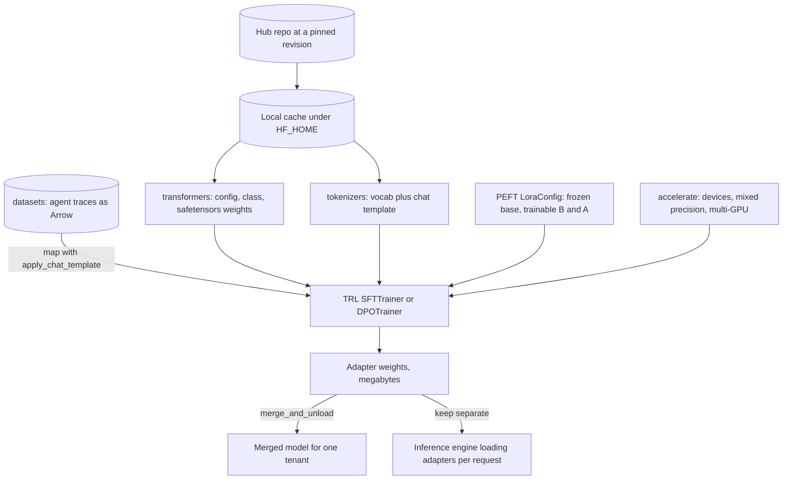

## TL;DR
Hugging Face is how agent teams run and adapt open models: load by name, render tool-calling chats with
the right template, and LoRA-tune a model on agent traces with PEFT and TRL, without per-model glue code.

## For agent builders
- **Why it matters for agents.** When a hosted model is too expensive, too slow or not allowed, the
  replacement is an open model from the Hub. Making it call tools reliably means rendering tool schemas
  with its own chat template and, often, fine-tuning on your agent's successful traces.
- **Where it shows up in your stack.** `transformers` and `tokenizers` for local agent models and evals,
  `datasets` for trace corpora, PEFT and TRL for SFT and DPO on traces, `langchain-huggingface` wrappers
  in LangChain, Hugging Face's own `smolagents` library, and vLLM or SGLang loading the same Hub repos.
- **What you control.** The pinned `revision`, `apply_chat_template` with your tool definitions, loss
  masking to assistant (and tool-call) tokens, LoRA rank and targets, and whether adapters are merged or
  swapped per tenant.
- **What you can skip.** Training tokenizers, writing Accelerate configs by hand for a first run, and
  serving traffic from `generate()`; export to an inference engine instead.

## Why it exists
- **A model is more than a weights file.** You also need matching architecture code, the config (layer
  count, heads, rope settings), the tokenizer with its exact vocabulary and special tokens, and the chat
  template that formats a conversation, including how tool calls and tool results are written.
- **Mismatches fail silently.** Before a common hub each release had its own repository and conventions,
  so swapping models meant rewriting glue. The wrong tokenizer or a missing BOS token produced a model
  that ran but generated garbage, with no error. In an agent, it shows up as tool calls that never parse.
- **Training adds more glue.** Datasets of tens of gigabytes do not fit in RAM as Python lists;
  multi-GPU needs process launching, gradient sync and mixed precision. Full fine-tuning of a 7B model at
  about 16 bytes per parameter (bf16 weights and gradients, fp32 master weights, two fp32 AdamW moments)
  is roughly 112 GB before any activation, more than an 80 GB GPU holds.
- **Preference tuning is easy to get subtly wrong.** DPO and PPO-style RLHF need paired data handling, a
  frozen reference model and specific loss functions.
- **"Write it in plain PyTorch" re-solves this per project.** The libraries put it behind
  `from_pretrained` and a few trainer classes, so the expensive knowledge (correct tokenisation, loss
  masking, sharding) lives in one tested place.

## How it works
### The libraries at a glance
| Library | Job | Agent use |
|---|---|---|
| `transformers` | loads any published architecture and its weights by name | local agent model, judge, evals |
| `tokenizers` | turns text into the exact ids that model expects | token budgets, chat and tool templates |
| `datasets` | streams and memory-maps training data | trace corpora for SFT and DPO |
| `accelerate` | runs the same PyTorch code on one GPU or many | scaling a trace fine-tune |
| `PEFT` | trains small adapters instead of all weights | one adapter per agent or tenant |
| `TRL` | SFT and preference-tuning trainers | tune tool-calling on good versus bad traces |

### transformers
1. **Resolve.** `AutoModelForCausalLM.from_pretrained("org/name")` downloads `config.json` and reads its
   `model_type`.
2. **Pick the class.** It chooses the matching PyTorch class. Task heads are separate classes
   (`...ForSequenceClassification`, `...ForCausalLM`) because one backbone feeds different output layers.
3. **Load weights** (preferably `.safetensors`) into it.

Load-time options and helpers:
- **`device_map="auto"`** (via Accelerate) spreads layers across GPUs and CPU when a model does not fit
  on one device.
- **`dtype`** selects precision at load, e.g. `torch.bfloat16`, or `"auto"` for the checkpoint's stored
  dtype, so no fp32 copy is materialised first. Older releases call it `torch_dtype` (still accepted as a
  deprecated alias).
- **`generate()`** implements the decoding loop with the KV cache, sampling and stopping criteria.
- **`pipeline()`** wraps tokenise-model-decode for quick experiments.

### The Hub and the local cache
- **Name plus `revision`.** Each `from_pretrained` resolves a repository and a `revision` (branch, tag or
  commit hash) to files.
- **Content-addressed cache.** Files download once into a cache under `HF_HOME` and are reused after.
- **Pin a commit hash for reproducibility**, because a branch such as `main` can be rewritten by the
  repository owner, and a changed chat template silently changes how your agent's tools are rendered.
- **Offline mode.** `HF_HUB_OFFLINE=1` resolves loads only from the cache; that is how air-gapped
  deployments work once the cache is pre-populated.

### tokenizers and chat templates
- **Fast tokenizers are Rust**, exposed to Python, because tokenising a large corpus in pure Python is a
  bottleneck.
- **`AutoTokenizer`** loads that exact model's vocabulary and merges and returns offsets for span
  alignment.
- **`apply_chat_template`** renders a list of messages into the model's prompt format with the Jinja
  template stored with the tokenizer. Using it, not hand-concatenating `"User: ...\nAssistant:"`, keeps a
  chat model on-distribution.
- **Tools go through the template too.** Recent `transformers` versions let you pass tool definitions to
  `apply_chat_template` so the model sees them in the format it was trained on. Models that were not
  trained for tool use have no tool section in their template; check before choosing one for an agent.
- **Training new tokenizers** (BPE, WordPiece or Unigram) matters only when you pre-train or adapt a
  vocabulary; for fine-tuning always reuse the base model's tokenizer.
- **Left-pad for batched generation** with decoder-only models (`padding_side="left"`), because
  generation appends to the right end of each row and right padding would put pad tokens between the
  prompt and the new tokens.

### datasets
- **Arrow on disk, memory-mapped.** `load_dataset` stores data as Apache Arrow files, so a 50 GB dataset
  costs little RAM and random access is cheap.
- **Cached preprocessing.** `.map(fn, batched=True)` tokenises in batches and caches the result keyed by
  a fingerprint of the function and inputs, so re-running a notebook does not re-tokenise.
- **Streaming.** `streaming=True` iterates without downloading everything first.

### accelerate
- **`accelerator.prepare(model, optimizer, loader)`** handles device placement, distributed data
  parallel, mixed precision and FSDP/DeepSpeed backends.
- **`accelerate launch`** starts one process per GPU.
- **Your loop stays ordinary PyTorch**; the configuration decides the topology.

### PEFT and LoRA
PEFT freezes the base model and injects small trainable modules. LoRA's update:

```
ΔW = B·A          A is r×k, B is d×r, rank r << d, k
trainable per matrix:  d·k  ->  r·(d+k)
forward:   h = W·x + (α/r)·B·A·x
merge:     W' = W + (α/r)·B·A
```

- **`B` starts at zero**, so at step 0 the adapted model is exactly the base model and training starts
  from known-good behaviour.
- **The `α/r` scale** keeps the update's magnitude roughly stable when you change r.
- **What shrinks.** Optimizer state shrinks proportionally, the saved adapter is megabytes instead of
  gigabytes, and one base can serve many adapters (for example one per agent persona or tenant).
- **Deploy: merge or keep separate.** Merging removes any extra inference cost but fixes one adapter
  into the weights; separate adapters let a server swap them per request.
- **Why LoRA is the default.** Prompt/prefix tuning and IA³ are other PEFT methods, but LoRA adds no
  inference latency once merged.
- **QLoRA** adds a 4-bit quantized frozen base (via bitsandbytes) to fit larger models on one GPU.

### TRL
Trainers built on the `transformers` Trainer; they accept a `peft_config`, so adapters and preference
tuning compose.

| Trainer | Use | Agent data |
|---|---|---|
| `SFTTrainer` | supervised fine-tuning on chat or instruction data; applies the chat template and can compute loss only on assistant tokens | successful traces with tool calls and results |
| `DPOTrainer` | preference pairs; needs a frozen reference model to measure how far the policy moved | a good versus a bad tool choice for the same state |
| reward and online RL trainers | reward modelling, PPO, GRPO | rewards from task success or a verifier |

- **DPO with an adapter** can use the base model with the adapter disabled as the reference, instead of
  loading a second copy.
- **TRL's API changes frequently** across releases, so pin the version and read its docs.

## Diagram
The path of a LoRA fine-tune on agent traces: a pinned Hub repository feeds the model and tokenizer,
`datasets` feeds templated traces, TRL trains only the adapter, and the result is merged or served.



## Examples
### Render a tool-calling trace exactly as the model sees it
Before fine-tuning or serving an open model in an agent, print one rendered trace. If the tool schema or
the tool result does not appear in the model's native format, the agent will not call tools reliably.

```python
from transformers import AutoTokenizer

tok = AutoTokenizer.from_pretrained("Qwen/Qwen2.5-0.5B-Instruct")   # pin revision= in production
tools = [{
    "type": "function",
    "function": {
        "name": "get_order_status",
        "description": "Look up an order by id",
        "parameters": {"type": "object",
                       "properties": {"order_id": {"type": "string"}},
                       "required": ["order_id"]},
    },
}]
messages = [
    {"role": "system", "content": "You are a support agent. Use tools for order data."},
    {"role": "user", "content": "Where is order A-1042?"},
]
prompt = tok.apply_chat_template(messages, tools=tools, add_generation_prompt=True, tokenize=False)
print(prompt)                       # check: tool schema present, roles marked, generation prompt at end
print(len(tok(prompt).input_ids))   # tool schemas cost tokens on every agent step
```

### LoRA SFT of a small chat model with TRL and PEFT
Argument names follow recent TRL releases; check them against your pinned version. For an agent, each
row is a successful trace: user turn, assistant tool call, tool result, final answer.

```python
from datasets import load_dataset
from peft import LoraConfig
from trl import SFTConfig, SFTTrainer

# Each row: {"messages": [{"role": "user", ...}, {"role": "assistant", ...}]}
ds = load_dataset("json", data_files="support_chats.jsonl", split="train")
ds = ds.train_test_split(test_size=0.05, seed=0)

peft_cfg = LoraConfig(
    r=16, lora_alpha=32, lora_dropout=0.05,
    target_modules=["q_proj", "k_proj", "v_proj", "o_proj"],  # names depend on architecture
    task_type="CAUSAL_LM",
)
args = SFTConfig(
    output_dir="out/support-lora",
    per_device_train_batch_size=4, gradient_accumulation_steps=4,   # effective batch 16
    learning_rate=2e-4, num_train_epochs=2, bf16=True,
    logging_steps=10, eval_strategy="steps", eval_steps=100,
)
trainer = SFTTrainer(
    model="Qwen/Qwen2.5-0.5B-Instruct",   # loaded via transformers; chat template from its tokenizer
    args=args, train_dataset=ds["train"], eval_dataset=ds["test"],
    peft_config=peft_cfg,
)
trainer.train()
trainer.save_model()   # writes only adapter weights (adapter_model.safetensors) plus config
```

| Quantity | Value |
|---|---|
| Full update, one 4096×4096 projection | 16.8M parameters |
| LoRA at r=16 | 16×(4096+4096) = 131,072, under 1% of that matrix |
| Update scale with α=32 | α/r = 2 |
| Effective batch | per-device batch × accumulation steps × GPUs; on 4 GPUs this config trains with batch 64 |

- **Revisit learning rate when topology changes**, because the effective batch changes with GPU count.
- **`trainer.save_model()` writes megabytes** of adapter weights.

### Merge the adapter for serving
To serve without PEFT at runtime, load the base, attach the adapter and call `merge_and_unload()`.

```python
import torch
from transformers import AutoModelForCausalLM, AutoTokenizer
from peft import PeftModel

base_id = "Qwen/Qwen2.5-0.5B-Instruct"
base = AutoModelForCausalLM.from_pretrained(base_id, dtype=torch.bfloat16)
model = PeftModel.from_pretrained(base, "out/support-lora")   # attach adapter
merged = model.merge_and_unload()                             # W' = W + (α/r)·B·A, PEFT gone
merged.save_pretrained("out/support-merged")                  # safetensors by default
AutoTokenizer.from_pretrained(base_id).save_pretrained("out/support-merged")  # ship template too
```

### Worked scenario: what fits on one 80 GB GPU for a 7B agent model
Rough weight-and-optimizer memory before activations (illustrative orders of magnitude):

| Approach | What is stored | Approx. memory |
|---|---|---|
| Full fine-tune, mixed-precision AdamW | ~16 bytes per parameter | ~112 GB, does not fit |
| LoRA on a bf16 base | 2 bytes per frozen parameter + tiny adapter and its optimizer state | ~14 GB + adapter |
| QLoRA on a 4-bit base | ~0.5 bytes per frozen parameter + adapter | ~3.5 GB + adapter |

Activations for the batch come on top in every row, which is why batch size and sequence length still
decide whether a LoRA run fits. Agent traces are long (tool schemas, calls and results), so sequence
length is usually the binding constraint.

## Production patterns
- **Fine-tune on curated agent traces, not raw logs.** Keep only traces that passed your eval or a human
  review, render each with `apply_chat_template` and the same tool definitions the agent uses, and hold
  out a set of tasks. Monitor tool-call parse rate and task success on the held-out tasks after training.
- **Pin and mirror every artifact.** Pass `revision="<commit sha>"` to each `from_pretrained`, pre-fill
  the cache with `huggingface_hub.snapshot_download`, and run with `HF_HUB_OFFLINE=1`. Monitor for any
  load that reaches the network in production.
- **Ban unvetted remote code.** Keep `trust_remote_code=False` by default; when a model needs it, review
  the code and pin it by commit hash. Alert on any config change that flips it.
- **Lock library versions per training job.** Pin `transformers`, `peft`, `trl`, `datasets` and
  `accelerate` in a lockfile next to the config, because renamed arguments or changed defaults silently
  alter training. Record versions with every run.
- **Mask loss to assistant tokens and verify it.** Use your TRL version's assistant-only or
  completion-only loss option, then decode one batch and check that prompt and tool-result positions have
  label -100 (the ignore index). Watch held-out task metrics, not training loss.
- **Merge for one tenant, swap for many.** Merge with `merge_and_unload()` when one adapter serves all
  traffic; keep adapters separate on an engine that loads LoRA per request (for example vLLM with
  `--enable-lora`) for adapter-per-tenant. Monitor per-adapter latency and quality.
- **Export to an inference engine for traffic.** Use `generate()` for evals and batch jobs, and serve
  concurrent agents from vLLM or SGLang behind an OpenAI-compatible endpoint, so the agent code does not
  change. Monitor time to first token and throughput under load.

## Trade-offs
- **Fine-tuned open model vs prompted hosted model.** A LoRA on traces can match a narrow agent task at
  lower cost and latency, and keeps data in-house, but you own evals, serving and every base-model
  upgrade. Prompting a hosted model wins while the task still changes weekly.
- **Instant access vs supply-chain risk.** `from_pretrained` by name reaches thousands of models but
  fetches weights at runtime (and, with `trust_remote_code=True`, Python code too) from whatever the
  branch currently holds. Pin a revision hash and mirror artifacts once you leave experimentation.
- **Trainer defaults vs control.** Trainer classes remove boilerplate and encode correct defaults but
  hide the loop; for a custom loss or schedule, subclassing can be harder than writing the PyTorch loop.
- **LoRA efficiency vs capacity.** LoRA cuts memory and storage dramatically and allows many adapters per
  base, but can underfit tasks needing broad behaviour change, where full fine-tuning (if affordable)
  does better.
- **`generate` simplicity vs serving throughput.** `transformers.generate` is fine for experiments and
  batch jobs; many concurrent users are better served by an inference engine such as vLLM or SGLang,
  which add continuous batching and a paged KV cache.
- **Runs vs runs fast.** `device_map="auto"` makes a too-large model run, but layers offloaded to CPU
  make generation dramatically slower; it trades failure for latency, acceptable only offline.

## Pitfalls
- **Hand-formatted prompts instead of `apply_chat_template`.** The model answers, but quality is oddly
  poor, it ignores the system prompt, or keeps generating past where it should stop. With tools, it
  writes tool calls in a format your parser rejects.
- **Training and serving with different tool renderings.** Traces rendered one way at training time and
  tools passed another way at inference. Symptom: tool-call accuracy on evals drops after deployment.
  Fix: one function renders both, through the same template and tool list.
- **Loss on prompt tokens as well as completions during SFT.** The model learns to imitate users (and
  tool outputs). Symptom: outputs that echo or continue the question instead of answering it.
- **`trust_remote_code=True` on an unvetted repository.** It executes arbitrary Python from the hub at
  load time; the symptom may be nothing visible at all, which is the danger.
- **Unpinned library versions.** TRL or transformers upgrades rename arguments or change defaults, and a
  script that worked last month fails or silently trains differently.
- **Right-padding batched prompts for a decoder-only model in `generate()`.** Shorter prompts give
  degraded or nonsensical outputs and transformers warns that right-padding was detected. Fix:
  `tokenizer.padding_side = "left"` for generation.
- **Mismatched tokenizer and model** (e.g. new special tokens without resizing embeddings). Symptom:
  index errors on new token ids, or generations that never emit the end-of-turn token.

## When to use
- **Use `transformers` + `tokenizers`** whenever you run an open-weight model in Python for experiments,
  offline batch work, evaluation, an LLM judge or embedding.
- **Use `datasets`** when training or eval data (agent traces, eval tasks) exceeds a few hundred
  megabytes or needs reproducible preprocessing.
- **Use PEFT + TRL** when prompting and retrieval have plateaued and you have a few thousand high-quality
  examples of the target behaviour; use Accelerate when one GPU is not enough.
- **Avoid** serving high-concurrency traffic from this stack; export the model (merged weights or base
  plus adapter) to an inference engine.
- **Measure** eval loss and a task metric on a held-out set (for agents, tool-call validity and task
  success), not training loss.
- **Interviews:** LoRA's parameter arithmetic, why chat templates matter, and when to fine-tune instead
  of prompt.

## Role lens
- **Engineer:** Loads checkpoints with correct dtype and template, writes SFT/DPO jobs with PEFT, and
  debugs tokenisation, loss masking and version drift.
- **Architect:** Decides fine-tune versus prompt-and-retrieve, sets the hub mirroring and revision-pinning
  policy, and chooses adapter-per-tenant versus merged models for serving.
- **FDE:** Fine-tunes or evaluates an open model inside a customer's air-gapped environment, which means
  pre-downloading weights, datasets and wheels, and loading them offline.

## Check yourself
**Q:** A team fine-tuned a 7B instruct model with LoRA on 5,000 support transcripts. Training loss fell
nicely, but in testing the model rambles, sometimes writes the customer's next message, and ignores the
system prompt. What do you check first?
**A:** These symptoms point at data formatting, not capacity. First, was the data rendered with the base
model's own chat template via `apply_chat_template`, including its end-of-turn token? If not, the model
learned a new format that conflicts with its instruction tuning and never learned to stop. Second, was
loss masked to assistant tokens only? Training on user turns teaches the model to write user turns. Third,
was the system prompt present in training examples? Then verify inference uses the same template. Only
after formatting is correct would I tune rank, learning rate or epochs, and I would judge with a task
metric on held-out conversations, since falling training loss says little about behaviour.

## Interview questions
### What does `from_pretrained` actually resolve and load, and why does that matter?
- **It resolves a repository plus a `revision`** to files, downloads them once into the cache under
  `HF_HOME`, reads `config.json` for `model_type`, picks the matching class and loads the weights.
- **The tokenizer and chat template travel separately**, so loading a model with the wrong tokenizer runs
  without error but generates garbage.
- **A branch such as `main` can be rewritten**, so production code pins a commit hash.

### Walk through the LoRA parameter arithmetic for a 4096 by 4096 projection at rank 16.
- **Full update:** 4096 × 4096 is about 16.8M trainable parameters for that one matrix.
- **LoRA:** r·(d+k) = 16 × (4096 + 4096) = 131,072, under 1% of the matrix, and `B` starts at zero so
  step 0 equals the base model.
- **Scale:** with `lora_alpha=32` the update is multiplied by α/r = 2, which keeps magnitude stable if
  you later change r.

### When would you fine-tune an open model for your agent, and when would you not?
- **Not while prompting and retrieval still improve the task metric**, because both are cheaper to
  change than weights, and a hosted model with good tool use may already be enough.
- **LoRA by default** when cost, latency or data residency force an open model: far less memory,
  megabyte-sized adapters, many adapters per base and no latency once merged.
- **Full fine-tuning** when the task needs broad behaviour change that LoRA underfits and you can afford
  roughly 16 bytes per parameter of training memory.

### After LoRA SFT on agent traces, the model's tool calls fail to parse 20 percent of the time in production but not in evals. What do you check?
- **Rendering parity:** are tools passed to `apply_chat_template` at inference exactly as they were when
  the traces were rendered for training, with the same pinned tokenizer revision?
- **Serving path:** does the inference engine apply the same chat template and tool parser as your eval
  harness, or a default one?
- **Data coverage:** do training traces include the tools and argument shapes now failing? Log failing
  raw outputs and diff them against the training format.

### A customer runs in an air-gapped network. How do you deliver a fine-tuned open model?
- **Pre-fetch everything outside:** `huggingface_hub.snapshot_download` at a pinned commit for the base,
  plus the adapter or merged weights, the tokenizer files, datasets and Python wheels.
- **Load offline inside:** populate the cache, set `HF_HUB_OFFLINE=1` so loads resolve only from it, and
  keep `trust_remote_code=False` unless the code was reviewed.
- **Verify with a smoke test** that generates with the chat template and stops at the end-of-turn token.

### Does a 7B full fine-tune fit on an 80 GB GPU? What are the alternatives?
- **No:** about 16 bytes per parameter for mixed-precision AdamW is roughly 112 GB before activations.
- **LoRA on a bf16 base** stores about 2 bytes per frozen parameter, roughly 14 GB plus the adapter.
- **QLoRA on a 4-bit base** is roughly 3.5 GB plus the adapter; in every case activations still decide
  the batch size and sequence length that fit.

## Quiz
### Q: Why does LoRA reduce GPU memory during fine-tuning so much more than it reduces inference memory?
- [ ] Because LoRA quantizes the base model to 4 bits automatically
- [x] Because gradients and optimizer states are only kept for the small adapter matrices, not the frozen base
- [ ] Because LoRA removes the KV cache during training
- [ ] Because the adapter replaces the attention layers entirely
> Training memory is dominated by gradients and AdamW states for every trainable weight. Freezing the base
> removes those for almost all parameters; the frozen weights still must be loaded, so inference barely changes.

### Q: What does `datasets` gain by storing data as memory-mapped Arrow files?
- [ ] It compresses text so tokenisation is faster
- [ ] It guarantees the data is deduplicated
- [x] Large datasets can be accessed randomly without loading them fully into RAM
- [ ] It encrypts the data for compliance
> Memory mapping lets the operating system page in only the rows you touch, so a dataset far larger
> than RAM is usable. Compression and deduplication are separate concerns that Arrow does not imply.

### Q: Why use `tokenizer.apply_chat_template` instead of building the prompt string yourself?
- [ ] It makes the prompt shorter so it costs fewer tokens
- [ ] It is required for the model to accept a system prompt at all
- [x] It reproduces the exact special tokens and turn format the model was trained on
- [ ] It automatically removes prompt-injection attempts from user messages
> Chat models are trained on one specific format of role markers and end-of-turn tokens. Deviating keeps
> the model running but off-distribution, which degrades quality and stopping behaviour without any error.

## Use cases & projects
### Use cases
- **Replacing a hosted model with an open one.** When cost, latency or data rules rule out a hosted API,
  teams load an open model from the Hub and make it call tools with its own chat template.
- **Fine-tuning on agent traces.** PEFT and TRL turn successful tool-calling transcripts into a LoRA
  adapter that calls your tools more reliably than the base model.
- **Offline agent evals.** `datasets` holds trace corpora and eval sets, and `transformers` runs candidate
  models over them before a model swap ships.
- **Per-tenant adapters.** One base model with swapped LoRA adapters serves several agents or customers
  from the same GPUs.

### Mini project
**Render and test tool calls with an open model (2-3 hours).**
- **Goal:** get a small open instruct model to emit parseable tool calls for two tools.
- **Steps:** pick a Hub model whose chat template supports tools and pin its `revision`; define two tool
  schemas; render prompts with `apply_chat_template` and inspect the raw string; generate for 20 test
  requests; parse the tool calls and count how many are valid against the schema.
- **Done when:** you have a parse-rate number, examples of failures, and a note on whether the template,
  the prompt or the model caused them.
