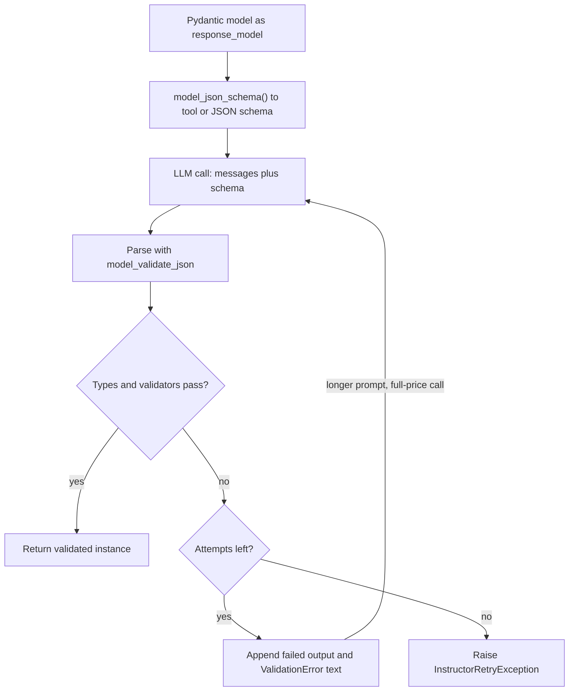

## TL;DR
Instructor wraps an LLM client so a call takes a Pydantic model as `response_model` and returns a
validated instance. When validation fails it sends the error back and retries, replacing the brittle
"ask for JSON and `json.loads` it" loop every codebase rewrites.

## Why it exists
- **Most LLM features are extraction or classification.** Pull an invoice's line items, label a
  ticket's intent, turn an email into a calendar event. Downstream code wants a typed object, not prose.
- **"Respond in JSON" plus `json.loads` fails in many distinct ways.** A Markdown fence or preamble
  around the JSON; `"twelve"` instead of `12`; an invented enum value; a missing required field; a date
  in the wrong format; JSON truncated because the output hit the token limit.
- **Every team writes the same bundle by hand.** Build a schema from the type, put it in the request,
  strip fences, parse, validate, and on failure tell the model what was wrong and try again.
- **Provider-native structured output closes only part of the gap.** JSON mode, strict schemas and
  forced tool calls can guarantee syntactically valid JSON of the schema's shape. They cannot enforce
  *business* rules: `end_date >= start_date`, a cited quote actually in the source, line items summing
  to the total.
- **Those rules live in Pydantic validators.** Only a validate-then-retry loop can use them to correct
  the model. Instructor is that loop, packaged once, across many providers.

## How it works
### Patching the client
- **Wrap an existing SDK client:** `instructor.from_openai(OpenAI())` or
  `instructor.from_anthropic(Anthropic())`. Recent versions also offer a `from_provider("openai/...")`
  shortcut.
- **Same call signature, a few extra kwargs,** chiefly `response_model` and `max_retries`.
- **It wraps rather than replaces the SDK** *because* the SDK already handles auth, HTTP, streaming and
  provider quirks; Instructor only owns the schema and validation layer.

### Schema in, object out
1. **Schema generation.** Pydantic's `model_json_schema()` turns your `BaseModel` into JSON Schema,
   including field descriptions, enums from `Literal` or `Enum`, and nested models. The class docstring
   and each `Field(description=...)` become prompt text the model reads, which is why good descriptions
   matter (measure it on your own eval set).
2. **Mode selection.** The `mode` decides how the schema reaches the model (table below). Tool calling is
   preferred where available *because* providers train models to emit well-formed tool arguments.
3. **Parse and validate.** The reply's arguments are parsed with `model_validate_json`, which runs type
   coercion and every `field_validator` and `model_validator`.
4. **Reask.** If validation raises, Instructor appends the model's previous output and the
   `ValidationError` text as a new message and calls again. The error is the correction signal: a
   validator raising `ValueError("end_date is before start_date")` tells the model precisely what to fix.
5. **Give up cleanly.** After the last attempt it raises an `InstructorRetryException` carrying the
   number of attempts and the last completion.

| Mode | How the schema is sent |
|---|---|
| `Mode.TOOLS` | Single tool definition, tool call forced (the usual default for OpenAI) |
| Provider tool modes | Equivalent for Anthropic and others |
| `Mode.JSON` | The provider's JSON mode |
| `Mode.MD_JSON` | Asks for JSON in a Markdown block, for models with no native support |

### Retries and `max_retries`
- **Retries are driven by Tenacity,** so `max_retries` accepts an integer or a full Tenacity retry policy.
- **An integer means total attempts.** It becomes a stop-after-N-*attempts* rule, counting all calls
  including the first, not extra reasks on top of it (check this against the version you pin).

### What a reask actually sends
- **In tool mode, retry request =** the original messages + an assistant message with the failed tool
  call + a message carrying the `ValidationError` text and an instruction to fix it.
- **Every retry re-sends the whole prompt *and* grows it,** so retry *k* costs more input tokens than
  the first call.
- **Long documents hurt most:** reasking over a 20k-token contract repeats the 20k tokens each time.

### Expected retry cost
If each attempt failed independently with probability *p* and you allow *N* attempts:

```
expected calls   = 1 + p + p² + … + p^(N−1)
residual failure = p^N
p = 0.1, N = 3  ->  ~1.11 calls, 0.1% residual failures
```

- **Real failures are *not* independent.** An input that defeats the model once tends to defeat it again
  with the same error, so the residual rate is far higher than p^N.
- **Most retry spend lands on a small set of hard inputs.** Measure retry success rate per attempt
  number; if attempt two rarely fixes what attempt one broke, lower `max_retries` and route failures to
  review or a stronger model.

### Giving validators something to check against
- **Validators only see the data you give them.** To check an extracted quote appears in the source,
  pass the source as a context dict at call time (`context=` in recent versions, `validation_context=`
  in older ones). It reaches validators through Pydantic's `ValidationInfo.context`.
- **This turns a prompt instruction into an enforced rule:** "the quote must be verbatim" now triggers a
  reask.
- **Make fields the source may omit `Optional`.** A required field forces the model to produce
  *something*, and that something is a plausible invention.

### Beyond a single object
| Method | Returns | Use for |
|---|---|---|
| `create_partial` | A model whose fields fill in as tokens arrive | UIs rendering a form progressively |
| `create_iterable` | A stream of objects | Every person mentioned in a document |
| `create_with_completion` | Parsed object + raw provider response | Token usage and logging |

### What it is not
- **Instructor does not constrain decoding.** The model can still emit anything; Instructor detects bad
  output after the fact and pays for another call.
- **Constrained decoding is a different tool.** Libraries such as Outlines mask tokens during generation
  so invalid output is impossible, but that needs access to the logits, which hosted APIs do not expose.

## Diagram
Follow one `create` call: the schema goes out with the prompt, and every validation failure loops back as
a longer request until it passes or `max_retries` attempts are used up.



## Examples
### Meeting extraction with a cross-field rule
Extracting a meeting from an email, with a business rule the schema alone cannot express.

```python
from datetime import date
from typing import Literal
import instructor
from openai import OpenAI
from pydantic import BaseModel, Field, model_validator

class Meeting(BaseModel):
    title: str = Field(description="Short title, max 8 words")
    start: date
    end: date
    kind: Literal["internal", "customer", "interview"]
    attendees: list[str] = Field(description="Email addresses only")

    @model_validator(mode="after")
    def end_not_before_start(self):
        if self.end < self.start:
            raise ValueError(f"end {self.end} is before start {self.start}; re-read the dates")
        return self

client = instructor.from_openai(OpenAI())

meeting, raw = client.chat.completions.create_with_completion(
    model="gpt-4o-mini",                 # any tool-calling model
    response_model=Meeting,
    max_retries=3,                       # at most 3 calls: the first try plus up to 2 reasks
    messages=[{"role": "user", "content":
        "Offsite with Acme from 3 to 5 March 2025. Invite ana@acme.com and raj@us.io."}],
)
print(meeting.model_dump())
print(raw.usage.total_tokens)            # recent versions sum usage across all attempts here
```

- **If the first reply sets `end` before `start`,** the validator's message goes back and the second
  call usually fixes it.
- **If all three attempts fail,** the exception tells you which validation kept failing.
- **Usage accounting:** recent versions accumulate token usage from every attempt into the returned
  completion's `usage` for the major providers; confirm that for your version and provider before you
  build cost reporting on it.

### Grounded quotes via validation context
The validator rejects any quote not found verbatim in the source, which forces a reask.

```python
from pydantic import BaseModel, ValidationInfo, field_validator

class Evidence(BaseModel):
    claim: str
    quote: str

    @field_validator("quote")
    @classmethod
    def quote_in_source(cls, v: str, info: ValidationInfo) -> str:
        source = (info.context or {}).get("source", "")
        if v not in source:
            raise ValueError("quote is not verbatim in the source; copy it exactly")
        return v

contract = open("contract.txt").read()
ev = client.chat.completions.create(       # client from the example above
    model="gpt-4o-mini",
    response_model=Evidence,
    max_retries=2,
    context={"source": contract},           # validation_context= on older versions
    messages=[{"role": "user", "content": f"What is the termination notice period?\n\n{contract}"}],
)
```

### Worked scenario: what retries cost on a long contract
Illustrative token counts for one 20k-token contract that fails validation on every attempt, with
`max_retries=3`.

| Attempt | Input tokens sent | Why |
|---|---|---|
| 1 | ~20,000 | Prompt plus contract |
| 2 | ~20,600 | Same, plus failed tool call (~500) and error text (~100) |
| 3 | ~21,200 | Grows again by the second failure |
| **Total** | **~61,800** | About 3× a single call, for an input that still fails |

- **Under independence** (p = 0.1) the average would be ~1.11 calls, about 22k tokens per contract.
- **In practice** the same hard contracts fail repeatedly, so a few inputs dominate spend; cap retries and
  escalate them.

## Production patterns
- **Cap retries with an explicit policy.** For long inputs pass a small integer or a Tenacity policy,
  e.g. `max_retries=Retrying(stop=stop_after_attempt(2))` with both names imported from `tenacity`.
  Monitor retries per request and cost per
  successful extraction by route.
- **Escalate instead of looping.** Catch `InstructorRetryException`, then send the input to a stronger
  model or a human-review queue with the last completion attached. Monitor escalation rate and the
  validators that triggered it.
- **Log every attempt.** Use `create_with_completion` for usage, and Instructor's hooks (for example
  `client.on("parse:error", handler)`) to record each failed attempt and its `ValidationError`. Reconcile monthly
  against the provider invoice.
- **Ground with context validators.** Pass the source via `context=` and check quotes, IDs or totals
  against it in validators, so hallucinated values cause a reask. Monitor the rate of grounding failures.
- **Gate schema changes on an eval set.** Field names, docstrings and descriptions are prompt text; rerun a
  labelled set before merging a model change. Track first-pass validation rate, since a fall signals
  prompt or model drift.

## Trade-offs
- **Less glue vs another dependency.** One `response_model` argument replaces schema, parsing and retry
  glue, but mode defaults and provider adapters change between releases; pin it and test upgrades.
- **Arbitrary rules vs extra calls.** Validate-and-reask enforces any Python rule, at the cost of extra
  full LLM calls. When failures are mostly syntactic, native strict structured output removes them for
  free and the reask loop sits idle.
- **No logit access needed vs no guarantee.** Hosted APIs work, but nothing guarantees validity. If you
  self-host and need validity on the first pass every time, constrained decoding (Outlines, vLLM guided
  decoding) wins.
- **Rich schemas vs tokens.** Rich Pydantic schemas improve extraction quality, but deep nesting and long
  descriptions add input tokens on every call; for high-volume classification, a flat model with a
  `Literal` field is cheaper.

## Pitfalls
- **High `max_retries` with no budget.** One pathological input triggers several full-price calls.
  Symptom: a cost spike traced to a handful of requests with repeated identical errors. Fix: cap
  attempts per route and escalate.
- **Vague validator messages like "invalid".** The model cannot act on them. Symptom: retries returning
  the same wrong value each time. Fix: say what is wrong and how to fix it.
- **Cost reporting that misses failed attempts.** Per-call logs, or a provider adapter that does not
  accumulate usage across retries, make failed attempts vanish. Symptom: dashboards under-report against
  the provider invoice. Verify with a forced validation failure, or log each attempt through hooks.
- **Answer field before the reasoning field.** Field order is generation order, so the answer is
  committed before the reasoning exists and accuracy drops on harder cases. Fix: declare a `reasoning`
  field first.
- **Every field required when the source often omits some.** The model must fill them. Symptom:
  plausible but absent values (a made-up phone number, a guessed date) that pass validation.
- **Treating a validated object as true.** Validation proves the shape and your rules, not that the facts
  are in the source. Symptom: confident, well-typed hallucinations in evals.

## When to use
- **Use when:** you call hosted LLMs and need typed objects with rules beyond what a JSON schema can say,
  especially across more than one provider.
- **Consider the SDK alone when:** your only need is valid JSON of a fixed shape from one provider; native
  structured output (for example OpenAI's `parse` helper) may be enough without another dependency.
- **Avoid when:** you self-host and need hard guarantees or very low latency; prefer constrained decoding.
- **Measure:** first-pass validation rate, retries per request, cost per successful extraction, and the
  fix rate of each retry attempt. A falling first-pass rate is an early signal of prompt or model drift.
- **Interviews:** explain why validation-plus-reask and constrained decoding solve different halves of
  the structured-output problem.

## Role lens
- **Engineer:** Writes the Pydantic models, validators with actionable error messages, and retry limits,
  and logs every attempt with its token usage.
- **Architect:** Decides where structure is enforced: provider strict mode, reask loops or constrained
  decoding, and sets the retry and cost budget per feature.
- **FDE:** Turns a customer's messy documents into a typed schema quickly, using validators to encode
  their business rules so extraction errors surface as explicit failures.

## Check yourself
**Q:** Your extraction pipeline uses provider strict JSON mode and still produces wrong records. A
colleague says adding Instructor's retries is pointless because the JSON is already valid. Are they right?
**A:** Partly. Strict mode guarantees syntax and schema shape, so Instructor's reask will never fire on
those failures. But the wrong records are semantic: dates swapped, totals not matching line items,
values not present in the source. Those can be expressed as Pydantic validators, and Instructor feeds
each validator's message back so the model can correct itself. The trade is extra calls per failure, so
you would cap retries, measure first-pass and post-retry accuracy on a labelled set, and keep a
human-review path for records that still fail validation.

## Interview questions
### What does Instructor add on top of a provider SDK, and why not just call `json.loads`?
- **It packages the validate-then-reask loop.** It builds a schema from a Pydantic model, sends it as a
  tool or JSON schema, parses and validates the reply, and on failure sends the `ValidationError` back.
- **`json.loads` only checks syntax.** It misses Markdown fences, wrong types, invented enum values,
  missing fields and every business rule, so each team ends up rewriting the same glue.
- **It wraps rather than replaces the SDK,** so auth, HTTP, streaming and provider quirks stay with the
  client you already use.

### Extraction retries are spiking cost on one route. How do you debug it?
- **Find who pays.** Log every attempt with its usage and the `ValidationError` that triggered the reask,
  then group by input; a few hard documents usually dominate spend.
- **Check whether retries fix anything.** If attempt two rarely succeeds where attempt one failed, the
  failures are correlated, so lower `max_retries` to 2 and escalate.
- **Read the validator messages.** A vague "invalid" gives the model nothing to act on; rewrite it to say
  what is wrong and how to fix it.

### When would you choose constrained decoding over Instructor?
- **When you self-host and need validity on the first pass.** Constrained decoding (Outlines, engine
  guided decoding) masks invalid tokens, so no retry is ever needed.
- **When latency is tight.** Every Instructor reask is another full LLM call, which multiplies tail
  latency.
- **Instructor still wins on hosted APIs and business rules,** because it needs no logit access and can
  enforce any Python check, such as line items summing to the total.

### How do you budget the token cost of retries on long inputs?
- **Retries re-send and grow the prompt.** For a 20k-token contract that fails every time with
  `max_retries=3`, illustrative input is ~20,000 + ~20,600 + ~21,200, about 61,800 tokens.
- **Independence math is optimistic.** With p = 0.1 and three attempts the expected count is ~1.11 calls,
  but hard inputs fail repeatedly, so the real cost sits in a small tail.
- **So** cap retries per route, catch `InstructorRetryException`, and route the input to a stronger model
  or human review instead of looping.

### How do you stop well-typed hallucinations in extracted fields?
- **Ground validators in the source.** Pass the document as `context=` and reject any quote or ID not
  found in it, which turns "must be verbatim" into a reask.
- **Make omittable fields `Optional`.** A required field forces the model to invent a plausible value.
- **Order fields for reasoning.** Put reasoning before the answer, because field order is generation order.

## Quiz
### Q: What does Instructor do when the model's output fails Pydantic validation?
- [ ] It masks invalid tokens and resamples only the failing field
- [x] It sends the validation error back to the model in a new message and calls again, up to max_retries
- [ ] It silently fills missing fields with their Pydantic defaults and returns the object
- [ ] It switches automatically to a larger model for the next attempt
> Instructor works on hosted APIs without logit access, so it cannot mask tokens. It reasks: the
> ValidationError text becomes a corrective message, and each retry is a full new LLM call.

### Q: Why is the tool-calling mode usually preferred over plain JSON-in-prompt mode?
- [ ] Tool calls are billed at a lower token rate than normal completions
- [ ] Tool calls let Instructor skip Pydantic validation entirely
- [x] Providers train models to emit well-formed arguments for declared tools, so first-pass validity is higher
- [ ] JSON-in-prompt mode cannot represent nested models
> Tool modes send the schema as a tool definition the provider is trained to honour, which reduces
> malformed output. Validation still runs afterwards; nothing about billing or nesting differs.

### Q: Which requirement can Instructor enforce but provider strict schema mode alone cannot?
- [ ] That a field is an integer rather than a string
- [ ] That an enum field only takes listed values
- [x] That the sum of extracted line items equals the stated invoice total
- [ ] That every required field is present
> Types, enums and required fields are expressible in JSON Schema and strict mode enforces them.
> A cross-field arithmetic rule needs code, which lives in a Pydantic validator that drives the reask.
