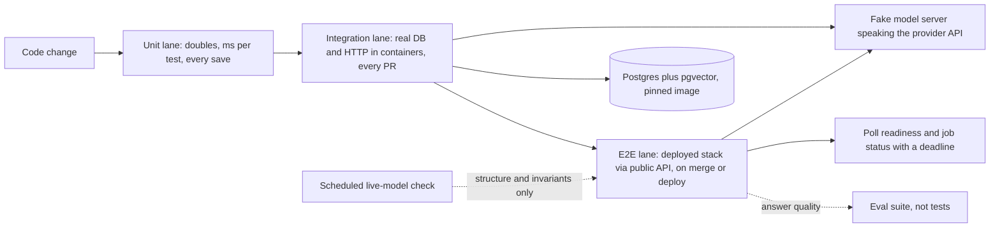

## TL;DR
Integration tests run your code against real dependencies (Postgres with pgvector, Redis, a real HTTP
stack); end-to-end tests drive the deployed system through its public interface. Keep fewer of each going
up, because some failures exist only there.

## Why it exists
- **Unit tests only prove logic given your assumptions.** Doubles check your code against your model of
  the outside world; integration and end-to-end tests check that model against reality.
- **A RAG service with perfect unit tests can fail on its first real query:**
  - the fake vector store returned exactly *k* results, but the real approximate index with a tenant
    filter returns fewer;
  - the fake database accepted 1,536-dimensional vectors into a column declared for 768;
  - the SQL the ORM generates differs from what the mocked repository implied;
  - the migration that creates the index was never run in tests;
  - the streaming endpoint works in isolation, but the reverse proxy buffers the stream.
- **None of these are logic bugs.** They are disagreements between your code and the real systems it
  touches, and a double cannot reveal them because the double *is* your assumption.
- **"Test everything end to end against staging" fails the other way.** End-to-end runs are slow (minutes,
  not milliseconds), depend on shared state others change, fail for unrelated reasons (a network blip, a
  model rate limit, a redeploy), and rarely say *where*. A suite built mainly from them becomes slow,
  flaky and ignored.
- **The test pyramid is the compromise:** many fast unit tests for logic, fewer integration tests at each
  real boundary, and a thin layer of end-to-end tests for the critical user journeys.

## How it works
### Where the lines are
| Level | What runs | Typical cost |
|---|---|---|
| **Unit** | one piece of your code, collaborators replaced by doubles | milliseconds per test |
| **Integration** | your code plus one or more *real* collaborators you control in the test: a database in a container, a real HTTP client against a local server, the real framework routing and serialisation | usually seconds per test, mostly startup |
| **End-to-end** | the assembled system, deployed roughly as in production, exercised only through its public interface (HTTP API, UI, queue) | minutes per journey |

An end-to-end test checks a full journey: upload a document, ask a question, get a cited answer.

### Real dependencies, disposable
- **Testcontainers** (with a Python library) starts a throwaway Docker container from a pinned image for
  the duration of a fixture, waits until it is ready, and gives you its connection URL.
- **Same engine as production**, not SQLite or an in-memory imitation, because dialect, indexing and
  extension behaviour are exactly what you are trying to verify.
- **Docker Compose** does the same for a multi-service stack.
- **Scope the container per session** and isolate each test within it, because container startup is the
  expensive part.
- **Under pytest-xdist, "per session" means per worker process**, so eight workers start eight databases.
  That is usually fine, and it is also why tests must not assume they share rows with any other test.

### Isolation inside a shared dependency
Each option has its own failure mode. Never rely on test order.

| Option | Speed | Breaks when |
|---|---|---|
| Wrap each test in a transaction and roll back | fast | the code commits or uses several connections |
| Unique namespace per test (tenant ID, schema or collection name) | medium | rarely; works across connections and services |
| Truncate tables between tests | slower | simple, but serialises tests on shared tables |

### The model in the loop
The LLM breaks the usual playbook, because it is non-deterministic, paid and rate-limited. Choices for
integration and e2e tests:
1. **A fake model server** that speaks the provider's HTTP API and returns scripted replies. The full HTTP
   path, SDK, retries and parsing run for real; only the model is fixed.
2. **Record and replay:** capture real responses once (cassette libraries such as vcrpy do this for HTTP)
   and replay them, refreshing deliberately.
3. **Live calls**, kept few, run on a schedule or before release, asserting structure and invariants
   (valid JSON, cited document IDs exist) rather than exact text.
- **Judging answer *quality* belongs in the eval suite**, not the test suite.

### End-to-end tests that are not flaky
Most e2e flakiness is self-inflicted, and each cause has a mechanical fix:
- **Starting before the system is ready.** Wait on a readiness endpoint that checks dependencies, not on
  a fixed sleep, because startup time varies with the CI machine.
- **Racing asynchronous work.** Ingestion in a RAG system is usually a background job, so "upload, then
  immediately ask" sometimes runs before indexing finishes.
  - Poll for the observable outcome (the document's status is `indexed`) with a deadline, and fail with
    the last status seen.
  - A guessed sleep is either too short on a slow day or wasteful on every run.
- **Shared data.** Create uniquely named tenants, users and documents per run, so concurrent runs and
  leftovers from crashed runs cannot collide; clean up best-effort, but never depend on cleanup.
- **Undiagnosable failures.** Attach the request IDs or trace IDs of every call the test made to the
  failure message, so a red run points at the logs of the service that misbehaved.
- **The payoff:** such a test fails only when the system is broken or genuinely slower than its budget,
  which is the only kind of failure worth paging a developer about.

### Running them
- **Mark slow tests** (`@pytest.mark.integration`, `@pytest.mark.e2e`) and register the markers.
- **Select them with `-m`**, so the default local run stays fast while CI runs integration tests on every
  change and e2e on merge or deploy.

## Diagram
Which lane catches what: each step up uses more real systems, runs less often and costs more per test.



## Examples
### Integration test: a pgvector retriever against the real extension
The embedder is a deterministic fake so results are reproducible; everything else (SQL, index,
migrations, tenant filter) is real. `PgRetriever` and `HashEmbedder` stand for the application's own code.

```python
import uuid
import pytest
from testcontainers.postgres import PostgresContainer
from app.retriever import PgRetriever     # code under test: migrate(), add(), search()
from app.embed import HashEmbedder        # deterministic fake: hashes text into an 8-dim vector

pytestmark = pytest.mark.integration      # run with: pytest -m integration

@pytest.fixture(scope="session")
def retriever():
    with PostgresContainer("pgvector/pgvector:0.8.0-pg16", driver=None) as pg:  # pin both versions
        r = PgRetriever(pg.get_connection_url(), embedder=HashEmbedder(dim=8))
        r.migrate()                       # the real migrations: extension, table, HNSW index
        yield r

@pytest.fixture
def tenant():
    return f"t-{uuid.uuid4().hex[:8]}"    # unique namespace per test: no cleanup, no cross-talk

def test_search_never_crosses_tenants(retriever, tenant):
    retriever.add(tenant, "d1", "refunds are issued within 14 days")
    retriever.add(tenant + "-other", "d2", "refunds are issued within 14 days")
    hits = retriever.search(tenant, "refund window", k=5)
    assert [h.doc_id for h in hits] == ["d1"]

def test_wrong_dimension_is_rejected_by_the_database(retriever, tenant):
    with pytest.raises(ValueError):       # adapter maps the DB error to a domain error
        retriever.add_vector(tenant, "d3", [0.1] * 7)

def test_filtered_search_returns_all_matches(retriever, tenant):
    for i in range(50):
        retriever.add(tenant, f"doc{i}", f"policy section {i}")
    assert len(retriever.search(tenant, "policy", k=20)) == 20
```

- **The last test is the one doubles cannot write.** With a shared approximate index and a selective
  tenant filter, a naive query can return fewer than *k* rows, which is a property of the real engine and
  its settings, not of your Python.
- **Why it happens.** pgvector's HNSW scan gathers a bounded candidate list (`hnsw.ef_search`, 40 by
  default) and the `WHERE` filter is applied afterwards; version 0.8.0 added iterative index scans to keep
  searching when too few rows survive.
- **Make the test meaningful.** Seed enough rows for other tenants that the planner actually uses the
  index; on a near-empty table Postgres may choose an exact sequential scan and the test passes for the
  wrong reason.
- **Pin both versions.** The image tag pins pgvector as well as Postgres: a bare `pg16` tag moves when
  pgvector releases.

### End-to-end journey: poll with a deadline, report what you saw
A smoke test against a deployed stack. The URL comes from the environment and the endpoints are the
application's own API; the polling helper is plain Python and replaces every guessed sleep.

```python
import os, time, uuid
import httpx
import pytest

pytestmark = pytest.mark.e2e

def wait_for(check, *, timeout: float, interval: float = 0.5):
    """Call check() until it returns (True, value); fail with the last value seen."""
    deadline, last = time.monotonic() + timeout, None
    while time.monotonic() < deadline:
        done, last = check()
        if done:
            return last
        time.sleep(interval)
    raise AssertionError(f"not done after {timeout}s; last seen: {last!r}")

def test_upload_then_ask_cites_the_document():
    base = os.environ["E2E_BASE_URL"]
    tenant = f"e2e-{uuid.uuid4().hex[:8]}"              # unique per run, never shared
    req_ids = []
    with httpx.Client(base_url=base, timeout=30, headers={"X-Tenant": tenant}) as http:
        wait_for(lambda: (http.get("/ready").status_code == 200, None), timeout=60)
        r = http.post("/documents", json={"text": "Refunds are issued within 14 days."})
        req_ids.append(r.headers.get("x-request-id"))
        doc_id = r.json()["id"]

        def indexed():
            s = http.get(f"/documents/{doc_id}").json()["status"]
            return s == "indexed", s

        wait_for(indexed, timeout=120)
        r = http.post("/ask", json={"question": "How long do refunds take?"})
        req_ids.append(r.headers.get("x-request-id"))
        assert doc_id in r.json()["citations"], f"request ids: {req_ids}"   # structure, not exact text
```

The assertion checks a cited document ID, not the answer text, so a model or prompt change cannot break
it while the plumbing still works.

### Worked scenario: fixed sleep vs polling for background ingestion
Illustrative indexing times on a shared CI runner: about 4 s typically, up to 25 s on a busy day.

| Strategy | Typical wait | Busy-day outcome | Over 200 CI runs |
|---|---|---|---|
| `time.sleep(10)` then ask | 10 s every run | fails whenever indexing takes over 10 s, passes on rerun | ~33 min spent sleeping; flaky reds teach people to rerun |
| `time.sleep(30)` then ask | 30 s every run | passes | ~100 min spent sleeping |
| poll every 0.5 s, 120 s deadline | ~4.5 s | passes at ~25 s | ~15 min waiting; a red means indexing really exceeded 120 s |

## Production patterns
- **Lanes by marker and trigger.** Register `integration` and `e2e` markers; run unit plus integration on
  every pull request and e2e on merge or deploy, with locally `pytest -m "not integration and not e2e"`.
  Monitor wall time per lane and keep the PR lane within a few minutes.
- **Pinned, session-scoped containers.** One Testcontainers fixture per dependency at session scope, with
  images pinned to a full tag such as `pgvector/pgvector:0.8.0-pg16`, and the real migrations applied in
  the fixture. Cache images in CI and track container startup time separately from test time.
- **Point the SDK at a fake model server.** Run a small HTTP server that speaks the provider's chat API
  with scripted replies, and set the client's base URL to it through configuration (the OpenAI and
  Anthropic Python clients both accept `base_url=`). The SDK, retries and parsing stay real. Review the
  fake whenever the SDK is upgraded.
- **Unique namespaces plus a janitor.** Prefix every test tenant, collection and user with `e2e-` and a
  random suffix, and run a scheduled job that deletes prefixed data older than a day. Monitor leftover
  counts, which reveal crashed runs.
- **Flake tracking instead of blind retries.** Record per-test pass/fail-then-pass on rerun with no code
  change, quarantine a flaky test with an owner and a deadline, and fix or delete it. Do not auto-retry
  e2e tests to green, because retries hide real races and timeouts near p99 latency.
- **Scheduled live-model smoke.** A handful of real calls on a schedule or before release, asserting valid
  JSON and existing cited IDs. Alert on structure failures; track cost and rate-limit errors per run.

## Trade-offs
- **Real dependencies vs startup cost.** They catch dialect, index and migration bugs that fakes hide, but
  add container startup time and a Docker requirement in CI; session-scoped containers keep that cost
  roughly constant.
- **Whole-system confidence vs fault location.** End-to-end tests are the only check that the deployed
  whole works, but are slow, flaky and poor at locating faults; keep them to a few critical journeys and
  push everything else down a level.
- **Deterministic fake models vs reality.** Fake model servers make AI e2e tests deterministic and free,
  but test only your handling of replies you anticipated; scheduled live checks flip that, at the cost of
  money, rate limits and noise.
- **Rollback isolation vs generality.** Transaction rollback is very fast, but breaks once code commits or
  spans connections; unique namespaces per test are slower to set up and work everywhere.

## Pitfalls
- **SQLite or an in-memory imitation in place of Postgres with pgvector.** Symptom: green tests and
  production errors on vector operators, JSON functions or index behaviour.
- **Tests sharing rows or collections.** Symptom: a suite that passes serially and fails under parallel
  runs or in a different order, which teams misdiagnose as random flakiness.
- **Asserting exact LLM output text in end-to-end tests.** Symptom: failures after any model or prompt
  change even though the system still works, until the tests are disabled.
- **Unpinned container image tags such as `latest`.** Symptom: a suite that breaks overnight with no code
  change because the database or extension version moved.
- **Fixed `sleep` calls waiting for background ingestion or deployment.** Symptom: a test that fails on
  busy CI runners and passes on rerun, while the suite's wall time grows by the sum of every guess.
- **Retrying flaky e2e tests until green.** Symptom: a real intermittent bug (a race, a timeout too close
  to p99 latency) that the retry hides and production users then hit.

## When to use
- **Write an integration test at every boundary** where your code meets something you did not write and
  cannot fully fake: databases and vector stores, queues, caches, the web framework's request handling,
  and the HTTP layer to model providers via a fake server.
- **Keep end-to-end tests to a handful of journeys** that would be a severity-one incident if broken, and
  run them on merge or deploy rather than on every save.
- **Measure:** suite time per lane and flake rate (the share of runs that fail and then pass on rerun with
  no code change). Fix or delete flaky tests quickly, because each one teaches the team to ignore red.
- **Interviews:** "how would you test a RAG service?" expects this layering, plus a clear separation from
  evals that measure quality.

## Role lens
- **Engineer:** Writes container-backed integration tests with unique per-test namespaces, marks them,
  and keeps the default local test run fast.
- **Architect:** Defines the test layering, what runs on every commit versus before deploy, and where the
  model is faked, replayed or called live, with an explicit budget for each.
- **FDE:** Builds an end-to-end smoke test against the customer's environment (their SSO, network, data
  store) that proves the deployment works before handing it over.

## Check yourself
**Q:** Your RAG service's unit tests all pass, but after deploying, answers for some tenants have no
citations. How would you change the test suite so this class of failure is caught before deploy?
**A:** Missing citations for some tenants smells like a real-engine behaviour: a tenant filter combined
with an approximate index returning fewer rows, a migration not applied, or a dimension mismatch. I would
add container-backed integration tests against the same Postgres and pgvector version, running the real
migrations, with per-test tenant namespaces and cases for selective filters and large tenants. Then one
end-to-end test that uploads a document and asks a question through the public API against a fake model
server, asserting that the response cites an existing document ID. Model answer quality stays in evals;
these tests check the plumbing that the model depends on.

## Interview questions
### Where do you draw the line between unit, integration and end-to-end tests?
- **Unit:** your code with collaborators replaced by doubles, milliseconds per test, for logic.
- **Integration:** your code plus at least one real collaborator you control in the test, such as Postgres
  in a container or the real framework routing, to check your assumptions about it.
- **End-to-end:** the deployed system through its public interface only, for a few critical journeys,
  because it is slow and poor at locating faults.

### How would you keep integration tests isolated when they share one database container?
- **Prefer a unique namespace per test**, such as a tenant ID or collection name from `uuid4`, because it
  works across connections and services and needs no cleanup.
- **Transaction rollback is faster** but breaks once the code commits or uses several connections.
- **Never rely on order:** under pytest-xdist each worker has its own container, and tests must not assume
  shared rows.

### An end-to-end test fails one run in ten and passes on rerun. How do you debug it?
- **Look for self-inflicted causes first:** a fixed sleep racing background ingestion, starting before
  readiness, or data shared with concurrent runs.
- **Replace guesses with polling** on the observable outcome (status `indexed`) with a deadline, failing
  with the last status seen.
- **Attach request or trace IDs to the failure message**, and do not add retries, because they would hide a
  real race or a timeout near p99 latency.

### How do you include the LLM in integration and e2e tests without flakiness or cost?
- **Default to a fake model server** that speaks the provider's HTTP API, so the SDK, retries and parsing
  run for real while replies are scripted.
- **Use record and replay** for realistic responses, refreshing cassettes deliberately.
- **Keep a few scheduled live calls** asserting structure (valid JSON, cited IDs exist), and leave answer
  quality to evals.

### Why might a filtered vector search test pass locally but miss a real production bug?
- **On a near-empty table Postgres may choose an exact sequential scan**, so the HNSW index and its
  post-filtering are never exercised.
- **In production the HNSW scan gathers a bounded candidate list** (`hnsw.ef_search`, 40 by default) before
  the `WHERE` filter, so a selective tenant filter can return fewer than *k* rows.
- **Fix the test:** seed enough rows for other tenants that the planner uses the index, pin the pgvector
  version, and assert the full *k* is returned.

## Quiz
### Q: What distinguishes an integration test from a unit test in this layering?
- [ ] Integration tests are written in a different framework
- [x] Integration tests run your code against at least one real collaborator instead of a double
- [ ] Integration tests always go through the public UI
- [ ] Integration tests cannot be run with pytest
> The defining feature is the real dependency, such as a containerised database. Driving the whole
> deployed system through its public interface describes end-to-end tests, not integration tests.

### Q: Why is SQLite a poor stand-in for Postgres with pgvector in integration tests?
- [ ] SQLite is too slow for tests
- [ ] SQLite cannot be started from pytest fixtures
- [x] The test exists to verify engine-specific behaviour, which a different engine does not have
- [ ] SQLite does not support transactions
> Vector operators, index behaviour and SQL dialect are exactly what integration tests check, so a
> different engine silently skips the assumptions you meant to verify. SQLite is fast, not slow.

### Q: Which approach keeps an AI end-to-end test deterministic while still exercising the HTTP path?
- [ ] Calling the live model with temperature zero and asserting exact text
- [x] Pointing the system at a fake model server that speaks the provider's API with scripted replies
- [ ] Mocking the service's handler function inside the test process
- [ ] Retrying the test until the model produces the expected answer
> A fake server keeps SDK, retries and parsing real while fixing the model's output. Temperature zero
> does not guarantee identical text, and mocking the handler is no longer end to end.
