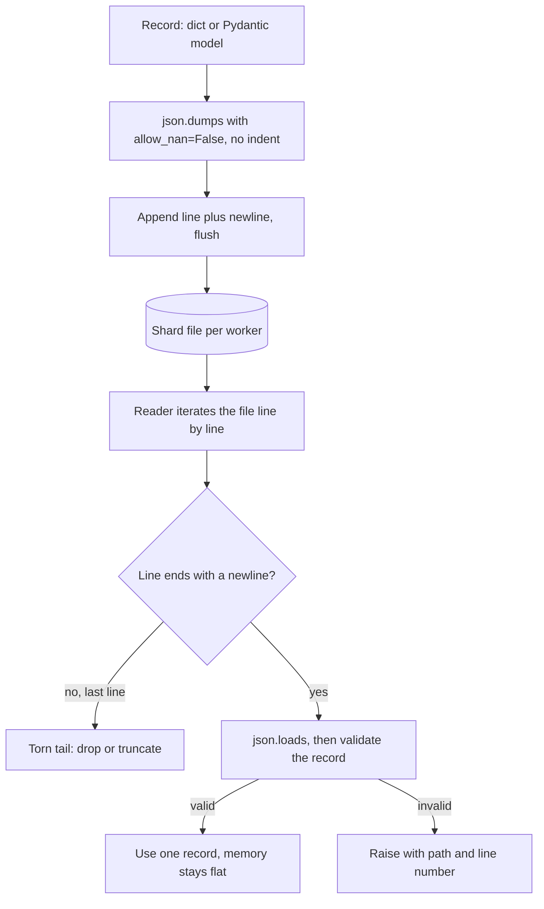

## TL;DR
JSON is the lingua franca of LLM payloads, tool arguments and structured outputs; JSONL puts one JSON
value per line, making files appendable, streamable and splittable for evals, fine-tuning, batches and
logs. Watch NaN, big integers and encoding.

## Why it exists
- **AI data is nested records.** A chat transcript with a variable number of messages, a tool call with
  arguments, a model response with metadata.
- **The alternatives fail.** CSV cannot represent nesting without inventing an escaping scheme; binary
  formats need a schema up front and are not readable in a terminal. JSON represents nested objects and
  arrays directly, every language parses it, and LLMs produce it reliably enough that providers expose
  JSON modes.
- **One JSON array is a bad container for many records.** `[{...}, {...}, ...]` must be parsed in full
  before you use the first record, cannot be appended to without rewriting the closing bracket, cannot be
  split across workers without parsing, and is corrupted as a whole if a writer crashes before the final
  `]`. With a million eval cases you hold the whole dataset in memory just to read one.
- **JSONL's one rule.** Each line is a self-contained JSON value, separated by `\n`. Appending is writing
  a line, reading is iterating lines, splitting is `split -l`, and a crash damages at most the last line.
- **It costs no expressiveness.** Standard encoders escape newlines inside strings as `\n`, so any JSON
  value fits on one line.

## How it works
### JSON's data model
RFC 8259 defines six types: object, array, string, number, `true`/`false`, `null`.

| JSON | Python `json` maps to |
|---|---|
| object / array | `dict` / `list` |
| string | `str` |
| number | `int`/`float` |
| `true`/`false` / `null` | `bool` / `None` |

- **Not in JSON:** comments, trailing commas, dates, bytes, NaN or Infinity.
- **Encoding:** strings are Unicode and, for interchange, the text must be UTF-8.
- **Anything else raises `TypeError` on `dumps`:** datetimes, `Decimal`, sets, most numpy scalars such as
  `np.int64` and `np.float32`. (`np.float64` slips through only because it subclasses Python `float`.)
- **Convert first:** with a `default=` function, or serialize a Pydantic model with `model_dump_json()`.

### The edges where Python's defaults bite
- **NaN and Infinity.** `json.dumps(float("nan"))` emits `NaN`, which is *not* valid JSON; JavaScript's
  `JSON.parse` and strict parsers reject it. Pass `allow_nan=False` to fail at write time instead.
- **Big integers.** Python round-trips any integer exactly, but parsers that use IEEE doubles (JavaScript)
  lose precision above 2^53. IDs from Snowflake-style generators should travel as strings.
- **Non-ASCII.** `ensure_ascii=True` is the default, so `café` is written as `caf\u00e9`: valid, but it
  inflates files and hurts readability for multilingual data. `ensure_ascii=False` writes UTF-8, which is
  correct as long as the file is opened with `encoding="utf-8"`.
- **Duplicate keys.** The RFC leaves them undefined; Python keeps the last one silently.

### JSONL mechanics
1. **Write** `f.write(json.dumps(obj) + "\n")` per record, with no pretty-printing, because `indent=`
   inserts newlines and breaks one-record-per-line.
2. **Read** by iterating the file object line by line and calling `json.loads` on each, so memory stays
   proportional to one record.
3. **Writers** treat the file as append-only and flush per record or per batch.
4. **Readers** report errors with line numbers so a bad record can be located, and decide explicitly
   whether to skip or stop.
5. **Compress** with `gzip.open(path, "wt")` for `.jsonl.gz`; line semantics are unchanged.

### Three details that decide crash isolation
- **What counts as a line.** Iterating a text file splits only on `\n` (and `\r\n`), which is what JSONL
  means. `str.splitlines()` also splits on U+2028 and U+0085, which `json.dumps(..., ensure_ascii=False)`
  leaves unescaped inside strings, so `text.splitlines()` can cut a valid record in half. Iterate the
  file, or split on `"\n"` explicitly.
- **The torn last line.** A writer killed mid-write leaves a final line with no trailing newline that
  usually fails to parse. A resuming reader should tolerate exactly that case (drop it, then truncate or
  rewrite the file) and treat a bad line anywhere else as real corruption.
- **One writer per file.** Several processes appending to one file can interleave bytes when records are
  large or the file is on network storage, producing two half records on a line. Give each worker its own
  shard (`results-00.jsonl`, `results-01.jsonl`) or funnel writes through one process.

### Where you meet it
| Use | Shape |
|---|---|
| OpenAI-style fine-tuning data | One `{"messages": [...]}` object per line |
| OpenAI Batch API | JSONL of requests, each with a `custom_id` so results match back |
| Eval harnesses | Cases and results as JSONL |
| Structured logs | Usually one JSON object per line |

For analytics over millions of rows, JSONL is usually converted to a columnar format such as Parquet,
since re-parsing text on every query is slow.

## Diagram
The write side keeps one record per line; the read side streams line by line, tolerates only a torn
final line, and pins any other failure to a line number.



## Examples
### Write an eval set safely, read it as a stream
Writing an eval set safely and reading it back as a stream, with failures pinned to a line.

```python
import json, math
from pathlib import Path

cases = [
    {"id": "q1", "messages": [{"role": "user", "content": "Refund policy?\nAsk twice."}],
     "expected": "policy", "score": 0.9},
    {"id": "q2", "messages": [{"role": "user", "content": "Café opening hours"}],
     "expected": "hours", "score": math.nan},          # a bad value we must catch
]

def write_jsonl(path: Path, rows) -> None:
    with path.open("w", encoding="utf-8") as f:
        for row in rows:
            # allow_nan=False refuses to emit the invalid token NaN
            f.write(json.dumps(row, ensure_ascii=False, allow_nan=False) + "\n")

def read_jsonl(path: Path):
    with path.open(encoding="utf-8") as f:
        for lineno, line in enumerate(f, 1):
            if not line.strip():
                continue
            try:
                yield json.loads(line)
            except json.JSONDecodeError as e:
                raise ValueError(f"{path}:{lineno}: {e.msg}") from e

cases[1]["score"] = None                               # fix: null is valid JSON
p = Path("eval.jsonl")
write_jsonl(p, cases)
print(p.read_text(encoding="utf-8").count("\n"))       # 2: the embedded newline was escaped
for case in read_jsonl(p):                             # one record in memory at a time
    print(case["id"], len(case["messages"]))
```

- **Without the fix,** `write_jsonl` raises `ValueError: Out of range float values are not JSON compliant`
  on the second record, at write time, instead of producing a file a TypeScript dashboard later refuses
  to parse.

### Resumable batch output that survives a torn last line
A worker appends one result per request and can be killed at any time. On restart it drops a torn tail,
skips finished `custom_id`s and appends the rest.

```python
import json
from pathlib import Path

def resume(path: Path) -> set[str]:
    done, good_bytes = set(), 0
    if not path.exists():
        return done
    with path.open("rb") as f:
        for raw in f:                          # binary iteration splits on b"\n" only
            if not raw.endswith(b"\n"):        # torn last line: writer died mid-record
                break
            if raw.strip():                    # a bad *complete* line is real corruption: let it raise
                done.add(json.loads(raw)["custom_id"])
            good_bytes += len(raw)
    with path.open("r+b") as f:
        f.truncate(good_bytes)                 # cut the torn tail before appending again
    return done

def run(requests, out: Path, call_model):
    done = resume(out)
    with out.open("a", encoding="utf-8") as f:
        for req in requests:
            if req["custom_id"] in done:
                continue
            result = call_model(req)
            f.write(json.dumps({"custom_id": req["custom_id"], **result}, allow_nan=False) + "\n")
            f.flush()                          # durability matches progress
```

| Event | Effect on `results.jsonl` |
|---|---|
| Pod killed while writing record 1,800,001 | 1,800,000 complete lines plus a partial one |
| Restart calls `resume` | Partial line truncated; 1,800,000 IDs marked done |
| Job continues | Only the remaining requests are sent, so it is idempotent |

## Production patterns
- **Strict writer by default.** Wrap `json.dumps` with `allow_nan=False`, an explicit `default=` for
  datetimes and numpy scalars, and `encoding="utf-8"` on every open. Monitor write-time `ValueError` and
  `TypeError` counts; they are bugs caught early, not noise to suppress.
- **Validate every line at the boundary.** Define a Pydantic model per record type and call
  `Model.model_validate_json(line)` while reading, raising with the file and line number. Track the
  rejected-line count per dataset version; schema drift shows up there first.
- **Shard by worker, merge by concatenation.** Each process writes `results-{worker:02d}.jsonl`, never a
  shared file, and downstream jobs read the shard glob. Watch for shards with no trailing newline, which
  mark workers that died mid-write.
- **Key every record for idempotent resume.** Carry a stable `custom_id` (strings, not big integers) and
  resume as in the second example. Monitor duplicate-ID counts after merges.
- **Promote to Parquet for analytics.** Keep JSONL as the append and interchange format, and convert
  finished files (for example `pd.read_json(path, lines=True).to_parquet(...)`) before repeated queries.
  Watch query latency and file size; a gzip-compressed `.jsonl.gz` is the cheaper archive.

## Trade-offs
- **Streaming vs document guarantees.** JSONL streams and appends record by record but has no enclosing
  schema, so a malformed middle line is only found when a reader reaches it.
- **Readable vs fast.** Text JSON is human-readable and universal, yet several times larger and slower to
  parse than columnar binary formats; for repeated analytical queries over millions of rows, Parquet wins.
- **Schemaless vs drift.** Adding fields to eval or log data is easy, but readers drift silently unless a
  Pydantic model or JSON Schema validates each line at the boundary.
- **`ensure_ascii=False` vs safety.** Multilingual data stays compact and readable, but a consumer that
  guesses the wrong encoding mangles it; ASCII escapes are safer when you do not control the reader.

## Pitfalls
- **`json.dump(obj, f, indent=2)` in a JSONL writer.** Symptom: `JSONDecodeError` on the very first line
  (a lone `{` is not a complete value) because each record spans many lines. Fix: no `indent`.
- **Serializing NaN from pandas or numpy metrics.** Symptom: a JavaScript or Go consumer rejects the file
  while Python reads it fine. Fix: `allow_nan=False` and map NaN to `null`.
- **`f.readlines()` or `[json.loads(l) for l in f]` on a multi-gigabyte file.** Symptom: memory climbs to
  several times the file size (parsed objects are far larger than their text) and the process is
  OOM-killed. (`json.load` on JSONL fails outright with "Extra data".) Fix: a generator reader.
- **Reading with `path.read_text().splitlines()`.** Symptom: `JSONDecodeError` ("Unterminated string") on
  a handful of records containing U+2028 or similar, often scraped web text. Fix: iterate the file.
- **Opening files without `encoding="utf-8"`.** Symptom: `UnicodeDecodeError` or mojibake on Windows or
  in containers with a non-UTF-8 locale.
- **Passing numpy types into `json.dumps`.** Symptom: `TypeError: Object of type float32 is not JSON
  serializable` deep inside an eval run. Fix: `.item()`, `.tolist()` or a `default=` hook.

## When to use
- **JSON for single payloads:** API requests and responses, tool arguments, config documents, a model's
  structured output.
- **JSONL for growing or one-at-a-time collections:** eval datasets, fine-tuning data, batch-inference
  inputs and outputs, agent traces and logs.
- **Validate at ingestion** with a Pydantic model so bad records fail with a line number.
- **Move to Parquet or a database** for column-wise queries, joins or typed schemas across millions of
  rows.
- **Interviews:** "why JSONL rather than a JSON array?" The answer is streaming, appending and crash
  isolation.

## Role lens
- **Engineer:** Writes JSONL readers as generators with line-numbered errors, sets `allow_nan=False`, and
  validates every record against a Pydantic model before it enters an eval or training run.
- **Architect:** Chooses where JSONL is the interchange format and where data is promoted to Parquet or
  a database, and defines the record schema and versioning for datasets.
- **FDE:** Converts a customer's CSV or ticket export into a validated JSONL eval set, catching encoding
  and malformed-row problems before they poison results.

## Check yourself
**Q:** Your batch-inference job writes 2 million results to a single JSON array file, and a pod restart at
90% leaves it unusable. Redesign it and explain why each choice helps.
**A:** Write results as JSONL, one object per line, each carrying the request's `custom_id`. A restart
then damages at most the final partial line, and the reader can drop a last line that fails to parse. On
resume, read the existing file, collect completed IDs and only submit the rest, which makes the job
idempotent. Flush after each batch so durability matches progress. Downstream consumers can stream the
file without loading 2 million objects, and shards can be split by line for parallel scoring. If the
results feed analytics, convert the finished JSONL to Parquet.

## Interview questions
### What is JSONL, and why do fine-tuning, eval and batch APIs use it instead of a JSON array?
- **Definition:** one self-contained JSON value per line, separated by `\n`; encoders escape newlines
  inside strings, so any value fits on one line.
- **Why:** a reader handles one record at a time, a writer appends without rewriting a closing `]`, a file
  splits by line across workers, and a crash damages at most the last line.
- **Example:** OpenAI-style fine-tuning data is one `{"messages": [...]}` object per line.

### Python reads your results file fine, but a TypeScript dashboard rejects it. What do you check?
- **NaN or Infinity first:** Python's `json.dumps` emits `NaN` by default, which is not valid JSON, so
  strict parsers like `JSON.parse` fail. Write with `allow_nan=False` and map NaN to `null`.
- **Big integers next:** JavaScript parses numbers as IEEE doubles and loses precision above 2^53, so IDs
  should travel as strings.
- **Then encoding:** confirm the file is UTF-8 and was opened with `encoding="utf-8"` on both sides.

### A reader fails with "Unterminated string" on a few records of scraped web text. Why?
- **Likely cause:** the code splits with `str.splitlines()`, which also breaks on U+2028 and U+0085.
  `ensure_ascii=False` leaves those unescaped inside strings, so a valid record is cut in half.
- **Fix:** iterate the file object, which splits only on `\n` and `\r\n`, or split on `"\n"` explicitly.
- **Prevent it:** keep a regression case containing U+2028 in the reader's tests.

### How should several workers write results without corrupting the output?
- **One writer per file:** concurrent appends to one file can interleave bytes for large records or on
  network storage, leaving two half records on one line.
- **Shard and concatenate:** each worker writes `results-00.jsonl`, `results-01.jsonl` and so on, and
  downstream jobs read the glob.
- **Monitor:** a shard without a trailing newline marks a worker that died mid-write; duplicate
  `custom_id` counts after a merge reveal double processing.

### When would you not keep data in JSONL?
- **Repeated analytics:** text JSON is larger and slower to parse than columnar formats, so finished
  datasets queried column by column across millions of rows belong in Parquet or a database.
- **Typed joins and schemas:** JSONL has no enclosing schema, so drift is found only when a reader hits
  the bad line.
- **Keep JSONL for:** append-heavy interchange, such as eval cases, batch inputs and outputs, and traces.

## Quiz
### Q: Why is JSONL preferred over a single JSON array for a large, growing eval dataset?
- [ ] JSONL files are always smaller than equivalent JSON arrays
- [x] Each line parses independently, so the file can be streamed, appended to and split without parsing the whole thing
- [ ] JSONL supports comments and trailing commas that JSON forbids
- [ ] JSONL stores numbers in binary, which is faster to parse
> The size and syntax are essentially the same as JSON. The advantage is structural: one record per line
> means constant memory reads, appends without rewriting, line-based sharding and crash damage limited
> to one line.

### Q: What does Python's `json.dumps({"x": float("nan")})` produce by default?
- [ ] `{"x": null}`, because NaN maps to null
- [ ] A `TypeError` because NaN is not serializable
- [x] `{"x": NaN}`, which is not valid JSON and strict parsers reject
- [ ] `{"x": "NaN"}`, a string representation
> Python defaults to `allow_nan=True` and emits the JavaScript-style token NaN, which RFC 8259 does not
> allow. Setting `allow_nan=False` raises a ValueError instead, catching the bad value at write time.

### Q: A JSONL writer uses `json.dumps(record, indent=2)`. What breaks?
- [ ] Nothing; readers ignore whitespace inside JSON values
- [ ] Only non-ASCII characters are affected
- [ ] The file becomes valid JSON instead of JSONL
- [x] Each record spans several lines, so line-by-line readers fail to parse
> Indentation inserts newlines between keys. JSON parsers tolerate whitespace inside one document, but
> JSONL readers split on newlines first, so each fragment is an incomplete value and parsing fails.
