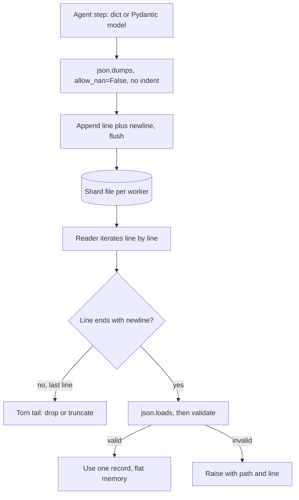

## TL;DR
JSON is what an agent speaks: tool schemas, tool-call arguments, tool results and structured outputs.
JSONL puts one JSON value per line, so agent traces, eval sets, fine-tuning data and batch jobs append,
stream and survive crashes. Watch NaN, big integers and encoding.

## For agent builders
- **Why it matters for agents.** Every tool call is a JSON round trip: you send a JSON Schema, the model
  returns arguments as JSON, your tool returns a result you serialize back. A tool result with a NaN, a
  `datetime` or a numpy scalar breaks the loop at step 5 instead of at your desk.
- **Where it shows up in your stack.** OpenAI-style `tool_calls` carry arguments as a JSON *string* you
  must parse; structured-output modes return JSON; agent traces, eval datasets, fine-tuning files and
  Batch API inputs and outputs are JSONL.
- **What you control.** A strict writer (`allow_nan=False`, a `default=` hook), a validating reader with
  line numbers, one writer per file, and a stable ID per record for resumable eval and batch jobs.
- **What you can skip.** The RFC's grammar details. Know the six types, what Python emits that is not
  valid JSON, and why JSONL beats one big array.

## Lab
### Task
Build the trace I/O an agent's eval dashboard depends on: a strict writer for tool-step records, a fixed
reader that survives a killed worker and scraped text, and a per-tool error rate computed in streaming
fashion. Time box: 45 minutes.
- **Prerequisites:** this lesson's How it works, plus generators and pytest.
- **The reader is shipped buggy:** it uses `str.splitlines()` and has no torn-tail or line-number handling.
  Fix it rather than rewriting the tests.

### Starter code
```python
# trace_io.py  (stdlib only, checked on Python 3.9 and later)
import json
import math
import tempfile
from datetime import datetime
from decimal import Decimal
from pathlib import Path

LS = chr(0x2028)   # LINE SEPARATOR: str.splitlines() splits on it, JSONL must not


def dumps_strict(record: dict) -> str:
    # FILL IN 1: one JSONL line ending in "\n": no indent, UTF-8 text kept (no \u escapes),
    # NaN or Infinity anywhere raises ValueError, datetime -> isoformat(), Decimal -> str,
    # set -> sorted list, any other unknown type raises TypeError naming the type.
    raise NotImplementedError


def iter_trace(path: Path):
    """Yield (lineno, record) for each step. BUGGY: fix it (FILL IN 2)."""
    # Must split on "\n" only, skip blank lines, silently drop a torn LAST line
    # (no trailing newline), and raise ValueError("<path>:<lineno>: ...") for any other bad line.
    for lineno, line in enumerate(path.read_text(encoding="utf-8").splitlines(), 1):
        yield lineno, json.loads(line)


def tool_error_rate(path: Path) -> dict:
    # FILL IN 3: {tool: share of that tool's steps whose result has an "error" key}, rounded to 2
    # places, keys sorted. Use iter_trace so a 2 GB trace streams in flat memory.
    raise NotImplementedError


if __name__ == "__main__":
    steps = [
        {"step": 1, "tool": "search", "at": datetime(2026, 1, 5, 9, 30), "result": {"hits": 3}},
        {"step": 2, "tool": "lookup_order", "result": {"error": "order_id must be a string"}},
        {"step": 3, "tool": "lookup_order", "result": {"text": "Café" + LS + "note", "total": Decimal("42.50")}},
        {"step": 4, "tool": "search", "result": {"hits": 0, "tags": {"b", "a"}}},
    ]
    with tempfile.TemporaryDirectory() as d:
        p = Path(d) / "trace.jsonl"
        with p.open("w", encoding="utf-8") as f:
            for s in steps:
                f.write(dumps_strict(s))
            f.write('{"step": 5, "tool": "sea')          # the worker was killed mid-write
        print("line 1:", p.read_text(encoding="utf-8").split("\n")[0])
        try:
            dumps_strict({"score": math.nan})
        except ValueError:
            print("nan rejected: ValueError")
        print("records read:", sum(1 for _ in iter_trace(p)))
        print("error rate:", tool_error_rate(p))
```

### Expected output
```text
line 1: {"step": 1, "tool": "search", "at": "2026-01-05T09:30:00", "result": {"hits": 3}}
nan rejected: ValueError
records read: 4
error rate: {'lookup_order': 0.5, 'search': 0.0}
```

### Tests
```python
# test_trace_io.py  (run: pytest -q)
import json
import math
from datetime import datetime
from decimal import Decimal

import pytest

from trace_io import dumps_strict, iter_trace, tool_error_rate


def line(obj):                     # plain writer, so reader tests do not depend on dumps_strict
    return json.dumps(obj, ensure_ascii=False) + "\n"


def write(tmp_path, text):
    p = tmp_path / "t.jsonl"
    p.write_text(text, encoding="utf-8")
    return p


def test_one_line_and_types():
    out = dumps_strict({"at": datetime(2026, 1, 5), "amt": Decimal("1.10"), "tags": {"b", "a"},
                         "text": "a\nb Café"})
    assert out.endswith("\n") and out.count("\n") == 1
    assert "Café" in out
    assert json.loads(out) == {"at": "2026-01-05T00:00:00", "amt": "1.10", "tags": ["a", "b"],
                                "text": "a\nb Café"}


@pytest.mark.parametrize("bad", [math.nan, math.inf])
def test_nan_rejected_at_write_time(bad):
    with pytest.raises(ValueError):
        dumps_strict({"score": bad})


def test_unknown_type_names_type():
    with pytest.raises(TypeError, match="complex"):
        dumps_strict({"z": 1j})


def test_u2028_does_not_split_a_record(tmp_path):
    p = write(tmp_path, line({"text": "x" + chr(0x2028) + "y"}) + line({"text": "z"}))
    assert [r["text"] for _, r in iter_trace(p)] == ["x" + chr(0x2028) + "y", "z"]


def test_torn_last_line_dropped(tmp_path):
    p = write(tmp_path, line({"step": 1}) + '{"step": 2, "to')
    assert [r["step"] for _, r in iter_trace(p)] == [1]


def test_bad_middle_line_names_line(tmp_path):
    p = write(tmp_path, line({"step": 1}) + "\n" + "{oops\n" + line({"step": 3}))
    with pytest.raises(ValueError, match=r"t\.jsonl:3"):
        list(iter_trace(p))


def test_error_rate(tmp_path):
    rows = [{"tool": "a", "result": {"error": "x"}}, {"tool": "a", "result": {}},
            {"tool": "a", "result": {}}, {"tool": "b", "result": {"ok": 1}}]
    p = write(tmp_path, "".join(line(r) for r in rows))
    assert tool_error_rate(p) == {"a": 0.33, "b": 0.0}
```
On the starter all 8 fail: the writer and error-rate tests with `NotImplementedError`, the U+2028 and
torn-tail tests with `JSONDecodeError` from the buggy reader, and the middle-line test because the error
does not name `t.jsonl:3`.

### Failure scenarios
- **Inject `indent=2` in the writer.** The one-line test fails and the reader dies on line 1 with a lone
  `{`. Debug by `head -c 200` on the file: a record that spans lines is the tell.
- **Inject dropping `allow_nan=False`.** The NaN test fails, and in a real run a TypeScript dashboard
  rejects the file while Python reads it. Grep the file for `NaN` or `Infinity`.
- **Inject the torn-tail rule on every line, not just the last.** Real corruption in the middle is
  silently skipped and error rates drift. Count lines with `wc -l` against records read.
- **Inject `str.splitlines()` back.** Only records with scraped text break, with "Unterminated string".
  Print the failing line number and inspect it for U+2028 or U+0085.

### Submission
- **Code:** `trace_io.py` plus the unchanged test file.
- **Test run:** `pytest -q` showing 8 passed and the Python version.
- **Output:** the four demo lines, matching Expected output exactly.
- **Memory note:** one sentence on why `tool_error_rate` stays flat in memory on a 2 GB trace.
- **Evaluation:** tests pass unmodified, the reader never calls `read_text()` or `splitlines()`, and a
  bad middle line raises with its line number.

## Why it exists
- **Agent data is nested records.** A transcript with a variable number of messages, a tool call with
  arguments, a model response with metadata, a trace with one span per step.
- **The alternatives fail.** CSV cannot represent nesting without inventing an escaping scheme; binary
  formats need a schema up front and are not readable in a terminal. JSON represents nested objects and
  arrays directly, every language parses it, and LLMs produce it reliably enough that providers expose
  JSON modes.
- **One JSON array is a bad container for many records.** `[{...}, {...}, ...]` must be parsed in full
  before you use the first record, cannot be appended to without rewriting the closing bracket, cannot be
  split across workers without parsing, and is corrupted as a whole if a writer crashes before the final
  `]`. With a million eval cases you hold the whole dataset in memory just to read one.
- **JSONL's one rule.** Each line is a self-contained JSON value, separated by `\n`. Appending is writing
  a line, reading is iterating lines, splitting is `split -l`, and a crash damages at most the last line.
- **It costs no expressiveness.** Standard encoders escape newlines inside strings as `\n`, so any JSON
  value fits on one line, including a long tool result.

## How it works
### JSON's data model
RFC 8259 defines six types: object, array, string, number, `true`/`false`, `null`.

| JSON | Python `json` maps to |
|---|---|
| object / array | `dict` / `list` |
| string | `str` |
| number | `int`/`float` |
| `true`/`false` / `null` | `bool` / `None` |

- **Not in JSON:** comments, trailing commas, dates, bytes, NaN or Infinity.
- **Encoding:** strings are Unicode and, for interchange, the text must be UTF-8.
- **Anything else raises `TypeError` on `dumps`:** datetimes, `Decimal`, sets, most numpy scalars such as
  `np.int64` and `np.float32`. (`np.float64` slips through only because it subclasses Python `float`.)
- **Convert first:** with a `default=` function, or serialize a Pydantic model with `model_dump_json()`.
  This matters most in tool results, which often come straight from a database row or a pandas frame.

### Tool calls are JSON in both directions
1. **You send** each tool's parameters as a JSON Schema (often generated from a Pydantic model).
2. **The model returns** arguments; in OpenAI-style APIs they arrive as a JSON string you `json.loads`,
   and the model can produce malformed or schema-violating JSON.
3. **You validate** the parsed arguments against the same model, and on failure send the error back as
   the tool result so the model can retry, instead of crashing the loop.
4. **You return** the tool's result serialized as a string, so it must be valid, compact JSON.

### The edges where Python's defaults bite
- **NaN and Infinity.** `json.dumps(float("nan"))` emits `NaN`, which is *not* valid JSON; JavaScript's
  `JSON.parse` and strict parsers reject it. Pass `allow_nan=False` to fail at write time instead.
- **Big integers.** Python round-trips any integer exactly, but parsers that use IEEE doubles (JavaScript)
  lose precision above 2^53. IDs from Snowflake-style generators should travel as strings, including
  order IDs a tool returns to the model.
- **Non-ASCII.** `ensure_ascii=True` is the default, so `café` is written as `caf\u00e9`: valid, but it
  inflates files and hurts readability for multilingual data, and escapes cost extra tokens in a prompt.
  `ensure_ascii=False` writes UTF-8, which is correct as long as the file is opened with
  `encoding="utf-8"`.
- **Duplicate keys.** The RFC leaves them undefined; Python keeps the last one silently.

### JSONL mechanics
1. **Write** `f.write(json.dumps(obj) + "\n")` per record, with no pretty-printing, because `indent=`
   inserts newlines and breaks one-record-per-line.
2. **Read** by iterating the file object line by line and calling `json.loads` on each, so memory stays
   proportional to one record.
3. **Writers** treat the file as append-only and flush per record or per batch.
4. **Readers** report errors with line numbers so a bad record can be located, and decide explicitly
   whether to skip or stop.
5. **Compress** with `gzip.open(path, "wt")` for `.jsonl.gz`; line semantics are unchanged.

### Three details that decide crash isolation
- **What counts as a line.** Iterating a text file splits only on real line endings (`\n`, `\r\n`, and a
  lone `\r` in default text mode), all of which encoders escape inside strings, so that is what JSONL
  means. `str.splitlines()` also splits on U+2028 and U+0085, which `json.dumps(..., ensure_ascii=False)`
  leaves unescaped inside strings, so `text.splitlines()` can cut a valid record in half. Iterate the
  file, or split on `"\n"` explicitly.
- **The torn last line.** A writer killed mid-write leaves a final line with no trailing newline that
  usually fails to parse. A resuming reader should tolerate exactly that case (drop it, then truncate or
  rewrite the file) and treat a bad line anywhere else as real corruption.
- **One writer per file.** Several processes appending to one file can interleave bytes when records are
  large or the file is on network storage, producing two half records on a line. Give each worker its own
  shard (`results-00.jsonl`, `results-01.jsonl`) or funnel writes through one process.

### Where you meet it
| Use | Shape |
|---|---|
| OpenAI-style fine-tuning data | One `{"messages": [...]}` object per line, tool calls included for agent traces |
| OpenAI Batch API | JSONL of requests, each with a `custom_id` so results match back |
| Eval harnesses | Cases and results as JSONL |
| Agent traces and structured logs | Usually one JSON object per line: one step, one span or one event |

For analytics over millions of rows, JSONL is usually converted to a columnar format such as Parquet,
since re-parsing text on every query is slow.

## Diagram
The agent's trace writer keeps one record per line; the reader streams line by line, tolerates only a
torn final line, and pins any other failure to a line number.



## Examples
### Parse tool-call arguments, run the tool, log the step as JSONL
The model's arguments are untrusted JSON; validate them, feed errors back to the model, and append each
step to a trace file.

```python
import json
from pydantic import BaseModel, ValidationError

class LookupOrder(BaseModel):
    order_id: str            # string, not int: IDs above 2^53 break JS consumers
    include_items: bool = False

def run_tool(raw_args: str) -> str:
    try:
        args = LookupOrder.model_validate_json(raw_args)   # parse + validate in one step
    except ValidationError as e:
        return json.dumps({"error": e.errors(include_url=False)}, default=str)  # model retries
    row = {"order_id": args.order_id, "status": "shipped", "total": 42.5}
    return json.dumps(row, ensure_ascii=False, allow_nan=False)

def log_step(f, step: int, name: str, raw_args: str, result: str) -> None:
    rec = {"step": step, "tool": name, "args": raw_args, "result": result}
    f.write(json.dumps(rec, ensure_ascii=False, allow_nan=False) + "\n")
    f.flush()                                           # a crash loses at most this line

with open("trace.jsonl", "a", encoding="utf-8") as f:
    for step, raw in enumerate(['{"order_id": "9007199254740993"}', '{"order_id": 5'], 1):
        log_step(f, step, "lookup_order", raw, run_tool(raw))   # 2nd is malformed JSON
```

- **The malformed second call** becomes a JSON error string that goes back to the model as the tool
  result, and the trace still gets a complete line for step 2.

### Write an eval set safely, read it as a stream
Writing an eval set safely and reading it back as a stream, with failures pinned to a line.

```python
import json, math
from pathlib import Path

cases = [
    {"id": "q1", "messages": [{"role": "user", "content": "Refund policy?\nAsk twice."}],
     "expected": "policy", "score": 0.9},
    {"id": "q2", "messages": [{"role": "user", "content": "Café opening hours"}],
     "expected": "hours", "score": math.nan},          # a bad value we must catch
]

def write_jsonl(path: Path, rows) -> None:
    with path.open("w", encoding="utf-8") as f:
        for row in rows:
            # allow_nan=False refuses to emit the invalid token NaN
            f.write(json.dumps(row, ensure_ascii=False, allow_nan=False) + "\n")

def read_jsonl(path: Path):
    with path.open(encoding="utf-8") as f:
        for lineno, line in enumerate(f, 1):
            if not line.strip():
                continue
            try:
                yield json.loads(line)
            except json.JSONDecodeError as e:
                raise ValueError(f"{path}:{lineno}: {e.msg}") from e

cases[1]["score"] = None                               # fix: null is valid JSON
p = Path("eval.jsonl")
write_jsonl(p, cases)
print(p.read_text(encoding="utf-8").count("\n"))       # 2: the embedded newline was escaped
for case in read_jsonl(p):                             # one record in memory at a time
    print(case["id"], len(case["messages"]))
```

- **Without the fix,** `write_jsonl` raises `ValueError: Out of range float values are not JSON compliant`
  on the second record, at write time, instead of producing a file a TypeScript dashboard later refuses
  to parse.

### Worked scenario: a resumable agent eval run that survives a torn last line
A worker runs the agent on each case, appends one result per `custom_id`, and can be killed at any time.
On restart it drops a torn tail, skips finished IDs and appends the rest.

```python
import json
from pathlib import Path

def resume(path: Path) -> set[str]:
    done, good_bytes = set(), 0
    if not path.exists():
        return done
    with path.open("rb") as f:
        for raw in f:                          # binary iteration splits on b"\n" only
            if not raw.endswith(b"\n"):        # torn last line: writer died mid-record
                break
            if raw.strip():                    # a bad *complete* line is real corruption: let it raise
                done.add(json.loads(raw)["custom_id"])
            good_bytes += len(raw)
    with path.open("r+b") as f:
        f.truncate(good_bytes)                 # cut the torn tail before appending again
    return done

def run_eval(cases, out: Path, run_agent):
    done = resume(out)
    with out.open("a", encoding="utf-8") as f:
        for case in cases:
            if case["custom_id"] in done:
                continue                       # finished: do not pay for it twice
            result = run_agent(case)           # several model and tool calls
            f.write(json.dumps({"custom_id": case["custom_id"], **result},
                               ensure_ascii=False, allow_nan=False) + "\n")
            f.flush()                          # durability matches progress
```

| Event | Effect on `results.jsonl` |
|---|---|
| Pod killed while writing record 1,800,001 | 1,800,000 complete lines plus a partial one |
| Restart calls `resume` | Partial line truncated; 1,800,000 IDs marked done |
| Job continues | Only the remaining cases are sent, so it is idempotent |

- **Why it matters for agent evals:** each case may cost several model and tool calls, so re-running
  finished cases after a crash multiplies spend. A bad *complete* line anywhere else should raise, since
  that is real corruption.

## Production patterns
- **Strict writer by default.** Wrap `json.dumps` with `allow_nan=False`, an explicit `default=` for
  datetimes and numpy scalars, and `encoding="utf-8"` on every open; use it for tool results and traces
  alike. Monitor write-time `ValueError` and `TypeError` counts; they are bugs caught early.
- **Validate every tool call and every line at the boundary.** Define a Pydantic model per tool and per
  record type and call `Model.model_validate_json(line)`, raising with the file and line number (or
  returning the error to the model). Track rejected-argument rates per tool; schema drift shows up there.
- **Shard by worker, merge by concatenation.** Each eval or batch process writes
  `results-{worker:02d}.jsonl`, never a shared file, and downstream jobs read the shard glob. Watch for
  shards with no trailing newline, which mark workers that died mid-write.
- **Key every record for idempotent resume.** Carry a stable `custom_id` (strings, not big integers) and
  resume as in the eval scenario. Monitor duplicate-ID counts after merges.
- **Promote to Parquet for analytics.** Keep JSONL as the append and interchange format for traces and
  evals, and convert finished files (for example `pd.read_json(path, lines=True).to_parquet(...)`) before
  repeated queries. Watch query latency and file size; a gzip-compressed `.jsonl.gz` is the cheaper archive.

## Trade-offs
- **Streaming vs document guarantees.** JSONL streams and appends record by record but has no enclosing
  schema, so a malformed middle line is only found when a reader reaches it.
- **Readable vs fast.** Text JSON is human-readable and universal, yet several times larger and slower to
  parse than columnar binary formats; for repeated analytical queries over millions of rows, Parquet wins.
- **Schemaless vs drift.** Adding fields to eval, trace or log data is easy, but readers drift silently
  unless a Pydantic model or JSON Schema validates each line at the boundary.
- **`ensure_ascii=False` vs safety.** Multilingual data stays compact and readable (and cheaper in tokens
  when the JSON goes back into a prompt), but a consumer that guesses the wrong encoding mangles it; ASCII
  escapes are safer when you do not control the reader.

## Pitfalls
- **`json.dump(obj, f, indent=2)` in a JSONL writer.** Symptom: `JSONDecodeError` on the very first line
  (a lone `{` is not a complete value) because each record spans many lines. Fix: no `indent`.
- **Serializing NaN from pandas or numpy metrics.** Symptom: a JavaScript or Go consumer rejects the file
  while Python reads it fine. Fix: `allow_nan=False` and map NaN to `null`.
- **Trusting tool-call arguments.** Symptom: the agent loop crashes with `JSONDecodeError` or `KeyError`
  when the model emits truncated or off-schema arguments. Fix: validate with a Pydantic model and return
  the error to the model as the tool result.
- **`f.readlines()` or `[json.loads(l) for l in f]` on a multi-gigabyte file.** Symptom: memory climbs to
  several times the file size (parsed objects are far larger than their text) and the process is
  OOM-killed. (`json.load` on JSONL fails outright with "Extra data".) Fix: a generator reader.
- **Reading with `path.read_text().splitlines()`.** Symptom: `JSONDecodeError` ("Unterminated string") on
  a handful of records containing U+2028 or similar, often scraped web text. Fix: iterate the file.
- **Opening files without `encoding="utf-8"`.** Symptom: `UnicodeDecodeError` or mojibake on Windows or
  in containers with a non-UTF-8 locale.
- **Passing numpy types into `json.dumps`.** Symptom: `TypeError: Object of type float32 is not JSON
  serializable` deep inside an eval run or a tool result. Fix: `.item()`, `.tolist()` or a `default=` hook.

## When to use
- **JSON for single payloads:** API requests and responses, tool schemas and arguments, tool results,
  config documents, a model's structured output.
- **JSONL for growing or one-at-a-time collections:** eval datasets, fine-tuning data, batch-inference
  inputs and outputs, agent traces and logs.
- **Validate at ingestion** with a Pydantic model so bad records fail with a line number.
- **Move to Parquet or a database** for column-wise queries, joins or typed schemas across millions of
  rows.
- **Interviews:** "why JSONL rather than a JSON array?" The answer is streaming, appending and crash
  isolation.

## Role lens
- **Engineer:** Writes JSONL readers as generators with line-numbered errors, sets `allow_nan=False`, and
  validates every record against a Pydantic model before it enters an eval or training run.
- **Architect:** Chooses where JSONL is the interchange format and where data is promoted to Parquet or
  a database, and defines the record schema and versioning for datasets.
- **FDE:** Converts a customer's CSV or ticket export into a validated JSONL eval set, catching encoding
  and malformed-row problems before they poison results.

## Check yourself
**Q:** Your batch-inference job writes 2 million results to a single JSON array file, and a pod restart at
90% leaves it unusable. Redesign it and explain why each choice helps.
**A:** Write results as JSONL, one object per line, each carrying the request's `custom_id`. A restart
then damages at most the final partial line, and the reader can drop a last line that fails to parse. On
resume, read the existing file, collect completed IDs and only submit the rest, which makes the job
idempotent. Flush after each batch so durability matches progress. Downstream consumers can stream the
file without loading 2 million objects, and shards can be split by line for parallel scoring. If the
results feed analytics, convert the finished JSONL to Parquet.

## Interview questions
### What is JSONL, and why do fine-tuning, eval and batch APIs use it instead of a JSON array?
- **Definition:** one self-contained JSON value per line, separated by `\n`; encoders escape newlines
  inside strings, so any value fits on one line.
- **Why:** a reader handles one record at a time, a writer appends without rewriting a closing `]`, a file
  splits by line across workers, and a crash damages at most the last line.
- **Example:** OpenAI-style fine-tuning data is one `{"messages": [...]}` object per line.

### Your agent crashes intermittently when the model calls a tool. How do you make the loop robust?
- **Treat arguments as untrusted input:** parse the JSON string and validate it with the tool's Pydantic
  model, because models sometimes emit truncated or off-schema JSON.
- **Return errors, do not raise:** send the validation error back as the tool result so the model can
  correct itself, and cap retries per step.
- **Serialize results strictly:** `allow_nan=False` and a `default=` hook, so a NaN or a `datetime` in a
  database row cannot break the next model call. Track rejected-argument rate per tool.

### Python reads your results file fine, but a TypeScript dashboard rejects it. What do you check?
- **NaN or Infinity first:** Python's `json.dumps` emits `NaN` by default, which is not valid JSON, so
  strict parsers like `JSON.parse` fail. Write with `allow_nan=False` and map NaN to `null`.
- **Big integers next:** JavaScript parses numbers as IEEE doubles and loses precision above 2^53, so IDs
  should travel as strings.
- **Then encoding:** confirm the file is UTF-8 and was opened with `encoding="utf-8"` on both sides.

### A reader fails with "Unterminated string" on a few records of scraped web text. Why?
- **Likely cause:** the code splits with `str.splitlines()`, which also breaks on U+2028 and U+0085.
  `ensure_ascii=False` leaves those unescaped inside strings, so a valid record is cut in half.
- **Fix:** iterate the file object, which splits only on `\n` and `\r\n`, or split on `"\n"` explicitly.
- **Prevent it:** keep a regression case containing U+2028 in the reader's tests.

### How should several eval workers write agent results without corrupting the output?
- **One writer per file:** concurrent appends to one file can interleave bytes for large records or on
  network storage, leaving two half records on one line.
- **Shard and concatenate:** each worker writes `results-00.jsonl`, `results-01.jsonl` and so on, and
  downstream jobs read the glob.
- **Monitor:** a shard without a trailing newline marks a worker that died mid-write; duplicate
  `custom_id` counts after a merge reveal double processing.

### When would you not keep data in JSONL?
- **Repeated analytics:** text JSON is larger and slower to parse than columnar formats, so finished
  datasets queried column by column across millions of rows belong in Parquet or a database.
- **Typed joins and schemas:** JSONL has no enclosing schema, so drift is found only when a reader hits
  the bad line.
- **Keep JSONL for:** append-heavy interchange, such as eval cases, batch inputs and outputs, and traces.

## Quiz
### Q: Why is JSONL preferred over a single JSON array for a large, growing eval dataset?
- [ ] JSONL files are always smaller than equivalent JSON arrays
- [x] Each line parses independently, so the file can be streamed, appended to and split without parsing the whole thing
- [ ] JSONL supports comments and trailing commas that JSON forbids
- [ ] JSONL stores numbers in binary, which is faster to parse
> The size and syntax are essentially the same as JSON. The advantage is structural: one record per line
> means constant memory reads, appends without rewriting, line-based sharding and crash damage limited
> to one line.

### Q: What does Python's `json.dumps({"x": float("nan")})` produce by default?
- [ ] `{"x": null}`, because NaN maps to null
- [ ] A `TypeError` because NaN is not serializable
- [x] `{"x": NaN}`, which is not valid JSON and strict parsers reject
- [ ] `{"x": "NaN"}`, a string representation
> Python defaults to `allow_nan=True` and emits the JavaScript-style token NaN, which RFC 8259 does not
> allow. Setting `allow_nan=False` raises a ValueError instead, catching the bad value at write time.

### Q: A JSONL writer uses `json.dumps(record, indent=2)`. What breaks?
- [ ] Nothing; readers ignore whitespace inside JSON values
- [ ] Only non-ASCII characters are affected
- [ ] The file becomes valid JSON instead of JSONL
- [x] Each record spans several lines, so line-by-line readers fail to parse
> Indentation inserts newlines between keys. JSON parsers tolerate whitespace inside one document, but
> JSONL readers split on newlines first, so each fragment is an incomplete value and parsing fails.

## Use cases & projects
### Use cases
- **Tool-call round trips.** Parsing the model's argument string, validating it and serializing the tool
  result back is JSON on every step of every agent run.
- **Agent trace logs.** One JSONL record per step (run ID, tool, arguments, status, tokens) is easy to
  append, tail and load into pandas or Polars later.
- **Eval datasets.** Each test case is one JSONL line with a stable ID, so a crashed eval run resumes by
  skipping IDs already present in the results file.
- **Fine-tuning and batch jobs.** Training files built from good agent transcripts and batch inputs and
  outputs are JSONL, one request or example per line.

### Mini project
**A strict JSONL trace logger for an agent (1-2 hours).**
- **Goal:** log every step of a small tool-calling agent to JSONL safely enough that bad values fail at
  write time, not at analysis time.
- **Steps:** write a logger that serializes with `allow_nan=False` and a `default=` hook for datetimes
  and numpy scalars; write one record per step with a run ID and step number; write a reader that
  reports the line number of any bad record; feed it a tool result containing NaN and a `datetime`.
- **Done when:** the NaN case raises at the writer, the datetime is stored as a string, the reader loads
  a 100-step log and names the exact line of a hand-corrupted record.
