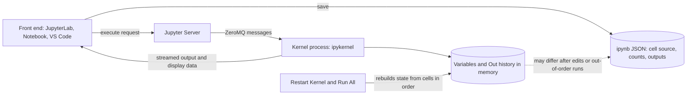

## TL;DR
Jupyter runs code in cells against a long-lived kernel and saves code and outputs together in an
`.ipynb` file: the fastest way to explore data and read model outputs. That persistent state also makes
notebooks unreliable as evidence unless you restart and run all.

## Why it exists
- **Much AI work is exploratory.** Look at 50 failing eval cases, try three prompt variants, plot score
  distributions, inspect what the retriever returned.
- **Scripts make every question start from zero.** Reloading a model, re-reading a dataset, re-calling an
  API you pay for: seconds or minutes of setup dominate a two-second question, and output scrolls away in
  a terminal.
- **A plain REPL keeps state but not much else.** It loses history and cannot show tables, images or
  charts well.
- **Jupyter splits a stateful kernel from a front end.** Load the model or dataframe once, then ask
  questions in small cells, each with output rendered inline and saved next to the code. The result
  doubles as a record others can read.
- **It trades some reproducibility for iteration speed.** Scripts with print statements are reproducible
  but slow to iterate; knowing exactly what the notebook gave up is the skill.

## How it works
### Architecture
| Piece | What it is | Why it matters |
|---|---|---|
| **Kernel** | A separate process (for Python, `ipykernel`, built on IPython) that executes code and holds all variables | Separate *because* the front end can crash, reconnect or be another program without losing state; other languages plug in the same way |
| **Messaging protocol** | ZeroMQ sockets with a documented protocol: execute requests, streamed output, rich display data, interrupts | Why JupyterLab, the classic Notebook interface, VS Code and hosted services can all drive the same kernel |
| **Server** | Jupyter Server | Manages kernels, files and the browser-facing API |
| **Document** | An `.ipynb` is JSON: cells, each with source, an execution count and outputs (text, HTML, base64 images) | Outputs live *in* the file, so it reads without re-running, and can also carry data and secrets you did not mean to share |

### State is the execution history, not the file
- **The kernel's state is whatever cells you ran, in the order you ran them,** including cells since
  edited or deleted.
- **The file shows each cell's current text,** which may not be the code that produced the variables in
  memory.
- **The visible clue:** execution counts (`[7]`, `[3]`) out of order.
- **The only proof a notebook works:** **Restart Kernel and Run All** producing the same results.

### Kernels, environments and the install trap
- **The kernelspec picks the Python.** It is a small JSON file naming the interpreter to launch, not the
  shell you started Jupyter from.
- **Register a project environment as a kernel:** `python -m ipykernel install --user --name myenv`.
- **`!pip` vs `%pip`.** `!pip` runs whatever `pip` is first on the server's `PATH`, which may belong to
  another environment; `%pip` installs with the kernel's own interpreter, which is what you usually want.

### Memory lives as long as the kernel
- **Everything the kernel references survives until restart.**
- **Output history holds references too.** IPython keeps every displayed result (`Out`, `_`, `__`), so a
  large DataFrame or tensor you displayed stays referenced even after you `del` the variable.
- **Re-running a "load model" cell makes a second copy** before the first can be freed. On a GPU that is
  the classic notebook out-of-memory error: the first load fits, the re-run does not, and only a kernel
  restart reliably gives the memory back.

### Useful machinery
- **Magics:** `%timeit` for micro-benchmarks; `%autoreload` to pick up edits to imported modules.
- **Top-level `await` works** *because* IPython kernels already run an event loop. The same fact is why
  `asyncio.run()` fails in a notebook with "cannot be called from a running event loop".
- **Headless execution:** `jupyter nbconvert --execute` runs a notebook top to bottom; papermill injects
  parameters and runs notebooks as batch jobs, which some teams use for scheduled reports.
- **Version control helpers:** nbstripout removes outputs before commit; Jupytext pairs a notebook with a
  plain `.py` file so diffs and reviews are readable.

## Diagram
The kernel's memory comes from the execution history, while the `.ipynb` stores only current cell text
and saved outputs; Restart and Run All is what makes the two agree.



## Examples
### Error analysis on 2,000 RAG answers, and the stale-cell trap
Illustrative numbers from one eval run.

| Cell | Does | Cost |
|---|---|---|
| 1 | Loads eval results JSONL into pandas and, once, the embedding model | about 30 seconds |
| 2 | Filters the 140 rows the judge scored as failures | seconds |
| 3 | Shows ten of them: question, retrieved chunks, answer side by side | seconds |
| 4 | Many failures involve tables, so adds a `has_table` flag by regex over the chunks; stores a cross-tab of document type against `has_table` for failing rows in `by_type` | seconds |
| 5 | Plots `by_type` | seconds |

Each question takes seconds because the model and data stay in memory. Then the trap:
1. **You edit cell 2's filter** to include "partial" scores and re-run cells 2 and 5, but not cell 4.
2. **`by_type` still holds counts from the old subset,** so the chart is silently wrong; nothing errors.
3. **The file shows the new filter,** so a reviewer cannot tell.
4. **Before sharing, you Restart and Run All:** cell 4 now runs on the new subset and the chart changes.
   That habit makes the notebook trustworthy.
5. **Finally, the `has_table` heuristic moves into `analysis/features.py` with a test,** and the notebook
   imports it, so the logic outlives the exploration.

```python
%load_ext autoreload
%autoreload 2
import pandas as pd
from analysis.features import has_table      # logic lives in a module, not a cell

df = pd.read_json("runs/eval-2025-03.jsonl", lines=True)
fails = df[df.score < 3].assign(has_table=lambda d: d.chunks.map(has_table))
pd.crosstab(fails.doc_type, fails.has_table)
```

### CI check: was this report notebook run top to bottom?
A pure-Python check for notebooks committed with outputs (curated reports). Counts of 1..n in order are
what Restart and Run All produces; anything else means hidden state.

```python
import json, sys

def check(path: str) -> list[str]:
    nb = json.load(open(path, encoding="utf-8"))
    counts = [c.get("execution_count") for c in nb["cells"] if c["cell_type"] == "code"]
    ran = [n for n in counts if n is not None]
    problems = []
    if ran != list(range(1, len(ran) + 1)):
        problems.append(f"execution counts {ran} are not 1..{len(ran)} in order")
    if len(ran) < len(counts):
        problems.append(f"{len(counts) - len(ran)} code cell(s) never ran")
    return problems

if __name__ == "__main__":
    results = {p: check(p) for p in sys.argv[1:]}
    for p, problems in results.items():
        for msg in problems:
            print(f"{p}: {msg}")
    sys.exit(1 if any(results.values()) else 0)
```

A notebook whose counts read `[1, 7, 3]` fails with a clear message; one run cleanly passes. Do not run
it on output-stripped notebooks, where every count is empty.

## Production patterns
- **Strip outputs at commit time.** Run `nbstripout --install` in the repo so a git filter removes outputs
  and execution counts from exploratory notebooks. Monitor with a secret scanner over the repository, since
  saved outputs are where keys and customer records leak.
- **Pair notebooks with text files for review.** Use Jupytext paired formats (for example ipynb plus a
  percent-format `.py`) so pull requests diff readable code. Review the `.py`; regenerate the notebook
  from it.
- **Re-execute reports headlessly before publishing.** Run `jupyter nbconvert --to notebook --execute` (or
  papermill with `-p` parameters for scheduled runs) in CI, so published numbers come from a clean kernel.
  Monitor run duration and failures like any batch job.
- **Promote logic into a tested package.** Once a helper is reused, move it to a module with tests and
  import it with `%autoreload 2` during exploration. Track how much logic lives only in cells; it should
  trend to zero for anything scheduled.
- **One registered kernel per project environment.** Register each project's virtual environment with
  `python -m ipykernel install --user --name <project>` and install only with `%pip`. Watch for
  `ModuleNotFoundError` right after an install, the sign of a mismatched interpreter.

## Trade-offs
- **Fast iteration vs hidden state.** Persistent kernel state makes iteration fast when setup is
  expensive, but results may not reproduce; the balance flips the moment the output informs a decision
  others rely on.
- **Readable saved outputs vs bloat and leaks.** Outputs saved in the file make notebooks readable without
  re-running, yet bloat diffs and can leak customer data or keys; strip them for code review, keep them
  only for curated reports.
- **Exploration vs modular code.** Notebooks are excellent for exploration and teaching, but poor for
  modular, tested code; once logic is reused or scheduled, it belongs in a package the notebook imports.
- **Cheap scheduled jobs vs operability.** Parameterized notebook execution turns analyses into repeatable
  jobs cheaply, but a scheduled notebook is harder to test, type-check and monitor than a script with the
  same logic.

## Pitfalls
- **Trusting out-of-order execution.** Symptom: a colleague running the notebook top to bottom gets
  different numbers, or a `NameError` for a variable you deleted.
- **Committing outputs with API keys, tokens or customer records.** Symptom: secrets or personal data in
  the repository history and in rendered previews.
- **Calling `asyncio.run()` in a cell.** It raises because the kernel's loop is already running. The usual
  hack, patching nested loops, hides the problem; use top-level `await` instead.
- **Re-running a model-loading cell, or displaying large tensors, in a long session.** Symptom: CUDA
  out-of-memory on a cell that worked an hour ago, cleared only by restarting the kernel.
- **Installing with `!pip` into a different interpreter than the kernel's.** Symptom: a successful install
  followed by `ModuleNotFoundError` in the next cell.
- **Shipping a notebook as the production service.** Symptom: no tests, no error handling, and an outage
  when someone runs cells in a new order.

## When to use
- **Use when:** exploring and communicating: data inspection, error analysis on eval results, prompt
  iteration, quick model comparisons, and demos for stakeholders.
- **Move code out when:** it is reused, scheduled or needs tests.
- **Before trusting numbers:** treat nothing as final until Restart and Run All reproduces it, and pin the
  environment so others can.
- **Pair with tracking:** for tracking runs and reproducible evaluations, see the LLMOps lessons;
  notebooks complement experiment tracking rather than replace it.
- **Interviews:** expect to explain hidden state and how you keep notebook analysis honest.

## Role lens
- **Engineer:** Explores data and failure cases in notebooks, then promotes stable logic into tested
  modules the notebook imports, with outputs stripped before commit.
- **Architect:** Sets the boundary: notebooks for exploration and reports, packages and pipelines for
  anything scheduled or served, plus rules on data allowed in saved outputs.
- **FDE:** Uses a notebook to walk a customer through their own data and model results live, then hands
  over a cleaned, re-run version as the record of findings.

## Check yourself
**Q:** A colleague's notebook shows a 12-point accuracy improvement from a new prompt. What would you
check before believing it, and why is a notebook specifically prone to this kind of error?
**A:** I would restart the kernel and run all cells in order, because the kernel's state reflects the
execution history, not the file: an edited cell, a variable left over from an earlier experiment or a
filter applied to only one arm can produce a difference that the visible code does not explain. I would
also check that both prompts ran on the same rows, with the same model and settings, that the evaluation
function is identical for both, and that the sample is large enough for a 12-point gap to be meaningful.
Then I would move the comparison into a script or eval harness so it can be re-run.

## Interview questions
### What is a Jupyter kernel, and why is it a separate process from the front end?
- **The kernel executes code and holds all variables;** for Python it is `ipykernel`, built on IPython.
- **It is separate so state survives the front end,** which can crash, reconnect or be a different program
  such as JupyterLab, VS Code or a hosted service, all speaking the same ZeroMQ messaging protocol.
- **The cost is hidden state:** memory reflects what ran, not what the file shows.

### A notebook hits CUDA out-of-memory on a cell that worked an hour ago. How do you debug and fix it?
- **Suspect re-run loading cells.** Re-running "load model" creates a second copy before the first can be
  freed.
- **Suspect output history.** IPython keeps displayed results in `Out`, `_` and `__`, so a displayed tensor
  stays referenced after `del`.
- **Fix:** restart the kernel, which reliably frees the memory, load the model once in an early cell, and
  avoid displaying large tensors.

### When would you not use a notebook?
- **For anything scheduled, reused or served,** because notebooks are hard to test, type-check and
  monitor; that logic belongs in a package the notebook imports.
- **For results others will rely on, unless re-run cleanly,** because out-of-order state can produce
  numbers the visible code does not explain.

### `pip install` succeeded in a cell, but the next cell raises `ModuleNotFoundError`. Why?
- **`!pip` runs whichever `pip` is first on the server's `PATH`,** which may belong to another
  environment than the kernel's.
- **Use `%pip`,** which installs with the kernel's own interpreter.
- **Prevent it per project:** register the environment with `python -m ipykernel install --user --name`
  and select that kernel.

### How do you keep notebooks safe and reviewable in a team repository?
- **Strip outputs on commit** with `nbstripout --install`, because saved outputs bloat diffs and can carry
  keys or customer records.
- **Pair with Jupytext** so reviews diff a readable `.py` file.
- **Re-execute report notebooks in CI** with `jupyter nbconvert --execute` or papermill, so published numbers
  come from a clean kernel.

## Quiz
### Q: What determines the values of variables in a running Jupyter kernel?
- [ ] The current text of the cells, read top to bottom
- [x] The cells actually executed, in the order they were executed, including since-edited ones
- [ ] The last saved version of the .ipynb file
- [ ] Only the most recently executed cell
> The kernel is a live process that accumulates state from every execution. The file shows current cell
> text, which may differ from what produced the state, hence Restart and Run All.

### Q: Why does asyncio.run() fail inside a standard IPython notebook cell?
- [ ] Notebooks do not support asynchronous code at all
- [ ] The kernel uses threads instead of an event loop
- [x] The kernel already runs an event loop, and asyncio.run() refuses to start one inside a running loop
- [ ] asyncio is not installed in the default kernel
> IPython kernels run their own event loop, which is also why top-level await works directly in a cell.
> asyncio.run() wants to create and own a new loop, so it raises.

### Q: A team wants readable code reviews of notebooks without leaking data. Which practice best addresses both?
- [ ] Converting every notebook to PDF before committing
- [ ] Committing notebooks with full outputs so reviewers can see results
- [x] Stripping outputs before commit and pairing notebooks with plain-text .py files
- [ ] Storing notebooks only on a shared drive outside version control
> Outputs cause noisy diffs and can contain sensitive data. Stripping them, and pairing with a text
> representation such as Jupytext, gives clean diffs while keeping the notebook usable.
