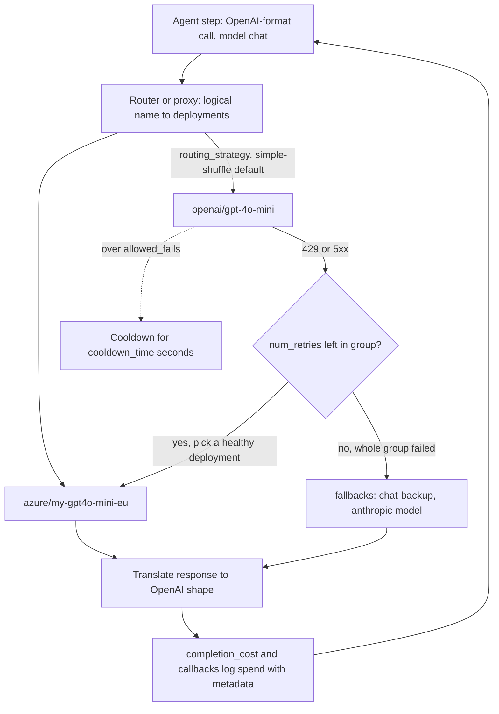

## TL;DR
LiteLLM puts many LLM providers behind one OpenAI-style call, so one agent loop can route steps to
different models, fail over, and track cost and budgets per agent. Its main cost: translation can hide or
lag provider-specific features agents rely on.

## For agent builders
- **Why it matters for agents.** Agents make many calls per task, often to different models (a cheap
  router step, a strong planner, a judge for evals). One call shape means one tool-calling loop for every
  provider, and one place for retries, fallbacks and spend caps per agent or tenant.
- **Where it shows up in your stack.** As the model layer under hand-written agent loops, via LangChain's
  LiteLLM chat model integration (and so LangGraph), inside other agent frameworks that accept a LiteLLM
  model string, as a proxy that every agent service calls with an OpenAI client, and in eval harnesses
  that compare models on the same agent tasks.
- **What you control.** Logical model names per agent role, `fallbacks` and `num_retries`, which layer
  owns retries, `drop_params`, virtual keys with budgets per agent or tenant, `metadata` for cost
  attribution, and callbacks to tracing backends.
- **What you can skip.** The internals of each provider translation. Test the parts your agent depends on
  (tool calls, streaming usage, caching) on every provider in the route instead.

## Why it exists
- **Teams rarely stay on one model.** A cheap model for classification, a strong one for reasoning, a
  second provider for outages or rate limits, a self-hosted model for sensitive data, and new models to
  evaluate without rewriting call sites.
- **Every provider differs.** Each has its own SDK, message format, tool-call shape, error classes,
  streaming events and usage fields.
- **Direct calls spread the cost everywhere.** Every new provider touches every call site, fallbacks are
  ad hoc per service, and nobody can answer "what did we spend on model X for feature Y last month",
  because usage is logged in five shapes.
- **An internal wrapper grows into a product.** Fine for two providers and one capability, it becomes a
  maintained translation layer for tool schemas, streaming, error mapping and pricing tables: the boring,
  fast-changing work a shared library amortises.
- **Proxy mode moves it out of apps entirely.** Services talk to one OpenAI-compatible endpoint; the
  platform team controls which models exist, who may use them and how much they may spend. The trade: a
  dependency on every LLM call, whose correctness, latency and update cadence become yours.

## How it works
### Unified call
`litellm.completion(model="<provider>/<model>", messages=[...])` (and `acompletion` for asyncio):
1. **Parse the provider prefix:** `openai/`, `anthropic/`, `bedrock/`, `vertex_ai/`, `ollama/`,
   `hosted_vllm/` and many more.
2. **Translate** the OpenAI-format request into that provider's native request and call it.
3. **Translate back** into an OpenAI-format object: `choices[0].message`, `tool_calls` and `usage`.

- **Same shape whichever provider served it:** `completion(model="anthropic/...", messages=...)` returns
  the same response object as an OpenAI call.
- **Credentials** come from provider-specific environment variables.
- **Unsupported parameters raise by default.** `drop_params=True` silently drops them instead, which is
  convenient and dangerous in equal measure.

### What translation actually does (OpenAI format to `anthropic/...`)
Request, OpenAI format in, Anthropic request out:

| You send (OpenAI) | LiteLLM sends (Anthropic) |
|---|---|
| `system` message in `messages` | top-level `system` field |
| `max_tokens` omitted | a value is supplied, because Anthropic requires it |
| `tools[].function` | `name`/`description`/`input_schema` tool |
| assistant `tool_calls` | `tool_use` blocks |
| `role: "tool"` message | `tool_result` block inside a user message |

Response, Anthropic reply in, OpenAI shape out:

| Anthropic returns | You receive (OpenAI) |
|---|---|
| `tool_use` blocks | `tool_calls` with `arguments` re-serialised as a JSON string |
| `stop_reason`: `end_turn`, `tool_use`, `max_tokens` | `finish_reason`: `stop`, `tool_calls`, `length` |
| `input_tokens` / `output_tokens` | `prompt_tokens` / `completion_tokens` |

- **Every mapping is a fidelity risk.** A feature with no OpenAI equivalent (thinking blocks, cache
  breakpoints, citations) must ride in an extra field or is lost, which is why translation fidelity is the
  thing to test.
- **Agent history is the hardest case.** A multi-step transcript with parallel tool calls, tool results
  and reasoning blocks must round-trip through translation on every step; test full multi-step traces,
  not single calls.

### Errors
- **One hierarchy.** Provider errors map onto OpenAI-style exception types (rate limit, context window
  exceeded, authentication, bad request), so retry and fallback logic is written once.

### Router
`litellm.Router` takes a `model_list` where several deployments share one logical `model_name` (for
example two Azure regions plus OpenAI direct).

| Setting | Effect |
|---|---|
| `routing_strategy` | load balancing: random `simple-shuffle` by default, or prefer the least busy, lowest latency or least used deployment |
| `allowed_fails`, `cooldown_time` | a deployment exceeding `allowed_fails` goes into cooldown for `cooldown_time` seconds |
| `num_retries` | retries within the group |
| `fallbacks` | map one logical model to others |
| `context_window_fallbacks` | overflow to a longer-context model |
| `content_policy_fallbacks` | reroute on content-policy errors |

- **Callers ask for the logical name; topology lives in config.**
- **Order matters.** Retries happen within the group first; fallback to another group only when the whole
  group has failed, because a different model is a bigger behavioural change than a different deployment
  of the same one.

### Cost and callbacks
- **Price map.** `completion_cost` computes per-call cost from usage: prompt tokens × input price +
  completion tokens × output price, looked up by model name.
- **Custom names need `base_model`.** An Azure deployment called `my-gpt4o-mini-eu` is not in the map, so
  declare its `base_model` in the deployment's `model_info` for the lookup to work.
- **Callbacks** send each call's inputs, outputs, latency and cost to logging and observability backends.

### Proxy (gateway) mode
- **Same machinery as a server** exposing OpenAI-compatible endpoints, configured by a YAML file of models,
  routing and fallbacks.
- **Governance features:** virtual API keys mapped to teams or users, budgets and rate limits per key,
  spend logs in a database, and central guardrail hooks.
- **Any client, any language**, pointed at the proxy's `base_url`.
- **Licensing.** The core is open source, but some enterprise proxy features (for example SSO and certain
  audit and admin controls) need a commercial licence; check which you need before standardising.

## Diagram
A request for the logical name "chat": retries stay inside the group first, a failing deployment cools
down, and only when the whole group fails does the call fall back to another provider's model.



## Examples
### One agent loop, a model per role
The same tool loop runs whichever provider serves each step; a cheap model decides whether tools are
needed, a stronger one does the work. Model names are illustrative; take them from config.

```python
import json, litellm

ROLES = {"router": "openai/gpt-4o-mini", "worker": "anthropic/claude-haiku-5-5"}
tools = [{"type": "function", "function": {
    "name": "get_order", "description": "Look up an order by id",
    "parameters": {"type": "object", "properties": {"order_id": {"type": "string"}},
                   "required": ["order_id"]}}}]

def get_order(order_id: str) -> dict:
    return {"order_id": order_id, "status": "shipped"}

def run(question: str, tenant: str, max_steps: int = 6) -> str:
    messages = [{"role": "user", "content": question}]
    for step in range(max_steps):
        model = ROLES["router"] if step == 0 else ROLES["worker"]
        resp = litellm.completion(model=model, messages=messages, tools=tools, timeout=20,
                                  metadata={"agent": "support", "tenant": tenant, "step": step})
        msg = resp.choices[0].message
        print(step, resp.model, resp.usage.prompt_tokens, litellm.completion_cost(resp))
        if resp.choices[0].finish_reason != "tool_calls":
            return msg.content                     # same finish_reason names for every provider
        messages.append(msg.model_dump())
        for call in msg.tool_calls:
            args = json.loads(call.function.arguments)   # validate before running in production
            messages.append({"role": "tool", "tool_call_id": call.id,
                             "content": json.dumps(get_order(**args))})
    return "Step limit reached."
```

- **Switching models mid-run is a design choice.** History written by one model is read by another;
  provider-specific blocks (reasoning, cache markers) do not carry over, so eval the mixed trajectory.
- **Per-step cost** comes from `completion_cost`, so you can report cost per task and per agent role.

### Router with two deployments, retries and a cross-provider fallback
Model names are illustrative; take them from config.

```python
import litellm
from litellm import Router

router = Router(
    model_list=[
        {"model_name": "chat", "litellm_params": {"model": "openai/gpt-4o-mini"}},
        {"model_name": "chat", "litellm_params": {"model": "azure/my-gpt4o-mini-eu",
                                                  "api_base": "https://example-eu.openai.azure.com"}},
        {"model_name": "chat-backup", "litellm_params": {"model": "anthropic/claude-haiku-5-5"}},
    ],
    num_retries=2,                                # retries within the group; may pick another deployment
    fallbacks=[{"chat": ["chat-backup"]}],        # if all "chat" deployments fail
    timeout=20,
)

resp = router.completion(
    model="chat",
    messages=[{"role": "user", "content": "Summarise: the refund was issued on 3 May."}],
    metadata={"feature": "ticket-summary", "tenant": "acme"},   # for cost attribution in callbacks
)
print(resp.model, resp.choices[0].message.content)
print(resp.usage.prompt_tokens, resp.usage.completion_tokens, litellm.completion_cost(resp))
```

Scenario: OpenAI returns 429s for a minute.
1. By default the router spreads "chat" traffic across both deployments (simple shuffle).
2. Failing calls are retried, and the OpenAI deployment goes into cooldown after repeated failures.
3. Traffic lands on the EU Azure deployment.
4. Only if the "chat" group as a whole fails does the request go to the Anthropic backup; the caller still
   receives an OpenAI-shaped response.

### The same topology as a proxy config
Applications then call the proxy with any OpenAI-compatible client and a virtual key.

```yaml
model_list:
  - model_name: chat
    litellm_params:
      model: openai/gpt-4o-mini
      api_key: os.environ/OPENAI_API_KEY
  - model_name: chat
    litellm_params:
      model: azure/my-gpt4o-mini-eu
      api_base: https://example-eu.openai.azure.com
      api_key: os.environ/AZURE_API_KEY
    model_info:
      base_model: azure/gpt-4o-mini      # so the price map can cost this custom name
  - model_name: chat-backup
    litellm_params:
      model: anthropic/claude-haiku-5-5
      api_key: os.environ/ANTHROPIC_API_KEY
router_settings:
  num_retries: 2
  timeout: 20
  allowed_fails: 3
  cooldown_time: 30
  fallbacks: [{"chat": ["chat-backup"]}]
```

```python
from openai import OpenAI
client = OpenAI(base_url="http://localhost:4000", api_key="sk-team-virtual-key", max_retries=0)
client.chat.completions.create(model="chat", messages=[{"role": "user", "content": "hi"}])
```

`max_retries=0` on the app client leaves retries to the proxy, so they live in exactly one layer.

### Worked scenario: how stacked retries amplify an incident
Illustrative settings, during an outage where every upstream call fails:

| Layer | Attempts |
|---|---|
| Application client retries 2 times | 3 |
| Router `num_retries=2` per group | × 3 |
| Groups tried: "chat", then "chat-backup" | × 2 |
| **Upstream calls for one user request** | **18** |

Eighteen calls for one user request, sent exactly when the provider is already rate limiting you. With
retries owned only by the router (`max_retries=0` on the app client), the same request makes 3 × 2 = 6
calls.

### Worked scenario: the same outage, inside an agent
An agent task averages 8 model calls (illustrative). With the stacked setup above, each call can become
18 upstream attempts.

| Setup | Upstream calls for one agent task, worst case |
|---|---|
| Stacked retries: 8 × 18 | 144 |
| Router-owned retries only: 8 × 6 | 48 |
| Router-owned retries plus a task deadline that stops after 3 failed steps: 3 × 6 | 18 |

Agents multiply every per-call retry policy by their step count, which is why the loop needs its own
deadline and failure budget on top of the router.

## Production patterns
- **One logical name per agent role.** Call `planner`, `router`, `judge` instead of provider model names,
  and map them in router or proxy config, so swapping a model is a config change plus an eval run.
  Monitor cost and latency per role.
- **Budget each agent with its own key.** In proxy mode give each agent or tenant a virtual key with a
  spend budget and rate limit, so one runaway loop cannot spend the whole month. Monitor budget burn per
  key and alert well before the cap.
- **Own retries in one layer.** Set `num_retries` and `timeout` in the router or proxy, and `max_retries=0`
  on clients that call the proxy. Monitor upstream calls per user request during incidents.
- **Eval every fallback pair.** Run the eval suite on each `fallbacks` target before enabling it, and alert
  on fallback rate per route, so a silent permanent failover with worse quality is noticed.
- **Make cost attribution complete.** Declare `base_model` for every custom deployment, pass `metadata`
  (feature, tenant) on each call, and reconcile computed spend against provider invoices monthly before
  using it for chargeback.
- **Run the proxy highly available.** At least two replicas behind a load balancer, sharing one database
  for keys and spend logs, with the proxy's health endpoints wired to the orchestrator's liveness and
  readiness probes. Monitor proxy-added latency and error rate.
- **Pin the version, keep `drop_params` off globally.** Lock the LiteLLM version and upgrade deliberately
  with an eval run; enable dropping only where a known parameter gap is accepted. Watch for cost or format
  changes after upgrades.

## Trade-offs
- **Per-step model choice vs trajectory consistency.** Routing cheap steps to a small model cuts agent
  cost, but each switch hands a transcript written by one model to another; it pays off only when evals
  on mixed trajectories hold up.
- **One interface vs lowest common denominator.** Switching and A/B testing become cheap, but features get
  hidden; Claude cache breakpoints or Responses-API tools may need provider-specific params.
- **Library vs proxy.** The in-process library adds no network hop, but every service needs credentials
  and config; the proxy centralises keys, budgets and logs at the price of an extra hop and a component you
  must run highly available.
- **Availability vs behaviour drift.** Automatic fallbacks raise availability, but a fallback model may
  behave differently on your prompts; without evals per fallback pair, an outage silently becomes a
  quality regression.
- **Instant cost visibility vs accuracy.** Built-in price maps show cost immediately but can lag price
  changes and negotiated rates; reconcile against provider invoices before using them for chargeback.

## Pitfalls
- **Testing translation with single calls only.** A one-shot prompt works on every provider, but the
  agent fails on step 3 when a parallel tool-call history is translated. Fix: replay full multi-step
  agent traces against each provider in the route.
- **`drop_params=True` globally.** A parameter you rely on (structured output, a stop sequence) is quietly
  discarded for one provider, and outputs change format only when a fallback fires.
- **Assuming tool calling and streaming behave identically everywhere.** Translation edge cases show up as
  malformed tool arguments or missing usage in streamed responses from one provider.
- **Fallback chains without evals.** During an incident users see a different model's style or lower
  accuracy, and support tickets spike with no error in the logs.
- **Unpinned versions of a fast-moving dependency on every LLM call.** An upgrade changes defaults or
  pricing data. Symptom: a behaviour or cost change nobody deployed deliberately.
- **Stacking retry layers.** Application retries × router `num_retries` × any retries the underlying client
  performs × each fallback group. Symptom: one user request becomes a dozen upstream calls during an
  incident, amplifying the provider's rate limiting. Own retries in exactly one layer.
- **Cost reports showing zero or raising for some deployments.** The custom deployment name is not in the
  price map; declare `base_model` so spend attribution is not silently undercounted.
- **Running the proxy as a single instance.** It becomes the single point of failure for every AI feature,
  and one restart takes them all down.

## When to use
- **Use when** you genuinely use, or must be able to switch between, several providers: routing by cost or
  capability, cross-provider fallbacks, eval harnesses comparing many models on the same agent tasks, or
  agents that use different models for different roles.
- **Use proxy mode when** a platform team needs central keys, budgets and spend attribution across many
  services.
- **Stay with a native SDK when** one provider is strategic and you depend on its newest features, or call
  volume is small and an extra abstraction is not worth owning.
- **Measure** fallback rate, per-model latency and error rates, cost per feature and tenant, and quality on
  an eval set for each fallback pair.
- **Interviews:** how you would build provider failover and where the abstraction should stop.

## Role lens
- **Engineer:** Calls models through one interface, writes retry and fallback config, attaches
  metadata for cost attribution, and handles provider-specific parameters where translation falls short.
- **Architect:** Decides library versus gateway, which providers and fallback pairs are allowed, how
  budgets and keys are governed, and keeps a vendor-exit path that does not depend on one SDK.
- **FDE:** Deploys the proxy inside a customer's network to route between their approved cloud models
  and a local model, giving their security team one place to audit and cap usage.

## Check yourself
**Q:** Your product runs on one provider. Leadership asks for "no single point of failure for AI". A
colleague proposes adding LiteLLM with a fallback to a second provider. What else must be true for this
to actually deliver resilience?
**A:** The fallback must be tested, not just configured. Prompts, tool schemas and output parsing need
to work on the second model, so I would run the eval suite against it and fix prompt or schema
differences first. Features that do not translate, such as provider-specific caching or structured
output modes, need equivalents or graceful degradation. Rate limits and quotas on the backup must cover
failover traffic. The routing layer itself must not become the new single point of failure, so the
proxy runs with multiple replicas or the library is embedded. Finally, alert on fallback rate, so a
silent permanent failover with worse quality is noticed.

## Interview questions
### What does LiteLLM translate, and where does translation lose fidelity?
- **It maps requests and responses:** for `anthropic/...` the OpenAI `system` message becomes top-level
  `system`, `tools[].function` becomes `input_schema` tools, and `role: "tool"` messages become
  `tool_result` blocks inside a user message.
- **On the way back** `stop_reason` maps to `finish_reason` and `input_tokens` to `prompt_tokens`, so
  parsing and logging are written once.
- **Lost or hidden:** features with no OpenAI equivalent, such as thinking blocks, cache breakpoints or
  citations, which must ride in extra fields.

### After a provider outage, your agent's task success dropped and support tickets spiked, but logs showed no errors. What happened?
- **Likely a silent fallback:** the router moved traffic to `chat-backup`, so requests succeeded on a
  model with different style, tool-calling accuracy or instruction following on your prompts.
- **Check `drop_params`:** if it is on globally, a stop sequence or response format may have been dropped
  only for the fallback provider, changing output format.
- **Fix:** run the eval suite on every fallback pair before enabling it and alert on fallback rate per route.

### A fallback fires halfway through a 10-step agent run. What can go wrong, and how do you design for it?
- **Mixed trajectories:** steps 1 to 5 were written by one model and steps 6 to 10 by another; reasoning
  blocks and cache state do not carry over, and the new model may call tools differently.
- **Design choices:** either pin a task to one model group for its whole run and retry the task, or allow
  mid-run fallback only to pairs whose mixed trajectories passed your agent evals.
- **Observe it:** tag each step with the serving model in traces and alert on fallback rate per agent.

### When would you not introduce LiteLLM?
- **One strategic provider:** if you depend on its newest features, a native SDK exposes them first and
  at full fidelity.
- **Small call volume:** an extra abstraction on every LLM call, with its own correctness, latency and
  update cadence, may not be worth owning.
- **Library versus proxy:** choose the proxy only when many services and languages need shared keys,
  budgets and spend logs, because it is an extra hop you must run highly available.

### How many upstream calls can one user request make during a full outage?
- **Stacked layers multiply:** 3 application attempts × 3 router attempts per group × 2 groups gives 18
  upstream calls in the illustrative setup.
- **With retries owned only by the router** the same request makes 3 × 2 = 6 calls.
- **So set `max_retries=0`** on clients that call the proxy and monitor upstream calls per user request
  during incidents.

### Cost reports show zero spend for one Azure deployment. How do you fix attribution?
- **Cause:** `completion_cost` looks up price by model name, and a custom name such as
  `my-gpt4o-mini-eu` is not in the price map.
- **Fix:** declare `base_model` in that deployment's `model_info` and pass `metadata` (feature, tenant)
  on each call so callbacks can attribute spend.
- **Then reconcile** computed spend against provider invoices before chargeback, because price maps can
  lag price changes and negotiated rates.

## Quiz
### Q: What does LiteLLM's response translation give application code?
- [ ] A guarantee that every provider produces identical outputs for the same prompt
- [x] One OpenAI-format response shape, including usage and tool calls, regardless of provider
- [ ] Automatic prompt rewriting optimised for each model
- [ ] Access to every provider-specific feature through standard OpenAI parameters
> Translation normalises the shape of requests and responses, so parsing and logging are written once.
> It cannot make models behave the same, and some provider-specific features have no standard equivalent.

### Q: When is LiteLLM's proxy mode a better choice than the in-process library?
- [ ] When a single Python service calls one provider
- [ ] When the lowest possible latency is the only goal
- [x] When many services and languages need shared keys, budgets, rate limits and spend logs
- [ ] When you need offline access to models without any server
> The proxy centralises governance behind an OpenAI-compatible endpoint any client can use. For one
> service and one provider, the extra hop and operational burden rarely pay off.

### Q: Why is `drop_params=True` risky as a global default?
- [ ] It doubles the token cost of each request
- [ ] It disables retries on rate-limit errors
- [x] Unsupported parameters are silently removed, so behaviour can change only when a different provider serves the call
- [ ] It prevents streaming responses from working
> Silently dropping a parameter such as a response format or stop sequence turns a loud error into a
> quiet behaviour change, often visible only during a fallback when debugging is hardest.

## Use cases & projects
### Use cases
- **Model routing per agent role.** A cheap model for routing steps, a strong one for planning and a judge
  model for evals, all behind one call shape.
- **Fallbacks during outages.** `fallbacks` and `num_retries` keep an agent running when one provider
  rate-limits or fails.
- **Spend control per agent or tenant.** Proxy virtual keys with budgets and `metadata` for attribution
  answer "what did this agent cost last month".
- **Cross-provider agent evals.** The same agent tasks run against several models to compare quality,
  latency and cost before a switch.

### Mini project
**Route one agent across two providers (2-3 hours).**
- **Goal:** run the same tool-calling agent on two providers and prove the fallback works.
- **Steps:** write one agent loop with a single tool using LiteLLM; configure a primary and a fallback
  model in a `Router`; run 10 tasks on each; force a primary failure (point the primary deployment at an
  unreachable `api_base`) and confirm the fallback serves; log per-task cost and tool-call parse success.
- **Done when:** you have a per-provider table of success, cost and latency, plus a note on any parameter
  that behaved differently or was dropped.
