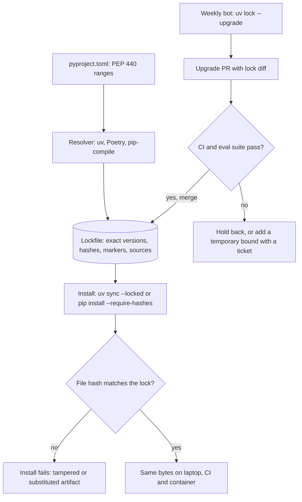

## TL;DR
Declare what an agent *needs* as ranges, record what it *got* as exact versions with hashes, and install
only from that record, so the agent you evaluated is the agent you ship. Applications lock; libraries
publish ranges.

## For agent builders
- **Why it matters for agents.** Agent behaviour is an eval result, and an eval result is only valid for
  the environment it ran in. An unlocked rebuild can move `langchain-core`, a provider SDK or a tokenizer
  and silently change message formatting, tool-call parsing or retries.
- **Where it shows up in your stack.** `uv.lock` or `poetry.lock` pins LangChain, LangGraph, LangSmith,
  `openai`, `anthropic` and their transitive graph; Renovate or Dependabot opens upgrade pull requests;
  your eval suite is the gate on each one.
- **What you control.** Lock the service and the eval harness from one file, pin what the lock cannot
  (dated model snapshots instead of moving aliases, prompt versions, embedding model revisions, base
  image digests), and record all of them with every eval run.
- **What you can skip.** PEP 440 edge cases beyond `~=` and pre-releases, and lockfile format internals.

## Why it exists
- **The graph is mostly not yours.** A typical AI service declares perhaps fifteen direct dependencies and
  installs well over a hundred, each allowing a range of its own dependencies, with new releases daily.
- **Ranges alone drift.** `pip install` on Tuesday and on Friday can produce different environments from the
  same source tree.
- **The failure is rarely loud at install time.** It appears later as a changed default, a removed keyword argument or a new
  validation rule, in a package nobody on the team chose directly.
- **Pinning nothing** ("always get the latest fixes") makes every build a new, untested combination, so a
  green CI run on Monday says nothing about Friday's deploy.
- **Pinning by hand fails too.** Hand pins in `requirements.txt` miss transitive dependencies unless you freeze
  the whole environment; then upgrades are manual surgery, teams stop upgrading and accumulate vulnerable
  versions. A resolver-generated lockfile gives exactness *and* cheap, reviewable upgrades.

## How it works
### Two layers: constraints and resolution
1. **Declare intent** in `pyproject.toml` with PEP 440 specifiers: `openai>=1.40,<2`, `httpx>=0.27`.
2. **Resolve:** a resolver (uv, Poetry, pip-compile) finds one version of every package in the transitive
   graph that satisfies all constraints at once.
3. **Record** the result in the lockfile.

Keeping the layers separate is the point: humans reason about compatibility in ranges; machines record the
exact solution.

### Reading specifiers precisely
| Specifier | Means |
|---|---|
| `>=1.40,<2` | common application range: newer minors allowed, next major excluded |
| `~=1.4.2` | *compatible release*: `>=1.4.2, ==1.4.*` |
| `~=1.4` | `>=1.4, ==1.*`: the number of components decides how much floats, easy to misread |
| `==1.4.*` | prefix match |
| `==1.4.2` | exact pin |
| `!=1.4.3` | excludes one known-bad release |
| pre-releases (`2.0.0rc1`) | skipped by default unless a specifier names one or you opt in |

- **None of this encodes semantic versioning,** *because* PEP 440 defines ordering, not compatibility
  promises.
- **`0.x` packages can break on a minor bump.** Many core AI-stack packages are still on `0.x`, as the example
  below shows. A range is a bet about the maintainer's behaviour; the lock makes that bet testable.
- **`requires-python` is a constraint too.** A universal lock must work across the whole declared Python range,
  so declaring `>=3.9` when you only run 3.12 can force older releases or split resolutions for some packages.

### What a lockfile records
- **Exact versions** for every package, direct and transitive.
- **Hashes** of the distribution files. With hash checking (`pip install --require-hashes`, or tools that
  verify lock hashes automatically), an install fails if a file's bytes differ from what was locked,
  *because* a version number alone does not prove you got the same artifact: a compromised mirror or index
  could serve different bytes under the same name.
- **Markers and platforms.** Packages can differ by OS, CPU architecture or Python version. A *universal*
  lock (uv.lock, poetry.lock) records all supported environments; a platform-specific one (a pip-compile
  output run on Linux) is valid only where it was resolved.
- **Sources.** Which index each package came from, which matters for torch CUDA wheels and private mirrors.
- **Standard format:** PEP 751 defines `pylock.toml` so different tools can produce and consume the same
  lockfile; tool-specific formats remain common.

### Applications vs libraries
| | Application | Library |
|---|---|---|
| Position | end of the dependency chain | installed alongside other people's dependencies |
| Policy | lock exactly | widest range actually tested |
| Exact pin effect | reproducibility | `httpx==0.27.2` blocks any app needing a newer httpx |

- **Upper bounds (`<2`) on libraries are debated:** they prevent breakage from a future major but cause
  unsatisfiable resolutions when that major ships and the library is not updated.
- **Lower bounds** should reflect the oldest version you actually test.

### Upgrading on purpose
1. A bot (Dependabot, Renovate) or a scheduled job runs `uv lock --upgrade` (or `--upgrade-package openai`
   for one package).
2. It opens a pull request with the lock diff.
3. CI and the eval suite decide.

- **Why:** pinning is safe only if upgrades keep happening. Small, frequent upgrades are cheaper to debug than
  a year of drift landing at once, and keep security fixes flowing.

### What a lock does not pin
| Outside the Python lock | Pin it with |
|---|---|
| interpreter version | a `requires-python` range plus a `.python-version` |
| OS libraries (glibc, CUDA drivers), base container image | an image digest |
| model weights | model revisions or checksums |
| hosted model behind an alias | a dated model snapshot ID where the provider offers one |
| prompts and tool schemas | a prompt version stored with the code |

## Diagram
The lock is the only input to every install, hash checks guard the bytes, and changes reach the lock only
through a reviewed upgrade pull request that CI and evals must pass.



## Examples
### Worked failure: an unlocked rebuild breaks every request
A RAG service declares `openai>=1.0` and `httpx` with no lockfile.

| Step | Without a lock | With a lock |
|---|---|---|
| Trigger | image rebuilt for an unrelated config change; the resolver picks a new minor of the HTTP client that removed a long-deprecated constructor argument | rebuild installs exactly the locked versions; production unaffected |
| Where the new version lands | straight in the production image | in a PR: the weekly `uv lock --upgrade` diff shows the HTTP client moving one minor version |
| What breaks | the resolved SDK still passes that argument, so every request fails at client construction with a `TypeError` about an unexpected keyword | CI's integration test constructs the real SDK client and hits the same `TypeError`, so the upgrade is held back |
| Diagnosis | code, prompts and tests unchanged; only the environment moved, reconstructed from logs | cause visible as a two-line lock diff |

- **Real instance:** this pattern hit older OpenAI Python SDK releases when httpx 0.28 removed its `proxies`
  argument.
- **Fix:** also upgrade the SDK to a release that supports the new client, or add a temporary upper bound
  (`httpx<0.28`) with a comment and a ticket to remove it. The failure happened in a pull request, not in
  production.

### Agent scenario: same commit, different agent
An agent's tool-call success rate on the eval set dropped between two runs of the same commit. The team
compared what each run actually had (illustrative incident, rates from their eval set).

| Pinned? | Run A (last week) | Run B (today) | Effect |
|---|---|---|---|
| Python packages | unlocked rebuild | unlocked rebuild | the agent framework's core package moved one minor version |
| Hosted model | model alias | same alias, now pointing to a newer snapshot | different tool-call style |
| Prompt | `support-v7` | `support-v7` | unchanged |
| Tool-call success on evals | 94% | 81% | two moving parts, impossible to attribute |

The fix was to lock packages with `uv sync --locked`, call a dated model snapshot, and write the lock
hash, model ID and prompt version into each eval run's metadata. The next drop was attributable to one
lock diff.

### What hash checking actually does
Standard library only: the lock records a digest at resolve time, and the installer refuses a file whose
bytes differ, even with the same name and version.

```python
import hashlib, pathlib, tempfile

def sha256(path: pathlib.Path) -> str:
    h = hashlib.sha256()
    with path.open("rb") as f:
        for block in iter(lambda: f.read(1 << 20), b""):   # 1 MiB blocks: wheels can be gigabytes
            h.update(block)
    return h.hexdigest()

wheel = pathlib.Path(tempfile.mkdtemp()) / "demo-1.0-py3-none-any.whl"
wheel.write_bytes(b"original bytes")
locked = sha256(wheel)                       # what the lockfile recorded at resolve time

wheel.write_bytes(b"tampered bytes")         # same name, same version, different file
actual = sha256(wheel)
print("install" if actual == locked else f"refuse: expected {locked[:12]}..., got {actual[:12]}...")
```

### Check how far a specifier floats
With `pip install packaging` (the library pip itself uses for PEP 440):

```python
from packaging.specifiers import SpecifierSet

assert SpecifierSet("~=1.4").contains("1.9")             # surprise: 1.9 is allowed
assert not SpecifierSet("~=1.4.0").contains("1.9")       # patch releases only
assert SpecifierSet(">=1.40,<2").contains("1.99")

candidates = ["1.9", "2.0.0rc1"]                         # what an index offers
assert list(SpecifierSet(">=1.0").filter(candidates)) == ["1.9"]   # pre-release skipped by default
assert list(SpecifierSet(">=1.0").filter(candidates, prereleases=True)) == candidates
```

Use `filter` to see what a resolver would pick: it drops pre-releases when a final release fits (and keeps
them only if nothing else matches). Do not test this with `contains("2.0.0rc1")`, whose default changed
between `packaging` releases (21.x returns False, 26.x returns True).

## Production patterns
- **Record the full agent fingerprint with every eval and trace.** Store the lockfile hash, model snapshot
  ID, prompt version and embedding model revision as run metadata (LangSmith and similar tools accept
  arbitrary metadata on runs). Then a quality change maps to one diff instead of a guess.
- **Gate dependency upgrades on agent evals, not only unit tests.** Upgrade pull requests for agent
  frameworks and provider SDKs run the eval suite; merge only when task success, tool-call validity and
  cost per run hold.
- **Scheduled, small upgrade PRs.** Run `uv lock --upgrade` weekly (or let Renovate or Dependabot do it, if
  they support your lock format), and use `uv lock --upgrade-package openai` for urgent single fixes. Monitor
  lock age and the number of packages behind latest.
- **Lock-is-current gate in CI.** Install with `uv sync --locked` (or run `poetry check --lock` before
  `poetry install`), so an edited `pyproject.toml` without a re-lock fails fast. Pin the tool version so lock
  diffs carry only real changes.
- **Integration test that constructs real clients.** A cheap test that builds the actual SDK and HTTP clients
  catches constructor and import breakage from an upgrade before merge, as in the worked failure above.
- **Temporary bounds with an owner.** When an upstream release breaks you, add a narrow bound such as
  `httpx<0.28` with a comment and a ticket link, and track open bounds so they get removed.
- **Pin what the lock cannot.** Base images by digest (`FROM image@sha256:...`), the interpreter via
  `.python-version`, and model weights by revision (for Hugging Face, the `revision=` argument of
  `from_pretrained` set to a commit hash). Record all of them with eval results.

## Trade-offs
- **Reproducibility vs automatic fixes.** Exact locks make builds reproducible and incidents bisectable, but
  you stop receiving fixes automatically; safe only when an automated upgrade process runs and its PRs get
  merged.
- **Tamper protection vs friction.** Hash checking defends against tampered or substituted artifacts, but
  breaks when the lock lacks a hash for another platform's wheel, when an internal mirror rebuilds or
  re-packages files (new bytes, new hash), or for direct URL and VCS dependencies pip cannot hash-check; then
  verify at the mirror or pin by commit.
- **Universal vs single-platform lock.** One file serves every developer OS and CI image, but may fail to
  resolve packages that exist only for some platforms; a Linux-only lock is simpler when deployment is the
  only target.
- **Library caps vs conflicts.** Tight upper bounds protect users from untested majors but cause unresolvable
  conflicts in applications; testing against new releases quickly usually beats capping.

## Pitfalls
- **Locking packages but calling a moving model alias.** Symptom: agent behaviour changes with no lock
  diff at all. Fix: use a dated model snapshot where the provider offers one, and record the model ID with
  every eval run.
- **Lockfile not committed** (or in `.gitignore`). Symptom: "works locally, fails in CI" with different
  transitive versions in each environment. Fix: commit it and install with `uv sync --locked`.
- **`pip install .` in Docker while the lock sits unused.** Symptom: images containing versions that appear
  nowhere in the lockfile. Fix: install from the lock.
- **Exact pins in a published library.** Symptom: bug reports saying your package cannot be installed
  alongside another common package. Fix: declare the widest tested range.
- **Locking but never upgrading.** Symptom: a security scan listing many known vulnerabilities whose fixes
  shipped months ago, then an upgrade that changes dozens of packages at once. Fix: scheduled upgrade PRs.
- **Different tool versions locally and in CI** for `uv lock` (or `poetry lock`). Symptom: lock diffs rewriting
  many lines (format revision, metadata) with no dependency change, burying the one real change. Pin the
  tool version alongside the lock.
- **Reading `~=1.4` as "1.4.x only".** Symptom: a 1.9 release in an upgrade PR someone assumed was excluded.
  Write `~=1.4.0` or `>=1.4,<1.5` when you mean patch releases only.
- **Treating the Python lock as full reproducibility.** Symptom: identical locks give different results
  because the base image, CUDA runtime or model revision changed underneath.

## When to use
- **Lock:** every agent service, tool server, notebook environment that feeds production, and evaluation
  harness, because eval results are only comparable when the environment is fixed.
- **Do not lock:** a library's published dependencies; lock its development environment for CI instead.
- **Install with checks:** that the lock matches declared dependencies (`uv sync --locked`, `poetry install`
  with a current-lock check), and hash verification where tooling allows.
- **Measure:** lock age and the number of packages behind latest; schedule upgrades.
- **Interviews:** separate application from library policy and explain what hashes protect against.

## Role lens
- **Engineer:** Commits the lock, reads lock diffs in upgrade PRs, and adds a narrowly scoped temporary bound
  with a ticket when an upstream release breaks something.
- **Architect:** Defines organization-wide policy: locking for deployables, upgrade cadence, hash
  verification, approved indexes, and how base images and model revisions are pinned alongside.
- **FDE:** Reproduces the customer's exact environment from their lock or image when debugging, and ships
  locked, mirror-compatible requirements that pass their artifact review.

## Check yourself
**Q:** You maintain both an internal Python library used by several services and one of those services.
How should version constraints differ between them, and what goes wrong if you use the service's policy for
the library?
**A:** The service is a leaf: it locks every package exactly, with hashes, and installs only from the lock,
because reproducibility of what runs matters most. The library is installed alongside other services'
dependencies, so it declares ranges covering versions it is tested against, perhaps with conservative bounds,
and locks only its own CI environment. If the library pinned exact versions, every consuming service would
be forced onto those versions, and any service needing a different version of a shared package (an SDK,
pydantic, httpx) would hit an unresolvable conflict.

## Interview questions
### Why do you need a lockfile if `pyproject.toml` already lists your dependencies?
- **`pyproject.toml` holds ranges for direct dependencies only,** while a typical AI service installs well
  over a hundred packages, each with its own ranges and new releases daily.
- **Without a lock,** two installs of the same source tree days apart can differ, and the breakage arrives in
  a package nobody chose directly.
- **The lock records the exact resolved set with hashes,** so every environment installs the same bytes and
  an incident is bisectable to a lock diff.

### A deploy broke with a `TypeError` about an unexpected keyword, but nobody changed code. How do you investigate?
- **Compare environments:** diff the installed versions (or the lock) between the last good image and the
  broken one; an unlocked rebuild often pulled a new transitive minor.
- **Known shape:** older OpenAI Python SDK releases broke when httpx 0.28 removed its `proxies` argument.
- **Fix and prevent:** upgrade the SDK or add `httpx<0.28` with a ticket, then lock and install only from the
  lock, with an integration test that constructs the real clients.

### What does `~=1.4` allow, and why does that trip people up?
- **It means `>=1.4, ==1.*`,** so 1.9 is allowed; the number of components decides how much floats.
- **For patch releases only,** write `~=1.4.0` or `>=1.4,<1.5`.
- **And remember** PEP 440 defines ordering, not compatibility, and many AI-stack packages are still `0.x`.

### How would you make an agent's eval results reproducible months later?
- **Lock the code environment:** commit `uv.lock` and run evals with `uv sync --locked`, the same lock the
  service image uses.
- **Pin what the lock cannot:** a dated model snapshot rather than an alias, prompt and tool-schema
  versions, embedding model revision, base image digest.
- **Record it all per run:** store the lock hash and those IDs as eval-run metadata, so any later run can
  be compared or rebuilt exactly.

### When does hash checking cause more friction than it is worth, and what do you do then?
- **Missing hashes:** the lock lacks a hash for another platform's wheel.
- **Rebuilt artifacts:** an internal mirror re-packages files, producing new bytes and new hashes.
- **Unhashable sources:** direct URL and VCS dependencies pip cannot hash-check; verify at the mirror or pin by
  commit instead of dropping verification everywhere.

### Your eval scores shifted between two runs with the same commit and the same lock. What else would you pin?
- **The interpreter:** a `requires-python` range plus a `.python-version`.
- **System layers:** the base image by digest, which also fixes OS libraries and the CUDA runtime.
- **Model weights:** a revision or checksum, for example a commit hash as the Hugging Face `revision=`, and
  record all of these alongside the eval results.

## Quiz
### Q: What does hash checking in a lockfile protect against that exact version pins alone do not?
- [ ] A dependency releasing a new minor version
- [x] Receiving different file contents under the same package name and version
- [ ] Resolution conflicts between transitive dependencies
- [ ] Packages that require a newer Python version
> A version number names a release; a hash identifies the exact bytes. If an index or mirror serves a
> tampered or substituted file, the hash no longer matches and installation fails instead of proceeding.

### Q: Why should a widely used library avoid exact pins in its declared dependencies?
- [ ] Exact pins slow down import time
- [ ] PyPI rejects packages with exact pins
- [ ] Exact pins disable hash checking for users
- [x] Applications installing it with other packages may be unable to find a version set that satisfies everyone
> Every package in an environment must agree on one version of each dependency. A library's exact pins
> become everyone's constraints, causing unresolvable conflicts; applications are the right place to lock.

### Q: Two builds from the same commit and the same lockfile give different model outputs. Which is a plausible cause?
- [ ] The lockfile hashes were ignored, so packages differed
- [x] Something outside the Python lock changed, such as the base image, CUDA runtime or model revision
- [ ] Lockfiles do not pin transitive dependencies
- [ ] The resolver re-ran and chose different versions
> A lock pins Python packages, including transitive ones, but not the interpreter build, system libraries,
> drivers or model weights. Those need their own pins, such as image digests and model revisions.

## Use cases & projects
### Use cases
- **Trustworthy eval results.** Recording the lock hash, model snapshot and prompt version with every eval
  run means a score can be tied to the exact environment that produced it.
- **Explaining a behaviour change after a rebuild.** Diffing two locks shows whether `langchain-core`, a
  provider SDK or a tokenizer moved between the good and bad builds.
- **Automated upgrade pull requests.** Renovate or Dependabot opens lock updates and the agent eval suite
  decides whether they merge.
- **Pinning what the lock cannot.** Dated model snapshots, embedding model revisions and base image digests
  close the gaps a Python lockfile leaves open.

### Mini project
**Build an eval-run manifest for an agent (1-2 hours).**
- **Goal:** make every agent eval result reproducible from a recorded manifest.
- **Steps:** in a locked agent project, write a small script that collects the lock file hash, Python
  version, model identifier, prompt version and base image digest; save it as JSON next to each eval
  result; then upgrade one framework package, re-run a 10-case eval and diff both the manifests and the
  scores.
- **Done when:** each eval result has a manifest, the diff names exactly what changed between runs, and you
  can rebuild the earlier environment from its lock and reproduce the earlier score within the run-to-run
  noise you measured by repeating the eval (model sampling is not bit-for-bit deterministic).
