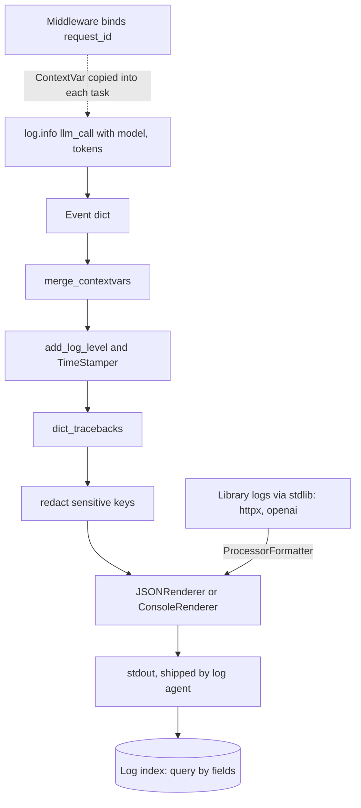

## TL;DR
Stdlib `logging` routes records through levels, handlers and formatters; structlog makes every line a
structured event rendered as JSON. Incident questions ("which model, how many tokens, which request, which
retry?") become queries over fields, not greps over prose.

## Why it exists
- **Concurrency makes prose logs useless.** `print()` and f-string log lines work until there are many
  concurrent requests. An LLM service interleaves hundreds of in-flight calls in one
  process; `"call failed after 3.2s"` cannot tell you which user, conversation, model or prompt version it
  belongs to.
- **Prose cannot be aggregated.** "p95 latency by model" or "token spend by tenant" needs fields; regexing
  them back out of free text is fragile and slow.
- **Stdlib solves routing, not structure.** It decides who emits, at what level, to where. You can pass
  `extra={...}`, but every formatter must know which keys to print.
- **No natural request context.** There is no built-in way to attach a request ID once and have every
  downstream line carry it, especially across `await` points.
- **structlog fills the gap.** Context is bound once, every event is a dict, and rendering (JSON for
  machines, coloured console for humans) is configuration, not baked into every call site.

## How it works
### stdlib logging: the routing layer
| Piece | Role |
|---|---|
| **Loggers** | named and hierarchical (`myapp.rag.retriever` is a child of `myapp`); use `logging.getLogger(__name__)` so names mirror modules |
| **Levels** | `DEBUG < INFO < WARNING < ERROR < CRITICAL`, checked on the logger and again on each handler |
| **Handlers** | send records somewhere (stderr, file, syslog) |
| **Formatters** | turn a record into text |

- **Propagation:** a record goes to its logger's handlers, then up to ancestors, ending at the root.
- **So libraries never configure logging.** No `basicConfig`, no handlers: configuration belongs to the
  application. A library adds only a `NullHandler`, staying silent unless the app opts in.
- **Use `log.info("retrieved %d chunks", n)`, not an f-string,** *because* formatting is deferred and
  skipped entirely when the level is disabled.
- **`log.exception(...)` inside `except`** attaches the traceback.

### structlog: events and processors
1. A call such as `log.info("llm_call", model="gpt-4o-mini", tokens_in=812)` creates an **event dict**.
2. The dict passes through a **processor chain**: an ordered list of functions
   `(logger, method_name, event_dict) -> event_dict`.
3. A final **renderer** turns it into output.

Typical chain, in order:

| Processor | Job |
|---|---|
| `merge_contextvars` | pull in request-scoped context |
| `add_log_level` | add `level` |
| `TimeStamper(fmt="iso")` | add a timestamp |
| `format_exc_info` or `dict_tracebacks` | structured exceptions |
| custom redaction step | scrub sensitive keys |
| `JSONRenderer()` / `ConsoleRenderer()` | production / local rendering |

- **Policy lives in one place** (timestamps, redaction, sampling), not at every call site.
- **A processor is just a function,** so redaction and sampling look like this:

```python
SENSITIVE = {"api_key", "authorization", "prompt", "completion"}
def redact(logger, method_name, event_dict):
    for key in SENSITIVE & event_dict.keys():
        event_dict[key] = "[redacted]"
    return event_dict

def sample_debug(logger, method_name, event_dict):
    if method_name == "debug" and random.random() > 0.01:
        raise structlog.DropEvent          # silently discards this event
    return event_dict
```

- **Order matters** *because* each processor sees only what earlier ones produced. Redaction must run after
  `merge_contextvars` (or a key bound in context escapes it) and before the renderer (after which there is
  only a string).
- **Keep processors cheap:** every processor runs on every emitted event.

### Context binding
- **Local binding:** `log = log.bind(conversation_id=cid)` returns a new logger carrying that field. Bound
  loggers are immutable, so binding in one function cannot leak into another.
- **Request-wide:** `structlog.contextvars` (`bind_contextvars`, `clear_contextvars`) stores fields in a
  `contextvars.ContextVar`.
- **Why it works across `await`:** context variables are copied into each asyncio task, so a request ID bound
  in FastAPI middleware appears on every line for that request without passing it explicitly.
- **Clear at request start** so a reused worker does not carry stale values.
- **Limits of the copy.** It is one-way and happens at task creation:

| Situation | Sees the request context? |
|---|---|
| Child asyncio task | yes, a copy; values bound in the child are invisible to the parent |
| `asyncio.to_thread` | yes, it copies the context |
| `loop.run_in_executor` | no, so lines logged from that thread lose their `request_id` |

### Handlers can block the event loop
- **Stdlib handlers write synchronously** inside the logging call.
- **stdout/stderr in a container** is normally cheap; a file on a slow disk or a network handler (syslog,
  HTTP) stalls every coroutine in the process while it writes.
- **Stdlib answer:** `QueueHandler` on the hot path plus a `QueueListener` thread that owns the slow
  handlers, *because* enqueueing is fast and the I/O moves off the event loop.
- **Container answer:** write JSON to stdout and let the platform's log agent ship it.

### Level discipline
| Level | Meaning |
|---|---|
| DEBUG | detail you would enable while investigating |
| INFO | one summary event per meaningful unit of work (a request, an LLM call, a tool call) |
| WARNING | something that recovered (a retry, a fallback model) |
| ERROR | a failed unit of work someone may need to look at |

- Levels are useful only if they mean the same thing everywhere. Alert on ERROR rate and on fields, not on
  message text.

### Integrating the two
- **Libraries (httpx, openai, uvicorn) log through stdlib.** structlog can use stdlib loggers as its backend,
  or render stdlib records via `structlog.stdlib.ProcessorFormatter`, so library and application lines share
  one JSON format.
- **Standalone speed:** `make_filtering_bound_logger(logging.INFO)` is a fast level filter, and
  `cache_logger_on_first_use=True` avoids rebuilding loggers on every call.

### Logs vs traces vs metrics
- **Logs:** discrete events.
- **Traces (OpenTelemetry spans):** timing and parent-child structure across services.
- **Metrics:** cheap aggregates.
- **Join them:** put the trace ID in every log event, and do not use logs as your only latency metric.

## Diagram
Follow one `log.info` call: middleware has already called `clear_contextvars()` then `bind_contextvars(...)`,
so request context is merged first; redaction runs before rendering; library records join at the renderer;
and the rendered line goes to stdout (or a queue) so a slow sink never blocks the event loop.



## Examples
### Production configuration with one event per LLM call
JSON output, request context via contextvars, and fields you will later aggregate on. The prompt itself is
not logged, only its hash.

```python
import hashlib, logging, time, uuid
import structlog

structlog.configure(
    processors=[
        structlog.contextvars.merge_contextvars,     # request-scoped fields
        structlog.processors.add_log_level,
        structlog.processors.TimeStamper(fmt="iso"),
        structlog.processors.dict_tracebacks,        # exceptions as structured data
        structlog.processors.JSONRenderer(),
    ],
    wrapper_class=structlog.make_filtering_bound_logger(logging.INFO),
    cache_logger_on_first_use=True,
)
log = structlog.get_logger()

def handle_request(user_id: str, prompt: str) -> None:
    structlog.contextvars.clear_contextvars()
    structlog.contextvars.bind_contextvars(request_id=str(uuid.uuid4()), user_id=user_id)
    t0 = time.perf_counter()
    # ... call the model here ...
    log.info("llm_call", model="gpt-4o-mini", prompt_version="summarize-v3",
             prompt_sha=hashlib.sha256(prompt.encode()).hexdigest()[:12],
             tokens_in=812, tokens_out=164, latency_ms=round((time.perf_counter() - t0) * 1000))

handle_request("u_42", "Summarize this contract ...")
# {"model": "gpt-4o-mini", "prompt_version": "summarize-v3", "prompt_sha": "…", "tokens_in": 812,
#  "tokens_out": 164, "latency_ms": 0, "event": "llm_call", "request_id": "…", "user_id": "u_42",
#  "level": "info", "timestamp": "2026-…Z"}
# (keys follow processor order: call kwargs, then contextvars, level, timestamp; pass
#  JSONRenderer(sort_keys=True) if your pipeline wants a stable alphabetical order)
```

- **Do not rely on key order among context fields:** `request_id` and `user_id` can come out in either
  order, because `merge_contextvars` reads an unordered context mapping. Query by key, or use `sort_keys=True`.

### Watch request context vanish in a thread pool
Standard library only. Two concurrent requests each set a `ContextVar`; `asyncio.to_thread` keeps it,
`run_in_executor` does not.

```python
import asyncio, contextvars, logging

request_id = contextvars.ContextVar("request_id", default="-")

class AddRequestId(logging.Filter):
    def filter(self, record):
        record.request_id = request_id.get()   # read at emit time, in the emitting thread
        return True

handler = logging.StreamHandler()
handler.addFilter(AddRequestId())
handler.setFormatter(logging.Formatter("%(request_id)s %(message)s"))
logging.basicConfig(level=logging.INFO, handlers=[handler])
log = logging.getLogger("demo")

def blocking_work(label):
    log.info("in thread via %s", label)

async def handle(rid):
    request_id.set(rid)                       # per task: each gathered task has its own copy
    await asyncio.to_thread(blocking_work, "to_thread")                 # req-A / req-B
    loop = asyncio.get_running_loop()
    await loop.run_in_executor(None, blocking_work, "run_in_executor")  # "-"
    log.info("back in task")                                            # req-A / req-B

async def main():
    await asyncio.gather(handle("req-A"), handle("req-B"))

asyncio.run(main())
```

### Worked scenario: one event vocabulary, three incident questions
With `llm_call` events carrying `model`, `tokens_in`, `tokens_out`, `latency_ms`, `request_id` and `user_id`:

| Incident question | Query over fields |
|---|---|
| Which model got slow? | p95 of `latency_ms` grouped by `model` |
| Who is burning tokens? | sum of `tokens_in + tokens_out` grouped by `user_id` |
| What happened in this request? | all events where `request_id` = the ID from the error report |

None of these is possible from `"call failed after 3.2s"`.

## Production patterns
- **Bind context in middleware, clear first.** In FastAPI (or any framework) middleware call
  `clear_contextvars()` then `bind_contextvars(request_id=..., user_id=...)` before the handler runs. Monitor
  the share of log lines missing `request_id`; it should be near zero.
- **Fixed event vocabulary.** Define `llm_call`, `retrieval`, `tool_call`, `guardrail_block` with consistent
  field names in one module, and build dashboards and alerts on those fields. Review new event names in code
  review like an API change.
- **Redaction as a processor, with a test.** Place `redact` after `merge_contextvars` and before the
  renderer, and add a test that logs a fake key and asserts it never appears in output. Log a hash or a
  prompt version instead of the prompt.
- **Stdout JSON, off-loop slow sinks.** In containers write JSON to stdout and let the log agent ship it;
  if you must use a file or network handler, put it behind `QueueHandler` and a `QueueListener`. Monitor
  event-loop lag.
- **One format for library logs.** Route stdlib records through `structlog.stdlib.ProcessorFormatter` and
  quiet chatty libraries with `logging.getLogger("httpx").setLevel(logging.WARNING)`. Monitor log volume
  per request.
- **Trace ID on every event.** A small processor that adds the current OpenTelemetry span's trace ID lets
  you jump from a log line to its trace. Check that a sample of ERROR lines carries a trace ID.

## Trade-offs
- **Queryable vs readable.** JSON logs aggregate cleanly but are hard to read in a terminal; render with
  `ConsoleRenderer` in development and switch on an environment flag rather than choosing one forever.
- **Debuggability vs data exposure.** Full prompts and completions make debugging easy but store user data
  and secrets in a system with broad access and long retention. Acceptable only with redaction, sampling and
  short retention, or by sending payloads to a dedicated LLM tracing store.
- **Context vs cost.** Rich context on every line costs bytes and ingestion fees at high volume; sample DEBUG
  and per-chunk streaming events, keep one summary event per call at INFO.
- **structlog vs plain stdlib.** structlog adds a dependency and a configuration step; for a small script or
  a library, stdlib logging with `extra=` is enough and keeps you dependency-free.

## Pitfalls
- **`logging.basicConfig` or handlers inside a library.** Symptom: duplicated lines, or log formats that
  change with import order in the host application. Fix: `NullHandler` only.
- **Request context in a module-level global** instead of contextvars. Symptom: one user's lines carry
  another user's `request_id` under concurrency. Fix: `bind_contextvars`, cleared at request start.
- **`log.error(str(e))` for exceptions.** Symptom: you know *that* something failed but have no traceback,
  because only `log.exception` or `exc_info=True` captures it. Fix: `log.exception(...)` inside `except`.
- **Raw prompts containing API keys, PII or retrieved documents.** Symptom: a security review finds customer
  data in a log index half the company can query. Fix: a redaction processor; log a hash or prompt version.
- **Logging inside `loop.run_in_executor` work.** Symptom: exactly the thread-pool lines lack `request_id`
  and cannot be joined to their request. Fix: `asyncio.to_thread`, or pass the ID explicitly.
- **A log line per streamed token.** Symptom: volume and cost scale with output length and the useful summary
  line drowns in noise. Fix: one summary event per call with token counts and latency.

## When to use
- **Use stdlib logging everywhere** as the routing backbone.
- **Add structlog when:** a service handles concurrent requests or its logs feed a search or analytics
  backend; that is nearly every deployed AI service.
- **Do early:** define a small event vocabulary (`llm_call`, `retrieval`, `tool_call`, `guardrail_block`)
  with consistent field names, because dashboards and alerts are built on them.
- **Measure:** log volume per request, and that every line carries a request or trace ID.
- **Interviews:** explain propagation, why libraries do not configure logging, and how contextvars keep
  async context straight.

## Role lens
- **Engineer:** Configures the processor chain, binds request and conversation IDs in middleware, and emits
  one structured event per model or tool call with tokens and latency.
- **Architect:** Sets the logging contract: field names, what may never be logged, retention, and how logs
  join traces and cost metrics across services.
- **FDE:** Adapts the output format and redaction rules to the customer's log pipeline and compliance rules,
  often their SIEM or a mandated JSON schema.

## Check yourself
**Q:** Under load, your FastAPI service's logs sometimes show a request's events tagged with another user's
ID. You store the current user in a module-level dict that middleware updates. Why does this happen and
what is the fix?
**A:** A module-level dict is shared by every concurrent request in the process. With async handlers,
request A sets the user, awaits the model, request B overwrites the value, and A's later log lines read B's
user. The fix is request-scoped storage: `structlog.contextvars.bind_contextvars` (backed by a
`ContextVar`), which asyncio copies per task, so each request sees its own values across awaits. Also clear
contextvars at request start so a reused worker does not inherit stale fields, and add a test that runs
concurrent requests and asserts each line's ID matches.

## Interview questions
### What does structlog add on top of the standard `logging` module?
- **Stdlib handles routing:** hierarchical loggers, levels, handlers and formatters decide who emits, at what
  level and to where.
- **structlog adds structure:** every call is an event dict passed through a processor chain and rendered as
  JSON, so incident questions become queries over fields.
- **And context:** fields bound once with `bind` or `bind_contextvars` appear on every later line without
  being passed explicitly.

### Some log lines for a request are missing `request_id`. How do you track it down?
- **Check where they were emitted:** lines logged from `loop.run_in_executor` work lose the context, because
  that call does not copy the current context into the thread, while `asyncio.to_thread` does.
- **Check the processor order:** `merge_contextvars` must be in the chain, before the renderer.
- **Check middleware:** context must be bound before the handler runs, and cleared at request start.

### Where does redaction belong in the processor chain, and why there?
- **After `merge_contextvars`,** otherwise a sensitive key bound in context escapes it.
- **Before the renderer,** because after rendering there is only a string to scrub.
- **Back it with a test** that logs a fake API key and asserts it never appears in output, and prefer logging
  a prompt hash or version over the prompt itself.

### Would you log full prompts and completions in production?
- **The gain:** debugging is much easier with the exact input and output.
- **The cost:** user data and secrets land in a system with broad access and long retention.
- **Middle ground:** redaction, sampling and short retention, or send payloads to a dedicated LLM tracing store
  and keep only a hash, token counts and latency in logs.

### Your async service's latency spikes whenever the log volume is high. What is a likely cause and fix?
- **Likely cause:** stdlib handlers write synchronously inside the logging call, so a file on a slow disk or a
  network handler stalls every coroutine in the process.
- **Fix:** write JSON to stdout and let the platform's log agent ship it, or put slow handlers behind a
  `QueueHandler` with a `QueueListener` thread.
- **Reduce volume too:** sample DEBUG, and never log a line per streamed token.

## Quiz
### Q: Why should a library add only a NullHandler rather than configure logging itself?
- [ ] NullHandler makes the library's logging faster than a StreamHandler
- [x] Handler and format configuration belong to the application; libraries that configure logging cause duplicated or reformatted output
- [ ] Libraries are not allowed to use getLogger(__name__)
- [ ] Records from libraries do not propagate to the root logger
> Library records propagate to the application's handlers, so the app decides where and how they appear.
> A library that attaches handlers or calls basicConfig overrides that choice and often duplicates lines.

### Q: What does a structlog processor chain receive and return?
- [ ] A formatted string, returning a formatted string
- [ ] A stdlib LogRecord, returning a LogRecord
- [x] The event dict, returning a (possibly modified) event dict, with a renderer at the end
- [ ] A list of handlers, returning the handler to use
> Each processor takes the logger, method name and event dict and returns an event dict; the final
> renderer turns it into JSON or console text. That is what makes redaction and timestamps one-place policy.

### Q: Why does `log.info("retrieved %d chunks", n)` beat `log.info(f"retrieved {n} chunks")` in stdlib logging?
- [ ] f-strings are not supported by logging handlers
- [ ] The %-style call writes JSON automatically
- [x] Formatting is deferred and skipped when the level is disabled, and the template stays constant for grouping
- [ ] The f-string version is not thread-safe
> The f-string is built before logging checks the level, wasting work for disabled levels, and it produces
> a unique message per value, which defeats grouping by message template in log tools.
