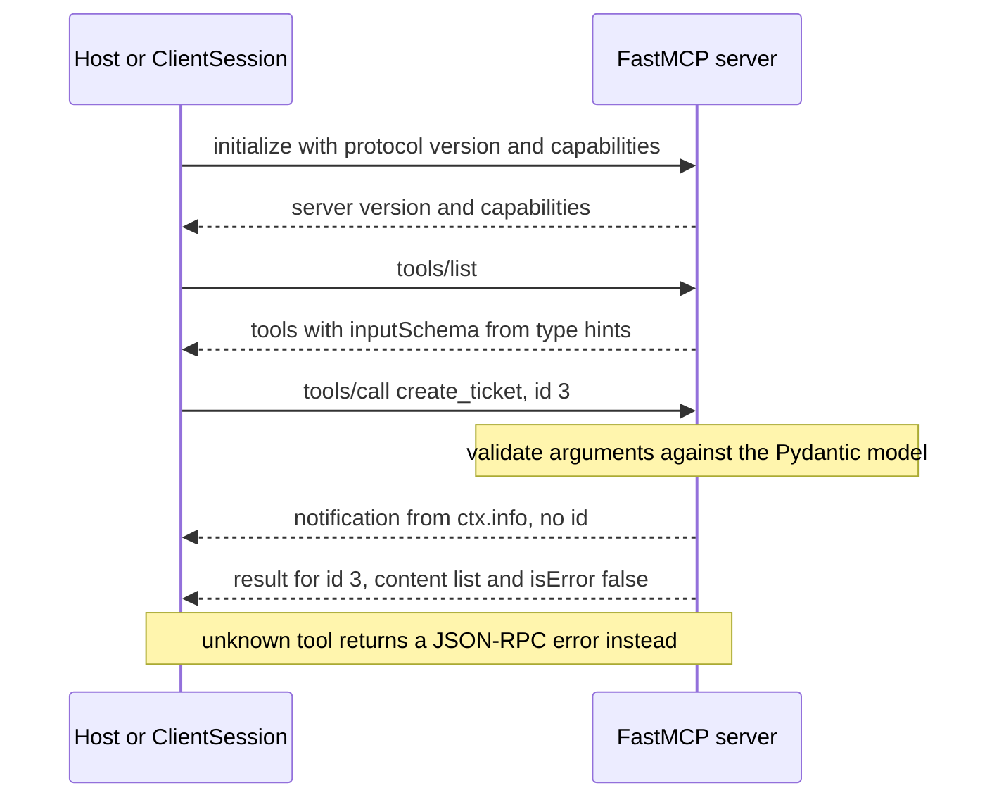

## TL;DR
The MCP Python SDK (the `mcp` package) exposes Python tools, data and prompts to any MCP host and
calls MCP servers from Python. FastMCP turns type-hinted functions into tools; lower layers handle
JSON-RPC and transports. The protocol is taught in the agents module.

## Why it exists
- **Every host defined tools its own way.** An OpenAI function schema here, a LangChain tool class there,
  a custom plugin format in each IDE.
- **So integrations multiplied.** A team wanting internal search, ticketing and database tools in three
  assistants wrote three integrations and kept them in sync.
- **MCP fixes the interface.** A server advertises tools, resources and prompts over a standard protocol,
  and any compliant host can use them.
- **The protocol is not trivial by hand.** JSON-RPC 2.0, version and capability negotiation during
  `initialize`, JSON Schema for every tool input, request routing, notifications and cancellation, over at
  least two transports with different framing.
- **Hand-rolled versions get details wrong.** Schemas drift from the function signature, a stray `print`
  corrupts the stdio stream, version negotiation is skipped. The SDK handles the protocol once, correctly,
  so your code is just the tool logic.

## How it works
### Two layers
- **FastMCP (high level).** `FastMCP("name")` creates a server; decorators register capabilities. It
  inspects each function's signature and type hints, builds a Pydantic model, and emits its JSON Schema
  as the tool's `inputSchema`.
- **Why derive the schema:** the signature is already the source of truth, so the two cannot drift.
  Incoming arguments are validated against the same model before your function runs. The docstring
  becomes the tool description the LLM reads.
- **Low-level `Server`.** Explicit handlers for `list_tools`, `call_tool` and so on, for dynamic tool
  lists or full control over the wire format.
- **Name clash to watch.** A separately maintained project, also called FastMCP, extends the original API
  that was folded into the official SDK; imports differ, so check which one a codebase uses.

### Three primitives
| Decorator | Exposes | Controlled by |
|---|---|---|
| `@mcp.tool()` | An action the model may choose to call, e.g. `create_ticket` | The model |
| `@mcp.resource("tickets://{id}")` | Readable data addressed by URI | The host application (not necessarily the model) |
| `@mcp.prompt()` | A reusable prompt template a user can pick | The user |

The split exists *because* control differs, and hosts present the three differently.

### The session lifecycle
1. **Connect.** The client starts or connects to the server through a transport.
2. **`initialize`.** Client and server exchange protocol versions and capabilities.
3. **Discovery.** `tools/list`, `resources/list`, `prompts/list`.
4. **Use.** `tools/call` with JSON arguments. The result is a list of content items (text, image,
   embedded resource), with an `isError` flag for tool-level failures. Recent protocol versions also allow
   structured output validated against an output schema, which the SDK can derive from a typed return.

On the wire, step 4 is one JSON-RPC request and one response matched by `id`, which is what lets many
calls be in flight on one connection:

```
-> {"jsonrpc":"2.0","id":3,"method":"tools/call",
    "params":{"name":"create_ticket","arguments":{"title":"VPN down","priority":"high"}}}
<- {"jsonrpc":"2.0","id":3,"result":{"content":[{"type":"text","text":"{\"id\": 1, ...}"}],
    "isError":false}}
```

### Two failure channels
| Failure | Returned as | Handled by |
|---|---|---|
| Malformed request, unknown tool | JSON-RPC `error` | The host (protocol failure) |
| Tool ran and failed | Normal `result` with `isError: true` | The model, which can read the message and try something else |

- **Notifications** (messages with no `id`) carry logs and progress and need no reply.

### Transports
| | stdio | Streamable HTTP |
|---|---|---|
| Start | `mcp.run()` (the default) | `mcp.run(transport="streamable-http")` |
| Mechanics | Host spawns your server as a subprocess; newline-delimited JSON-RPC over stdin and stdout | Same protocol over HTTP |
| Fits | Local tools; simple, no network | Remote, multi-client servers |
| Auth | Not needed | Your concern |

- **The older HTTP+SSE transport is deprecated** in favour of Streamable HTTP.
- **Streamable HTTP is *stateful* by default.** It issues a session ID header after `initialize`, and later
  requests must reach the process holding that session, so behind a load balancer you need sticky routing.
- **Stateless mode** (`stateless_http=True`) treats each request independently. It scales horizontally
  but gives up server-initiated messages that depend on a live session.

### Context, lifespan and server-to-client requests
- **`ctx: Context` parameter.** FastMCP injects it (and hides it from the schema); use it to send log
  messages and progress notifications back to the client during long operations.
- **MCP is bidirectional.** A server can *ask the client* for capabilities the client advertised:
  **sampling** (the host's LLM generates text, so the server needs no model key of its own) and
  **elicitation** (ask the user for missing input mid-call). Hosts vary, so check capabilities rather
  than assuming.
- **Shared resources go in a `lifespan`.** Pass an async context manager to `FastMCP(...)`; it runs once
  at startup and shutdown and its yielded object is reachable from the context, *because* opening a
  connection per tool call repeats setup and leaks under load.

### Client side
- **`ClientSession` plus a transport helper such as `stdio_client`** lets Python code act as a host:
  initialize, list tools, call them.
- **Everything is async,** built on `anyio`.

## Diagram
One session over stdio: version and capability negotiation first, then discovery, then a tool call whose
log message travels back as a notification, never through `print`.



## Examples
### Ticket server and stdio client
A small ticket server and a client that calls it over stdio.

```python
# server.py
from typing import Literal
from mcp.server.fastmcp import FastMCP, Context

mcp = FastMCP("tickets")
DB: dict[int, dict] = {}

@mcp.tool()
async def create_ticket(title: str, priority: Literal["low", "high"], ctx: Context) -> dict:
    """Create a support ticket. Use only after confirming the issue with the user."""
    tid = len(DB) + 1
    DB[tid] = {"id": tid, "title": title, "priority": priority}
    await ctx.info(f"created ticket {tid}")      # goes to the client, never to stdout
    return DB[tid]

@mcp.resource("tickets://{tid}")
def read_ticket(tid: int) -> str:
    return str(DB.get(int(tid), "not found"))

if __name__ == "__main__":
    mcp.run()                                    # stdio by default

# client.py
import asyncio
from mcp import ClientSession, StdioServerParameters
from mcp.client.stdio import stdio_client

async def main():
    params = StdioServerParameters(command="python", args=["server.py"])
    async with stdio_client(params) as (read, write):
        async with ClientSession(read, write) as session:
            await session.initialize()
            print([t.name for t in (await session.list_tools()).tools])
            res = await session.call_tool("create_ticket", {"title": "VPN down", "priority": "high"})
            print(res.content[0].text, res.isError)

asyncio.run(main())
```

- **The `priority` hint becomes an `enum`** in the schema, so the model sees exactly two legal values,
  and a call with `"urgent"` is rejected before your code runs.
- **Generated `inputSchema` for `create_ticket`** is roughly
  `{"type":"object","properties":{"title":{"type":"string"},"priority":{"enum":["low","high"],"type":"string"}},"required":["title","priority"]}`;
  `ctx` is absent because FastMCP injects it.
- **Inspect before any LLM is involved.** With the SDK's CLI extra installed, `mcp dev server.py` opens
  the MCP Inspector, where you can see that schema and call the tool by hand.

### Production shape: lifespan pool, actionable errors, stateless HTTP
One database pool per process, errors the model can act on, and a transport that scales behind a load
balancer.

```python
import sys, logging
from contextlib import asynccontextmanager
import asyncpg
from mcp.server.fastmcp import FastMCP, Context

logging.basicConfig(stream=sys.stderr, level=logging.INFO)   # never stdout

@asynccontextmanager
async def lifespan(server: FastMCP):
    pool = await asyncpg.create_pool("postgresql://app@db/tickets")
    try:
        yield {"pool": pool}                     # reachable from every tool's ctx
    finally:
        await pool.close()

mcp = FastMCP("tickets", lifespan=lifespan, stateless_http=True)

@mcp.tool()
async def get_ticket(ticket_id: int, ctx: Context) -> dict:
    """Fetch one ticket by numeric id. Use search_tickets first if you only have a title."""
    pool = ctx.request_context.lifespan_context["pool"]
    row = await pool.fetchrow("SELECT id, title, status FROM tickets WHERE id = $1", ticket_id)
    if row is None:
        raise ValueError(f"ticket {ticket_id} does not exist; call search_tickets with a title")
    return dict(row)

if __name__ == "__main__":
    mcp.run(transport="streamable-http")
```

### Worked scenario: "session not found" after scaling out
A stateful Streamable HTTP server goes from 1 replica to 3 behind a round-robin load balancer.

| Replicas | Chance a follow-up request reaches the process holding the session | Symptom |
|---|---|---|
| 1 | 100% | Works |
| 3, round-robin | roughly 1 in 3 | Intermittent "session not found" or 4xx errors on about two-thirds of follow-ups |
| 3, sticky on session ID header | 100% | Works, but a replica restart drops its sessions |
| 3, `stateless_http=True` | Not needed | Works; server-initiated messages that need a live session are gone |

## Production patterns
- **Keep stdout clean on stdio.** Configure `logging` to `sys.stderr` at startup, log through `ctx` for
  client-visible messages, and silence libraries that print progress bars. Monitor the host's MCP logs
  for parse errors and unexpected disconnects.
- **Pick a scaling mode for HTTP explicitly.** Either run `stateless_http=True` behind any load balancer,
  or route on the session ID header with sticky sessions. Alert on "session not found" and 4xx rates per
  replica.
- **Own shared resources in `lifespan`.** Create pools and clients once in the lifespan context manager and
  read them via `ctx.request_context.lifespan_context`. Monitor pool saturation and per-tool latency.
- **Write errors for the model.** Raise exceptions whose message says what was wrong and what to call
  instead; FastMCP returns them as `isError` results. Monitor `isError` rate per tool and repeated identical
  calls, which signal an unhelpful message.
- **Contract-test the schema in CI.** Start the server under a real `ClientSession`, snapshot the
  `list_tools()` output (names, descriptions, `inputSchema`) and fail the build on unreviewed changes,
  because a renamed parameter or reworded docstring changes model behaviour.
- **Authenticate every HTTP server.** Put Streamable HTTP behind auth and origin checks before exposing a
  port. Audit-log every `tools/call` with caller identity.

## Trade-offs
- **Every host vs a process boundary.** One MCP server makes a tool usable from every compliant host, but
  you pay a process boundary and protocol overhead; for a tool used by exactly one in-process agent, a
  plain function call is simpler.
- **stdio vs Streamable HTTP.** stdio is zero-config with no network attack surface, but runs one server
  process per client and cannot be shared; Streamable HTTP is shareable and remote, at the cost of auth,
  TLS and deployment.
- **Derived schemas vs expressiveness.** FastMCP derives schemas from type hints so they never drift, but
  anything hints cannot express (cross-field rules) must be enforced in the function; drop to the
  low-level server for dynamic tools.
- **Precise tools vs context cost.** Many small, focused tools give the model precise choices, but every
  schema occupies context on every turn; past a few dozen tools, selection accuracy and token cost both
  suffer.

## Pitfalls
- **`print()` in a stdio server.** stdout is the protocol channel. Symptom: the host reports parse errors
  or the server "disconnects" right after a log line.
- **Docstrings written for humans, not models.** The model picks tools from these descriptions. Symptom:
  the wrong tool chosen, or a destructive tool called without the intended precondition.
- **Vague exceptions for expected failures.** FastMCP catches a tool's exception and returns it as an
  `isError` result carrying its message, so `raise Exception("failed")` gives the model nothing to act on.
  Symptom: the same bad call retried in a loop. Fix: say what was wrong and what to do instead.
- **Blocking calls inside async tools.** Sync database drivers or `time.sleep` stall the whole server.
  Symptom: every tool times out whenever one slow call is in flight.
- **Stateful Streamable HTTP behind a round-robin load balancer.** Requests land on a process that never
  saw the session. Symptom: intermittent "session not found" or 4xx errors that vanish with one replica.
- **No authentication or origin checks on Streamable HTTP.** Symptom: discovering that anything that can
  reach the port can invoke your tools.

## When to use
- **Use when:** tools or data must work across several agent hosts (IDE assistants, desktop chat apps,
  your own agents), or a customer's platform already speaks MCP.
- **Transport choice:** stdio for local, single-user tools; Streamable HTTP for shared services behind
  proper auth.
- **Avoid when:** one application calls the function in-process; do not wrap every internal function as
  an MCP tool.
- **Measure:** tool-call error rate, latency per tool, and how often the model picks the intended tool.
- **Go deeper / interviews:** the agents module's MCP lessons cover protocol design, the security model and
  when MCP is the right boundary; expect to explain the lifecycle and why stdout matters on stdio.

## Role lens
- **Engineer:** Writes FastMCP tools with precise type hints and model-facing docstrings, logs through
  the context or stderr, and tests servers with a real client session.
- **Architect:** Decides which capabilities become shared MCP servers versus in-process functions, which
  transport each uses, and where authentication and authorization are enforced.
- **FDE:** Wraps a customer's internal APIs as an MCP server so their existing assistant hosts can use
  them without bespoke integrations per tool.

## Check yourself
**Q:** A stdio MCP server works when you run it by hand but the host shows "connection closed" as soon
as one particular tool is called. What do you suspect, and how do you confirm it?
**A:** On stdio, stdout carries the JSON-RPC stream, so anything else written there, a `print`, a
library's progress bar, a warning sent to stdout, corrupts the framing and the host drops the session.
Running by hand hides this because you are not parsing the stream. Confirm by checking the host's MCP
logs for a parse error, grepping that tool's code path for prints, or running it under a real
`ClientSession`. Fix by logging to stderr or through `ctx` logging, and redirecting noisy libraries.
A second suspect is the process itself dying in that code path (a native-extension crash, `sys.exit`,
an out-of-memory kill), which the server's stderr or exit code would show; an ordinary Python exception
inside a FastMCP tool does not do this, because it is returned to the client as an `isError` result.

## Interview questions
### What does FastMCP do for you that a hand-written MCP server would not?
- **It derives each tool's `inputSchema` from type hints** through a Pydantic model, so the schema cannot
  drift from the signature, and arguments are validated before your function runs.
- **It handles the protocol:** JSON-RPC 2.0 framing, `initialize` version and capability negotiation,
  routing, notifications and the transports.
- **The docstring becomes the tool description,** which is the text the model uses to choose the tool.

### Explain the difference between a JSON-RPC error and an `isError` result.
- **JSON-RPC `error` is a protocol failure,** such as a malformed request or unknown tool, and the host
  handles it.
- **`isError: true` is a tool failure inside a normal `result`.** The model reads the message and can try
  something else, which is why exception text should say what to call instead.
- **FastMCP maps a raised exception to `isError`,** so a vague `Exception("failed")` produces retry loops.

### You scaled a Streamable HTTP server from 1 to 3 replicas and see intermittent "session not found". Why, and what are the fixes?
- **Stateful mode pins a session to one process.** After `initialize` the server issues a session ID
  header, and round-robin sends roughly two-thirds of follow-ups to a replica that never saw it.
- **Fix one: sticky routing** on the session ID header; a replica restart still drops its sessions.
- **Fix two: `stateless_http=True`,** which scales behind any load balancer but gives up server-initiated
  messages that need a live session.

### When would you not wrap a function as an MCP tool?
- **When one in-process agent is the only caller,** because a plain function call avoids the process
  boundary and protocol overhead.
- **When the tool list is already large,** because every schema occupies context on every turn; past a few
  dozen tools, selection accuracy and token cost both suffer.

### How would you test an MCP server before any LLM is involved?
- **Manually:** `mcp dev server.py` (with the CLI extra) opens the MCP Inspector to view schemas and call
  tools by hand.
- **In CI:** start the server under a real `ClientSession`, snapshot `list_tools()` output and fail on
  unreviewed changes, since a renamed parameter or reworded docstring changes model behaviour.
- **Exercise failure paths** and assert they return `isError` with an actionable message.

## Quiz
### Q: How does FastMCP produce a tool's input schema?
- [ ] You must write the JSON Schema by hand in the decorator
- [x] It builds a Pydantic model from the function's type hints and emits that model's JSON Schema
- [ ] The host infers the schema by calling the tool with sample arguments
- [ ] It parses the docstring for parameter types
> FastMCP inspects the signature and type hints, so the schema cannot drift from the code. The docstring
> supplies the description the model reads, not the types.

### Q: Why should a stdio MCP server never write logs to stdout?
- [ ] stdout is buffered and logs would arrive out of order
- [ ] The protocol forbids any logging during a session
- [x] stdout carries the JSON-RPC messages, so extra output corrupts the stream the host parses
- [ ] Hosts discard stdout, so the logs would be lost
> On stdio the two processes talk over stdin and stdout. Logging belongs on stderr or in protocol log
> notifications through the context; stdout output breaks message framing.

### Q: When is Streamable HTTP the better transport than stdio?
- [ ] When the tool runs on the same laptop as a single desktop host
- [ ] When you want to avoid writing any authentication code
- [ ] When the server must print debugging output freely
- [x] When one server should be shared by many clients or run remotely as a service
> stdio spawns a private subprocess per client, which is ideal locally. A shared or remote server needs
> HTTP, which also brings authentication and network security into scope.
