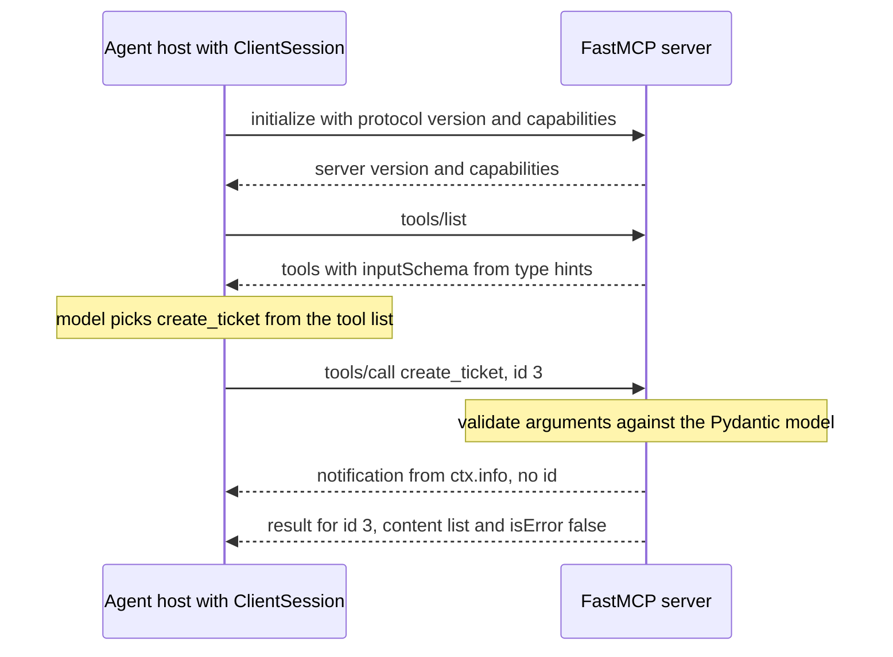

## TL;DR
The MCP Python SDK (the `mcp` package) lets you publish tools to any agent host and plug MCP servers
into your own agent loop. FastMCP turns type-hinted functions into tools; lower layers handle JSON-RPC
and transports. The agents module teaches the protocol.

## For agent builders
- **Why it matters for agents.** Tools are what make an agent act. MCP gives them one interface, so a
  ticket or search tool you write once works in IDE assistants, desktop chat apps and your own agents,
  and your agent can use third-party servers without bespoke glue.
- **Where it shows up in your stack.** Server side: `FastMCP` with `@mcp.tool()`. Client side:
  `ClientSession` feeding `list_tools()` into your model's tool definitions; agent frameworks such as the
  OpenAI Agents SDK and LangChain (through its MCP adapters package) can load MCP servers as tools.
- **What you control.** Tool names, docstrings and type hints (the model reads them), error messages the
  model recovers from, the transport, auth, and how many tools you expose per agent.
- **What you can skip.** Hand-writing JSON-RPC, capability negotiation and transport framing; the SDK
  owns those. Know the lifecycle, the two failure channels and why stdout is sacred on stdio.

## Lab
### Task
Finish a FastMCP ticket server that an agent can recover from: tools whose descriptions are written for
the model, failures returned as actionable `isError` results, and logs that never touch stdout. The
tests drive it as a host would, over stdio with a real `ClientSession`, plus one raw JSON-RPC exchange.
Time box: 60 minutes.
- **Prerequisites:** the async/await lesson and the Pydantic lesson; the agents module's MCP lesson for
  the protocol.
- **Setup:** Python 3.10+, `pip install "mcp>=1.30,<2" pytest` (checked against mcp 1.30.0). The 2.x
  line renamed `FastMCP` to `MCPServer`, so pin below 2 for this lesson's code. Save the starter as
  `server.py` and the tests as `test_server.py` in the same folder.

### Starter code
```python
"""Lab: a ticket MCP server an agent can recover from. Run over stdio: python server.py"""
import logging
import sys
from typing import Literal

from mcp.server.fastmcp import FastMCP

mcp = FastMCP("tickets")
TICKETS: dict[int, dict] = {42: {"id": 42, "title": "VPN down in Berlin", "status": "open",
                                 "priority": "high"}}
log = logging.getLogger("tickets")

# YOUR CODE: configure logging so log lines go to stderr; stdout carries only JSON-RPC.


@mcp.tool()
def get_ticket(ticket_id: int) -> dict:
    """Write the model-facing description: what it returns and what to do when you only have a title."""
    raise NotImplementedError("YOUR CODE: return the ticket, or raise an actionable ValueError")


# YOUR CODE: a create_ticket(title: str, priority: Literal["low", "high"]) tool that stores a new
# ticket with status "open", logs "created ticket <id>" through `log`, and returns the ticket.


if __name__ == "__main__":
    mcp.run()                              # stdio transport
```

### Expected output
Key lines a correct solution produces (your wording of the error may differ, but it must name the id
and `create_ticket`):
```
$ pytest -q test_server.py
....                                                                     [100%]
4 passed

get_ticket(7)  -> isError=True  "Error executing tool get_ticket: ticket 7 does not exist; known ids: [42]. To report a new issue call create_ticket."
create_ticket(priority="urgent") -> isError=True  "... priority  Input should be 'low' or 'high' ..."
```
On the starter all four tests fail: the tool list lacks `create_ticket` and `get_ticket` raises
`NotImplementedError`.

### Tests
```python
import asyncio, json, subprocess, sys
from mcp import ClientSession, StdioServerParameters
from mcp.client.stdio import stdio_client

PARAMS = StdioServerParameters(command=sys.executable, args=["server.py"])


async def session_calls(*calls):
    async with stdio_client(PARAMS) as (read, write), ClientSession(read, write) as s:
        await s.initialize()
        tools = {t.name: t for t in (await s.list_tools()).tools}
        results = [await asyncio.wait_for(s.call_tool(n, a), 10) for n, a in calls]
        return tools, results


def text(res):
    return "".join(c.text for c in res.content if c.type == "text")


def test_tool_list_and_schema():
    tools, _ = asyncio.run(session_calls())
    assert set(tools) == {"get_ticket", "create_ticket"}
    assert tools["create_ticket"].inputSchema["properties"]["priority"]["enum"] == ["low", "high"]
    assert all(len(t.description or "") > 30 for t in tools.values())     # written for the model


def test_found_missing_and_created():
    _, (found, missing, created, again) = asyncio.run(session_calls(
        ("get_ticket", {"ticket_id": 42}), ("get_ticket", {"ticket_id": 7}),
        ("create_ticket", {"title": "Printer jam", "priority": "low"}),
        ("get_ticket", {"ticket_id": 43})))
    assert not found.isError and json.loads(text(found))["status"] == "open"
    assert missing.isError and "7" in text(missing) and "create_ticket" in text(missing)
    assert not created.isError and json.loads(text(created))["id"] == 43
    assert json.loads(text(again))["title"] == "Printer jam"


def test_bad_argument_comes_back_as_tool_error():
    _, (res,) = asyncio.run(session_calls(("create_ticket", {"title": "x", "priority": "urgent"})))
    assert res.isError and "'low' or 'high'" in text(res)     # the model learns the legal values


def test_stdout_is_only_json_rpc_and_logs_go_to_stderr():
    lines = [{"jsonrpc": "2.0", "id": 1, "method": "initialize", "params": {
                "protocolVersion": "2025-06-18", "capabilities": {},
                "clientInfo": {"name": "t", "version": "0"}}},
             {"jsonrpc": "2.0", "method": "notifications/initialized"},
             {"jsonrpc": "2.0", "id": 2, "method": "tools/call", "params": {
                "name": "create_ticket", "arguments": {"title": "VPN", "priority": "high"}}}]
    p = subprocess.run([sys.executable, "server.py"], capture_output=True, text=True, timeout=20,
                       input="".join(json.dumps(m) + "\n" for m in lines))
    out = [json.loads(line) for line in p.stdout.splitlines()]   # any stray print fails here
    assert out[-1]["id"] == 2 and "created ticket 43" in p.stderr
```

### Failure scenarios
- **Add `print("debug", tid, flush=True)` inside `create_ticket`.** The three `ClientSession` tests still
  pass, because this SDK client skips the unparseable line, but the raw stdout test fails with
  `JSONDecodeError`; stricter hosts drop the connection. Debug by running the raw exchange and reading
  stdout line by line.
- **Raise `Exception("failed")` for a missing ticket.** The call is still `isError`, but the
  assertion that the message names the id and `create_ticket` fails (the model sees only
  `Error executing tool get_ticket: failed`); in a live agent the model retries the same id. Debug
  by printing `text(missing)` exactly as the model would see it.
- **Type `priority` as plain `str`.** The schema loses its `enum` and `"urgent"` is accepted. Debug by
  printing `inputSchema`, or open it in `mcp dev server.py`.
- **Call `sys.exit(1)` for a missing ticket.** `SystemExit` is not an `Exception`, so FastMCP does not
  turn it into `isError`: no result ever arrives and the test fails at its 10 s `asyncio.wait_for`.
  Debug from the server's stderr traceback; this is why tests need a timeout per call.

### Submission
- **`server.py`** passing the four tests unmodified, with model-facing docstrings on both tools.
- **The `pytest -q` output** and the stderr captured from the raw test showing `created ticket 43`.
- **The `list_tools()` snapshot** (names, descriptions, `inputSchema`) saved as JSON, ready to become the
  CI contract test from Production patterns.
- **One paragraph** on which failures go back to the model as `isError` and which your agent loop must
  handle in code.
- **Evaluated on:** an error message an agent can act on, a schema whose enum matches the hint, and zero
  non-JSON bytes on stdout.

## Why it exists
- **Every host defined tools its own way.** An OpenAI function schema here, a LangChain tool class there,
  a custom plugin format in each IDE.
- **So integrations multiplied.** A team wanting internal search, ticketing and database tools in three
  assistants wrote three integrations and kept them in sync.
- **MCP fixes the interface.** A server advertises tools, resources and prompts over a standard protocol,
  and any compliant host, including your own agent, can use them.
- **The protocol is not trivial by hand.** JSON-RPC 2.0, version and capability negotiation during
  `initialize`, JSON Schema for every tool input, request routing, notifications and cancellation, over at
  least two transports with different framing.
- **Hand-rolled versions get details wrong.** Schemas drift from the function signature, a stray `print`
  corrupts the stdio stream, version negotiation is skipped. The SDK handles the protocol once, correctly,
  so your code is just the tool logic.

## How it works
### Two layers
- **FastMCP (high level).** `FastMCP("name")` creates a server; decorators register capabilities. It
  inspects each function's signature and type hints, builds a Pydantic model, and emits its JSON Schema
  as the tool's `inputSchema`.
- **Why derive the schema:** the signature is already the source of truth, so the two cannot drift.
  Incoming arguments are validated against the same model before your function runs. The docstring
  becomes the tool description the LLM reads when choosing a tool.
- **Low-level `Server`.** Explicit handlers for `list_tools`, `call_tool` and so on, for dynamic tool
  lists or full control over the wire format.
- **Name clash to watch.** A separately maintained project, also called FastMCP, extends the original API
  that was folded into the official SDK; imports differ, so check which one a codebase uses.

### Three primitives
| Decorator | Exposes | Controlled by |
|---|---|---|
| `@mcp.tool()` | An action the model may choose to call, e.g. `create_ticket` | The model |
| `@mcp.resource("tickets://{id}")` | Readable data addressed by URI | The host application (not necessarily the model) |
| `@mcp.prompt()` | A reusable prompt template a user can pick | The user |

The split exists *because* control differs, and hosts present the three differently. In your own agent,
tools go into the model's tool list; resources are context your code decides to load.

### The session lifecycle
1. **Connect.** The client starts or connects to the server through a transport.
2. **`initialize`.** Client and server exchange protocol versions and capabilities.
3. **Discovery.** `tools/list`, `resources/list`, `prompts/list`. Your agent turns the tool list into
   the model's tool definitions.
4. **Use.** `tools/call` with JSON arguments the model produced. The result is a list of content items
   (text, image, embedded resource), with an `isError` flag for tool-level failures. Recent protocol
   versions also allow structured output validated against an output schema, which the SDK can derive
   from a typed return.

On the wire, step 4 is one JSON-RPC request and one response matched by `id`, which is what lets many
calls be in flight on one connection (for example parallel tool calls in one agent turn):

```
-> {"jsonrpc":"2.0","id":3,"method":"tools/call",
    "params":{"name":"create_ticket","arguments":{"title":"VPN down","priority":"high"}}}
<- {"jsonrpc":"2.0","id":3,"result":{"content":[{"type":"text","text":"{\"id\": 1, ...}"}],
    "isError":false}}
```

### Two failure channels
| Failure | Returned as | Handled by |
|---|---|---|
| Malformed request, unknown tool | JSON-RPC `error` | The host (protocol failure) |
| Tool ran and failed | Normal `result` with `isError: true` | The model, which can read the message and try something else |

- **Notifications** (messages with no `id`) carry logs and progress and need no reply.
- **In your agent loop,** feed `isError` results back to the model as the tool result, and handle
  JSON-RPC errors in code (retry, drop the tool, or fail the step).

### Transports
| | stdio | Streamable HTTP |
|---|---|---|
| Start | `mcp.run()` (the default) | `mcp.run(transport="streamable-http")` |
| Mechanics | Host spawns your server as a subprocess; newline-delimited JSON-RPC over stdin and stdout | Same protocol over HTTP |
| Fits | Local tools; simple, no network | Remote, multi-client servers shared by many agents |
| Auth | Not needed | Your concern |

- **The older HTTP+SSE transport is deprecated** in favour of Streamable HTTP.
- **Streamable HTTP is *stateful* by default.** It issues a session ID header after `initialize`, and later
  requests must reach the process holding that session, so behind a load balancer you need sticky routing.
- **Stateless mode** (`stateless_http=True`) treats each request independently. It scales horizontally
  but gives up server-initiated messages that depend on a live session.

### Context, lifespan and server-to-client requests
- **`ctx: Context` parameter.** FastMCP injects it (and hides it from the schema); use it to send log
  messages and progress notifications back to the client during long operations.
- **MCP is bidirectional.** A server can *ask the client* for capabilities the client advertised:
  **sampling** (the host's LLM generates text, so the server needs no model key of its own) and
  **elicitation** (ask the user for missing input mid-call). Hosts vary, so check capabilities rather
  than assuming.
- **Shared resources go in a `lifespan`.** Pass an async context manager to `FastMCP(...)`; it runs once
  at startup and shutdown and its yielded object is reachable from the context, *because* opening a
  connection per tool call repeats setup and leaks under load.

### Client side
- **`ClientSession` plus a transport helper such as `stdio_client`** lets Python code act as a host:
  initialize, list tools, call them. This is how your own agent consumes MCP servers.
- **Everything is async,** built on `anyio`.

## Diagram
One session over stdio inside an agent: negotiation first, then discovery feeding the model's tool list,
then a tool call whose log message travels back as a notification, never through `print`.



## Examples
### Agent scenario: MCP tools in your own tool-calling loop
The agent connects to the ticket server below, exposes its tools to the model, executes the calls the
model makes, and feeds results (including `isError` ones) back until the model answers.

```python
import asyncio, json
from mcp import ClientSession, StdioServerParameters
from mcp.client.stdio import stdio_client
from openai import AsyncOpenAI

llm = AsyncOpenAI()

async def run_agent(task: str, max_steps: int = 6) -> str:
    params = StdioServerParameters(command="python", args=["server.py"])
    async with stdio_client(params) as (read, write), ClientSession(read, write) as session:
        await session.initialize()
        tools = [{"type": "function", "function": {"name": t.name, "description": t.description,
                  "parameters": t.inputSchema}} for t in (await session.list_tools()).tools]
        messages = [{"role": "user", "content": task}]
        for _ in range(max_steps):                         # step budget
            msg = (await llm.chat.completions.create(
                model="gpt-4o-mini", messages=messages, tools=tools)).choices[0].message
            if not msg.tool_calls:
                return msg.content
            messages.append(msg)
            for call in msg.tool_calls:
                res = await session.call_tool(call.function.name, json.loads(call.function.arguments))
                text = "".join(c.text for c in res.content if c.type == "text")
                messages.append({"role": "tool", "tool_call_id": call.id,
                                 "content": ("ERROR: " if res.isError else "") + text})
        return "step budget exhausted"

print(asyncio.run(run_agent("Open a high-priority ticket: VPN is down for the Berlin office.")))
```

- **The MCP schema is passed straight through** as the function's `parameters`, so the type hints on the
  server are what constrain the model.
- **`isError` results go back to the model,** which is the channel for recovering from a bad call.

### Ticket server and stdio client
A small ticket server and a client that calls it over stdio.

```python
# server.py
from typing import Literal
from mcp.server.fastmcp import FastMCP, Context

mcp = FastMCP("tickets")
DB: dict[int, dict] = {}

@mcp.tool()
async def create_ticket(title: str, priority: Literal["low", "high"], ctx: Context) -> dict:
    """Create a support ticket. Use only after confirming the issue with the user."""
    tid = len(DB) + 1
    DB[tid] = {"id": tid, "title": title, "priority": priority}
    await ctx.info(f"created ticket {tid}")      # goes to the client, never to stdout
    return DB[tid]

@mcp.resource("tickets://{tid}")
def read_ticket(tid: int) -> str:
    return str(DB.get(int(tid), "not found"))

if __name__ == "__main__":
    mcp.run()                                    # stdio by default

# client.py
import asyncio
from mcp import ClientSession, StdioServerParameters
from mcp.client.stdio import stdio_client

async def main():
    params = StdioServerParameters(command="python", args=["server.py"])
    async with stdio_client(params) as (read, write):
        async with ClientSession(read, write) as session:
            await session.initialize()
            print([t.name for t in (await session.list_tools()).tools])
            res = await session.call_tool("create_ticket", {"title": "VPN down", "priority": "high"})
            print(res.content[0].text, res.isError)

asyncio.run(main())
```

- **The `priority` hint becomes an `enum`** in the schema, so the model sees exactly two legal values,
  and a call with `"urgent"` is rejected before your code runs.
- **Generated `inputSchema` for `create_ticket`** is roughly
  `{"type":"object","properties":{"title":{"type":"string"},"priority":{"enum":["low","high"],"type":"string"}},"required":["title","priority"]}`;
  `ctx` is absent because FastMCP injects it.
- **Inspect before any LLM is involved.** With the SDK's CLI extra installed, `mcp dev server.py` opens
  the MCP Inspector, where you can see that schema and call the tool by hand.

### Production shape: lifespan pool, actionable errors, stateless HTTP
One database pool per process, errors the model can act on, and a transport that scales behind a load
balancer when many agents share the server.

```python
import sys, logging
from contextlib import asynccontextmanager
import asyncpg
from mcp.server.fastmcp import FastMCP, Context

logging.basicConfig(stream=sys.stderr, level=logging.INFO)   # never stdout

@asynccontextmanager
async def lifespan(server: FastMCP):
    pool = await asyncpg.create_pool("postgresql://app@db/tickets")
    try:
        yield {"pool": pool}                     # reachable from every tool's ctx
    finally:
        await pool.close()

mcp = FastMCP("tickets", lifespan=lifespan, stateless_http=True)

@mcp.tool()
async def get_ticket(ticket_id: int, ctx: Context) -> dict:
    """Fetch one ticket by numeric id. Use search_tickets first if you only have a title."""
    pool = ctx.request_context.lifespan_context["pool"]
    row = await pool.fetchrow("SELECT id, title, status FROM tickets WHERE id = $1", ticket_id)
    if row is None:
        raise ValueError(f"ticket {ticket_id} does not exist; call search_tickets with a title")
    return dict(row)

if __name__ == "__main__":
    mcp.run(transport="streamable-http")
```

### Worked scenario: "session not found" after scaling out
A stateful Streamable HTTP server goes from 1 replica to 3 behind a round-robin load balancer.

| Replicas | Chance a follow-up request reaches the process holding the session | Symptom |
|---|---|---|
| 1 | 100% | Works |
| 3, round-robin | roughly 1 in 3 | Intermittent "session not found" or 4xx errors on about two-thirds of follow-ups |
| 3, sticky on session ID header | 100% | Works, but a replica restart drops its sessions |
| 3, `stateless_http=True` | Not needed: no session to find | Works; server-initiated messages that need a live session are gone |

### Worked scenario: what a large tool list costs an agent
Illustrative: an agent connects to four MCP servers exposing 40 tools, each schema plus description about
150 tokens.

| Quantity | Value |
|---|---|
| Tool definitions per model call | 40 × ~150 ≈ 6,000 tokens |
| Over a 20-step run | ~120,000 input tokens on tool definitions alone |
| Exposing only the 8 tools this task needs | ~1,200 tokens per call, ~24,000 per run |

Prompt caching softens the price when the tool list is byte-identical and first, but selection accuracy
still falls as near-duplicate tools pile up.

## Production patterns
- **Keep stdout clean on stdio.** Configure `logging` to `sys.stderr` at startup, log through `ctx` for
  client-visible messages, and silence libraries that print progress bars. Monitor the host's MCP logs
  for parse errors and unexpected disconnects.
- **Curate the tool list per agent.** Load only the servers and tools a given agent needs, and keep their
  order stable so the prefix caches. Monitor tokens spent on tool definitions per call and the rate of
  wrong-tool selections in agent evals.
- **Pick a scaling mode for HTTP explicitly.** Either run `stateless_http=True` behind any load balancer,
  or route on the session ID header with sticky sessions. Alert on "session not found" and 4xx rates per
  replica.
- **Own shared resources in `lifespan`.** Create pools and clients once in the lifespan context manager and
  read them via `ctx.request_context.lifespan_context`. Monitor pool saturation and per-tool latency.
- **Write errors for the model.** Raise exceptions whose message says what was wrong and what to call
  instead; FastMCP returns them as `isError` results. Monitor `isError` rate per tool and repeated identical
  calls, which signal an unhelpful message.
- **Contract-test the schema and authenticate HTTP.** Snapshot `list_tools()` output (names, descriptions,
  `inputSchema`) under a real `ClientSession` in CI and fail on unreviewed changes, because a renamed
  parameter or reworded docstring changes model behaviour. Put Streamable HTTP behind auth and origin
  checks, and audit-log every `tools/call` with caller identity.

## Trade-offs
- **Every host vs a process boundary.** One MCP server makes a tool usable from every compliant host, but
  you pay a process boundary and protocol overhead; for a tool used by exactly one in-process agent, a
  plain function call is simpler.
- **stdio vs Streamable HTTP.** stdio is zero-config with no network attack surface, but runs one server
  process per client and cannot be shared; Streamable HTTP is shareable and remote, at the cost of auth,
  TLS and deployment.
- **Derived schemas vs expressiveness.** FastMCP derives schemas from type hints so they never drift, but
  anything hints cannot express (cross-field rules) must be enforced in the function; drop to the
  low-level server for dynamic tools.
- **Precise tools vs context cost.** Many small, focused tools give the model precise choices, but every
  schema occupies context on every turn; past a few dozen tools, selection accuracy and token cost both
  suffer.
- **Third-party servers vs trust.** Plugging in someone else's MCP server is fast, but its tool
  descriptions and results enter your agent's context unfiltered; treat them as untrusted input.

## Pitfalls
- **`print()` in a stdio server.** stdout is the protocol channel. Symptom: the host reports parse errors
  or the server "disconnects" right after a log line. Fix: log to stderr or through `ctx`.
- **Docstrings written for humans, not models.** The model picks tools from these descriptions. Symptom:
  the wrong tool chosen, or a destructive tool called without the intended precondition.
- **Vague exceptions for expected failures.** FastMCP catches a tool's exception and returns it as an
  `isError` result carrying its message, so `raise Exception("failed")` gives the model nothing to act on.
  Symptom: the same bad call retried in a loop. Fix: say what was wrong and what to do instead.
- **Blocking calls inside async tools.** Sync database drivers or `time.sleep` stall the whole server.
  Symptom: every tool times out whenever one slow call is in flight. Fix: use an async driver and
  `await asyncio.sleep`, or push sync work to a thread with `anyio.to_thread.run_sync`.
- **Stateful Streamable HTTP behind a round-robin load balancer.** Requests land on a process that never
  saw the session. Symptom: intermittent "session not found" or 4xx errors that vanish with one replica.
  Fix: sticky routing on the session ID header, or `stateless_http=True`.
- **No authentication or origin checks on Streamable HTTP.** Symptom: discovering that anything that can
  reach the port can invoke your tools.
- **Dropping `isError` in the agent loop.** Symptom: the model believes a failed call succeeded and
  reports a ticket that was never created. Fix: pass the error text back as the tool result.

## When to use
- **Use when:** tools or data must work across several agent hosts (IDE assistants, desktop chat apps,
  your own agents), or a customer's platform already speaks MCP.
- **Transport choice:** stdio for local, single-user tools; Streamable HTTP for shared services behind
  proper auth.
- **Avoid when:** one application calls the function in-process; do not wrap every internal function as
  an MCP tool.
- **Measure:** tool-call error rate, latency per tool, tokens spent on tool definitions, and how often the
  model picks the intended tool.
- **Go deeper / interviews:** the agents module's MCP lessons cover protocol design, the security model and
  when MCP is the right boundary; expect to explain the lifecycle and why stdout matters on stdio.

## Role lens
- **Engineer:** Writes FastMCP tools with precise type hints and model-facing docstrings, logs through
  the context or stderr, and tests servers with a real client session.
- **Architect:** Decides which capabilities become shared MCP servers versus in-process functions, which
  transport each uses, and where authentication and authorization are enforced.
- **FDE:** Wraps a customer's internal APIs as an MCP server so their existing assistant hosts can use
  them without bespoke integrations per tool.

## Check yourself
**Q:** A stdio MCP server works when you run it by hand but the host shows "connection closed" as soon
as one particular tool is called. What do you suspect, and how do you confirm it?
**A:** On stdio, stdout carries the JSON-RPC stream, so anything else written there, a `print`, a
library's progress bar, a warning sent to stdout, corrupts the framing and the host drops the session.
Running by hand hides this because you are not parsing the stream. Confirm by checking the host's MCP
logs for a parse error, grepping that tool's code path for prints, or running it under a real
`ClientSession`. Fix by logging to stderr or through `ctx` logging, and redirecting noisy libraries.
A second suspect is the process itself dying in that code path (a native-extension crash, `sys.exit`,
an out-of-memory kill), which the server's stderr or exit code would show; an ordinary Python exception
inside a FastMCP tool does not do this, because it is returned to the client as an `isError` result.

## Interview questions
### What does FastMCP do for you that a hand-written MCP server would not?
- **It derives each tool's `inputSchema` from type hints** through a Pydantic model, so the schema cannot
  drift from the signature, and arguments are validated before your function runs.
- **It handles the protocol:** JSON-RPC 2.0 framing, `initialize` version and capability negotiation,
  routing, notifications and the transports.
- **The docstring becomes the tool description,** which is the text the model uses to choose the tool.

### How do you wire MCP servers into your own tool-calling agent?
- **Discover, then translate.** Open a `ClientSession`, call `list_tools()`, and map each tool's name,
  description and `inputSchema` into your model provider's tool definition format.
- **Execute and feed back.** For each tool call the model makes, run `call_tool` and append the content
  as the tool result, prefixing or flagging `isError` results so the model can recover.
- **Budget it.** Cap steps, expose only the tools the task needs, and log every call in the trace.

### Explain the difference between a JSON-RPC error and an `isError` result.
- **JSON-RPC `error` is a protocol failure,** such as a malformed request or unknown tool, and the host
  handles it.
- **`isError: true` is a tool failure inside a normal `result`.** The model reads the message and can try
  something else, which is why exception text should say what to call instead.
- **FastMCP maps a raised exception to `isError`,** so a vague `Exception("failed")` produces retry loops.

### You scaled a Streamable HTTP server from 1 to 3 replicas and see intermittent "session not found". Why, and what are the fixes?
- **Stateful mode pins a session to one process.** After `initialize` the server issues a session ID
  header, and round-robin sends roughly two-thirds of follow-ups to a replica that never saw it.
- **Fix one: sticky routing** on the session ID header; a replica restart still drops its sessions.
- **Fix two: `stateless_http=True`,** which scales behind any load balancer but gives up server-initiated
  messages that need a live session.

### When would you not wrap a function as an MCP tool?
- **When one in-process agent is the only caller,** because a plain function call avoids the process
  boundary and protocol overhead.
- **When the tool list is already large,** because every schema occupies context on every turn; past a few
  dozen tools, selection accuracy and token cost both suffer.

### How would you test an MCP server before any LLM is involved?
- **Manually:** `mcp dev server.py` (with the CLI extra) opens the MCP Inspector to view schemas and call
  tools by hand.
- **In CI:** start the server under a real `ClientSession`, snapshot `list_tools()` output and fail on
  unreviewed changes, since a renamed parameter or reworded docstring changes model behaviour.
- **Exercise failure paths** and assert they return `isError` with an actionable message.

## Quiz
### Q: How does FastMCP produce a tool's input schema?
- [ ] You must write the JSON Schema by hand in the decorator
- [x] It builds a Pydantic model from the function's type hints and emits that model's JSON Schema
- [ ] The host infers the schema by calling the tool with sample arguments
- [ ] It parses the docstring for parameter types
> FastMCP inspects the signature and type hints, so the schema cannot drift from the code. The docstring
> supplies the description the model reads, not the types.

### Q: Why should a stdio MCP server never write logs to stdout?
- [ ] stdout is buffered and logs would arrive out of order
- [ ] The protocol forbids any logging during a session
- [x] stdout carries the JSON-RPC messages, so extra output corrupts the stream the host parses
- [ ] Hosts discard stdout, so the logs would be lost
> On stdio the two processes talk over stdin and stdout. Logging belongs on stderr or in protocol log
> notifications through the context; stdout output breaks message framing.

### Q: When is Streamable HTTP the better transport than stdio?
- [ ] When the tool runs on the same laptop as a single desktop host
- [ ] When you want to avoid writing any authentication code
- [ ] When the server must print debugging output freely
- [x] When one server should be shared by many clients or run remotely as a service
> stdio spawns a private subprocess per client, which is ideal locally. A shared or remote server needs
> HTTP, which also brings authentication and network security into scope.

## Use cases & projects
### Use cases
- **Internal tools for every assistant.** A team publishes ticketing, search or database lookups once as
  an MCP server and uses them from IDE assistants, desktop chat apps and in-house agents.
- **Agents that consume third-party servers.** Your agent loop connects a `ClientSession`, calls
  `list_tools()` and passes the result to the model as tool definitions, with no bespoke glue per tool.
- **Local developer agents over stdio.** A desktop host spawns your server as a subprocess for file,
  git or project-specific actions on the developer's machine.
- **Shared remote tool services.** One Streamable HTTP server with authentication serves many agents and
  users, so tool logic and access control live in one place.

### Mini project
**Build an MCP tool server and call it from your own agent (2-3 hours).**
- **Goal:** expose two tools with FastMCP and drive them from a minimal agent loop you write.
- **Steps:** write a `FastMCP` server with two `@mcp.tool()` functions (for example a note search and a
  note create) with clear docstrings and type hints; run it over stdio, logging to stderr only; write a
  client with `ClientSession` that lists tools, maps them to your model's tool format, runs a tool-calling
  loop and returns tool errors to the model; test one call that fails on purpose.
- **Done when:** the agent completes a two-step task using both tools, recovers from the deliberate tool
  error, and the same server also works unchanged in one existing MCP host.

### Major project
**Production ticket-tools MCP server with its own host agent (multi-day).**
- **Goal:** one Python MCP server that serves support-ticket tools to an IDE or desktop host over stdio
  and to a fleet of your own agents over Streamable HTTP, from the same tool code.
- **Scope:** FastMCP tools for search, read and create with `Literal` and bounded arguments; an
  `asyncpg` pool in `lifespan`; errors written for the model; `ctx` progress on slow searches;
  `stateless_http=True` behind auth and origin checks; a host agent with a step budget and a curated
  tool list; a CI job that snapshots `list_tools()` output.
- **Done when:** an existing host and your agent both list and call the tools, a bad argument comes back
  as an `isError` result the agent recovers from, nothing but JSON-RPC reaches stdout, and three replicas
  behind a round-robin balancer serve calls with zero "session not found" errors.
- **Module tie-in:** the module Capstone (see the module guide) is a ticket-triage pipeline; as a stretch,
  expose its classifier through this server so any MCP host can triage a ticket on demand.
