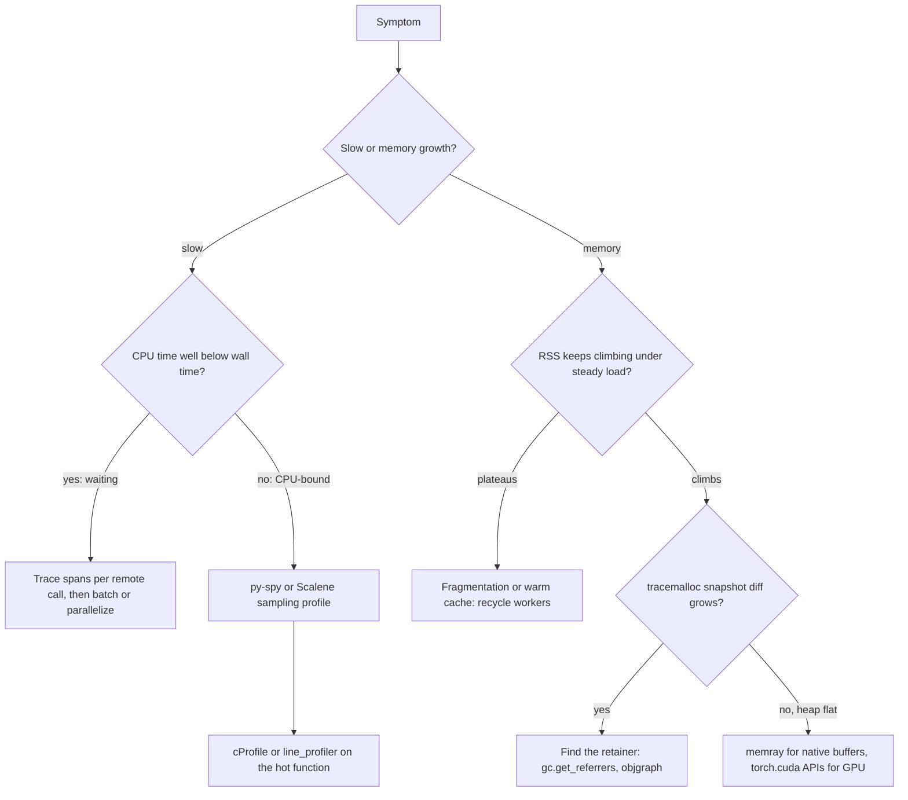

## TL;DR
Profiling replaces guessing: CPU profilers show which functions consume time, memory profilers which lines
allocated the bytes still alive. AI services mostly wait on network or GPU and hold native buffers Python
cannot see, so pick the tool by the question.

## Why it exists
- **Two tickets dominate.** "The pipeline is slow" and "the worker gets OOM-killed after a few hours", and
  intuition is a poor guide to either.
- **Engineers fix the wrong thing.** They rewrite a loop in NumPy when a tokenizer was re-created per
  request; add a cache when the cost was waiting sequentially on twelve embedding calls; blame "a memory
  leak in the model" when an unbounded `lru_cache` or an untrimmed conversation list holds every request's
  text.
- **`time.time()` prints only measure code you already suspect.**
- **`top` cannot say where.** It reports resident memory (RSS) for the whole process, mixing the Python
  heap, native allocations, memory-mapped model weights and allocator fragmentation: it shows *that* memory
  grows, never *where*.
- **A profiler attributes cost systematically,** including code you did not think to suspect.

## How it works
### Pick the tool by the question
| Question | Tool |
|---|---|
| CPU-bound or waiting? | `time.perf_counter()` vs `time.process_time()` |
| Which functions, exact call counts (dev box) | `cProfile` + `pstats` / `snakeviz` |
| Where is time in a live process | `py-spy` |
| Python vs native time, memory and copies per line | Scalene |
| Per-line timing of one known function | `line_profiler` |
| Which lines' Python allocations grew | `tracemalloc` |
| Native memory (C extensions, PyTorch CPU, tokenizers) | `memray` |
| GPU memory | `torch.cuda` memory APIs |

### First question: CPU-bound or waiting?
- **Compare wall time with CPU time** (`time.perf_counter()` vs `time.process_time()`).
- **CPU time a small fraction of wall time** means waiting on I/O, locks or a GPU; a CPU profiler will mostly
  show time inside the event loop's selector.
- **The fix is then** concurrency, batching or caching, and the right measurement is a trace with spans per
  remote call, not a function profile.

### Deterministic profiling: cProfile
- **How:** `cProfile` (stdlib) hooks every call and return, recording call counts, `tottime` (time inside
  each function) and `cumtime` (including callees).
- **Strength:** exact call counts, which is how you discover "this tokenizer was constructed 10,000 times".
- **Cost:** overhead on every call inflates functions that make many small calls, and it attributes poorly
  across `await` points and threads.
- **Reading it:** `pstats` sorted by `cumulative` finds the expensive subtree, then by `tottime` the hot
  leaf; `snakeviz` renders it visually.

### Sampling profilers: py-spy, Scalene
- **Why low overhead:** a sampler interrupts at intervals and records the current stack, so cost is low and
  roughly constant, *because* it depends on the sampling rate, not on how many calls you make.
- **`py-spy` reads the target's memory from outside,** so it attaches to a running production worker without
  code changes:

| Command / flag | Use |
|---|---|
| `py-spy top --pid` | live top-like view |
| `py-spy record -o flame.svg --pid` | flame graph |
| `py-spy dump` | stacks of a hung process |
| `--idle` | include waiting threads |
| `--native` | include C extension frames |

- **Scalene** separates Python time from native time and reports memory and copy volume per line, which
  answers "is my NumPy code actually vectorized?".
- **`line_profiler`** (`@profile` plus `kernprof -l`) gives per-line timings once you know which function
  matters.

### Python heap memory: tracemalloc
1. `tracemalloc` (stdlib) records a traceback for every allocation through Python's allocator.
2. Take a snapshot, run the workload, take another.
3. `compare_to` shows which source lines' live allocations grew: the right tool for growing lists, dicts,
   caches and closures.
4. **Then find the retainer.** tracemalloc answers *where* surviving bytes were allocated, not *who keeps
   them alive*, and the second question is the one you fix. Take one leaked object and walk its referrers
   with `gc.get_referrers(obj)`, or draw the chain to a module global with `objgraph.show_backrefs`.
5. **Typical retainers:** a module-level list, a cache, a closure, or a bound-method callback registered on
   a long-lived object.

- **Limits:** tracemalloc slows the program, and it cannot see allocations native libraries make with their
  own allocators unless they report them explicitly.
- **NumPy is the exception:** it registers array data buffers with tracemalloc (via `PyTraceMalloc_Track`),
  so large arrays do show up. PyTorch CPU tensors, Hugging Face `tokenizers` (Rust) and most C/C++ parsers
  do not.

### Native and GPU memory
- **`memray` intercepts allocator calls** (`malloc`, `mmap` and friends), so it sees native allocations (C
  extensions, PyTorch CPU tensors, tokenizers). It records to a file and draws flame graphs of what was live
  at peak (`memray run`, then `memray flamegraph`).
- **GPU memory:** use `torch.cuda.memory_allocated()`, `max_memory_allocated()` and `memory_summary()`. RSS
  and tracemalloc know nothing about VRAM.
- **`nvidia-smi` overstates tensor usage,** because the caching allocator keeps freed blocks reserved.
- **GPU timing trap:** CUDA kernels launch asynchronously, so `perf_counter()` around `model(x)` measures
  how long it took to *queue* the work. Call `torch.cuda.synchronize()` before reading the clock (or use
  `torch.cuda.Event` timers or `torch.profiler`); otherwise the cost lands at the first line needing a
  result on the CPU, such as `.item()`.

### Measuring a fix
- **Profile tells you where to look; a benchmark tells you whether the change helped.**
- **Function:** `timeit` with several repeats, compare the minimum, *because* OS and process noise only ever
  adds time.
- **Service:** compare latency percentiles (p50 and p95) and throughput under the same load script before
  and after, warmed up, since a single request mixes in one-off costs.

### Why RSS may not go down
- **Arenas:** CPython's small-object allocator can return an arena to the OS only when every object in it is
  freed; native allocators behave similarly.
- **So** a process that peaked at 6 GB and freed most objects may still report high RSS.
- **Read the shape:** growth that plateaus is usually fragmentation or a warm cache; growth that never stops
  under steady load is a leak.

## Diagram
The decision path: start from the symptom, use one cheap discriminating measurement, then pick the profiler
that can actually see the cost (Python time, native memory or GPU memory).



## Examples
### Find a memory leak and a hot spot in a RAG worker
tracemalloc compares two snapshots around a burst of requests; cProfile then shows where the CPU time goes.

```python
import cProfile, pstats, tracemalloc
from functools import lru_cache

HISTORY: list[str] = []                          # the bug: grows forever

@lru_cache(maxsize=None)                         # second bug: unbounded cache keyed by full text
def normalize(text: str) -> str:
    return " ".join(text.lower().split())

def handle(i: int) -> int:
    doc = f"Retrieved chunk {i} " * 200
    HISTORY.append(doc)                          # kept "for debugging"
    return len(normalize(doc).split())

tracemalloc.start(10)                            # keep 10 frames per allocation
before = tracemalloc.take_snapshot()
for i in range(5_000):
    handle(i)
after = tracemalloc.take_snapshot()
for stat in after.compare_to(before, "lineno")[:3]:
    print(stat)    # top lines by growth: the `doc = ...` line (strings kept alive by HISTORY),
                   # normalize's join (cached results) and the call site (lru_cache entries)
tracemalloc.stop()

prof = cProfile.Profile()
prof.enable()
for i in range(5_000, 10_000):
    handle(i)
prof.disable()
pstats.Stats(prof).sort_stats("cumulative").print_stats(5)
# Fix: bound the history (collections.deque(maxlen=100)) and give lru_cache a maxsize,
# then re-run the snapshot diff and confirm growth is flat across bursts.
```

### Wall vs CPU time: the first discriminating measurement
Standard library only. `time.sleep` stands in for waiting on a socket.

```python
import time

def measure(fn, *args):
    w0, c0 = time.perf_counter(), time.process_time()
    fn(*args)
    wall, cpu = time.perf_counter() - w0, time.process_time() - c0
    verdict = "waiting: fix with concurrency/batching" if cpu < 0.5 * wall else "CPU-bound: profile it"
    print(f"{fn.__name__:<18} wall={wall:.2f}s cpu={cpu:.2f}s  {verdict}")

def sequential_calls(n):            # stands in for n embedding calls made one after another
    for _ in range(n):
        time.sleep(0.05)            # time.sleep releases the CPU, like waiting on a socket

def tokenize_loop(n):               # pure-Python work: CPU time tracks wall time
    text = "the quick brown fox " * 50
    for _ in range(n):
        sum(len(w) for w in text.split())

measure(sequential_calls, 12)       # wall ≈ 0.6s, cpu ≈ 0.00s -> waiting
measure(tokenize_loop, 20_000)      # wall ≈ cpu -> CPU-bound
```

The 0.5 threshold is a rule of thumb for the demo, not a standard.

### Worked scenario: the OOM-killed ingestion worker
Same facts as Check yourself, walked as a diagnosis.

| Observation | Inference | Next step |
|---|---|---|
| RSS 1.5 GB → 9 GB over six hours | memory grows under steady load | find out where |
| tracemalloc heap flat at ~300 MB | growth is outside Python's allocator (NumPy would have shown) | `memray run` in a staging replica |
| memray peak shows parser buffers held by a document cache | native objects kept alive by a Python reference | bound or drop the cache |
| RSS after fix | flat, or plateaus | if it plateaus, recycle workers after N jobs |

## Production patterns
- **Attach py-spy to a misbehaving worker.** `py-spy record -o flame.svg --pid <PID>` (add `--idle` for
  waiting threads) or `py-spy dump --pid <PID>` for a hang. In containers this needs ptrace permission, for
  example adding the `SYS_PTRACE` capability to a debug pod. Keep sessions short and watch overhead.
- **Memory profiling in staging, not prod.** Replay a recorded workload under `memray run` and compare the
  peak flame graph with the previous release; keep tracemalloc and cProfile out of production builds.
- **Recycle workers when growth plateaus.** For fragmentation you cannot remove, restart workers after N jobs:
  gunicorn `--max-requests` with `--max-requests-jitter`, or Celery's max-tasks-per-child setting. Monitor RSS
  per worker over time and alert on slope, not on a single high value.
- **Log GPU peak per batch.** Call `torch.cuda.reset_peak_memory_stats()` before a batch and log
  `torch.cuda.max_memory_allocated()` after it, so capacity planning uses measured peaks rather than
  `nvidia-smi`.
- **Gate optimizations on a benchmark.** Keep a load script and compare p50, p95 and throughput on a warmed
  process before and after each change; for a function, `timeit` with repeats and compare the minimum.
- **Trace remote calls.** When wall time far exceeds CPU time, add spans per LLM, embedding and vector-store
  call; the fix is usually concurrency or batching, visible in the trace waterfall.

## Trade-offs
- **Exact counts vs honest timings.** Deterministic profilers give exact call counts but distort call-heavy
  code; sampling profilers keep timings honest and are safe in production, but miss rare short calls and
  give no exact counts.
- **Line precision vs coverage.** tracemalloc pinpoints Python-object leaks to a line but slows the program
  noticeably and misses native memory; switch to memray once RSS grows while tracemalloc's totals stay flat.
- **Real traffic vs access.** Profiling in production (py-spy attach) shows real behaviour, but needs
  `ptrace`-style permissions that hardened containers often deny; locally reproduced load is easier but may
  not trigger the real hot path.
- **Micro-optimization vs remote calls.** Halving a hot Python function's time does nothing for the user if
  wall time is dominated by remote calls; batching or parallelizing those calls is the larger lever.

## Pitfalls
- **cProfile on an I/O-bound async service,** then "optimizing" the top entry. Symptom: the selector or event
  loop dominates and latency does not improve. Fix: measure wall vs CPU first, then trace.
- **Treating high RSS after a peak as a leak.** Symptom: memory plateaus under steady load rather than
  climbing, which points to fragmentation or a cache, not unbounded growth.
- **Measuring once, on a cold process.** Symptom: profiles dominated by imports, model loading and JIT or
  CUDA initialization that never recur in steady state.
- **Timing GPU code without `torch.cuda.synchronize()`.** Symptom: a forward pass "takes 0.2 ms" while an
  innocent `.item()` or `.cpu()` a few lines later appears to take hundreds of milliseconds.
- **Stopping at tracemalloc's allocation line.** Symptom: a fix to the allocating code (a smaller string, a
  copy avoided) shrinks each leaked object but memory climbs at the same slope. Fix: find the retainer.
- **Reading `nvidia-smi` as tensor usage.** Symptom: apparent "GPU leaks" that are the PyTorch caching
  allocator holding reserved but free blocks.
- **tracemalloc or a deterministic profiler left on in production.** Symptom: a large, otherwise
  unexplained latency regression.

## When to use
- **Use when:** before optimizing, and whenever a latency SLO, a cost target or an OOM is in play.
- **Order for time:** wall vs CPU time, then a sampling profile, then a deterministic or line profile of the
  function that matters.
- **Order for memory:** watch RSS over time under steady load; if it climbs, tracemalloc snapshot diffs for
  Python objects, memray for native buffers, the CUDA memory APIs for GPU.
- **Measure:** after every fix, confirm it moved the number you cared about.
- **Interviews:** distinguishing CPU-bound from waiting, and Python heap from native and GPU memory, is the
  core skill.

## Role lens
- **Engineer:** Runs py-spy on a slow worker, uses tracemalloc diffs to find the unbounded cache, and
  verifies each fix with a before-and-after measurement.
- **Architect:** Decides where profiling hooks and memory limits live, and sets the capacity model from
  measured per-request CPU, memory and GPU cost rather than estimates.
- **FDE:** Diagnoses performance inside the customer's environment, often without root access, so relies on
  sampling, logs of wall vs CPU time and reproducible load scripts.

## Check yourself
**Q:** A document-ingestion worker's RSS climbs from 1.5 GB to 9 GB over six hours and the pod is
OOM-killed. tracemalloc shows the Python heap stable at about 300 MB. How do you proceed?
**A:** A stable traced heap with growing RSS means the growth is outside what tracemalloc sees: native
buffers (PDF parsers, PyTorch tensors, tokenizers; NumPy arrays would have shown up because NumPy reports
them to tracemalloc), memory-mapped files, or fragmentation. I would run the worker under
memray, or attach it in a staging replica, and look at what is live at the high-water mark, checking for
native objects kept alive by Python references such as a cache of parsed documents or arrays. I would also
check whether growth plateaus (fragmentation, possibly mitigated by recycling workers after N jobs) or is
unbounded (a real leak). Then fix, rerun the same workload, and confirm RSS stays flat.

## Interview questions
### What is the difference between a deterministic profiler and a sampling profiler, and when do you use each?
- **Deterministic (`cProfile`):** hooks every call and return, giving exact call counts, which is how you find
  a tokenizer constructed 10,000 times; the per-call overhead distorts call-heavy code.
- **Sampling (`py-spy`, Scalene):** records the stack at intervals, so overhead is low and constant and it is
  safe to attach to a live production worker.
- **Typical order:** sample first to find the hot area, then a deterministic or line profile of that function.

### A RAG endpoint's p95 is 3 s. How do you find out where the time goes?
- **Start with wall vs CPU time:** if `time.process_time()` is a small fraction of `time.perf_counter()`, the
  request is waiting on network or GPU, not computing.
- **If waiting:** add trace spans per LLM, embedding and vector-store call; sequential remote calls are the
  usual culprit, fixed by concurrency or batching.
- **If CPU-bound:** take a py-spy flame graph, then confirm the fix with p50 and p95 under the same load script.

### Why can't you trust `perf_counter()` around a PyTorch forward pass on a GPU?
- **Kernels launch asynchronously,** so the timer measures how long it took to queue the work.
- **The cost moves** to the first line that needs a CPU-side result, such as `.item()` or `.cpu()`.
- **Fix:** call `torch.cuda.synchronize()` before reading the clock, or use `torch.cuda.Event` timers or
  `torch.profiler`.

### When would you recycle workers instead of hunting a memory problem further?
- **When growth plateaus:** under steady load that points to allocator fragmentation or a warm cache rather
  than an unbounded leak, since CPython can return an arena to the OS only when every object in it is freed.
- **How:** gunicorn `--max-requests` with `--max-requests-jitter`, or Celery's max-tasks-per-child setting.
- **When not to:** growth that never stops is a real leak; recycling only hides it and the slope stays.

### `nvidia-smi` shows the GPU nearly full but your model should fit easily. What do you check?
- **The caching allocator:** PyTorch keeps freed blocks reserved, so `nvidia-smi` overstates tensor usage.
- **Measure what tensors use:** `torch.cuda.memory_allocated()`, `max_memory_allocated()` and
  `memory_summary()`.
- **For capacity planning,** call `torch.cuda.reset_peak_memory_stats()` before a batch and log the peak
  after it, rather than reading `nvidia-smi`.

## Quiz
### Q: An async RAG endpoint's cProfile output is dominated by the event loop's select call. What does that indicate?
- [ ] The event loop implementation is inefficient and should be replaced
- [x] The process spends most wall time waiting on I/O, so CPU optimization will not help much
- [ ] cProfile cannot run on async code at all
- [ ] There is a memory leak in the selector
> Time in the selector is time spent waiting for sockets. The levers are concurrency, batching and
> caching of remote calls, measured with traces; replacing the loop rarely moves waiting-dominated latency.

### Q: Why can py-spy safely profile a live production process when cProfile usually is not used there?
- [ ] py-spy only records memory, not CPU
- [ ] cProfile requires a debug build of Python
- [x] py-spy samples stacks from outside the process at low constant overhead, while cProfile instruments every call
- [ ] py-spy rewrites bytecode to remove its own overhead
> Sampling cost depends on the sampling rate, not on how many calls the program makes, and py-spy reads
> the target's memory externally, so no code change or restart is needed.

### Q: RSS keeps growing but tracemalloc's traced total is flat. Most likely explanation?
- [ ] tracemalloc is reporting incorrectly and should be restarted
- [ ] Python's garbage collector is disabled
- [ ] The leak is in a Python list that tracemalloc ignores
- [x] Memory is allocated by native code or the allocator is fragmented, outside what tracemalloc traces
> tracemalloc sees allocations through Python's allocator. Native libraries using their own allocators,
> mmaps and fragmentation all raise RSS invisibly to it, which is when a native-aware tool like memray helps.
