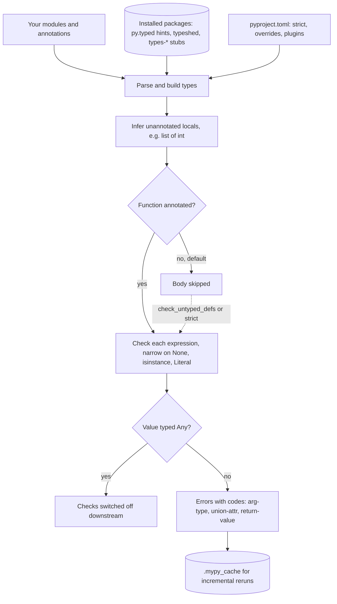

## TL;DR
Agent code passes loosely shaped data everywhere: replies whose content may be `None`, tool arguments,
step results. mypy reads your hints, infers the rest, and reports wrong types, missing keys and
unhandled cases without running anything. Unannotated code stays mostly unchecked.

## For agent builders
- **Why it matters for agents.** The crashes that end agent runs are rarely logic errors; they are a
  `.strip()` on a reply with no text, a misspelled tool-argument key, or a new step type the loop never
  handles. mypy finds all three across every path, including the rare ones no test reaches.
- **Where it shows up in your stack.** Provider SDK response types (most ship `py.typed`), `TypedDict` and
  Pydantic models for tool arguments, a `Protocol` for the model client so fakes type-check, and a union of
  step types the agent loop must handle exhaustively.
- **What you control.** Strictness per module, how precisely you type the boundaries where model output
  enters, and whether `Any` from `json.loads` leaks into the loop.
- **What you can skip.** Typing theory beyond variance and narrowing; runtime validation of model output
  is Pydantic's job, not mypy's.

## Why it exists
- **Python ignores hints at runtime.** `def call_model(prompt: str) -> str` happily accepts a list and
  returns `None`; you find out when a downstream `.strip()` raises `AttributeError` in production, often
  on a rare path: the model returned no content, an env var was unset, a tool call had no arguments.
- **AI code is especially exposed.** It passes loosely shaped data between layers: provider responses
  where `content` may be `None`, dicts of tool arguments, optional fields in config, results that are
  either a value or an error.
- **Tests and Pydantic leave gaps.** Tests cover only the paths you test, and the `None` paths are the
  ones people forget. Runtime validation catches bad data at boundaries, but not inside your own code
  between boundaries.
- **Unchecked annotations are comments that drift.** "We have annotations, that is enough" gives you
  documentation that silently becomes wrong after the third refactor, because nothing checks it.
- **A checker is a cheap whole-program test.** It runs in seconds, covers every path including those no
  test exercises, and makes refactoring safe: change a signature and it lists every caller you broke.

## How it works
### Checking
1. **Parse** each module.
2. **Build types** for every definition from annotations and from inference (`x = []` followed by
   `x.append(1)` infers `list[int]`).
3. **Check every expression** against them.
4. **Report errors with a code** in brackets (`[arg-type]`, `[union-attr]`, `[return-value]`), which you
   use for targeted ignores and configuration.

### Narrowing
- **Narrowing makes optional types usable:** after `if content is None: return`, mypy knows `content` is
  `str`.
- **Same mechanism** for `isinstance`, comparisons against `Literal` values, and `TypeGuard`/`TypeIs`
  functions.
- **Exhaustiveness:** calling `assert_never(x)` in the final branch makes mypy prove a chain of checks is
  exhaustive, so adding a new literal value breaks the build where it is not handled.

### Subtyping: nominal, structural, and variance
- **Nominal by default:** a value is compatible with a class if it is an instance of that class or a
  subclass.
- **`Protocol` switches to structural typing:** any object with matching methods qualifies, without
  inheriting anything. That is how you type "anything with an async `complete` method", so a real client
  and a test fake both satisfy one interface.
- **`list[int]` is *not* a `list[float]`**, even though `int` is accepted where `float` is expected. The
  reason is soundness: a function taking `list[float]` may append `0.5`, which would corrupt the caller's
  `list[int]`.

| Container | Variance | Consequence |
|---|---|---|
| `list`, `dict` (mutable) | invariant | `list[int]` rejected where `list[float]` is expected |
| `Sequence`, `Mapping` values (read-only) | covariant | `Sequence[float]` accepts a `list[int]` |

- **The usual fix** is to accept `Sequence[float]` when the function only reads.
- **`reveal_type(expr)`** prints what mypy inferred at that point, and is the first tool when a message
  seems wrong.

### Gradual typing
- **`Any` is compatible with everything, in both directions**, so errors stop propagating through it.
- **Unannotated functions are skipped by default:** mypy does not check the bodies of functions with no
  annotations at all, because adopting a checker on an untyped codebase would otherwise produce
  thousands of errors.
- **Both choices make adoption possible and both hide bugs**, which is why `--strict` exists, along with
  flags such as `disallow_untyped_defs`, `check_untyped_defs`, `warn_return_any` and `warn_unused_ignores`.

### Third-party types
- **Inline hints** are used if the package ships a `py.typed` marker (PEP 561).
- **Otherwise stub packages:** the standard library's from typeshed (bundled), others from `types-*`
  packages.
- **Untyped libraries** produce "missing library stubs" errors, silenced per module with
  `ignore_missing_imports`.
- **Plugins** teach mypy about some libraries, such as Pydantic's mypy plugin for model constructors.

### Configuration and speed
Configure in `pyproject.toml`; per-module overrides let you be strict in new code and lenient in legacy:

```toml
[tool.mypy]
strict = true
plugins = ["pydantic.mypy"]

[[tool.mypy.overrides]]
module = ["legacy.*"]
disallow_untyped_defs = false

[[tool.mypy.overrides]]
module = ["some_untyped_sdk.*"]
ignore_missing_imports = true
```

- **Run it in the real environment.** mypy reads types from the packages installed where it runs, so it
  needs the project's real dependencies and the same target Python version (`python_version`) as
  production. In a bare CI image every third-party import becomes a missing-stubs error or silently `Any`.
- **Incremental:** results are cached in `.mypy_cache` and only what changed is rechecked; `dmypy` keeps a
  daemon running for faster editor-style feedback.

| Checker | Notes |
|---|---|
| mypy | long-standing reference, plugin system |
| pyright (engine behind Pylance) | faster, infers more aggressively, so it disagrees with mypy at the edges |
| Astral's ty, Meta's Pyrefly | Rust-based and much faster but younger; check current maturity and typing-spec conformance before making one a gate |

- **Pick one checker as the CI gate.**

### Where types pay off in an agent
| Agent boundary | Type it as | What mypy then catches |
|---|---|---|
| Model reply content | `str \| None`, narrowed before use | `.strip()` on a tool-call reply with no text |
| Tool arguments after parsing | `TypedDict` or a Pydantic model, not `dict[str, Any]` | misspelled argument keys |
| Step results of the loop | a union of dataclasses (tool call, final, refusal) | a new step type left unhandled |
| Model client | a `Protocol` with the methods the loop uses | a test fake whose methods do not match |
| `json.loads` output | parse straight into a model | `Any` silently disabling checks downstream |

## Diagram
What mypy consumes and where checking silently stops: annotated code is checked end to end, while `Any`
and unannotated bodies bypass the checks unless strict flags close them.



## Examples
### Agent scenario: an exhaustive step handler
The loop turns each model reply into one of three step types. Check with `mypy --strict agent_step.py`;
messages are abridged and were produced with a recent mypy.

```python
from dataclasses import dataclass
from typing import assert_never

@dataclass
class ToolCall:
    id: str
    name: str
    arguments: str          # a JSON string, as providers send it

@dataclass
class Final:
    text: str | None        # a reply can arrive with no text content

@dataclass
class Refusal:
    reason: str

Step = ToolCall | Final | Refusal

def run_tool(name: str, arguments: str) -> str:
    return "ok"

def handle(step: Step) -> str:
    match step:
        case ToolCall(name=name, arguments=args):
            return run_tool(name, args)
        case Final(text=text):
            return text.strip()
            # error: Item "None" of "str | None" has no attribute "strip"  [union-attr]
        case Refusal():
            return "refused"
        case _:
            assert_never(step)

def handle_v2(step: Step) -> str:          # written before Refusal existed
    match step:
        case ToolCall():
            return run_tool(step.name, step.arguments)
        case Final():
            return step.text or ""
        case _:
            assert_never(step)
            # error: Argument 1 to "assert_never" has incompatible type "Refusal"; expected "Never"  [arg-type]
```

- **Two agent incidents prevented:** the `None` reply that would crash the final step, and the new
  `Refusal` step type that an older handler silently mishandled.
- **Add a step type, get a to-do list:** every `assert_never` that now fails is a place in the loop,
  tracing or UI that must learn the new case.

### Bugs a test suite misses, and one mypy misses
Each reported by mypy with its error code. The comments show mypy's messages (paths and line numbers
omitted).

```python
import os
from typing import Literal, TypedDict, assert_never   # assert_never: Python 3.11+

class ToolCall(TypedDict):
    name: Literal["search", "fetch_url"]
    arguments: dict[str, str]

def run(model: str, prompt: str) -> str: ...

def answer(prompt: str) -> str:
    model = os.environ.get("MODEL")          # str | None
    return run(model, prompt)
    # error: Argument 1 to "run" has incompatible type "str | None"; expected "str"  [arg-type]

def first_text(content: str | None) -> str:
    return content.strip()
    # error: Item "None" of "str | None" has no attribute "strip"  [union-attr]

def query_of(call: ToolCall) -> str:
    return call["argumnets"]["query"]
    # error: TypedDict "ToolCall" has no key "argumnets"  [typeddict-item]

def route(call: ToolCall) -> str:
    name = call["name"]
    if name == "search":
        return "search-service"
    elif name == "fetch_url":
        return "fetcher"
    else:
        assert_never(name)   # adding "run_sql" to the Literal makes this line an error

def helper(resp):                  # unannotated: mypy skips this body by default
    return first_text(resp) + 1    # str + int: reported only with check_untyped_defs (or strict)
    # resp.choises would pass even then: an unannotated parameter is Any until you annotate it
```

- **The fixes are one line each:** `os.environ["MODEL"]` or a default, an `is None` branch, the correct
  key. mypy 1.19 also adds a `Did you mean "arguments"?` note to the TypedDict error.
- **Why `strict` matters:** unannotated bodies are skipped by default, and even `check_untyped_defs` cannot
  see through parameters that are implicitly `Any`. Strict mode's `disallow_untyped_defs` forces the
  annotation that makes the checker useful there.
- **A side effect of the stub:** `def run(...) -> str: ...` in a regular module is itself reported as
  `Missing return statement  [empty-body]`; real code has a body or lives in a `.pyi` stub.

### Protocols and variance: a fake that type-checks, a fake that does not
Check with `mypy --strict fakes.py`; the file is for the checker, not for running. Messages are from
mypy 1.19, abridged.

```python
from typing import Protocol, Sequence

class Completer(Protocol):
    async def complete(self, prompt: str) -> str: ...

class FakeLLM:                                  # no inheritance: matches structurally
    async def complete(self, prompt: str) -> str:
        return prompt.upper()

class BadFake:
    def complete(self, prompt: str) -> str:     # sync: does not match the protocol
        return prompt

async def summarize(llm: Completer, text: str) -> str:
    return await llm.complete(f"Summarize: {text}")

def mean(xs: list[float]) -> float:
    return sum(xs) / len(xs)

def mean_ro(xs: Sequence[float]) -> float:
    return sum(xs) / len(xs)

async def main() -> None:
    await summarize(FakeLLM(), "doc")           # ok
    await summarize(BadFake(), "doc")
    # error: Argument 1 to "summarize" has incompatible type "BadFake"; expected "Completer"  [arg-type]
    # note: Expected: def complete(self, prompt: str) -> Coroutine[Any, Any, str]
    scores: list[int] = [3, 4, 5]
    mean(scores)
    # error: Argument 1 to "mean" has incompatible type "list[int]"; expected "list[float]"  [arg-type]
    # note: "list" is invariant ... Consider using "Sequence" instead, which is covariant
    mean_ro(scores)                             # ok: Sequence is covariant
    reveal_type(scores)                         # note: Revealed type is "builtins.list[builtins.int]"
```

The sync fake would have failed at runtime with "object str can't be used in 'await' expression", but
only on the path that awaits it; mypy reports it before any test runs.

### Worked scenario: adopting mypy on a legacy service
Illustrative counts for a 60-module service; the shape of the ratchet is what matters.

| Step | Config change | Errors to fix | Result |
|---|---|---|---|
| 1 | default mode, `ignore_missing_imports` per untyped SDK | ~40, mostly `union-attr` and `arg-type` | real `None` bugs fixed; gate turned on in CI |
| 2 | `strict = true`, all old modules in a `legacy.*`-style override | 0 new; new modules strict from day one | strict code grows with every PR |
| 3 | move 5 modules per sprint out of the override | ~20 per module | override list shrinks; track it as a metric |
| 4 | `warn_unused_ignores` on | stale ignores removed | suppressions stay honest |

## Production patterns
- **Gate CI in the project's environment.** Install the real dependencies (for example `uv run mypy src/`
  or `pip install -e .` first) and set `python_version` to production's version. Cache `.mypy_cache`
  between CI runs. Monitor error count on main, which must stay at zero.
- **Strict for new code, ratchet the rest.** `strict = true` globally, with legacy packages listed in a
  `[[tool.mypy.overrides]]` block that relaxes `disallow_untyped_defs`. Remove modules from the list as
  they are typed, and track the list's length as the adoption metric.
- **Honest suppressions.** Require error codes on every ignore (`# type: ignore[union-attr]`) by adding
  `enable_error_code = ["ignore-without-code"]`, and set `warn_unused_ignores = true` so stale ones fail
  the build. Review the ignore count in each release.
- **Measure `Any` leakage.** Run `mypy --any-exprs-report <dir>` periodically; it writes a per-module
  table of how many expressions are `Any` and why (unannotated, unimported, explicit). Model the worst
  boundaries with `TypedDict` or Pydantic.
- **Typed agent boundaries.** Parse every tool call's arguments straight into a Pydantic model or
  `TypedDict`, type reply content as optional, and model loop steps as a union handled with
  `assert_never`. Run `--any-exprs-report` on the agent package first, because that is where `Any` from
  `json.loads` concentrates. Monitor production `AttributeError` and `KeyError` in the loop.
- **pre-commit needs its dependencies.** The `mirrors-mypy` hook runs in its own isolated environment, so
  list typed libraries and stub packages under `additional_dependencies`. Otherwise imports silently
  become `Any` and pre-commit passes code that CI rejects.

## Trade-offs
- **Strict mode: most bugs caught vs annotation effort.** It fights dynamic code, and flips from burden to
  bargain once a codebase is refactored often or shared by several teams.
- **Gradual typing: incremental adoption vs holes.** `Any` and unannotated functions leave holes that look
  checked; track the untyped share and ratchet strictness module by module.
- **Static checks: every path vs only your process.** They cover every path at near-zero runtime cost, but
  say nothing about data from outside the process; model output and HTTP payloads still need runtime
  validation with Pydantic or similar.
- **pyright vs mypy.** pyright is faster and more aggressive at inference, while mypy is the long-standing
  reference with a plugin system; mixing both as CI gates mostly produces arguments about edge cases.

## Pitfalls
- **Sprinkling bare `# type: ignore` comments.** Symptom: suppressed real errors that outlive their
  reason. Fix: `warn_unused_ignores` and error-code-specific ignores make them visible.
- **Typing provider responses or tool arguments as `dict[str, Any]`.** Symptom: mypy passes code that
  reads misspelled keys, because `Any` turns off every check downstream of it.
- **Leaving functions unannotated and assuming they are checked.** Symptom: obvious misuse of typed values
  in those bodies that mypy never reports until `check_untyped_defs` is on, and attribute typos on their
  implicitly `Any` parameters that stay invisible until the parameters are annotated.
- **Running mypy only in editors, not in CI.** Symptom: a main branch with hundreds of errors that nobody
  can turn on as a gate without a week of cleanup.
- **Annotating a read-only parameter as `list[float]` or `dict[str, float]`.** Symptom: `[arg-type]`
  errors at callers passing `list[int]`, "fixed" with casts or ignores, when `Sequence[float]` or
  `Mapping[str, float]` states the real requirement.
- **Ignoring missing stubs globally rather than per module.** Symptom: a typo in an import or a wrongly
  named function from a library that no longer produces any error.

## When to use
- **Use on every service that will be maintained beyond a prototype:** mypy (or one chosen alternative)
  as a CI gate alongside ruff and pytest.
- **New projects:** start in strict mode.
- **Existing projects:** start lenient, fix the error codes that find real bugs (`union-attr`, `arg-type`,
  `return-value`), and tighten per module.
- **Pair with boundary types:** `TypedDict`, `Literal` and Pydantic models where untyped data enters,
  because types are only as good as the boundary that establishes them.
- **Interviews:** explain gradual typing and why `Any` is contagious, not just which flags you set.

## Role lens
- **Engineer:** Annotates provider and tool boundaries precisely, narrows optional values explicitly,
  and treats every `type: ignore` as a reviewed exception with an error code.
- **Architect:** Sets the typing policy: which checker gates CI, strictness for new versus legacy
  modules, and how typed contracts flow between services and agent tools.
- **FDE:** Adds typed adapters around a customer's loosely shaped API early, so changes in their payloads
  surface as type errors in the integration code rather than as runtime failures.

## Check yourself
**Q:** A team says "we have type hints everywhere and mypy passes, yet we keep getting `NoneType has no
attribute` errors in production." Give two plausible causes and how to confirm each.
**A:** First, `Any` leakage: responses or JSON are typed `dict[str, Any]` or come from an untyped library,
so attribute access on them is never checked. Confirm with `reveal_type` at the failing site or mypy's
any-expression reports, and fix by modelling the data with `TypedDict` or Pydantic at the boundary.
Second, gradual-typing gaps: the failing code is in unannotated functions or under a lenient override,
so its body is not checked; turn on `check_untyped_defs` or strict for that module and see what appears.
A third possibility is that runtime data violates the declared types, such as a field the provider
documents as present arriving as null, which only runtime validation catches.

## Interview questions
### Your agent reads tool arguments from json.loads. What is gradual typing, and why is that Any contagious?
- **Gradual:** unannotated functions are not checked by default and `Any` is compatible with everything in
  both directions, so a large codebase can adopt mypy module by module.
- **Contagious:** any value derived from an `Any` (an attribute, an index, a call result) is also `Any`, so
  one `dict[str, Any]` of tool arguments switches off checking for everything the tool does with it.
- **Close the gap** with `--strict`, boundary models (`TypedDict`, Pydantic) that parse the arguments, and
  `--any-exprs-report`.

### Why is list[int] rejected where list[float] is expected, and how do you fix the signature?
- **Mutable containers are invariant** for soundness: a function taking `list[float]` could append `0.5`
  and corrupt the caller's `list[int]`.
- **State the real requirement:** if the function only reads, accept `Sequence[float]` (or
  `Mapping[str, float]`), which is covariant.
- **Do not paper over it** with `cast` or `# type: ignore[arg-type]`; mypy's own note suggests `Sequence`.

### How would you use types to make an agent loop safe to extend with new step types?
- **Model steps as a union** of small dataclasses (tool call, final answer, refusal) instead of a dict
  with a `type` key.
- **Handle them with `match` and `assert_never`** in the final branch, so adding a step type makes mypy
  report every handler that does not cover it.
- **Type reply content as `str | None`** so the checker forces a branch for replies with no text, the
  case that otherwise crashes the last step.

### mypy passes locally but CI reports dozens of missing-stubs errors. What happened?
- **mypy reads types from the installed environment**, so a CI image without the project's dependencies
  makes every third-party import a missing-stubs error, or silently `Any`.
- **Fix the environment, not the config:** install real dependencies and `types-*` stubs before running,
  and set `python_version` to production's.
- **The reverse also happens** with pre-commit's isolated hook environment, unless typed libraries are
  listed under `additional_dependencies`.

### How would you introduce mypy to a 200-module untyped codebase without stopping feature work?
- **Start lenient and gate CI immediately** on the codes that find real bugs (`union-attr`, `arg-type`,
  `return-value`), with `ignore_missing_imports` per untyped SDK, never globally.
- **Make new code strict** via `strict = true` plus an override listing legacy packages, so the strict share
  grows with every pull request.
- **Ratchet:** remove a few modules from the override each sprint, turn on `warn_unused_ignores`, and track
  the override list and `Any` share as metrics.

### Would you use mypy or pyright as the CI gate, and would you run both?
- **Either works as a gate:** mypy is the long-standing reference with a plugin system (Pydantic's
  plugin, for example); pyright is faster and infers more aggressively, which suits editor feedback.
- **Run one as the gate**, because the two disagree at the edges and dual gates mostly produce arguments
  about edge cases.
- **Treat newer Rust-based checkers** (ty, Pyrefly) as candidates to evaluate on maturity and typing-spec
  conformance before they gate anything.

## Quiz
### Q: By default, what does mypy do with the body of a function that has no annotations?
- [ ] Infers all parameter types from call sites and checks the body fully
- [x] Treats it as dynamically typed and does not report errors inside the body
- [ ] Refuses to check the module until annotations are added
- [ ] Converts the parameters to object and reports every attribute access
> Skipping unannotated bodies makes gradual adoption possible; `check_untyped_defs` or strict mode
> changes that. mypy does not infer parameter types from call sites; unannotated parameters are
> treated as Any.

### Q: Why does typing a model response as `dict[str, Any]` weaken mypy's checking so much?
- [ ] mypy cannot check dictionaries at all
- [ ] It forces mypy into a slower checking mode
- [x] Values typed Any are compatible with everything, so errors downstream of them are not reported
- [ ] It makes mypy treat the whole module as untyped
> `Any` switches off checks wherever it flows, so a misspelled key or wrong attribute passes silently.
> Modelling the response with TypedDict or Pydantic restores checking downstream.

### Q: What does calling `assert_never(x)` in a final `else` branch let mypy verify?
- [ ] That x is never None at runtime
- [x] That every possible value of x's union or Literal type was handled by earlier branches
- [ ] That the function never raises an exception
- [ ] That the else branch is executed at least once in tests
> After narrowing, x in the final branch should have no remaining type; if a new Literal value is added
> and not handled, mypy reports an error at the assert_never call.
