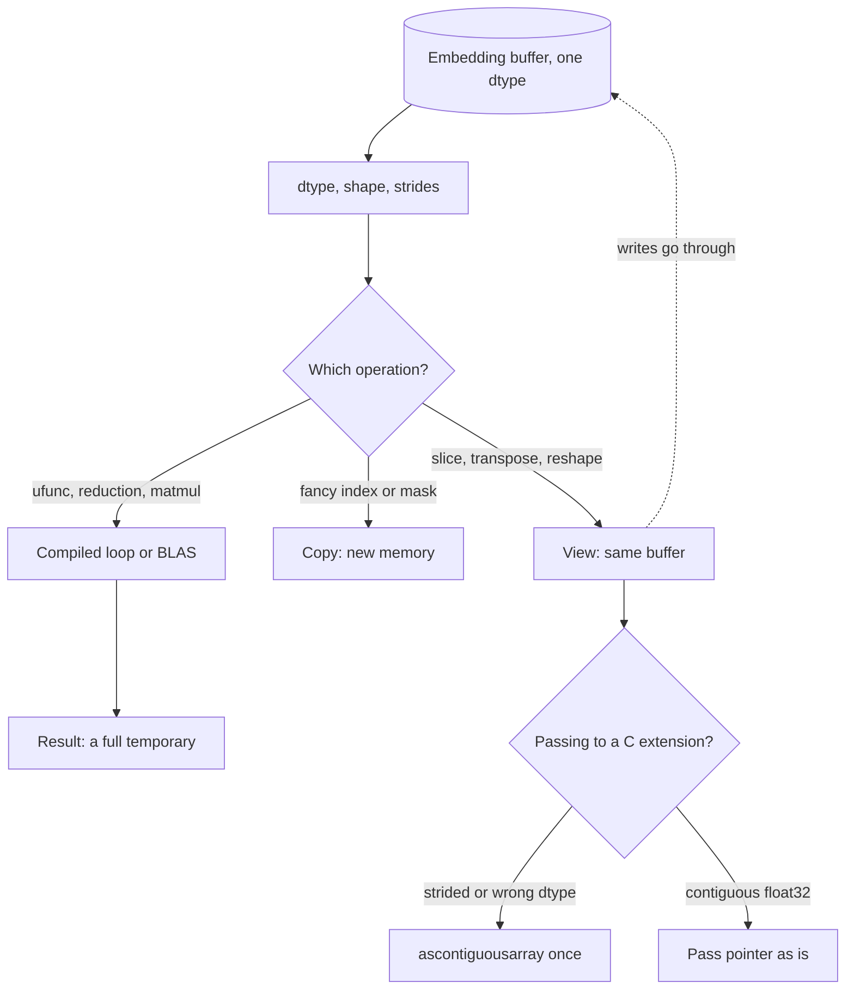

## TL;DR
NumPy is where an agent's embeddings live before or beside a vector database: typed, contiguous arrays
run by compiled loops. Semantic memory, tool routing and retrieval-recall checks get compiled speed, but
bugs hide in shapes, dtypes, broadcasting and views.

## For agent builders
- **Why it matters for agents.** Every embedding your agent produces (a query, a memory, a tool
  description, a retrieved chunk) comes back as a float vector. Scoring it against stored vectors, picking
  the top-k memories or the 5 most relevant tools out of 200, and measuring retrieval recall are NumPy
  one-liners.
- **Where it shows up in your stack.** Embedding API responses turned into `float32` arrays, in-process
  semantic memory for prototypes, LangChain or LlamaIndex in-memory vector stores, FAISS inputs, eval
  scripts for recall@k, and the arrays inside pandas and scikit-learn.
- **What you control.** Dtype (float32, not the float64 default), normalization once at ingestion, shapes
  you assert at boundaries, batch sizes for big score matrices, and when to hand off to a real index.
- **What you can skip.** Linear algebra beyond dot products and norms, and most of the API. Shapes,
  broadcasting, views, dtype promotion and `argpartition` are the working set.

## Why it exists
- **A Python list of floats is pointers to boxed objects.** Each element is a separate heap object with
  a type and a reference count. A dot product costs, per element, two pointer chases, two type checks, an
  allocation for the result and an interpreter dispatch.
- **That is slow at agent scale.** Scoring a query against 100,000 embeddings of 768 dimensions is about
  77 million multiply-adds: seconds to minutes in pure Python versus milliseconds in compiled code
  (illustrative orders of magnitude; measure on your machine). In an agent loop that runs every step.
- **It wastes memory too.** A boxed float is far larger than its 8 bytes of payload, so lists use several
  times the memory of the raw values and scatter them across the heap, ruining CPU cache behaviour.
- **NumPy's answer.** Store numbers unboxed in one buffer with one dtype, and expose whole-buffer
  operations. The loop still exists, but runs in C (or an optimized BLAS library for matrix products) over
  contiguous memory.
- **It is the common substrate.** Nearly the whole scientific Python stack, pandas, scikit-learn, and the
  tensor interop in PyTorch, is built on or speaks this array model.

## How it works
### The ndarray: buffer, dtype, shape, strides
An array is a pointer to raw bytes plus metadata:

| Field | Example | Meaning |
|---|---|---|
| `dtype` | `float32` | 4 bytes per element |
| `shape` | `(100000, 768)` | Size of each axis |
| `strides` | `(3072, 4)` | Bytes to step one position along each axis (C-ordered, row-major) |

- **Addressing.** Element `[i, j]` lives at `offset + i*3072 + j*4`.
- **Memory is exactly `n × d × itemsize`:** 100,000 × 768 × 4 = 307,200,000 bytes, about 307 MB. In
  float64 it would be twice that, which is why embeddings are usually kept in float32.

### Views versus copies
Indexing is arithmetic on strides, so many operations return a *view* sharing the buffer.

| Returns a view | Returns a copy |
|---|---|
| Basic slicing: `a[:10]`, `a[:, ::2]` | Fancy indexing: `a[[1, 5, 9]]` |
| `reshape` when possible | Boolean masks: `a[a > 0]` |
| Transpose: `a.T` just swaps the strides | |

- **Why views.** Speed: slicing a 307 MB array costs nothing.
- **The consequence.** Writing into a view writes into the original, for example a memory store shared by
  two agent sessions.
- **Why fancy indexing copies.** It must gather scattered elements into new memory.

### Contiguity and layout
- **Views leave arrays non-contiguous.** `a.T` of a C-ordered matrix is Fortran-ordered; `a[:, ::2]`
  skips every other element.
- **Strides cost cache.** NumPy accepts any strides, but a large stride wastes cache lines, so reducing
  along the contiguous axis is faster than along the strided one.
- **C extensions are stricter.** Code taking a raw pointer (FAISS, many C/CUDA kernels, some
  serialization paths) expects C-contiguous memory of a specific dtype. Check `a.flags["C_CONTIGUOUS"]`
  and convert once with `np.ascontiguousarray(a, dtype=np.float32)` at the boundary; that is the one place
  a copy is correct.
- **`reshape` may copy silently.** It returns a view only when existing strides can express the new
  shape, so after a transpose a reshape may cost a full copy.

### Vectorization and ufuncs
- **Ufuncs.** Element-wise operations (`+`, `np.exp`, comparisons) are compiled loops over every element.
- **Reductions take an `axis`,** the dimension that collapses: `a.sum(axis=1)` on `(N, d)` gives `(N,)`.
  Same for `sum`, `max`, `argmax`.
- **Matrix products (`@`) dispatch to BLAS,** which uses SIMD and multiple cores.
- **Many release the GIL,** so threads can overlap NumPy work, for example scoring memories while an
  async agent server waits on a model call.

### Broadcasting
1. Align shapes from the right.
2. Each pair of dimensions must be equal or one of them 1.
3. Size-1 dimensions are stretched virtually (stride 0), with no copy.

| Expression | Effect |
|---|---|
| `(N, d) / (N, 1)` | Divides each row by its own norm |
| `(N, d) - (d,)` | Subtracts a mean vector from every row |
| `(N,) - (N, 1)` | Silently becomes an `(N, N)` matrix: the top source of silent bugs |

### Dtypes and numerical behaviour
- **Integers wrap on overflow** without an exception: a `uint8` pixel of 250 plus 10 becomes 4.
- **float32 has about 7 significant decimal digits:** enough for similarity scores, risky for long
  accumulations.
- **NumPy scalars are not Python floats.** `float32` values do not serialize to JSON until you call
  `.item()` or `.tolist()`, which bites when a similarity score goes into a tool result or a trace.
- **Mixed dtypes promote to the wider one.** `float32_array * float64_array` produces float64, so one
  float64 array (a weights vector built with `np.array([...])`, a result from an older file) can silently
  double the memory of everything downstream.
- **Scalars differ.** A plain Python scalar does not force the upcast (`emb * 0.5` stays float32). A
  NumPy `float64` scalar, such as a value pulled out of another array, does under NumPy 2's promotion
  rules, whereas NumPy 1.x let it slide, so upgrades can change dtypes. Check `result.dtype` at stage
  boundaries.

### Randomness
- **Use `rng = np.random.default_rng(seed)` and pass `rng` around** rather than seeding global state,
  because explicit generators make experiments (and sampled eval subsets) reproducible and do not
  interfere across libraries.

## Diagram
One buffer, many behaviours: the operation you choose decides whether you get a free view, a gathered
copy or a compiled loop, and handing vectors to FAISS or another C extension is where a copy is correct.



## Examples
### Agent tool routing: pick 5 of 200 tools by embedding similarity
Sending 200 tool schemas every step wastes context; embed the tool descriptions once and send only the
closest few to the user's request.

```python
import numpy as np

rng = np.random.default_rng(0)
tool_names = [f"tool_{i}" for i in range(200)]
# In production: embeddings of each tool's description from your embedding model, done once.
tool_vecs = rng.standard_normal((200, 768), dtype=np.float32)
tool_vecs /= np.linalg.norm(tool_vecs, axis=1, keepdims=True)    # (200, 768) / (200, 1)

def route(query_vec: np.ndarray, k: int = 5) -> list[tuple[str, float]]:
    q = np.asarray(query_vec, dtype=np.float32)
    q /= np.linalg.norm(q)
    scores = tool_vecs @ q                                     # (200,)
    top = np.argpartition(-scores, k)[:k]
    top = top[np.argsort(-scores[top])]
    return [(tool_names[i], scores[i].item()) for i in top]    # .item(): JSON-safe float

picked = route(rng.standard_normal(768))
assert tool_vecs.dtype == np.float32 and tool_vecs.shape == (200, 768)
print(picked)    # pass only these 5 schemas to the model this step
```

- **Why it pays:** 5 schemas instead of 200 shrinks every prompt and reduces wrong-tool picks; log the
  routed set per step so an eval can check the right tool was in the top 5.

### Exact top-k cosine search
Exact top-k cosine search over 100,000 embeddings, the core of every retrieval prototype and agent
semantic-memory store.

```python
import numpy as np

rng = np.random.default_rng(0)
docs = rng.standard_normal((100_000, 768), dtype=np.float32)   # ~307 MB
query = rng.standard_normal(768, dtype=np.float32)
print(docs.nbytes, docs.strides)          # 307200000 (3072, 4)

# Normalize rows: (N, 768) / (N, 1) broadcasts per row; /= writes into docs in place
docs /= np.linalg.norm(docs, axis=1, keepdims=True)
query /= np.linalg.norm(query)

scores = docs @ query                     # (100000,) via one BLAS matrix-vector product
k = 5
top = np.argpartition(-scores, k)[:k]     # O(N) selection of the k best, unordered
top = top[np.argsort(-scores[top])]       # sort only those k
print(top, scores[top].round(3))

# Pitfall demo: forgetting keepdims gives shape (N,), which cannot broadcast against (N, 768)
norms = np.linalg.norm(docs, axis=1)      # (100000,)
# docs / norms would raise: operands could not be broadcast together
head = docs[:10]                          # a view: head[:] = 0 would zero rows of docs
picked = docs[[0, 5, 9]]                  # fancy indexing: a copy, safe to modify
print(np.shares_memory(head, docs), np.shares_memory(picked, docs))  # True False
```

- **`argpartition`** avoids sorting 100,000 scores to find 5.
- **`keepdims=True`** keeps the norm as `(N, 1)` so the division broadcasts per row.
- **Scale limit.** Past a few million vectors, exact search like this is replaced by an approximate index.

### Worked scenario: batched exact search as the recall baseline for an agent's retriever
`Q @ D.T` for many eval queries materialises a huge block. A `batched_topk(Q, D, k=10, batch=1_000)`
helper loops over query slices, computes `Q[s:s + batch] @ D.T`, keeps `argpartition` top-k per row with
`np.take_along_axis`, and discards the block. Its output is ground truth to compare with the vector
database's answers.

| Plan (768-d float32, 1,000,000 docs) | Peak score block |
|---|---|
| 50,000 queries at once | 50,000 × 1,000,000 × 4 B = 200 GB: does not fit |
| batch=1,000 | 4 GB, plus a temporary of the same size from `-S` |
| batch=100 | 0.4 GB per block |

| Embedding store (768-d) | float64 | float32 | float16 |
|---|---|---|---|
| 100,000 vectors | 614 MB | 307 MB | 154 MB |
| 1,000,000 vectors | 6.1 GB | 3.1 GB | 1.5 GB |

- **For an agent memory store:** an agent that writes one 768-d float32 memory per turn reaches 100,000
  memories at 307 MB; that still fits in process, but at 1,000,000 (3.1 GB per replica) move to a vector
  database.

## Production patterns
- **Normalize and pin layout at ingestion.** Convert once with `np.ascontiguousarray(x, dtype=np.float32)`,
  divide by row norms, and store that. Monitor `np.isnan(x).any()` and the min/max of row norms per batch;
  a zero or NaN norm usually means an empty input text upstream, such as an empty tool result embedded.
- **Assert shapes and dtypes at stage boundaries.** Put `assert x.shape == (n, d) and x.dtype ==
  np.float32` where arrays enter and leave a component, including after every embedding call. Track
  `x.nbytes` in logs, so a float64 upcast shows up as a doubled number before it shows up as an OOM.
- **Memory-map big arrays.** Save with `np.save` and open with `np.load(path, mmap_mode="r")`, so agent
  workers share pages from the OS cache instead of each loading a copy. Monitor resident memory per worker
  and disk read throughput.
- **Bound BLAS threads per process.** When running several agent worker processes, set `OMP_NUM_THREADS`
  (or the BLAS-specific variable, such as `OPENBLAS_NUM_THREADS`) so cores are not oversubscribed. Watch
  CPU load average against core count and matrix-product latency.
- **Keep exact search as the recall baseline.** Run `batched_topk` on a sample of real agent queries and
  compare with the vector database's results. Alert when recall@k drops after an index rebuild, an
  embedding-model change or a parameter change.
- **Convert scores before they leave NumPy.** Call `.item()` or `.tolist()` before a similarity score goes
  into a tool result, a trace or an API response. Watch for serialization `TypeError`s in agent logs.

## Trade-offs
- **Compiled speed vs temporaries.** Whole-array operations are fast, but every intermediate is a full
  temporary, so memory can peak at several copies of your data; in-place operators and `out=` arguments
  help.
- **Free views vs aliasing.** Slicing and transposes cost nothing, but a mutation through a view changes
  the original, a correctness hazard in shared code paths such as a memory store used by many sessions.
- **float32 vs float64.** float32 halves memory and speeds up BLAS, but loses precision in long sums or
  ill-conditioned linear algebra, where float64 is worth the cost.
- **In-process arrays vs a vector database.** NumPy needs no service, no network hop and is exact, but has
  no persistence, filtering, multi-tenant isolation or concurrent writes. Past one process, millions of
  vectors or per-user filters, a vector database wins.
- **One CPU process vs scale.** Once arrays exceed RAM or you need GPUs or autograd, PyTorch,
  memory-mapped arrays or a vector database take over.

## Pitfalls
- **Python loops over array elements.** Symptom: a NumPy script no faster than pure Python; a profiler
  shows time in the interpreter, not in NumPy calls. Fix: vectorize.
- **Accidental broadcasting of `(N,)` against `(N, 1)`.** Symptom: an unexpectedly huge array, a
  `MemoryError`, or a plausible-looking metric averaged over N² pairs. Fix: `keepdims=True` or reshape.
- **Modifying a slice and corrupting the source.** Symptom: embeddings or memories change "by themselves"
  after an unrelated function ran. Fix: `.copy()` before mutating.
- **Integer overflow in fixed-width dtypes.** Symptom: negative counts or wrapped pixel values with no
  warning. Fix: widen the dtype before arithmetic.
- **Default float64 or one float64 operand.** `np.array(list_of_floats)` for embeddings returned by an
  API as Python lists, or a float64 operand promoting a float32 pipeline. Symptom: double the expected
  memory and slower matrix products, visible in `arr.dtype` and `arr.nbytes`.
- **Mixing embedding models in one array.** Symptom: retrieval quality drops after a model upgrade with no
  error, because old and new vectors are not comparable even at the same dimension. Fix: version vectors
  by model and re-embed.
- **Transposed or sliced arrays into a C extension.** Symptom: an explicit "array is not C-contiguous"
  error or, with careless bindings, garbage results. Fix: `np.ascontiguousarray` at the boundary.

## When to use
- **Use when:** anything numerical that fits in memory on one machine: embedding similarity, tool
  routing, prototype agent memory, retrieval metrics, feature arrays for scikit-learn, image and audio
  buffers, and interchange between libraries.
- **Think shapes first:** write the expected shape next to each line.
- **Switch when:** data is tabular with named, mixed-type columns (pandas or Polars); you need GPUs or
  gradients (PyTorch); exact search over millions of vectors is too slow (a vector index).
- **Measure:** with `nbytes`, a profiler and `%timeit` rather than guessing.
- **Interviews:** often ask you to vectorize a loop or explain broadcasting.

## Role lens
- **Engineer:** Vectorizes scoring and metrics, tracks shapes and dtypes explicitly, and uses float32 and
  `argpartition` for retrieval prototypes.
- **Architect:** Uses `n × d × bytes` arithmetic to size in-memory indexes and decides when exact NumPy
  search must give way to an approximate vector store.
- **FDE:** Loads a customer's embedding dump with NumPy, checks norms, dtypes and NaNs, and runs exact
  search as a ground-truth baseline for their vector database.

## Check yourself
**Q:** You need cosine similarity between 50,000 queries and 1,000,000 documents, both 768-d float32.
A colleague writes `Q @ D.T` in one line. What happens and what would you do?
**A:** The result matrix is 50,000 × 1,000,000 float32 values, 200 GB, so it will not fit in memory, on
top of 3 GB for D and about 154 MB for Q. Normalize both once, then process queries in batches (say
1,000 at a time, a 4 GB result per batch, or smaller), and for each batch take `argpartition` top-k per
row and keep only those indices and scores, discarding the full block. If this runs regularly, an
approximate nearest-neighbour index is the right tool, with the exact batched computation kept as the
recall baseline.

## Interview questions
### Why is a NumPy dot product so much faster than the same loop over Python lists?
- **Lists hold pointers to boxed objects:** each element costs pointer chases, type checks, a result
  allocation and an interpreter dispatch.
- **An ndarray is one unboxed, typed buffer:** the loop runs in C, or in BLAS for `@`, over contiguous
  memory with SIMD and often several cores.
- **Memory follows:** values take exactly `n × d × itemsize` bytes and stay cache-friendly instead of
  being scattered across the heap.

### Your agent has 200 tools and picks the wrong one too often. How would you use embeddings to help?
- **Route before the model call:** embed each tool's description once into a normalized float32 matrix,
  embed the request, and pass only the top 5 by cosine score (`argpartition`) to the model.
- **Measure it:** build an eval of requests labelled with the correct tool and track whether it lands in
  the routed set (recall@5); tune k from that.
- **Watch the failure mode:** a tool missing from the routed set can never be called, so keep a fallback
  such as a generic search tool, or raise k for ambiguous requests.

### A recall metric looks plausible but is wrong after a refactor. How could broadcasting cause that?
- **The classic bug:** `(N,) - (N, 1)` broadcasts to an `(N, N)` matrix with no error, so a mean is
  silently taken over N² pairs.
- **How to find it:** print or assert `shape` at each step; an unexpected 2-D intermediate, or a sudden
  `MemoryError` at large N, gives it away.
- **Fix:** keep reduced axes with `keepdims=True`, or reshape explicitly so both operands have the shape
  you wrote down.

### When would you keep an agent's long-term memory in a NumPy array, and when move it to a vector database?
- **NumPy is enough when:** one process, up to roughly hundreds of thousands of vectors (100,000 768-d
  float32 vectors are 307 MB), exact results wanted, and no per-user filtering or concurrent writers.
- **Move when:** several replicas must share memory, you need metadata filters or tenant isolation,
  writes are concurrent, or the store passes a few million vectors.
- **Keep NumPy anyway:** as the exact recall baseline that checks the database's approximate results.

### Memory doubled after a pipeline change. What do you check?
- **Dtype promotion:** one float64 operand, such as a weights vector built with `np.array([...])`, turns
  a float32 pipeline into float64. Under NumPy 2 a NumPy `float64` scalar also upcasts.
- **The numbers:** 1,000,000 768-d embeddings take 3.1 GB in float32 but 6.1 GB in float64.
- **Prevent it:** assert `x.dtype == np.float32` at stage boundaries and log `x.nbytes`, so the doubling
  shows up in logs before it shows up as an OOM.

### When is a view dangerous, and why use `argpartition` rather than `argsort` for top-k?
- **Aliasing:** basic slices share the buffer, so `head = docs[:10]` followed by `head[:] = 0` zeroes rows
  of `docs`; call `.copy()` before mutating shared data. Slicing a 307 MB array otherwise costs nothing.
- **C-extension boundaries:** transposed or strided views are not C-contiguous; convert once with
  `np.ascontiguousarray(a, dtype=np.float32)`.
- **Top-k:** `argpartition` selects the k best in O(N) without ordering them, while a full sort of 100,000
  scores is O(N log N) to find 5; then sort only k. With `axis=1` and `np.take_along_axis`, the same trick
  keeps only k results per query row in batched search.

## Quiz
### Q: Which operation returns a view sharing memory with the original array `a` of shape (1000, 64)?
- [ ] `a[[0, 10, 20]]`
- [ ] `a[a[:, 0] > 0]`
- [x] `a[:, ::2]`
- [ ] `np.sort(a, axis=0)`
> Basic slicing with step sizes only changes offset and strides, so it shares the buffer. Integer and
> boolean indexing must gather scattered rows into new memory, and sort returns a new array.

### Q: `x` has shape (500,) and `y` has shape (500, 1). What is the shape of `x - y`?
- [ ] (500,)
- [ ] (500, 1)
- [x] (500, 500)
- [ ] An error, because the shapes differ
> Broadcasting aligns trailing dimensions: (1, 500) against (500, 1) stretches both to (500, 500). No
> error is raised, which is why this silent shape blow-up is a common bug in metric code.

### Q: Why is `np.argpartition` preferred over `np.argsort` for top-5 retrieval over a million scores?
- [ ] It returns the results already sorted by score
- [x] It finds the k best in linear time without fully sorting the array
- [ ] It runs on the GPU automatically
- [ ] It handles NaN scores while argsort cannot
> A full sort is O(N log N) work for an answer that needs only k items. Partitioning is linear and leaves
> the top k unordered, so you sort just those k afterwards, which is cheap.
