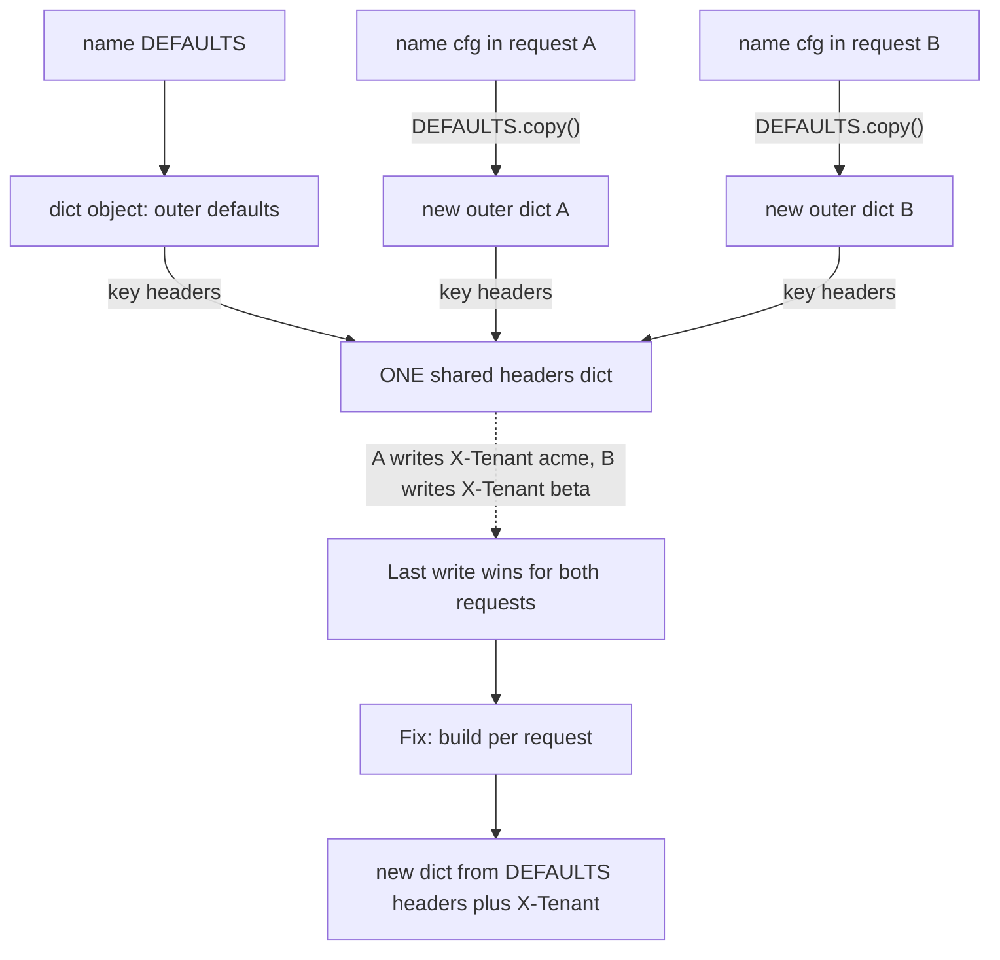

## TL;DR
A Python variable is a name bound to an object; assignment never copies. In agents that means message
histories, graph state and prompt templates are shared unless you build new ones, so one in-place edit
can corrupt another branch, run or tenant.

## For agent builders
- **Why it matters for agents.** An agent's state is a pile of mutable lists and dicts: the transcript,
  tool results, scratchpad, per-tenant tool lists. Forking a run, compacting history, running branches
  in parallel or sharing a template across users all go wrong silently if two names point at one object.
- **Where it shows up in your stack.** Message lists you pass to SDKs, graph state handed to each node
  (LangGraph nodes return updates rather than editing the state they receive), cached tool results,
  module-level system prompts and tool registries, and in-place tensor ops when you fine-tune.
- **What you control.** Build per-run and per-request state fresh, keep shared templates immutable,
  return new messages instead of editing old ones, and lint mutable defaults and class attributes.
- **What you can skip.** CPython's small-int cache and interning rules beyond "never use `is` on values";
  descriptor internals beyond the lookup order below.

## Why it exists
- **Four bugs, one fact.** `def ask(question, history=[])` passes its unit test, then every production
  user sees everyone's messages. A tenant's `.copy()` of a prompt template still shares the inner `tools`
  list. Normalising an embedding slice changes the original rows. An in-place tensor `add_` makes
  autograd raise on the backward pass.
- **They are not library bugs.** Python passes and stores *references to objects*, and mutating through
  any reference is visible through all of them.
- **The C-like intuition is wrong.** "A variable holds a value and assignment copies it" fails here, and
  nothing in the syntax warns you: `a = b` is indistinguishable from a copy until someone mutates.
- **Defensive copying is not the answer.** It costs memory and time AI workloads cannot spare (copying a
  gigabyte of embeddings per request) and still fails, because shallow copies share their contents.
- **The real defence is a correct model.** Know what an object is, which names point at it, which
  operations create versus change objects, and prefer immutable values for shared data. That also makes
  threads and async tasks tractable, because immutable data cannot race.

## How it works
### Objects, names and identity
- **Every value is an object** with an identity (`id()`, its address in CPython), a type and a value.
- **Namespaces map names to objects:** module globals, function locals, instance `__dict__`.
- **Binding never copies.** `x = expr` binds `x` to the object `expr` produced; `y = x` binds a second name
  to the *same* object, so `x is y` is `True`. Binding is O(1) regardless of what is bound, by design.
- **`==` versus `is`.** `==` asks for equal values; `is` asks for the same object. Use `is` only for
  singletons like `None`: CPython caches small integers and interns some strings, so `is` on numbers or
  text depends on implementation details.

### Functions and classes are objects too
- **A function stores its defaults** in `f.__defaults__`, built when `def` executes.
- **A class stores its body's assignments** in its own `__dict__`.
- **Neither is re-created** per call or per instance, so anything mutable stored there is shared by
  construction. Several "quirks" are this one rule.

### Attribute lookup: where `obj.x` comes from
1. **Reading `obj.x`:** data descriptors on the type (a `property`, a slot), then the instance's own
   `__dict__`, then the class and its bases in MRO order (where plain functions become bound methods).
2. **Writing `obj.x = v`:** unless a descriptor intercepts it, it always stores into the instance
   `__dict__`.
3. **That asymmetry is the class-attribute bug.** With `class Agent: history = []`,
   `self.history.append(m)` *reads* `history`, finds the class's single list, and mutates it for every
   agent. `self.history = [m]` would create a private instance attribute that shadows the class one.
   Same-looking code, opposite sharing.

### Operators are method calls on the type
| Syntax | Calls |
|---|---|
| `a + b` | `type(a).__add__(a, b)` |
| `a[i] = v` | `__setitem__` |
| `a += b` | `__iadd__` if the type defines it, otherwise `a = a + b` |

Which one runs is a property of the type, not the syntax; the next section is that rule applied.

### Mutable versus immutable
| | Immutable | Mutable |
|---|---|---|
| Types | `int`, `float`, `str`, `bytes`, `tuple`, `frozenset`, `bool`, `None` | `list`, `dict`, `set`, `bytearray`, user-defined class instances, NumPy arrays, PyTorch tensors |
| Operations | Always yield a new object | Change in place |
| `+=` | `s += "x"` *rebinds* `s`; other names still see the old string | `lst += [1]` calls `__iadd__`, extending the existing list; every alias sees it |

- **Same spelling, opposite effect**, so the distinction has to live in your head, not the syntax.
- **Mutating methods return `None`** by convention (`list.sort`, `dict.update`, `random.shuffle`), precisely
  so `x = lst.sort()` fails loudly rather than letting you believe you got a copy.

### Function arguments
- **Passed by assignment.** A parameter is a new local name bound to the caller's object.
- **Mutating it** (`items.append`) is visible to the caller; **rebinding it** (`items = []`) is not.
- **Defaults are evaluated once,** at `def` time, and stored on the function object. A mutable default is
  therefore shared by all calls; the idiom is `None` with an in-body `if x is None: x = []`.

### Containers hold references
- **Multiplied lists alias.** `[[0] * 3] * 3` holds three references to one inner list; changing
  `grid[0][0]` changes every row.
- **Shallow copies** (`list(x)`, `x[:]`, `dict.copy()`, `copy.copy`) make a new outer container referencing
  the *same* inner objects.
- **`copy.deepcopy` recurses** at O(size) cost, and fails on objects that cannot be copied or pickled, such
  as locks and sockets, and therefore on most SDK clients that hold them.
- **Class attributes are shared by all instances.** `class Agent: history = []` is one list for every
  agent; the per-instance version must be created in `__init__`.

### Hashing and equality
- **Keys must be hashable,** and equal objects must hash equally. Mutable built-ins are unhashable for that
  reason.
- **User classes** are hashable by identity, unless they define `__eq__` without `__hash__`, which makes
  them unhashable; `@dataclass` applies the same rule.
- **Mutating a key** after inserting it (through a custom `__hash__`) makes it unfindable.

### Arrays and tensors
- **NumPy basic slicing returns a view.** `a[:, :10]` and `a[::2]` share the buffer, so normalising the
  slice normalises the original; `a.copy()` or fancy indexing returns an independent array.
- **PyTorch marks in-place methods with a trailing underscore** (`t.add_()`), and autograd refuses in-place
  changes to values it still needs for the backward pass.
- **The trade is explicit:** in-place operations exist to avoid allocating gigabytes, so it is memory
  versus aliasing risk.

### Lifetime
- **CPython frees an object when its reference count reaches zero;** cycles are collected later by the
  garbage collector.
- **A large tensor stays resident** while any name, container, closure, cached traceback or notebook
  output history references it, which is why `del x` sometimes frees nothing.

## Diagram
Names point at objects; a shallow copy of a plain-dict `DEFAULTS` makes a new outer dict whose entries
still point at the same inner objects. Follow both requests' edges to the one shared `headers` dict:
that is the tenant leak, and the bottom box is the fix used in the third example.



## Examples
### Forked agent branches that share message dicts
Two branches of one run start from the same history. Branch A compacts long tool output in place for a
cheaper model, and branch B silently loses the full text, because `list(history)` copied only the outer
list. The fix returns new dicts only where something changes.

```python
def compact(messages: list[dict[str, str]], limit: int = 20) -> None:
    for m in messages:                                  # BUG: edits the dicts in place
        if m["role"] == "tool" and len(m["content"]) > limit:
            m["content"] = m["content"][:limit] + "...[truncated]"

def fresh_history() -> list[dict[str, str]]:
    return [{"role": "user", "content": "Summarise ticket 4521"},
            {"role": "tool", "content": "full ticket text " * 10}]   # 170 characters

history = fresh_history()
branch_a = list(history)                    # shallow: new list, SAME message dicts
branch_b = list(history)
compact(branch_a)                           # branch A compacts for a cheaper model
print(len(branch_b[1]["content"]))          # 34: branch B lost the full tool output too
print(history[1] is branch_b[1])            # True

def compacted(messages: list[dict[str, str]], limit: int = 20) -> list[dict[str, str]]:
    return [{**m, "content": m["content"][:limit] + "...[truncated]"}
            if m["role"] == "tool" and len(m["content"]) > limit else m
            for m in messages]               # new dicts only where something changes

history = fresh_history()
branch_a = compacted(history)
print(len(history[1]["content"]), len(branch_a[1]["content"]))   # 170 34
```

| Branching approach | Cost per fork | Safe if a branch edits a message? |
|---|---|---|
| `branch = history` | nothing | no: one list, one set of dicts |
| `list(history)` or `history[:]` | one list of references | no: dicts shared |
| `copy.deepcopy(history)` | O(size), every fork | yes, but slow for long transcripts |
| Treat messages as immutable, return new ones | only what changes | yes, and cheap |

### Four aliasing bugs from real LLM code, with fixes
A shared default leaks history between callers, a shallow-copied template leaks tools between tenants,
`+=` differs for lists and strings, and nested-list multiplication aliases rows.

```python
import copy

def ask(question: str, history: list[dict] = []) -> list[dict]:   # BUG: one list for every call
    history.append({"role": "user", "content": question})
    return history

print(len(ask("a")), len(ask("b")))              # 1 2  -> the second caller sees the first turn

def ask_ok(question: str, history: list[dict] | None = None) -> list[dict]:
    history = [] if history is None else history  # fresh list per call unless one is passed
    return [*history, {"role": "user", "content": question}]

BASE = {"system": "You are a support bot.", "tools": ["search"]}

def per_tenant(tenant: str) -> dict:
    cfg = BASE.copy()                            # shallow: cfg["tools"] IS BASE["tools"]
    cfg["tools"].append(f"{tenant}_crm")         # leaks into every later tenant
    return cfg

per_tenant("acme"); print(BASE["tools"])        # ['search', 'acme_crm']

def per_tenant_ok(tenant: str) -> dict:
    cfg = copy.deepcopy(BASE)                    # or rebuild; or store BASE as tuples
    cfg["tools"] = [*cfg["tools"], f"{tenant}_crm"]
    return cfg

a = [1, 2]; b = a; c = a[:]
b += [3]                                        # list.__iadd__ mutates the shared list in place
print(a is b, a, c)                             # True [1, 2, 3] [1, 2]  (c is a shallow copy)
s = "x"; t = s; s += "y"                        # str is immutable: += rebinds s only
print(t)                                        # x
grid = [[0] * 2] * 2; grid[0][0] = 9            # both rows are the same inner list
print(grid, [[0] * 2 for _ in range(2)])        # [[9, 0], [9, 0]] [[0, 0], [0, 0]]
```

### Class-attribute leak, read-only template, and the tuple `+=` puzzle
The class list is shared by every agent; a `MappingProxyType` template makes the tenant leak impossible
rather than avoided; and `t[0] += [2]` both raises and mutates.

```python
from types import MappingProxyType

class Agent:
    history: list[str] = []                     # BUG: one list on the class object

    def remember(self, m: str) -> None:
        self.history.append(m)                  # reads the class list, mutates it for everyone

class AgentOk:
    def __init__(self) -> None:
        self.history: list[str] = []            # one list per instance

a, b = Agent(), Agent()
a.remember("hi from a")
print(b.history)                                # ['hi from a']
print(AgentOk().history is AgentOk().history)   # False

DEFAULTS = MappingProxyType({"model": "gpt-4o-mini", "headers": MappingProxyType({"X-App": "bot"})})
try:
    DEFAULTS["headers"]["X-Tenant"] = "acme"
except TypeError as e:
    print("blocked:", e)                        # blocked: 'mappingproxy' object does not support item assignment
headers = {**DEFAULTS["headers"], "X-Tenant": "acme"}   # new small dict per request
print(headers, dict(DEFAULTS["headers"]))       # {'X-App': 'bot', 'X-Tenant': 'acme'} {'X-App': 'bot'}

t = ([1],)
try:
    t[0] += [2]                                 # list.__iadd__ runs, then tuple item store fails
except TypeError:
    pass
print(t)                                        # ([1, 2],)
```

- **Why the proxy is nested:** freezing is shallow, so the inner `headers` dict needs its own
  `MappingProxyType`, or it stays writable.

## Production patterns
- **Append-only transcripts, new messages for edits.** Treat each message in an agent's history as
  immutable: compaction, redaction and truncation return new lists and new dicts, and graph nodes return
  state updates instead of mutating the state passed in. A test that forks a run, edits one branch and
  asserts the other is byte-identical catches regressions.
- **Lint the two classic leaks.** Enable Ruff's flake8-bugbear rule `B006` (mutable argument defaults) and
  `RUF012` (mutable class attributes without `ClassVar`) in CI. Track the violation count to zero, then
  keep it blocking.
- **Immutable shared templates, per-request construction.** Store system prompts, tool lists and default
  headers as tuples, frozen dataclasses or `MappingProxyType`, and build each request's mutable pieces
  with `{**base, ...}` or `[*base, ...]`. A cross-tenant test that runs two tenants back to back and
  asserts no overlap catches regressions.
- **Factories, not `deepcopy`, for objects holding clients.** Construct per-request state from a function
  instead of deep-copying a prototype that may hold a lock, socket or SDK client.
- **Explicit copies around array views.** In embedding pipelines, write `emb[idx].copy()` or out-of-place
  expressions before normalising, and document any deliberate in-place op. Add a test that checksums the
  source matrix before and after a retrieval call.
- **Hunt retained memory by references.** When memory does not return after `del` (a GPU tensor during
  fine-tuning, or finished agent runs kept alive by a cache or callback), clear notebook output history
  and stored exceptions, and inspect holders with `gc.get_referrers(obj)`. Monitor allocated memory per
  step (for example `torch.cuda.memory_allocated()`) across a long run.

## Trade-offs
- **Immutable sharing vs allocation.** Tuples, frozen dataclasses and `MappingProxyType` are safe to share
  across tenants, threads and tasks and usable as cache keys, but every change allocates; for hot loops
  over large state, controlled in-place mutation wins.
- **In-place arrays vs aliasing.** In-place array and tensor ops avoid copying gigabytes, at the cost of
  aliasing and autograd hazards; when memory is not the constraint, out-of-place ops are easier to
  reason about.
- **`deepcopy` isolation vs cost.** It guarantees isolation but is O(size), can be slower than rebuilding
  the object, and fails on unpicklable members such as clients and locks; rebuild from a factory instead.
- **Shallow freezing vs real protection.** A tuple of lists still has mutable lists inside, so protection
  must be applied at every level or the invariant is only cosmetic.

## Pitfalls
- **A mutable default argument.** Symptom: state leaking between calls, and tests that pass in isolation
  but fail when run together.
- **A mutable class attribute as per-instance state.** Every `Agent` shares one `history`; symptom:
  cross-conversation contamination.
- **Shallow-copying a nested config.** Symptom: tenant A's tools or headers appear in tenant B's requests.
- **Editing a message in place to compact or redact history.** Symptom: a forked branch, a parallel
  sub-agent or the stored trace shows the edited text, and a replay no longer matches what the model saw.
  Fix: return new message dicts.
- **`x = lst.sort()` or `cfg = d.update(...)`.** Symptom: `AttributeError: 'NoneType' object has no attribute`,
  because mutating methods return `None` by convention.
- **Mutating a list or dict while iterating it.** Lists skip elements silently; dicts raise
  `RuntimeError: dictionary changed size during iteration`.
- **Normalising a NumPy slice or tensor view in place.** The source matrix changes; symptom: retrieval
  scores that drift between runs.
- **GPU memory that does not return after `del`.** Another reference (a list, an exception traceback, a
  notebook `Out[]` entry) still holds the tensor.
- **`t[0] += [x]` on a tuple holding a list.** The list's `__iadd__` mutates in place, then the store back
  into the tuple raises `TypeError`: an exception *and* a changed list, which looks impossible until you
  split `+=` into its two steps.
- **`is` to compare strings or integers.** It works in tests because of interning and fails on values
  built at runtime.

## When to use
- **Always on:** this is not a tool you choose; it is the model you need every time a value is shared.
- **Immutability by default** for anything passed between layers, stored in a cache, or used by more than
  one task: tuples for fixed sequences, frozen dataclasses for configs, `None` plus in-body construction
  for defaults.
- **Deliberate mutation** when memory or speed demands it, contained inside one function with an explicit
  docstring note.
- **Measure:** no mutable defaults in the codebase (linters flag them), no class-level mutable attributes,
  copies at every tenant boundary.
- **Interviews:** "what does this print" questions about `+=`, default arguments and nested list
  multiplication are the standard probe of this model.

## Role lens
- **Engineer:** Builds per-request message lists from scratch, keeps shared prompt templates
  immutable, and uses views and in-place tensor ops only where the memory saving is measured.
- **Architect:** Sets the rule that cross-tenant and cross-request state is immutable or copied at
  the boundary, and designs caches around hashable, frozen keys.
- **FDE:** Diagnoses "customer B saw customer A's context" incidents by tracing which shared object
  was mutated, usually a template or default argument in a customisation layer.

## Check yourself
**Q:** A multi-tenant service builds each request's config with `cfg = DEFAULTS.copy()` then
`cfg["headers"]["X-Tenant"] = tenant`. Under load, requests intermittently carry the wrong tenant
header. Explain the mechanism and give two fixes with their costs.
**A:** `dict.copy()` is shallow: the new `cfg` is a different outer dict, but `cfg["headers"]` is the
very same inner dict object that `DEFAULTS["headers"]` references, so every request writes its
tenant into one shared dict. With concurrency, request B's write lands between A's write and A's
HTTP call, so A sends B's header. Fix one: `copy.deepcopy(DEFAULTS)` per request, which isolates
everything at O(size) cost per call and breaks if DEFAULTS ever holds a client or lock. Fix two,
usually better: make DEFAULTS immutable (tuples, `MappingProxyType`, a frozen dataclass) and build the
per-request headers as a new dict `{**DEFAULTS["headers"], "X-Tenant": tenant}`, which costs only the
small structure that actually changes and makes the sharing impossible rather than merely avoided.

## Interview questions
### What does assignment do in Python, and why does that matter more in AI services than in scripts?
- **Assignment binds a name to an object; it never copies.** `y = x` makes two names for one object, so a
  mutation through either is visible through both.
- **Why it matters in services:** templates, defaults and caches are shared across requests and tenants,
  so one in-place mutation can leak one customer's context into another's prompt.

### Users report seeing other users' chat turns, but only in production. Where do you look first?
- **Shared mutable state that outlives a request:** a mutable default argument (`history=[]`), a mutable
  class attribute (`class Agent: history = []`), or a module-level template mutated in place.
- **Why only in production:** a single test call never sees the second caller; concurrency and long-lived
  processes do.
- **Fix and guard:** `None` default with in-body construction, per-instance state in `__init__`, and
  Ruff's `B006` and `RUF012` in CI.

### Your agent forks into three parallel branches from one history, and one branch's compaction shows up in the others. Explain and fix.
- **The fork was shallow.** `list(history)` gives each branch its own list, but every element is the same
  message dict, so editing `m["content"]` in one branch edits it for all three and for the stored trace.
- **Fix without deep copies:** treat messages as immutable values; compaction returns
  `[{**m, "content": short} ...]` for the changed ones and reuses the rest, so forking costs one list.
- **Guard it** with a fork-and-edit test, and freeze shared prefixes (system prompt, tool schemas) in
  tuples or `MappingProxyType`.

### When would you choose `copy.deepcopy` over making the shared data immutable?
- **Rarely.** `deepcopy` is O(size) per call and fails on objects holding locks, sockets or SDK clients.
- **Immutable shared data plus small per-request construction** (`{**base, ...}`) costs only the part that
  changes and makes the leak impossible rather than avoided.
- **`deepcopy` fits** when you receive a nested mutable structure you do not own and must isolate it once.

### After `del big_tensor` your GPU memory does not drop. What is going on?
- **CPython frees an object only when its reference count reaches zero.** Another holder (a list, a
  closure, a cached traceback, a notebook `Out[]` entry) still references it.
- **Find the holder** with `gc.get_referrers(obj)`, clear stored exceptions and output history, and
  watch allocated memory per step to confirm the release.

## Quiz
### Q: What does `def f(x, acc=[]): acc.append(x); return acc` return on the second call `f(2)` after `f(1)`?
- [ ] `[2]`, because the default is re-evaluated on every call
- [x] `[1, 2]`, because the default list was created once at definition time and is shared
- [ ] A `TypeError`, because mutable defaults are rejected
- [ ] `[1, 2]` only if both calls happen in the same thread
> Default values are evaluated once when `def` executes and stored on the function object. Every call
> that omits `acc` mutates that one list, which is why `None` plus in-body creation is the idiom.

### Q: Why does `s += "a"` leave other names bound to the old string unchanged, while `lst += [1]` changes every alias of the list?
- [ ] Strings are copied on assignment and lists are not
- [ ] The `+=` operator is only defined for mutable types
- [x] `str` is immutable so `+=` rebinds the name to a new object, whereas `list.__iadd__` extends the existing object in place
- [ ] Lists are stored by reference and strings by value in the interpreter
> Same spelling, different semantics: immutable types have no in-place operator, so a new object is
> created and only the assigned name moves. Mutable types implement in-place augmentation and all
> references observe it.

### Q: After `row = emb[0]; row /= row.sum()` with a float32 NumPy embedding matrix `emb`, what happened to `emb`?
- [ ] Nothing; indexing returns an independent copy of the row
- [x] Its first row was modified, because basic indexing returns a view sharing the same buffer
- [ ] It was converted to a float array but its values are unchanged
- [ ] A `ValueError` was raised because views cannot be modified in place
> Basic slicing and indexing in NumPy return views, so an in-place operation on the view writes into
> the original buffer. `emb[0].copy()` or an out-of-place expression avoids the side effect.

## Use cases & projects
### Use cases
- **Forking agent runs.** Branching a run to try two plans needs its own message list and must never
  edit the shared message dicts in place, or one branch's compaction or tool results leak into the other.
- **Multi-tenant prompt templates.** A shared system prompt and tool list must stay immutable, or one
  tenant's edit changes every other tenant's agent.
- **History compaction.** Summarising old turns should build a new list, so traces and checkpoints keep
  the original transcript.
- **Graph nodes returning updates.** Nodes that return new values instead of editing received state keep
  parallel branches and checkpoints consistent.

### Mini project
**Find and fix shared-state bugs in an agent (1-2 hours).**
- **Goal:** reproduce the mutable-default and shallow-copy bugs in a small agent, then fix them.
- **Steps:** write an `ask` function with a `history=[]` default and a template dict holding a `tools`
  list; run two simulated users and show their histories merge; give one tenant a `.copy()` of the
  template and edit its tools; fix with `None` defaults, tuples or frozen records and `copy.deepcopy`
  where needed.
- **Done when:** a test with two users and two tenants fails before the fix, passes after it, and an `is`
  check proves no list is shared between runs.
