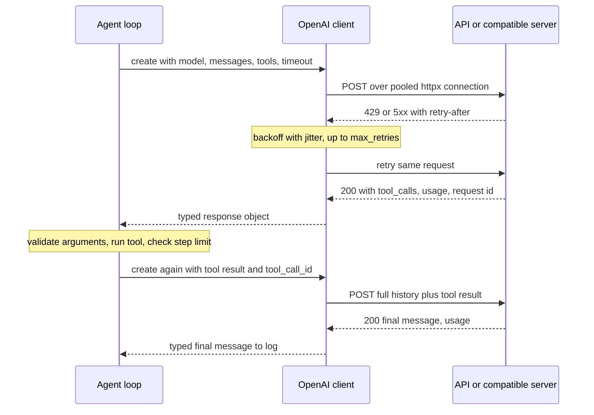

## TL;DR
The `openai` package is the typed client most agent loops are built on: tools, structured outputs,
streaming, retries and timeouts. Its Chat Completions shape is the de facto standard, so the same agent
code often reaches vLLM, Ollama or gateways by changing `base_url`.

## For agent builders
- **Why it matters for agents.** An agent is a loop of model calls: send history plus tool schemas, get
  tool calls back, run them, append results, repeat. This SDK transports every step; the loop, the
  argument validation, the step limit and the deadline are your code.
- **Where it shows up in your stack.** Directly in hand-written agents, under LangChain's `ChatOpenAI`
  (the `langchain-openai` package) and therefore LangGraph nodes, under OpenAI's own Agents SDK, inside
  LiteLLM for OpenAI models, and wrapped by tracing tools such as LangSmith's OpenAI wrapper.
- **What you control.** Timeouts and `max_retries` per path, the tool schemas (strict, with
  `additionalProperties: false`), Chat Completions versus Responses, `store=False`, streaming, and what you
  log per step (request ID, usage, tool calls).
- **What you can skip.** Raw HTTP and SSE parsing, and most Responses-only features if you need
  portability. Learn the tool-call round trip and retry semantics before any framework hides them.

## Lab
### Task
Fix a tool-calling loop so it survives what real agent traffic sends: parallel tool calls in one turn,
truncated argument JSON, a tool name the model invented, and a transient 429. You run the real `openai`
client against a recorded fake server plugged in through `httpx.MockTransport`, so no key or money is
needed. Time box: 45-60 minutes.
- **Prerequisites:** httpx, Pydantic, Function and tool calling, and this lesson's Tools and Errors
  sections.
- **The fake server behaves like the API on one rule:** every `tool_call_id` in an assistant turn needs
  exactly one tool message, or it returns a 400.
- **Checked against:** Python 3.12, `openai` 2.54 and `httpx` 0.28. `http_client=`, `max_retries`,
  `_request_id` and the `retry-after-ms` header have been stable since `openai` 1.x.

### Starter code
Save as `lab.py`. Change only the three `LAB` lines inside `run_agent`.

```python
"""Lab: a bounded tool-calling loop on the real OpenAI SDK, against a recorded fake server (no API key)."""
import json

import httpx
from openai import OpenAI


def tool_call(cid, name, arguments):        # one recorded assistant tool call
    return {"id": cid, "type": "function", "function": {"name": name, "arguments": arguments}}


class FakeChatServer:
    """Replays recorded Chat Completions replies in order and validates history like the real API."""

    def __init__(self, replies):
        self.replies, self.requests = list(replies), []

    def __call__(self, request: httpx.Request) -> httpx.Response:
        body = json.loads(request.content)
        self.requests.append(body)
        msgs = body["messages"]
        open_ids = set()                                            # calls still waiting for a result
        for m in msgs + [{"role": "end"}]:
            if m["role"] == "tool" and m.get("tool_call_id") in open_ids:
                open_ids.discard(m["tool_call_id"])
                continue
            if open_ids or m["role"] == "tool":
                return httpx.Response(400, json={"error": {"message": "each tool_call_id needs exactly one "
                                      "tool message right after its assistant turn", "type": "invalid_request_error"}})
            open_ids = {c["id"] for c in m.get("tool_calls") or []}
        reply = self.replies.pop(0)
        if isinstance(reply, int):                                  # a recorded HTTP error
            return httpx.Response(reply, headers={"retry-after-ms": "10"},
                                  json={"error": {"message": f"status {reply}", "type": "error"}})
        n = len(self.requests)
        msg = {"role": "assistant", "content": None if isinstance(reply, list) else reply}
        if isinstance(reply, list):
            msg["tool_calls"] = reply
        return httpx.Response(200, headers={"x-request-id": f"req_{n}"}, json={
            "id": f"chatcmpl-{n}", "object": "chat.completion", "created": 0, "model": "fake-model",
            "choices": [{"index": 0, "message": msg, "finish_reason": "tool_calls" if msg.get("tool_calls") else "stop"}],
            "usage": {"prompt_tokens": 20 * len(msgs), "completion_tokens": 7, "total_tokens": 20 * len(msgs) + 7}})


def make_client(server, max_retries=1):
    return OpenAI(api_key="test", base_url="http://fake.local/v1", max_retries=max_retries, timeout=5.0,
                  http_client=httpx.Client(transport=httpx.MockTransport(server)))


TOOLS = [{"type": "function", "function": {
    "name": "get_order", "description": "Look up an order by id", "strict": True,
    "parameters": {"type": "object", "properties": {"order_id": {"type": "string"}},
                   "required": ["order_id"], "additionalProperties": False}}}]


def get_order(order_id: str) -> dict:
    return {"order_id": order_id, "status": "shipped"}


REGISTRY = {"get_order": get_order}


def run_agent(client, question: str, max_steps: int = 4) -> tuple[str, list[dict]]:
    """Return (answer, per-step log of request_id, prompt_tokens and tool names)."""
    messages, log = [{"role": "user", "content": question}], []
    for step in range(max_steps):
        resp = client.chat.completions.create(model="fake-model", messages=messages, tools=TOOLS)
        msg = resp.choices[0].message
        log.append({"step": step, "request_id": resp._request_id, "prompt_tokens": resp.usage.prompt_tokens,
                    "tools": [c.function.name for c in msg.tool_calls or []]})
        if not msg.tool_calls:
            return msg.content, log
        messages.append(msg.model_dump(exclude_none=True))
        call = msg.tool_calls[0]                    # LAB 1: answer EVERY tool call in this turn
        args = json.loads(call.function.arguments)  # LAB 2: bad JSON -> error result, not a crash
        result = REGISTRY[call.function.name](**args)   # LAB 3: unknown tool -> error result
        messages.append({"role": "tool", "tool_call_id": call.id, "content": json.dumps(result)})
    return "Step limit reached.", log


if __name__ == "__main__":
    server = FakeChatServer([
        429,                                                         # transient: the SDK retries it
        [tool_call("call_1", "get_order", '{"order_id": "A1"}'),
         tool_call("call_2", "get_order", '{"order_id": "B2"}')],    # two parallel calls in one turn
        [tool_call("call_3", "get_order", '{"order_id": ')],         # truncated, invalid JSON
        "A1 and B2 have both shipped.",
    ])
    try:
        answer, log = run_agent(make_client(server), "Where are orders A1 and B2?")
        for row in log:
            print(row)
        print("answer:", answer, "| HTTP requests:", len(server.requests))
    except Exception as e:
        print(f"{type(e).__name__}: {e}")
```

### Expected output
The starter prints `BadRequestError: Error code: 400 - ...each tool_call_id needs exactly one tool
message...`, because `call_2` was never answered. A correct loop prints:

```
{'step': 0, 'request_id': 'req_2', 'prompt_tokens': 20, 'tools': ['get_order', 'get_order']}
{'step': 1, 'request_id': 'req_3', 'prompt_tokens': 80, 'tools': ['get_order']}
{'step': 2, 'request_id': 'req_4', 'prompt_tokens': 120, 'tools': []}
answer: A1 and B2 have both shipped. | HTTP requests: 4
```

- **Read the numbers:** step 0 is `req_2` because the SDK retried the 429 once. Prompt tokens are 20 per
  message in the fake: 1 message, then 4 (question, assistant, two results), then 6.

### Tests
Save as `test_lab.py` and run `pytest -q`. Three fail on the starter: `BadRequestError` (unanswered
parallel call), `JSONDecodeError` and `KeyError`. The step-limit and retry tests pass already; they pin
down the SDK behaviour you rely on.

```python
import json

import openai
import pytest
from lab import FakeChatServer, make_client, run_agent, tool_call


def tool_messages(request):
    return [m for m in request["messages"] if m["role"] == "tool"]


def test_every_parallel_call_gets_a_result():
    server = FakeChatServer([[tool_call("c1", "get_order", '{"order_id": "A1"}'),
                              tool_call("c2", "get_order", '{"order_id": "B2"}')], "done"])
    answer, _ = run_agent(make_client(server), "q")
    assert answer == "done"
    assert [m["tool_call_id"] for m in tool_messages(server.requests[1])] == ["c1", "c2"]


def test_invalid_arguments_go_back_to_the_model_as_an_error():
    server = FakeChatServer([[tool_call("c1", "get_order", '{"order_id": ')], "fixed"])
    answer, _ = run_agent(make_client(server), "q")
    assert answer == "fixed"
    assert "error" in json.loads(tool_messages(server.requests[1])[0]["content"])


def test_unknown_tool_is_not_run_and_reported():
    server = FakeChatServer([[tool_call("c1", "delete_all_orders", "{}")], "ok"])
    answer, _ = run_agent(make_client(server), "q")
    assert answer == "ok"
    assert "error" in json.loads(tool_messages(server.requests[1])[0]["content"])


def test_step_limit_stops_a_runaway_loop():
    server = FakeChatServer([[tool_call(f"c{i}", "get_order", '{"order_id": "A1"}')] for i in range(10)])
    answer, log = run_agent(make_client(server), "q", max_steps=4)
    assert answer == "Step limit reached." and len(server.requests) == 4 and len(log) == 4


def test_sdk_retries_429_but_not_400():
    server = FakeChatServer([429, "ok"])
    answer, log = run_agent(make_client(server, max_retries=1), "q")
    assert answer == "ok" and len(server.requests) == 2 and log[0]["request_id"] == "req_2"
    server = FakeChatServer([400])
    with pytest.raises(openai.BadRequestError):
        run_agent(make_client(server, max_retries=3), "q")
    assert len(server.requests) == 1
```

### Failure scenarios
- **Append results only for calls that succeeded.** The bad-arguments turn now gets no tool message and
  the next request is a 400. Debug: print the ids in the assistant turn next to the ids of the tool
  messages that follow it in `server.requests[-1]`.
- **Set `max_retries=0` and replay the 429 script.** `RateLimitError` reaches your loop. Debug: count
  `server.requests`; decide whether the client or an outer queue owns the retry, never both.
- **Forget to append the assistant turn before its tool results.** The tool messages now answer a call
  the server never saw, and it returns a 400, as the real API does. Debug: print the roles of the last
  request body; every `tool` message must follow an assistant message whose `tool_calls` hold its id.

### Submission
- **`lab.py` passing all five tests**, and the script output matching Expected output.
- **A recorded transcript of your own:** capture one real or local (vLLM via `base_url`) multi-tool run as
  a `FakeChatServer` script, and add a test that replays it.
- **A note** on how the per-step log (request ID, prompt tokens, tool names) would let you explain one
  costly run to a teammate.
- **Evaluation:** tests pass, every tool call gets exactly one result, and the loop never runs a tool
  that is not in `REGISTRY`.

## Why it exists
- **Raw HTTP breaks on the details.** 429 rate limits and transient 5xx errors are routine at volume and
  need backoff; requests can hang for minutes without a timeout.
- **Payloads are awkward to parse safely.** Streaming arrives as server-sent events parsed incrementally;
  tool calls arrive as JSON strings inside nested structures whose shape changes as features land; every
  dict field you read is an unchecked guess about the schema.
- **Hand-rolled clients fail predictably.** Teams reinvent retries badly (retrying non-idempotent work, or
  retrying 400s forever) and discover schema changes as `KeyError`s in production.
- **The SDK encodes the contract once.** Generated from the OpenAPI specification, it gives typed,
  autocompletable parameters and responses, a precise exception hierarchy, and one implementation of
  pooling, retry with backoff, timeouts and streaming.
- **Most agent debugging happens here.** What this client sent and received, meaning the exact messages,
  the tool schema, the `usage` counts and the request ID you give to support, is why to learn it before
  hiding it behind a framework.

## How it works
### Client and transport
- **Env-configured.** `OpenAI()` reads `OPENAI_API_KEY` (and optionally organisation and project) and
  builds an `httpx` client with connection pooling.
- **Async twin.** `AsyncOpenAI` exposes the same methods as coroutines for asyncio servers, which is how
  you run many agent sessions, or parallel tool-using sub-agents, in one process.
- **One client per process**, reused, because each client owns a connection pool; one per request defeats
  keep-alive.
- **`base_url`** points the same client at any compatible server.
- **Azure.** A dedicated `AzureOpenAI` client exists because classic deployment-based URLs, the
  `api-version` parameter and Entra ID auth differ. Azure's newer v1-style endpoints can also be reached
  with the plain client and a `base_url`; check which one your deployment exposes.

### Two generation APIs
| | Chat Completions | Responses |
|---|---|---|
| Call | `client.chat.completions.create` | `client.responses.create` |
| Input | role-tagged `messages` | `input` plus `instructions` |
| Output | `choices[0].message` | list of typed output items; `response.output_text` concatenates text |
| State | stateless: resend the whole history each call | optional server-side conversation state, built-in tools |
| Best for | portability; the shape other providers copied | new OpenAI-specific features, which tend to arrive here first |

Server-side state (`previous_response_id`, or a conversation object):
- **Saves resending history over the wire, not paying for it.** The model still reads earlier turns, and
  they are billed as input tokens on each call, which is why long agent runs cost more per step.
- **Moves the transcript into provider storage**, which matters for retention policies. `store=False` opts
  out, at the cost of managing history yourself.

### Typed responses and structured output
- **Pydantic responses.** `resp.usage.prompt_tokens` is checked attribute access, not a dict lookup.
- **`parse` helpers** take a Pydantic class, convert it to a strict JSON Schema, and return the validated
  object (`output_parsed` on Responses, `message.parsed` on Chat Completions).
- **Strict mode constrains decoding** to the schema, stronger than asking for JSON in the prompt. You still
  handle refusals and truncated outputs. Agents use it for plans, routing decisions and final answers.

### Tools: the agent loop
1. You pass JSON Schema function definitions.
2. The model may return tool calls whose `arguments` field is a JSON string, possibly several in one turn.
3. Your code parses and validates the arguments and runs the function.
4. You send the result back in a follow-up message tied to the call's ID.
5. Repeat until the model answers without tool calls, or your step limit or deadline is reached.

- **The SDK does not execute tools.** That loop is your agent code, and so are its guards: a maximum step
  count, an overall deadline, an allow-list of tool names and argument validation.
- **Every call must get a result.** Each `tool_call_id` in an assistant turn needs a matching tool
  message, even if the result is an error, or the next request is rejected.

### Streaming
- **`stream=True`** returns an iterator of chunks (Chat Completions) or typed events (Responses) parsed from
  server-sent events, so you can forward tokens as they arrive.
- **Usage arrives only at the end.** Chat Completions includes it in a final chunk only with
  `stream_options={"include_usage": True}`; Responses carries it on the closing `response.completed`
  event. Log usage from the final event.

### Errors, retries, timeouts
| Exception (all subclass `openai.APIError`) | Meaning |
|---|---|
| `APIConnectionError`, `APITimeoutError` | transport: no HTTP response arrived |
| `RateLimitError` | 429 |
| `BadRequestError` | 400 |
| `AuthenticationError` | 401 |

- **Status errors share a parent.** `RateLimitError`, `BadRequestError` and `AuthenticationError` are all
  `APIStatusError` subclasses carrying `status_code`, so catch the specific class first and
  `APIStatusError` last.
- **Default retries:** connection errors, 408, 409, 429 and 5xx are retried twice (`max_retries=2`) with
  exponential backoff and jitter, honouring a `retry-after` header when sent, because those failures are
  plausibly transient.
- **No retry on 4xx like 400**, because resending the same bad request cannot succeed.
- **Default timeout is 600 seconds**, far too long for an interactive path; set your own per client or per
  call with `with_options`.
- **Worst-case wall clock** is roughly `timeout × (max_retries + 1)` plus backoff, per model call; an agent
  multiplies that by its step count.
- **Generation is not idempotent.** If a timeout fires after the server started work, the retry is a
  second, separately billed generation, so aggressive timeouts on long outputs raise cost as well as
  latency. Tool side effects are not retried by the SDK, but your loop must not re-run them blindly.

### Raw responses and headers
- **Typed objects hide the HTTP layer**, usually what you want, except for the headers.
- **`client.with_raw_response.chat.completions.create(...)`** returns the raw response; its headers carry
  the request ID and rate-limit state (`x-ratelimit-remaining-requests`, `x-ratelimit-remaining-tokens`),
  and `.parse()` gives the usual typed object.
- **Throttle before the 429.** Reading remaining-token headers lets a batch worker slow down before it hits
  429s instead of after.

## Diagram
One agent step through the SDK: retries happen inside the client, the tool loop happens in your code,
and the request ID and usage come back for logging on every iteration.



## Examples
### A bounded agent loop (Chat Completions)
The SDK only transports each call; the step limit, deadline, tool allow-list, argument validation and the
reply for every tool call are yours. Model names change; read them from configuration.

```python
import json, os, time
from openai import OpenAI

MODEL = os.environ.get("AGENT_MODEL", "gpt-4o-mini")
client = OpenAI(timeout=20.0, max_retries=1)          # per step: worst case ~2 × 20 s + backoff

tools = [{"type": "function", "function": {
    "name": "get_order", "description": "Look up an order by id", "strict": True,
    "parameters": {"type": "object", "properties": {"order_id": {"type": "string"}},
                   "required": ["order_id"], "additionalProperties": False}}}]

def get_order(order_id: str) -> dict:
    return {"order_id": order_id, "status": "shipped"}

TOOLS = {"get_order": get_order}

def run_agent(question: str, max_steps: int = 8, deadline_s: float = 90.0) -> str:
    messages = [{"role": "user", "content": question}]
    start = time.monotonic()
    for step in range(max_steps):
        if time.monotonic() - start > deadline_s:
            return "Sorry, that took too long. Please try again."
        resp = client.chat.completions.create(model=MODEL, messages=messages, tools=tools)
        print(step, resp._request_id, resp.usage.prompt_tokens, resp.usage.completion_tokens)
        msg = resp.choices[0].message
        if not msg.tool_calls:
            return msg.content                         # final answer
        messages.append(msg)                           # the assistant turn that asked for tools
        for call in msg.tool_calls:                    # may be several, in one turn
            fn = TOOLS.get(call.function.name)
            try:
                args = json.loads(call.function.arguments)        # model-generated, may be invalid
                result = fn(**args) if fn else {"error": "unknown tool"}
            except (json.JSONDecodeError, TypeError) as e:
                result = {"error": f"bad arguments: {e}"}         # let the model correct itself
            messages.append({"role": "tool", "tool_call_id": call.id, "content": json.dumps(result)})
    return "Step limit reached."

print(run_agent("Where is order A123?"))
```

- **Errors go back to the model.** Returning `{"error": ...}` as the tool result lets the model fix its
  arguments on the next step, instead of crashing the loop.
- **Local server:** the same loop runs against vLLM with `OpenAI(base_url="http://localhost:8000/v1",
  api_key="unused")`, provided that server implements the endpoint you call and tool-call parsing for
  that model is enabled.

### Structured output for a routing step, with explicit errors
A classifier step at the front of an agent: decide the category before choosing which tools to expose.

```python
import os
from typing import Literal
from pydantic import BaseModel
import openai
from openai import OpenAI

MODEL = os.environ.get("CLASSIFIER_MODEL", "gpt-4o-mini")
client = OpenAI(timeout=20.0, max_retries=3)        # one client per process; worst case ~4 × 20 s + backoff

class Triage(BaseModel):
    category: Literal["billing", "bug", "how_to", "other"]
    urgent: bool
    summary: str

def triage(ticket: str) -> Triage | None:
    try:
        resp = client.responses.parse(
            model=MODEL,
            instructions="Classify the support ticket.",
            input=ticket,
            text_format=Triage,                     # Pydantic class -> strict JSON Schema
        )
    except openai.RateLimitError:
        raise                                       # already retried; let the queue back off
    except openai.BadRequestError as e:
        print("bad request, not retrying:", e.status_code, e.message)
        return None
    print("request id:", resp._request_id, "tokens:", resp.usage.input_tokens, resp.usage.output_tokens)
    return resp.output_parsed                       # a validated Triage, or None on refusal

print(triage("I was charged twice this month and need it fixed today."))
```

- **On the wire:** `parse` turns `Triage` into a JSON Schema (an enum for `category`, a boolean, a string,
  every field required, no extra properties) sent as a strict text format. The server constrains decoding
  to matching JSON; the SDK validates it back into a `Triage`.
- **Retry accounting:** a 429 is retried up to three times before `RateLimitError` reaches the `except`, so
  re-raising hands the failure to an outer queue instead of retrying a fourth time in-process.

### Worked scenario: worst-case time a worker is held
Using `timeout × (max_retries + 1)`, before backoff:

| Settings | Worst case per call |
|---|---|
| Defaults: 600 s, `max_retries=2` | 1,800 s (30 minutes) |
| Classifier above: 20 s, `max_retries=3` | 80 s |
| Interactive path: 10 s, `max_retries=1` | 20 s |
| Queued batch job: 60 s, `max_retries=0`, queue owns backoff | 60 s per attempt |
| Agent above: 20 s, `max_retries=1`, up to 8 steps | 40 s per step, 320 s per task without a deadline |

During a provider incident, the first row is how a few slow calls exhaust a worker pool, and the last row
is why an agent needs a task-level deadline (90 s above) on top of per-call timeouts.

## Production patterns
- **Bound every agent run.** Enforce a maximum step count, a wall-clock deadline and a token budget per
  task, and return a graceful answer when one trips. Monitor steps per task and the share of runs hitting
  each limit; a rising share signals a prompt or tool regression.
- **Trace each step, not just each task.** Record `resp._request_id`, model, input and output tokens,
  latency and the tool calls per step in structured logs or a tracer (LangSmith, Langfuse or
  OpenTelemetry). Use them to answer "why did the agent do that" and "why this bill".
- **Strict tool schemas plus server-side validation.** Use `additionalProperties: false` and required
  fields, then validate again in the tool (types, ranges, permissions), because the model chooses the
  arguments. Monitor invalid-argument rate per tool.
- **Budget timeouts per path.** Create one client, then derive variants with
  `client.with_options(timeout=10.0, max_retries=1)` for user-facing calls and longer budgets for batch.
  Monitor `APITimeoutError` and `RateLimitError` rates separately, because they need different fixes.
- **Throttle batch workers from headers.** Use `with_raw_response` and read
  `x-ratelimit-remaining-tokens`, slowing the worker as it approaches zero, for example during an offline
  eval run over thousands of agent tasks. Monitor 429 count per hour; it should trend to zero.
- **Stream with usage on.** Pass `stream=True` with `stream_options={"include_usage": True}` on Chat
  Completions, forward deltas to the user, and record usage from the final chunk. Monitor time to first
  token.
- **Async client in async servers.** Use `AsyncOpenAI` in FastAPI or other asyncio apps, created once at
  startup, so many agent sessions share one process. Monitor event-loop lag and concurrent in-flight calls.

## Trade-offs
- **Hand-written loop vs framework.** A raw SDK loop is small, debuggable and has no hidden prompts;
  LangGraph or the OpenAI Agents SDK add state graphs, handoffs, persistence and tracing. Start raw, adopt
  a framework when you need durable state or multi-agent control flow.
- **Immediate features vs provider coupling.** The official SDK tracks new features immediately but
  couples code to one provider's shapes; a thin internal interface or a router like LiteLLM pays off once
  you genuinely use several providers.
- **Free retries vs multiplied latency.** Built-in retries handle transient failures with no code, but
  multiply latency and cost on overload; in queued batch jobs prefer `max_retries=0` and let the queue own
  backoff.
- **Responses features vs portability.** Server-side state and built-in tools are not mirrored by other
  providers, so Chat Completions is better when portability matters more than new features.
- **Schema guarantee vs schema expressiveness.** Strict structured outputs guarantee conformance but
  restrict JSON Schema features; complex unions or open-ended dicts may need a looser schema plus Pydantic
  validation.

## Pitfalls
- **An unbounded tool loop.** The model keeps calling tools (often the same one) and the task never ends.
  Symptom: runaway token spend on a few sessions. Fix: step limit, deadline, and detection of repeated
  identical calls.
- **Dropping a tool result.** An assistant turn with tool calls and a missing matching tool message makes
  the next request fail with a 400. Fix: always append one result per `tool_call_id`, errors included.
- **A new client per request.** Connection setup on every call raises latency; under load you see socket
  exhaustion or many TLS handshakes in traces.
- **The default long timeout in a user-facing endpoint.** One stuck upstream call ties up a worker for
  minutes. Symptom: request pile-ups during provider incidents.
- **The sync client inside an async web server.** The event loop blocks and every concurrent request
  stalls while one LLM call is in flight; use `AsyncOpenAI`.
- **Trusting tool-call `arguments` as valid.** They are model-generated JSON strings. Symptom: occasional
  `JSONDecodeError` or wrong-typed fields crashing the tool layer.
- **Not logging request IDs and usage.** When a customer reports a bad answer or a billing spike, you
  cannot match it to a call or explain the cost.

## When to use
- **Use directly when** OpenAI (or Azure OpenAI) is your primary provider and you want new features as they
  ship; use it with `base_url` against OpenAI-compatible servers for local or self-hosted models.
- **Wrap it** behind a small interface (one function per capability: classify, generate, embed, agent
  step) so tests can fake it and a second provider can be added without touching callers.
- **Move to LiteLLM or a gateway when** you need routing, fallbacks or central spend tracking across
  providers; to LangGraph or an agents SDK when you need durable, multi-step state.
- **Measure** latency percentiles, retry counts, error rates by type, tokens per call, and steps per task.
- **Interviews:** retry semantics, streaming, and how you validate structured output.

## Role lens
- **Engineer:** Writes the client wrapper with timeouts, retries, structured output and streaming,
  and logs request IDs and usage for every call.
- **Architect:** Decides whether product code calls the SDK directly or through an internal interface
  or gateway, and which API surface (Chat Completions or Responses) the platform standardises on.
- **FDE:** Points the client at a customer's Azure deployment or private compatible endpoint, often
  behind proxies and custom certificates configured through the underlying HTTP client.

## Check yourself
**Q:** During a provider incident your API's p99 latency jumps to several minutes and workers are
exhausted, even though most calls eventually fail. What is happening in the SDK and what do you change?
**A:** Each failing call may wait for the client's long default timeout and then be retried several
times with backoff, so one user request can hold a worker for the timeout multiplied by the attempts.
I would set an explicit per-call timeout sized to the endpoint's latency budget, lower `max_retries` for
interactive paths (keeping more retries for background jobs), use the async client so waiting does not
block workers, and add a circuit breaker or fallback model so that after repeated failures requests fail
fast or route elsewhere. I would also alert on `APITimeoutError` and `RateLimitError` rates separately,
because they need different fixes.

## Interview questions
### Why use the official SDK instead of calling the HTTP API with `requests`?
- **It encodes the contract once:** generated from the OpenAPI specification, it gives typed,
  autocompletable parameters and responses that your editor and type checker verify, instead of unchecked
  dict lookups that fail as `KeyError`s in production.
- **It ships the hard parts:** connection pooling, retries with exponential backoff and jitter that honour
  `retry-after`, timeouts, server-sent-event parsing and a precise exception hierarchy.
- **Hand-rolled clients** tend to retry 400s or non-idempotent work, or forget timeouts entirely.

### Walk me through the tool-calling loop you would write on this SDK, and its guards.
- **Loop:** send messages plus tool schemas; if the reply has tool calls, append that assistant turn, run
  each allowed tool with validated arguments, append one tool message per `tool_call_id`, and call again.
- **Guards:** a step limit, a task deadline, a token budget, an allow-list of tool names, and errors
  returned to the model as tool results so it can self-correct.
- **Observability:** log request ID, usage and tool calls per step, so a bad run can be replayed.

### Token spend on long generations rose after you lowered the client timeout. Why?
- **Generation is not idempotent:** if the timeout fires after the server started work, the SDK's retry
  starts a second, separately billed generation.
- **So short timeouts on long outputs raise cost as well as latency**, and the first attempt still bills.
- **Fix:** size timeouts to the output length per path, and stream long responses: the client's read
  timeout then measures the gap between chunks, not the whole generation. For queued jobs set
  `max_retries=0` so the queue owns backoff.

### When would you choose Chat Completions over the Responses API for an agent?
- **Portability:** Chat Completions is the shape vLLM, Ollama and gateways copied, so the same agent loop
  reaches them via `base_url`.
- **Data control:** Responses can keep server-side conversation state, which moves transcripts into
  provider storage; `store=False` opts out at the cost of managing history yourself.
- **Choose Responses** when you need new OpenAI-specific features or built-in tools, which tend to arrive
  there first.

### What is the worst-case time one agent task can hold a worker?
- **Per call:** roughly `timeout × (max_retries + 1)` plus backoff; defaults of 600 seconds and
  `max_retries=2` give 1,800 seconds, 30 minutes.
- **Per task:** multiply by the step count; 20 seconds, `max_retries=1` and 8 steps is 320 seconds.
- **Fix:** a short interactive variant (10 seconds, `max_retries=1`, 20 seconds per call) from
  `client.with_options`, plus a task-level deadline that ends the loop.

### How do you get token usage when streaming?
- **Chat Completions:** usage appears in a final chunk only when you pass
  `stream_options={"include_usage": True}`.
- **Responses:** usage is carried on the closing `response.completed` event.
- **In both cases** log usage from the final event, and monitor time to first token separately from total
  latency, because streaming changes what users perceive.

## Quiz
### Q: Why does the SDK retry 429 and 5xx responses by default but not 400?
- [ ] Because 400 errors are always caused by network problems
- [x] Because 429 and 5xx are plausibly transient, while resending an invalid request will fail the same way
- [ ] Because the API forbids retrying 400 responses
- [ ] Because 400 responses are retried by the server automatically
> Rate limits and server errors often clear after a short wait, so backoff retries help. A 400 means the
> request itself is wrong; retrying wastes time and quota without any chance of success.

### Q: What does changing `base_url` on the OpenAI client accomplish?
- [ ] It enables the Responses API on older models
- [ ] It switches the client to a different OpenAI region for lower latency
- [x] It lets the same client call any server implementing the compatible endpoints, such as a local vLLM instance
- [ ] It disables authentication for local testing
> Many servers implement OpenAI's request and response shapes. Pointing `base_url` at them reuses the
> client, though only the endpoints and features that server actually implements will work.

### Q: A model returns a tool call. What is the SDK's responsibility versus yours?
- [ ] The SDK executes the function and returns the final answer automatically
- [x] The SDK returns the call with its JSON-string arguments; your code validates, executes and returns the result
- [ ] The SDK validates the arguments against your Python function signature
- [ ] The SDK sends the tool result back to the model on the next request automatically
> The client only transports the model's request to call a tool. Parsing arguments, running the tool and
> sending results back with the call ID is the agent loop you write and must guard.

## Use cases & projects
### Use cases
- **Hand-written tool-calling agents.** The SDK carries every step of the loop: send history and tool
  schemas, read tool calls, append results with their call IDs, repeat.
- **Structured extraction steps.** Strict schemas with `additionalProperties: false` give parseable output
  for planners, classifiers and form-filling agents.
- **One client for many backends.** Changing `base_url` points the same agent code at vLLM, Ollama or a
  gateway for cheaper or private steps.
- **Agent observability.** Logging request ID, usage and tool calls per step turns a failed run into a
  readable trace.

### Mini project
**Build a guarded tool-calling agent (2-3 hours).**
- **Goal:** a small agent that answers questions with two tools and never runs away.
- **Steps:** define two tools with strict schemas; write the loop yourself; validate arguments before
  running a tool and return errors as tool results; add a step limit, a per-call timeout and
  `max_retries`; log request ID, usage and tool calls per step.
- **Done when:** 10 test questions complete within the step limit, a malformed argument is recovered
  from, and you have a per-step log with total tokens per run.
