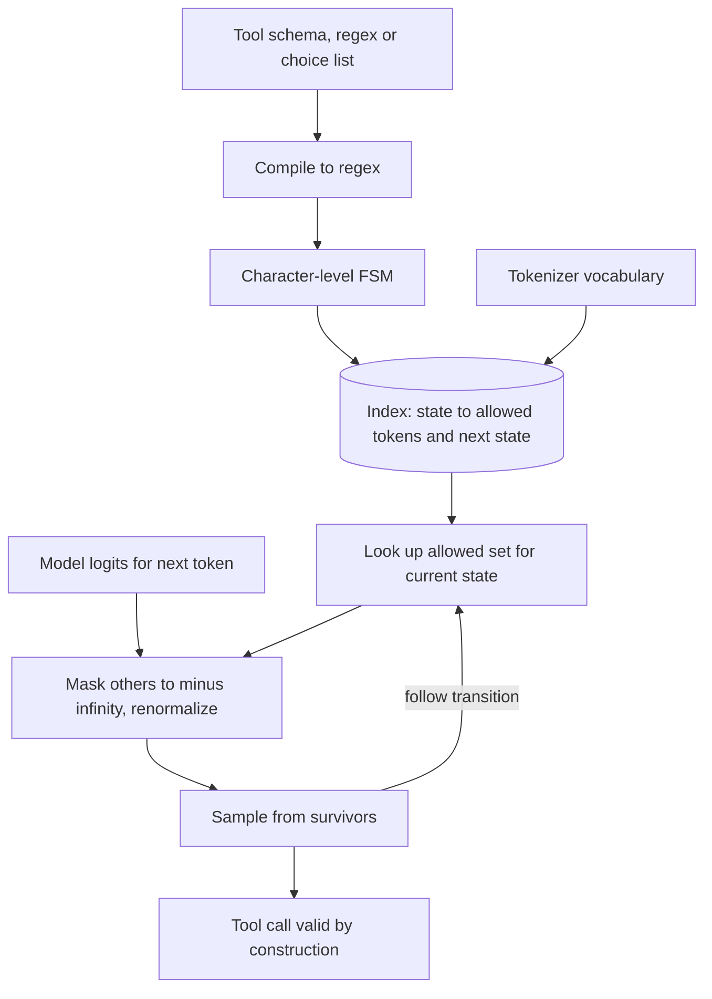

## TL;DR
For agents on self-hosted models, Outlines makes every tool call, route and label match a JSON Schema,
regex or choice list *by construction*, by masking invalid tokens before sampling. It needs logit
access, so closed hosted APIs are out.

## For agent builders
- **Why it matters for agents.** A small self-hosted model drives an agent only if its tool arguments
  parse every step. One malformed call per few dozen steps breaks a meaningful share of multi-step runs;
  constrained decoding removes that failure class entirely.
- **Where it shows up in your stack.** Inside serving engines rather than your app: vLLM's guided
  decoding has offered an Outlines backend, reached through the OpenAI-compatible `response_format`.
  Directly, it wraps Transformers, llama.cpp or MLX for local agents and offline batch steps.
- **What you control.** The schema (bounded strings, field order, `Literal` labels), the prompt that
  describes the format, the chat template, and whether you constrain at all for a given step.
- **What you can skip.** Building FSM indexes by hand and grammar internals. Know that the constraint
  fixes syntax, never correctness, and that compile cost lands on the first request per schema.

## Why it exists
- **Sampling knows nothing about your format.** A model samples one token at a time over its whole
  vocabulary; nothing in that process knows you wanted a JSON object with an integer `age`. Prompting
  raises the odds of valid output but never makes it certain.
- **Small open models break formats most.** The ones you can afford to self-host break formats far more
  often than frontier APIs, and an agent multiplies that risk by every step it takes.
- **Parse-and-retry has two costs.** Each retry is another full generation, so tail latency multiplies.
  And retries do not converge on hard inputs: a model that keeps writing `"age": "about 40"` will keep
  doing it.
- **If you control sampling, refuse invalid tokens.** At each step compute which tokens could continue a
  valid string, set every other logit to negative infinity, and sample from what remains. Output is valid
  on the first pass, always.
- **The naive check is too slow.** Testing every token against the pattern at every step scans a
  vocabulary of tens or hundreds of thousands of tokens per generated token. Outlines' contribution was
  making that check effectively a lookup.

## How it works
### From pattern to automaton
1. **Compile the constraint to a regular expression.** A regex is used directly. A JSON Schema becomes a
   regex matching exactly the JSON strings that satisfy it (keys in schema order, types as sub-patterns,
   enums as alternations). A `choice(["yes","no"])` is an alternation.
2. **Regex to finite-state machine.** The regex becomes a deterministic finite automaton over
   *characters*: states, and transitions labelled by characters.
3. **Index the vocabulary against the FSM (the key step).** For every state, walk each token's string
   character by character; if the walk never falls off the automaton, the token is allowed there, and you
   record where it lands. Result: a map `state -> {allowed token -> next state}`.
4. **Build once, cache.** The index is built once per (pattern, tokenizer) pair *because* it is
   expensive, then reused across every request with the same schema, such as every call of one tool.
5. **Generate.** Each step: look up the current state's allowed set, mask all other logits, sample
   (greedy, temperature, whatever you configured) from the survivors, follow the transition. Per-step
   overhead is a lookup and a mask, not a vocabulary scan.

### The maths
With allowed set A(s) in state *s*, the sampled distribution is
`p'(t) = p(t) · 1[t ∈ A(s)] / Σ_{u ∈ A(s)} p(u)`: the model's probabilities restricted to legal tokens
and renormalized.

```
index build cost ≈ (number of FSM states) × (vocabulary size) × (average token length) character steps
```

- **More states, longer compile.** Long enumerations or many optional fields multiply states, so such a
  schema takes visibly longer to compile than a two-field one; that is why the work happens once.
- **Token level, not character level,** *because* tokens span several characters. A single token such as
  `name` moves the FSM four characters forward in one step, and the index also records tokens valid only
  because they straddle a boundary, such as `":"`.

### Constraining an agent's tool call
- **One schema per tool, or one union schema per step.** Give each tool's argument model its own
  compiled index, or compile a single schema whose `tool` field is a `Literal` of tool names with
  matching argument objects.
- **The engine applies it per request.** With vLLM you send the schema in `response_format` and the
  engine masks tokens for that request only, so different agent steps can use different schemas.
- **Decide "call a tool or answer" first.** A tiny choice constraint (for example `call` or `answer`)
  routes the step, then a second constrained call fills the arguments; or fold both into one schema.

### Grammars
- **Regexes cannot describe arbitrary nesting.** Recursive JSON schemas, or code, need a context-free
  grammar, which requires a pushdown automaton (a state plus a stack).
- **Grammar mode exists but costs more.** Outlines supports it, but it is costlier and less mature than
  the regex path; engines such as vLLM also offer alternative grammar backends for this reason.
- **Backends move.** The core was later rewritten as a separate `outlines-core` package, and recent
  versions can delegate to other backends; which one runs is a version detail to check.

### Where it runs
- **Local runtimes:** Outlines wraps Hugging Face Transformers, llama.cpp, MLX and others.
- **Serving engines:** its core FSM logic is used inside them; vLLM's guided decoding has offered an
  Outlines backend. This is where most agent teams meet it.
- **The API changed between major versions.** Older code uses `outlines.generate.json(model, Schema)`;
  the 1.x API passes the output type when calling the model. Check the version you install.

### What constraining does to quality
Masking renormalizes over allowed tokens. If the model strongly wanted a forbidden token, it is pushed
onto a path it considered unlikely, and content there can be worse even though the format is perfect.
Two mechanisms make this worse than it sounds:
- **The mask is greedy, not look-ahead.** It asks "can this token still lead to a valid string?", not
  "is this a good continuation?". If the model's mass sits on prose like `Sure! {"intent"...`, the mask
  removes `Sure` and renormalizes into a state the model was not planning for.
- **Fix: describe the format in the prompt** (or show an example). The model's own preference then
  aligns with the mask, so little probability is removed. For tool calls, list the tools and their
  arguments in the system prompt as you would without constraints.
- **Non-canonical tokenization.** The index allows any token sequence that spells a valid string,
  including splits the tokenizer would never produce (for example `"` + `int` + `ent` where training data
  always had `"intent`). The model has rarely seen these, so later predictions degrade.
- **Still measure accuracy, not just parse rate.** Mature implementations handle forced boundaries
  carefully, but constraints guarantee syntax, never correctness: a valid call to the wrong tool is
  still a wrong step.

## Diagram
The top half (pattern to index) runs once per (pattern, tokenizer) pair, for example once per tool
schema; the loop below it runs every token and only does a lookup and a mask.



## Examples
### Agent scenario: constrained tool calls on a self-hosted model
A support agent on a self-hosted model served by vLLM. Each step asks for one of two tool calls; the
engine constrains decoding so the reply always parses.

```python
import json
from typing import Literal, Union
from openai import OpenAI
from pydantic import BaseModel, Field

class SearchDocs(BaseModel):
    tool: Literal["search_docs"]
    query: str = Field(max_length=200)          # bounded: no runaway strings

class GetTicket(BaseModel):
    tool: Literal["get_ticket"]
    ticket_id: int

class Step(BaseModel):
    reasoning: str = Field(max_length=400)      # reason first, then act
    call: Union[SearchDocs, GetTicket]

llm = OpenAI(base_url="http://vllm.internal:8000/v1", api_key="unused")
resp = llm.chat.completions.create(
    model="my-7b-instruct",
    messages=[{"role": "system", "content": "Tools: search_docs(query), get_ticket(ticket_id). "
                                            "Reply with JSON: reasoning, then call."},
              {"role": "user", "content": "What is the status of ticket 42?"}],
    response_format={"type": "json_schema",
                     "json_schema": {"name": "step", "schema": Step.model_json_schema()}},
    max_tokens=300,                             # above the longest valid output
)
step = Step.model_validate_json(resp.choices[0].message.content)   # parses; may still be the wrong tool
print(step.call)
```

- **The schema is the tool registry.** `Literal` tool names plus per-tool argument models mean the model
  cannot invent a tool or an argument type.
- **Bounded strings** (`max_length` becomes `maxLength`) stop a looping model from filling the window.
- **Which backend masks tokens** (Outlines or another) is an engine setting whose name varies by version.

### Worked scenario: parse failures across a multi-step run
A self-hosted 7B agent averages 6 tool-calling steps per run. Suppose 4% of unconstrained steps fail to
parse (illustrative; measure your own).

| | Unconstrained plus retry | Constrained |
|---|---|---|
| Runs with at least one bad step | 1 − 0.96^6 ≈ 22% | 0% from parsing |
| Extra generations | One or more retries on those steps | None |
| p99 run latency | Extra steps' worth of generation | One generation per step |
| What can still go wrong | Wrong tool, wrong arguments | Wrong tool, wrong arguments |

The constraint removes the format failures; the remaining errors are decision errors your agent evals
must catch.

### Toy FSM index and one masked step (pure Python)
A choice constraint, a tiny vocabulary, the precomputed index, and one renormalized sampling step.

```python
import math

choices = ["yes", "no", "not sure"]                    # constraint: one of these strings
vocab = ["y", "ye", "yes", "n", "no", "not", " sure", "s", "x", "Sure"]

# FSM states = every prefix of a valid string; build the index once.
states = {c[:i] for c in choices for i in range(len(c) + 1)}
index = {s: {t: s + t for t in vocab if s + t in states} for s in states}

print(index[""])      # tokens allowed at the start, and the state each lands in
print(index["not"])   # only ' sure' can continue 'not'

# One decoding step: mask disallowed logits, renormalize, pick.
logits = {"Sure": 3.0, "yes": 1.0, "no": 0.5, "x": 0.2, "y": 0.1}
allowed = {t: v for t, v in logits.items() if t in index[""]}
z = sum(math.exp(v) for v in allowed.values())
probs = {t: round(math.exp(v) / z, 3) for t, v in allowed.items()}
print(probs)          # 'Sure' had the most mass but is masked out
```

Output: `index[""]` allows `y`, `ye`, `yes`, `n`, `no`, `not`; the step gives roughly
`{'yes': 0.497, 'no': 0.301, 'y': 0.202}`. That is the greedy-mask problem in miniature: the model's
favourite token is gone and its mass is spread over paths it ranked lower.

### Ticket classifier on a self-hosted model
Classifying 50,000 support tickets on a self-hosted 7B model into
`{"intent": one of 6 labels, "urgent": true|false}`, the routing step in front of a support agent.

| | Parse-and-retry | Outlines |
|---|---|---|
| Parse failures | Suppose 4% (illustrative; measure your own) | None: every output parses |
| Extra work | 2,000 tickets need at least one more generation, some several | No retries exist |
| p99 latency | Two or three generations long | One generation |
| Compile | None | JSON Schema compiles once into an index |

- **What the model may emit.** Apart from whatever optional whitespace the pattern permits:
  `{"intent":"`, then the tokens of one of the six labels, then the closing quote, `,"urgent":`, then
  `true` or `false`, then `}`.
- **Far fewer free tokens.** Most structure is forced. When only one token is allowed there is nothing to
  sample, and some implementations append such forced tokens directly and process several in one forward
  pass.
- **Field order is generation order.** To make the model reason, put a bounded `reasoning` string
  *before* `intent`; otherwise the label is chosen with no reasoning to condition on.

```python
from typing import Literal
from pydantic import BaseModel
import outlines
from transformers import AutoModelForCausalLM, AutoTokenizer

class Ticket(BaseModel):
    intent: Literal["billing", "bug", "how_to", "account", "feature", "other"]
    urgent: bool

name = "Qwen/Qwen2.5-0.5B-Instruct"   # any local causal LM
model = outlines.from_transformers(
    AutoModelForCausalLM.from_pretrained(name), AutoTokenizer.from_pretrained(name))
raw = model("Classify: 'I was charged twice this month, fix it today.'", Ticket, max_new_tokens=50)
print(Ticket.model_validate_json(raw))   # always parses; may still be the wrong label
```

## Production patterns
- **Constrain tool calls in the serving engine.** When agents run on vLLM or a similar engine, request
  structured output per call through its OpenAI-compatible API (`response_format` with
  `"type": "json_schema"`) instead of embedding Outlines in app code; which decoding backend runs is an
  engine setting whose name varies by version. Monitor per-token latency with and without constraints.
- **Compile at startup, cache by schema.** Keep a fixed set of tool schemas so each compiles once; build
  generators when the worker starts so no agent step pays compile latency, and for dynamic schemas cache
  by a hash of the schema plus tokenizer. Monitor compile time and cache hit rate.
- **Bound every free-text field.** Use `Field(max_length=...)` (JSON Schema `maxLength`) on strings and
  set `max_new_tokens` above the longest valid output. Monitor how often generation stops at the token
  limit; it should be near zero.
- **Prompt for the format and use the chat template.** Build the prompt with
  `tokenizer.apply_chat_template(..., add_generation_prompt=True)` and describe the JSON and tools in it,
  so the mask removes little probability. Watch for degenerate values on easy inputs.
- **Gate on task success, not parse rate.** Before rollout, run the agent eval set constrained and
  unconstrained and keep the better configuration. Track tool-selection accuracy and run success per
  release, since parse rate will read 100%.

## Trade-offs
- **Guaranteed validity vs owning the stack.** Validity is guaranteed on the first pass and retries
  vanish, but only when you own the inference stack; on hosted APIs you rely on the provider's structured
  output or on validate-and-retry tools.
- **One-time compile vs dynamic schemas.** Index construction is paid once per schema and tokenizer; for a
  few fixed tool schemas it amortizes to nothing, but per-request dynamic schemas (tools generated per
  user) pay compile latency each time unless cached.
- **No format errors vs content quality.** Hard constraints can lower content quality when the mask fights
  the model's preferences; a looser pattern plus validation sometimes scores better on accuracy evals.
- **Regex speed vs grammar reach.** Regex-based JSON is fast and robust for flat or bounded schemas;
  deeply recursive structures need grammar mode, which costs more per step and is where alternative
  backends may perform better.

## Pitfalls
- **Unbounded strings or whitespace in the pattern.** The model can fill tokens until `max_new_tokens`.
  Symptom: outputs truncated at the limit, which then fail to parse despite the constraint. Fix: bound
  strings with `maxLength`.
- **Assuming constrained output is correct output.** Symptom: a perfect parse rate alongside poor accuracy
  on a labelled set or failing agent runs, because format and truth are different properties.
- **Answer field before any reasoning field.** The label or tool is committed first. Symptom: lower
  accuracy than the same model achieves in free-form chain-of-thought. Fix: put a bounded `reasoning`
  field first.
- **Copying tutorial code across major versions.** The `outlines.generate.*` functions and the old
  `outlines.models.transformers(...)` loader are pre-1.0 idioms. Symptom: `AttributeError` or `TypeError`
  on those calls after an upgrade.
- **Constraining without describing the format in the prompt.** The mask fights the model's preferred
  opening. Symptom: valid JSON with odd or degenerate field values on easy inputs.
- **Forgetting the chat template for instruct models.** A bare prompt degrades quality. Symptom: worse
  labels than the same model gives through its usual chat interface.

## When to use
- **Use when:** you self-host open models and need structured output at volume: classification,
  extraction, routing, agent tool arguments on a small model.
- **Most valuable when:** retries are expensive or latency-bound, small models break formats often, and
  agent runs chain many structured steps.
- **Avoid when:** you use closed APIs, which do not expose logits; use their native structured output or a
  validate-and-retry library like Instructor.
- **Measure:** parse rate (should become 100%), task accuracy and agent run success with and without the
  constraint, and compile latency for new schemas.
- **Interviews:** explain the FSM index and why constraining fixes syntax but not semantics.

## Role lens
- **Engineer:** Defines schemas with bounded strings and sensible field order, wires constrained decoding
  into local inference, and compares accuracy with and without the constraint.
- **Architect:** Decides whether structure is enforced at decode time on self-hosted models or by
  validation on hosted APIs, and which serving engine backend carries it.
- **FDE:** In air-gapped or on-prem deployments with only small open models, uses constrained decoding to
  get reliable structured output where retries would blow latency budgets.

## Check yourself
**Q:** Why does Outlines precompute an index from FSM states to allowed tokens instead of checking the
regex against each candidate token at generation time, and what does that cost you?
**A:** Checking at generation time means testing every vocabulary token, tens or hundreds of thousands,
against the pattern from the current state on every step, which adds a large per-token overhead. Since the
set of valid tokens depends only on the FSM state, the pattern and the tokenizer, it can be computed once:
for each state, walk each token's characters through the automaton and record whether it survives and
where it lands. Generation then becomes lookup plus masking. The cost moves to compile time and memory
per schema, which is cheap for a few stable schemas but painful for per-request dynamic schemas, so you
cache indexes and avoid generating schemas on the fly.

## Interview questions
### What is constrained decoding, and why can't prompting alone give the same guarantee?
- **It filters the vocabulary before each sample.** Tokens that cannot continue a valid string get a logit
  of negative infinity, and the model samples from what remains, renormalized.
- **Prompting only shifts probabilities.** The sampler knows nothing about your format, so a prompt raises
  the odds of valid JSON but never makes it certain, especially on small self-hosted models.

### Your self-hosted agent fails about one run in five on malformed tool calls. How would you fix it?
- **Compute the run-level effect.** With six steps and an illustrative 4% per-step parse failure,
  1 − 0.96^6 ≈ 22% of runs hit at least one bad call, which matches the symptom.
- **Constrain in the engine.** Send each step's schema (a `Literal` of tool names plus argument models)
  as `response_format` with `"type": "json_schema"`, so every call parses on the first pass.
- **Then measure decisions.** Parse failures go to zero; track tool-selection accuracy and run success on
  the agent eval set, since wrong-but-valid calls remain.

### Your constrained classifier parses 100% of outputs, but accuracy dropped versus free-form output. What do you check?
- **The prompt.** If it does not describe the JSON, the model's mass sits on prose like `Sure!`, and the
  greedy mask pushes it onto paths it ranked low.
- **The chat template.** Instruct models need `apply_chat_template(..., add_generation_prompt=True)`; a
  bare prompt degrades quality.
- **Field order.** If `intent` comes before any `reasoning` field, the label is committed with nothing to
  condition on.
- **Non-canonical token splits,** which the index allows but the model has rarely seen in training.

### When would you not use Outlines?
- **On closed hosted APIs,** because masking needs the logits before sampling; use native structured output
  or a validate-and-retry library like Instructor.
- **For per-request dynamic schemas you cannot cache,** such as tools generated per user, because each new
  schema pays index compile time.
- **For deeply recursive structures,** which need grammar mode; it costs more per step and is less mature
  than the regex path.

### Where does the cost of constrained decoding go, and how do you keep it off an agent's request path?
- **Into the index build.** Roughly FSM states × vocabulary size × average token length character steps,
  so long enums and many optional fields compile visibly slower.
- **Per token it is a lookup and a mask,** not a scan of tens or hundreds of thousands of tokens.
- **So** keep a fixed set of tool schemas, compile them at worker startup, cache dynamic ones by a hash of
  schema plus tokenizer, and monitor compile time and cache hit rate.

### Why do unbounded string fields cause truncated output even under a constraint?
- **Any length is valid.** A looping model keeps emitting legal characters until `max_new_tokens`, leaving
  the JSON unclosed.
- **Fix:** set `maxLength` (Pydantic `Field(max_length=...)`) on every free-text field, set
  `max_new_tokens` above the longest valid output, and alert on generations that stop at the limit.

## Quiz
### Q: Why can't Outlines enforce a schema on a closed hosted model API?
- [ ] Hosted models use a different tokenizer format that Outlines cannot parse
- [x] It must mask logits before each token is sampled, and hosted APIs do not expose that step
- [ ] Hosted APIs reject requests containing regular expressions
- [ ] JSON Schema is only supported by open-weight models
> Constrained decoding intervenes inside the sampling loop. Hosted APIs return finished tokens, so the
> only options there are the provider's own structured output or validating and retrying afterwards.

### Q: A constrained classifier now parses 100% of outputs but its accuracy did not improve. What is the most likely explanation?
- [ ] The FSM index was built for the wrong tokenizer
- [ ] Constrained decoding always lowers temperature to zero
- [x] Constraints guarantee format, not correctness, so the model can still choose the wrong valid label
- [ ] The schema compiled to a context-free grammar instead of a regex
> Masking removes invalid tokens but leaves the model's choice among valid ones untouched. Previous parse
> failures may also have been the hard cases, so accuracy can stay flat or even drop.

### Q: Which schema design choice tends to cause truncated, unparseable outputs under constrained decoding?
- [ ] Using a Literal field with six allowed values
- [ ] Putting a boolean field last in the object
- [x] An unbounded free-text string field, which lets generation run until max_new_tokens
- [ ] Declaring all fields as required
> The constraint allows any length string, so a looping model keeps emitting valid characters until the
> token limit, leaving the JSON unclosed. Bounding length with maxLength prevents it.
