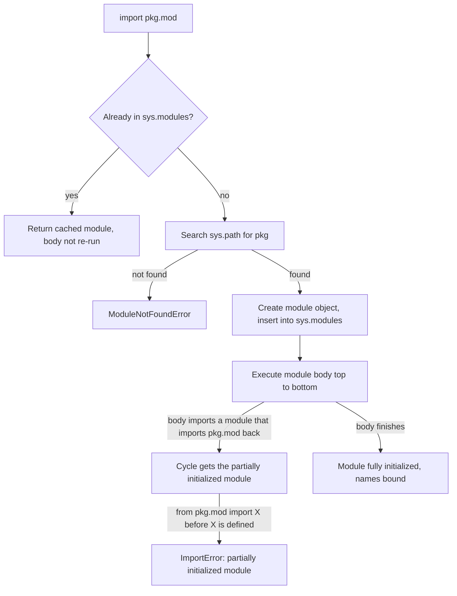

## TL;DR
An agent repo's import graph decides whether the agent loop tests without a model, how fast a worker
cold-starts and whether tools can be swapped. Use a `src/` layout, one-way imports (domain ← services ←
adapters ← entrypoints), and keep heavy SDKs at the edges.

## For agent builders
- **Why it matters for agents.** Agent code has natural cycles: the agent needs its tools, tools want the
  agent's types, and both want the LLM client. Without a direction, you get partial-init `ImportError`s
  and an agent package that imports `torch` and three vendor SDKs just to list its tools.
- **Where it shows up in your stack.** LangChain ships provider integrations as separate packages
  (`langchain-openai` and similar) so you import only what you use; your repo should follow the same
  idea, with LangGraph graphs and agent loops in `services/`, tool and model clients in `adapters/`, and
  the FastAPI app or queue worker in `entrypoints/`.
- **What you control.** The layer contract, where tool registries and prompt templates live, which
  imports are lazy on cold-start paths (serverless tools, autoscaled agent workers), and whether CI tests
  the built wheel so prompt files actually ship.
- **What you can skip.** Namespace packages and multi-distribution monorepos, until several teams ship
  agent components independently.

## Lab
### Task
Build a mini import-linter: an `ast`-based checker that enforces the layer contract (entrypoints →
adapters → services → domain) and keeps vendor SDKs out of the agent's domain and services. The agent
goal is a CI gate that stops a stray `import openai` from making the agent loop untestable without a key.
Time box: 60-90 min.
- **Prerequisites:** Dependency injection & interface boundaries; Python packaging basics from uv / poetry / pip.
- **Setup:** Python 3.10+ (for `ast.unparse` and `X | None` hints) and `pip install pytest`. Save the
  starter as `lab.py`, the tests as `test_lab.py`.
- **What you get:** a sample agent package written to a temp directory, with three real violations and two
  traps (a `TYPE_CHECKING` import and an allowed downward import).

### Starter code
```python
"""Lab: a mini import-linter for a layered agent package. Run: python lab.py"""
from __future__ import annotations
import ast, pathlib, tempfile, textwrap

LAYERS = ["myapp.entrypoints", "myapp.adapters", "myapp.services", "myapp.domain"]   # high -> low
FORBIDDEN = {"myapp.domain": {"openai", "anthropic", "torch"},
             "myapp.services": {"openai", "anthropic", "torch"}}

SAMPLE = {
    "domain/__init__.py": "",
    "domain/models.py": "from myapp.adapters.llm import OpenAIClient\n",
    "services/__init__.py": "",
    "services/agent.py": """\
        from typing import TYPE_CHECKING
        import openai
        from myapp.domain.models import Message
        if TYPE_CHECKING:
            from myapp.entrypoints.cli import App
        """,
    "services/memory.py": "from ..adapters import llm\nfrom . import agent\n",
    "adapters/__init__.py": "",
    "adapters/llm.py": "import openai\nfrom myapp.services.agent import Agent\n",
    "entrypoints/__init__.py": "",
    "entrypoints/cli.py": "from myapp.adapters.llm import OpenAIClient\nimport torch\n",
}

def write_package(root: pathlib.Path, files: dict[str, str]) -> pathlib.Path:
    pkg = root / "myapp"
    for rel, src in files.items():
        (pkg / rel).parent.mkdir(parents=True, exist_ok=True)
        (pkg / rel).write_text(textwrap.dedent(src))
    (pkg / "__init__.py").touch()
    return root

def module_name(path: pathlib.Path, src_root: pathlib.Path) -> str:
    parts = list(path.relative_to(src_root).with_suffix("").parts)
    return ".".join(parts[:-1] if parts[-1] == "__init__" else parts)

def layer_of(module: str) -> str | None:
    return next((l for l in LAYERS if module == l or module.startswith(l + ".")), None)

def imports_in(path: pathlib.Path, module: str) -> list[tuple[int, str]]:
    # YOUR CODE HERE: return (lineno, absolute module) for every import in the file, in line order.
    # - `import a.b` -> "a.b"; `from a.b import c` -> "a.b"
    # - relative `from ..x import y` resolves against the file's package ("myapp.services.memory"
    #   -> package "myapp.services"; for an __init__.py the package is the module itself)
    # - skip imports nested under `if TYPE_CHECKING:` (they never run)
    raise NotImplementedError

def check(src_root: pathlib.Path) -> list[tuple[str, int, str, str]]:
    # YOUR CODE HERE: return sorted (file, lineno, imported, rule) for every violation.
    # - file is the path relative to src_root, posix style ("myapp/domain/models.py")
    # - rule "layer": the imported module's layer is HIGHER than the importer's layer
    # - rule "forbidden": the imported top-level package is in FORBIDDEN[importer's layer]
    raise NotImplementedError

if __name__ == "__main__":
    root = write_package(pathlib.Path(tempfile.mkdtemp()), SAMPLE)
    for file, line, imported, rule in check(root):
        print(f"{file}:{line} {rule}: {imported}")
```

### Expected output
`python lab.py` with a correct solution prints exactly these three violations. The adapter importing
`openai`, the entrypoint importing `torch` and the type-only import of `App` are all allowed.

```
myapp/domain/models.py:1 layer: myapp.adapters.llm
myapp/services/agent.py:2 forbidden: openai
myapp/services/memory.py:1 layer: myapp.adapters
```

### Tests
Run `pytest -q test_lab.py`. On the starter all 4 fail with `NotImplementedError`; a correct solution
passes all 4 (checked with Python 3.12 and pytest 9.1, standard library only otherwise).

```python
import pathlib
from lab import SAMPLE, check, imports_in, write_package

def test_imports_resolve_relative_and_skip_type_checking(tmp_path):
    root = write_package(tmp_path, SAMPLE)
    agent = root / "myapp/services/agent.py"
    assert imports_in(agent, "myapp.services.agent") == [
        (1, "typing"), (2, "openai"), (3, "myapp.domain.models")]
    memory = root / "myapp/services/memory.py"
    assert imports_in(memory, "myapp.services.memory") == [(1, "myapp.adapters"), (2, "myapp.services")]

def test_relative_import_from_package_init(tmp_path):
    root = write_package(tmp_path, {"services/__init__.py": "from .agent import Agent\n",
                                    "services/agent.py": ""})
    assert imports_in(root / "myapp/services/__init__.py", "myapp.services") == [(1, "myapp.services.agent")]

def test_sample_violations(tmp_path):
    assert check(write_package(tmp_path, SAMPLE)) == [
        ("myapp/domain/models.py", 1, "myapp.adapters.llm", "layer"),
        ("myapp/services/agent.py", 2, "openai", "forbidden"),
        ("myapp/services/memory.py", 1, "myapp.adapters", "layer"),
    ]

def test_fixed_package_is_clean(tmp_path):
    fixed = dict(SAMPLE)
    fixed["domain/models.py"] = "from dataclasses import dataclass\n"
    fixed["services/agent.py"] = "from myapp.domain.models import Message\n"
    fixed["services/memory.py"] = "from . import agent\n"
    assert check(write_package(tmp_path, fixed)) == []
```

### Failure scenarios
- **Walk only `tree.body` and miss nested imports.** Function-local and `try/except ImportError` imports
  slip through. Add `def f(): import torch` to a domain file and confirm `check` flags it; `ast.walk`
  finds everything but then needs its own `TYPE_CHECKING` exclusion.
- **Treat `if TYPE_CHECKING:` like any other `if`.** `test_sample_violations` gains an extra
  `myapp.entrypoints.cli` layer violation. Print `ast.dump(node.test)` for each `ast.If` to see what the
  guard looks like (`Name` or `typing.TYPE_CHECKING` as an `Attribute`).
- **Resolve relative imports against the module instead of its package.** `from ..adapters import llm`
  becomes `myapp.services.adapters`, the layer check misses it and `test_imports_resolve...` fails.
  Print `(module, node.level, node.module)` for every `ImportFrom` and resolve one by hand.
- **Compare layers in the wrong direction.** Every allowed downward import (`adapters/llm.py` importing
  the agent) becomes a violation. The list is ordered high to low, so a lower index is a higher layer.

### Submission
- **`lab.py`** with `imports_in` and `check` implemented, standard library only.
- **A green test run** (4 passed) and the output of `python lab.py`.
- **One extra test** proving a function-local `import torch` in `myapp/domain` is caught.
- **A note comparing your checker with `import-linter`**: two behaviours it has that yours lacks
  (for example, indirect import chains and `include_external_packages`).
- **Evaluated on:** exact violation list, no false positive on the type-only import, and correct relative
  import resolution for both modules and `__init__.py` files.

## Why it exists
- **Notebooks grow into tangles.** One agent notebook becomes a `utils.py`, then forty modules where
  everything imports everything. Three failures follow, one per bullet below.
- **Circular imports.** `agent.py` imports `tools.py`, which imports `agent.py` for a type, until Python
  raises `ImportError: cannot import name 'Agent' from partially initialized module`.
- **Slow, fragile startup.** Importing the package pulls in `torch`, `transformers` and three vendor SDKs,
  so a CLI that only lists prompts takes seconds. A module-level `client = OpenAI()` fails at import when
  `OPENAI_API_KEY` is missing, which also breaks test collection.
- **Tests pass for the wrong reason.** With a flat layout, `pytest` imports the package from the working
  directory, not from what `pip install` would ship, so a missing wheel file or wrong package-data
  declaration stays invisible until production.
- **Naive fixes hide the cause.** `sys.path.insert(0, "..")` or `PYTHONPATH=.` makes imports depend on
  where the process started, so they differ in CI, Docker and a teammate's laptop. `try/except ImportError`
  hides a cycle until another import order triggers it. "Just be careful" does not scale because nothing
  enforces it: design the structure, give it a direction and check it with a tool, the same way you would
  design service boundaries.

## How it works
### What an import actually does
1. `import pkg.mod` looks in `sys.modules`.
2. If absent, it walks `sys.path` for `pkg` and creates the module object.
3. It **inserts the module into `sys.modules` before executing its body**.
4. It runs the module top to bottom.

Two consequences drive every rule below:
- **The body runs once per process, at first import.** Anything at top level (network clients, file
  reads, model loading, `logging.basicConfig`) is an import-time side effect.
- **A cycle does not loop forever.** The half-built module is already registered, so the second module
  gets the partially initialized first one, and `from a import X` fails if `X` is not defined yet.

### `import a` vs `from a import X`
| Form | Binds | Consequence |
|---|---|---|
| `import a` | the module object | a cycle survives if `a.X` is only looked up later, at call time |
| `from a import X` | a new name `X` in the importer, bound to whatever `a.X` is *now* | fails mid-cycle |

- **Patch where the name is used.** `mock.patch("a.X")` does not affect a module `b` that already did
  `from a import X`, because `b` holds its own reference; patch `b.X`.

### Where `sys.path[0]` comes from
- **`python path/to/script.py`** puts the script's own directory first on `sys.path`.
- **`python -m pkg.mod`** puts the current directory there and imports `pkg.mod` as part of its package.
- **So `python src/myapp/entrypoints/cli.py` breaks things:** `entrypoints/` tops the search path, siblings
  become top-level modules, relative imports fail with "attempted relative import with no known parent
  package", and a sibling named like a library shadows it.
- **Fix:** run `python -m myapp.entrypoints.cli`, or declare a console script under `[project.scripts]` in
  `pyproject.toml`, *because* both resolve imports through the installed package rather than wherever the
  file sits.

### src layout
- **Shape:** code in `src/myapp/`, `tests/` beside `src/`, installed editable (`uv sync`, or
  `pip install -e .`).
- **Why it helps:** the project root has no importable `myapp` directory, so tests can only import through
  the installation. Undeclared dependencies and modules not really in the package show up instead of being
  silently picked up from the working directory.
- **Caveat:** an editable install still points back at `src/`. Files on disk but missing from the wheel
  (prompt templates, package data) are caught only when CI builds the wheel and tests a non-editable
  install of it.
- **Flat layout** (`myapp/` at the root) is fine for scripts and small tools, but it lets the current
  directory shadow the installed package.

### Layering and direction
Allow imports only downward:

| Layer | Contains | May import |
|---|---|---|
| `domain/` | pure types and logic (Pydantic models, prompt templates, scoring) | nothing from the app |
| `services/` | orchestration (RAG pipeline, agent loop) | domain + *interfaces* (Protocols) for LLMs, vector stores, tools |
| `adapters/` | concrete clients (OpenAI, Anthropic, pgvector, Redis) | implement those Protocols |
| `entrypoints/` | FastAPI app, CLI, workers | the composition root that wires adapters into services |

- **Why this direction:** the parts that change most (vendor SDKs) should be the parts nothing else
  depends on.
- **Enforce it:** `import-linter` turns this into a CI check with "layers" and "forbidden" contracts, so a
  stray `from myapp.adapters.openai import ...` inside `domain/` fails the build.

### Breaking cycles properly
- **A cycle is a design signal:** two modules share a concept that belongs in a third. Move the shared
  types down into `domain/`.
- **Type-only import?** Guard it with `if TYPE_CHECKING:` and use string or postponed annotations,
  because type checkers read it but the runtime never executes it.
- **Function-local imports** also break cycles; use them deliberately, not as a habit.

### Public surface and lazy imports
- **`__init__.py` defines what callers see.** Re-export a small API (`from .client import Client`, plus
  `__all__`) to reorganize internals freely. Re-exporting everything makes `import myapp` load everything.
- **Defer heavy optional dependencies:** import inside the function that needs them, or use a module-level
  `__getattr__` (PEP 562) to load on first attribute access.
- **Measure:** `python -X importtime -c "import myapp"` prints per-module import cost, so you see what to
  defer.

### Regular vs namespace packages
- **Regular package:** a directory with `__init__.py`.
- **Namespace package (PEP 420):** a directory *without* one is still importable. It exists so several
  separately installed distributions can contribute subpackages to one name (`acme.llm` and `acme.rag`
  shipped independently). Use it on purpose only.
- **Accidental namespace package** (a forgotten `__init__.py`) usually imports in development, but
  setuptools' `find_packages()` skips it, so the subpackage can silently be left out of the wheel, and some
  tools resolve its module names differently.
- **Rule:** in a single application package, give every package directory an `__init__.py`.

### Absolute vs relative imports
- **Absolute** (`from myapp.domain import Query`): explicit, survives copying a module elsewhere.
- **Explicit relative** (`from .models import Query`): shorter, survives renaming the top package.
- **Either is fine:** pick one and let `ruff` enforce it. Implicit relative imports do not exist in
  Python 3.

## Diagram
Follow one `import` statement: the module is registered in `sys.modules` before its body runs, which is
why a cycle hands the second importer a half-built module instead of looping forever.



## Examples
### Layered layout with a type-only import and a lazy adapter
The `TYPE_CHECKING` import removes a runtime cycle between the agent and its tool registry; the embedder
defers `torch` until the first call, so importing the package (or collecting tests) stays fast and
side-effect free.

```python
# src/myapp/
#   domain/models.py        <- pure Pydantic models, no app imports
#   services/agent.py       <- depends on domain + Protocols
#   adapters/embeddings.py  <- imports torch / sentence-transformers lazily
#   entrypoints/cli.py      <- composition root

# services/agent.py
from __future__ import annotations
from typing import TYPE_CHECKING, Protocol
from myapp.domain.models import Message

if TYPE_CHECKING:                      # seen by mypy/pyright, never executed at runtime
    from myapp.services.tools import ToolRegistry

class LLM(Protocol):
    def complete(self, messages: list[Message]) -> Message: ...

class Agent:
    def __init__(self, llm: LLM, tools: ToolRegistry) -> None:
        self.llm, self.tools = llm, tools

# adapters/embeddings.py
class LocalEmbedder:
    def __init__(self, model_name: str) -> None:
        self.model_name, self._model = model_name, None   # nothing heavy at import

    def embed(self, texts: list[str]) -> list[list[float]]:
        if self._model is None:
            from sentence_transformers import SentenceTransformer  # pays torch import on first use
            self._model = SentenceTransformer(self.model_name)
        return self._model.encode(texts).tolist()

# Measure: python -X importtime -c "import myapp.entrypoints.cli" 2> imports.log
```

### Reproduce a partial-init cycle and a wrong-place patch
Standard library only. It writes four tiny modules to a temp directory and shows both failure modes.

```python
import sys, tempfile, textwrap, pathlib
from unittest import mock

root = pathlib.Path(tempfile.mkdtemp())
def write(name, src):
    (root / name).write_text(textwrap.dedent(src))

write("a.py", """
    from b import helper          # runs b before X exists
    X = 1
""")
write("b.py", """
    from a import X               # a is in sys.modules but half-built
    def helper(): return X
""")
write("llm.py", "def call(): return 'real network call'\n")
write("rag.py", """
    from llm import call          # copies the reference into rag's namespace
    def answer(): return call()
""")
sys.path.insert(0, str(root))     # demo only: never do this in project code

try:
    import a
except ImportError as e:
    print("cycle:", e)            # cannot import name 'X' from partially initialized module 'a'

import rag
with mock.patch("llm.call", return_value="fake"):
    print(rag.answer())           # real network call: patched where defined
with mock.patch("rag.call", return_value="fake"):
    print(rag.answer())           # fake: patched where it is looked up
```

### Agent scenario: an agent worker whose cold start hid in imports
An autoscaled queue worker runs a tool-calling agent. New pods took too long to pick up jobs during a
traffic spike. The team captured `python -X importtime` and traced the cost (figures are illustrative,
from one team's profile, not a benchmark).

| Finding | Cause | Fix |
|---|---|---|
| Most startup spent importing `torch` | `myapp/__init__.py` re-exported the local embedder used by one tool | minimal `__init__.py`, lazy import inside the embedder |
| Every vendor SDK imported at boot | tool registry module imported all adapters at top level | registry maps tool names to adapter factories, built in the composition root |
| Tests failed without `OPENAI_API_KEY` | module-level `client = OpenAI()` in the planner | client built in the root and injected into the agent |
| Prompt templates missing in prod | flat layout, templates never declared as package data | src layout plus a CI job that tests the built wheel |

After the change, `import myapp.entrypoints.worker` loads only the agent loop and the adapters that
worker's tools need, and unit tests run the agent with a scripted fake model.

### Layer contract as a CI check
An `import-linter` contract in `pyproject.toml`; `lint-imports` fails the build when a lower layer imports a
higher one. Layers are listed from highest to lowest; forbidding third-party packages such as `openai`
also needs `include_external_packages = true`, because import-linter ignores external imports by default.

```toml
[tool.importlinter]
root_package = "myapp"
include_external_packages = true   # required for the forbidden contract on openai, anthropic, torch

[[tool.importlinter.contracts]]
name = "Layered architecture"
type = "layers"
layers = [
    "myapp.entrypoints",
    "myapp.adapters",
    "myapp.services",
    "myapp.domain",
]

[[tool.importlinter.contracts]]
name = "Domain and services never import vendor SDKs"
type = "forbidden"
source_modules = ["myapp.domain", "myapp.services"]
forbidden_modules = ["openai", "anthropic", "torch"]
```

## Production patterns
- **Tools as adapters behind a registry.** Keep each tool's backend client in `adapters/`, expose it to
  the agent through a Protocol or a typed function, and register tools in the composition root. The agent
  loop then imports no SDK, and adding a tool touches one adapter file and the root. Monitor which tools
  each worker actually loads at boot.
- **Prompts and tool schemas as package data.** Store prompt templates and JSON tool schemas inside
  `src/myapp/` and load them with `importlib.resources`, so they ship in the wheel and version with the
  code. Check for them in the wheel-install CI job.
- **Test the built wheel, not the checkout.** In CI, build the wheel (`uv build` or `python -m build`),
  install it into a fresh environment without `-e`, and run the test suite against it. Catches missing
  package data and undeclared dependencies; monitor CI for `ModuleNotFoundError` on this job only.
- **Import contracts in CI.** Run `lint-imports` with layers and forbidden contracts like the one above on
  every pull request, so direction is enforced by a tool, not by review. Track contract violations as
  build failures.
- **Import-time budget for cold-start paths.** For CLIs, serverless handlers and autoscaled workers,
  capture `python -X importtime -c "import myapp.entrypoints.cli"` in CI and review the slowest modules;
  defer them with function-local imports or PEP 562 `__getattr__`. Monitor cold-start latency.
- **Console scripts, never file paths.** Declare entrypoints under `[project.scripts]` and run workers with
  `python -m` in Dockerfiles and process managers, so `sys.path` is the same everywhere.
- **Eager imports at server boot.** For long-running API servers, import adapters during startup (the
  lifespan or app factory) so a missing optional dependency fails the deploy health check instead of the
  first user request.

## Trade-offs
- **Swappable adapters vs ceremony.** Strict layering makes services testable with fakes, but adds
  indirection that feels like ceremony in a 500-line prototype; adopt it once a second adapter or a test
  suite appears.
- **Fast startup vs late failure.** Lazy imports cut startup time and make optional extras optional, but
  move `ImportError` from startup to first use; for a long-running server, eager import at boot can be
  safer because it fails fast.
- **Tidy API vs import cost.** A rich `__init__.py` gives users a tidy API but couples import cost to the
  whole package; prefer minimal `__init__` files once the package contains heavy or optional dependencies.
- **Many packages vs one layered package.** Splitting into many small packages (a monorepo with workspaces)
  isolates dependencies cleanly, but costs versioning and release overhead that a single package with clear
  layers usually does not need.

## Pitfalls
- **One tools module importing every tool backend.** Symptom: an agent worker that serves two tools pays
  the import cost and credential checks of all twelve, and one missing optional SDK breaks every agent.
  Fix: register tools per entrypoint in the composition root, with lazy imports in each adapter.
- **Clients or models created at module top level.** Symptom: tests fail at collection with a missing API
  key, or a CLI `--help` takes several seconds. Fix: build them in the composition root.
- **Moving an import into a function without fixing the shared concept.** Symptom: the same cycle reappears
  in a new form a few weeks later. Fix: move the shared types into `domain/`.
- **A module named after a dependency** (`openai.py`, `logging.py`, `datasets.py`) on `sys.path`. Symptom:
  `AttributeError: module 'openai' has no attribute 'OpenAI'` because your file shadowed the library. Fix:
  rename it.
- **Patching where a name is defined, not where it is looked up** (`patch("myapp.adapters.llm.OpenAI")`
  when `services/rag.py` did `from myapp.adapters.llm import OpenAI`). Symptom: the test still makes real
  network calls although the patch "is applied". Fix: patch `myapp.services.rag.OpenAI`, or inject.
- **Running modules as files** (`python src/myapp/cli.py`) instead of with `-m` or a console script.
  Symptom: "attempted relative import with no known parent package", or imports that work from one
  directory and fail from another.
- **Flat layout and no wheel build in CI.** Symptom: `ModuleNotFoundError` or missing prompt templates only
  after deployment, because package data was never declared.

## When to use
- **Use when:** agent code leaves the notebook and gets a `pyproject.toml`; use a src layout for anything
  installed, deployed or shared, such as an agent service, a tool server or a shared tools library.
- **Avoid when:** it is a one-off script; keep a flat layout.
- **Add explicit layers when:** you have more than one implementation of an external dependency, or tests
  start patching module globals to avoid network calls.
- **Measure:** import time when startup matters (CLIs, serverless cold starts, worker autoscaling).
- **Code review / interviews:** ask "which way does this import point?"; explain why a cycle signals a
  misplaced concept and how `sys.modules` makes a cycle fail the way it does.

## Role lens
- **Engineer:** Keeps vendor SDK imports in adapters, guards type-only imports, and runs `-X importtime`
  when a worker's cold start creeps up.
- **Architect:** Defines the layer contract and enforces it in CI, so the dependency direction survives team
  growth and vendor swaps.
- **FDE:** Restructures a customer's notebook-grown repo into an installable package that their platform team
  can deploy, test and own after handover.

## Check yourself
**Q:** Your FastAPI service imports `myapp`, and `myapp/__init__.py` re-exports everything. Cold starts on
your serverless platform take several seconds and unit tests fail without an `OPENAI_API_KEY`. What do you
change and why?
**A:** Both symptoms come from import-time work. Re-exporting everything means `import myapp` executes every
module, including ones that import `torch` and ones that construct SDK clients at top level. I would shrink
`__init__.py` to a small public API, move client construction into the composition root (the FastAPI lifespan
or a factory), and inject clients into services. Heavy libraries move behind function-local or PEP 562 lazy
imports. Then `-X importtime` confirms the cold-start gain, and tests run with fakes because nothing touches
the network or environment at import time.

## Interview questions
### What does a src layout buy you over a flat layout, and what does it not catch on its own?
- **What it buys:** the project root has no importable `myapp` directory, so tests import through the
  installation and undeclared dependencies or stray modules surface instead of being picked up from the
  working directory.
- **What it misses:** an editable install still points back at `src/`, so files missing from the wheel
  (prompt templates, package data) only show up when CI builds the wheel and tests a non-editable install.

### A teammate hits `ImportError: cannot import name 'Agent' from partially initialized module`. Walk me through the fix.
- **Explain the cause:** Python inserts a module into `sys.modules` before running its body, so the cyclic
  import gets a half-built module and `from a import X` fails if `X` is not defined yet.
- **Find the shared concept:** if both modules need the same types, move them down into `domain/`.
- **Type-only edge:** guard it with `if TYPE_CHECKING:` plus postponed annotations; avoid
  `try/except ImportError`, which hides the cycle until another import order triggers it.

### How would you enforce a layered dependency direction across a team of twenty engineers?
- **Write the rule down as a contract:** `import-linter` with a "layers" contract (entrypoints, adapters,
  services, domain) and a "forbidden" contract keeping `openai`, `anthropic` and `torch` out of the inner
  layers.
- **Run `lint-imports` in CI** on every pull request, so a stray adapter import in `domain/` fails the build
  rather than relying on reviewers.

### Your test patches `myapp.adapters.llm.OpenAI` but still makes real network calls. Why?
- **Names are looked up where they are used:** `services/rag.py` did `from myapp.adapters.llm import
  OpenAI`, so it holds its own reference and the patch on the defining module does not touch it.
- **Fix:** patch `myapp.services.rag.OpenAI`, or better, inject the client so no patching is needed.
- **Prevent recurrence** by building clients in the composition root rather than at module top level.

### New agent worker pods take far too long to pick up their first job after scale-out. How do you check whether imports are the cause?
- **Measure first:** run `python -X importtime -c "import myapp.entrypoints.worker"` in the worker image
  and sort by cumulative time; heavy modules such as `torch` or every vendor SDK show up at the top.
- **Trace why they load:** usually a re-exporting `__init__.py` or a tool registry that imports every
  adapter at top level, although this worker serves only two tools.
- **Fix and verify:** minimal `__init__.py`, lazy imports inside heavy adapters, tools registered per
  entrypoint in the composition root; re-measure and watch cold-start latency.

## Quiz
### Q: Why does a circular import often fail with "cannot import name X from partially initialized module"?
- [ ] Python detects the cycle and refuses to load either module
- [x] The first module is registered in sys.modules before its body finishes, so the second gets it half-built
- [ ] Relative imports are not allowed inside packages that import each other
- [ ] The bytecode cache is invalidated when two modules reference each other
> Python inserts a module into sys.modules before executing it. The cyclic import returns that
> partially executed module, so names defined later in its body do not exist yet; Python does not refuse cycles outright.

### Q: What is the main reason to prefer a src layout for a deployable package?
- [ ] It makes imports run faster at startup
- [ ] It is required by pyproject.toml build backends
- [x] Tests import the installed package instead of the working-directory copy, exposing packaging mistakes
- [ ] It prevents circular imports between subpackages
> With src/, the repository root has no importable package directory, so tests use what installation
> provides (pair it with a test run against the built wheel to catch missing package data). It does not
> affect import speed or cycles, and build backends support flat layouts too.

### Q: A type annotation is the only reason module A imports module B, and this creates a cycle. Best fix?
- [ ] Merge A and B into one module
- [ ] Replace the import with importlib.import_module at call time
- [x] Import B under `if TYPE_CHECKING:` and use postponed or string annotations
- [ ] Catch the ImportError and set the name to None
> TYPE_CHECKING is False at runtime, so the import exists only for type checkers and the runtime cycle
> disappears. Merging modules or dynamic imports work but are heavier changes than the cause needs.

## Use cases & projects
### Use cases
- **Agent services that grow tools fast.** A clear `services/`, `adapters/`, `entrypoints/` direction keeps
  new tools from importing the agent loop and creating cycles.
- **Cold-start-sensitive tool workers.** Lazy imports of heavy libraries keep a serverless tool or an
  autoscaled agent worker from loading model libraries just to list its tools.
- **Shipping prompts and tool schemas as package data.** Prompt templates and JSON schemas inside the
  package, tested from the built wheel, stop "works locally, missing in the image" failures.
- **Shared agent components across teams.** A stable public import surface lets several agents reuse the
  same tool library without depending on its internals.

### Mini project
**Restructure a flat agent script into a layered package (1-3 hours).**
- **Goal:** turn a single-file agent with two tools into a package with a one-way import direction.
- **Steps:** move the loop into `services/`, the model client and tools into `adapters/`, and a CLI or
  FastAPI app into `entrypoints/`; put prompt templates in package data; make any heavy import lazy; add
  an import-direction check (a linter rule or a small test that inspects imports); build the wheel and run
  one test against the installed wheel, not the source tree.
- **Done when:** there are no import cycles, importing the tool registry does not load the heavy library,
  and the wheel test finds the prompt files.
