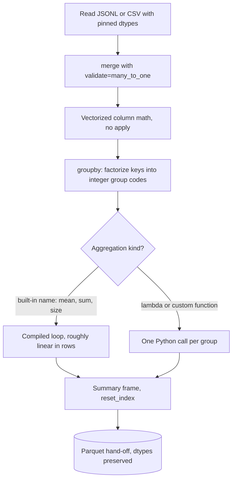

## TL;DR
pandas gives Python an in-memory labelled table, the DataFrame: typed columns plus an index, with
vectorized math, group-by, joins and readers for most formats. It is the default for eval results and
logs that fit in RAM; watch alignment, copies and memory.

## Why it exists
- **AI data is mixed-type rows.** An eval run produces a case ID, model name, category string, pass/fail
  boolean, latency, token counts and a timestamp. NumPy arrays hold one dtype and address data by integer
  position.
- **The questions are tabular.** "Pass rate and p95 latency per model per category", join in a price
  table, filter to failures to read them.
- **The naive tools fail.** Lists of dicts mean hand-written loops for every group-by and join, slow and
  easy to get wrong; raw NumPy means keeping parallel arrays aligned by hand.
- **SQL is friction here.** Loading data into a database for a ten-minute analysis is overhead, and SQL is
  awkward for the iterative, look-at-it-and-adjust workflow of a notebook.
- **pandas brought R's data-frame model into Python.** Named columns of different types, row labels and a
  large vocabulary of vectorized operations, in process with your other code, which is why so much of the
  ecosystem, from scikit-learn inputs to plotting libraries, accepts DataFrames.

## How it works
### Columns, dtypes and the index
- **Structure.** An ordered collection of columns (each a `Series`) sharing one `Index` of row labels.
- **Storage.** Each column is a NumPy array or an extension array, so numeric columns get NumPy speed.

| Column kind | Storage | Note |
|---|---|---|
| Numeric | NumPy array | Compiled speed |
| Strings, historically | `object`: pointers to Python objects | Slow and memory-hungry |
| Strings, newer | Dedicated string dtypes | pandas 3.0 makes a string dtype the default for text |
| Arrow-backed (since pandas 2.0, optional) | `dtype_backend="pyarrow"` | Arrow's columnar format |

### Missing values
- **Float columns use `NaN`,** so an integer column that gains one missing value silently becomes
  `float64` (a historical compromise).
- **Nullable dtypes (`Int64`, `boolean`, `string`)** use a separate mask instead, keeping the type.

### Alignment
- **Arithmetic aligns on index *labels*, not positions.** `a + b` matches rows with the same label and
  yields `NaN` where a label exists on only one side.
- **Why.** It was designed for time series, where aligning by date is what you want.
- **The cost.** On freshly filtered frames with gappy indexes it causes silent NaNs, which is why
  `reset_index(drop=True)` appears so often.

### Vectorized operations and their escape hatch
- **Column expressions** such as `df["cost"] = df["tokens"] / 1000 * df["price"]` run as NumPy operations
  over whole columns.
- **`df.apply(f, axis=1)`** calls a Python function per row, bringing back interpreter speed: a last resort.
- **String and datetime operations** live under `.str` and `.dt`.

### Group-by, joins, reshaping
| Tool | What it does |
|---|---|
| `groupby` | Split-apply-combine: split rows by key, aggregate per group, combine into a new frame |
| Named aggregation `agg(pass_rate=("passed", "mean"))` | Keeps output columns explicit |
| `merge` | SQL-style joins; `validate=` checks cardinality so a duplicate key cannot silently multiply rows |
| `pivot_table` / `melt` | Switch between wide and long shapes |

How `groupby` runs:
1. **Factorize** the key columns: one hash pass maps each distinct key to an integer group code.
2. **Aggregate.** Built-ins named by string (`"mean"`, `"sum"`, `"size"`) run a compiled loop adding each
   row into its group's accumulator, so cost is roughly linear in rows whatever the number of groups.
3. **Custom functions are slower.** A lambda is called once per group with a Series: fine for tens of
   groups, slow for a million.

Two defaults matter: `dropna=True` drops rows whose key is missing, and for categorical keys `observed=`
decides whether empty categories appear as rows.

### Indexing, copies and views
- **Select and assign with `.loc[row_mask, "col"]`** for labels, `.iloc` for positions.
- **Chained indexing** such as `df[mask]["col"] = x` may assign into a temporary copy and leave `df`
  unchanged, the origin of the `SettingWithCopyWarning`.
- **pandas 3.0 made Copy-on-Write the default.** Every derived object behaves as a copy and real copying
  is deferred until a write.
- **That removes the ambiguity in one direction.** Chained assignment *never* modifies `df`, and pandas
  emits a `ChainedAssignmentError` warning instead. Code for pandas 2.x that relied on chained assignment
  silently stops working.

### Execution model
- **Eager.** Each operation materializes a full result immediately, mostly on a single core.
- **RAM rule of thumb.** With intermediates, have several times the dataset's size available.
- **Bigger than memory?** Chunked reading (`chunksize=`), a columnar engine such as Polars or DuckDB, or a
  database.

## Diagram
A typical eval-analysis pipeline, with the group-by split shown: built-in aggregations stay in compiled
code, while a lambda drops back to one Python call per group.



## Examples
### Eval summary per model and category
Summarising an eval run: pass rate, tail latency and cost per model and category.

```python
import pandas as pd

df = pd.DataFrame({          # in practice: pd.read_json("results.jsonl", lines=True)
    "case_id":    [1, 1, 2, 2, 3, 3],
    "model":      ["small", "large"] * 3,
    "category":   ["refund", "refund", "billing", "billing", "refund", "refund"],
    "passed":     [False, True, True, True, False, True],
    "latency_ms": [420, 1310, 380, 1250, 450, 1400],
    "out_tokens": [120, 180, 90, 150, 130, 200],
})
price = pd.DataFrame({"model": ["small", "large"],
                      "usd_per_1k_out": [0.0006, 0.01]})     # illustrative prices

df = df.merge(price, on="model", how="left", validate="many_to_one")
df["cost_usd"] = df["out_tokens"] / 1000 * df["usd_per_1k_out"]   # column math, no loop

summary = (df.groupby(["model", "category"])
             .agg(pass_rate=("passed", "mean"),
                  p95_ms=("latency_ms", lambda s: s.quantile(0.95)),
                  cost_usd=("cost_usd", "sum"),
                  n=("case_id", "size"))
             .reset_index())
print(summary)

# Wrong: chained indexing may write into a temporary copy
# df[df["model"] == "small"]["passed"] = True
df.loc[df["model"] == "small", "reviewed"] = True             # right: one .loc call
failures = df.loc[~df["passed"], ["case_id", "model", "category"]]
```

| model | category | pass_rate | cost_usd |
|---|---|---|---|
| small | refund (2 cases) | 0.0 | 0.00015 |
| small | billing | 1.0 | |
| large | refund | 1.0 | (180 + 200) / 1000 × 0.01 = 0.0038 |
| large | billing | 1.0 | |

That is the shape of a real model-choice discussion: the cheap model fails one category, so route that
category to the large one.

### Loading a large usage log without exhausting memory
A token-usage export too big to load with default dtypes. Read only needed columns, pin compact dtypes,
and aggregate chunk by chunk.

```python
import pandas as pd

cols = ["ts", "model", "route", "out_tokens", "latency_ms"]
dtypes = {"model": "category", "route": "category",
          "out_tokens": "int32", "latency_ms": "float32"}

parts = []
for chunk in pd.read_csv("usage.csv", usecols=cols, dtype=dtypes,
                         parse_dates=["ts"], chunksize=1_000_000):
    parts.append(chunk.groupby(["model", "route"], observed=True)
                      .agg(calls=("latency_ms", "size"), out_tokens=("out_tokens", "sum")))

usage = pd.concat(parts).groupby(level=["model", "route"], observed=True).sum()  # combine partial sums
print(usage.sort_values("out_tokens", ascending=False).head())
```

Why the dtypes matter, per 10 million rows (bytes are exact for fixed-width types):

| Column | Default dtype | Pinned dtype | Memory |
|---|---|---|---|
| `out_tokens` | int64, 8 B/row = 80 MB | int32, 4 B/row | 40 MB |
| `latency_ms` | float64 = 80 MB | float32 | 40 MB |
| `model` (a handful of values) | `object`: 8 B pointer per row plus Python string objects (~50 B each) | `category`: 1 B code per row | ~10 MB |

Check the real numbers with `df.memory_usage(deep=True)`.

## Production patterns
- **Pin dtypes and columns at read time.** Pass `usecols=`/`dtype=` to `read_csv`, or `columns=` to
  `read_parquet`, and use `category` for repeated strings. Log `df.memory_usage(deep=True).sum()` per
  stage; a jump means a column fell back to `object` or `float64`.
- **Guard every join.** Use `merge(..., validate="many_to_one")` and assert the row count is unchanged
  after a left join. Monitor rows-before versus rows-after in pipeline logs, since inflated totals are the
  classic silent failure.
- **Nullable IDs everywhere.** Read ID columns as `Int64` or `string` (`dtype={"case_id": "Int64"}`, or
  `df.convert_dtypes()`), so one missing value cannot turn IDs into `1234.0`. Watch join match rates.
- **Opt into Copy-on-Write before upgrading.** On pandas 2.x set `pd.set_option("mode.copy_on_write",
  True)` in tests and fix every chained assignment it flags. Track `ChainedAssignmentError` and
  `SettingWithCopyWarning` counts in CI output; aim for zero.
- **Hand off as Parquet, not CSV.** Write `df.to_parquet(path, index=False)` so dtypes survive the trip
  to the next notebook or job. Monitor file sizes and read times, and keep `dropna=False` explicit in
  report group-bys so missing categories stay visible.

## Trade-offs
- **Huge API vs consistency.** Most tasks are one line away, but there are many ways to do the same thing
  and inconsistent historical defaults, so code quality varies wildly across a team.
- **Eager vs lazy.** Eager execution is easy to inspect cell by cell, yet materializes every intermediate;
  near RAM size, lazy engines such as Polars or DuckDB optimize and stream instead.
- **Label alignment vs surprise NaNs.** Ideal for time series, but on ad-hoc tables it silently introduces
  NaNs, so many teams treat the index as a plain row number and join explicitly.
- **`object` flexibility vs cost.** It holds anything and tolerates messy data at the cost of speed and
  memory; converting to string, categorical or Arrow dtypes flips that once data grows.

## Pitfalls
- **`apply(axis=1)` or `iterrows()` for arithmetic.** Symptom: a cell taking minutes on a few million rows
  where the vectorized expression takes under a second. Fix: column expressions, `map` or `merge`.
- **Chained assignment like `df[mask]["col"] = x`.** Symptom: `SettingWithCopyWarning` (pandas 2.x) or
  `ChainedAssignmentError` (pandas 3.x, Copy-on-Write) and a frame unchanged afterwards. Fix: one `.loc`.
- **Merging on a key not unique on the side you assumed.** Symptom: row count grows after a join and
  totals inflate. Fix: `validate="many_to_one"` catches it.
- **One missing value turning an ID column into `float64`.** Symptom: IDs printed as `1234.0` and failed
  joins against integer keys. Fix: nullable `Int64`.
- **A multi-gigabyte CSV with default dtypes.** Symptom: memory exhaustion. Fix: specify dtypes, read only
  needed columns, or switch to Parquet; `df.memory_usage(deep=True)` shows which columns (usually `object`
  strings) are responsible.
- **Grouping a column with missing values under default `dropna=True`.** Symptom: per-group counts sum to
  fewer rows than the frame, because cases with no category vanished from the report. Fix: pass
  `dropna=False` or fill the key first.

## When to use
- **Use when:** exploratory analysis and reporting on data that fits comfortably in memory: eval results,
  annotation exports, token and cost logs, small training sets, anything feeding scikit-learn or a plot.
  It is also the lingua franca for handing tables between libraries.
- **Prefer Polars or DuckDB when:** data approaches RAM size, a pipeline runs repeatedly and speed
  matters, or you want lazy, query-optimized execution.
- **Prefer a database when:** data is shared, updated concurrently or needs durability.
- **Interviews:** expect group-by, joins, vectorization and why chained assignment fails.

## Role lens
- **Engineer:** Loads JSONL eval and trace data into DataFrames, slices failures by category, and writes
  vectorized, `.loc`-based transformations that survive Copy-on-Write.
- **Architect:** Decides where notebook-scale pandas analysis ends and production pipelines in Polars,
  Spark or SQL begin, and standardizes Parquet as the hand-off format.
- **FDE:** Pulls a customer's CSV or ticket export into pandas on day one to profile volumes, categories
  and data quality before scoping the solution.

## Check yourself
**Q:** A notebook computes per-ticket cost with `df.apply(lambda r: price[r.model] * r.tokens, axis=1)`
over 5 million rows and takes many minutes. Why is it slow and how do you fix it?
**A:** `apply` with `axis=1` builds a Series for each row and calls the Python lambda 5 million times,
so the work runs in the interpreter rather than in compiled column operations. Fix it by expressing the
lookup as a join or a vectorized map: `df["unit"] = df["model"].map(price)` (or merge a price table),
then `df["cost"] = df["unit"] * df["tokens"]`, both of which operate on whole columns. Also convert
`model` to a categorical dtype if it repeats, and check the merge or map left no NaNs for unknown models.

## Interview questions
### What is a DataFrame, and why reach for pandas instead of lists of dicts or raw NumPy?
- **Definition:** an ordered set of typed columns, each a `Series`, sharing one `Index` of row labels,
  with numeric columns stored as NumPy arrays.
- **Why:** eval and log data are mixed-type rows, and the questions (pass rate per model per category,
  join a price table) are one `groupby` or `merge` instead of hand-written loops or parallel arrays kept
  aligned by hand.
- **Ecosystem:** scikit-learn, plotting libraries and most readers accept or produce DataFrames.

### Cost totals inflated after a join. How do you find and prevent the cause?
- **Likely cause:** the key is not unique on the side you assumed, so a left join multiplied rows.
- **Find it:** compare row counts before and after the merge, and check duplicate keys with
  `df.duplicated(subset=[key]).sum()` on the lookup table.
- **Prevent it:** pass `validate="many_to_one"` so pandas raises instead of multiplying rows, and log
  rows-before versus rows-after in the pipeline.

### Why does `df[mask]["col"] = x` fail to update `df`, and what changed in pandas 3.0?
- **Chained indexing:** the first `[]` may return a temporary copy, so the assignment lands there and
  `df` is unchanged; pandas 2.x warns with `SettingWithCopyWarning`.
- **pandas 3.0 Copy-on-Write:** every derived object behaves as a copy, so chained assignment never
  modifies `df` and pandas emits `ChainedAssignmentError` instead.
- **Fix:** one `.loc[mask, "col"] = x` call; enable `mode.copy_on_write` on 2.x in tests before upgrading.

### A 10-million-row usage CSV exhausts memory. How do you cut it down?
- **Read less:** pass `usecols=` for the needed columns and `chunksize=` to aggregate chunk by chunk.
- **Pin dtypes:** `int32` and `float32` take 40 MB per column instead of 80 MB in int64 or float64, and a
  repeated string as `category` costs about 1 byte per row instead of a pointer plus a Python string.
- **Measure, then switch format:** `df.memory_usage(deep=True)` shows the offending columns, usually
  `object` strings; Parquet keeps the dtypes for the next reader.

### When would you not use pandas?
- **Near RAM size or in repeated pipelines:** pandas is eager and mostly single-core, needing several
  times the data size in RAM; Polars or DuckDB optimize lazily and stream.
- **Shared or concurrently updated data:** a database gives durability and concurrent access.
- **Keep pandas for:** notebook-scale exploration, eval reports and hand-offs to scikit-learn or plots.

## Quiz
### Q: `a` has index [0, 1, 2] and `b` has index [1, 2, 3]. What does `a + b` return?
- [ ] An error, because the indexes differ
- [ ] Three values computed by position
- [x] Four rows labelled 0 to 3, with NaN for labels present on only one side
- [ ] Two rows, labels 1 and 2 only
> pandas aligns on labels and takes the union of the indexes, so labels 0 and 3 have no partner and become
> NaN. Positional addition requires `.to_numpy()` or resetting the indexes first.

### Q: Why does `df[df.score < 0.5]["flag"] = True` often fail to modify `df`?
- [ ] Boolean masks are read-only in pandas
- [x] The first indexing step can return a new object, and the assignment goes into that temporary copy
- [ ] The column must exist before assignment
- [ ] pandas requires `inplace=True` for all assignments
> Chained indexing performs two separate operations; the second writes into whatever the first returned,
> which may be a copy (under pandas 3's Copy-on-Write it always behaves as one). A single
> `df.loc[mask, "flag"] = True` modifies the original frame.

### Q: After a merge, an eval summary reports more rows than there were test cases. What is the most likely cause?
- [ ] The merge defaulted to an outer join
- [ ] groupby dropped NaN keys
- [x] The join key was duplicated in the right-hand table, multiplying matching rows
- [ ] Copy-on-Write duplicated the frame
> A many-to-many match repeats each left row once per matching right row. Passing `validate="many_to_one"`
> raises an error when the right side's keys are not unique, catching the problem at the join.
