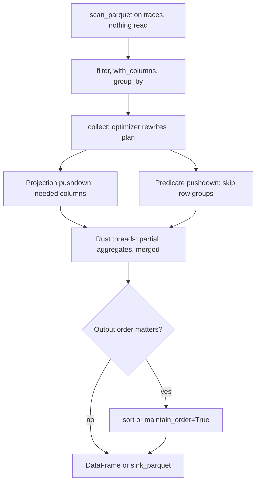

## TL;DR
Polars is a Rust DataFrame library on Arrow memory for agent traces, evals and RAG corpora that outgrow
pandas. Lazy mode pushes filters and columns into the scan and uses all cores, so recurring
multi-gigabyte jobs typically run much faster; the API is stricter.

## For agent builders
- **Why it matters for agents.** A production agent fleet writes one row per step, with prompts and tool
  outputs attached; that reaches tens of gigabytes quickly. Daily cost per model, error rate per tool,
  steps per run, and "turn last month's good traces into a fine-tuning set" are scheduled jobs over it.
- **Where it shows up in your stack.** Nightly rollups over trace Parquet or JSONL exports, eval
  aggregation across thousands of runs, deduplicating and filtering documents before chunking and
  embedding for RAG, and cleaning SFT data built from agent transcripts.
- **What you control.** Lazy scans with explicit schemas, which columns the plan touches (skip the big
  prompt text when you only need token counts), file layout for skipping, and deterministic ordering.
- **What you can skip.** The streaming-engine internals and most of the API surface. Expressions,
  `scan_*` plus `collect`, `explain()` and `group_by` are the working set.

## Why it exists
- **pandas was designed for one core and a few hundred megabytes.** Each operation runs eagerly,
  materializes a full intermediate, mostly on one core, and strings have historically been arrays of
  Python objects.
- **That breaks at trace scale.** Point it at 50 GB of agent traces to compute daily token usage per
  model and you read every column of every file into memory, filter afterwards, and wait on one core
  while the others idle.
- **Fix one: an analytics memory layout.** Typed, contiguous columns with a proper string representation
  and real null handling, so scans and aggregations are cache-friendly and vectorizable. Apache Arrow
  defines exactly that.
- **Fix two: a query engine, not a function library.** Seeing the whole computation first lets it skip
  unused columns, apply filters while reading instead of after, and split work across threads.
- **Databases have done this for decades.** Polars brings it to a DataFrame API inside a Python process,
  with no server to run.

## How it works
### Expressions, not row functions
- **Expressions describe a column computation, not a result:** `pl.col("latency_ms").quantile(0.95)`,
  `(pl.col("out_tokens") / 1000 * pl.col("price")).alias("cost")`,
  `pl.when(cond).then(a).otherwise(b)`.
- **Contexts apply them:** `select`, `with_columns`, `filter`, and `group_by(...).agg(...)`.
- **Why declarative.** Polars can run independent expressions in parallel and optimize them, which a
  Python lambda executed per row would prevent.
- **Escape hatch.** Python UDFs (`map_elements`) exist but drop you back to interpreter speed.

### Eager and lazy
| Call | Returns | When it reads |
|---|---|---|
| `pl.read_parquet` | `DataFrame` | Immediately, like pandas |
| `pl.scan_parquet` (also `scan_csv`, `scan_ndjson`) | `LazyFrame` | Nothing until `.collect()`; each call adds a node to a logical plan |

Before executing, the optimizer applies rules such as:
- **Projection pushdown:** only columns referenced anywhere in the plan are read from disk, so the large
  prompt and tool-output columns of a trace are never touched by a cost rollup.
- **Predicate pushdown:** filters move into the scan, so Parquet row groups whose statistics rule them
  out can be skipped.
- **Simplification and common-subexpression elimination**, so repeated expressions are computed once.

`lf.explain()` prints the optimized plan, so you can verify what will be read.

### Memory and parallelism
- **Arrow-style buffers with a validity bitmap.** `null` is distinct from a float `NaN`, and an integer
  column with missing values stays an integer column (a step with no token count stays an integer).
- **Multi-threaded Rust, outside the GIL.** A group-by uses all cores without multiprocessing.
- **Parallel group-by works like a distributed one.** Threads hash rows into partitions, build partial
  aggregates independently, and merge them.
- **So group order is not guaranteed** unless you pass `maintain_order=True` (which costs speed). That
  matters for tests and reports that compare frames row by row.
- **Larger than RAM.** A streaming engine processes the plan in batches, and `sink_parquet` writes a lazy
  result straight to disk without materializing it. How you enable streaming has changed across
  releases, so check the docs for your version.

### No index, strict types
- **No row index, no label alignment.** Rows are positions, and joins are explicit.
- **Strict schemas.** Mixing types in a column or comparing incompatible dtypes raises an error rather
  than silently becoming `object`. Agent traces are prone to this, because a tool's result field can be a
  number in one step and an error string in the next.
- **The deliberate trade:** fewer silent surprises, more errors up front.

### Interop
- **Arrow on both sides.** Conversion to and from pyarrow is typically zero-copy.
- **`to_pandas()`** exists for libraries that only accept pandas. Many plotting and ML libraries accept
  Polars frames directly now, but not all.

## Diagram
A lazy trace rollup is only a plan until `.collect()`; the optimizer pushes columns and filters into the
scan before the parallel engine runs, and group order is not guaranteed unless you ask for it.



## Examples
### Daily token usage from agent trace files, read lazily
Daily token usage per model from a directory of trace files, read lazily.

```python
import polars as pl

lf = (
    pl.scan_parquet("traces/*.parquet")                    # builds a plan; reads nothing
      .filter(pl.col("ts") >= pl.datetime(2026, 10, 1))
      .filter(pl.col("status") == "ok")
      .with_columns(
          (pl.col("output_tokens") / 1000 * pl.col("usd_per_1k_out")).alias("cost_usd"))
      .group_by("model", pl.col("ts").dt.date().alias("day"))
      .agg(
          pl.len().alias("calls"),
          pl.col("input_tokens").sum(),
          pl.col("output_tokens").sum(),
          pl.col("cost_usd").sum(),
          pl.col("latency_ms").quantile(0.95).alias("p95_ms"),
      )
      .sort("day", "model")
)
print(lf.explain())   # both filters appear inside the Parquet scan; only 7 columns are projected
daily = lf.collect()  # multi-threaded execution happens here
daily.write_parquet("daily_usage.parquet")
```

Suppose the trace files hold 40 columns, including large prompt and completion text, and only rows from
1 October onward are needed:

| | Eager pandas | Lazy Polars |
|---|---|---|
| Columns read | All 40, text included | 7 numeric or short columns |
| Rows read | All, filtered afterwards | Row groups whose `ts` statistics fall before October are skipped |
| Bytes read | The whole dataset | Can be a small fraction of it |

### Per-tool health and steps per run, from step-level traces
Two rollups an agent team watches: which tools fail, and whether runs are getting longer.

```python
import polars as pl

steps = pl.scan_parquet("traces/*.parquet").filter(pl.col("ts") >= pl.datetime(2026, 10, 1))

per_tool = (steps.filter(pl.col("tool").is_not_null())
                 .group_by("tool")
                 .agg(pl.len().alias("calls"),
                      (pl.col("status") == "error").mean().alias("error_rate"),
                      pl.col("latency_ms").quantile(0.95).alias("p95_ms"))
                 .sort("error_rate", descending=True))

per_run = (steps.group_by("run_id")
                .agg(pl.len().alias("n_steps"),
                     pl.col("input_tokens").sum().alias("in_tokens"))
                .select(pl.col("n_steps").mean().alias("mean_steps"),
                        pl.col("n_steps").quantile(0.95).alias("p95_steps"),
                        pl.col("in_tokens").mean().alias("mean_in_tokens")))

print(pl.collect_all([per_tool, per_run]))   # collects both plans in one call, in parallel
```

- **What to act on:** a tool at the top of `error_rate` with many calls, or a p95 step count creeping
  toward your loop's step budget, which means runs are hitting the cap instead of finishing.

### Worked scenario: turning agent transcripts into a clean fine-tuning set
Raw JSONL with a field that is "always an integer" until it is not. An explicit schema fails fast and
predictably, and the dedupe runs in parallel native code.

```python
import polars as pl

schema = {"id": pl.String, "prompt": pl.String, "completion": pl.String,
          "source": pl.String, "quality": pl.Float64}
lf = (
    pl.scan_ndjson("raw/sft.jsonl", schema=schema)       # no inference from the first rows
      .filter(pl.col("quality") >= 0.7)                  # judge or human grade per transcript
      .with_columns(pl.col("prompt").str.strip_chars().str.to_lowercase().alias("key"))
      .unique(subset=["key"], keep="first", maintain_order=True)   # deterministic output order
      .drop("key")
)
clean = lf.collect()
print(clean.height, clean.null_count())                  # rows kept, nulls per column
clean.write_parquet("clean/sft.parquet")
```

| Stage | Rows (illustrative) | Why |
|---|---|---|
| Raw agent transcripts | 120,000 | Every successful run last month |
| `quality >= 0.7` (judge or human score) | 54,000 | Keep only runs graded as good |
| Dedupe on normalised prompt | 31,000 | Popular requests repeat; duplicates overweight them |

- **No `map_elements`:** normalisation uses built-in string expressions, so it stays parallel.
- **`maintain_order=True`** keeps reruns diffable, at some speed cost.

## Production patterns
- **Lazy scan, then read the plan.** Build trace and eval pipelines from `scan_parquet`/`scan_ndjson` and
  review `lf.explain()` whenever a pipeline changes, checking that filters and projections sit in the
  scan. Monitor bytes read and peak memory per run; a sudden jump usually means an early `.collect()`
  crept in.
- **Explicit schemas at ingestion.** Pass `schema=` to scans of JSONL, or `schema_overrides=` for CSV, for
  every source you do not control, including traces exported from a tracing vendor. Track ingestion
  failures by source; a type error there beats a silently wrong column downstream.
- **Split hot and cold trace columns.** Keep token counts, latencies, status and tool names in one set of
  files and prompt and tool-output text in another, joined by step ID, so dashboards never scan the text.
  Watch bytes read per dashboard query.
- **Deterministic outputs.** End report pipelines with an explicit `.sort(...)` (or `maintain_order=True`
  where order matters) before writing or diffing. Monitor flaky report diffs and tests; they usually
  trace back to group order.
- **Lay out Parquet for skipping.** Sort or partition files by the common filter key (date, customer,
  agent version) before `write_parquet`, so row-group statistics are tight and predicate pushdown can skip
  data. Watch row groups read versus total in your profiling.
- **Pin the version and fail on deprecations.** Pin Polars in the lockfile and treat deprecation warnings
  as errors in CI, because names such as `groupby` became `group_by` and other APIs evolved quickly.
  Convert with `to_pandas()` or to Arrow only at library boundaries.

## Trade-offs
- **Speed vs debuggability.** Lazy plans with pushdown and parallelism are fast on large data, but
  debugging means reading a query plan instead of inspecting intermediate frames; for small exploratory
  data, eager mode or pandas is just as quick to write.
- **Strictness vs ingestion friction.** Strict types and no index remove pandas' silent alignment and
  dtype drift, at the cost of more upfront casting and errors on messy JSON or CSV, which agent traces
  usually are.
- **Performance vs ecosystem.** Faster and leaner than pandas on most analytical workloads, yet younger,
  so some libraries still expect pandas and you pay a conversion at the boundary.
- **No server vs no governance.** An in-process engine needs no server, but has no concurrency control,
  durability or access management; once many users share the data, a warehouse or database wins.

## Pitfalls
- **pandas habits such as `map_elements` with Python lambdas.** Symptom: Polars code no faster than pandas
  and using one core. Fix: built-in expressions like `when/then` or string methods.
- **Calling `.collect()` early and continuing eagerly.** Symptom: memory spikes, because pushdown only
  applies to the plan built before collecting. Fix: stay lazy until the end.
- **Confusing `null` and `NaN`.** Symptom: `drop_nulls()` leaves NaN rows behind, or averages come out
  NaN. Fix: handle both explicitly.
- **Code copied from older blog posts.** Symptom: `AttributeError` or deprecation warnings because names
  such as `groupby` became `group_by` and other APIs evolved quickly. Fix: check the current docs.
- **Relying on `group_by` output order.** Symptom: a test or daily-report diff fails intermittently with
  the same data, because groups come back in a different order each run. Fix: sort explicitly or pass
  `maintain_order=True`.
- **Wide JSONL with inferred schemas.** Symptom: a type error deep in the file when an always-integer
  field suddenly holds a string, typically a tool result that returned an error message. Fix: pass an
  explicit schema.

## When to use
- **Use when:** data is in the gigabytes; a transformation runs on a schedule (token and cost rollups,
  eval aggregation, dataset deduplication and filtering before fine-tuning, corpus cleaning before RAG
  ingestion); or pandas is running out of memory or time. Use lazy scans over Parquet whenever possible.
- **Stay with pandas when:** small notebooks, code leaning on pandas-only libraries, or team skills make
  it the cheaper choice.
- **Consider DuckDB when:** the team prefers SQL; it occupies similar ground.
- **Measure:** wall time and peak memory on your real data before migrating a pipeline.

## Role lens
- **Engineer:** Writes lazy Polars pipelines over Parquet trace and eval data, checks `explain()` for
  pushdown, and converts to pandas only at library boundaries.
- **Architect:** Chooses between pandas, Polars, DuckDB and a warehouse based on data size, run frequency
  and sharing needs, and standardizes Arrow and Parquet as the interchange layer.
- **FDE:** Processes a customer's large log export on a single VM without provisioning a cluster, getting
  usage and quality numbers within hours of receiving access.

## Check yourself
**Q:** A pandas job reads 30 GB of Parquet traces, filters to one customer, and sums tokens per day. It
OOMs on a 64 GB machine. Why might a Polars lazy rewrite succeed, and what would you verify?
**A:** As written, pandas reads every column of every file into memory before filtering (its
`read_parquet` accepts `columns=` and `filters=`, but the naive job uses neither), and decompression,
Python string objects and intermediates add more, so 30 GB on disk can exceed 64 GB in RAM. A lazy Polars plan built with `scan_parquet` pushes the
customer filter and the column selection into the scan, so only the few needed columns are read and
row groups for other customers can be skipped using Parquet statistics. The aggregation then runs in
parallel. I would verify with `explain()` that the filter and projection are in the scan, measure peak
memory, and if data is not sorted or partitioned by customer, expect less skipping and consider the
streaming engine.

## Interview questions
### What is a Polars expression, and why is it faster than a pandas `apply` with a lambda?
- **Definition:** an expression such as `pl.col("latency_ms").quantile(0.95)` describes a column
  computation; contexts like `select`, `with_columns`, `filter` and `group_by(...).agg(...)` apply it.
- **Why faster:** because it is declarative, Polars can optimize it and run independent expressions in
  parallel in Rust, outside the GIL, while a lambda runs once per row in the interpreter.
- **The escape hatch costs the same:** `map_elements` with a Python function drops back to interpreter
  speed and one core.

### Design the nightly job that turns raw agent traces into a cost and reliability dashboard.
- **Ingest with a schema:** lazy `scan_parquet` or `scan_ndjson` with explicit types, filtered to the
  previous day, so a tool that returned a string where a number was expected fails loudly at ingestion.
- **Read only hot columns:** token counts, latency, status, tool, model and run ID; never the prompt or
  output text, which projection pushdown leaves on disk.
- **Roll up and order:** group by model and by tool for cost, error rate and p95 latency, and per run for
  step counts; sort before writing so diffs are stable. Monitor bytes read and peak memory per run.

### A daily report diff fails intermittently on identical input. What is the likely cause?
- **Group order:** a parallel `group_by` hashes rows into partitions per thread and merges partial
  aggregates, so groups come back in a different order from run to run.
- **Fix:** end the pipeline with an explicit `.sort(...)`, or pass `maintain_order=True` where order
  matters, accepting some speed cost.
- **Same idea for dedupe:** `unique(..., maintain_order=True)` keeps reruns diffable.

### After migrating to Polars, `drop_nulls()` leaves bad rows and an average comes out NaN. Why?
- **Two kinds of missing:** Polars uses an Arrow validity bitmap, so `null` is distinct from a float
  `NaN`; `drop_nulls()` removes only nulls.
- **Where NaN comes from:** upstream float maths or a pandas source that used `NaN` for missing values.
- **Fix:** handle both explicitly, and settle at ingestion which one the dataset uses for missing.

### How would you lay out Parquet files so Polars filters skip most of the data?
- **Sort or partition by the common filter key,** such as date or customer, before `write_parquet`, so
  each row group has tight min and max statistics.
- **Then predicate pushdown can skip row groups** whose statistics rule them out; unsorted data gives wide
  ranges and little skipping.
- **Verify:** check `lf.explain()` for the filter inside the scan, and compare bytes read and peak memory
  before and after the layout change.

### When would you stay with pandas or pick DuckDB instead of Polars?
- **Stay with pandas:** small notebook data, code that depends on pandas-only libraries, or a team whose
  skills make pandas cheaper; conversion with `to_pandas()` at each boundary also costs time.
- **Pick DuckDB:** when the team prefers SQL for the same in-process analytical work.
- **Move to a warehouse:** when many users share data and need concurrency control, durability or
  access management; decide with wall time and peak memory measured on real data.

## Quiz
### Q: What does projection pushdown do in a Polars lazy query over Parquet?
- [ ] It moves the group-by to run before filters
- [x] It reads only the columns the query actually references
- [ ] It caches the result for later queries
- [ ] It converts the plan into SQL for an external database
> The optimizer sees the whole plan, so it knows which columns are used and asks the Parquet reader for
> only those. Predicate pushdown is the related rule that moves filters into the scan.

### Q: Why can a Polars group-by use all CPU cores without multiprocessing?
- [ ] It forks one Python process per core automatically
- [ ] It uses asyncio to schedule groups concurrently
- [x] The engine runs in Rust threads outside the Python interpreter, so the GIL does not serialize the work
- [ ] It sends the work to a local Spark cluster
> Polars executes expressions in native code with its own thread pool. Python only builds the plan, so
> the GIL is not held during the heavy computation and parallelism needs no extra processes.

### Q: A teammate's Polars pipeline is no faster than the pandas version. What is the most likely cause?
- [ ] Polars is slower than pandas for CSV files in general
- [ ] Lazy mode adds planning overhead that dominates every query
- [ ] The machine has too few cores for Rust code
- [x] Row-wise Python functions via `map_elements` force interpreter-speed execution
> Expressions run in native, parallel code, but a Python UDF must be called per element under the GIL.
> Rewriting the logic as built-in expressions such as `when/then` or string methods restores the speedup.

## Use cases & projects
### Use cases
- **Nightly trace rollups.** Daily tokens, cost and error rate per model and per tool over gigabytes of
  step-level traces, reading only the columns the query needs.
- **Fine-tuning set curation.** Filter last month's successful agent runs, deduplicate by prompt and
  write the selected transcripts out for SFT.
- **RAG corpus cleaning.** Drop empty and duplicate documents and normalize text before chunking and
  embedding.
- **Large eval aggregation.** Combine results from thousands of eval runs into per-model, per-category
  scores without loading everything into memory.

### Mini project
**Lazy daily rollup over agent traces (1-2 hours).**
- **Goal:** compute daily cost and tool error rates from a large trace dataset with a lazy Polars query.
- **Steps:** generate or export a few million step rows to Parquet (run ID, date, model, tool, status,
  tokens, prompt text) with explicit column types; write a `scan_parquet` query that groups by date,
  model and tool and ends with an explicit `.sort(...)`; check with `explain()` that the prompt text
  column is not read; run it with `collect`.
- **Done when:** the rollup is deterministic across two runs, `explain()` shows only the needed columns,
  and you have timed it against the same query in eager pandas on the same files.
