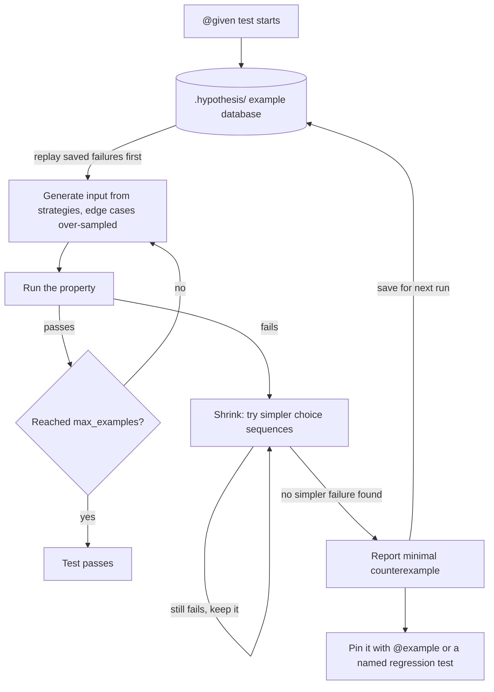

## TL;DR
Models send your agent arbitrary text and arguments. You state a property that must hold for every
input; Hypothesis generates hundreds of edge-biased inputs and shrinks any failure to a minimal
counterexample. Tool-argument parsing, chunking and memory bugs hide there.

## For agent builders
- **Why it matters for agents.** The model is an adversarial input generator you do not control: it
  emits truncated JSON, wrong types, empty strings and odd Unicode as tool arguments. "The dispatcher
  never raises on any model output" is a property, and Hypothesis checks it far better than examples.
- **Where it shows up in your stack.** Tool-argument parsers and validators, RAG chunkers, prompt
  templates that escape user text, JSON round-trips for tool results, and stateful pieces such as
  conversation memory, caches and rate limiters.
- **What you control.** The properties (round-trip, invariant, idempotence, oracle), strategies that
  build valid inputs directly, and per-lane example budgets so the pull-request lane stays fast.
- **What you can skip.** Judging model quality with it. Generated inputs test your deterministic code;
  whether the model chooses well is an eval question.

## Why it exists
- **Examples test only what the author imagined.** A chunker passes "a paragraph", "exactly one chunk
  long" and "three chunks", then production hits an empty document, combining characters, a chunk size
  of 1, or an overlap of chunk size minus one, and it crashes or silently drops text.
- **The bug was always there.** The example set simply never visited that part of the input space.
- **AI glue code is full of such functions.** Tokenisation-adjacent splitting, prompt templating that
  escapes user text, model-output parsers, JSON round-trips for tool arguments, deduplication, score
  normalisation, pagination over retrieval results: huge input spaces, rules easy to state, hard to
  enumerate.
- **"Random inputs in a loop" falls short twice.** Uniform random data rarely hits the boundaries that
  matter (an empty list, zero, the maximum value, a lone surrogate), and a failure arrives as a
  1,400-character random string you must reverse-engineer by hand.
- **Property-based testing fixes both:** generators are biased toward edge cases, and failures are shrunk
  automatically to the smallest input that still fails.

## How it works
### Properties, not examples
A property is a universally quantified claim: for all valid inputs *x*, some predicate holds. Common
shapes, roughly in order of how often they pay off:

| Shape | Claim | AI-code example |
|---|---|---|
| **Round-trip** | `decode(encode(x)) == x` | JSON, serialisers, tokenizer encode/decode where lossless |
| **Invariant** | output always satisfies a condition | every chunk length ≤ size; scores in [0, 1]; output sorted; no duplicate IDs |
| **Idempotence** | `f(f(x)) == f(x)` | normalisation, deduplication, cleaning |
| **Oracle / differential** | fast version agrees with a slow obviously-correct one, or new agrees with old | rewritten ranker vs reference |
| **Metamorphic** | a known input change gives a known output change | reordering documents does not change the set retrieved |
| **Total function** | never raises, always returns a result or a typed error | tool-argument parser on any model output |

- **The agent-specific shape is the last one.** A tool dispatcher that raises on bad arguments crashes
  the loop; one that returns an error result lets the model retry. "Never raises" is cheap to state and
  Hypothesis finds the inputs that break it.

### Strategies
- **Primitives:** `st.integers(0, 100)`, `st.text()`, `st.lists(...)`, `st.dictionaries(...)`.
- **Combinators:** `.map`, `.filter`, `st.one_of`, `st.recursive` and `st.builds` (call a constructor
  with generated arguments).
- **`st.from_type`** derives a strategy from type hints; works with dataclasses and many annotated classes.
- **`st.data()`** draws values interactively, so one parameter can depend on another (an overlap smaller
  than the chunk size).
- **Edge cases are over-sampled on purpose:** empty collections, boundary integers, unusual Unicode.

### Running, shrinking and remembering
1. **`@given(...)` turns a test into a loop.** By default about 100 examples per test (tunable with
   `@settings(max_examples=...)`); a deadline setting flags examples that run too long.
2. **On failure, Hypothesis shrinks:** it repeatedly tries simpler inputs and keeps any that still fail.
3. **It shrinks choices, not values.** Classic QuickCheck shrinks values by type-specific rules;
   Hypothesis shrinks the underlying sequence of random choices that produced the value. The payoff:
   shrinking works for any composed strategy, including `.map` and `.filter`, with no shrinker to write.
4. **Failures are remembered.** They are saved in a local database (the `.hypothesis/` directory) and
   replayed first next run, so a found bug is checked every time until fixed.
5. **`@example(...)` pins an input permanently**, turning a counterexample into a documented regression.

- **`assume(cond)`** discards inputs that miss a precondition. Use it sparingly, because heavy filtering
  makes generation slow and Hypothesis reports a health-check failure.
- **Construct valid inputs instead** (draw `size` first, then `overlap` below it) rather than generating
  freely and throwing most away; it is almost always cheaper.

### Profiles: different budgets for different lanes
The example count is a dial between thoroughness and suite time, so set it per environment, not per test.
- **Register** `settings.register_profile("ci", max_examples=1000)` and
  `settings.register_profile("dev", max_examples=50)` in `conftest.py`.
- **Select** with `--hypothesis-profile=ci` or `settings.load_profile(...)` from an environment variable.
- **`derandomize=True` in CI** makes examples a fixed function of the test, so a red build is reproducible
  and never an unlucky draw. The price: CI explores the same inputs every run, which is why some teams
  keep a randomised nightly job alongside it.
- **`derandomize=True` implies `database=None`**, so a derandomized lane neither saves nor replays
  failures; the example database only helps randomised runs. Recent Hypothesis versions also detect CI
  and default to derandomized settings there, so check your version before assuming randomness in CI.

### Stateful testing
- **The bug is often in a *sequence* of calls** for objects with operations (a cache, a conversation
  memory, a rate limiter), not in any single input.
- **`RuleBasedStateMachine`:** declare each operation as a `@rule` with argument strategies and each
  invariant as an `@invariant`.
- **Random programs vs a model.** Hypothesis generates programs (put, put, evict, get, ...), runs each
  against the real object and a deliberately trivial model (a plain `dict` standing in for an LRU cache),
  and checks after every step that they agree.
- **It shrinks the *program*.** A 40-step failure is typically reported as the three or four calls that
  matter, such as "insert at capacity, read the oldest key, insert again".

## Diagram
The loop behind one `@given` test, such as a tool-argument parser property: replay saved failures
first, generate edge-biased inputs, and on a failure shrink the choice sequence until the smallest
failing input remains.



## Examples
### Agent scenario: a tool-argument parser that never crashes the loop
The model's tool call arrives as a JSON string. The parser must return `{"ok": args}` or
`{"error": message}` for any input, so the agent can feed errors back instead of crashing; valid
arguments must survive unchanged.

```python
import json
from hypothesis import given, strategies as st

SCHEMA = {"city": str, "days": int}

def parse_tool_args(raw: str) -> dict:
    try:
        args = json.loads(raw)
    except json.JSONDecodeError as e:
        return {"error": f"arguments are not valid JSON: {e.msg}"}
    if not isinstance(args, dict):
        return {"error": "arguments must be a JSON object"}
    missing = [k for k in SCHEMA if k not in args]
    if missing:
        return {"error": f"missing: {', '.join(missing)}"}
    bad = [k for k, t in SCHEMA.items() if type(args[k]) is not t]   # rejects True for int
    if bad:
        return {"error": f"wrong type: {', '.join(bad)}"}
    return {"ok": {k: args[k] for k in SCHEMA}}

scalars = st.none() | st.booleans() | st.integers() | st.text()

@given(st.text())
def test_any_text_gives_result_or_error(raw):
    assert set(parse_tool_args(raw)) in ({"ok"}, {"error"})

@given(st.dictionaries(st.text(), scalars))
def test_any_object_gives_result_or_error(args):
    assert set(parse_tool_args(json.dumps(args))) in ({"ok"}, {"error"})

@given(city=st.text(), days=st.integers(), extra=st.dictionaries(st.text(), scalars))
def test_valid_args_pass_through(city, days, extra):
    raw = json.dumps({**extra, "city": city, "days": days})
    assert parse_tool_args(raw) == {"ok": {"city": city, "days": days}}
```

- **Total, not just correct:** the first two properties encode "the loop never crashes on model output",
  which is the property agent incidents usually violate.
- **Extra keys on purpose:** models add fields you did not ask for; the third property states that they
  are dropped, not that they break the call.

### Chunker and tool-argument round-trip
A retrieval chunker with overlap. The contract: no chunk exceeds `size`, only the last may be short,
consecutive chunks really share `overlap` characters, and dropping each later chunk's overlap rejoins
the text exactly.

An earlier version used `range(0, len(text), step)`; Hypothesis failed it at once and shrank the
counterexample to `text=''`, where that version returned no chunks at all.

```python
import json
from hypothesis import given, strategies as st

def chunk(text: str, size: int, overlap: int) -> list[str]:
    if not 0 <= overlap < size:
        raise ValueError("need 0 <= overlap < size")
    step = size - overlap
    return [text[i:i + size] for i in range(0, max(len(text) - overlap, 1), step)]

@given(text=st.text(max_size=2000), size=st.integers(1, 200), data=st.data())
def test_chunk_properties(text, size, data):
    overlap = data.draw(st.integers(0, size - 1), label="overlap")
    chunks = chunk(text, size, overlap)
    assert chunks, "always at least one chunk"
    assert all(len(c) <= size for c in chunks)
    assert all(len(c) == size for c in chunks[:-1])           # only the last chunk may be short
    assert all(a[len(a) - overlap:] == b[:overlap] for a, b in zip(chunks, chunks[1:]))
    assert chunks[0] + "".join(c[overlap:] for c in chunks[1:]) == text

json_values = st.recursive(
    st.none() | st.booleans() | st.integers() | st.text(),        # no floats: NaN != NaN
    lambda inner: st.lists(inner) | st.dictionaries(st.text(), inner),
)

@given(st.dictionaries(st.text(min_size=1), json_values))
def test_tool_args_round_trip(args):
    assert json.loads(json.dumps(args)) == args

def test_empty_text_regression():          # the shrunk counterexample, pinned as a plain test
    assert chunk("", size=4, overlap=1) == [""]
```

- **Five assertions encode the spec.** The full-length and shared-overlap checks matter: without them a
  chunker emitting one character per chunk would still rejoin correctly and pass whenever `overlap` is 0.
- **Coverage no example set gives:** size 1, overlap `size - 1`, empty text and non-ASCII text, all at once.
- **Floats excluded on purpose** from the round-trip, because `NaN` breaks equality; property tests force
  you to decide such facts explicitly.

### Stateful: an LRU cache against a dict-and-list model
Runnable with `pip install hypothesis pytest`; pytest collects `TestLRU`.

```python
from collections import OrderedDict
from hypothesis import strategies as st
from hypothesis.stateful import RuleBasedStateMachine, invariant, rule

class LRU:                                         # the code under test
    def __init__(self, capacity: int):
        self.capacity, self.data = capacity, OrderedDict()
    def get(self, k):
        if k not in self.data:
            return None
        self.data.move_to_end(k)                   # delete this line to see the bug found
        return self.data[k]
    def put(self, k, v):
        self.data[k] = v
        self.data.move_to_end(k)
        if len(self.data) > self.capacity:
            self.data.popitem(last=False)          # evict least recently used

class LRUMachine(RuleBasedStateMachine):
    def __init__(self):
        super().__init__()
        self.cache, self.model, self.recency = LRU(3), {}, []   # model: dict + list

    def _touch(self, k):
        if k in self.recency:
            self.recency.remove(k)
        self.recency.append(k)

    @rule(k=st.integers(0, 5), v=st.integers())
    def put(self, k, v):
        self.cache.put(k, v)
        self.model[k] = v
        self._touch(k)
        if len(self.recency) > 3:
            del self.model[self.recency.pop(0)]

    @rule(k=st.integers(0, 5))
    def get(self, k):
        assert self.cache.get(k) == self.model.get(k)
        if k in self.model:
            self._touch(k)

    @invariant()
    def within_capacity(self):
        assert len(self.cache.data) <= 3

TestLRU = LRUMachine.TestCase
```

With the marked line deleted, one run reported this shrunk program (exact keys vary run to run):

| Step | Call | Why it matters |
|---|---|---|
| 1-3 | `put(1)`, `put(0)`, `put(3)` | fill capacity 3 |
| 4 | `get(1)` | 1 should become most recent |
| 5 | `put(2)` | evicts; the buggy cache drops 1, the model drops 0 |
| 6 | `get(0)` | cache returns a value, model says `None`: assertion fails |

### Worked scenario: example budgets per lane
Rough orders of magnitude for a suite of 40 property tests at ~2 ms per example (illustrative).

| Profile | `max_examples` | Per test | Whole suite |
|---|---|---|---|
| `dev` | 50 | ~0.1 s | ~4 s |
| default | 100 | ~0.2 s | ~8 s |
| `ci` (+ `derandomize=True`) | 1000 | ~2 s | ~80 s |
| nightly, randomised | 10,000 | ~20 s | ~13 min |

## Production patterns
- **Profiles selected by environment.** In `conftest.py`, register `dev`, `ci` and `nightly` profiles and
  call `settings.load_profile(os.getenv("HYPOTHESIS_PROFILE", "dev"))`. PRs run the deterministic `ci`
  profile; a nightly job runs a large randomised budget. Monitor property-lane wall time per profile.
- **Pin every shrunk counterexample.** Add it as `@example(...)` on the property and, for important bugs,
  as a plain named regression test like `test_empty_text_regression`. The bug then stays covered even if
  the `.hypothesis/` database is wiped.
- **Persist the example database in randomised CI lanes.** Cache the `.hypothesis/` directory between
  nightly runs with your CI system's cache step, so failures found on one run are replayed first on the
  next. Skip it for the derandomized PR lane, which does not use the database.
- **Reproduce from CI output.** Enable the `print_blob=True` setting in the CI profile; a failure then
  prints an `@reproduce_failure(...)` line you paste locally to replay the exact case.
- **Tune deadlines, not tolerance for slowness.** For legitimately slow properties set
  `@settings(deadline=None)` or a larger `timedelta`, rather than leaving deadline flakes in the suite.
  Track which tests carry such overrides.
- **Stateful tests for anything with memory.** Caches, conversation memories and rate limiters get a
  `RuleBasedStateMachine` against a plain dict or list model. For agent memory, rules such as add turn,
  summarise, trim to budget and recall check that pinned facts survive every trim. Re-run it whenever
  eviction or expiry logic changes.
- **A "never raises" property per tool.** Every tool the model can call gets one property feeding it
  arbitrary argument JSON and asserting a result or a typed error. Monitor production tool exceptions
  that escaped the dispatcher; each is a missing property.

## Trade-offs
- **Coverage vs effort.** Properties cover far more of the input space but are harder to write; for code
  whose correctness you cannot state as a rule, a handful of good examples is the better investment.
- **More examples vs suite time.** Larger counts find rarer bugs but slow the suite; run the default
  count locally and a larger count in a nightly or CI profile, and flip that once the suite is a bottleneck.
- **Exploration vs surprise failures.** Generated inputs explore edge cases you did not imagine, but a new
  failure can surface on an unrelated commit; the example database and pinned `@example`s keep that
  manageable.
- **Easy property vs real property.** Restating the implementation as the property is easy but proves
  nothing; an independent oracle or invariant costs more thought and is the only version that catches bugs.

## Pitfalls
- **Re-implementing the function as the property.** Symptom: a test that has never failed, even when you
  deliberately break the code.
- **Overusing `filter` or `assume`.** Symptom: slow tests and health-check errors about too much data
  being filtered out. Fix: construct valid inputs directly.
- **Floats in equality properties.** NaN, infinities and rounding cause spurious failures on
  `nan != nan` or tiny representation differences. Exclude them or compare with tolerance.
- **Function-scoped fixtures inside `@given`.** `tmp_path` and friends are created once per *test
  function* and shared by all examples, so one example's state leaks into the next. Hypothesis raises a
  health-check error; create the resource inside the test body instead.
- **Real LLM or network calls inside `@given`.** Symptom: a hundred paid, slow, non-deterministic calls
  per run, failing on flaky responses rather than bugs.
- **Deleting `.hypothesis/` in CI without pinning failures.** Symptom: a bug that reproduced once, then
  mysteriously stops reproducing until it hits production.

## When to use
- **Use when:** deterministic code has a large input space and an easy-to-state rule: model-output
  and tool-argument parsers, chunkers and splitters, serialisers, prompt template escaping, ID and deduplication logic,
  ranking and score normalisation, and stateful things like caches and memories.
- **Avoid when:** judging model quality. Outputs are not deterministic and "correctness" is a graded
  judgement, which evals and metamorphic evaluation address.
- **Pair with:** a few readable examples, which serve as documentation.
- **Interviews:** naming the property for a given function (round-trip, invariant, idempotence, oracle)
  is the skill being tested.

## Role lens
- **Engineer:** Writes Hypothesis properties for parsers, chunkers and tool-argument serialisation, and
  pins every shrunk counterexample as a permanent regression test.
- **Architect:** Requires property tests on boundary code that turns untrusted text into structured data,
  because that is where malformed inputs enter the system.
- **FDE:** Turns a customer's odd documents (encodings, empty pages, enormous tables) into strategies
  that generate similar inputs, proving the pipeline handles the whole class.

## Check yourself
**Q:** You must test a function that extracts a JSON object from a model reply that may include markdown
fences and surrounding prose. What properties would you write, and what would you not use Hypothesis for?
**A:** Generate an arbitrary JSON-compatible dict, serialise it, then wrap it with generated prose
before and after, optionally inside a fenced block; the property is that extraction returns the
original dict. A second property: text with no JSON object raises a specific parse error rather than
returning garbage. A third: extraction is unchanged by leading and trailing whitespace. Generated
prose should be filtered so it cannot itself contain braces, or the property must define which object
wins. I would not use Hypothesis to decide whether the model produces good JSON in the first place;
that is an eval over real prompts, and replies would be recorded examples, not generated ones.

## Interview questions
### What does property-based testing find that example-based tests miss?
- **Definition:** you state a rule that must hold for all valid inputs and Hypothesis generates the
  inputs, about 100 per test by default, biased toward empty collections, boundary integers and unusual
  Unicode.
- **Why it finds more:** examples cover only what the author imagined, while generators visit the corners
  (chunk size 1, overlap of size minus one, empty text) where parsing and chunking bugs live.
- **Shrinking makes failures readable**, reporting `text=''` instead of a 1,400-character random string.

### Your agent crashes on some tool calls the model emits. How would property-based testing help?
- **State the property the crash violates:** for any argument string, the parser or dispatcher returns a
  result or an error result the model can read, and never raises.
- **Generate the inputs models produce:** arbitrary text, arbitrary JSON objects, wrong types, missing and
  extra keys; Hypothesis shrinks a crash to the smallest such input.
- **Pin each shrunk input** with `@example(...)` and keep the property in the PR lane, since it needs no
  network or model.

### Which properties would you write for a retrieval chunker with overlap?
- **Invariants:** at least one chunk, no chunk longer than `size`, only the last chunk short.
- **Overlap really shared:** the tail of each chunk equals the head of the next for `overlap` characters.
- **Round-trip:** dropping each later chunk's overlap rejoins the original text exactly.
- **Generate valid inputs directly:** draw `size` first, then `overlap` below it with `st.data()`, rather
  than generating freely and filtering with `assume`.

### A property test fails in CI but you cannot reproduce it locally. What do you do?
- **Make CI deterministic:** use a `ci` profile with `derandomize=True`, so a red build is a fixed
  function of the test, not an unlucky draw.
- **Get the exact case:** with `print_blob=True` the failure prints a `@reproduce_failure(...)` line you
  paste locally.
- **Keep it covered:** pin the shrunk input with `@example(...)`, because a derandomized CI lane has no
  example database to replay it from.

### When is property-based testing the wrong tool?
- **When you cannot state the rule:** for code whose correctness is not expressible as an invariant, a few
  good examples are the better investment.
- **When judging model quality:** outputs are non-deterministic and correctness is graded, which is the
  job of evals, not Hypothesis.
- **When the property restates the implementation:** it never fails, even when you break the code, so it
  proves nothing.

### How would you budget example counts for a suite of 40 property tests?
- **Per lane, not per test:** register `dev` (50 examples), `ci` (1000, derandomized) and a randomised
  nightly profile, and select with `--hypothesis-profile` or an environment variable.
- **Rough arithmetic at ~2 ms per example (illustrative):** about 4 s for the suite in dev, about 80 s in
  CI and about 13 minutes nightly at 10,000 examples.
- **Monitor property-lane wall time** and raise or lower budgets when the PR lane becomes a bottleneck.

## Quiz
### Q: What does Hypothesis shrinking do after a property fails?
- [ ] Reruns the failing input until it passes, to detect flakiness
- [x] Searches for a simpler input that still fails and reports the minimal one
- [ ] Reduces max_examples so the test runs faster next time
- [ ] Removes the failing input from future runs to avoid noise
> Shrinking turns a large random failure into a small, readable counterexample such as an empty
> string. Failing inputs are saved and replayed first next time, not removed.

### Q: Which is the strongest property for a JSON serialiser of tool arguments?
- [ ] The output is a non-empty string
- [ ] The output is shorter than ten kilobytes
- [x] Deserialising the output returns a value equal to the original input
- [ ] Serialising twice produces the same string
> The round-trip property checks that no information is lost or corrupted. Non-empty output and
> determinism can hold while values are silently mangled, so they are much weaker checks.

### Q: Why can Hypothesis shrink values built with `.map` and `.filter` without a custom shrinker?
- [ ] It requires every strategy to define its own shrink function
- [ ] It only shrinks integers and strings, not composed values
- [x] It shrinks the underlying sequence of random choices, then regenerates the value from it
- [ ] It stores every generated value and picks the smallest one
> Shrinking the choice sequence works for any strategy composition automatically. Type-based
> shrinking, as in classic QuickCheck, needs a shrinker per type and struggles with mapped values.

## Use cases & projects
### Use cases
- **Tool-argument parsing.** The property "the dispatcher never raises on any model output" is checked
  against generated truncated JSON, wrong types and odd Unicode.
- **RAG chunkers.** Invariants such as "chunks rejoin to the original text" and "no chunk exceeds the
  size limit" hold for every document, chunk size and overlap.
- **Tool-result round-trips.** Serialising a tool result to JSON and parsing it back returns an equal
  value for every generated result.
- **Stateful agent memory.** Rule-based state machines exercise conversation memory, caches and rate
  limiters with random sequences of operations.

### Mini project
**Fuzz an agent's tool dispatcher with Hypothesis (1-2 hours).**
- **Goal:** show that a tool dispatcher turns every possible model output into a result or a structured
  error, never an exception.
- **Steps:** write a dispatcher for two tools with typed arguments; build a strategy that mixes valid
  tool calls, valid calls with wrong types, and arbitrary text; assert the dispatcher returns a result
  or an error object; add a round-trip property for the tool-result JSON; keep a small example budget
  for the pull-request lane.
- **Done when:** Hypothesis has found and shrunk at least one real bug you then fixed, the failing input
  is kept as an explicit example, and the suite passes in seconds.
