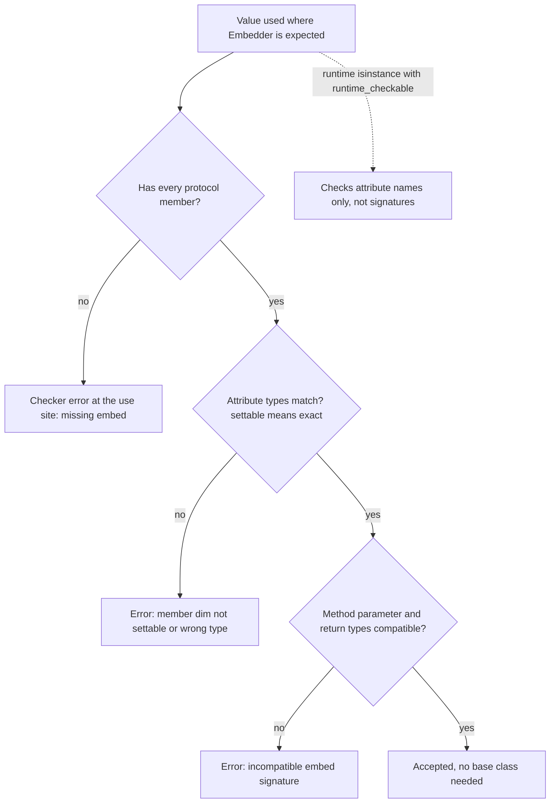

## TL;DR
Protocols let an agent core say "any LLM client, tool or memory store with these methods works", checked
without inheritance. Generics keep element types flowing, so `first(xs: list[Message])` returns a
`Message`. Together they make providers, tools and test doubles swappable.

## For agent builders
- **Why it matters for agents.** An agent loop talks to parts you swap often: model providers, tools,
  embedders, vector stores, memory. A Protocol per seam lets a scripted fake LLM drive the loop in tests
  and a new provider drop in without touching the core.
- **Where it shows up in your stack.** Framework base types (LangChain's chat-model and retriever
  classes, LlamaIndex's) play the same role nominally; your own agent core can stay framework-free behind
  `LLMClient`, `Tool` and `Store` Protocols, with each framework or SDK in an adapter.
- **What you control.** Where the seams are, keeping protocols small and consumer-owned, and typing
  retry and tracing decorators with `ParamSpec` so tool calls stay checked.
- **What you can skip.** Deep variance theory. Remember "accept `Sequence`, return `list`" and that
  `@runtime_checkable` checks names only.

## Lab
### Task
Finish a provider-agnostic agent core: a scripted fake LLM that drives the loop in tests, an adapter
that fits a vendor search client to your `Tool` Protocol without inheritance, and a retry decorator
typed with `ParamSpec` so the checker still sees the wrapped tool's signature.

Time box: 60-90 minutes. Do "How it works" here and the `type-hints` lesson first.
- **Implement** `ScriptedLLM.complete`, `SearchTool.run` and `retry` in `lab.py`.
- **Keep** `run_agent`, the Protocols and `VendorSearch` unchanged; they are the contract and the
  third-party code.
- **Run** on Python 3.10+ with pytest and mypy (checked on Python 3.12.14, pytest 9.1.1, mypy 2.4.0).

### Starter code
Save as `lab.py`. It runs and stops at the first unimplemented part.

```python
"""lab.py: a provider-agnostic agent core behind small Protocols."""
from __future__ import annotations

import functools
from collections.abc import Callable
from dataclasses import dataclass, field
from typing import Any, ParamSpec, Protocol, TypeVar, runtime_checkable

@dataclass
class Reply:
    text: str | None = None
    tool: str | None = None
    args: dict[str, object] = field(default_factory=dict)

class LLMClient(Protocol):
    def complete(self, messages: list[dict[str, str]], /) -> Reply: ...

@runtime_checkable
class Tool(Protocol):
    @property
    def name(self) -> str: ...
    def run(self, args: dict[str, object], /) -> str: ...

def run_agent(llm: LLMClient, tools: dict[str, Tool], task: str, max_steps: int = 5) -> str:
    messages = [{"role": "user", "content": task}]
    for _ in range(max_steps):
        r = llm.complete(messages)
        if r.tool is None:
            return r.text or ""
        result = tools[r.tool].run(r.args) if r.tool in tools else f"unknown tool {r.tool}"
        messages.append({"role": "tool", "content": result})
    return "stopped: step limit"

class VendorSearch:                       # third-party client: you cannot change it
    DOCS = [{"title": "Refund policy", "path": "docs/refunds.md"},
            {"title": "Shipping times", "path": "docs/shipping.md"}]
    def search(self, query: str, k: int = 3) -> list[dict[str, str]]:
        words = query.lower().split()
        return [d for d in self.DOCS if any(w in d["title"].lower() for w in words)][:k]

class ScriptedLLM:
    """Fake LLMClient: returns `replies` in order and records a snapshot of every messages list."""
    def __init__(self, replies: list[Reply]) -> None:
        self.replies = list(replies)
        self.seen: list[list[dict[str, str]]] = []
    def complete(self, messages: list[dict[str, str]], /) -> Reply:
        raise NotImplementedError("LAB: ScriptedLLM.complete")

class SearchTool:
    """Adapter that satisfies Tool without inheriting from it. run({"query": q}) returns
    'Top hit: <title> (<path>)' for the first vendor result, or 'no results'."""
    def __init__(self, vendor: VendorSearch) -> None:
        self.vendor = vendor
    @property
    def name(self) -> str:
        return "search"
    def run(self, args: dict[str, object], /) -> str:
        raise NotImplementedError("LAB: SearchTool.run")

class TransientError(Exception): ...

P = ParamSpec("P")
R = TypeVar("R")

def retry(times: int):  # type: ignore[no-untyped-def]
    # LAB: retry on TransientError up to `times` attempts in total (re-raise the last one),
    # let every other exception through at once, and keep the wrapped signature
    # (Callable[P, R] -> Callable[P, R] plus functools.wraps). Remove the type: ignore.
    def deco(fn: Callable[..., Any]) -> Callable[..., Any]:
        def inner(*args: Any, **kwargs: Any) -> Any:
            return fn(*args, **kwargs)
        return inner
    return deco

ATTEMPTS = [0]

@retry(3)
def flaky_lookup(order_id: str) -> str:
    ATTEMPTS[0] += 1
    if ATTEMPTS[0] < 3:
        raise TransientError("orders API timed out")
    return f"{order_id}: shipped"

def main() -> None:
    llm = ScriptedLLM([Reply(tool="search", args={"query": "refund"}), Reply(text="See the refund policy.")])
    print("answer:", run_agent(llm, {"search": SearchTool(VendorSearch())}, "How do refunds work?"))
    print("tool result seen by the model:", llm.seen[-1][-1]["content"])
    print("flaky_lookup:", flaky_lookup("ORD-1"), "after", ATTEMPTS[0], "attempts")

if __name__ == "__main__":
    print("SearchTool is a Tool:", isinstance(SearchTool(VendorSearch()), Tool))
    try:
        main()
    except (NotImplementedError, TransientError) as e:
        print(f"not done yet: {type(e).__name__}: {e}")
```

### Expected output
`python lab.py` with a correct solution prints:

```
SearchTool is a Tool: True
answer: See the refund policy.
tool result seen by the model: Top hit: Refund policy (docs/refunds.md)
flaky_lookup: ORD-1: shipped after 3 attempts
```

### Tests
Save as `test_lab.py` and run `python -m pytest -q`. On the starter all five fail: four on
`NotImplementedError` or a missing retry, and the checker test because mypy reports an untyped decorator.
Install mypy first: without it the checker test is skipped, not passed.

```python
import inspect, pathlib, shutil, subprocess, sys
import pytest
import lab
from lab import Reply, ScriptedLLM, SearchTool, Tool, TransientError, VendorSearch, retry, run_agent

def test_loop_runs_on_the_fake_and_adapter():
    llm = ScriptedLLM([Reply(tool="search", args={"query": "refund"}), Reply(text="See the refund policy.")])
    assert run_agent(llm, {"search": SearchTool(VendorSearch())}, "refunds?") == "See the refund policy."
    assert len(llm.seen) == 2
    assert len(llm.seen[0]) == 1, "seen must hold snapshots, not the loop's live list"
    assert llm.seen[1][-1] == {"role": "tool", "content": "Top hit: Refund policy (docs/refunds.md)"}

def test_adapter_no_results_and_structural_match():
    tool = SearchTool(VendorSearch())
    assert tool.run({"query": "weather"}) == "no results"
    assert isinstance(tool, Tool) and not isinstance(VendorSearch(), Tool)

def test_retry_retries_transient_only():
    calls: list[str] = []
    @retry(3)
    def f(x: str) -> str:
        calls.append(x)
        if len(calls) < 3:
            raise TransientError("blip")
        return x.upper()
    assert f("a") == "A" and len(calls) == 3

    @retry(2)
    def always() -> None:
        calls.append("x"); raise TransientError("down")
    calls.clear()
    with pytest.raises(TransientError):
        always()
    assert len(calls) == 2

    @retry(5)
    def bug() -> None:
        calls.append("b"); raise KeyError("text")
    calls.clear()
    with pytest.raises(KeyError):
        bug()
    assert calls == ["b"], "a bug must not be retried"

def test_retry_keeps_name_and_signature():
    def g(order_id: str, *, verbose: bool = False) -> str: return order_id
    w = retry(2)(g)
    assert w.__name__ == "g" and inspect.signature(w) == inspect.signature(g)

def test_checker_sees_through_the_decorator(tmp_path: pathlib.Path):
    pytest.importorskip("mypy")
    shutil.copy(lab.__file__, tmp_path / "lab.py")
    (tmp_path / "check_types.py").write_text(
        "from lab import LLMClient, ScriptedLLM, SearchTool, Tool, VendorSearch, flaky_lookup\n"
        "llm: LLMClient = ScriptedLLM([])\n"
        "tool: Tool = SearchTool(VendorSearch())\n"
        "flaky_lookup(123)\n")
    out = subprocess.run([sys.executable, "-m", "mypy", "--strict", "--no-error-summary", "check_types.py"],
                         cwd=tmp_path, capture_output=True, text=True).stdout
    errors = [ln for ln in out.splitlines() if ": error:" in ln]
    assert len(errors) == 1 and errors[0].startswith("check_types.py:4:"), out
    assert 'incompatible type "int"' in errors[0], out
```

### Failure scenarios
- **Store the live list: `self.seen.append(messages)`.** The first test fails on `len(llm.seen[0]) == 1`,
  because `run_agent` keeps appending to the one list every snapshot points at. Print `id()` of each
  stored list; identical ids mean aliasing, so copy the messages.
- **Leave out `functools.wraps`.** Retries work but `__name__` is `inner` and the signature is
  `(*args, **kwargs)`, so traces and tool registries that read the signature break. Check with
  `inspect.signature(flaky_lookup)`.
- **Catch `Exception` in the retry loop.** The `KeyError` case is called five times instead of once, a
  bug retried at provider prices. The `calls` list in the test shows the repeat count.
- **Type the decorator `Callable[..., Any]`.** mypy accepts `flaky_lookup(123)`, so the checker test
  finds zero errors in `check_types.py`. Add `reveal_type(flaky_lookup)` and look for `def (*Any, **Any)`.

### Submission
- **`lab.py` and `test_lab.py`,** plus the `python -m pytest -q` output showing 5 passed.
- **The output of `mypy --strict lab.py`,** clean, with the `type: ignore` removed.
- **One more adapter:** a second `Tool` around a different fake vendor shape (for example a
  `lookup(id)` method returning a dict), added to `run_agent` with a scripted reply that calls it.
- **A short note:** which failure scenario you reproduced and what the debugging step showed.
- **Evaluation:** tests pass unmodified, no class in `lab.py` inherits from `Tool` or `LLMClient`, and
  mypy reports nothing.

## Why it exists
- **Python code targets behaviour, not names.** "Anything with an `embed(texts)` method" is a complete
  contract. An OpenAI client, a sentence-transformers model and a test stub can all satisfy it without
  sharing a base class. The same holds for "anything with `run(args)`" as an agent tool.
- **Nominal typing forces bad choices.** Originally a value matched `Embedder` only if its class
  inherited from it. You either write adapter classes that exist only to inherit, or type the parameter
  `Any` and lose checking exactly at the seam with a vendor's code.
- **Without generics, element types vanish.** `first(xs)` must be typed `list[Any] -> Any`, so the
  checker cannot tell you `first(messages).content` is wrong when `messages` holds tool-call records.
  One copy per element type is absurd; you need a placeholder bound per call.
- **The design goal was Pythonic.** Protocols (PEP 544) and type variables keep runtime behaviour
  unchanged and make existing stdlib duck-typed idioms (`Iterable`, `Sized`, file-like objects)
  expressible, rather than forcing Python into a Java-shaped type system.

## How it works
### Structural versus nominal compatibility
| Question asked | Nominal | Structural |
|---|---|---|
| Compatibility rule | "Is this class a declared subclass?" | "Does it have the required members with compatible types?" |
| Example | an `abc.ABC` subclass | `collections.abc.Iterable`: any class with `__iter__`, no registration |

A `Protocol` class lets you define your own structural interfaces:

```python
from collections.abc import Sequence
from typing import Protocol
class Embedder(Protocol):
    dim: int
    def embed(self, texts: Sequence[str]) -> list[list[float]]: ...
```

- **Member by member.** Any class with an `int` attribute `dim` and a compatible `embed` is an
  `Embedder`. The checker compares attribute types, then each method's parameter and return types.
- **Parameter names are checker-dependent.** pyright rejects an implementation that renames `texts`,
  because a caller might pass `texts=` by keyword; mypy deliberately ignores positional parameter names
  when matching protocol methods. Declare parameters positional-only with `/` and both agree.
- **Errors show up at use sites.** The match is checked where an object is used as an `Embedder`,
  *because* the implementation never declared intent. Adding `impl: Embedder = MyEmbedder()` in a test
  moves the error earlier.

### `@runtime_checkable`
- Makes `isinstance(obj, Embedder)` work.
- It checks only that the named attributes exist, not signatures or types, *because* a full structural
  check at runtime would be slow and ambiguous.
- Treat it as a cheap plugin-discovery check (for example, finding tool objects in a plugin module), not
  validation.

### Protocol versus ABC
| | ABC (`abc.ABC` plus `@abstractmethod`) | Protocol |
|---|---|---|
| Compatibility | Nominal | Structural |
| Enforcement | At instantiation: a subclass missing a method cannot be constructed | Static only |
| Shared default implementations | Yes | No behaviour |
| Use when | You own every implementation | Implementations come from outside |

### What a protocol member actually promises
- **A bare attribute is read-write.** `dim: int` lets a consumer assign `e.dim = 768`, so a class exposing
  `dim` as a read-only `@property` does not satisfy it.
- **Settable means exact.** For the same reason as `list` invariance (below), a settable attribute must
  match its type exactly, not a subtype.
- **Read-only consumers should say so.** Declare `@property def dim(self) -> int: ...`, which accepts
  plain attributes, properties and subtypes alike. Ask for the least you need, here as everywhere; a
  tool's `name` is the typical case.

### Generic protocols and callback protocols
- **Generic protocol:** `class Store[T](Protocol): def get(self, key: str) -> T | None: ...` (or
  `Protocol[T]` on older versions). A Redis-backed `Store[Session]` and an in-memory `Store[Session]` stand
  in for each other while the checker still knows what `get` returns. Agent memory and checkpoint stores
  fit this shape.
- **Callback protocol:** when an interface is one call with keyword arguments or overloads that
  `Callable[...]` cannot express (a streaming callback taking `token: str, *, final: bool`), a protocol
  defining only `__call__` types it exactly.

### Generics: type variables
- **A `TypeVar` is a placeholder bound per use.** `def first[T](xs: Sequence[T]) -> T` (PEP 695 syntax,
  Python 3.12+), or the older `T = TypeVar("T")` plus `def first(xs: Sequence[T]) -> T`, says the return
  type equals the element type.
- **Generic classes carry the binding across methods.** With `class Index[T]:` or
  `class Index(Generic[T]):`, `Index[Document].nearest(...)` returns a `Document`.
- **Bound:** `T = TypeVar("T", bound=BaseModel)` allows any subclass of `BaseModel`, so the checker
  allows `.model_dump()` on it. A `parse_output[T: BaseModel](text, schema: type[T]) -> T` helper for
  structured outputs uses exactly this.
- **Constrained:** `TypeVar("N", int, float)` means exactly one of those types, which is how `sum`-like
  helpers avoid accepting strings.

### Variance, or why `list[Dog]` is not a `list[Animal]`
1. `def rename(xs: list[Animal]) -> None` may legally `xs.append(Cat())`.
2. If the checker accepted a `list[Dog]` there, the caller's list would now contain a `Cat`.
3. So the rules are:

| Kind | Variance | Example |
|---|---|---|
| Mutable containers | Invariant | `list[Dog]` is compatible only with `list[Dog]` |
| Read-only views | Covariant | `Sequence[Dog]` is a `Sequence[Animal]`, because nothing can be inserted |
| Function parameters | Contravariant | A callback accepting `Animal` works where one accepting `Dog` is required |

- **Most common "it obviously should work" error.** The fix is almost always to accept `Sequence[T]` or
  `Iterable[T]` for inputs; in agents it appears as `list[ToolMessage]` rejected for `list[Message]`.
- **Declaring variance.** With the old syntax you must state it (`TypeVar("T_co", covariant=True)`); PEP
  695 syntax infers it from how the parameter is used.

### ParamSpec and Self
- **The problem:** every retry, tracing and caching decorator wraps arbitrary functions. Typed as
  `Callable[..., Any]`, it erases the wrapped signature and every call through it goes unchecked.
- **`ParamSpec`** captures "whatever parameters the wrapped function has", so
  `Callable[P, R] -> Callable[P, R]` preserves argument and return types through the wrapper.
- **`Self`** (3.11) fixes the related problem of fluent builders and `copy`-style methods returning the
  subclass type rather than the base.

## Diagram
How a checker decides whether a value can be used where a Protocol (here an `Embedder`, but equally an
agent's `Tool` or `LLMClient`) is expected: no inheritance lookup, only a member-by-member comparison,
and `isinstance` at runtime checks far less.



## Examples
### An agent loop typed against Protocols, driven by a fake LLM
The loop depends only on `LLMClient` and `Tool`. A scripted test double and a plain class satisfy them
with no base class, so the loop is testable without network or vendor mocks. This passes
`mypy --strict` on Python 3.10+.

```python
from dataclasses import dataclass, field
from typing import Protocol

@dataclass
class Reply:
    text: str | None = None
    tool: str | None = None
    args: dict[str, object] = field(default_factory=dict)

class LLMClient(Protocol):
    def complete(self, messages: list[dict[str, str]], /) -> Reply: ...

class Tool(Protocol):
    @property
    def name(self) -> str: ...                # read-only: plain attributes also satisfy it
    def run(self, args: dict[str, object], /) -> str: ...

class Clock:                                  # a tool; no base class
    name = "clock"
    def run(self, args: dict[str, object], /) -> str:
        return "2026-10-22T09:00Z"

class ScriptedLLM:                            # test double: satisfies LLMClient structurally
    def __init__(self, replies: list[Reply]) -> None: self.replies = replies
    def complete(self, messages: list[dict[str, str]], /) -> Reply:
        return self.replies.pop(0)

def run_agent(llm: LLMClient, tools: dict[str, Tool], task: str, max_steps: int = 5) -> str:
    messages = [{"role": "user", "content": task}]
    for _ in range(max_steps):
        r = llm.complete(messages)
        if r.tool is None:
            return r.text or ""
        result = tools[r.tool].run(r.args) if r.tool in tools else f"unknown tool {r.tool}"
        messages.append({"role": "tool", "content": result})
    return "stopped: step limit"

llm = ScriptedLLM([Reply(tool="clock"), Reply(text="It is 09:00 UTC.")])
print(run_agent(llm, {"clock": Clock()}, "What time is it?"))   # It is 09:00 UTC.
```

### Structural embedder, generic index, typed decorator
Two unrelated classes satisfy `Embedder`, the index remembers what it stores (the retrieval half of a
RAG tool), and the decorator keeps the signature. On Python 3.12+ the `Generic[T]` base can be replaced
by `class Index[T]:`.

```python
import functools, zlib
from collections.abc import Callable, Sequence
from typing import Generic, ParamSpec, Protocol, TypeVar, runtime_checkable

@runtime_checkable
class Embedder(Protocol):
    dim: int
    def embed(self, texts: Sequence[str]) -> list[list[float]]: ...

class HashEmbedder:                       # no inheritance from Embedder anywhere
    dim = 16
    def embed(self, texts: Sequence[str]) -> list[list[float]]:
        return [self._one(t) for t in texts]
    def _one(self, text: str) -> list[float]:
        v = [0.0] * self.dim              # bag of words; crc32 is stable across runs, hash() is not
        for w in text.lower().split(): v[zlib.crc32(w.encode()) % self.dim] += 1.0
        return v

class OpenAIEmbedder:                     # wraps a vendor SDK; also structurally an Embedder
    dim = 1536
    def __init__(self, client) -> None: self.client = client
    def embed(self, texts: Sequence[str]) -> list[list[float]]:
        r = self.client.embeddings.create(model="text-embedding-3-small", input=list(texts))
        return [d.embedding for d in r.data]

T = TypeVar("T")
class Index(Generic[T]):
    def __init__(self, embedder: Embedder) -> None:
        self.embedder = embedder
        self.items: list[T] = []                    # annotated, or the checker sees list[Any]
        self.vecs: list[list[float]] = []
    def add(self, item: T, text: str) -> None:
        self.items.append(item); self.vecs.append(self.embedder.embed([text])[0])
    def nearest(self, text: str) -> T:              # the checker knows this is a T
        q = self.embedder.embed([text])[0]
        dot = lambda v: sum(a * b for a, b in zip(q, v))
        return self.items[max(range(len(self.vecs)), key=lambda i: dot(self.vecs[i]))]

P = ParamSpec("P"); R = TypeVar("R")
def logged(fn: Callable[P, R]) -> Callable[P, R]:   # keeps fn's exact signature
    @functools.wraps(fn)
    def inner(*args: P.args, **kwargs: P.kwargs) -> R:
        print("calling", fn.__name__); return fn(*args, **kwargs)
    return inner

idx: Index[int] = Index(HashEmbedder())
idx.add(42, "the answer"); idx.add(7, "a prime")
print(idx.nearest("answer"))                       # 42 (int, per the checker)
print(isinstance(HashEmbedder(), Embedder))        # True: attribute presence only
```

What the checker catches when you break it:

| Edit | Checker report |
|---|---|
| `nearest` returns `self.vecs[0]` | `list[float]` is not `T` (only because `self.vecs` is annotated; an unannotated `[]` would leak `Any` and hide the error) |
| `idx: Index[int] = Index(object())` | `object` is missing `embed` |

### Generic store protocol and a callback protocol (Python 3.12+)
A memory store swaps for a Redis one without inheritance, and the streaming callback's keyword-only
`final` is typed exactly (the shape of a token callback that streams an agent's answer to a UI). This
passes `mypy --strict`.

```python
from typing import Protocol

class Store[T](Protocol):
    def get(self, key: str) -> T | None: ...
    def put(self, key: str, value: T) -> None: ...

class OnToken(Protocol):                     # callback protocol: Callable[...] cannot say "*, final"
    def __call__(self, token: str, *, final: bool) -> None: ...

class MemoryStore[T]:                        # no inheritance; structurally a Store[T]
    def __init__(self) -> None:
        self._d: dict[str, T] = {}
    def get(self, key: str) -> T | None:
        return self._d.get(key)
    def put(self, key: str, value: T) -> None:
        self._d[key] = value

def stream(words: list[str], on_token: OnToken) -> None:
    for i, w in enumerate(words):
        on_token(w, final=i == len(words) - 1)

def printer(token: str, *, final: bool) -> None:
    print(token, end="\n" if final else " ")

sessions: Store[dict[str, str]] = MemoryStore()
sessions.put("u1", {"lang": "en"})
print(sessions.get("u1"))                    # {'lang': 'en'}
stream(["hello", "world"], printer)          # hello world
```

## Production patterns
- **Consumer-owned protocols at the provider boundary.** Define `LLMClient`, `Embedder`, `Tool` and
  `Store` Protocols in the agent-core package, next to the code that calls them, and keep vendor SDK and
  framework imports in adapter modules only. Monitor how many core modules import a vendor SDK; the
  target is zero.
- **Scripted fake LLMs for loop tests.** Drive the agent loop in unit tests with a fake that satisfies
  `LLMClient` and returns a fixed list of tool calls and answers. Test step limits, unknown tools and
  error results deterministically; keep real-model runs for the eval suite.
- **Conformance assertions in tests.** For each implementation add one line such as
  `_: Embedder = OpenAIEmbedder(client)` in a test module the checker covers. A signature drift then fails
  CI at the implementation, not at a distant call site.
- **Run both checkers if both are used.** Because pyright checks protocol parameter names and mypy does
  not, declare protocol method parameters positional-only
  (`def embed(self, texts: Sequence[str], /) -> list[list[float]]: ...`) so editor and CI agree. Watch
  for failures that only one checker reports.
- **`ParamSpec` on every shared decorator.** Retry, tracing and caching decorators around model and tool
  calls use `Callable[P, R] -> Callable[P, R]` with `functools.wraps`. A quick audit: `reveal_type` on a
  decorated function should show its real signature, not `(...) -> Any`.
- **Protocol for consumers, ABC for your own implementations.** Ship an ABC with shared defaults that
  in-house classes inherit, and type consumers against the Protocol, so outside classes still plug in.

## Trade-offs
- **Decoupling vs late errors.** Protocols free your contracts from vendor classes, but mismatches surface
  at call sites, so without an explicit `impl: Proto = Impl()` check in tests a broken implementation is
  reported only where it is first used.
- **Cheap runtime check vs false confidence.** `@runtime_checkable` verifies attribute names only, so
  using it to validate untrusted objects becomes harmful the moment signatures matter.
- **Precise element types vs reading cost.** Generics make types flow through containers and pipelines,
  but nested type variables and variance annotations are harder to read; for a small private helper
  `list[Any]` can be the honest choice.
- **ABC enforcement vs structural freedom.** An ABC enforces at instantiation and holds shared defaults,
  which a Protocol cannot; when you own all implementations and want shared behaviour, the ABC wins
  despite being nominal.
- **Signature preservation vs boilerplate.** `ParamSpec` costs more code per decorator; skipping it turns
  every decorated function into `Callable[..., Any]` and silently disables checks.
- **Own protocols vs framework base classes.** Your own small Protocols keep the core portable across
  frameworks and providers; adopting a framework's base classes gives you its integrations for free but
  couples the loop to its release cycle. The second wins when you lean on many of its connectors.

## Pitfalls
- **Invariant inputs.** Declaring `list[Message]` gives callers "incompatible type list[ToolMessage]".
  Cause: invariance of mutable containers. Fix: `Sequence[Message]`.
- **Renamed protocol parameters.** `def embed(self, docs)` is rejected by pyright and accepted by mypy, so
  a team using both sees CI disagree. Fix: match the names or make the protocol's parameters
  positional-only.
- **`isinstance(x, SomeProtocol)` as a safety check.** It passes with the wrong signature, and the
  failure appears later as a `TypeError` inside the call, often mid-run in an agent tool step.
- **A `TypeVar` used once.** In `def f(x: T) -> None` it relates nothing to anything (pyright warns about
  exactly this); usually `object` was intended.
- **`dim: int` against read-only properties.** Symptom: "protocol member dim is not settable" on classes
  that look correct. Fix: declare it as a `@property` in the protocol.
- **Decorators typed `Callable[..., Any]`.** mypy never catches wrong arguments to decorated LLM-call
  functions, because the signature was erased.
- **Fat protocols.** An `LLMClient` with fifteen methods makes every fake and adapter expensive. Symptom:
  test doubles full of `raise NotImplementedError`. Fix: split by consumer; the loop usually needs one
  `complete` method.

## When to use
- **Use a Protocol when the consumer defines the interface** and implementations come from elsewhere: an
  `LLMClient` your agent loop calls, an `Embedder` your retriever uses, a `Store` your memory layer
  writes to. Test doubles become trivial, because a stub only needs the methods, and vendor SDKs stay
  out of your signatures.
- **Use an ABC instead** when you ship a base class with shared behaviour that your own subclasses extend.
- **Use generics** for anything container-shaped whose element type varies: `Cache[K, V]`,
  `Pipeline[In, Out]`, `Result[T]`.
- **Use `ParamSpec`** on every decorator in a typed codebase.
- **Measure:** how few `Any` and adapter-only classes remain.
- **Interviews:** explain structural versus nominal typing, why `list` is invariant and what `ParamSpec`
  fixes.

## Role lens
- **Engineer:** Types the LLM client, embedder and store as Protocols so a fake can replace each in
  tests without monkeypatching vendor modules.
- **Architect:** Defines the handful of Protocols that form the boundary between agent core and
  providers, so swapping a vendor is an implementation change, not a refactor.
- **FDE:** Fits a customer's existing classes (their search service, their auth client) into the
  product's interfaces by matching method shapes instead of asking them to subclass anything.

## Check yourself
**Q:** Your team has a `Retriever` abstract base class with three in-house subclasses. A customer
wants to plug in their vendor's search client, which already exposes a compatible `search(query,
k)` method. A teammate proposes writing an adapter subclass. Is there a better option, and what do
you give up?
**A:** Define `Retriever` as a `Protocol` with the `search` signature; the vendor class then
satisfies it structurally with no wrapper, and the checker verifies the signature match at the
call site. What you give up is the ABC's instantiation-time enforcement and any shared default
methods, and you should make parameter names match or declare them positional-only (pyright checks
names; mypy does not). A common
compromise is both: a Protocol for consumers to depend on, and an ABC that your own
implementations inherit for shared behaviour, which still satisfies the Protocol.

## Interview questions
### What is structural typing, and why did Python add Protocols instead of just using ABCs?
- **Structural typing** means compatibility is decided by the members an object has, not by its declared
  base classes; it is static duck typing.
- **Why Protocols (PEP 544):** Python code already targeted behaviour, so nominal ABCs forced adapter
  classes or `Any` at every vendor seam. Protocols make existing idioms such as `Iterable` and file-like
  objects checkable without changing runtime behaviour.

### How would you structure an agent codebase so you can switch model providers and unit-test the loop without network calls?
- **Define small consumer-owned Protocols** (`LLMClient.complete`, `Tool.run`, `Store.get/put`) in the
  core, and put each SDK or framework behind an adapter that satisfies them.
- **Test the loop with a scripted fake** that returns a fixed sequence of tool calls and answers, so step
  limits, unknown tools and tool errors are deterministic tests.
- **Add conformance lines** (`_: LLMClient = AnthropicAdapter(...)`) so adapter drift fails CI, and keep
  real-model behaviour in the eval suite.

### A teammate's function takes `list[Message]` and every caller passing `list[ToolMessage]` gets an error. Explain and fix.
- **Cause: invariance.** The function could append a plain `Message` into the caller's list, so the
  checker refuses to treat `list[ToolMessage]` as `list[Message]`.
- **Fix:** accept `Sequence[Message]` or `Iterable[Message]`, which are covariant because nothing can be
  inserted through them.
- **Rule of thumb:** abstract read-only types for inputs, concrete types for outputs.

### When would you not use a Protocol?
- **When you own every implementation and want shared behaviour:** an ABC holds default methods and
  refuses to instantiate a subclass missing an abstract method, which a Protocol cannot do.
- **When you need runtime validation:** `@runtime_checkable` checks attribute names only, so it is no
  substitute for validating untrusted objects.
- **Common compromise:** Protocol for consumers, ABC for in-house classes.

### Your retry decorator around tool and model calls makes mypy stop catching wrong arguments. Why, and how do you fix it?
- **Cause:** typing the decorator `Callable[..., Any]` erases the wrapped signature, so every call through
  it is unchecked.
- **Fix:** `P = ParamSpec("P")`, `R = TypeVar("R")`, and type it `Callable[P, R] -> Callable[P, R]` with
  `*args: P.args, **kwargs: P.kwargs` in the inner function.
- **Verify** with `reveal_type` on a decorated function; it should show the real parameters.

### mypy passes and pyright fails on the same protocol implementation. What is the likely difference?
- **Parameter names.** pyright rejects an implementation that renames a protocol method parameter,
  because a caller could pass it by keyword; mypy ignores positional parameter names when matching.
- **Fix that satisfies both:** match the names, or make the protocol's parameters positional-only with
  `/`.

## Quiz
### Q: What makes a class compatible with a `Protocol` in the eyes of a type checker?
- [ ] It must inherit from the Protocol class or be registered with it
- [x] It must have the Protocol's members with compatible types and signatures, regardless of inheritance
- [ ] It must be decorated with `@runtime_checkable`
- [ ] It must define `__protocol__` returning the Protocol name
> Protocols are structural: the checker compares members. Inheritance is allowed but never required,
> and `@runtime_checkable` only affects `isinstance`, not static compatibility.

### Q: Why does a checker reject passing a `list[Dog]` to a parameter typed `list[Animal]`?
- [ ] Because `Dog` is not a subclass of `Animal` in the checker's eyes
- [ ] Because lists cannot be generic over user-defined classes
- [x] Because the function could append a non-`Dog` `Animal`, corrupting the caller's list, so `list` is invariant
- [ ] Because `list` is covariant and `Animal` is more specific than `Dog`
> Mutable containers are invariant precisely to prevent writes of the wrong subtype. A read-only
> `Sequence[Animal]` accepts `list[Dog]` because nothing can be inserted through it.

### Q: What problem does `ParamSpec` solve for a retry decorator?
- [ ] It lets the decorator run the wrapped function in a thread
- [ ] It validates argument values at runtime before the call
- [x] It preserves the wrapped function's parameter types so calls through the decorator stay type-checked
- [ ] It makes the decorator usable on async functions
> Without `ParamSpec`, the decorator's return type is `Callable[..., Any]` and every call to a
> decorated function loses argument checking. `ParamSpec` carries the original signature through.

## Use cases & projects
### Use cases
- **Swapping model providers.** An `LLMClient` Protocol lets the agent core run on one vendor today and
  another tomorrow, with each SDK wrapped in a thin adapter.
- **Deterministic agent tests.** A scripted fake LLM that satisfies the same Protocol drives the loop
  through tool calls and errors without network access or token cost.
- **Pluggable tools and memory.** A `Tool` or `Store` Protocol lets new tools and vector stores join the
  registry without inheriting from a framework base class.
- **Typed retry and tracing wrappers.** `ParamSpec` keeps argument checking on every tool and model call
  wrapped by a retry or span decorator.

### Mini project
**Build a provider-agnostic agent core (2-3 hours).**
- **Goal:** an agent loop that depends only on small Protocols, so a real provider and a fake one are
  interchangeable.
- **Steps:** define `LLMClient` and `Tool` Protocols; write the loop against them; add one adapter for a
  real SDK and one scripted fake that returns a tool call, then a final answer; type a retry decorator
  with `ParamSpec`; run the checker in strict mode.
- **Done when:** the same loop passes a unit test with the fake and runs a live query with the adapter,
  the checker is clean, and a deliberately wrong argument to a decorated tool is flagged.
