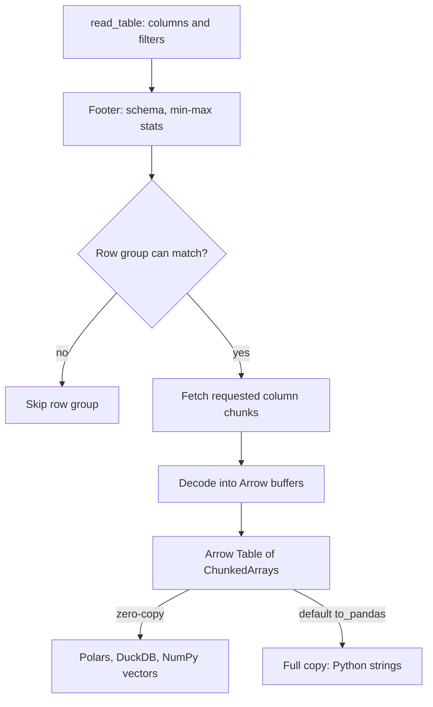

## TL;DR
pyarrow binds Apache Arrow, the shared columnar memory format, and is Python's standard Parquet reader and
writer. It is the storage layer under an agent's RAG chunks, embeddings, traces and eval sets, letting
pandas, Polars, DuckDB and Hugging Face swap tables without serializing.

## For agent builders
- **Why it matters for agents.** The data around an agent outlives any one run: the chunk-and-embedding
  table behind RAG, months of step-level traces, eval datasets and fine-tuning sets built from them. Stored
  as Parquet with a schema, each is cheap to re-read selectively, for example only one tenant's vectors.
- **Where it shows up in your stack.** Under pandas and Polars Parquet I/O, Hugging Face `datasets` (Arrow
  files, memory-mapped), DuckDB, LanceDB (built on Arrow), and the export or backfill jobs that load a
  vector database from a Parquet source of truth.
- **What you control.** Explicit schemas (`large_string` for chunk text, `fixed_size_list` for
  embeddings), partitioning by tenant or date, row-group and file sizes, compression, and conversions
  that keep zero-copy.
- **What you can skip.** The C Data Interface details and most of `pyarrow.compute`; let Polars or DuckDB
  do the queries.

## Lab
### Task
Build the Parquet source of truth behind an agent's RAG index: an explicitly typed chunk table tagged
with its embedding model, written hive-partitioned by tenant, and a loader that hands one tenant's vectors
to the index builder as a float32 NumPy array and refuses vectors from the wrong model.

No vector database or embedding API is needed. Time box: 60 minutes.
- **Prerequisites:** this lesson's How it works, plus numpy and json-jsonl.
- **The shipped `build_table` infers types,** so embeddings arrive as `list<double>`, not
  `fixed_size_list<float>`.

### Starter code
```python
# chunk_store.py  (checked with pyarrow 21.0.0, numpy 2.0.2, Python 3.9+)
import tempfile
from pathlib import Path

import numpy as np
import pyarrow as pa
import pyarrow.dataset as ds


def build_table(doc_ids, tenants, chunks, emb: np.ndarray, model: str) -> pa.Table:
    """BUGGY (FILL IN 1): types are inferred. Use an explicit schema: doc_id string, tenant string,
    chunk large_string, embedding fixed_size_list<float32>[d], plus schema metadata
    {"embedding_model": model} so vectors from two models can never be mixed silently."""
    return pa.table({"doc_id": doc_ids, "tenant": tenants, "chunk": chunks,
                     "embedding": emb.tolist()})


def write_partitioned(table: pa.Table, root: Path) -> None:
    # FILL IN 2: hive-partitioned Parquet by tenant (root/tenant=t1/...), overwriting earlier runs.
    raise NotImplementedError


def load_tenant_vectors(root: Path, tenant: str, model: str):
    # FILL IN 3: read ONLY doc_id and embedding for one tenant (filter prunes other directories);
    # raise ValueError if the stored embedding_model differs from `model`; return
    # (doc_ids sorted ascending, float32 array of shape (n, d) in the same order).
    raise NotImplementedError


if __name__ == "__main__":
    n, d = 9, 4
    emb = (np.arange(n * d, dtype=np.float32) / 4).reshape(n, d)
    table = build_table([f"doc-{i}" for i in range(n)], [f"t{i % 3}" for i in range(n)],
                        [f"text of chunk {i}" for i in range(n)], emb, model="embed-v1")
    print("embedding type:", table.schema.field("embedding").type)
    with tempfile.TemporaryDirectory() as d_:
        root = Path(d_) / "chunks"
        write_partitioned(table, root)
        print("partitions:", sorted(p.name for p in root.iterdir()))
        ids, vecs = load_tenant_vectors(root, "t1", model="embed-v1")
        print("t1:", ids, vecs.shape, vecs.dtype)
        print("first vector:", vecs[0].tolist())
        try:
            load_tenant_vectors(root, "t1", model="embed-v2")
        except ValueError as e:
            print("error:", e)
```
Run as given, it prints `embedding type: list<item: double>`, then raises `NotImplementedError`.

### Expected output
```text
embedding type: fixed_size_list<item: float>[4]
partitions: ['tenant=t0', 'tenant=t1', 'tenant=t2']
t1: ['doc-1', 'doc-4', 'doc-7'] (3, 4) float32
first vector: [1.0, 1.25, 1.5, 1.75]
error: stored embedding_model 'embed-v1' != requested 'embed-v2'
```
The error wording is yours, but it must name both models. `doc-1` is row 1, so its vector is
`[4, 5, 6, 7] / 4`.

### Tests
```python
# test_chunk_store.py  (run: pytest -q)
import numpy as np
import pyarrow as pa
import pytest

from chunk_store import build_table, load_tenant_vectors, write_partitioned

N, D = 12, 8
EMB = np.random.default_rng(0).standard_normal((N, D)).astype(np.float32)
IDS = [f"d{i:02d}" for i in range(N)]
TENANTS = ["acme" if i % 4 == 0 else "globex" for i in range(N)]


def table():
    return build_table(IDS, TENANTS, [f"chunk {i}" for i in range(N)], EMB, model="m1")


def test_explicit_schema_and_model_metadata():
    s = table().schema
    assert s.field("embedding").type == pa.list_(pa.float32(), D)
    assert s.field("chunk").type == pa.large_string()
    assert s.metadata[b"embedding_model"] == b"m1"


def test_hive_partitions(tmp_path):
    write_partitioned(table(), tmp_path / "c")
    assert sorted(p.name for p in (tmp_path / "c").iterdir()) == ["tenant=acme", "tenant=globex"]
    write_partitioned(table(), tmp_path / "c")                     # a rerun must not fail


def test_load_one_tenant(tmp_path):
    write_partitioned(table(), tmp_path / "c")
    ids, vecs = load_tenant_vectors(tmp_path / "c", "acme", model="m1")
    assert ids == ["d00", "d04", "d08"]
    assert vecs.dtype == np.float32 and vecs.shape == (3, D)
    np.testing.assert_array_equal(vecs, EMB[[0, 4, 8]])


def test_model_mismatch_refused(tmp_path):
    write_partitioned(table(), tmp_path / "c")
    with pytest.raises(ValueError, match="m1"):
        load_tenant_vectors(tmp_path / "c", "acme", model="m2")
```
On the starter all 4 fail: the schema assertion (`list<item: double>`), then `NotImplementedError`.

### Failure scenarios
- **Inject the inferred `emb.tolist()` column.** The loader gets float64 vectors at twice the memory, and
  a C extension expecting float32 rejects or copies them. Print `table.schema` before writing; the
  `fixed_size_list` type is the contract.
- **Inject dropping `existing_data_behavior`.** The rerun in `test_hive_partitions` raises because the
  directory is not empty. Note that `overwrite_or_ignore` replaces same-named files but keeps a partition
  you no longer write, so delete stale tenants explicitly.
- **Inject a write of one tenant with `model="embed-v2"` into the same root.** That tenant's
  `part-0.parquet` is replaced while the others keep `embed-v1`, so similarity scores across them are
  meaningless. `dset.schema.metadata` comes from a single file and can still say `embed-v1`; check
  `physical_schema.metadata` on each fragment of `dset.get_fragments(filter=...)`, and write each model
  version to its own root.
- **Inject a read without `columns=`.** Results are identical, but the chunk text is decoded too. Compare
  `t.nbytes` with and without the projection on a 100,000-chunk table.

### Submission
- **Code:** `chunk_store.py` plus the unchanged tests.
- **Test run:** `pytest -q` showing 4 passed, with `pa.__version__`.
- **Output:** the five demo lines, matching Expected output.
- **Layout evidence:** a `find` listing of the dataset root showing one `tenant=` directory per tenant.
- **Evaluation:** an explicit `pa.schema`, a filtered and projected read, float32 vectors with no Python
  loop, and a model mismatch that raises.

## Why it exists
- **Every tool had its own memory layout.** Moving a table from a database client to pandas, then Spark,
  then a model's data loader meant converting each value at every hop: row-by-row serialization, often
  through Python objects, that could cost more than the analysis itself.
- **Text files waste reads.** CSV and JSONL store numbers as text with no types, so every read re-parses
  every byte and must read every column even when the query needs two (say, IDs and embeddings, not the
  chunk text).
- **Arrow fixes memory with a shared spec.** If every library lays out a column the same way, a table
  moves from C++ to Python to Rust by passing pointers to buffers.
- **Parquet fixes storage.** A columnar file format with types, encodings, compression and statistics, so
  a reader can skip columns and whole blocks of rows.
- **They are complementary.** Parquet is optimized for being small on disk and selectively readable,
  Arrow for fast in-memory compute, and pyarrow converts between them efficiently. You rarely write much
  pyarrow directly, but it sits under most of your data stack.

## How it works
### The Arrow memory layout
An Arrow array is a few contiguous buffers:

| Column type | Buffers |
|---|---|
| Fixed-width (`int64`, `float32`) | One values buffer + optional *validity bitmap*, one bit per row marking nulls |
| Variable-length (`string`) | Adds an *offsets* buffer: row *i* is the bytes between `offsets[i]` and `offsets[i+1]` in one shared data buffer |
| Nested (`list`, `struct`, `fixed_size_list`) | Compose the above |

- **Nulls without type changes.** The validity bitmap is why missing values do not force a type change as
  NaN does in pandas.
- **Strings are three buffers,** not a million Python objects for a million strings.
- **Embeddings fit naturally.** A fixed-size list of 768 float32 values is one contiguous float buffer
  that converts to a NumPy `(n, 768)` array without copying.
- **Nested traces fit too.** A step's tool arguments can be a `struct` and a run's steps a `list`, though
  most teams flatten traces to one row per step for easier querying.

### Tables, batches and chunks
- **`RecordBatch`:** a set of equal-length arrays with a `Schema`.
- **`Table`:** a schema plus columns that are `ChunkedArray`s (sequences of arrays), *because* tables are
  built by concatenating batches from files or streams, and chunking avoids copying them into one buffer.
- **Chunk-wise by default.** Many operations work chunk by chunk; `combine_chunks()` makes a single
  contiguous array when a consumer needs one.

### Sharing without copying
- **In process.** The Arrow C Data Interface lets libraries exchange buffers by pointer, which is how
  Polars, DuckDB and pandas' Arrow-backed dtypes interoperate cheaply.
- **In Python,** this is increasingly exposed through the Arrow PyCapsule protocol (`__arrow_c_stream__`
  and friends), so a library can accept "anything Arrow-shaped" without importing the producer.
- **Zero-copy holds only while both sides keep the Arrow layout.** `table.to_pandas()` with default
  settings turns a string column into an `object` column of Python strings: a full copy, often several
  times larger. `to_pandas(types_mapper=pd.ArrowDtype)` keeps Arrow-backed columns instead.
- **Across processes.** The Arrow IPC format (also called Feather v2 on disk) writes the in-memory layout
  directly, so a file can be memory-mapped and read with almost no decoding.
- **Hugging Face `datasets`** stores data as Arrow files and memory-maps them, which is why a dataset
  larger than RAM can still be indexed randomly, for example an SFT set of agent transcripts.

### Parquet on disk
1. **Row groups.** A file is split into *row groups*, each holding a *column chunk* per column.
2. **Encoding.** Dictionary encoding for repetitive values such as tenant IDs, tool names or model names;
   run-length and bit-packing for small integers.
3. **Compression.** Snappy by default in pyarrow, Zstandard for a better ratio.
4. **Footer.** Stores the schema and per-column-chunk statistics such as min and max.
5. **Selective reads.** Asked for two columns with a filter, a reader reads the footer, skips row groups
   whose statistics cannot match, and fetches only the needed column chunks. That is why one file serves
   cheap selective queries.

The `pyarrow.dataset` module extends this to directories of files, including hive-style partitions such
as `tenant=acme/`, which prune whole files.

### Compute
- **`pyarrow.compute`** provides vectorized kernels (filters, arithmetic, string functions, aggregations)
  over Arrow arrays.
- **Light work only.** For analytical queries you usually reach for Polars or DuckDB on top of Arrow.

## Diagram
A selective read of a RAG chunk table: footer statistics decide which row groups are fetched, only the
requested column chunks are decoded, and the Arrow table moves on by pointer unless a conversion copies it.



## Examples
### A RAG chunk-and-embedding table in Parquet
Storing chunk text and embeddings for an agent's retrieval corpus in Parquet with an explicit schema, then
reading back only what retrieval needs.

```python
import numpy as np
import pyarrow as pa
import pyarrow.parquet as pq

n, d = 10_000, 384
emb = np.random.default_rng(0).standard_normal((n, d), dtype=np.float32)  # 15.4 MB

schema = pa.schema([
    ("doc_id", pa.string()),
    ("tenant", pa.string()),                       # Parquet dictionary-encodes it on disk
    ("chunk", pa.large_string()),                  # 64-bit offsets: no 2 GB-per-array limit
    ("embedding", pa.list_(pa.float32(), d)),      # fixed_size_list<float32>[384]
])
table = pa.table({
    "doc_id": [f"doc-{i}" for i in range(n)],
    "tenant": [f"t{i % 3}" for i in range(n)],
    "chunk": [f"text of chunk {i}" for i in range(n)],
    "embedding": pa.FixedSizeListArray.from_arrays(pa.array(emb.ravel()), d),
}, schema=schema)

pq.write_table(table, "chunks.parquet", compression="zstd", row_group_size=2_000)
print(pq.ParquetFile("chunks.parquet").metadata.num_row_groups)    # 5

t = pq.read_table("chunks.parquet", columns=["doc_id", "embedding"],
                  filters=[("tenant", "=", "t1")])                 # chunk text never read
vecs = t.column("embedding").combine_chunks().flatten().to_numpy().reshape(-1, d)
print(t.num_rows, vecs.shape, vecs.dtype)                           # 3333 (3333, 384) float32
```

What the read skips depends on layout:

| Layout | `chunk` column | Row groups read |
|---|---|---|
| As written (tenants interleaved) | Skipped entirely | All 5: every row group contains all three tenants |
| Sorted by tenant before writing | Skipped | `t1` occupies rows 3,334 to 6,666 (0-based), in the 2nd, 3rd and 4th groups, so min/max statistics skip the other 2 of 5 |
| Partitioned (`tenant=t1/` directories) | Skipped | Only `t1`'s files; the two-thirds of data for other tenants is never opened |

### Worked scenario: rebuilding a tenant's vector index after an embedding-model change
The agent's retriever moves to a new embedding model. Parquet is the source of truth; the vector
database is rebuilt from it, one tenant at a time. The production version of the third row above: write
one directory per tenant with `ds.write_dataset(table, "chunks/", format="parquet",
partitioning=["tenant"], partitioning_flavor="hive", existing_data_behavior="overwrite_or_ignore")`.

| Step | What is read | Why |
|---|---|---|
| Re-embed tenant `t1` | `doc_id`, `chunk` from `chunks/tenant=t1/` only | New vectors need the text; other tenants' directories are never opened |
| Write new vectors | A new `embedding_v2` column or a new dataset version | Old and new vectors are not comparable, so never mix them |
| Load the vector DB | `doc_id`, `embedding_v2` | The large chunk text is skipped by projection |
| Recall check | A sample of eval queries | Compare top-k against exact search before switching the agent over |

- **The partition column lives in the path,** not in the files, and is restored on read.
- **Watch cardinality.** Partition by a column with tens to thousands of values; one directory per
  document would recreate the tiny-files problem.

### Partitioned dataset for per-tenant reads
Read one tenant with a filter that prunes whole files.

```python
import pyarrow.dataset as ds

ds.write_dataset(table, "chunks/", format="parquet",
                 partitioning=["tenant"], partitioning_flavor="hive",   # chunks/tenant=t1/...
                 existing_data_behavior="overwrite_or_ignore")

dset = ds.dataset("chunks/", format="parquet", partitioning="hive")
t1 = dset.to_table(columns=["doc_id", "embedding"],
                   filter=ds.field("tenant") == "t1")                 # other directories never opened
print(t1.num_rows)                                                    # 3333
```

## Production patterns
- **Parquet as the source of truth for RAG.** Keep chunks, metadata and embeddings (with the embedding
  model's name per column or dataset version) in Parquet, and treat the vector database as a rebuildable
  serving index. Monitor row counts in Parquet versus the index after each load.
- **Explicit schema on every write.** Define a `pa.schema` per table (with `large_string` for big text and
  `pa.list_(pa.float32(), d)` for embeddings) and pass it to `pa.table` or the writer. Monitor write-time
  type errors; they replace dataset reads failing weeks later on one odd file.
- **Partition by the dominant filter.** Use `ds.write_dataset(..., partitioning=["tenant"],
  partitioning_flavor="hive")` for tenant or date filters, and sort within partitions by the next filter
  key. Watch files opened and bytes read per query.
- **Compact small trace files on a schedule.** Streaming trace writers produce many tiny files; a periodic
  job rewrites them with `ds.write_dataset` using its `max_rows_per_file` and `min_rows_per_group` limits.
  Monitor file count and average file size per partition.
- **Keep Arrow types across hand-offs.** Convert with `to_pandas(types_mapper=pd.ArrowDtype)`, or hand the
  table to Polars or DuckDB, instead of default `to_pandas()` on text-heavy tables. Track peak memory
  against `table.nbytes`.
- **Zstandard for archives, Feather for local caches.** Write long-lived Parquet with
  `compression="zstd"`; for scratch data reread many times on one machine, write Arrow IPC with
  `pyarrow.feather.write_feather` (pass `compression="uncompressed"`, since its default LZ4 must be
  decoded on read) and memory-map it on read. Compare file size and read time per format.

## Trade-offs
- **Cheap selective reads vs immutability.** Parquet's compression and column pruning make selective
  reads cheap, but files are immutable and poor at single-row updates; frequently mutated data, such as
  live agent memory or session state, belongs in a database or a table format on top.
- **Free hand-offs vs type matching.** Zero-copy only holds when types match; nulls, string columns or
  non-contiguous chunks can force a copy when converting to NumPy or pandas.
- **Large vs small row groups.** Large ones compress better and scan faster; small ones allow finer
  skipping and lower memory when reading. The right size depends on whether workloads scan or seek.
- **Explicit schemas vs maintenance.** They catch type drift at write time but must evolve with fields;
  inference is convenient until two files disagree and a dataset read fails.
- **Parquet store vs vector database.** Parquet is cheap, portable and exact to rebuild from, but has no
  ANN index; serve queries from a vector database built from it.

## Pitfalls
- **Many tiny Parquet files from a streaming job.** Symptom: slow reads dominated by opening files and
  parsing footers. Fix: compact into fewer, larger files.
- **32-bit-offset `string` for huge text columns.** Symptom: an offset overflow error once one array's
  text exceeds about 2 GB, common with long documents or full tool outputs. Fix: `large_string` or smaller
  chunks.
- **Expecting filters to skip data on unsorted files.** Symptom: a "filtered" read takes as long as a full
  scan, because row-group statistics overlap every predicate. Fix: sort or partition first.
- **Letting schemas be inferred per file.** Symptom: a dataset read fails because one file has an int
  column as double or a field missing entirely. Fix: an explicit schema.
- **Assuming `to_numpy()` is always zero-copy.** Symptom: an error or memory spike on columns with nulls
  or multiple chunks. Fix: `combine_chunks()` and handle nulls first.
- **Default `to_pandas()` on a large text table.** Symptom: peak memory far above the Arrow table's
  `nbytes`, because every string became a Python object. Fix: `types_mapper=pd.ArrowDtype`.

## When to use
- **Parquet via pyarrow by default** for any tabular dataset read more than once: eval results, traces,
  processed training data, chunk and embedding tables for RAG.
- **Arrow IPC or Feather** when you want fast, memory-mappable local files with no decoding.
- **pyarrow directly** for explicit schemas, control over row groups and compression, or moving data
  between libraries; otherwise let pandas, Polars or DuckDB call it for you.
- **Keep JSONL** for human-readable interchange and append-only logs, and convert to Parquet for analysis.
- **Measure:** file size, read time for typical queries and peak memory.

## Role lens
- **Engineer:** Writes Parquet with explicit schemas and `fixed_size_list` embeddings, reads only needed
  columns, and converts to NumPy without copies for scoring.
- **Architect:** Makes Arrow and Parquet the interchange and storage contract across ingestion, training
  and analytics, including partitioning and file-size policy.
- **FDE:** Asks the customer for a Parquet export instead of CSV, cutting transfer size and avoiding a week
  of type and encoding bugs.

## Check yourself
**Q:** Your embedding store is 20 million rows of text plus 768-d float32 vectors in one directory of
Parquet files. Retrieval for one tenant reads everything and is slow. What do you change, and why?
**A:** Vectors alone are 20 M × 768 × 4 bytes, about 61 GB, so full scans are expensive. First, project:
read only the ID and embedding columns, never the text, until results are chosen. Second, make filters
skip data: partition the dataset by tenant (`tenant=x/` directories) or sort by tenant before writing so
row-group statistics exclude other tenants. Third, tune file and row-group sizes so there are not
thousands of tiny files. If queries are frequent and latency matters, Parquet is the source of truth but
not the serving layer; build an ANN index per tenant from it.

## Interview questions
### What is the difference between Arrow and Parquet, and why do you need both?
- **Arrow is an in-memory columnar spec:** contiguous values buffers, a validity bitmap for nulls and
  offsets for strings, so libraries share tables by passing pointers instead of serializing.
- **Parquet is an on-disk columnar file format:** row groups, dictionary and run-length encoding,
  compression and min and max statistics, so readers skip columns and row groups.
- **pyarrow bridges them:** Parquet is small on disk and selectively readable, Arrow is fast to compute
  on, and pyarrow converts efficiently between the two.

### How would you store the corpus behind a multi-tenant RAG agent so you can rebuild the vector index safely?
- **Parquet as source of truth:** one dataset of chunk ID, tenant, text, metadata and embeddings, with an
  explicit schema and the embedding model recorded per column or version.
- **Partition by tenant:** `tenant=x/` directories, so re-embedding or reloading one tenant never opens
  another's files, which also helps isolation audits.
- **Rebuild, then verify:** load the vector database from the ID and embedding columns only, compare
  counts, and run an exact-search recall check on eval queries before switching the agent over.

### Peak memory is several times `table.nbytes` after converting to pandas. Why, and what do you do?
- **Default `to_pandas()` copies strings:** each Arrow string becomes a Python object in an `object`
  column, a full copy that is often several times larger.
- **Keep Arrow types:** use `to_pandas(types_mapper=pd.ArrowDtype)`, or hand the table to Polars or
  DuckDB, which read Arrow buffers directly.
- **Check other copies too:** `to_numpy()` on columns with nulls or several chunks also copies or fails;
  `combine_chunks()` and null handling come first.

### Your agent's trace-ingestion job produces thousands of tiny Parquet files and dashboards are slow. What happened?
- **Cause:** each file has its own footer to open and parse, so per-file overhead dominates and row
  groups are too small to compress well or skip usefully.
- **Fix:** a scheduled compaction job that rewrites partitions with `ds.write_dataset` using its
  `max_rows_per_file` and `min_rows_per_group` limits.
- **Monitor:** file count and average file size per partition, plus files opened per query.

### How do you choose row-group size and partitioning?
- **Large row groups** compress better and scan faster; **small ones** skip at finer grain and use less
  memory per read, so pick by whether workloads scan or seek.
- **Statistics only help when data is sorted:** on unsorted files every row group's min and max overlap
  the predicate, and a filtered read costs a full scan.
- **Partition by the dominant filter,** such as `tenant=acme/`, with tens to thousands of values; one
  directory per document recreates the tiny-files problem.

### A write fails with an offset overflow on a large text column. What is going on?
- **32-bit offsets:** Arrow's `string` type stores row boundaries as 32-bit offsets into one shared data
  buffer, so a single array's text cannot exceed about 2 GB.
- **Fix:** declare the column as `pa.large_string()`, which uses 64-bit offsets, or write in smaller
  chunks.
- **Prevent it:** put `large_string` for chunk text in the explicit schema, as in the RAG example.

## Quiz
### Q: What lets a Parquet reader skip entire row groups when a query filters on `tenant = "acme"`?
- [ ] The validity bitmap marks irrelevant rows as null
- [x] Per-column-chunk min/max statistics in the file footer show no row in the group can match
- [ ] Dictionary encoding stores each tenant in a separate file
- [ ] Snappy compression indexes every distinct value
> Readers consult footer statistics before fetching data. If a row group's tenant range excludes
> "acme", it is skipped, which only works well when data is sorted or partitioned by that column.

### Q: How does Arrow represent a column of one million variable-length strings?
- [ ] As one million Python string objects referenced by pointers
- [ ] As fixed-width padded strings sized to the longest value
- [x] As an offsets buffer, a contiguous data buffer and an optional validity bitmap
- [ ] As a compressed Parquet column chunk kept in memory
> Offsets mark where each string starts and ends inside one shared byte buffer, so the column is a few
> contiguous buffers that any Arrow-speaking library can read without conversion.

### Q: What is the key difference between Arrow and Parquet?
- [ ] Arrow is row-oriented and Parquet is columnar
- [x] Arrow is an in-memory format for fast computation and exchange; Parquet is an encoded, compressed on-disk format
- [ ] Parquet is a Python library and Arrow is a file format
- [ ] They are the same format with different file extensions
> Both are columnar. Arrow optimizes random access and zero-copy sharing in memory, while Parquet uses
> encodings, compression and statistics to be small and selectively readable on disk.

## Use cases & projects
### Use cases
- **RAG source of truth.** Chunks, metadata and embeddings live in Parquet with a fixed schema, so a
  vector database can be rebuilt or re-embedded from it at any time.
- **Per-tenant agent memory exports.** Partitioning by tenant lets a job read or delete one tenant's
  rows without touching the rest.
- **Long-term trace storage.** Months of agent steps stored compressed and columnar, cheap to query for
  only IDs, tools and token counts.
- **Handing data between tools.** Polars, DuckDB and Hugging Face `datasets` read the same Arrow data,
  often without copying.

### Mini project
**Parquet store for an agent's RAG chunks (1-3 hours).**
- **Goal:** keep a small agent's retrieval corpus in Parquet so its vector index can be rebuilt from disk.
- **Steps:** chunk 200 documents; define an explicit schema with `large_string` for text, a
  `fixed_size_list` of floats for embeddings and a tenant column; write a dataset partitioned by tenant;
  read back only one tenant's IDs and embeddings; load them into an in-memory index and run a few queries.
- **Done when:** the reread touches only the requested columns and tenant, the schema rejects an
  embedding of the wrong length, and the rebuilt index returns the same top results as before.
