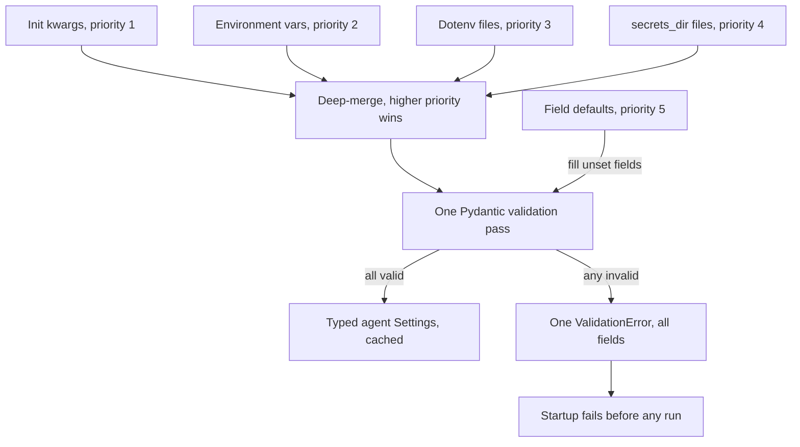

## TL;DR
pydantic-settings fills a typed Pydantic model from env vars, `.env` files and secret files. Declare an
agent's model, step budget and tool keys once; it starts validated or refuses to, turning 2 a.m.
mid-run failures into deploy-time crashes.

## For agent builders
- **Why it matters for agents.** An agent service has many knobs: model name, max steps, per-tool
  timeouts, which tools are enabled, retrieval `top_k`, tracing on or off, several API keys. A typo in any
  of them otherwise surfaces deep inside a run, after tokens and tool calls are already spent.
- **Where it shows up in your stack.** The `Settings` class behind a FastAPI agent server, a LangGraph or
  plain-Python worker, an eval runner and a background job queue; one class shared by all of them.
- **What you control.** The prefix, the source order (env vs secret files), nested groups per tool,
  constraints such as `Field(gt=0)`, and `SecretStr` so a logged config or trace never shows a key.
- **What you can skip.** Writing custom sources. The four default sources (init kwargs, env vars, dotenv,
  secret files) cover most deployments, and the package ships optional ones (YAML, TOML, JSON files and
  cloud secret stores) you enable in `settings_customise_sources`.

## Why it exists
- **Everything is a string.** With `os.environ.get` scattered through the code, `TIMEOUT="30"` must be
  converted at each call site, and `"false"` is truthy, so a disabled tool stays enabled.
- **Nothing is checked up front.** A missing `VECTOR_DB_URL` or a typo in `RERANK_TOP_K` surfaces only
  when the first agent run reaches the retrieval step, possibly hours after deploy.
- **No single list of what the service needs.** A new environment is configured by trial and error.
- **A hand-written `config.py` hits a wall.** It works until thirty fields, nested groups (retrieval,
  model, tracing, one per tool), lists of allowed models and secrets that must stay out of logs and
  traces; then you are reimplementing a validation library.
- **Pydantic already is one.** pydantic-settings reuses its coercion, constraints and error messages,
  aimed at the process environment. It was split out with Pydantic v2, so it is a separate install
  (`pip install pydantic-settings`).

## How it works
### Declaring settings
Subclass `BaseSettings`, annotate fields as in any Pydantic model, and set behaviour with
`model_config = SettingsConfigDict(...)`:

| Option | Effect |
|---|---|
| `env_prefix` | `APP_MODEL` fills `model`, avoiding collisions with other software's variables |
| `env_file` | One path or a tuple, later files winning |
| `case_sensitive` | Off by default |
| `env_nested_delimiter` | Lets one env var set one field of a nested model, such as one tool's timeout |
| `extra` | What to do with unknown keys from dotenv files |

### Where values come from, in priority order
When you instantiate `Settings()`, each field is resolved from the highest-priority source that has it:

1. Keyword arguments passed to the constructor (used by tests and eval variants).
2. Environment variables.
3. The dotenv file(s).
4. Files in `secrets_dir`, one file per field, which is how Docker and Kubernetes secrets are mounted.
5. Field defaults.

- **Why this order.** The platform's environment beats a local file, matching python-dotenv's default,
  so a stale `.env` cannot override production.
- **Customisable.** Reorder or add sources (a vault, a YAML file) by overriding the
  `settings_customise_sources` classmethod.

### The merge mechanism
1. Each source is a callable returning a dict of raw values for the fields it knows about.
2. pydantic-settings calls them and deep-merges the dicts, a higher-priority source overwriting a lower
   one key by key.
3. One ordinary Pydantic validation runs over the merged dict.

- **Consequence.** Everything Pydantic can do (coercion, validators, nested models, aliases) works
  unchanged for config, and a custom source only has to produce a dict.
- **Asymmetry with python-dotenv.** Within `env_file=(".env", ".env.local")` the *later* file wins,
  whereas repeated `load_dotenv` calls keep the first value.
- **Names fixed by someone else.** For the OpenAI SDK's `OPENAI_API_KEY` or a platform's `DATABASE_URL`,
  use `validation_alias="OPENAI_API_KEY"` (or `AliasChoices` for several accepted names) instead of
  bending your prefix convention.

### Parsing beyond strings
| Field type | Env value | Result |
|---|---|---|
| `float` | `"30"` | `30.0` |
| `bool` | `"false"` | `False` |
| `list`, `dict`, nested model | JSON string, e.g. `APP_ALLOWED_MODELS='["a","b"]'` | Parsed list |
| Nested field with `env_nested_delimiter="__"` | `APP_RETRIEVAL__TOP_K=20` | Sets one field, rest keep defaults |

- **Constraints apply.** `Field(gt=0)` and `Literal["dev","prod"]` are enforced exactly as for API input,
  so `max_steps=0` or an unknown model name never reaches the loop.
- **All errors at once.** A failure raises a single `ValidationError` listing every bad field, because one
  deploy should report all problems rather than one per restart.

### Secrets
- **Type sensitive fields as `SecretStr`.** The value is masked in `repr`, `str` and default
  serialization, so `print(settings)`, a crash log or a config dump attached to a trace shows
  `**********`.
- **Unwrap at the point of use** with `.get_secret_value()`, when constructing the model or tool client.
- **No encryption.** It prevents the most common leak, which is logging a config object.

### Where it lives at runtime
- **Construct once and share:** a cached `get_settings()` function, or an object built in the FastAPI
  lifespan and injected as a dependency into the agent endpoint and tool factories.
- **Payoff:** one validation at startup and an easy override in tests (construct a `Settings(...)` with
  explicit kwargs and `_env_file=None`).

## Diagram
Each source returns a dict; they are merged key by key in priority order, then one validation pass either
yields a typed agent config or fails startup with every bad field listed.



## Examples
### Settings for a tool-calling RAG agent
One class holds the model, the loop budget, retrieval knobs and per-tool config. Every agent component
reads from it.

```python
from functools import lru_cache
from typing import Literal
from pydantic import BaseModel, Field, SecretStr
from pydantic_settings import BaseSettings, SettingsConfigDict

class Retrieval(BaseModel):
    top_k: int = Field(8, ge=1, le=100)
    rerank: bool = True

class SearchTool(BaseModel):
    enabled: bool = True
    timeout_s: float = Field(10.0, gt=0)

class Settings(BaseSettings):
    model_config = SettingsConfigDict(
        env_prefix="APP_", env_file=".env", env_nested_delimiter="__", extra="ignore")
    env: Literal["dev", "staging", "prod"] = "dev"
    openai_api_key: SecretStr                     # required: no default
    model: str = "gpt-4o-mini"
    max_steps: int = Field(8, ge=1, le=50)        # agent loop budget
    request_timeout_s: float = Field(30.0, gt=0)
    allowed_models: list[str] = ["gpt-4o-mini"]
    retrieval: Retrieval = Retrieval()
    search: SearchTool = SearchTool()

@lru_cache
def get_settings() -> Settings:
    return Settings()

# Environment:
#   APP_OPENAI_API_KEY=sk-live-...      APP_ENV=prod
#   APP_RETRIEVAL__TOP_K=20             APP_ALLOWED_MODELS='["gpt-4o-mini","gpt-4o"]'
#   APP_SEARCH__ENABLED=false
s = get_settings()
print(s.retrieval)          # top_k=20 rerank=True   (nested override, default kept)
print(s.search.enabled)     # False                  (parsed bool, not the truthy string)
print(s.openai_api_key)     # **********             (masked)
client_key = s.openai_api_key.get_secret_value()
tools = [t for t, on in {"search": s.search.enabled, "retrieve": True}.items() if on]

# In a test, ignore the developer's .env (real env vars still apply, so
# kwargs or monkeypatch.delenv must cover anything the shell might set):
t = Settings(_env_file=None, openai_api_key="test", env="dev", max_steps=2)
```

- **Bad staging values fail loudly.** If staging sets `APP_REQUEST_TIMEOUT_S=thirty` and
  `APP_ENV=production`, startup fails with one `ValidationError` reporting two errors:
  `request_timeout_s` is not a valid number and `env` is not one of `'dev', 'staging', 'prod'`.
- **Result.** The pod crash-loops visibly instead of accepting agent runs with a broken timeout.

### Worked scenario: what a config typo costs at runtime vs at startup
An agent averages 6 steps per run; the search tool is first called on step 4. Someone sets
`APP_SEARCH__TIMEOUT_S=ten`.

| Approach | When it fails | Cost before the failure is visible |
|---|---|---|
| `float(os.environ[...])` inside the tool | Step 4 of every run | 4 model calls per run wasted (steps 1-3 plus the call that requested search), user sees an error |
| Typed `Settings()` at startup | Deploy | Zero runs; the rollout stops and names the field |

### Making mounted secret files authoritative
When a team rotates keys by updating mounted secret files, a leftover env var would silently shadow the
new key. Reordering sources makes the file win.

```python
from pydantic import SecretStr
from pydantic_settings import BaseSettings, SettingsConfigDict

class Settings(BaseSettings):
    model_config = SettingsConfigDict(env_prefix="APP_", secrets_dir="/run/secrets")
    openai_api_key: SecretStr

    @classmethod
    def settings_customise_sources(cls, settings_cls, init_settings, env_settings,
                                   dotenv_settings, file_secret_settings):
        # default order is init, env, dotenv, secrets; put secret files ahead of env vars
        return (init_settings, file_secret_settings, env_settings, dotenv_settings)
```

| Source present | Default order picks | Reordered picks |
|---|---|---|
| Stale `APP_OPENAI_API_KEY` env var + new secret file | Stale env var | New secret file |
| Only the env var | Env var | Env var |
| Neither | Startup fails: required field | Startup fails: required field |

## Production patterns
- **Validate config before agent traffic.** Run a step that only constructs `Settings()` (a CI job against
  the target environment's variables, or the container's first startup line) so a bad value fails the
  deploy. Monitor deploy failures and crash-loops that name a field, not mid-run `KeyError`s.
- **One cached settings dependency.** Expose `get_settings()` with `@lru_cache` and inject it with FastAPI
  `Depends(get_settings)`. In tests set `app.dependency_overrides[get_settings]` to return
  `Settings(_env_file=None, ...)`, and call `get_settings.cache_clear()` when env changes.
- **Eval variants as constructor kwargs.** An eval runner builds `Settings(model="...", max_steps=4)` per
  variant instead of mutating env vars, so two configs can run in one process. Record the non-secret
  settings with each eval result.
- **Prefix everything, alias the fixed names.** Set `env_prefix="APP_"` so fields like `path` cannot pick
  up system variables, and use `validation_alias` only for names others own, such as `OPENAI_API_KEY`.
  Review new fields for collisions.
- **Secrets as `SecretStr`, delivered by the platform.** Mount them via `secrets_dir` or inject env vars
  from a secrets manager; never put real values in `.env.example`. Log which settings are present at
  startup, never their values, and grep logs and traces for unmasked keys.
- **Tolerate shared dotenv files.** Use `extra="ignore"` when the same `.env` feeds other tools (a tracing
  SDK, an MCP server), so their keys do not fail validation. Keep a documented `.env.example` that
  mirrors the `Settings` fields.

## Trade-offs
- **Fail fast vs convenience.** Startup validation turns silent misconfiguration into a crash, right for
  agent services but annoying for scripts that need one value; there plain `os.environ` is simpler.
- **One typed object vs coercion surprises.** It documents every setting but couples config to Pydantic's
  coercion rules, so lax coercion (`"1"` to `True`) can surprise; strict mode trades convenience for
  exactness.
- **JSON-in-env vs quoting pain.** Lists and nested models stay in variables, yet quoting JSON inside
  shell, YAML and Helm templates is error-prone; past a few nested fields (a dozen tools each with
  options) a mounted config file is cleaner.
- **Masking vs ceremony.** `SecretStr` masks accidental logging but adds `.get_secret_value()` noise, and
  it is no substitute for a secrets manager with rotation; it only governs how the value is printed.
- **Startup-time config vs per-run config.** Settings fix values for the process lifetime; per-tenant or
  per-request choices (which model this user gets) belong in request data, not in env vars.

## Pitfalls
- **Instantiating `Settings()` at import time in a library module.** Symptom: tests fail to import
  because a required key is missing. Fix: construct lazily or in the entry point.
- **Forgetting `env_prefix` and naming a field `path` or `home`.** Symptom: the field is mysteriously
  filled from the system's own `PATH` or `HOME` variable. Fix: add a prefix.
- **Leaving `extra` at its default (`"forbid"`) with a shared `.env`.** Symptom: a validation error about
  unexpected keys from the dotenv file (environment variables never trigger it). Fix: `extra="ignore"`.
- **Expecting a nested override without `env_nested_delimiter`.** Symptom: `APP_RETRIEVAL__TOP_K` is
  silently ignored and the default used, so the agent retrieves 8 chunks instead of 20. Fix: set the
  delimiter.
- **Caching with `lru_cache`, then changing env vars in a test.** Symptom: old values. Fix:
  `get_settings.cache_clear()` or dependency overrides.
- **Dumping settings into a trace.** Symptom: keys visible in the tracing UI because a field was typed
  `str`. Fix: type every key as `SecretStr` and export only an allow-listed subset.

## When to use
- **Use when:** any long-running agent service or worker with more than a few settings, anything with
  secrets, and anything deployed to more than one environment.
- **Default in FastAPI:** settings plug straight into dependency injection.
- **Avoid when:** throwaway scripts and notebooks; keep plain `os.environ` or python-dotenv.
- **Measure:** how config failures surface. They should appear as startup errors naming the field, never
  as mid-run `KeyError`s or wrong agent behaviour.
- **Interviews:** explain the source precedence and why secrets are typed as `SecretStr`.

## Role lens
- **Engineer:** Writes the `Settings` class, injects it through a cached dependency, and overrides it
  in tests with explicit kwargs instead of patching environment variables.
- **Architect:** Decides which settings exist per environment, the prefix convention, which values come
  from a secrets store, and that services fail closed on invalid config.
- **FDE:** Hands the customer a documented settings schema and `.env.example`, and reads the startup
  `ValidationError` to diagnose their environment in minutes.

## Check yourself
**Q:** Your platform team rotated the API key by updating a Kubernetes secret mounted as a file in
`secrets_dir`. The pods restarted, but they still call the provider with the old key. An old ConfigMap
also sets `APP_OPENAI_API_KEY`. Explain what happened and two ways to fix it.
**A:** Sources are merged by priority: init kwargs, environment, dotenv, secret files, defaults. The
stale ConfigMap value arrives as an environment variable, which outranks the mounted secret file, so the
rotation was silently shadowed; the restart re-read both and the env var won again. Fix one: delete the
variable from the ConfigMap so the secret file is the only source. Fix two, if the team wants files to
be authoritative by design: override `settings_customise_sources` to return the file-secret source
ahead of the environment source. Either way, add a startup log of *which source* supplied each secret
(never the value), so the next shadowing is visible, and remember a running process never re-reads its
settings without a restart.

## Interview questions
### Why use pydantic-settings instead of `os.environ.get` calls spread through the code?
- **One typed schema:** every setting is declared once with a type and constraint, so `"30"` becomes
  `30.0` and `"false"` becomes `False` without per-call-site conversion.
- **Fail at startup, not mid-request:** a missing or malformed value raises one `ValidationError` naming
  every bad field when `Settings()` is built, instead of a `KeyError` hours after deploy.
- **Self-documenting:** the class is the list of what a new environment must provide.

### How would you structure configuration for an agent with a dozen tools?
- **Nested model per tool:** each tool gets a small `BaseModel` (enabled, timeout, limits) on the
  `Settings` class, and `env_nested_delimiter="__"` lets ops change one field without rewriting JSON.
- **Keys as `SecretStr`, owned names aliased:** each tool's credential is typed `SecretStr`, with
  `validation_alias` where the vendor fixes the variable name.
- **Build tools from settings:** a factory reads the settings once and registers only enabled tools, so a
  disabled tool never appears in the model's tool list.

### A field named `path` holds a strange value in production. What happened and how do you fix it?
- **Likely cause:** there is no `env_prefix`, and matching is case-insensitive by default, so the field
  was filled from the operating system's own `PATH` variable.
- **Fix:** set `env_prefix="APP_"` so only `APP_PATH` can fill it, and use `validation_alias` only for
  names other software owns, such as `OPENAI_API_KEY`.
- **Prevent it:** review new field names for collisions with common system variables like `HOME`.

### How do you pass lists and nested config through environment variables, and when would you stop?
- **Lists and dicts:** pass a JSON string, for example `APP_ALLOWED_MODELS='["a","b"]'`.
- **Nested models:** set `env_nested_delimiter="__"` so `APP_RETRIEVAL__TOP_K=20` overrides one field and
  the rest keep their defaults; without the delimiter the override is silently ignored.
- **When to stop:** quoting JSON inside shell, YAML and Helm is error-prone, so past a few nested fields a
  mounted config file read by a custom source is cleaner.

### How do you test code that depends on `Settings` without the developer's `.env` leaking in?
- **Construct explicitly:** `Settings(_env_file=None, openai_api_key="test", ...)` skips the dotenv file;
  real environment variables still apply, so cover them with kwargs or `monkeypatch.delenv`.
- **Override the dependency:** in FastAPI set `app.dependency_overrides[get_settings]` to return the test
  object.
- **Mind the cache:** `get_settings` is wrapped in `lru_cache`, so call `get_settings.cache_clear()`
  after changing environment variables in a test.

### What does `SecretStr` protect against in an agent that logs traces, and what does it not?
- **Protects:** accidental logging. The value is masked in `repr`, `str` and default serialization, so
  `print(settings)`, a crash log or a config dump in a trace shows `**********`.
- **Does not:** encrypt, rotate or audit anything. The plaintext is in process memory and returned by
  `.get_secret_value()`, which you call only at the point of use.
- **So:** pair it with a secrets manager or mounted secret files for delivery and rotation.

## Quiz
### Q: `APP_MODEL` is set in the environment, `.env` sets `APP_MODEL` differently, and the field has a default. Which value wins?
- [ ] The `.env` value, because files are read last
- [x] The environment variable, because it outranks dotenv files and defaults
- [ ] The default, because explicit defaults always win
- [ ] Startup fails because of the conflicting definitions
> Priority is constructor kwargs, then environment variables, then dotenv, then secret files, then
> defaults. This matches the deployment model: the platform's injected value beats a local file.

### Q: Why type an API key as `SecretStr` rather than `str`?
- [ ] It encrypts the value in memory
- [ ] It validates that the key has the provider's format
- [x] It masks the value when the settings object is printed, logged or serialized
- [ ] It loads the value from a secrets manager automatically
> `SecretStr` only changes representation, so logging the config shows asterisks. You still need a real
> secrets store and must call `.get_secret_value()` where the key is actually used.

### Q: How would you set only `retrieval.top_k` from the environment for a nested `Retrieval` model?
- [ ] `APP_RETRIEVAL.TOP_K=20`, which works by default
- [x] Set `env_nested_delimiter="__"` and use `APP_RETRIEVAL__TOP_K=20`
- [ ] Nested models cannot be configured from the environment at all
- [ ] Set `APP_TOP_K=20`, since nested fields are flattened automatically
> Without a configured delimiter, nested models are only settable as a whole JSON string. With
> `env_nested_delimiter`, a single nested field can be overridden while the others keep their defaults.

## Use cases & projects
### Use cases
- **Agent API servers.** A FastAPI agent service validates model name, max steps, tool timeouts and keys
  at startup, so a bad deploy fails the health check instead of the first user run.
- **Per-environment agent behaviour.** Staging runs a cheap model with tracing on; production runs a
  stronger model with tighter step limits, all from the same `Settings` class.
- **Tool feature flags.** Boolean fields enable or disable individual tools per environment or
  deployment, parsed correctly so `"false"` really means off. Per-tenant choices belong in request data.
- **Eval runners.** The eval harness reuses the agent's `Settings`, overriding only the model and dataset
  path, so evaluated and deployed configs cannot drift apart.

### Mini project
**Typed config for a tool-calling agent (1-3 hours).**
- **Goal:** replace scattered `os.environ.get` calls in a small agent with one validated `Settings` class.
- **Steps:** define fields for model name, `max_steps` with `Field(gt=0)`, a nested retrieval group with
  `top_k`, a per-tool timeout and the provider key as `SecretStr`; set an env prefix and a nested
  delimiter; load it once and pass it into the agent loop; log the settings object at startup.
- **Done when:** a typo or a negative step limit stops the process before any model call, the startup
  log shows the key masked, and one nested field can be overridden from the environment alone.
