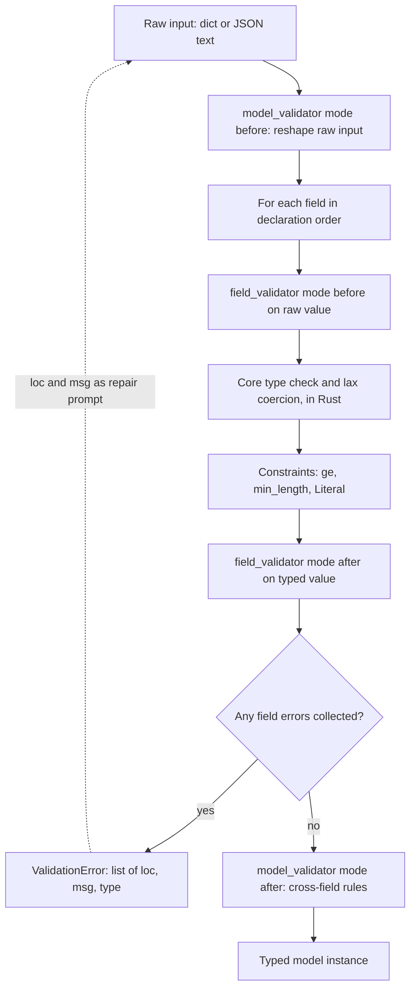

## TL;DR
Pydantic turns annotated `BaseModel` classes into validators, serializers and JSON Schema. Untrusted
input (API payloads, LLM output, configs) becomes typed objects with structured errors, and the same
class emits the schema you give a model, because type hints alone do nothing at runtime.

## Why it exists
- **Type hints are inert.** A function typed `-> Ticket` will happily return a dict with a misspelled key.
- **AI data is untrusted on arrival.** HTTP bodies, completions that should be JSON, tool arguments a
  model invented, env vars, YAML configs, rows from a customer export. A model malforms them creatively:
  a string for an int, an extra field, a value outside the set, valid JSON with a trailing sentence.
- **The naive fixes fail.** Hand-written `if "title" not in data` checks grow to hundreds of lines that
  drift from the types, with ad-hoc error messages. A `TypedDict` or `dataclass` documents the shape but
  validates nothing. A separate JSON Schema file duplicates the class, and the two disagree within a month.
- **One artifact, four jobs.** The annotated class is the static type, runtime validator, serializer and
  JSON Schema source. The schema you send the model and the validator you run on its answer cannot
  disagree, and the structured error list can be fed back for a repair attempt.
- **The ecosystem builds on it.** FastAPI, the OpenAI and Anthropic SDK structured-output helpers,
  `instructor`, LangChain and most agent frameworks rely on this property. (SDK support for passing a
  Pydantic class directly varies by provider and version; the generated JSON Schema is the portable part.)

## How it works
### From annotations to a validator
1. **Compile once.** At class creation, `BaseModel`'s metaclass reads `__annotations__` and each
   `Field(...)` into a *core schema*, a tree of every field's type and constraints. This happens once per
   class *because* building the validator costs far more than running it, and models are defined once
   and used millions of times.
2. **Run in Rust.** In Pydantic v2, `pydantic-core`, a Rust extension, executes the schema, which is why
   validation is fast enough for every request.
3. **Pick an entry point.**

| Call | Input |
|---|---|
| `Model.model_validate(obj)` | Python object (dict, attributes) |
| `model_validate_json(s)` | JSON text, parsed in Rust without an intermediate `json.loads` |
| `Model(**kwargs)` | keyword arguments |

4. **Fail with structure.** A `ValidationError` carries a list of errors, each with `loc` (path to the bad
   field), `msg` and a machine-readable `type`. That structure, not one string, is what makes "send the
   errors back to the model and retry" practical.

### Lax versus strict, ignore versus forbid
| Setting | Default behaviour | When to change |
|---|---|---|
| Coercion | *Lax*: `"1200"` becomes `1200` for `int`, `"true"` becomes `True`, because query strings, env vars and model output arrive as text | `ConfigDict(strict=True)` or `Field(strict=True)` when exact types matter, such as `1` vs `"1"` in an ID |
| Unknown fields | *Ignored* | `ConfigDict(extra="forbid")` for tool arguments, where a hallucinated field is a signal, not noise |

- **V2 tightened some rules** relative to v1; for example an `int` is no longer accepted for a `str` field
  by default.

### The order things happen in
For one `model_validate(data)` call, knowing the pipeline tells you where custom logic belongs:

1. **`@model_validator(mode="before")`** sees the raw input (a dict, or whatever was passed) and can
   reshape it, for example unwrapping `{"ticket": {...}}` that a model insisted on adding.
2. **Each field, in declaration order:** lookup by name or alias, then `field_validator(mode="before")`
   on the raw value, then core type validation and coercion (`"1200"` to `1200`), then declared
   constraints (`ge`, `min_length`), then `mode="after"` validators on an already-typed value.
   `mode="wrap"` surrounds the core step and can short-circuit it.
3. **Errors from every field are collected**, not stopped at the first, *because* a repair prompt that
   lists all five problems converges in one retry instead of five.
4. **`@model_validator(mode="after")`** runs on the built instance if all fields passed. Cross-field
   invariants such as `start < end` go here, since only now are all fields typed and present.

### After construction
- **Validation happens at construction only.** `t.affected_users = "lots"` is not checked unless the
  model sets `validate_assignment=True`.
- **`Model.model_construct(**data)` skips validation entirely:** the fast path for data you already
  validated, and a hole for data you did not.
- **`frozen=True`** makes instances immutable and hashable.

### Validators, serialization, schema
| Tool | Purpose |
|---|---|
| `field_validator` | Single-field normalisation and checks |
| `model_validator` | Reshaping and cross-field cases above |
| `Field(alias="userId")` | Map a wire name onto a Python name (set `populate_by_name=True` to accept both) |
| `@computed_field` | Expose derived values in dumps |
| `model_dump()` / `model_dump_json()` | Dict / string output, controlled by `exclude`, `by_alias` and `mode="json"` |
| `model_json_schema()` | JSON Schema: `enum` for `Literal` and `Enum`, `minimum`/`maximum` from `ge`/`le`, `description` from `Field(description=...)`, which is text the model actually reads |
| `TypeAdapter(list[Ticket])` | Validation and schema for non-models, including `TypedDict`s and plain containers |
| `Field(discriminator="type")` | Discriminated unions: route a payload to the right variant by a tag field, how you validate "one of these N tool calls" |

### Against the alternatives
| Option | Validation | Schema | Use for |
|---|---|---|---|
| Stdlib `dataclasses` | None; lighter | No | Internal records you construct yourself |
| `TypedDict` | Static only; data stays dicts | Via `TypeAdapter` | Wire shapes that must stay dicts |
| `attrs` | Validators | No schema generation | Rich internal classes |
| `msgspec` | Yes, faster | Smaller feature set | Hot-path decoding |
| Pydantic | Yes | Yes | One definition serving checker, validator, serializer and schema, which is why the AI ecosystem standardized on it |

Settings management lives in the separate `pydantic-settings` package.

### Sharp edges
- **Validation has a cost:** do it at boundaries, not in hot loops over already-validated data.
- **Lax coercion can mask bugs:** a float `1.0` silently becomes `1`.
- **Optional fields render as `anyOf` with `null`.** Some providers' strict structured-output modes need
  every property listed as required with `additionalProperties: false`. SDK helpers rewrite the schema
  for you; a hand-built schema must do it itself.
- **V1 and v2 APIs differ:** `validator` became `field_validator`, `.dict()` became `.model_dump()`,
  `parse_obj` became `model_validate`, and the inner `Config` class became
  `model_config = ConfigDict(...)`. Copying old snippets gives deprecation warnings or errors.

## Diagram
One `model_validate` call, in the order described above. Note that field errors are collected rather
than stopping at the first, and the after model validator runs only if every field passed.



## Examples
### Structured extraction with a repair message
The schema is generated from the model, and the validation errors become feedback for a repair attempt.
`extra="forbid"` makes an invented field fail loudly.

```python
from typing import Literal
from pydantic import BaseModel, ConfigDict, Field, ValidationError, field_validator

class Ticket(BaseModel):
    model_config = ConfigDict(extra="forbid")          # hallucinated keys are errors
    title: str = Field(min_length=3, max_length=120, description="Short summary of the issue")
    severity: Literal["low", "medium", "high"]
    affected_users: int = Field(ge=0)
    tags: list[str] = Field(default_factory=list)

    @field_validator("tags")
    @classmethod
    def normalise(cls, v: list[str]) -> list[str]:
        return sorted({t.strip().lower() for t in v if t.strip()})

schema = Ticket.model_json_schema()      # send this as the tool/response schema
print(schema["properties"]["severity"]["enum"])          # ['low', 'medium', 'high']
print(schema["properties"]["affected_users"]["minimum"]) # 0

def parse_or_feedback(text: str) -> Ticket | str:
    try:
        return Ticket.model_validate_json(text)
    except ValidationError as e:
        issues = "; ".join(f"{'.'.join(map(str, err['loc']))}: {err['msg']}" for err in e.errors())
        return f"Your JSON was rejected. Fix these fields and resend: {issues}"

raw = '{"title": "Login broken", "severity": "critical", "affected_users": "1200", "tags": ["Auth", "auth "]}'
print(parse_or_feedback(raw))
# Your JSON was rejected. Fix these fields and resend: severity: Input should be 'low', 'medium' or 'high'
t = parse_or_feedback(raw.replace("critical", "high"))
print(t)        # title='Login broken' severity='high' affected_users=1200 tags=['auth']
print(type(t.affected_users))   # <class 'int'>: "1200" was coerced in lax mode
print(t.model_dump_json())      # {"title":"Login broken","severity":"high","affected_users":1200,"tags":["auth"]}
```

What each field did in the first call:

| Field | Outcome | Pipeline step |
|---|---|---|
| `affected_users` | passed | lax coercion of `"1200"` in the core step |
| `tags` | passed | the after-validator received a real `list[str]` and collapsed `"Auth"` and `"auth "` into one tag |
| `severity` | failed | `Literal` check; the error list would have named every failing field had there been more |

- **Schema and validator agree:** because of `extra="forbid"`, the schema also carries
  `"additionalProperties": false`, so the model is told the same rule the validator enforces.
- **The feedback string** is what an `instructor`-style retry loop sends back to the model.

### Routing tool calls with a discriminated union
One adapter validates a list of mixed tool calls, picks the variant by `type`, and enforces a
cross-field rule in an after-validator.

```python
from datetime import date
from typing import Annotated, Literal, Union
from pydantic import BaseModel, ConfigDict, Field, TypeAdapter, ValidationError, model_validator

class SearchCall(BaseModel):
    model_config = ConfigDict(extra="forbid")
    type: Literal["search"]
    query: str = Field(min_length=1)

class ReportCall(BaseModel):
    model_config = ConfigDict(extra="forbid")
    type: Literal["report"]
    start: date
    end: date

    @model_validator(mode="after")
    def check_range(self) -> "ReportCall":
        if self.start >= self.end:                 # cross-field: only here are both typed
            raise ValueError("start must be before end")
        return self

ToolCall = Annotated[Union[SearchCall, ReportCall], Field(discriminator="type")]
calls = TypeAdapter(list[ToolCall])

ok = calls.validate_json('[{"type": "search", "query": "kv cache"},'
                         ' {"type": "report", "start": "2026-01-01", "end": "2026-02-01"}]')
print([type(c).__name__ for c in ok])           # ['SearchCall', 'ReportCall']

try:
    calls.validate_json('[{"type": "report", "start": "2026-03-01", "end": "2026-02-01"},'
                        ' {"type": "delete", "id": 7}]')
except ValidationError as e:
    for err in e.errors():
        print(err["loc"], err["type"])
# (0, 'report') value_error
# (1,) union_tag_invalid
```

## Production patterns
- **Bounded validate-and-repair loop.** On `ValidationError`, send the `loc: msg` list back to the model
  and retry at most once or twice, then fail the request. Monitor first-pass and post-repair failure
  rates separately; a rising first-pass rate means the prompt or schema regressed.
- **Aggregate errors by `loc` and `type`.** Log `e.errors()` as structured fields, never only `str(e)`,
  and chart counts per field. One dominant field usually means an ambiguous `description` or an enum the
  model paraphrases.
- **Strictness by source.** Use `extra="forbid"` for model output and tool arguments, but leave the default
  `ignore` for third-party webhooks so a vendor's new field is not an outage. Set `Field(strict=True)` on
  IDs and money.
- **Build adapters once.** Create `TypeAdapter(...)` instances and models at module import, not per
  request, because compiling the core schema is the expensive part. Watch per-request CPU after
  refactors that move adapters into functions.
- **Snapshot the generated schema.** A test compares `Model.model_json_schema()` with a committed JSON file,
  so any change to what the model is shown appears in code review and can be paired with an eval run.

## Trade-offs
- **One class for four jobs vs coupling.** Static type, validator, serializer and schema all follow
  Pydantic's interpretation, so a major-version change (v1 to v2) touches every boundary at once.
- **Lax coercion vs hidden confusion.** Real-world text inputs just work, but type confusion upstream can
  hide; flip to strict mode for identifiers, money and anything where `"1"` and `1` must differ.
- **Fast per call vs repeated calls.** Rust-backed validation still dominates in a tight loop over
  already-validated data; validate once at the boundary and pass models.
- **Expressive schemas vs model confusion.** Deeply nested or recursive schemas can confuse models and some
  providers' strict modes; flatten or simplify when output quality drops.
- **`extra="forbid"`: early detection vs brittleness.** It catches hallucinated fields, but on *inputs you
  do not control* (a vendor adding a field) it turns a harmless addition into an outage; use it for model
  output, not third-party webhooks.

## Pitfalls
- **Default `extra` (`ignore`) on tool arguments.** A misspelled key vanishes silently; the tool receives a
  default value and behaves as if the argument was never supplied.
- **Hand-editing a JSON Schema.** After one side changes, validation rejects responses the schema allowed,
  or vice versa. Generate it from the model.
- **Logging only `str(e)`.** You lose the structured `loc`/`type` list needed to retry with precise
  feedback or aggregate failure modes.
- **Mixing v1 and v2 idioms** (`@validator`, `.dict()`, class `Config`) in a v2 project. Symptom: a wall of
  deprecation warnings, then breakage when the compatibility shims are removed.
- **`tags: list[str] = []` as a default.** Pydantic copies defaults per instance so state is not shared,
  but readers assume it is; `default_factory` states the intent.
- **Assuming mutations are checked.** With the default `validate_assignment=False`,
  `t.severity = "critical"` succeeds and the bad value surfaces later in serialization or downstream.
- **Validating inside a per-token streaming loop.** Symptom: CPU-bound latency that disappears when you
  accumulate chunks and validate once at the end.

## When to use
- **Use at every trust boundary:** HTTP requests and responses, LLM structured output, tool-call
  arguments, configuration, and any file or message produced by another system.
- **The flow:** define the model, generate the schema from it, validate input with it, and pass the
  resulting object inward.
- **Avoid for** small internal records you construct yourself in a hot path; a `dataclass` is lighter.
- **Measure:** the error distribution from `ValidationError.errors()` over time. If the `type` field shows
  the model failing the same constraint, that is a prompt or schema problem, not a code problem.
- **Interviews:** explain lax versus strict, how the schema and validator stay in sync, and what you do
  when the model's JSON fails. Day to day, Pydantic is the connective tissue between prompts, SDKs and
  your code.

## Role lens
- **Engineer:** Defines response and tool-argument models, generates schemas from them, and builds
  the validate-then-retry loop around model output with structured error feedback.
- **Architect:** Decides where validation happens (edge, service, agent core), which models are
  shared across services, and the strictness policy for inputs you control versus vendor inputs.
- **FDE:** Models a customer's messy export or API payload as Pydantic classes on day one, so
  every malformed record is reported with a field path instead of a stack trace.

## Check yourself
**Q:** A model is asked to return JSON matching a Pydantic class. About 5% of responses fail
validation. Walk through how you would diagnose and reduce that rate without just retrying blindly.
**A:** First log `ValidationError.errors()` as structured data and aggregate by `loc` and `type`.
If one field dominates, it is usually a schema or prompt problem: an ambiguous `description`, an
enum the model keeps paraphrasing, or a nested optional the provider's strict mode handles badly;
fix the schema or the field description. Check that the schema sent to the model is generated from
the same class that validates, not a stale copy. Consider `extra="forbid"` so hallucinated fields
surface. Then add a bounded repair loop that sends the exact error list back to the model, and
measure the residual failure rate; if it is still material, simplify the schema or split the
extraction into two smaller calls.

## Interview questions
### What does Pydantic give you that type hints and dataclasses do not?
- **Runtime validation:** type hints are inert and dataclasses check nothing, while a `BaseModel` rejects
  or coerces bad input and reports every failure with a `loc`, `msg` and `type`.
- **One definition for four jobs:** static type, validator, serializer and JSON Schema come from the
  same class, so the schema you show a model and the validator you run on its answer cannot drift.

### A tool receives a default value even though the model clearly sent that argument. How do you debug it?
- **Suspect a misspelled or aliased key.** With the default `extra="ignore"`, `severty` is silently
  dropped and the field falls back to its default.
- **Confirm** by logging the raw tool-call JSON next to `model_dump()`.
- **Fix:** set `ConfigDict(extra="forbid")` on tool-argument models so the invented key becomes a
  `ValidationError` that a repair loop can report back to the model.

### Lax or strict mode: which would you choose, and when does it flip?
- **Lax by default** suits text-shaped sources (query strings, env vars, model output), because `"1200"`
  for an `int` is the common, harmless case.
- **Strict** for identifiers, money and anything where `1` and `"1"` must differ, set per field with
  `Field(strict=True)` or per model with `ConfigDict(strict=True)`, because lax coercion can hide
  upstream type confusion, such as a float `1.0` becoming `1`.

### Validation shows up as a hot spot in a profile of your streaming endpoint. What do you look for?
- **Validation per chunk:** validating inside a per-token loop is CPU-bound; accumulate and validate once
  at the end.
- **Adapters built per request:** compiling the core schema is the expensive part, so create
  `TypeAdapter` instances and models at import time.
- **Re-validating trusted data:** pass models inward, and use `model_construct` only for data you already
  validated.

### Where would you enforce "start must be before end", and why there?
- **In `@model_validator(mode="after")`**, because only after every field has passed are both values typed
  and present.
- **Not in a field validator,** where the other field may be missing or still raw, and not in the caller,
  where the rule would be skipped by any other entry point.

## Quiz
### Q: Why does Pydantic compile a model's annotations into a core schema once at class creation?
- [ ] To register the model with FastAPI automatically
- [x] Building the validator is expensive while running it is cheap, and models are defined once but validated many times
- [ ] Because annotations are only available at class creation time
- [ ] To make the model immutable
> Compilation happens once per class and the compiled validator (executed in Rust) runs on every
> call. Paying the build cost per validation would make request-time validation far too slow.

### Q: With default settings, what happens when an LLM returns `{"title": "x", "severty": "high"}` for a model whose field is `severity`?
- [ ] A `ValidationError` for the unknown field `severty`
- [x] `severty` is ignored and validation fails only because `severity` is missing
- [ ] `severty` is matched to `severity` by fuzzy matching
- [ ] The model instance is created with `severity=None`
> `extra` defaults to `ignore`, so the misspelled key is dropped. The required `severity` is then
> missing. Set `extra="forbid"` to make the hallucinated field itself an error.

### Q: Which is the strongest reason to generate the JSON Schema from the Pydantic model rather than writing it by hand?
- [ ] Generated schemas are smaller
- [ ] Hand-written schemas cannot express enums
- [x] The schema the model is given and the validator applied to its answer cannot drift apart
- [ ] Providers reject schemas that were not produced by Pydantic
> One definition serves both roles. A hand-maintained copy will eventually allow something the
> validator rejects or vice versa, producing failures that are hard to attribute.
