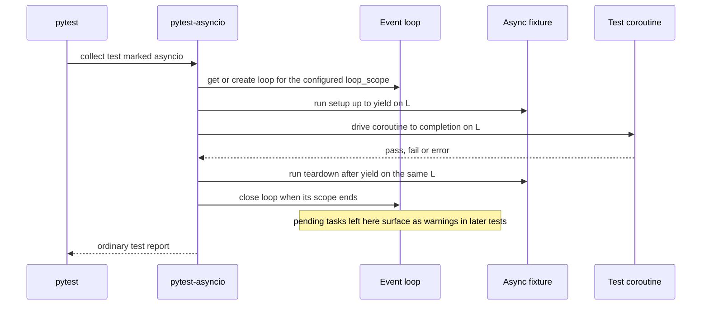

## TL;DR
Agent loops are async: parallel tool calls, streamed tokens, timeouts and cancellation. pytest-asyncio
runs `async def` tests and fixtures on a loop it owns, so you can test those behaviours. Most sharp
edges come from loop lifetime.

## For agent builders
- **Why it matters for agents.** A step that runs three tool calls with `asyncio.gather`, a per-tool
  timeout, a token stream the user can abort: each has bugs that only appear while the loop schedules
  tasks. A sync test of the same code proves nothing about them.
- **Where it shows up in your stack.** Async SDK clients (`httpx.AsyncClient` underneath most LLM SDKs),
  async agent frameworks, FastAPI streaming endpoints, MCP clients and servers. Their tests run under this
  plugin or anyio's.
- **What you control.** `asyncio_mode`, the loop scope of each fixture and test, injected delays so retry
  and backoff tests stay fast, and a guard that fails any test leaving a tool task pending.
- **What you can skip.** Custom loop policies and the old `event_loop` override. Pin the plugin, set the
  config keys explicitly and use the defaults.

## Why it exists
- **pytest calls tests synchronously.** An `async def` test is just a coroutine object nobody awaits.
- **Agents are mostly I/O.** One agent step fans out to an LLM, a vector store, a reranker and several
  tools, usually through `httpx.AsyncClient`, async database drivers and `asyncio.gather`.
- **The interesting bugs only exist while the loop schedules tasks.** A semaphore that does not cap
  concurrency, a timeout that leaves the request running, a cancelled stream that never closes its
  connection, a retry that swallows `CancelledError`. Calling sync wrappers cannot reveal them.
- **`def test_x(): asyncio.run(main())` is not enough.** It works for one coroutine but creates and
  destroys a loop per call, offers no shared async setup and teardown (a client opened before the test
  and closed after it), and cannot share an expensive resource such as a connection pool across tests.
- **A bare `async def test_x()` is worse.** pytest has no idea how to run it: older versions warned and
  skipped such tests, recent versions fail them. The plugin turns a coroutine into a test run.

## How it works
### What the plugin hooks into
1. It registers hooks that recognise coroutine test functions and async fixtures.
2. For a test it treats as async, it obtains an event loop for the configured scope.
3. It drives the coroutine to completion on that loop and reports an ordinary pass, fail or error.
4. Async fixtures (plain `async def` returning a value, or an async generator using `yield`) are wrapped
   the same way: code before `yield` is setup on the loop, code after is teardown on the same loop,
   because closing an async client on a different loop than it was opened on fails.

### Strict vs auto mode
Set with `asyncio_mode` in pytest config.

| Mode | What runs as asyncio | Fixture decorator | Why |
|---|---|---|---|
| **strict** (default) | only tests marked `@pytest.mark.asyncio` | `@pytest_asyncio.fixture` | a project may use several async frameworks (asyncio, trio via anyio); the plugin should not claim tests it does not own |
| **auto** | every `async def` test | plain `@pytest.fixture` works on async functions | removes boilerplate in an asyncio-only project |

### Loop scope
- **Scopes:** function (a fresh loop per test, the default), class, module, package or session.
- **A fresh loop isolates tests**, because leftover tasks and callbacks from one test cannot leak into
  the next.
- **A wider loop is needed** when a wide-scoped async fixture (a session-wide database pool) is used by
  tests, because those tests must run on the loop the pool was created on.
- **Recent API:** `loop_scope` arguments on the marker and on `pytest_asyncio.fixture`, plus a
  default-fixture-loop-scope config key (`asyncio_default_fixture_loop_scope`).
- **Old API:** an overridable `event_loop` fixture, deprecated and since removed. Check the docs for your
  pinned version, because this API changed more than once.

### What an agent test suite needs from it
| Agent behaviour | What the test asserts | Needs a running loop because |
|---|---|---|
| Parallel tool calls in one step | results keep call order, one failure does not sink the rest | `gather` schedules the tools concurrently |
| Per-tool timeout | slow tool returns an error result and is cancelled | only the loop can cancel a pending await |
| User aborts a streamed answer | the stream and its HTTP response close | cleanup runs on cancellation |
| Concurrency cap on model calls | peak in-flight calls never exceed the limit | overlap exists only while tasks interleave |

### What it does not do
- **No concurrency between tests.** pytest still runs one test at a time and the plugin runs each
  coroutine to completion before the next, so async does not speed up a slow suite (use pytest-xdist).
  Concurrency exists only *inside* a test, among the tasks it creates.
- **No fake clock.** `asyncio.sleep(10)` really waits ten seconds, which is why timeout and retry tests
  use tiny delays or inject the delay or clock as a parameter.
- **No cleanup of your tasks.** Tasks a test spawned and never awaited are still pending when the loop
  closes; they surface as warnings or as errors attributed to a later test.
- **Alternative loops (uvloop).** Use the plugin's documented mechanism for your pinned version (an
  event-loop policy fixture in recent releases) rather than constructing and swapping loop objects
  yourself. Python 3.14 deprecates loop policies, so expect this to move again.

### The alternative: anyio's plugin
- **`@pytest.mark.anyio`** can run the same test under asyncio and trio. If your code is written against
  anyio (as Starlette and httpx internals are), it is a reasonable alternative.
- **Pick one per suite.** With pytest-asyncio in auto mode both plugins can try to claim the same
  coroutine tests, and the resulting errors are confusing to debug.

## Diagram
One async test under strict mode with function loop scope: setup, the test body and teardown all run on
the same loop, which is closed when the test ends.



## Examples
### Agent scenario: parallel tool calls with a per-tool timeout
The agent runs every tool call the model requested in one step. A slow tool must come back as an error
result the model can read, not hang the step, and must actually be cancelled.

```python
import asyncio
import pytest

async def run_tool_calls(calls, tools, timeout_s):
    async def one(call):
        try:
            async with asyncio.timeout(timeout_s):           # Python 3.11+
                return {"id": call["id"], "content": await tools[call["name"]](**call["args"])}
        except TimeoutError:
            return {"id": call["id"], "error": f"{call['name']} timed out after {timeout_s}s"}
    return await asyncio.gather(*(one(c) for c in calls))    # keeps call order

def make_tools(state):
    async def search(q):
        await asyncio.sleep(0.01)
        return f"results for {q}"
    async def browse(url):
        state["browse_open"] = True
        try:
            await asyncio.sleep(10)                          # a hung page load
        finally:
            state["browse_open"] = False                     # runs on cancellation
    return {"search": search, "browse": browse}

@pytest.mark.asyncio
async def test_slow_tool_becomes_error_result_and_is_cancelled():
    state = {}
    calls = [{"id": "c1", "name": "search", "args": {"q": "kv cache"}},
             {"id": "c2", "name": "browse", "args": {"url": "https://example.com"}}]
    out = await run_tool_calls(calls, make_tools(state), timeout_s=0.05)
    assert out[0] == {"id": "c1", "content": "results for kv cache"}
    assert "timed out" in out[1]["error"]
    assert state["browse_open"] is False                     # no tool left running
```

- **Why it matters:** without the timeout one hung tool stalls the whole agent; without cancellation the
  hung task keeps a connection open after the step has moved on.
- **Fast:** total runtime is about 0.05 s because the delays are injected, not production-sized.

### Fan-out limit and timeout cancellation
A fan-out helper must never exceed a concurrency limit, and a timeout must leave no request in flight.
Both properties exist only while the loop runs. A fake LLM records peak concurrency; the async fixture
checks in teardown that nothing leaked.

```python
# pyproject.toml: [tool.pytest.ini_options] asyncio_mode = "strict"
import asyncio
import pytest
import pytest_asyncio

class FakeLLM:
    def __init__(self, delay: float):
        self.delay, self.in_flight, self.peak = delay, 0, 0
    async def complete(self, prompt: str) -> str:
        self.in_flight += 1
        self.peak = max(self.peak, self.in_flight)
        try:
            await asyncio.sleep(self.delay)
            return prompt.upper()
        finally:
            self.in_flight -= 1          # runs on success and on cancellation

async def fan_out(llm, prompts, limit: int):
    sem = asyncio.Semaphore(limit)
    async def one(p):
        async with sem:
            return await llm.complete(p)
    return await asyncio.gather(*(one(p) for p in prompts))

@pytest_asyncio.fixture
async def llm():
    client = FakeLLM(delay=0.01)
    yield client
    assert client.in_flight == 0          # teardown, same loop as the test

@pytest.mark.asyncio
async def test_fan_out_respects_limit(llm):
    out = await fan_out(llm, [f"p{i}" for i in range(20)], limit=4)
    assert out == [f"P{i}" for i in range(20)]   # gather preserves order
    assert llm.peak == 4

@pytest.mark.asyncio
async def test_timeout_cancels_inner_call(llm):
    llm.delay = 10
    with pytest.raises(TimeoutError):
        async with asyncio.timeout(0.05):        # Python 3.11+
            await llm.complete("x")
    assert llm.in_flight == 0
```

- **Fast:** the suite runs in well under a second because the delays are tiny.
- **What a bug looks like:** a broken limit shows up as `peak == 20`; a timeout that does not cancel
  shows up as `in_flight == 1`.

### Streams must close on early stop and on cancel
A token stream wraps an HTTP response; when the agent stops early (a stop sequence, a guardrail) or the
user disconnects, its cleanup must run.

```python
import asyncio
from contextlib import aclosing        # Python 3.10+
import pytest

async def stream_tokens(state: dict, n: int = 100):
    state["open"] = True
    try:
        for i in range(n):
            await asyncio.sleep(0.001)      # stands in for a network read
            yield f"t{i}"
    finally:
        state["open"] = False           # stands in for closing the HTTP response

async def first_k(state: dict, k: int) -> list[str]:
    out: list[str] = []
    async with aclosing(stream_tokens(state)) as agen:
        async for tok in agen:
            out.append(tok)
            if len(out) == k:
                break                   # aclosing runs the generator's finally now
    return out

@pytest.mark.asyncio
async def test_early_stop_closes_stream():
    state: dict = {}
    assert await first_k(state, 3) == ["t0", "t1", "t2"]
    assert state["open"] is False       # without aclosing, still True here

@pytest.mark.asyncio
async def test_cancel_mid_stream_closes_stream():
    state: dict = {}
    task = asyncio.create_task(first_k(state, 50))
    await asyncio.sleep(0.01)
    task.cancel()
    with pytest.raises(asyncio.CancelledError):
        await task
    assert state["open"] is False
```

- **Why `aclosing`:** breaking out of `async for` leaves the async generator suspended; its `finally`
  runs only when it is finalized later. `aclosing` closes it at the end of the block.
- **The cancel test** proves the cleanup also runs when the consumer task is cancelled mid-stream.

### Worked incident: "attached to a different loop" only in CI
| Step | What happened |
|---|---|
| Fixture | session-scoped async fixture opens a connection pool on the first test's loop |
| Locally | developer runs one test; only one loop exists, so it passes |
| CI, full suite | test 2 runs on a new function-scoped loop and reuses a pooled connection |
| Symptom | `RuntimeError` mentioning a Future "attached to a different loop" |
| Fix | `loop_scope="session"` on both the fixture and the marker of tests that use it |

```python
@pytest_asyncio.fixture(scope="session", loop_scope="session")
async def pool():
    p = await create_pool(DSN)        # your driver's pool factory
    yield p
    await p.close()

pytestmark = pytest.mark.asyncio(loop_scope="session")   # every test in this module
```

## Production patterns
- **Every tool call has a timeout under test.** For each async tool, one test runs it with a fake that
  never returns and asserts the step yields an error result and the task is cancelled. Monitor
  production tool-timeout rates per tool; a tool with no timeout test is the one that hangs an agent.
- **Explicit, pinned config.** Pin the plugin version and set `asyncio_mode = "strict"` and
  `asyncio_default_fixture_loop_scope = "function"` in `[tool.pytest.ini_options]`, so behaviour does not
  shift on upgrade. Monitor deprecation warnings from the plugin in CI output after each bump.
- **Leaked-task guard.** An autouse `@pytest_asyncio.fixture` that, after `yield`, collects
  `asyncio.all_tasks()` except `asyncio.current_task()`, cancels any not done and raises, so pytest
  reports a teardown error. Leaks then land on the test that caused them, not a later one. Watch for
  tests that need an opt-out.
- **asyncio debug mode in CI.** Run the async lane with `PYTHONASYNCIODEBUG=1` (or `python -X dev`):
  asyncio then logs callbacks slower than `loop.slow_callback_duration` (0.1 s by default) and gives
  "never awaited" warnings a traceback. Grep CI logs for "Executing" warnings to catch blocking calls.
- **Session pool, session loop, one module.** Put tests that share a costly async pool in one module
  with `pytestmark = pytest.mark.asyncio(loop_scope="session")`, and keep everything else on function
  loops. Monitor order-dependent failures with randomized order.
- **Injected delays and clocks.** Pass retry backoff and timeouts as parameters (or a `sleep` callable)
  so tests use 0.01 s where production uses seconds. Track async-lane wall time; a jump usually means a
  real delay crept in.

## Trade-offs
- **Function-scoped loops: isolation vs rebuild cost.** Every test is isolated from leaked tasks, but
  expensive async resources are rebuilt per test; widen loop scope only for genuinely costly fixtures.
- **Auto mode: less boilerplate vs claiming everything.** It removes markers and special fixture
  decorators but claims every coroutine test, so it fits asyncio-only projects and breaks once anyio or
  trio tests appear in the same suite.
- **Real `asyncio.sleep`: faithful vs slow.** Real delays match production timing but make suites slow
  and timing-sensitive; injecting a clock or tiny delays wins once the suite grows past a few minutes.
- **Real event loop: catches scheduling bugs vs harder tests.** It finds bugs sync wrappers hide, but
  tests are harder to read and debug. If the property does not depend on scheduling (a prompt builder
  that happens to be `async`), extract it and test it synchronously.
- **Session-scoped loops: one pool vs shared poison.** One connection pool serves the whole suite, but
  one test's leaked task or closed client poisons every later test. Switch to function scope as soon as
  failures appear only in particular test orders.

## Pitfalls
- **Session async fixture, function-loop tests.** Symptom: `RuntimeError` mentioning a Future or Task
  "attached to a different loop", often only in CI ordering. Fix: matching `loop_scope`.
- **Missing marker or decorator in strict mode.** A missing marker makes recent pytest fail the test as
  an unsupported `async def` (older pytest warned and skipped it). A missing `pytest_asyncio.fixture`
  hands the test an un-awaited coroutine or async generator object, so it fails on first attribute
  access or with a "never awaited" warning.
- **Blocking calls in async tests.** `time.sleep`, sync HTTP or sync DB drivers inside an async test or
  fixture: the test passes but serialises everything, so concurrency assertions are silently meaningless.
- **Orphaned tasks.** `asyncio.create_task` without awaiting or cancelling, common in agents that start
  background tool calls or memory writes. Symptom: "Task was destroyed
  but it is pending" warnings and assertions failing in a later, unrelated test.
- **Stale `event_loop` override.** Copied from an old blog post into a pinned recent version: on 0.2x
  releases it gives a deprecation warning; on 1.x the plugin no longer consults that fixture at all, so
  your custom loop or policy silently stops applying.

## When to use
- **Use when:** the unit under test is a coroutine and the property depends on scheduling: parallel tool
  calls, concurrency caps, timeouts, cancellation, streaming, ordering of `gather` results, backpressure.
- **Avoid when:** pure logic merely sits inside async code; extract it into a sync function and test it
  without a loop.
- **Configure:** pin the plugin and set `asyncio_mode` and the default fixture loop scope explicitly, so
  behaviour does not change on upgrade.
- **Per-test hang limit:** wrap risky awaits in `asyncio.timeout(...)` inside the test, or use
  `pytest-timeout`, so a never-resolving future fails one test instead of hanging the CI job.
- **FastAPI apps:** pair it with an async HTTP client against the ASGI app, for streaming agent endpoints.
- **Interviews:** explaining the "attached to a different loop" error from first principles signals you
  understand both asyncio and pytest fixtures.

## Role lens
- **Engineer:** Writes async tests for fan-out, retry and streaming code, choosing loop scopes so
  shared pools work without leaking state between tests.
- **Architect:** Sets the project-wide async testing convention: one async framework, pinned plugin,
  explicit mode and loop scope, and a rule that blocking calls in async code fail lint or review.
- **FDE:** Reproduces a customer's intermittent timeout or hung stream as a small async test with a
  fake slow dependency, so the fix can be shown working before redeploying.

## Check yourself
**Q:** Your suite has a session-scoped async fixture that opens an `httpx.AsyncClient`. Tests pass
when run one at a time but fail in CI with "attached to a different loop". What is happening and how
do you fix it?
**A:** The client lives for the whole session, but each test by default runs on its own
function-scoped loop that is closed when the test ends. The client's pooled connections are bound to
whichever loop was running when they were opened, typically the first test that made a request. The
next test pulls those keep-alive connections from the pool and awaits I/O tied to a dead loop. Run
alone, only one test loop ever exists, so nothing is shared across loops and it passes. Fixes: run the
fixture and the tests that use it on the same wider loop (`loop_scope="session"` on both
`pytest_asyncio.fixture` and the `asyncio` marker), or make the fixture function-scoped and accept
the cost, or create the client inside each test. The principle is that async resources are bound to
the loop they were made on, so fixture lifetime and loop lifetime must match.

## Interview questions
### Why can't pytest run an async def test without a plugin?
- **pytest calls tests synchronously**, so calling an `async def` test only creates a coroutine object
  that nobody awaits; recent pytest fails such tests and older versions warned and skipped them.
- **The plugin supplies the loop:** it recognises coroutine tests and async fixtures, obtains a loop for
  the configured scope and drives each coroutine to completion.
- **Why not `asyncio.run` in a sync test:** it gives no async setup and teardown and cannot share a pool
  across tests.

### How would you test that a fan-out helper never exceeds its concurrency limit?
- **Use a fake dependency that awaits**, for example `asyncio.sleep(0.01)`, and records `in_flight` and
  `peak` counters in a `try`/`finally`.
- **Run enough calls to saturate the limit**, such as 20 prompts with `limit=4`, and assert `peak == 4`.
- **Never block in the fake:** `time.sleep` stops task switching, so calls never overlap and the test
  passes even when the limit is broken.

### An agent step runs tool calls in parallel. How do you test that one hung tool cannot stall the agent?
- **Give each call a timeout** (`asyncio.timeout`) and turn `TimeoutError` into an error result the model
  can read, so the step completes with partial results.
- **Test it with a fake tool that sleeps far longer than the timeout** and records cleanup in a
  `finally`; assert the error result, the order of results, and that the cleanup ran.
- **Keep the timeout tiny in the test**, such as 0.05 s, so the case costs nothing in CI.

### When would you choose auto mode over strict mode, and when not?
- **Auto mode suits an asyncio-only project:** every `async def` test is claimed and plain
  `@pytest.fixture` works on async functions, which removes boilerplate.
- **Strict mode suits mixed suites:** when anyio or trio tests exist, auto mode claims coroutine tests it
  does not own and the errors are confusing.
- **Either way, set it explicitly** with `asyncio_mode` and pin the plugin, because defaults and APIs have
  changed between versions.

### Async tests leave "Task was destroyed but it is pending" warnings in CI. How do you find the culprit?
- **Cause:** a test called `asyncio.create_task` and never awaited or cancelled it, so the task is still
  pending when its loop closes and the warning lands on a later test.
- **Locate it** with an autouse async fixture that, after `yield`, checks `asyncio.all_tasks()` minus
  `asyncio.current_task()` and fails the test that leaked.
- **Get tracebacks** by running the lane with `PYTHONASYNCIODEBUG=1` or `python -X dev`.

### A user closes the browser mid-answer. How do you prove the agent stops spending tokens?
- **Model the disconnect as cancellation** of the task consuming the stream, as a server does when the
  client goes away.
- **Test it:** start the consumer with `asyncio.create_task`, cancel it after a few tokens, expect
  `CancelledError`, and assert the stream's `finally` closed the response.
- **Also cover early stop** with `aclosing`, since a `break` alone leaves the generator suspended.
- **Retry tests stay fast** the same way timeouts do: there is no fake clock, so `asyncio.sleep(10)`
  really waits; inject a `sleep` callable and pass 0.01 s.

## Quiz
### Q: In pytest-asyncio's strict mode, what happens to an unmarked `async def` test?
- [ ] It is run automatically on a fresh event loop
- [x] The plugin does not claim it, so it is not run as an asyncio test
- [ ] It runs on the session event loop instead of a function-scoped one
- [ ] It is converted into a synchronous test by wrapping it in asyncio.run
> Strict mode only treats tests with `@pytest.mark.asyncio` as asyncio tests, so multiple async
> plugins can coexist; an unclaimed coroutine test is then failed (or, on older pytest, skipped) by pytest
> itself. Automatic claiming of every coroutine test is what auto mode does.

### Q: Why does an async generator fixture run its teardown on the same loop as its setup?
- [ ] Because pytest requires all fixtures to share one thread
- [ ] Because a new loop would rerun the setup code
- [x] Because async resources such as clients and pools are bound to the loop they were created on
- [ ] Because teardown code is not allowed to await anything
> Closing a connection or awaiting a future from another loop raises errors, so setup, the test and
> teardown must all execute on one loop. Thread sharing is a separate concern from loop binding.

### Q: A concurrency-limit test passes, yet production exceeds the limit. Which test flaw best explains it?
- [ ] The test used a function-scoped event loop
- [x] The fake dependency blocked with time.sleep, so calls never overlapped and peak concurrency stayed low
- [ ] The test used auto mode instead of strict mode
- [ ] The fixture was declared with pytest_asyncio.fixture
> A blocking sleep stops the loop from switching tasks, so the test never produced concurrent calls
> to count. Loop scope and plugin mode affect which loop runs the test, not whether calls overlap.
