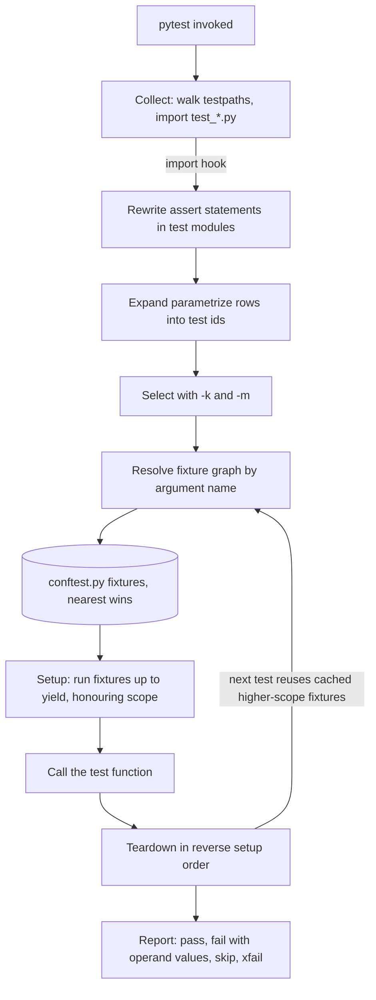

## TL;DR
pytest is the de facto Python test runner: informative plain `assert`, fixtures injected by argument
name, parametrized case tables and a plugin hook system. It makes the cheap way to write tests the
correct one.

## Why it exists
- **unittest is a JUnit port with ceremony.** Every test lives in a `TestCase` subclass, every assertion
  is a method (`assertEqual`, `assertIn`, `assertRaises`, dozens more), and setup is `setUp`/`tearDown`
  per class with no way to compose shared resources.
- **Failures are opaque.** A failing `assertEqual(a, b)` prints `3 != 4` and nothing about where 3 came
  from. A plain `assert a == b` is worse: Python's own `AssertionError` carries no message at all.
- **AI code needs many cases.** Chunkers with boundary conditions, prompt builders that escape user
  text, parsers for possibly fenced JSON, tool dispatchers that reject malformed arguments, retry
  wrappers that stop after N attempts. Each needs a table of inputs plus shared, expensive setup.
- **Friction cuts coverage.** If each table row costs a class and each setup costs a method, people
  write three tests where they needed thirty.
- **pytest answers both problems.** It rewrites `assert` so a bare comparison yields a useful failure,
  and treats setup as dependency injection with lifetimes. Everything else (async, parallelism) arrives
  as plugins through the same hook mechanism.

## How it works
### Discovery and collection
1. `pytest` walks `testpaths` (or the current directory).
2. It imports files matching `test_*.py` or `*_test.py`.
3. It collects functions prefixed `test_` and methods of classes prefixed `Test` that have no `__init__`.
4. It also collects `unittest.TestCase` subclasses, which is how a legacy suite migrates incrementally.
- **Collection runs before any test**, so a syntax error anywhere fails the whole session early.
- **`--collect-only`** shows the exact test ids that would run.

### Assertion rewriting
- **An import hook does it.** When pytest imports a test module (plus `conftest.py` files and any
  package registered with `pytest.register_assert_rewrite`), it rewrites the AST so each `assert expr`
  evaluates sub-expressions, keeps their values and builds a message on failure.
- **Result:** `assert len(chunks) == n` fails with `assert 4 == 3` and ` +  where 4 = len([...])`.
- **Import time, not tracing**, because tracing would slow every test and could not see inside a single
  expression.
- **Test modules only**, because changing bytecode in production code would be a surprising side effect.
- **Cached** as `.pyc` files tagged with the pytest version.

### Fixtures
A fixture is a function decorated with `@pytest.fixture`. A test that names it as a parameter gets its
return value; pytest resolves the dependency graph (fixtures can depend on fixtures) per test.

| Scope | Lifetime |
|---|---|
| `function` (default) | rebuilt per test |
| `class` | once per test class |
| `module` | once per test file |
| `package` | once per package |
| `session` | once per run |

- **`yield` splits setup from teardown**, and teardown runs even when the test fails.
- **`conftest.py` sharing.** Fixtures declared there are visible to every test in that directory tree
  without imports; that is how a project shares its `fake_llm` or `db` fixture.
- **Built-ins:** `tmp_path` (fresh directory), `monkeypatch` (undoable attribute and env-var changes),
  `capsys` and `caplog` (captured stdout and log records), `request` (introspection of the calling test).
- **Scope rule.** A higher-scoped fixture cannot depend on a lower-scoped one, because a session-wide
  object cannot be rebuilt once per test; violating it raises `ScopeMismatch` at setup.

Three more rules explain most fixture surprises:
- **Teardown runs in reverse order of setup**, because a fixture's dependencies must still exist while it
  cleans up (the client closes before the server it talks to stops).
- **`autouse=True` applies a fixture to every test in its scope** without being named. It suits "always
  block real network calls" or "always reset settings", but is invisible to the reader of a test.
- **Nearer definitions shadow outer ones.** A same-named fixture in a nearer `conftest.py` (or the test
  module) wins, so `tests/integration/conftest.py` can replace the root `llm` fake with a real client
  for that directory alone.

### Parametrization
- **`@pytest.mark.parametrize("raw,expected", cases, ids=[...])`** expands one function into one test
  per row, each with its own id such as `test_parse[fenced-json]`.
- **Stacking two decorators** yields the Cartesian product.
- **`pytest.param(..., marks=pytest.mark.xfail)`** marks a single row.
- **Fixtures can be parametrized too** (`params=`): every dependent test runs once per parameter. A
  `store` fixture parametrized over `["memory", "pgvector"]` runs the whole store suite on both backends.

### Markers and selection
- **Known gaps:** `@pytest.mark.skip`, `skipif`, and `xfail(strict=True)`.
- **Custom lanes:** markers such as `integration` or `e2e` are registered in configuration and selected
  with `-m "not e2e"`.
- **`--strict-markers`** turns a marker typo into an error, because an unregistered marker otherwise
  produces only a `PytestUnknownMarkWarning` that is easy to miss. The misspelled test is then not
  matched by `-m`, so it runs in the wrong lane.

| Option | Effect |
|---|---|
| `-k` | select by substring or boolean expression over test names |
| `-x` | stop at the first failure |
| `--lf` | rerun only the last failures |
| `--durations=10` | list the slowest tests |

### Configuration and plugins
- **Config** lives under `[tool.pytest.ini_options]` in `pyproject.toml`: `testpaths`, `addopts`,
  `markers`, `filterwarnings`.
- **Plugins** are ordinary packages that implement `pytest_*` hook functions and register an entry point;
  `conftest.py` can implement the same hooks locally.

| Plugin an AI engineer meets weekly | What it adds |
|---|---|
| `pytest-asyncio` | coroutine tests |
| `pytest-xdist` | `-n auto` distributes tests across one worker process per CPU core |
| `pytest-cov` | coverage |
| `pytest-timeout` | kills hung tests |
| `pytest-mock` | the `mocker` fixture |
| Hypothesis | registers its own settings and database handling |

- **xdist changes fixture semantics.** Each worker is a separate process with its own session, so a
  "session" fixture that starts a container runs once *per worker*.
- **Order-dependent tests break under xdist**, because a test relying on another test's side effects may
  land on a different worker.

## Diagram
Follow one run: collection and assertion rewriting happen before any test executes, then each test
resolves its fixture graph, runs, and tears fixtures down in reverse order.



## Examples
### Chunker suite: session fixture, parametrized ids, `pytest.raises`
The chunker counts whitespace tokens so the arithmetic in the ids is checkable by hand.

```python
# tests/conftest.py
import pytest
from myapp.chunking import Chunker

@pytest.fixture(scope="session")
def chunker():                              # built once per run: construction is the slow part
    return Chunker(max_tokens=50, overlap=5)

# tests/test_chunking.py
import pytest

@pytest.mark.parametrize("text,n_chunks", [
    ("", 0),
    ("short", 1),
    ("word " * 120, 3),                     # windows 0-49, 45-94, 90-119 -> three chunks
], ids=["empty", "single", "overlapping"])
def test_chunk_count(chunker, text, n_chunks):
    assert len(chunker.split(text)) == n_chunks

def test_every_chunk_respects_limit(chunker):
    chunks = chunker.split("word " * 1000)
    assert all(chunker.count_tokens(c) <= 50 for c in chunks)

def test_overlap_is_shared_tokens(chunker):
    text = " ".join(f"w{i}" for i in range(120))   # distinct tokens, so overlap is observable
    first, second = chunker.split(text)[:2]
    assert first.split()[-5:] == second.split()[:5] == ["w45", "w46", "w47", "w48", "w49"]

@pytest.mark.parametrize("bad", [None, 42, b"bytes"])
def test_rejects_non_text(chunker, bad):
    with pytest.raises(TypeError):
        chunker.split(bad)
```

- **Run** `pytest -q tests/test_chunking.py`: a wrong overlap implementation fails as
  `test_chunk_count[overlapping]` with `assert 4 == 3` followed by `where 4 = len([...])`. You get the
  case and the value without a debugger.
- **Distinct tokens on purpose.** With `"word " * 120` every window looks identical, so the overlap
  assertion would pass even with zero overlap.
- **`pytest -k overlap`** runs just the two ids containing the word: `test_chunk_count[overlapping]` and
  `test_overlap_is_shared_tokens`.

### Runnable: a model-output parser as a case table
Self-contained; save as `test_parse.py` and run `pytest -q test_parse.py`.

```python
import json, re
import pytest

FENCE = "`" * 3                      # a Markdown code fence, built so this file nests cleanly
FENCED = re.compile(FENCE + r"(?:json)?\s*(.*?)" + FENCE, flags=re.S)

def parse_json_reply(text: str) -> dict:
    """Accept bare JSON or JSON inside a fence; reject anything that is not an object."""
    m = FENCED.search(text)
    body = m.group(1) if m else text
    data = json.loads(body.strip())
    if not isinstance(data, dict):
        raise ValueError("expected a JSON object")
    return data

@pytest.mark.parametrize("raw,expected", [
    ('{"a": 1}', {"a": 1}),
    (f'{FENCE}json\n{{"a": 1}}\n{FENCE}', {"a": 1}),
    (f'Sure!\n{FENCE}\n{{"a": [1, 2]}}\n{FENCE}', {"a": [1, 2]}),
], ids=["bare", "fenced-json", "chatty-fence"])
def test_parse_ok(raw, expected):
    assert parse_json_reply(raw) == expected

@pytest.mark.parametrize("raw,exc", [
    ("[1, 2]", ValueError),
    ("not json", json.JSONDecodeError),
], ids=["array", "prose"])
def test_parse_rejects(raw, exc):
    with pytest.raises(exc):
        parse_json_reply(raw)
```

Five ids such as `test_parse_ok[fenced-json]` show up in the report, so a regression names the input
shape that broke. `json.JSONDecodeError` is a subclass of `ValueError`, so the "prose" row asserts the
narrower class on purpose.

### Worked scenario: a session fixture under xdist
A suite has a session fixture that starts a vector-DB container in ~20 s (illustrative figure).

| Run | Workers | Container starts | Fixed setup cost |
|---|---|---|---|
| `pytest` | 1 | 1 | ~20 s |
| `pytest -n auto` on 8 cores | 8 | 8 | ~20 s each, in parallel, plus 8× the memory |
| `-n auto` + file lock, shared container | 8 | 1 | ~20 s once; others wait and reuse it |

The fix that teams use is the xdist docs pattern: guard startup with a file lock under
`tmp_path_factory.getbasetemp().parent`, which all workers share, and isolate data per worker with the
`worker_id` fixture (for example a collection name suffixed with it).

- **Teardown is the hard part.** No worker knows when the others have finished, so the lock pattern
  suits read-only data you can leave behind; for a container, many teams start it once outside pytest
  (a CI service container or `docker compose up`) and pass its address in.

## Production patterns
- **Lane split with strict markers.** Register `integration` and `e2e` under `markers`, set
  `addopts = "-ra --strict-markers"`, run `-m "not integration and not e2e"` on every pull request and
  the slower lanes nightly or on merge. Monitor PR-lane wall time with `--durations=10`.
- **No real network in unit tests.** An `autouse` fixture in the root `conftest.py` uses `monkeypatch` to
  replace `socket.socket.connect` with a function that raises. A test that reaches a real LLM API then
  fails loudly instead of billing tokens. Monitor: any unit test that needs an opt-out marker.
- **Warnings as errors.** Set `filterwarnings = ["error"]` and whitelist known third-party warnings one
  by one, so deprecations from SDK upgrades fail CI before they become breakages. Review the whitelist on
  each dependency bump.
- **Hang protection.** With `pytest-timeout`, set a suite-wide `timeout` in config (or `--timeout=60`),
  because a stuck model call or event loop otherwise hangs CI until the job limit. Track which tests hit
  the timeout.
- **Order-independence check.** Run with `pytest-randomly` so order changes every run; on a failure,
  replay with the printed `--randomly-seed=<n>`. Monitor the flake rate per test id.
- **Shared fakes in root `conftest.py`.** Keep `fake_llm`, settings overrides and a temp workspace there,
  and replace them in `tests/integration/conftest.py` with real clients by shadowing the same name.

## Trade-offs
- **Concise injection vs hidden wiring.** Fixtures by name are short, but `conftest.py` hides where a
  value comes from; in a large suite you pay with `--fixtures` lookups and the occasional surprise
  override from a nearer `conftest.py`.
- **Informative `assert` vs scope of rewriting.** It only applies to modules pytest imports; helper
  assertions in a non-test package get the plain `AssertionError` unless you register them.
- **Session scope speed vs isolation.** It saves minutes when the resource is a loaded model or a
  container, but mutable state leaks between tests; the saving flips into flakiness the moment one test
  writes to the shared object.
- **Free plugins vs interactions.** Parallelism, coverage and async support come cheap, but each adds
  configuration interactions (xdist and session fixtures, asyncio loop scopes) you must understand when a
  test passes alone and fails in the suite.
- **`autouse` safety net vs readability.** It guarantees invariants (no real network, clean settings) in
  every test but hides setup; keep it for suite-wide invariants and name a fixture explicitly whenever
  only some tests need it.

## Pitfalls
- **Misspelled marker, wrong lane.** Symptom: an `e2e` test hits a real API on every pull request. Fix:
  `--strict-markers` turns this into a collection error.
- **Passes alone, fails together.** Usually a shared fixture mutated by an earlier test. `pytest-randomly`
  shuffles order and prints its seed, `--randomly-seed=<n>` replays it, and running the suspected pair
  alone confirms the dependence.
- **Floats compared with `==`.** Embedding similarities and loss values differ in the last bits across
  BLAS builds. Fix: `pytest.approx(expected, rel=1e-6)`.
- **Catching too broadly.** `pytest.raises(Exception)` lets a `TypeError` from a typo pass as the intended
  `ValueError`; use the specific class and `match=` on the message.
- **Lost `print` debugging.** pytest captures stdout and only shows it for failures. `-s` disables
  capture; `capsys` asserts on it.

## When to use
- **Use for:** every Python test, including inherited unittest-style classes; no modern Python scenario
  makes a different runner the better default.
- **Decide:** which fixtures live in the root `conftest.py` (fake LLM, settings override, temporary
  directory layout) versus a package-local one, which resources deserve session scope, and which markers
  split fast unit tests from integration and model-calling lanes.
- **Measure:** suite wall time with `--durations`; keep the pull-request lane under a few minutes,
  because a slow suite is one people stop running.
- **Interviews:** explain assertion rewriting, fixture scopes and the `conftest.py` lookup, and sketch a
  parametrized test for a parser of model output on the spot.

## Role lens
- **Engineer:** Writes parametrized tests for chunkers, prompt builders and output parsers, keeps a
  `fake_llm` fixture in `conftest.py`, and splits lanes with markers so unit tests stay fast.
- **Architect:** Sets the suite's shape: which dependencies are allowed in the unit lane, the marker
  taxonomy, time budgets per lane, and the plugins the whole organisation standardises on.
- **FDE:** Lands inside a customer repo with an unfamiliar suite and uses `--collect-only`,
  `--fixtures` and `-k` to find the tests covering the integration they are changing before touching
  code.

## Check yourself
**Q:** A colleague argues that `unittest` is "good enough" and pytest is just syntax sugar. Using the
mechanics rather than taste, what does pytest provide that changes how a test suite is built?
**A:** Two mechanisms, not sugar. First, assertion rewriting: pytest rewrites the AST of `assert`
in test modules at import time so a bare comparison reports the intermediate values, which removes
the need for a dozen assertion methods and makes failures diagnosable without a debugger. Second,
fixtures as dependency injection with scopes: a test names what it needs, pytest resolves a graph of
fixtures with function, module or session lifetimes and runs teardown after `yield`, so expensive
resources (a loaded tokenizer, a container) are built once and composed rather than duplicated in
`setUp` methods. Add parametrization, which turns a table of cases into individually identifiable
tests, and a hook system that lets plugins own concerns like async loops and parallel workers. Those
change the economics of writing tests, which is why suites built on pytest have more cases.

## Interview questions
### What is a fixture's scope, and how do you choose one?
- **Definition:** scope sets how often pytest rebuilds the fixture: `function` (default), `class`,
  `module`, `package` or `session`. The value is cached and shared for that lifetime.
- **Choose by cost and mutability.** Use session scope for expensive, read-only resources such as a loaded
  tokenizer or a container; keep anything a test mutates at function scope, because shared mutable state
  leaks between tests.
- **Constraint:** a wider-scoped fixture cannot depend on a narrower one, or setup raises `ScopeMismatch`.

### A test passes alone but fails in the full suite. How do you debug it?
- **Suspect shared state first:** a session or module fixture, a global, or an environment variable that an
  earlier test changed without `monkeypatch`.
- **Reproduce the order:** run with `pytest-randomly`, note the printed seed, and replay with
  `--randomly-seed=<n>`; then run the suspected pair alone to confirm.
- **Fix the cause:** narrow the fixture scope, reset state in a `yield` teardown, or use `monkeypatch` so
  the change is undone.

### Your suite uses a session fixture that starts a container. What changes under pytest-xdist?
- **Each worker is its own process with its own session**, so `-n auto` on 8 cores starts the container 8
  times, with 8 times the memory.
- **Share it with a file lock** under `tmp_path_factory.getbasetemp().parent`, which every worker sees, so
  only the first worker starts it.
- **Isolate data per worker** with the `worker_id` fixture, for example a collection name suffixed with it.

### When would you not use autouse fixtures?
- **Avoid them for setup only some tests need**, because an autouse fixture is invisible in the test's
  signature and readers cannot tell where state comes from.
- **Keep them for suite-wide invariants**, such as blocking real network calls or resetting settings, where
  forgetting to request the fixture would be the real bug.
- **Trade-off:** safety by default versus readability; name the fixture explicitly when in doubt.

### How would you keep a pull-request test lane fast as the suite grows to thousands of tests?
- **Split lanes with registered markers** and `--strict-markers`, running `-m "not integration and not
  e2e"` on each pull request and the slow lanes nightly or on merge.
- **Measure before optimising:** `--durations=10` lists the slowest tests, which are often a mis-scoped
  fixture rebuilt per test.
- **Then parallelise** with `pytest-xdist` (`-n auto`), after confirming tests are order-independent.

## Quiz
### Q: Why can pytest print the values inside a failing plain `assert` statement?
- [ ] Python's `AssertionError` always carries the evaluated sub-expressions
- [x] pytest rewrites the `assert` statements of test modules at import time into code that records intermediate values
- [ ] pytest runs every test under `sys.settrace` and reconstructs the expression from the trace
- [ ] The values come from the fixture that produced them, which pytest tracks by name
> Plain Python raises a bare `AssertionError`. pytest's import hook rewrites the AST of `assert` in
> collected test modules so the failure message includes each operand; tracing would be far too slow
> and could not see inside a single expression.

### Q: A session-scoped fixture declares a dependency on a function-scoped fixture. What happens?
- [ ] It works; the function-scoped fixture is rebuilt for each test and injected into the shared one
- [ ] It works but pytest emits a warning and caches the first value
- [x] pytest raises a `ScopeMismatch` error at setup time
- [ ] The session fixture is silently downgraded to function scope
> A session-wide object is built once and cannot be rebuilt per test, so it cannot depend on something
> that changes per test. pytest refuses the graph with `ScopeMismatch` rather than guessing a lifetime.

### Q: A test function carries two stacked `parametrize` decorators with 3 and 4 cases. How many tests run?
- [ ] 4, because the inner decorator takes precedence
- [ ] 7, one per case across both decorators
- [x] 12, the Cartesian product of the two case lists
- [ ] It fails at collection because stacked parametrization is not allowed
> Each `parametrize` multiplies the existing set of test instances by its own cases, so stacking
> produces every combination. Use a single decorator with explicit tuples when only specific pairs
> are meaningful.
