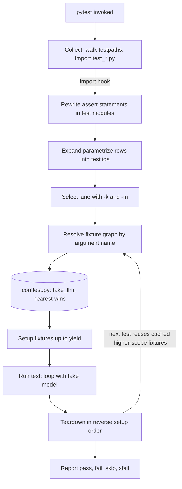

## TL;DR
pytest is how you test the deterministic shell around an agent: tool dispatch, output parsers, prompt
builders and loop control, with a scripted fake model. Plain `assert`, injected fixtures and
parametrized case tables make thirty cases as cheap as three.

## For agent builders
- **Why it matters for agents.** The model is nondeterministic, but everything around it is not: the
  loop that stops after N steps, the dispatcher that rejects malformed tool arguments, the parser for
  fenced JSON. Those bugs cause most agent incidents, and pytest pins them down without a single token.
- **Where it shows up in your stack.** A `fake_llm` fixture in the root `conftest.py`, parametrized
  tables of model replies, marker lanes (`integration`, `e2e`) that keep real-API tests off pull
  requests, and offline eval suites that many teams also run under pytest.
- **What you control.** Fixture scope for costly resources (tokenizer, vector store container), which
  lane may call a real model, a suite-wide block on network access, and timeouts so a hung model call
  cannot stall CI.
- **What you can skip.** Writing plugins and hook functions yourself. Know that plugins exist and change
  fixture behaviour (xdist, asyncio); you rarely author one.

## Lab
### Task
Production traces show a tool-calling loop crashing when the model names a tool that does not exist or
sends the wrong arguments, and billing one model call too many on runaway loops.

You will reproduce both defects with an offline pytest suite and a scripted model, read the rewritten assertion failures,
fix the loop, and extend the case table. Time box: 45-60 minutes.
- **Prerequisites:** this lesson's Fixtures and Parametrization sections; Test doubles, mocks and
  fixtures for the scripted-model idea.
- **Setup:** Python 3.11+, `pip install pytest` (checked against pytest 9.1.1). Save the starter as
  `agent_loop.py` and the tests as `test_agent_loop.py` in one directory.
- **Goal:** every malformed tool call becomes an error result the model can read, and the loop calls the
  model at most `max_steps` times.

### Starter code
```python
"""agent_loop.py: a tiny tool-calling loop. Two defects were reported from production."""
import json


class ScriptedLLM:
    """Stub plus spy: replays scripted replies and records every message list it was sent."""

    def __init__(self, replies):
        self.replies, self.calls = list(replies), []

    def complete(self, messages):
        self.calls.append([dict(m) for m in messages])
        if not self.replies:
            raise AssertionError("script exhausted: the loop called the model more often than scripted")
        return self.replies.pop(0)


TOOLS = {
    "get_weather": lambda city: {"city": city, "temp_c": 18},
    "add": lambda a, b: {"sum": a + b},
}


def run_agent(llm, user_msg, tools=TOOLS, max_steps=3):
    messages = [{"role": "user", "content": user_msg}]
    for _ in range(max_steps + 1):                      # EXERCISE: the budget is max_steps model calls
        reply = llm.complete(messages)
        if reply["type"] == "final":
            return reply["text"], messages
        result = tools[reply["name"]](**reply["args"])  # EXERCISE: bad calls must become error results
        messages.append({"role": "tool", "name": reply["name"], "content": json.dumps(result)})
    raise RuntimeError("step budget exhausted")


if __name__ == "__main__":
    call = {"type": "tool", "name": "get_weather", "args": {"city": "Oslo"}}
    llm = ScriptedLLM([call, {"type": "final", "text": "18 C in Oslo"}])
    text, messages = run_agent(llm, "weather in Oslo?")
    print("final:", text, "| tool message:", messages[-1]["content"])
    runaway = ScriptedLLM([call] * 10)
    try:
        run_agent(runaway, "loop forever", max_steps=3)
    except RuntimeError as e:
        print("runaway:", e, "| model calls:", len(runaway.calls))
```

### Expected output
`python agent_loop.py` after the fix (the starter prints `model calls: 4`), then `pytest -v`:

```text
final: 18 C in Oslo | tool message: {"city": "Oslo", "temp_c": 18}
runaway: step budget exhausted | model calls: 3

test_agent_loop.py::test_tool_result_reaches_model PASSED
test_agent_loop.py::test_bad_call_becomes_error_result[unknown-tool] PASSED
test_agent_loop.py::test_bad_call_becomes_error_result[missing-arg] PASSED
test_agent_loop.py::test_bad_call_becomes_error_result[wrong-arg-name] PASSED
test_agent_loop.py::test_loop_stops_at_budget[1] PASSED
test_agent_loop.py::test_loop_stops_at_budget[2] PASSED
test_agent_loop.py::test_loop_stops_at_budget[3] PASSED
7 passed
```

### Tests
On the starter, 6 of 7 fail: the three bad-call rows with `KeyError` or `TypeError`, the budget rows
with `assert 2 == 1`, `assert 3 == 2` and `assert 4 == 3`.

```python
import json

import pytest

from agent_loop import ScriptedLLM, run_agent

CALL = {"type": "tool", "name": "get_weather", "args": {"city": "Oslo"}}
FINAL = {"type": "final", "text": "18 C in Oslo"}


@pytest.fixture
def make_llm():
    return lambda *replies: ScriptedLLM(replies)


def test_tool_result_reaches_model(make_llm):
    llm = make_llm(CALL, FINAL)
    text, _ = run_agent(llm, "weather in Oslo?")
    assert text == "18 C in Oslo"
    assert json.loads(llm.calls[1][-1]["content"])["temp_c"] == 18


@pytest.mark.parametrize("bad_call", [
    {"type": "tool", "name": "rm_rf", "args": {}},
    {"type": "tool", "name": "get_weather", "args": {}},
    {"type": "tool", "name": "add", "args": {"a": 1, "c": 2}},
], ids=["unknown-tool", "missing-arg", "wrong-arg-name"])
def test_bad_call_becomes_error_result(make_llm, bad_call):
    llm = make_llm(bad_call, FINAL)
    text, messages = run_agent(llm, "go")
    assert text == "18 C in Oslo"                        # the loop kept going
    assert "error" in json.loads(messages[-1]["content"])  # and the model was told why


@pytest.mark.parametrize("budget", [1, 2, 3])
def test_loop_stops_at_budget(make_llm, budget):
    llm = make_llm(*[CALL] * (budget + 1))               # a model that never finishes
    with pytest.raises(RuntimeError, match="budget"):
        run_agent(llm, "loop forever", max_steps=budget)
    assert len(llm.calls) == budget
```

### Failure scenarios
- **Inject: catch `Exception` around the tool call.** All tests pass, but a typo inside a tool now
  reaches the model as an "error" too. Debug: add a row whose tool raises `ZeroDivisionError` and decide
  whether it should crash the run; narrow the `except` to argument errors.
- **Inject: share one `ScriptedLLM` at module scope.** The second test pops replies the first already
  used and fails with "script exhausted". Debug: run the failing id alone with `-k`; it passes, which
  points at shared state; keep the fixture function-scoped.
- **Inject: drop `ids=`.** Failures report `bad_call0` instead of `unknown-tool`. Debug: `--collect-only`
  shows the ids; restore names so a red run says which reply shape broke.
- **Inject: `max_steps=0` from config.** The loop raises before calling the model at all. Debug: add a
  budget row for 0 and decide whether a zero budget is a configuration error to reject at startup.

### Submission
- **Your fixed `agent_loop.py`**, with no change to the given tests.
- **A `pytest -v` log** showing all 7 ids passing, plus the starter's failing run for comparison.
- **Two new parametrized rows** with readable ids, one from a real reply shape you have seen (for
  example arguments sent as a JSON string instead of a dict).
- **A three-line note** naming which assertion message located each defect without a debugger.
- **Evaluated by:** the given tests pass unmodified, your rows fail on the starter, and the loop never
  calls the model more than `max_steps` times.

## Why it exists
- **unittest is a JUnit port with ceremony.** Every test lives in a `TestCase` subclass, every assertion
  is a method (`assertEqual`, `assertIn`, `assertRaises`, dozens more), and setup is `setUp`/`tearDown`
  per class with no way to compose shared resources.
- **Failures are opaque.** A failing `assertEqual(a, b)` prints `3 != 4` and nothing about where 3 came
  from. A plain `assert a == b` is worse: Python's own `AssertionError` carries no message at all.
- **Agent code needs many cases.** Chunkers with boundary conditions, prompt builders that escape user
  text, parsers for possibly fenced JSON, tool dispatchers that reject malformed arguments, retry
  wrappers that stop after N attempts. Each needs a table of inputs plus shared, expensive setup.
- **Friction cuts coverage.** If each table row costs a class and each setup costs a method, people
  write three tests where they needed thirty.
- **pytest answers both problems.** It rewrites `assert` so a bare comparison yields a useful failure,
  and treats setup as dependency injection with lifetimes. Everything else (async, parallelism) arrives
  as plugins through the same hook mechanism.

## How it works
### What to test in an agent repo
| Layer | Deterministic? | How pytest covers it |
|---|---|---|
| Tool functions and their argument validation | yes | plain unit tests, parametrized bad inputs |
| Dispatcher: tool name to function, errors fed back | yes | scripted fake model replies |
| Loop control: step budget, stop condition, retries | yes | fake model that never says "final" |
| Prompt and message assembly | yes | assert on the exact messages sent |
| The model's judgement | no | eval suites and recorded runs, in a separate lane |

- **Rule of thumb:** the unit lane never calls a model. It feeds scripted replies through the real loop,
  because that is where the deterministic bugs live.

### Discovery and collection
1. `pytest` walks `testpaths` (or the current directory).
2. It imports files matching `test_*.py` or `*_test.py`.
3. It collects functions prefixed `test_` and methods of classes prefixed `Test` that have no `__init__`.
4. It also collects `unittest.TestCase` subclasses, which is how a legacy suite migrates incrementally.
- **Collection runs before any test**, so a syntax error anywhere fails the whole session early.
- **`--collect-only`** shows the exact test ids that would run.

### Assertion rewriting
- **An import hook does it.** When pytest imports a test module (plus `conftest.py` files and any
  package registered with `pytest.register_assert_rewrite`), it rewrites the AST so each `assert expr`
  evaluates sub-expressions, keeps their values and builds a message on failure.
- **Result:** `assert len(chunks) == n` fails with `assert 4 == 3` and ` +  where 4 = len([...])`.
  For an agent test, `assert calls[1][-1]["role"] == "tool"` shows the actual message list.
- **Import time, not tracing**, because tracing would slow every test and could not see inside a single
  expression.
- **Test modules only**, because changing bytecode in production code would be a surprising side effect.
- **Cached** as `.pyc` files tagged with the pytest version.

### Fixtures
A fixture is a function decorated with `@pytest.fixture`. A test that names it as a parameter gets its
return value; pytest resolves the dependency graph (fixtures can depend on fixtures) per test.

| Scope | Lifetime | Agent example |
|---|---|---|
| `function` (default) | rebuilt per test | scripted fake LLM, message history |
| `class` | once per test class | rarely needed |
| `module` | once per test file | a seeded in-memory vector index |
| `package` | once per package | shared fixtures for one tool package |
| `session` | once per run | loaded tokenizer, vector-DB container |

- **`yield` splits setup from teardown**, and teardown runs even when the test fails.
- **`conftest.py` sharing.** Fixtures declared there are visible to every test in that directory tree
  without imports; that is how a project shares its `fake_llm` or `db` fixture.
- **Built-ins:** `tmp_path` (fresh directory, ideal as an agent's scratch workspace), `monkeypatch`
  (undoable attribute and env-var changes), `capsys` and `caplog` (captured stdout and log records),
  `request` (introspection of the calling test).
- **Scope rule.** A higher-scoped fixture cannot depend on a lower-scoped one, because a session-wide
  object cannot be rebuilt once per test; violating it raises `ScopeMismatch` at setup.

Three more rules explain most fixture surprises:
- **Teardown runs in reverse order of setup**, because a fixture's dependencies must still exist while it
  cleans up (the client closes before the server it talks to stops).
- **`autouse=True` applies a fixture to every test in its scope** without being named. It suits "always
  block real network calls" or "always reset settings", but is invisible to the reader of a test.
- **Nearer definitions shadow outer ones.** A same-named fixture in a nearer `conftest.py` (or the test
  module) wins, so `tests/integration/conftest.py` can replace the root `llm` fake with a real client
  for that directory alone.

### Parametrization
- **`@pytest.mark.parametrize("raw,expected", cases, ids=[...])`** expands one function into one test
  per row, each with its own id such as `test_parse[fenced-json]`.
- **Stacking two decorators** yields the Cartesian product, for example every tool times every malformed
  argument shape.
- **`pytest.param(..., marks=pytest.mark.xfail)`** marks a single row, such as a known model-output
  shape your parser does not handle yet.
- **Fixtures can be parametrized too** (`params=`): every dependent test runs once per parameter. A
  `store` fixture parametrized over `["memory", "pgvector"]` runs the whole store suite on both backends.

### Markers and selection
- **Known gaps:** `@pytest.mark.skip`, `skipif`, and `xfail(strict=True)`.
- **Custom lanes:** markers such as `integration` or `e2e` are registered in configuration and selected
  with `-m "not e2e"`.
- **`--strict-markers`** turns a marker typo into an error, because an unregistered marker otherwise
  produces only a `PytestUnknownMarkWarning` that is easy to miss. The misspelled test is then not
  matched by `-m`, so it runs in the wrong lane and may bill real tokens.

| Option | Effect |
|---|---|
| `-k` | select by substring or boolean expression over test names |
| `-x` | stop at the first failure |
| `--lf` | rerun only the last failures |
| `--durations=10` | list the slowest tests |

### Configuration and plugins
- **Config** lives under `[tool.pytest.ini_options]` in `pyproject.toml`: `testpaths`, `addopts`,
  `markers`, `filterwarnings`.
- **Plugins** are ordinary packages that implement `pytest_*` hook functions and register an entry point;
  `conftest.py` can implement the same hooks locally.

| Plugin an agent builder meets weekly | What it adds |
|---|---|
| `pytest-asyncio` | coroutine tests, for async agent loops and SDK clients |
| `pytest-xdist` | `-n auto` distributes tests across one worker process per CPU core |
| `pytest-cov` | coverage |
| `pytest-timeout` | kills hung tests, such as a stuck model call |
| `pytest-mock` | the `mocker` fixture |
| Hypothesis | registers its own settings and database handling |

- **xdist changes fixture semantics.** Each worker is a separate process with its own session, so a
  "session" fixture that starts a container runs once *per worker*.
- **Order-dependent tests break under xdist**, because a test relying on another test's side effects may
  land on a different worker.

## Diagram
Follow one run: collection and assertion rewriting happen before any test executes, then each test
resolves its fixture graph (here, the fake model), runs, and tears fixtures down in reverse order.



## Examples
### Agent scenario: testing a tool-calling loop with a scripted model
Self-contained; save as `test_agent_loop.py` and run `pytest -q`. The fake returns pre-written replies
and records every request, so tests assert on what the loop sent.

```python
import json
import pytest

class ScriptedLLM:
    def __init__(self, replies):
        self.replies, self.calls = list(replies), []
    def complete(self, messages):
        self.calls.append([dict(m) for m in messages])     # snapshot what the loop sent
        return self.replies.pop(0)

TOOLS = {"get_weather": lambda city: {"city": city, "temp_c": 18}}

def run_agent(llm, user_msg, max_steps=5):
    messages = [{"role": "user", "content": user_msg}]
    for _ in range(max_steps):
        reply = llm.complete(messages)
        if reply["type"] == "final":
            return reply["text"], messages
        fn = TOOLS.get(reply["name"])
        result = fn(**reply["args"]) if fn else {"error": f"unknown tool {reply['name']}"}
        messages.append({"role": "tool", "name": reply["name"], "content": json.dumps(result)})
    raise RuntimeError("step budget exhausted")

CALL = {"type": "tool", "name": "get_weather", "args": {"city": "Oslo"}}
FINAL = {"type": "final", "text": "18 C in Oslo"}

@pytest.fixture
def llm():
    return ScriptedLLM([CALL, FINAL])

def test_tool_result_reaches_model(llm):
    text, _ = run_agent(llm, "weather in Oslo?")
    assert text == "18 C in Oslo"
    assert json.loads(llm.calls[1][-1]["content"])["temp_c"] == 18

def test_unknown_tool_is_reported_not_raised():
    llm = ScriptedLLM([{"type": "tool", "name": "rm_rf", "args": {}}, FINAL])
    run_agent(llm, "clean up")
    assert "unknown tool" in llm.calls[1][-1]["content"]

@pytest.mark.parametrize("budget", [1, 3, 5])
def test_loop_stops_at_budget(budget):
    llm = ScriptedLLM([CALL] * budget)          # a model that never finishes
    with pytest.raises(RuntimeError, match="budget"):
        run_agent(llm, "loop forever", max_steps=budget)
    assert len(llm.calls) == budget
```

- **No tokens, no flakiness.** Five tests cover the happy path, the error-feedback path and the runaway
  loop, which are exactly the behaviours a real model run would hit only occasionally.
- **Assert on the transcript.** `llm.calls` is the message list the model saw; checking it catches a
  dropped tool result or a wrong role before a model ever does.

### Chunker suite: session fixture, parametrized ids, `pytest.raises`
The RAG chunker counts whitespace tokens so the arithmetic in the ids is checkable by hand.

```python
# tests/conftest.py
import pytest
from myapp.chunking import Chunker

@pytest.fixture(scope="session")
def chunker():                              # built once per run: construction is the slow part
    return Chunker(max_tokens=50, overlap=5)

# tests/test_chunking.py
import pytest

@pytest.mark.parametrize("text,n_chunks", [
    ("", 0),
    ("short", 1),
    ("word " * 120, 3),                     # windows 0-49, 45-94, 90-119 -> three chunks
], ids=["empty", "single", "overlapping"])
def test_chunk_count(chunker, text, n_chunks):
    assert len(chunker.split(text)) == n_chunks

def test_every_chunk_respects_limit(chunker):
    chunks = chunker.split("word " * 1000)
    assert all(chunker.count_tokens(c) <= 50 for c in chunks)

def test_overlap_is_shared_tokens(chunker):
    text = " ".join(f"w{i}" for i in range(120))   # distinct tokens, so overlap is observable
    first, second = chunker.split(text)[:2]
    assert first.split()[-5:] == second.split()[:5] == ["w45", "w46", "w47", "w48", "w49"]

@pytest.mark.parametrize("bad", [None, 42, b"bytes"])
def test_rejects_non_text(chunker, bad):
    with pytest.raises(TypeError):
        chunker.split(bad)
```

- **Run** `pytest -q tests/test_chunking.py`: a wrong overlap implementation fails as
  `test_chunk_count[overlapping]` with `assert 4 == 3` followed by `where 4 = len([...])`. You get the
  case and the value without a debugger.
- **Distinct tokens on purpose.** With `"word " * 120` every window looks identical, so the overlap
  assertion would pass even with zero overlap.
- **`pytest -k overlap`** runs just the two ids containing the word: `test_chunk_count[overlapping]` and
  `test_overlap_is_shared_tokens`.

### Runnable: a model-output parser as a case table
Self-contained; save as `test_parse.py` and run `pytest -q test_parse.py`. This is the parser between
the model's reply and your tool dispatcher.

```python
import json, re
import pytest

FENCE = "`" * 3                      # a Markdown code fence, built so this file nests cleanly
FENCED = re.compile(FENCE + r"(?:json)?\s*(.*?)" + FENCE, flags=re.S)

def parse_json_reply(text: str) -> dict:
    """Accept bare JSON or JSON inside a fence; reject anything that is not an object."""
    m = FENCED.search(text)
    body = m.group(1) if m else text
    data = json.loads(body.strip())
    if not isinstance(data, dict):
        raise ValueError("expected a JSON object")
    return data

@pytest.mark.parametrize("raw,expected", [
    ('{"a": 1}', {"a": 1}),
    (f'{FENCE}json\n{{"a": 1}}\n{FENCE}', {"a": 1}),
    (f'Sure!\n{FENCE}\n{{"a": [1, 2]}}\n{FENCE}', {"a": [1, 2]}),
], ids=["bare", "fenced-json", "chatty-fence"])
def test_parse_ok(raw, expected):
    assert parse_json_reply(raw) == expected

@pytest.mark.parametrize("raw,exc", [
    ("[1, 2]", ValueError),
    ("not json", json.JSONDecodeError),
], ids=["array", "prose"])
def test_parse_rejects(raw, exc):
    with pytest.raises(exc):
        parse_json_reply(raw)
```

Five ids such as `test_parse_ok[fenced-json]` show up in the report, so a regression names the input
shape that broke. `json.JSONDecodeError` is a subclass of `ValueError`, so the "prose" row asserts the
narrower class on purpose. When production logs show a new reply shape, add it as a row.

### Worked scenario: a session fixture under xdist
An agent's retrieval tests use a session fixture that starts a vector-DB container in ~20 s
(illustrative figure).

| Run | Workers | Container starts | Fixed setup cost |
|---|---|---|---|
| `pytest` | 1 | 1 | ~20 s |
| `pytest -n auto` on 8 cores | 8 | 8 | ~20 s each, in parallel, plus 8× the memory |
| `-n auto` + file lock, shared container | 8 | 1 | ~20 s once; others wait and reuse it |

The fix that teams use is the xdist docs pattern: guard startup with a file lock under
`tmp_path_factory.getbasetemp().parent`, which all workers share, and isolate data per worker with the
`worker_id` fixture (for example a collection name suffixed with it).

- **Teardown is the hard part.** No worker knows when the others have finished, so the lock pattern
  suits read-only data you can leave behind; for a container, many teams start it once outside pytest
  (a CI service container or `docker compose up`) and pass its address in.

## Production patterns
- **Lane split with strict markers.** Register `integration` and `e2e` under `markers`, set
  `addopts = "-ra --strict-markers"`, run `-m "not integration and not e2e"` on every pull request and
  the slower, model-calling lanes nightly or on merge. Monitor PR-lane wall time with `--durations=10`.
- **No real network in unit tests.** An `autouse` fixture in the root `conftest.py` uses `monkeypatch` to
  replace `socket.socket.connect` with a function that raises. A test that reaches a real LLM API then
  fails loudly instead of billing tokens. Monitor: any unit test that needs an opt-out marker.
- **Production failures become case rows.** When an agent trace shows a reply your parser or dispatcher
  mishandled, paste the raw reply into a parametrized table with a descriptive id. The table grows into
  a regression suite of real model behaviour. Monitor how many rows came from incidents.
- **Warnings as errors.** Set `filterwarnings = ["error"]` and whitelist known third-party warnings one
  by one, so deprecations from SDK upgrades fail CI before they become breakages. Review the whitelist on
  each dependency bump.
- **Hang protection.** With `pytest-timeout`, set a suite-wide `timeout` in config (or `--timeout=60`),
  because a stuck model call or event loop otherwise hangs CI until the job limit. Track which tests hit
  the timeout.
- **Order-independence and shared fakes.** Run with `pytest-randomly` so order changes every run and
  replay failures with `--randomly-seed=<n>`; monitor the flake rate per test id. Keep `fake_llm`,
  settings overrides and a temp workspace in the root `conftest.py`, and shadow them in
  `tests/integration/conftest.py` with real clients.

## Trade-offs
- **Concise injection vs hidden wiring.** Fixtures by name are short, but `conftest.py` hides where a
  value comes from; in a large suite you pay with `--fixtures` lookups and the occasional surprise
  override from a nearer `conftest.py`.
- **Informative `assert` vs scope of rewriting.** It only applies to modules pytest imports; helper
  assertions in a non-test package get the plain `AssertionError` unless you register them.
- **Session scope speed vs isolation.** It saves minutes when the resource is a loaded model or a
  container, but mutable state leaks between tests; the saving flips into flakiness the moment one test
  writes to the shared object, such as an agent memory store.
- **Scripted fakes vs realism.** A scripted model makes loop tests fast and exact, but it only replays
  replies you imagined; it cannot tell you the real model emits a new shape. Pair it with a recorded or
  live lane.
- **Free plugins vs interactions.** Parallelism, coverage and async support come cheap, but each adds
  configuration interactions (xdist and session fixtures, asyncio loop scopes) you must understand when a
  test passes alone and fails in the suite.
- **`autouse` safety net vs readability.** It guarantees invariants (no real network, clean settings) in
  every test but hides setup; keep it for suite-wide invariants and name a fixture explicitly whenever
  only some tests need it.

## Pitfalls
- **Misspelled marker, wrong lane.** Symptom: an `e2e` test hits a real API on every pull request. Fix:
  `--strict-markers` turns this into a collection error.
- **Passes alone, fails together.** Usually a shared fixture mutated by an earlier test, such as a
  session-scoped agent memory. `pytest-randomly` shuffles order and prints its seed,
  `--randomly-seed=<n>` replays it, and running the suspected pair alone confirms the dependence.
- **Floats compared with `==`.** Embedding similarities and loss values differ in the last bits across
  BLAS builds. Fix: `pytest.approx(expected, rel=1e-6)`.
- **Catching too broadly.** `pytest.raises(Exception)` lets a `TypeError` from a typo pass as the intended
  `ValueError`; use the specific class and `match=` on the message.
- **Fake model drifts from the real one.** Symptom: loop tests pass but production crashes on a reply
  shape the fake never produced. Fix: build fake replies from recorded real responses, not hand-typed
  dictionaries.
- **Lost `print` debugging.** pytest captures stdout and only shows it for failures. `-s` disables
  capture; `capsys` asserts on it.

## When to use
- **Use for:** every Python test in an agent codebase, including inherited unittest-style classes; no
  modern Python scenario makes a different runner the better default.
- **Decide:** which fixtures live in the root `conftest.py` (fake LLM, settings override, temporary
  directory layout) versus a package-local one, which resources deserve session scope, and which markers
  split fast unit tests from integration and model-calling lanes.
- **Measure:** suite wall time with `--durations`; keep the pull-request lane under a few minutes,
  because a slow suite is one people stop running.
- **Interviews:** explain assertion rewriting, fixture scopes and the `conftest.py` lookup, and sketch a
  test for an agent loop with a scripted model on the spot.

## Role lens
- **Engineer:** Writes parametrized tests for chunkers, prompt builders and output parsers, keeps a
  `fake_llm` fixture in `conftest.py`, and splits lanes with markers so unit tests stay fast.
- **Architect:** Sets the suite's shape: which dependencies are allowed in the unit lane, the marker
  taxonomy, time budgets per lane, and the plugins the whole organisation standardises on.
- **FDE:** Lands inside a customer repo with an unfamiliar suite and uses `--collect-only`,
  `--fixtures` and `-k` to find the tests covering the integration they are changing before touching
  code.

## Check yourself
**Q:** A colleague argues that `unittest` is "good enough" and pytest is just syntax sugar. Using the
mechanics rather than taste, what does pytest provide that changes how a test suite is built?
**A:** Two mechanisms, not sugar. First, assertion rewriting: pytest rewrites the AST of `assert`
in test modules at import time so a bare comparison reports the intermediate values, which removes
the need for a dozen assertion methods and makes failures diagnosable without a debugger. Second,
fixtures as dependency injection with scopes: a test names what it needs, pytest resolves a graph of
fixtures with function, module or session lifetimes and runs teardown after `yield`, so expensive
resources (a loaded tokenizer, a container) are built once and composed rather than duplicated in
`setUp` methods. Add parametrization, which turns a table of cases into individually identifiable
tests, and a hook system that lets plugins own concerns like async loops and parallel workers. Those
change the economics of writing tests, which is why suites built on pytest have more cases.

## Interview questions
### How do you unit test an agent loop when the model is nondeterministic?
- **Separate the deterministic shell from the model.** The loop, dispatcher, parser and stop conditions
  are ordinary code; inject the model client so a test can pass a scripted fake.
- **Script the replies, assert on the transcript.** The fake returns a tool call, then a final answer,
  and records every message list it received, so the test checks the tool result reached the model.
- **Cover the rare paths on purpose:** unknown tool, malformed arguments, a model that never finishes,
  each as a parametrized case.

### What is a fixture's scope, and how do you choose one?
- **Definition:** scope sets how often pytest rebuilds the fixture: `function` (default), `class`,
  `module`, `package` or `session`. The value is cached and shared for that lifetime.
- **Choose by cost and mutability.** Use session scope for expensive, read-only resources such as a loaded
  tokenizer or a container; keep anything a test mutates, such as agent memory, at function scope,
  because shared mutable state leaks between tests.
- **Constraint:** a wider-scoped fixture cannot depend on a narrower one, or setup raises `ScopeMismatch`.

### A test passes alone but fails in the full suite. How do you debug it?
- **Suspect shared state first:** a session or module fixture, a global, or an environment variable that an
  earlier test changed without `monkeypatch`.
- **Reproduce the order:** run with `pytest-randomly`, note the printed seed, and replay with
  `--randomly-seed=<n>`; then run the suspected pair alone to confirm.
- **Fix the cause:** narrow the fixture scope, reset state in a `yield` teardown, or use `monkeypatch` so
  the change is undone.

### Your suite uses a session fixture that starts a container. What changes under pytest-xdist?
- **Each worker is its own process with its own session**, so `-n auto` on 8 cores starts the container 8
  times, with 8 times the memory.
- **Share it with a file lock** under `tmp_path_factory.getbasetemp().parent`, which every worker sees, so
  only the first worker starts it.
- **Isolate data per worker** with the `worker_id` fixture, for example a collection name suffixed with it.

### How do you stop agent tests from silently calling a paid model API in CI?
- **Block the network by default** with an `autouse` fixture in the root `conftest.py` that patches
  `socket.socket.connect` to raise, so any accidental real call fails loudly.
- **Put real-model tests in a registered lane** (`integration` or `e2e`) with `--strict-markers`, so a
  typo cannot move them into the pull-request lane.
- **Trade-off:** autouse fixtures hide setup, which is acceptable for a suite-wide invariant like this
  and not for setup only some tests need.

### How would you keep a pull-request test lane fast as the suite grows to thousands of tests?
- **Split lanes with registered markers** and `--strict-markers`, running `-m "not integration and not
  e2e"` on each pull request and the slow lanes nightly or on merge.
- **Measure before optimising:** `--durations=10` lists the slowest tests, which are often a mis-scoped
  fixture rebuilt per test.
- **Then parallelise** with `pytest-xdist` (`-n auto`), after confirming tests are order-independent.

## Quiz
### Q: Why can pytest print the values inside a failing plain `assert` statement?
- [ ] Python's `AssertionError` always carries the evaluated sub-expressions
- [x] pytest rewrites the `assert` statements of test modules at import time into code that records intermediate values
- [ ] pytest runs every test under `sys.settrace` and reconstructs the expression from the trace
- [ ] The values come from the fixture that produced them, which pytest tracks by name
> Plain Python raises a bare `AssertionError`. pytest's import hook rewrites the AST of `assert` in
> collected test modules so the failure message includes each operand; tracing would be far too slow
> and could not see inside a single expression.

### Q: A session-scoped fixture declares a dependency on a function-scoped fixture. What happens?
- [ ] It works; the function-scoped fixture is rebuilt for each test and injected into the shared one
- [ ] It works but pytest emits a warning and caches the first value
- [x] pytest raises a `ScopeMismatch` error at setup time
- [ ] The session fixture is silently downgraded to function scope
> A session-wide object is built once and cannot be rebuilt per test, so it cannot depend on something
> that changes per test. pytest refuses the graph with `ScopeMismatch` rather than guessing a lifetime.

### Q: A test function carries two stacked `parametrize` decorators with 3 and 4 cases. How many tests run?
- [ ] 4, because the inner decorator takes precedence
- [ ] 7, one per case across both decorators
- [x] 12, the Cartesian product of the two case lists
- [ ] It fails at collection because stacked parametrization is not allowed
> Each `parametrize` multiplies the existing set of test instances by its own cases, so stacking
> produces every combination. Use a single decorator with explicit tuples when only specific pairs
> are meaningful.

## Use cases & projects
### Use cases
- **Agent loop guards.** Parametrized tests pin the step limit, the stop condition and the handling of
  a reply with no tool call, so a refactor of the loop cannot quietly remove a safety stop.
- **Tool dispatcher hardening.** A table of malformed tool calls (unknown name, missing argument, wrong
  type, fenced JSON) checks that each one becomes an error message to the model, not a crash.
- **Prompt and context builders.** Tests assert that user text is escaped, that retrieved chunks are
  ordered and trimmed to budget, and that the system prompt stays byte-stable across runs.
- **Lane separation in CI.** Markers keep real-model tests in a nightly lane while pull requests run the
  offline suite in seconds.

### Mini project
**Build an offline pytest suite for a tiny tool-calling agent (2-3 hours).**
- **Goal:** cover an agent loop with two tools using no network and no real model.
- **Steps:** write a `fake_llm` fixture in `conftest.py` that replays a scripted list of replies;
  parametrize at least eight cases (normal answer, one tool call, two chained calls, unknown tool,
  malformed arguments, step limit reached, empty reply, tool raising); mark one real-model test
  `integration` and exclude it by default.
- **Done when:** the default run passes in under a few seconds with no network access, every case has a
  readable id, and breaking the step limit in the loop makes exactly one test fail.
