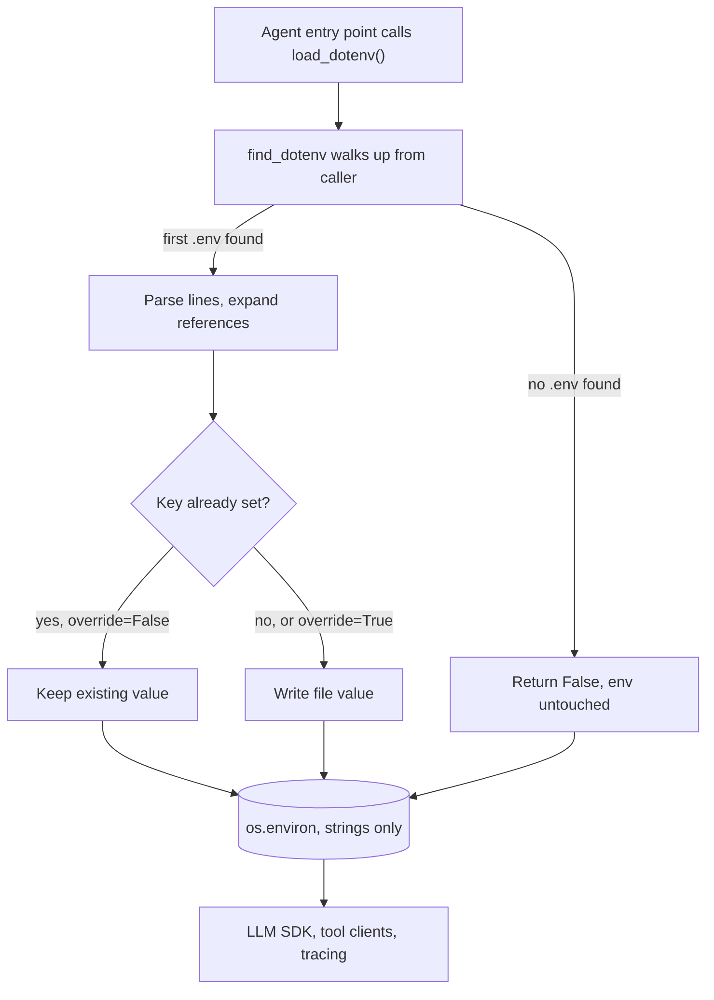

## TL;DR
A local agent needs model, tool and tracing keys; python-dotenv copies `KEY=value` lines from a
gitignored `.env` into `os.environ` so every SDK finds them. A dev convenience, not a secrets manager; it
never overrides variables already set.

## For agent builders
- **Why it matters for agents.** An agent touches more credentials than a chat app: the LLM provider, a
  search or browser tool, a vector database, a tracing service such as LangSmith or Langfuse. Each SDK
  reads its own env var, so one `.env` loaded early wires all of them locally.
- **Where it shows up in your stack.** The OpenAI and Anthropic SDKs, LangChain chat model classes and
  tracing clients read their keys from the environment on their own; `load_dotenv()` on the first lines of
  the agent's entry point, notebook or `conftest.py` is how those keys arrive in development.
- **What you control.** Which file loads, from which path, and the precedence: an already-set variable
  wins under the default `override=False`, so the platform's injected secret beats any stray file.
- **What you can skip.** Parser edge cases beyond quoting and `${VAR}` expansion. Know the override
  default, the one-time copy, and that every value is a string.

## Why it exists
- **Config belongs in the environment.** An agent service needs values that differ per environment and
  must never be committed: the OpenAI or Anthropic API key, a vector-database URL, a Langfuse key, the
  model you are trialling. Twelve-Factor says read them from env vars, because Docker, Kubernetes, a PaaS
  and CI all inject them with no code changes.
- **The friction is the laptop.** Exporting eight variables in every new terminal is tedious, and an
  agent with five tools easily needs that many.
- **The workarounds are worse.** Hardcoding the key "just for now" ends in a leaked key in git history;
  `~/.zshrc` leaks one project's key into every other project and every subprocess your agent spawns; a
  `config.py` with real values gets committed by accident.
- **What people want.** A per-project file that behaves like environment variables, is easy to edit and
  is ignored by git.
- **python-dotenv is that bridge.** The code path stays `os.environ["OPENAI_API_KEY"]` everywhere; only
  the *source* changes. Locally a file fills it in; in production the platform does and the library steps
  aside.

## How it works
### Finding the file
1. `load_dotenv()` with no arguments calls `find_dotenv()`.
2. The search starts in the calling module's directory (or the current directory in an interactive
   session) and walks *up* parent directories to the first `.env`. Upward, because agent scripts often
   run from `scripts/`, `evals/` or `notebooks/` while the file sits at the project root.
3. Alternatives: pass an explicit path, or `find_dotenv(usecwd=True)` to search from the working
   directory.
4. No file found: `load_dotenv()` returns `False` rather than raising, because "no file" is the normal
   production case.

The walk is a convenience with two sharp corners and one fix:
- **Monorepos.** It stops at the *first* `.env` going up, so a parent directory's file can be picked up by
  a child project, for example the agent picking up the web app's keys.
- **Installed packages.** When the calling code lives under `site-packages`, the walk starts there and
  never reaches your project.
- **Fix for both.** Pass an explicit path in the entry point.

### Parsing
| Syntax | Behaviour |
|---|---|
| `KEY=value` | One variable per line |
| `export ` prefix | Allowed, so the same file can be `source`d by a shell |
| `#` | Starts a comment |
| Single quotes | Literal value |
| Double quotes | Escapes such as `\n`; can span lines, which is how people store PEM keys |
| `${OTHER}` | Expands from earlier lines or the existing environment (interpolation is on by default for `load_dotenv`) |
| `${VAR:-default}` | Fallback when neither the environment nor the file defines `VAR` |

So `DB_URL=postgres://${DB_USER}@localhost/app` works, and so does a memory-store URL built from parts.

### The precedence rule
- **Default is `load_dotenv(override=False)`.** A variable already in the process environment wins over
  the file, because the file is meant to be the laptop's fallback.
- **Why that matters.** In CI or production the platform-injected value is authoritative, and a stray
  `.env` baked into an agent image must not silently replace it.
- **`override=True`** only when you deliberately want the file to win.
- **First source to set a key wins.** With several files, load the most specific first
  (`load_dotenv(".env.local")` then `load_dotenv(".env")`), the opposite of the "later overrides
  earlier" order most config systems use. Interpolation follows the same precedence.

### Lifecycle
- **A one-time copy, not a live binding.** Editing `.env` changes nothing in a running agent server;
  restart it.
- **Early captures keep stale values.** Anything that read a value before `load_dotenv()` ran (a
  module-level `client = OpenAI()`, a `settings` object built at import, a tracing client configured at
  import) keeps what it saw, which is why the load belongs on the first lines of the entry point.

### Two ways to use the values
| Call | Effect | Best for |
|---|---|---|
| `load_dotenv()` | Mutates `os.environ` | Libraries that read env vars themselves (the OpenAI SDK reads `OPENAI_API_KEY` on its own) and subprocesses you spawn |
| `dotenv_values(".env")` | Returns a plain dict, touches nothing | Tests and merging files, e.g. `{**dotenv_values(".env.shared"), **dotenv_values(".env.local")}`, because global mutable state is avoided |
| `dotenv run -- python app.py` | CLI (from the `cli` extra) loads the file then execs the command | Tools you cannot edit, such as a third-party MCP server you launch |

### What it does not do
- **Every value is a string.** `DEBUG=false` gives the non-empty string `"false"`, which is truthy, and
  `MAX_STEPS=8` is `"8"` until you convert it.
- **No schema, no required-field check, no secret masking.** That is the job of a settings layer such as
  pydantic-settings, which can itself read `.env` files.

## Diagram
Follow one `load_dotenv()` call at agent startup: the upward file search, then the per-key precedence
check that lets an already-set variable win unless `override=True`.



## Examples
### Agent entry point that loads, then fails fast
Load local config, check every key the agent's tools need, then build clients. Missing keys fail at
startup, not on step 7 of a run when the search tool is first called.

```python
# .env (gitignored)                     .env.example (committed, no real values)
#   OPENAI_API_KEY=sk-local-dev           OPENAI_API_KEY=
#   MODEL=gpt-4o-mini                     MODEL=gpt-4o-mini
#   MAX_TOKENS=512                        MAX_TOKENS=512
#   DEBUG=false                           DEBUG=false
#   SEARCH_API_KEY=local-search           SEARCH_API_KEY=
#   MAX_STEPS=8                           MAX_STEPS=8
import os
from dotenv import load_dotenv, dotenv_values

found = load_dotenv()          # walks up to find .env; existing env vars win
print("loaded .env:", found)   # False in production, where the platform sets vars

REQUIRED = ["OPENAI_API_KEY", "MODEL", "SEARCH_API_KEY"]   # model + every tool's key
missing = [k for k in REQUIRED if not os.environ.get(k)]
if missing:
    raise SystemExit(f"missing config: {missing}; copy .env.example to .env")

model = os.environ["MODEL"]
max_tokens = int(os.environ.get("MAX_TOKENS", "256"))      # strings only: convert yourself
max_steps = int(os.environ.get("MAX_STEPS", "8"))          # loop budget for the agent
debug = os.environ.get("DEBUG", "false").lower() in {"1", "true", "yes"}
print(model, max_tokens, max_steps, debug)  # bool("false") would have been True

from openai import OpenAI      # import clients AFTER load_dotenv
client = OpenAI()              # reads OPENAI_API_KEY from os.environ itself

# Without touching os.environ (good in tests):
cfg = dotenv_values(".env.example")
assert set(REQUIRED) <= cfg.keys(), "example file is out of date"
```

- Running `MODEL=claude-test python app.py` prints `claude-test`, because the shell's variable was set
  before `load_dotenv()` ran and `override` defaults to `False`.

### Worked scenario: who wins with two files and a shell export
The shell still has an old `export MODEL=gpt-4o` from yesterday's eval run. The agent's entry point runs
`load_dotenv(".env.local")` then `load_dotenv(".env")`, both with the default `override=False`.

| Key | Shell | `.env.local` | `.env` | Final value | Why |
|---|---|---|---|---|---|
| `MODEL` | `gpt-4o` | `gpt-4o-mini` | `gpt-4o-mini` | `gpt-4o` | Already set; files never override |
| `OPENAI_API_KEY` | unset | `sk-local-dev` | `sk-shared` | `sk-local-dev` | First file to set it wins |
| `MAX_TOKENS` | unset | unset | `512` | `512` | Only `.env` defines it |

The "I changed the model in .env and the agent still behaves the same" bug is the first row; `unset
MODEL` or a new terminal fixes it. In an eval comparison it is worse: both "variants" silently ran the
same model, so the scores match for the wrong reason.

### Worked scenario: an agent's tool subprocess sees too much
An agent runs a code-execution tool as a subprocess. With `load_dotenv()`, `os.environ` holds every key.

| Approach | What the sandboxed tool process can read |
|---|---|
| Inherit the parent environment | The model key, the search key, the tracing key: all of them |
| Pass `env={"PATH": ...}` explicitly to the subprocess | Only what you listed |

The fix is in how you spawn the tool, not in python-dotenv: give tool processes an explicit, minimal
environment.

## Production patterns
- **Fail fast on every tool's key.** At startup, check a `REQUIRED` list covering the model and each
  enabled tool against `os.environ` and exit with the missing names, as in the first example. Monitor
  crash-loops on deploy, which now name the key instead of surfacing as a `None` API key mid-run.
- **Keep `.env.example` honest in CI.** Add a test that loads `dotenv_values(".env.example")` and asserts
  every key the code requires is present. Watch for that test failing when someone adds a tool without
  documenting its key.
- **Exclude the file from git and images.** List `.env` in both `.gitignore` and `.dockerignore`, and run a
  secret scanner in pre-commit and CI. Monitor scanner hits and provider leaked-key alerts; any hit means
  rotate, because history keeps the value.
- **Load once, from an explicit path.** In `main`, the eval runner or `conftest.py`, call `load_dotenv()`
  with the path next to the entry point and log its return value. Never call it in library code or inside
  a tool, which should read only the environment it is given.
- **Treat production as "no file".** Run staging with no `.env` present and variables injected by the
  platform or a secrets manager. The agent should behave identically; a `True` return from
  `load_dotenv()` in production logs is a red flag.
- **Use separate dev keys with low limits.** Put a low-spend, dev-only provider key in `.env`, so a runaway
  local agent loop or a leaked laptop file costs little. Monitor spend per key.

## Trade-offs
- **One code path vs a second source of truth.** `os.environ` works in every environment, but the file is
  an implicit source that can drift from what production injects; a committed `.env.example` keeps the
  drift visible.
- **Zero friction vs hand-rolled typing.** Trivial to adopt with no other dependencies, but you write type
  conversion and required checks yourself. Past a few settings (model, step budget, timeouts, tool
  toggles), pydantic-settings pays for itself.
- **Visibility vs leakage.** Mutating `os.environ` lets third-party SDKs and subprocesses see values, which
  is convenient until a tool subprocess or crash dump exposes a key it never needed; `dotenv_values`
  avoids that.
- **Plaintext file vs secrets manager.** Fine for a dev key with low limits; for production secrets a
  secrets manager with rotation and audit wins regardless of team size.

## Pitfalls
- **Committing `.env` because `.gitignore` came later.** Symptom: a provider's leaked-key alert or a
  secret scanner hit. Fix: rotate the key (mandatory, because git history keeps it) and add the ignore.
- **Expecting the file to beat a stale export.** Symptom: "I changed the key in .env and nothing
  changed", because an old `export` takes precedence under `override=False`. Fix: unset it or open a new
  shell.
- **Loading after an import that already read `os.environ`.** Symptom: a `None` key even though the file
  is correct, or traces missing because the tracing client configured itself at import. Fix: load first
  thing in the entry point.
- **Treating `"false"` or `"0"` as falsy.** Symptom: debug mode, verbose tracing or a tool toggle stuck
  on. Fix: convert explicitly.
- **Copying `.env` into a Docker image with `COPY . .`.** Symptom: real keys visible in a pulled image
  layer. Fix: `.dockerignore`.
- **Relying on the upward search in a nested repo or installed package.** Symptom: values from the wrong
  project's `.env`, or `load_dotenv()` returning `False` where the file plainly exists. Fix: log the
  return value and pass an explicit path.

## When to use
- **Use when:** local agent development, notebooks, eval scripts, demos and small scripts where the
  alternative is exporting variables by hand. Call it once at the top of the entry point; commit a
  `.env.example` listing every key.
- **Avoid in library code and tools:** they should only read the environment they are given.
- **Move on when:** settings need types, validation, nesting or per-environment profiles; switch to
  pydantic-settings, which reads the same file.
- **Never for production secret delivery:** production gets variables from the platform or a secrets
  manager, and your code should work identically when no `.env` exists.
- **Interviews:** the signal is knowing the override default and why.

## Role lens
- **Engineer:** Loads `.env` once in `main` or `conftest.py`, keeps `.env.example` current, and converts
  string values explicitly instead of trusting truthiness.
- **Architect:** Sets the rule that `.env` is a local fallback only, production secrets come from a
  managed store, and environment precedence is documented.
- **FDE:** In a customer VPC, ships a `.env.example` and runbook, and checks the customer's platform
  injects variables rather than mounting a plaintext file.

## Check yourself
**Q:** Your service reads `OPENAI_API_KEY` via python-dotenv. In staging it uses the wrong key even
though the Kubernetes secret is correct. What are the likely causes and how do you fix it?
**A:** First check whether a `.env` file got into the image (no `.dockerignore`) and whether the code
calls `load_dotenv(override=True)`; together those make the baked file beat the injected secret. If
`override` is the default `False`, the injected variable should win, so the next suspect is that the pod
does not actually receive it (wrong secret key name or namespace) and the file supplies a fallback. Fix
by excluding `.env` from images, keeping the default precedence, and failing fast at startup when a
required variable is absent, so no silent fallback exists.

## Interview questions
### What does python-dotenv actually do, and why is it not a secrets manager?
- **Definition:** it parses `KEY=value` lines from a `.env` file and copies them into `os.environ` once,
  so code reads config the same way locally and in production.
- **Not a secrets manager:** the file is plaintext on disk, with no rotation, audit trail, access control
  or masking. Production values should come from the platform or a secrets store.
- **Why it still helps:** the code path stays `os.environ[...]` everywhere; only the source of the values
  changes between a laptop and a cluster.

### A developer changed `MODEL` in `.env`, but the agent still uses the old model. How do you debug it?
- **Stale shell export:** an earlier `export MODEL=...` is already in the environment, and under the
  default `override=False` the file never replaces it. Check with `echo $MODEL`.
- **Process not restarted:** loading is a one-time copy, so a running agent server never sees file edits.
- **Captured too early or wrong file:** a module-level client may have read the value before
  `load_dotenv()` ran, or the upward search found another project's `.env`. Log the return value and
  pass an explicit path.

### Your agent has a code-execution tool that runs as a subprocess. How do you keep it from seeing your API keys?
- **Know the default:** `load_dotenv()` writes keys into `os.environ`, and a child process inherits the
  whole environment unless you pass one explicitly.
- **Pass a minimal environment:** spawn the tool with an explicit env containing only what it needs, or
  load values with `dotenv_values` into a dict that never touches the process environment.
- **Defence in depth:** run the tool in a sandbox with no network access to your providers, and keep
  production keys out of `.env` entirely.

### Why is `override=False` the default, and when would you set `override=True`?
- **The environment is authoritative:** in CI and production the platform injects values, and a stray
  `.env` baked into an image must not silently replace them.
- **The file is a laptop fallback:** it fills only gaps, which is why the first source to set a key wins.
- **`override=True` is a deliberate choice:** use it only where you want the file to beat the shell, for
  example a local script, and never in code that also runs in production.

### How do you keep a `.env` file out of git history and container images?
- **Ignore it twice:** list `.env` in `.gitignore` and `.dockerignore`, because `COPY . .` would otherwise
  bake real keys into an image layer anyone who pulls it can read.
- **Scan continuously:** run a secret scanner in pre-commit and CI, and commit only a `.env.example` with
  key names and no real values.
- **Assume a leak is permanent:** if a key was ever committed, rotate it, because removing the file does
  not remove it from history.

### When would you replace python-dotenv with pydantic-settings in an agent service?
- **When settings need types:** python-dotenv yields only strings, so `"false"` is truthy and every call
  site converts step budgets, timeouts and toggles by hand.
- **When you need validation:** pydantic-settings checks required fields and constraints at startup,
  supports nested models (one per tool) and masks secrets with `SecretStr`.
- **Migration cost is low:** it reads the same `.env` file, so the switch is a new `Settings` class, not a
  new config workflow.

## Quiz
### Q: What does `load_dotenv()` do by default when `OPENAI_API_KEY` is already set in the shell?
- [ ] Replaces it with the value from `.env`
- [x] Leaves the existing value in place and only fills variables that are not already set
- [ ] Raises an error about a conflicting definition
- [ ] Keeps both values and joins them with a separator
> The default is `override=False`, so the process environment wins. That lets production inject real
> values while `.env` only fills gaps on a laptop; `override=True` reverses the precedence.

### Q: A `.env` has `ENABLE_CACHE=false`, and the code does `if os.environ["ENABLE_CACHE"]:`. What happens?
- [ ] The branch is skipped because python-dotenv parses booleans
- [ ] A TypeError is raised because the value is not a bool
- [x] The branch runs, because the value is the non-empty string "false"
- [ ] The variable is ignored because lowercase booleans are invalid
> python-dotenv only produces strings, and any non-empty string is truthy in Python. Convert explicitly
> or use a typed settings layer such as pydantic-settings that parses "false" into False.

### Q: When is `dotenv_values()` a better choice than `load_dotenv()`?
- [ ] When you need third-party SDKs to pick up the key automatically
- [x] When you want the values as a dict without mutating global process state, such as in tests
- [ ] When the file uses `export` prefixes that `load_dotenv` cannot parse
- [ ] When running in production without a `.env` file present
> `dotenv_values` returns a dict and leaves `os.environ` untouched, which avoids leakage between tests
> and makes merging files explicit. SDKs that read the environment themselves need `load_dotenv` instead.
