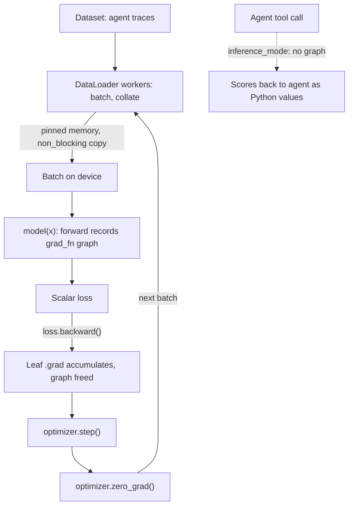

## TL;DR
PyTorch runs every local model your agent touches: embedders, rerankers, routers and fine-tuned LLMs.
Tensors record operations so `loss.backward()` computes gradients; `nn.Module`, `DataLoader` and `device`
decide whether your agent's tool models fit, stay fast and stop leaking memory.

## For agent builders
- **Why it matters for agents.** Hosted LLM calls hide PyTorch, but the moment an agent runs a local
  embedding model, a reranker, a small intent router or a LoRA fine-tuned on agent traces, a PyTorch
  module is in the request path. Its memory and latency become your agent's memory and latency.
- **Where it shows up in your stack.** Under Hugging Face Transformers, sentence-transformers, PEFT and
  TRL for fine-tuning, under LangChain or LlamaIndex embedding wrappers that load local models, and
  inside engines like vLLM and SGLang that serve self-hosted agent models.
- **What you control.** `model.eval()` plus `torch.inference_mode()` in every tool handler, `dtype`
  (bf16 halves memory), `device` placement, batch size across concurrent agents, and whether the model
  runs in-process or behind its own server.
- **What you can skip.** Writing training loops from scratch for standard LLM fine-tuning, and the
  autograd internals beyond "gradients accumulate and graphs hold memory". Literacy is enough to debug
  OOMs, NaNs and accidental CPU fallbacks.

## Lab
### Task
Fix a local router tool that an agent calls once per batch of pending turns from concurrent sessions.
The handler works, but it records an autograd graph, routes identical turns differently, and stores
tensors in session memory, so GPU memory would climb with open sessions. Time box: 45-60 minutes, CPU only.
- **Prerequisites:** NumPy, Backpropagation, and this lesson's Autograd and nn.Module sections.
- **Goal:** one batched forward pass per call, no graph, eval-mode layers, and only plain Python values
  crossing the tool boundary.
- **Checked against:** Python 3.12, `torch` 2.14 (CPU wheel); the APIs used are stable since 2.0.

### Starter code
Save as `lab.py`. Edit only the lines marked `LAB`.

```python
"""Lab: make a local router tool safe to call from many agent sessions (CPU is fine)."""
import torch
from torch import nn


class Router(nn.Module):                        # turn embedding (384-d) -> [answer, search]
    def __init__(self, dim: int = 384):
        super().__init__()
        self.net = nn.Sequential(nn.Linear(dim, 64), nn.ReLU(), nn.Dropout(0.3), nn.Linear(64, 2))

    def forward(self, x):
        return self.net(x)


class RouterTool:
    """Tool handler the agent calls with one batch of pending turns from concurrent sessions."""

    def __init__(self, model: nn.Module):
        self.model = model                      # LAB 1: put the model in the right mode once, here
        self.memory = {}                        # session_id -> last routing record, kept all session

    def route(self, session_ids: list[str], embeddings: torch.Tensor) -> list[str]:
        # LAB 2: this runs, but it records a graph, is non-deterministic, and leaks tensors.
        probs = self.model(embeddings).softmax(-1)
        decisions = []
        for sid, p in zip(session_ids, probs):
            d = "search" if p[1] > 0.5 else "answer"
            self.memory[sid] = {"decision": d, "p_search": p[1]}   # LAB 3: plain Python values only
            decisions.append(d)
        return decisions


if __name__ == "__main__":
    torch.manual_seed(0)
    tool = RouterTool(Router())
    x, ids = torch.randn(16, 384), [f"s{i}" for i in range(16)]
    first = tool.route(ids, x)
    p1 = [float(tool.memory[s]["p_search"]) for s in ids]
    tool.route(ids, x)
    p2 = [float(tool.memory[s]["p_search"]) for s in ids]
    rec = tool.memory["s0"]
    print("decisions:", len(first))
    print("same probabilities twice:", p1 == p2)
    print("memory value types:", sorted({type(v).__name__ for v in rec.values()}))
    print("graph kept in memory:", any(getattr(v, "grad_fn", None) is not None for v in rec.values()))
```

### Expected output
The starter prints `False`, `['Tensor', 'str']` and `True` on the last three lines. A correct fix prints:

```
decisions: 16
same probabilities twice: True
memory value types: ['float', 'str']
graph kept in memory: False
```

### Tests
Save as `test_lab.py` next to `lab.py` and run `pytest -q`. On the starter, three tests fail: dropout
changes the probabilities, memory holds a `Tensor`, and the forward hook sees autograd on.

```python
import torch
from lab import Router, RouterTool


def make():
    torch.manual_seed(0)
    return RouterTool(Router()), torch.randn(16, 384), [f"s{i}" for i in range(16)]


def test_one_decision_per_session():
    tool, x, ids = make()
    out = tool.route(ids, x)
    assert len(out) == 16 and set(out) <= {"answer", "search"}


def test_identical_turns_route_identically():         # dropout must be off
    tool, x, ids = make()
    tool.route(ids, x)
    a = [float(tool.memory[s]["p_search"]) for s in ids]
    tool.route(ids, x)
    b = [float(tool.memory[s]["p_search"]) for s in ids]
    assert a == b


def test_memory_holds_plain_python_values():          # nothing pins tensors or graphs
    tool, x, ids = make()
    tool.route(ids, x)
    for rec in tool.memory.values():
        assert isinstance(rec["decision"], str)
        assert type(rec["p_search"]) is float and 0.0 <= rec["p_search"] <= 1.0


def test_one_forward_pass_without_autograd():
    tool, x, ids = make()
    seen = []
    tool.model.register_forward_hook(
        lambda m, i, o: seen.append((torch.is_grad_enabled(), m.training, o.requires_grad)))
    tool.route(ids, x)
    assert seen == [(False, False, False)]            # one batched call, no graph, eval mode
```

### Failure scenarios
- **Remove `eval()` but keep `inference_mode`.** Memory is fine, but identical turns get different
  probabilities. Debug: run the same batch twice and diff `p_search`; check `model.training` in a hook.
- **Drop `inference_mode` and append each output tensor to a list.** On a GPU,
  `torch.cuda.memory_allocated()` climbs per call. Debug: log it before and after a burst of 100 calls, then
  look for anything with a `grad_fn` stored outside the handler.
- **Loop over sessions and call the model once per row.** Results are correct but latency scales with
  sessions. Debug: the forward hook fires 16 times instead of once; batch the rows back into one call.
- **Run the model on `cuda` and build a mask with `torch.zeros(n)` inside `forward`.** You get "Expected
  all tensors to be on the same device". Debug: print `x.device` next to the new tensor's device and create
  it with `device=x.device`.

### Submission
- **`lab.py` with only the `LAB` lines changed**, and the four tests passing under `pytest -q`.
- **The script's output** matching Expected output.
- **A three-line note** naming which of the three fixes stops the memory leak, which stops the
  non-determinism, and why `eval()` alone fixes neither the graph nor the tensor-in-memory leak.
- **Evaluation:** tests pass, the handler makes one forward call per batch, and no tensor appears in
  `tool.memory`.

## Why it exists
- **NumPy lacks three things training needs.** The derivative of a scalar loss with respect to millions
  or billions of parameters, execution on accelerators whose memory is separate from the CPU's, and a way
  to keep a GPU busy while the next batch is loaded and decoded.
- **Hand-derived and numeric gradients do not scale.** Hand derivation is error-prone past a few layers.
  Finite differences need one extra forward pass per parameter: a billion forward passes per step for a
  1B-parameter model.
- **Reverse-mode autodiff needs a record of the computation.** It computes all gradients in one backward
  pass costing a small constant multiple of the forward pass (commonly quoted as about two to three
  times), independent of parameter count.
- **Static graphs made that record painful.** TensorFlow 1.x had you declare a graph, then run it in a
  session: easy to optimise, miserable to debug, because errors surfaced inside a runtime you could not
  step through, and data-dependent control flow (a loop that runs a variable number of times) needed
  special graph operators.
- **Define-by-run fixes it, and is now the lingua franca.** The graph is recorded as Python executes,
  every iteration, so control flow is just Python and you debug with print statements and `pdb`, not a
  separate graph compiler; that is why it won.
- **For agent builders, literacy is the payoff.** Every Hugging Face model, LoRA adapter, embedding model
  and most local inference stacks are PyTorch modules. When the agent's retriever OOMs, a fine-tuned
  router produces NaNs, or a tool model runs on the CPU by accident, you need to know which of the five
  pieces is responsible.

## How it works
### Where agents meet PyTorch
| Agent component | PyTorch role | What to get right |
|---|---|---|
| RAG embedder and reranker | forward pass per query or batch of chunks | `inference_mode`, batching, bf16 |
| Intent or tool router (small classifier) | `nn.Module` loaded at startup | `model.eval()`, flat memory per request |
| LoRA fine-tune on agent traces | training loop via PEFT/TRL | zeroed grads, precision, memory budget |
| Self-hosted agent LLM | weights loaded by vLLM or SGLang | dtype and device; the engine owns the loop |

### Tensors
- **What a tensor is.** A typed, strided n-dimensional array: a pointer to storage plus `shape`,
  `stride`, `dtype` and `device`.
- **Views are free.** `.view`, `.transpose` and slicing share storage and only change strides. That is
  also why `.view` fails on a non-contiguous tensor and you need `.reshape` or `.contiguous()`.
- **Broadcasting** follows NumPy rules.
- **`dtype` matters more than in NumPy.**

| dtype | Notes |
|---|---|
| `float32` | the default |
| `bfloat16`, `float16` | halve memory and run on tensor cores |
| mixed in one op | raises or silently upcasts, depending on the op |

### Autograd
1. **Recording.** Any tensor with `requires_grad=True` (all `nn.Parameter`s) makes later ops record a
   node in a directed acyclic graph. Each output holds a `grad_fn` pointing to the function that made it
   and to its inputs.
2. **Backward.** `loss.backward()` walks the graph in reverse, applying the chain rule, and
   *accumulates* into each leaf's `.grad`.
3. **Freeing.** The graph is freed after `backward()`, because holding saved activations is the main
   memory cost of training.

Design choices and their reasons:
- **Accumulate, not assign.** Gradient accumulation across micro-batches works for free; the price is
  calling `optimizer.zero_grad()` every step.
- **No full Jacobian.** Starting from d(loss)/d(loss) = 1, each node takes the gradient w.r.t. its output,
  multiplies by its local derivative (a vector-Jacobian product) and passes it to its inputs. So cost is a
  small multiple of forward, and `backward()` with no argument only works on a scalar; for a vector
  output you supply the vector to multiply by.
- **Stop recording for inference.** `torch.no_grad()` (or `torch.inference_mode()`) records nothing, so
  no activations are saved for a backward pass that will never happen. Every agent tool that calls a
  local model is inference, so this is the setting that matters most.

Three lines make accumulation concrete:

```python
w = torch.tensor(3.0, requires_grad=True)
y = 2 * w**2; y.backward(); print(w.grad)   # tensor(12.)  since dy/dw = 4w
y = 2 * w**2; y.backward(); print(w.grad)   # tensor(24.)  accumulated, not replaced
```

- **Only leaves keep `.grad`.** Tensors you created, such as parameters. Intermediate gradients are freed
  unless you call `retain_grad()`.
- **`.detach()` cuts the graph.** It shares storage but stops gradients flowing, for example into a frozen
  target.
- **In-place edits are guarded.** Backward reuses inputs each op saved, so modifying one in place before
  `backward()` would silently corrupt the gradient. Autograd keeps a version counter per tensor and
  raises "modified by an inplace operation" instead.

### nn.Module
- **Auto-registration.** Attributes that are `nn.Parameter`s or other modules register automatically.
- **What registration buys.** `model.parameters()` (for the optimizer), `model.to(device)`,
  `model.state_dict()` (for saving) and `model.train()` / `model.eval()` all work across an arbitrarily
  nested tree. A LoRA adapter is just extra registered parameters, which is why PEFT can save only them.
- **`train()`/`eval()` flip layer behaviour** such as dropout and batch norm. They do not disable
  gradients.
- **Call it, don't call forward.** You write `forward`, and call the module as `model(x)` so hooks run.

### DataLoader
| Piece | Job |
|---|---|
| `Dataset` | answers `len()` and `__getitem__(i)`, for example one agent trace per index |
| `DataLoader` | batching and shuffling |
| `collate_fn` | stacks samples, or pads variable-length sequences (traces vary a lot in length) |
| `num_workers` | subprocesses that prefetch, so tokenisation or image decoding overlaps GPU compute |
| `pin_memory=True` | page-locked host memory, so the GPU copy is async with `non_blocking=True` on `.to(device)` |

- **Processes, not threads**, because of the GIL.

### device
- **One device per tensor:** `cpu`, `cuda:0`, `mps`. Ops require all inputs on the same device.
- **Moves are explicit** (`.to(device)`), because a host-to-GPU copy crosses PCIe and is slow relative to
  GPU compute, and PyTorch refuses to hide that cost.
- **CUDA calls are asynchronous.** Python returns before the kernel finishes, so naive timing measures
  launch time unless you call `torch.cuda.synchronize()`. Time agent tool latency only after a sync.

## Diagram
Two paths an agent team runs: the fine-tuning step (batch of traces through forward, backward and the
optimizer) and the serving path a tool handler takes under `inference_mode`, with no graph kept.



## Examples
### Agent tool: a local router model that does not leak
An agent decides per user turn whether to call the search tool. A small PyTorch classifier scores the
turn embedding; the handler is safe to call thousands of times.

```python
import torch
from torch import nn

device = "cuda" if torch.cuda.is_available() else "cpu"

class Router(nn.Module):                         # embedding (384-d) -> [no_tool, search]
    def __init__(self):
        super().__init__()
        self.net = nn.Sequential(nn.Linear(384, 64), nn.ReLU(), nn.Linear(64, 2))
    def forward(self, x):
        return self.net(x)

router = Router().to(device).eval()              # eval: dropout off; does NOT stop autograd

@torch.inference_mode()                          # no graph, no saved activations
def route(turn_embeddings: torch.Tensor) -> list[str]:
    probs = router(turn_embeddings.to(device, non_blocking=True)).softmax(-1)
    return ["search" if p[1] > 0.5 else "answer" for p in probs.cpu().tolist()]

# inside the agent loop: batch all pending turns from concurrent sessions into one call
decisions = route(torch.randn(16, 384))          # 16 sessions, one forward pass
print(decisions[:4])
```

### Minimal training loop
Every line maps to one of the five pieces. Swap the toy data for embedded agent turns and the same loop
trains the router above.

```python
import torch
from torch import nn
from torch.utils.data import DataLoader, TensorDataset

device = "cuda" if torch.cuda.is_available() else "cpu"
X = torch.randn(1024, 16)                       # 1024 samples, 16 features
y = (X.sum(dim=1, keepdim=True) > 0).float()    # toy binary label
loader = DataLoader(TensorDataset(X, y), batch_size=64, shuffle=True)

class MLP(nn.Module):
    def __init__(self):
        super().__init__()
        self.net = nn.Sequential(nn.Linear(16, 32), nn.ReLU(), nn.Linear(32, 1))
    def forward(self, x):
        return self.net(x)                       # logits, shape [batch, 1]

model = MLP().to(device)                         # moves every registered parameter
opt = torch.optim.AdamW(model.parameters(), lr=1e-3)
loss_fn = nn.BCEWithLogitsLoss()

for epoch in range(5):
    model.train()
    for xb, yb in loader:
        xb, yb = xb.to(device), yb.to(device)    # data must be on the model's device
        opt.zero_grad()                          # grads accumulate otherwise
        loss = loss_fn(model(xb), yb)
        loss.backward()                          # fills p.grad for every parameter
        opt.step()
    model.eval()
    with torch.no_grad():                        # no graph, less memory
        acc = ((model(X.to(device)) > 0).float() == y.to(device)).float().mean()
    print(epoch, round(loss.item(), 4), round(acc.item(), 3))
```

- **Parameter count:** 16×32+32 + 32×1+1 = 577.
- **`loss.item()` forces a sync** because it copies one scalar back to the CPU; in a real loop, log it
  every N steps rather than every step.

### Leak-free inference handler
The fix for the Check-yourself bug, reusing `model` and `device` from the loop above on a CUDA GPU: no
graph, plain Python results, flat memory. This is the shape of every agent tool that wraps a local model.

```python
import torch

model.eval()                                     # dropout off; does NOT stop autograd

@torch.inference_mode()                          # no graph, no saved activations
def predict(batch):
    logits = model(batch.to(device, non_blocking=True))
    return (logits > 0).squeeze(-1).cpu().tolist()   # binary labels as Python bools, no graph kept alive

before = torch.cuda.memory_allocated()
for _ in range(100):
    predict(torch.randn(8, 16))
print(torch.cuda.memory_allocated() - before)    # should stay ~0 across requests
```

### Worked scenario: will full fine-tuning of a 1B model fit?
Plain fp32 training with AdamW, before activations, for example a 1B model tuned on tool-calling traces:

| Item | Bytes per parameter | 1B parameters |
|---|---|---|
| Weights (fp32) | 4 | 4 GB |
| Gradients in `.grad` (fp32) | 4 | 4 GB |
| AdamW state (two moments, fp32) | 8 | 8 GB |
| **Total before activations** | **16** | **16 GB** |

- **Activations come on top.** They grow with batch size and sequence length, and agent traces are long
  (multi-turn tool calls and results); gradient checkpointing trades roughly one extra forward pass for
  much lower activation memory.
- **Inference alone needs only the weights:** 4 GB in fp32, 2 GB in bf16, because no `.grad`, optimizer
  state or saved activations exist under `inference_mode()`.
- **Why agent teams use LoRA instead.** The same arithmetic for an 8B model gives 16 × 8 = 128 GB before
  activations. LoRA freezes the base (2 bytes × 8B = 16 GB in bf16) and trains only small adapter
  matrices, so gradients and optimizer state shrink to the adapter's size (illustrative arithmetic, not a
  benchmark).

## Production patterns
- **Inference mode in every tool handler.** Wrap request handlers in `@torch.inference_mode()` plus
  `model.eval()` at startup, and return `.cpu().tolist()` values to the agent, never tensors. Monitor
  `torch.cuda.memory_allocated()` per request; it should stay flat over a long-running agent session.
- **Keep model calls off the agent's event loop.** A forward pass is blocking Python; inside an async
  agent framework it stalls every other session. Run it in a worker thread or, better, behind a separate
  model server (Text Embeddings Inference, vLLM, a small FastAPI service). Monitor event-loop lag and
  tool-call p95 latency.
- **Micro-batch tool calls across concurrent agents.** Many sessions embedding or reranking at once
  should share one forward pass instead of running batch 1 each, because GPUs are underused at batch 1.
  Monitor batch size and queue wait per tool.
- **bf16 autocast for training and serving.** On hardware that supports it, wrap forward in
  `torch.autocast(device_type="cuda", dtype=torch.bfloat16)`; unlike fp16 it needs no loss scaling. Watch
  the loss curve and eval metrics against an fp32 baseline run.
- **Feed the GPU before buying a bigger one.** Raise `num_workers`, set `pin_memory=True` and
  `persistent_workers=True` on the `DataLoader`, and copy with `non_blocking=True`. Monitor GPU
  utilisation and samples per second; low utilisation with busy CPUs means the loader is the bottleneck.
- **Compile hot models.** Apply `torch.compile(model)` once the code is stable, to fuse kernels and cut
  per-op Python overhead. Track compile time on startup and graph breaks (`TORCH_LOGS="graph_breaks"`).
- **Track peak memory per job.** Call `torch.cuda.reset_peak_memory_stats()` before a step and log
  `torch.cuda.max_memory_allocated()` after it, so batch-size and context changes have a measured memory
  cost. Alert when peak approaches card capacity.
- **Sync-free logging.** Call `.item()` only every N steps, and time GPU work only after
  `torch.cuda.synchronize()`, so metrics neither stall the loop nor lie.

## Trade-offs
- **In-process tool model vs separate model server.** Loading the embedder or router inside the agent
  process is simplest and has no network hop, but it ties GPU memory to agent replicas and blocks the
  event loop unless offloaded to a worker thread. A dedicated server batches across agents and scales separately; it wins once several agent
  replicas or teams share the model.
- **Eager debuggability vs per-op overhead.** Define-by-run makes debugging trivial, but per-op Python
  overhead hurts small models. `torch.compile` recovers speed by tracing to fused kernels, at the cost of
  compile time and graph breaks.
- **Explicit placement vs forgotten moves.** Device placement makes data movement visible and predictable,
  but every boundary is a place to forget a `.to(device)`; frameworks like Accelerate hide it once you
  run multi-GPU.
- **Lower precision vs numeric care.** bf16/fp16 halve memory and speed tensor-core math, but fp16 needs
  loss scaling to avoid gradient underflow; bf16 does not, so prefer it whenever hardware supports it.
- **Cheap backward vs activation memory.** Storing activations makes autograd cheap in compute but
  dominates training memory; gradient checkpointing trades roughly one extra forward pass for much lower
  activation memory.

## Pitfalls
- **Inference without `torch.no_grad()` or `inference_mode()`.** Every forward saves activations for a
  backward that never comes, so peak memory is higher. If any output is kept (cached, appended to a list,
  stored in agent memory) its graph stays alive, and memory climbs per request until a CUDA out-of-memory
  error.
- **Returning tensors into agent state.** A tensor stored in conversation memory or a tool result keeps
  its device memory (and maybe its graph) alive for the session. Symptom: GPU memory tracks open
  sessions. Fix: convert to Python values with `.cpu().tolist()` at the tool boundary.
- **Forgetting `optimizer.zero_grad()`.** Gradients from every step add up. Symptom: loss diverges or
  oscillates wildly after a few steps.
- **Forgetting `model.eval()` before evaluation.** Dropout stays active, so the same input gives
  different outputs and validation metrics look noisy and worse than expected. In an agent, the router
  makes different tool choices for identical turns.
- **`total += loss` instead of `loss.item()`.** You keep every step's graph referenced. Symptom: steadily
  rising GPU memory across an epoch.
- **`torch.zeros(n)` inside `forward` after moving to GPU.** The new tensor lands on the CPU. Symptom:
  "Expected all tensors to be on the same device". Fix: pass `device=x.device` or use
  `torch.zeros_like(x)`.
- **Python lists of strings or dicts with many DataLoader workers.** Reference counting touches every
  object, so copy-on-write pages get copied into each worker. Symptom: host RAM grows per worker until the
  machine OOMs. Fix: store data as NumPy arrays or Arrow.
- **Timing GPU code without `torch.cuda.synchronize()`.** Kernels are asynchronous, so measurements look
  impossibly fast, then the cost appears at the next `.item()` or `.cpu()` call.

## When to use
- **Use raw PyTorch when** you need control a higher-level library hides: a custom loss, a non-standard
  training step, a small router or scorer for your agent, inspecting activations, or debugging why a
  Hugging Face model misbehaves.
- **Use a library on top when** fine-tuning standard LLMs on agent traces: Transformers, PEFT and TRL
  rather than hand-written loops.
- **Avoid for serving LLMs at scale:** use an inference engine (vLLM, SGLang, TensorRT-LLM) rather than a
  PyTorch `generate` loop behind your agent.
- **Skip entirely when** the agent only calls hosted APIs; PyTorch only enters when a model runs on your
  own hardware.
- **Measure:** GPU utilisation, peak memory (`torch.cuda.max_memory_allocated()`) and samples per second.
  A GPU idling at low utilisation usually means the DataLoader is the bottleneck.
- **Interviews:** explain why gradients accumulate, what `no_grad` saves, and the difference between
  `eval()` and `no_grad()`.

## Role lens
- **Engineer:** Writes and debugs training or inference loops, fixes device mismatches, dtype errors
  and OOMs, and reads model code in Transformers to understand what a checkpoint actually does.
- **Architect:** Decides when the team owns PyTorch-level code versus buying an API, and sets the
  GPU, precision and framework standards that training and serving pipelines inherit.
- **FDE:** Gets a customer's model running on their hardware, often diagnosing CUDA/driver mismatches,
  CPU fallbacks, or memory limits on whatever GPU the customer actually has.

## Check yourself
**Q:** A colleague's inference service leaks GPU memory: every request adds a little until it crashes.
The code calls `model.eval()` at startup. What is the likely cause, and why doesn't `eval()` fix it?
**A:** `eval()` only changes layer behaviour such as dropout and batch norm; it does not stop autograd
from recording. If the forward pass runs without `torch.no_grad()` or `torch.inference_mode()`, each
output tensor carries a graph with saved activations, and if any output (or a running total of them) is
kept referenced, for example appended to a list or stored in a cache, that memory is never released.
The fix is to wrap inference in `inference_mode()`, convert results to Python values or detached CPU
tensors before storing them, and check `torch.cuda.memory_allocated()` stays flat across requests.

## Interview questions
### What is define-by-run autograd, and why did it win over static graphs?
- **Definition:** the graph is recorded as Python executes each iteration; every op on a tensor with
  `requires_grad=True` adds a `grad_fn` node, and `backward()` walks it in reverse once.
- **Why it won:** control flow is ordinary Python, so you debug with `print` and `pdb` instead of
  inspecting a separately compiled graph, as TensorFlow 1.x sessions required.
- **Cost it accepts:** per-op Python overhead, which `torch.compile` later recovers by fusing kernels.

### Your agent's GPU memory grows with the number of open sessions, though each tool call is small. What do you check?
- **Graph retention first:** confirm every local-model tool runs under `torch.inference_mode()`; `eval()`
  alone still records graphs.
- **Then the tool boundary:** look for tensors stored in session memory, caches or tool results; convert
  them with `.cpu().tolist()` so nothing pins device memory.
- **Confirm with numbers:** log `torch.cuda.memory_allocated()` before and after a burst of requests; it
  should return to the same baseline once sessions close.

### You add a local reranker to an async agent and every session's latency doubles. Why, and what is the fix?
- **The forward pass blocks the event loop:** PyTorch calls are synchronous Python, so while one session
  reranks, every other coroutine waits.
- **Fix the placement:** run the model in a worker thread for a quick fix, or behind a model server that
  micro-batches requests across sessions, which also raises GPU utilisation.
- **Measure:** event-loop lag and tool p95 latency before and after; batch size per forward pass should
  rise above 1.

### Training loss diverges after a few steps in a loop a colleague wrote. How do you debug it?
- **Check gradient zeroing first:** a missing `optimizer.zero_grad()` makes every step's gradients add up,
  which matches divergence after a few steps.
- **Then check learning rate, precision and inputs:** a learning rate too high for the batch size
  diverges the same way; fp16 without loss scaling underflows small gradients to zero and can overflow to
  inf or NaN; NaN or extreme values in the batch show up as sudden loss spikes.
- **Confirm with numbers:** log the gradient norm every N steps (using `.item()` sparingly) and compare
  against an fp32 baseline run.

### How much GPU memory does full fp32 AdamW fine-tuning of a 1B-parameter model need?
- **16 bytes per parameter before activations:** 4 for weights, 4 for gradients and 8 for the two AdamW
  moments, so about 16 GB for 1B parameters.
- **Activations come on top** and grow with batch size and sequence length; gradient checkpointing trades
  roughly one extra forward pass for much lower activation memory.
- **Inference needs only weights:** 4 GB in fp32 or 2 GB in bf16, because no `.grad` or optimizer state exists.

### Your GPU shows 30 percent utilisation during training. What do you change?
- **Suspect the input pipeline:** low GPU utilisation with busy CPU cores means the GPU waits for batches
  from the `DataLoader`.
- **Fix it in the loader:** raise `num_workers`, set `pin_memory=True` and `persistent_workers=True`, and
  copy with `non_blocking=True` so transfers overlap compute.
- **Remove hidden syncs:** a `.item()` call every step forces the CPU to wait for the GPU; log every N
  steps instead and measure samples per second before and after.

## Quiz
### Q: Why does PyTorch accumulate gradients into `.grad` instead of overwriting them?
- [ ] Because overwriting would break the chain rule inside a single backward pass
- [x] So that gradients from several backward passes can be summed, enabling gradient accumulation
- [ ] Because GPU memory cannot be overwritten in place
- [ ] So the optimizer can compute momentum without storing extra state
> Accumulation lets several micro-batches contribute to one update without extra code. The price is
> that you must zero gradients each step; momentum is stored separately by the optimizer, not in `.grad`.

### Q: What does `model.eval()` change?
- [ ] It disables gradient tracking for all parameters
- [ ] It moves the model to the CPU for deterministic evaluation
- [x] It switches layers like dropout and batch norm to inference behaviour
- [ ] It freezes parameters so the optimizer cannot update them
> `eval()` sets the training flag that dropout and normalisation layers read. Gradient recording is
> controlled separately by `no_grad`/`inference_mode`, which is why production code needs both.

### Q: A GPU sits at low utilisation during training while CPU cores are busy. What is the most likely fix?
- [ ] Increase the learning rate so each step does more work
- [ ] Switch the model from bf16 to fp32
- [x] Raise DataLoader `num_workers` and enable `pin_memory` so batches are prepared in parallel
- [ ] Call `torch.cuda.synchronize()` after every step
> The GPU is waiting for data. Worker processes prefetch and collate batches while the GPU computes, and
> pinned memory allows asynchronous copies; synchronising more often would make the stall worse.

## Use cases & projects
### Use cases
- **Local tool models in the agent path.** Embedders, rerankers and intent routers run as PyTorch modules
  inside tool handlers, so their latency and memory add directly to every agent step.
- **Fine-tuning on agent traces.** LoRA or SFT runs on successful tool-calling transcripts are PyTorch
  training loops under PEFT and TRL; reading their loss curves and OOMs needs PyTorch literacy.
- **Debugging a slow or crashing agent worker.** Accidental CPU fallback, missing `torch.inference_mode()`
  or growing GPU memory across concurrent sessions are PyTorch issues that look like agent issues.
- **Capacity planning for self-hosted agents.** Choosing `dtype`, batch size and device placement decides
  how many concurrent agent sessions one GPU serves.

### Mini project
**Profile a local reranker tool inside an agent loop (1-2 hours).**
- **Goal:** measure what a PyTorch reranker costs per agent step and cut it.
- **Steps:** wrap a small cross-encoder as a `rerank` tool; call it from a fake 10-step agent loop; log
  per-call latency and peak GPU (or CPU) memory; then add `model.eval()`, `torch.inference_mode()`, bf16
  and batching of candidates, and rerun.
- **Done when:** you have a before/after table of latency and memory per step, and a note on which change
  mattered most and why.
