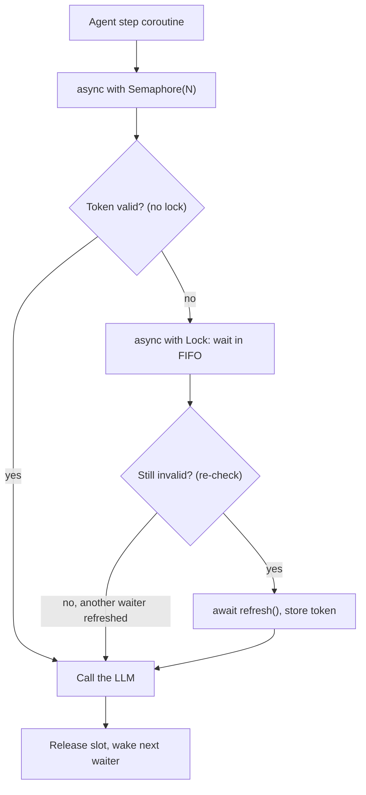

## TL;DR
Parallel tool calls and sub-agents share state (budgets, memory, tokens), and asyncio races whenever an
`await` separates the read from the write. `asyncio.Lock` makes check-then-act exclusive;
`asyncio.Semaphore` caps calls in flight, but not requests per second.

## For agent builders
- **Why it matters for agents.** Once an agent runs tools in parallel, spawns sub-agents or serves many
  sessions per process, they share mutable state: a per-run token or dollar budget, a scratchpad or memory
  store, an auth token, a lazily loaded index. Each check-then-act across an `await` is a race.
- **Where it shows up in your stack.** Budget and step counters in your agent loop, provider client and
  token caches, lazy loading of embedding models or vector indexes, and the concurrency cap on every model,
  embedding and tool provider you fan out to.
- **What you control.** Which state is shared (prefer per-run state over globals), a `Lock` or
  single-flight task around read-await-write, a `Semaphore` or bounded `Queue` per provider, and a shared
  rate limiter once you run more than one worker.
- **What you can skip.** `asyncio.Condition` details and building your own primitives. Know the three
  ingredients of a race, double-checked locking, single-flight and Little's law for sizing.

## Lab
### Task
Fix a per-run budget that parallel tool calls overspend, then cap how many model calls run at once.
The starter checks the budget, awaits the sub-call, then deducts, so ten parallel calls on a 100-cent
budget all pass the check. Time box: 45 minutes. Do **asyncio** first.
- **Goal:** never approve more than the budget covers, refund a reservation when the call fails or is
  cancelled, keep the lock off the slow await, and hold calls in flight to `limit`.
- **Why cents:** integer cents keep the arithmetic exact, as a real ledger would.
- **Constraints:** standard library only; checked on Python 3.12.14 with pytest 9.1.

### Starter code
Save as `lab_budget.py`. It runs as given and prints the overspend.

```python
import asyncio

stats = {"in_flight": 0, "peak": 0}           # model calls currently running, and the maximum seen

async def model_call(cost, fail=False):
    stats["in_flight"] += 1
    stats["peak"] = max(stats["peak"], stats["in_flight"])
    try:
        await asyncio.sleep(0.1)                # the sub-call: other tools run here
        if fail:
            raise ConnectionError("upstream reset")
        return f"answer ({cost} cents)"
    finally:
        stats["in_flight"] -= 1

class RunBudget:
    """A per-run budget in integer cents, shared by parallel tool calls and sub-agents."""
    def __init__(self, cents):
        self.left = cents
        self._lock = asyncio.Lock()

    async def spend(self, cost, fail=False):
        """Return the model answer, or None when the budget cannot cover `cost`.
        LAB 1: decide and deduct under the lock BEFORE awaiting, with no await inside the lock.
        LAB 2: refund the reservation if the call raises or is cancelled, then re-raise."""
        if self.left < cost:
            return None
        answer = await model_call(cost, fail)
        self.left -= cost
        return answer

async def fan_out(budget, n, cost, limit):
    """Run n parallel sub-calls against one budget.
    LAB 3: never more than `limit` model calls in flight (asyncio.Semaphore)."""
    return await asyncio.gather(*(budget.spend(cost) for _ in range(n)))

async def main():
    b = RunBudget(100)
    out = await fan_out(b, n=10, cost=20, limit=3)
    approved = [a for a in out if a is not None]
    print(f"approved={len(approved)} left={b.left} cents peak_in_flight={stats['peak']}")
    b2 = RunBudget(100)
    try:
        await b2.spend(20, fail=True)
    except ConnectionError as e:
        print(f"failed call: {e}; left={b2.left} cents")

if __name__ == "__main__":
    asyncio.run(main())
```

### Expected output
The starter prints `approved=10 left=-100 cents peak_in_flight=10`. A correct solution prints:

```
approved=5 left=0 cents peak_in_flight=3
failed call: upstream reset; left=100 cents
```

### Tests
Save as `test_lab_budget.py` and run `pytest -q`. On the starter the overspend and in-flight tests
fail (10 approved instead of 5, peak 10 instead of 3). The refund and lock-duration tests pass on the
starter on purpose: they fail on the two tempting half-fixes (reserving without a refund, and awaiting
the model inside the lock).

```python
import asyncio
import pytest
import lab_budget as lab

@pytest.fixture(autouse=True)
def reset_stats():
    lab.stats.update(in_flight=0, peak=0)

def test_parallel_calls_never_overspend():
    async def scenario():
        b = lab.RunBudget(100)
        out = await asyncio.gather(*(b.spend(20) for _ in range(10)))
        return b, out
    b, out = asyncio.run(scenario())
    assert sum(a is not None for a in out) == 5, "more calls approved than the budget covers"
    assert b.left == 0

def test_failed_call_is_refunded():
    async def scenario():
        b = lab.RunBudget(100)
        with pytest.raises(ConnectionError):
            await b.spend(20, fail=True)
        return b.left
    assert asyncio.run(scenario()) == 100

def test_cancelled_call_is_refunded():
    async def scenario():
        b = lab.RunBudget(100)
        t = asyncio.create_task(b.spend(20))
        await asyncio.sleep(0.05)
        t.cancel()
        with pytest.raises(asyncio.CancelledError):
            await t
        return b.left
    assert asyncio.run(scenario()) == 100

def test_lock_is_not_held_across_the_model_call():
    async def scenario():
        b = lab.RunBudget(1000)
        t0 = asyncio.get_running_loop().time()
        await asyncio.gather(*(b.spend(10) for _ in range(5)))
        return asyncio.get_running_loop().time() - t0
    assert asyncio.run(scenario()) < 0.3, "calls ran one at a time: the await is inside the lock"

def test_fan_out_caps_calls_in_flight():
    async def scenario():
        b = lab.RunBudget(1000)
        return await lab.fan_out(b, n=10, cost=20, limit=3)
    out = asyncio.run(scenario())
    assert all(a is not None for a in out)
    assert lab.stats["peak"] == 3, f"peak in flight was {lab.stats['peak']}, limit is 3"
```

### Failure scenarios
- **Inject the await inside the lock** (`async with self._lock:` around the whole method). Budgets are
  correct but the lock-duration test fails at about 0.5 s for five calls. Debug: time five parallel
  calls; serialised critical sections show as latency equal to the sum.
- **Inject `except Exception` for the refund.** The cancellation test fails with `left == 80`, because
  `CancelledError` is a `BaseException`. Debug: cancel mid-call in a test and print the balance.
- **Create the `Semaphore` at module import and reuse it across `asyncio.run` calls.** It can raise
  "bound to a different event loop" once it has to wait. Debug: create primitives inside the running
  loop (per call or in app startup).
- **Run two worker processes with the in-process lock.** Each enforces its own budget, so the run can
  spend twice. Debug: compare the ledger total across workers; move the reservation to an atomic decrement
  in a shared store.

### Submission
- **Your `lab_budget.py`** with the three LAB markers resolved.
- **A `pytest -q` run** showing 5 passed, plus the starter's failing run, in `NOTES.md`.
- **The fixed script's output**, matching the expected block exactly.
- **One paragraph naming the `await` that opened the race**, and why reserve-then-await holds the lock
  for microseconds instead of the 0.1 s call.
- **Evaluation:** tests pass, no `await` sits inside the lock, refunds catch `BaseException` and
  re-raise, and the semaphore wraps only the model call path.

## Why it exists
- **"Async cannot race" is half true.** Between two awaits a coroutine runs uninterrupted, so
  `self.count += 1` on its own is safe in asyncio, unlike in threaded code. But real agent logic spans
  awaits.
- **Check-then-act across an await races.** "If the auth token is expired, fetch a new one and store it"
  reads, awaits a network call, then writes. Meanwhile a hundred other requests see the same expired
  token and each starts a refresh: a thundering herd on the auth server, and if refreshes invalidate
  earlier tokens, some requests hold revoked ones. "If budget remains, call the model, then deduct" is the
  same bug for agents.
- **Unbounded fan-out exhausts resources.** `gather` over 5,000 prompts starts 5,000 HTTP requests at
  once. The provider answers most with 429s, the connection pool queues the rest, memory fills with
  pending responses, and timeouts fire on requests that never left the process. You need a gate that
  lets N through.
- **A boolean `refreshing` flag fails**, because it is itself check-then-act and needs a way to wait for
  the refresh to finish, which is a lock with extra steps.
- **A `threading.Lock` fails**, because when contended it blocks the whole event loop, stalling every
  coroutine instead of just the waiter. Waiting must itself be an `await` that yields to the loop.

## How it works
### Where races come from
An asyncio race needs all three:
1. **Shared mutable state** (an agent's budget, memory, cache).
2. **A read and a dependent write.**
3. **An `await` between them**, because every `await` is a point where the loop may run any other ready
   coroutine, such as a sibling tool call.

**Audit question per coroutine:** "what shared state did I read before this await, and do I still rely
on it after?"

The interleaving for the token refresh, with two requests A and B:

```
A: token expired? yes          B: (not yet run)
A: await refresh()  -> yields
                               B: token expired? yes   (A has not written yet)
                               B: await refresh()  -> yields
A: store token_1
                               B: store token_2        (token_1 now revoked)
```

- **Not a torn write but a stale decision.** Nothing is corrupted, which is what threads give you.
- **So it hides from tests.** asyncio races are logic bugs that pass unit tests (which run one coroutine at
  a time) and appear only under concurrent load, or only when the model happens to request tools in
  parallel.

### asyncio.Lock
- **Ownership.** At most one coroutine owns it. `async with lock:` awaits `acquire()`; if held, the
  coroutine parks in a FIFO queue of waiters and the loop runs other work. Release wakes the next waiter.
- **Waiting is nearly free**, *because* no thread is blocked; it costs a queued future.
- **Uncontended is nearly free:** `acquire()` returns without suspending.
- **Double-checked locking** for shared caches: check without the lock on the fast path, take the lock on a
  miss, then check again inside, *because* another coroutine may have refreshed the value while you waited.
- **Not reentrant.** Acquiring it again from the coroutine that holds it deadlocks.
- **Cancellation-safe with `async with`.** A coroutine cancelled while holding the lock still releases it
  in the exit; one cancelled while *waiting* is removed from the queue.

### Single-flight: share the in-flight work instead of locking around it
For "compute once, many waiters", store the in-flight task itself:
1. The first caller on a miss creates `self._refresh = asyncio.create_task(fetch())`.
2. Every caller, first or later, does `await self._refresh`.
3. All waiters get the same result, or the same exception, from one network call.

Two cares:
- **Failure:** clear the stored task when it raises, or every later caller re-reads the cached error.
- **Cancellation:** one caller being cancelled should not cancel the shared task; that is what
  `asyncio.shield` around the await is for.

### asyncio.Semaphore
- **Mechanism.** A counter initialised to N. `acquire()` decrements it, or waits if it is zero;
  `release()` increments it and wakes a waiter.
- **Effect.** `async with sem:` around an LLM call keeps at most N calls in flight, however many agent
  sessions and tool tasks exist.
- **`BoundedSemaphore`** also raises if you release more times than you acquired, catching bookkeeping bugs.
- **It caps *concurrency*, not rate.** Throughput is concurrency divided by latency (Little's law), so if
  latency rises, the same semaphore yields fewer requests per second.
- **Sizing:** to sustain λ requests per second at latency W seconds, you need N ≈ λ × W slots.

```
N ≈ λ × W        e.g. 20 requests/s × 1.5 s latency ≈ 30 slots
```

- **Too few slots** and you cannot reach the target; **many more** and you only queue inside the provider
  instead of inside your process.
- **Per-minute quotas need a rate limiter.** A limit in requests or tokens per minute needs something like a
  token bucket, often combined with a semaphore.

### The other primitives
| Primitive | What it does | Typical agent use |
|---|---|---|
| `asyncio.Event` | Many coroutines wait until one sets a flag | "model warmed up", "shutdown started", "user pressed Stop" |
| `asyncio.Condition` | A lock plus wait/notify | More complex predicates |
| `asyncio.Queue(maxsize=N)` | Bounded producer/consumer queue | Often the best primitive: concurrency limits and backpressure without explicit locking, for eval runs and ingestion |

### What they do not cover
- **One event loop only.** They coordinate coroutines on one loop; they are not thread-safe and do nothing
  across processes or replicas.
- **Limits multiply per process.** Two Uvicorn workers each holding their own `Semaphore(8)` allow 16
  concurrent calls.
- **Cross-replica limits** need a shared store such as Redis or a gateway. So does agent state that must
  survive across workers, such as a per-user budget.

## Diagram
The token-cache request path: the semaphore caps calls in flight, and the lock plus a second validity
check makes sure only the first waiter refreshes while the rest reuse its token.



## Examples
### Agent budget shared by parallel tool calls
Four parallel tool calls each check the run's remaining budget, await an LLM sub-call, then deduct. Without
the lock all four pass the check before any deduction lands. Costs are illustrative.

```python
import asyncio

class RunBudget:
    def __init__(self, dollars: float) -> None:
        self.left = dollars
        self._lock = asyncio.Lock()

    async def spend_racy(self, cost: float) -> bool:
        if self.left < cost:                 # read
            return False
        await asyncio.sleep(0.1)             # model sub-call: other tools run here
        self.left -= cost                    # write based on a stale read
        return True

    async def spend_safe(self, cost: float) -> bool:
        async with self._lock:               # reserve before awaiting
            if self.left < cost:
                return False
            self.left -= cost
        try:
            await asyncio.sleep(0.1)         # model sub-call outside the lock
            return True
        except BaseException:
            async with self._lock:
                self.left += cost            # refund if the call failed or was cancelled
            raise

async def main() -> None:
    for name in ("spend_racy", "spend_safe"):
        b = RunBudget(1.00)
        ok = await asyncio.gather(*(getattr(b, name)(0.40) for _ in range(4)))
        print(f"{name}: approved={sum(ok)} left=${b.left:.2f}")

asyncio.run(main())
# spend_racy: approved=4 left=$-0.60    spend_safe: approved=2 left=$0.20
```

- **Reserve, then await.** The safe version decides and deducts with no `await` inside the lock, so the
  lock is held for microseconds rather than the whole model call.
- **Refund on failure** keeps the budget honest when a tool errors or the turn is cancelled.

### Token cache plus concurrency cap
```python
import asyncio, time

class TokenCache:
    def __init__(self) -> None:
        self._token: str | None = None
        self._expires = 0.0
        self._lock = asyncio.Lock()
        self.refreshes = 0

    def _valid(self) -> bool:
        return self._token is not None and time.monotonic() < self._expires

    async def get(self) -> str:
        if self._valid():
            return self._token            # fast path, no lock
        async with self._lock:
            if not self._valid():         # re-check: someone may have refreshed
                self.refreshes += 1
                await asyncio.sleep(0.1)  # stands in for the auth call
                self._token, self._expires = "tok", time.monotonic() + 300
            return self._token

async def call_llm(cache: TokenCache, sem: asyncio.Semaphore, i: int) -> int:
    async with sem:                       # at most 8 requests in flight
        await cache.get()
        await asyncio.sleep(0.05)         # stands in for the model call
        return i

async def main() -> None:
    cache, sem = TokenCache(), asyncio.Semaphore(8)
    results = await asyncio.gather(*(call_llm(cache, sem, i) for i in range(100)))
    print(len(results), "calls,", cache.refreshes, "token refresh")

asyncio.run(main())
```

| Variant | Refreshes |
|---|---|
| As written | 1 (prints `100 calls, 1 token refresh`) |
| Lock removed, `Semaphore(8)` | 8: the first eight through the semaphore all see no token and all await the auth call |
| Lock removed, semaphore raised to 100 | 100 |

The bug scales with your concurrency setting, which is why it often appears only under load.

### Single-flight loader
Fifty agent sessions, one index load. The shield keeps one caller's cancellation from killing the shared
work, and the callback clears a failed task so the next caller retries.

```python
import asyncio

class SingleFlight:
    def __init__(self, fetch):
        self._fetch = fetch
        self._task: asyncio.Task | None = None

    async def get(self):
        if self._task is None:                        # first caller on a miss starts the work
            self._task = asyncio.create_task(self._fetch())
            self._task.add_done_callback(self._clear_on_error)
        return await asyncio.shield(self._task)       # a cancelled caller must not cancel the shared fetch

    def _clear_on_error(self, t: asyncio.Task) -> None:
        if t.cancelled() or t.exception() is not None:
            self._task = None                         # next caller retries instead of re-reading the error

calls = 0
async def load_index():
    global calls
    calls += 1
    await asyncio.sleep(0.2)                          # stands in for loading a model or index
    return "index"

async def main():
    sf = SingleFlight(load_index)
    results = await asyncio.gather(*(sf.get() for _ in range(50)))
    print(len(results), "callers,", calls, "load")    # 50 callers, 1 load

asyncio.run(main())
```

### Worked numbers: sizing with Little's law
| Setting | Latency | Result |
|---|---|---|
| Target 20 requests/s | 1.5 s | Needs about 30 slots |
| `Semaphore(10)` | 1 s | About 10 requests/s |
| Same `Semaphore(10)` | latency improves to 0.25 s | About 40 requests/s: the rate quadruples with no config change |
| `Semaphore(8)` × 2 Uvicorn workers | any | 16 concurrent calls, not 8 |

## Production patterns
- **Reserve agent budgets before the call.** Deduct the estimated cost of a model or tool call under a
  lock (or an atomic decrement in Redis for cross-worker budgets) before awaiting it, then reconcile with
  actual usage. Monitor runs that exceed budget; any at all means a read-await-write slipped through.
- **Size per-worker slots from the fleet target.** Compute N ≈ λ × W for the whole fleet, then divide by
  worker count × replicas. Monitor in-flight requests and the time spent waiting to acquire the semaphore.
- **Shared rate limiter for quotas.** Enforce requests- and tokens-per-minute with a token bucket in a shared
  store such as Redis or at a gateway, and keep the local semaphore only to bound memory and connections.
  Monitor 429 rate; honour `Retry-After` with jittered backoff.
- **Timeout inside the gate.** Write `async with sem:` then `async with asyncio.timeout(...)`, so one hung
  upstream call cannot hold a slot forever. Monitor timeouts per dependency and slot wait time.
- **Single-flight for expensive shared loads.** Use the pattern above for tokens, clients, and lazy model or
  index loading. Monitor load counts; more than one per expiry window means the guard is missing.
- **Create primitives inside the running loop.** Build locks and semaphores in app startup (FastAPI
  lifespan) or per test, not at import time, so each belongs to the loop that uses it. Watch for
  "bound to a different event loop" errors in CI.

## Trade-offs
- **Correctness vs serialisation.** A lock makes a critical section correct but serialises it; with a slow
  await inside (a model call), throughput collapses to one call at a time. Keep only the minimum inside the
  lock, as the reserve-then-await budget does.
- **Protection vs unused capacity.** A tight semaphore protects the provider and your memory but leaves
  capacity unused; when quota is generous and latency high, a larger limit gives more throughput.
- **Simple vs fleet-wide.** In-process primitives are fast and simple but invisible to other workers and
  replicas; once you scale horizontally, limits and budgets move to a shared store or an API gateway.
- **Queue vs semaphore.** A bounded `asyncio.Queue` with fixed workers is easier to reason about than many
  tasks behind a semaphore, at the cost of more structure. It wins when work arrives continuously rather
  than in batches.

## Pitfalls
- **Assuming single-threaded means race-free.** Symptom: duplicate refreshes, duplicate writes to agent
  memory or double-spent budgets that only show up under concurrent load or parallel tool calls.
- **Creating a primitive at import time and using it from different loops**, as tests often do. Since 3.10
  a primitive binds to the loop on which it first has to wait and raises `RuntimeError` ("bound to a
  different event loop") when it must wait on another. The failure appears only under contention and
  looks flaky. Fix: create primitives in app startup or per test.
- **Using a semaphore to enforce a requests-per-minute quota.** Symptom: 429s return when provider latency
  drops, because the same concurrency then produces more requests per minute.
- **Re-acquiring the same `asyncio.Lock` in a nested call.** The coroutine waits on itself forever and the
  agent step hangs with no error. Fix: take the lock once at the outer level and call an unlocked inner
  helper.
- **Holding a lock or semaphore across a call with no timeout.** One hung upstream request starves every
  waiter behind it. Fix: `async with asyncio.timeout(...)` inside the gate.

## When to use
- **Lock when** a coroutine reads shared state, awaits, then writes based on what it read: token and
  client caches, lazy model or index loading, per-conversation agent state, budget counters.
- **Semaphore (or bounded queue) when** you fan out to a dependency with finite capacity: LLM providers,
  embedding APIs, vector stores, scrapers, sandboxed code runners.
- **Avoid** locks around code with no await inside; it is already atomic with respect to other coroutines.
- **Measure:** in-flight requests, 429 rate and queue wait time. If wait time dominates latency, the limit
  is too tight or the dependency is saturated.
- **Interviews:** be ready to explain why asyncio can race at all.

## Role lens
- **Engineer:** Wraps provider calls in a semaphore sized from the quota, and uses double-checked
  locking for shared clients and token caches.
- **Architect:** Decides where concurrency limits live, per process, per replica or in a shared gateway,
  so the total stays inside provider quotas as the fleet scales.
- **FDE:** Tunes a customer's batch-ingestion concurrency against their own API quota and explains why
  doubling workers doubled their 429s instead of their throughput.

## Check yourself
**Q:** A team wraps OpenAI calls in `asyncio.Semaphore(50)` per worker, runs 4 Uvicorn workers, and still
gets 429s on a 3,000 requests-per-minute quota. Explain and propose a fix.
**A:** The semaphore is per process, so the fleet allows 200 concurrent calls, and it limits concurrency
rather than rate. By Little's law, 200 in flight at 2 seconds average latency is about 6,000 requests per
minute (illustrative numbers), double the quota, and if latency drops the rate rises further. The fix is
a rate limiter based on requests and tokens per minute, shared across workers through Redis or enforced
by a gateway, with the semaphore kept only to bound memory and connections. Retries on 429 should honour
`Retry-After` with jittered backoff so they do not amplify the burst.

## Interview questions
### How can single-threaded asyncio code have a race condition at all?
- **Interleaving happens at every await.** The loop can run any ready coroutine there, so shared state
  read before an `await` may be stale after it.
- **The race needs three things:** shared mutable state, a read and a dependent write, and an `await`
  between them. Code with no await in between is atomic with respect to other coroutines.
- **It is a stale decision, not a torn write**, which is why it passes unit tests and appears only
  under concurrent load.

### Your agent overspent its per-run budget only on turns where the model called tools in parallel. Why, and how do you fix it?
- **Read-await-write on a shared budget.** Each parallel tool checked the remaining budget, awaited its
  model sub-call, then deducted, so all of them passed the check before any deduction landed.
- **Reserve before awaiting:** decide and deduct inside an `asyncio.Lock` with no await in the critical
  section, then refund on failure or cancellation.
- **Across workers** the same reservation must be an atomic operation in a shared store such as Redis,
  because an in-process lock is invisible to other processes.

### Fifty concurrent agent sessions all trigger a reload of the same vector index. How would you fix it?
- **Single-flight the load.** The first caller on a miss stores `asyncio.create_task(load())`, and
  every caller awaits that same task, so one load serves all fifty.
- **Shield the shared await** so one caller's cancellation does not cancel the load for the others.
- **Clear the stored task on failure**, or every later caller re-reads the cached exception; monitor load
  counts per expiry window.

### Why not just use threading.Lock in async code?
- **A contended `threading.Lock` blocks the thread**, and in asyncio that thread is the event loop, so
  every coroutine stalls instead of just the waiter.
- **`asyncio.Lock` waits with an await**, parking the coroutine in a FIFO queue of futures while the loop
  keeps running other work.
- **The reverse also holds:** asyncio primitives are not thread-safe, so code shared with real threads
  needs thread-safe hand-off such as `loop.call_soon_threadsafe`.

### When would you use a bounded asyncio.Queue with workers instead of a semaphore around each task?
- **When work arrives continuously** (an ingest pipeline, a crawler, an eval run streaming cases): producers
  block on `put` once `Queue(maxsize=N)` is full, so memory stays bounded. A semaphore over `gather` still
  creates every task up front and only gates the call itself.
- **When you want a fixed, visible concurrency level:** N worker tasks means N calls in flight, and each
  worker owns its retries and error handling.
- **Not for a one-off batch of known size**, because the queue costs more structure (worker loops,
  shutdown via sentinels or cancellation, collecting results); a semaphore around each call is simpler.

### How many semaphore slots do you need to sustain 20 requests per second at 1.5 seconds latency?
- **Little's law:** N ≈ λ × W, so 20 × 1.5 ≈ 30 slots.
- **Fewer slots** cannot reach the target; **many more** only move the queue into the provider.
- **Divide across the fleet:** with several workers and replicas, each process gets its share, and you
  monitor in-flight count and slot wait time to validate the sizing.

## Quiz
### Q: In single-threaded asyncio code, when can two coroutines interfere with each other's view of shared state?
- [ ] Never, because only one coroutine runs at a time
- [ ] Only when the GIL is released by a C extension
- [x] When one reads the state, awaits something, and then acts on what it read
- [ ] Only when the shared state is a list or dict rather than an int
> The event loop switches coroutines only at awaits, so a read and a dependent write separated by an
> await can interleave with another coroutine doing the same. Code with no await in between is atomic.

### Q: Why does the token cache re-check validity after acquiring the lock?
- [ ] Because asyncio.Lock does not guarantee mutual exclusion
- [x] Because another coroutine may have refreshed the token while this one waited for the lock
- [ ] Because the clock may have moved backwards during the await
- [ ] Because the fast-path check is not allowed to read private attributes
> Several coroutines can miss on the fast path at once; they queue on the lock. The first refreshes,
> and without the second check every waiter behind it would refresh again on entry.

### Q: A semaphore of 10 wraps an API with 1-second latency. Latency improves to 0.25 seconds. What happens to request rate?
- [ ] It stays at 10 requests per second because the semaphore is unchanged
- [x] It rises to about 40 requests per second because the semaphore bounds concurrency, not rate
- [ ] It falls, because shorter requests release the semaphore less often
- [ ] It becomes unbounded because the semaphore stops blocking
> Throughput equals concurrency divided by latency. Ten slots each finishing in 0.25 seconds allow
> about 40 requests per second, which is why semaphores cannot enforce per-minute quotas.

## Use cases & projects
### Use cases
- **Per-run token and dollar budgets.** Parallel tool calls and sub-agents deduct from one budget, so the
  check and the deduction must sit under one `Lock` or reserve-then-settle step.
- **Shared auth token refresh.** Single-flight refresh stops a hundred concurrent agent sessions from each
  hitting the auth server when a token expires.
- **Lazy loading of indexes and models.** Double-checked locking loads a vector index or tokenizer once,
  even when the first ten requests arrive together.
- **Provider concurrency caps.** A `Semaphore` per model, embedding and tool provider keeps fan-out inside
  what each provider and connection pool can take.

### Mini project
**Break and fix a shared agent budget (1-2 hours).**
- **Goal:** reproduce a budget overrun from parallel tool calls, then fix it and cap concurrency.
- **Steps:** give a fake agent a $1.00 budget and ten parallel "model calls" that each check the budget,
  `await asyncio.sleep(0.1)`, then deduct $0.20; record the total spent; fix it with an `asyncio.Lock`
  around reserve-then-deduct; then add a `Semaphore(3)` and log the peak number of calls in flight.
- **Done when:** the unlocked run overspends, the locked run never exceeds $1.00, peak in-flight calls
  never exceed 3, and a short note explains which `await` opened the race.
