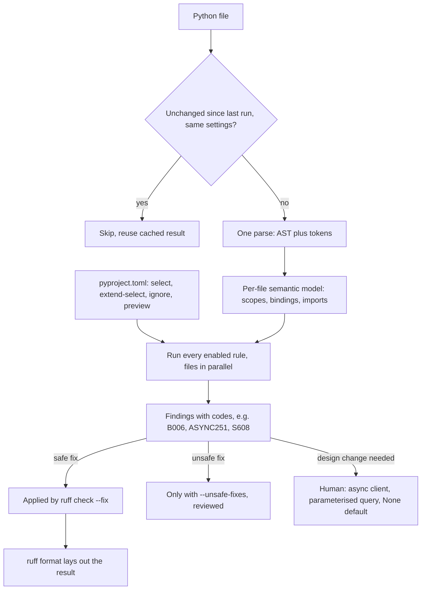

## TL;DR
Ruff is a fast Rust-written Python linter and formatter replacing flake8 and its plugins, isort,
pyupgrade, most of bandit, part of pylint, and Black. For agents its value is catching blocking calls,
lost tasks and unsafe tool code; it checks likely bugs, not types.

## For agent builders
- **Why it matters for agents.** Agent tools are where model-chosen input meets your process: a shell
  tool with `shell=True`, a calculator built on `eval`, a sync HTTP call inside an async tool, a memory
  write fired as an unreferenced task. Ruff flags each by rule code before the model ever reaches it.
- **Where it shows up in your stack.** One `[tool.ruff.lint]` block in `pyproject.toml`, the editor, a
  pre-commit hook and CI, all on one pinned version, next to mypy and pytest.
- **What you control.** The rule families: `ASYNC` for async agent services, `S` for tool code that runs
  processes, SQL or `eval`, `B` and `RUF` for likely bugs. Also which findings are fixed automatically and
  which need a design change.
- **What you can skip.** Style debates and the full rule catalogue; `ruff rule <code>` explains any rule
  when it appears.

## Lab
### Task
Four agent tools carry five planted defects: an `eval` calculator, an injectable SQL tool, a blocking
sleep in an async tool, a mutable default, and a fire-and-forget memory write.

You will let Ruff find
them, read each rule with `ruff rule <code>`, and fix every one by design, with behaviour tests proving
the fix is real and not just quiet.
- **Time box:** 40-60 minutes.
- **Prerequisites:** asyncio, and this lesson's Rules are namespaced by origin and Rules that map to
  agent incidents sections.
- **Setup:** Python 3.10+, `pip install ruff pytest` in one environment (checked against Ruff 0.17.2 and
  pytest 9.1.1; the test runs `python -m ruff`). Save the starter as `agent_tools.py` and the tests as
  `test_agent_tools.py`.
- **Goal:** `ruff check --isolated --select ASYNC,S,B,RUF agent_tools.py` reports nothing, with no
  `noqa`, and every behaviour test passes.

### Starter code
```python
"""agent_tools.py: tools an agent can call. Each runs on model-chosen input."""
import asyncio
import sqlite3
import time

DB = sqlite3.connect(":memory:", check_same_thread=False)
DB.execute("CREATE TABLE docs (tenant TEXT, title TEXT)")
DB.executemany("INSERT INTO docs VALUES (?, ?)", [("acme", "Refund policy"), ("globex", "Payroll 2026")])
MEMORY: list[str] = []
BACKGROUND: set[asyncio.Task[list[str]]] = set()                  # keep background tasks here


def calculator(expression: str) -> float:
    return eval(expression)                                       # EXERCISE: model-written code runs


def find_docs(tenant: str) -> list[str]:
    rows = DB.execute(f"SELECT title FROM docs WHERE tenant = '{tenant}'").fetchall()   # EXERCISE
    return [r[0] for r in rows]


async def lookup(key: str) -> str:
    time.sleep(0.2)                                               # EXERCISE: a slow backend call
    return f"value for {key}"


async def save_note(note: str, store: list[str] = []) -> list[str]:   # EXERCISE: shared default
    store.append(note)
    MEMORY.append(note)
    return store


async def agent_turn(note: str) -> str:
    asyncio.create_task(save_note(note))                          # EXERCISE: fire-and-forget write
    return "ok"


async def main() -> None:
    print("calc:", calculator("2 * (3 + 4)"))
    print("acme docs:", find_docs("acme"))
    print("injected:", find_docs("x' OR '1'='1"))
    start = time.monotonic()
    await asyncio.gather(lookup("a"), lookup("b"), lookup("c"))
    print("3 lookups took about", round(time.monotonic() - start, 1), "s")
    await agent_turn("user prefers metric units")
    await asyncio.sleep(0)
    print("memory:", MEMORY)


if __name__ == "__main__":
    asyncio.run(main())
```

### Expected output
`python agent_tools.py` after the fix. The starter prints both tenants' titles on the injected line and
`3 lookups took about 0.6 s`, and Ruff reports `S307`, `S608`, `ASYNC251`, `B006` and `RUF006`.

```text
calc: 14
acme docs: ['Refund policy']
injected: []
3 lookups took about 0.2 s
memory: ['user prefers metric units']
```

`ruff check --isolated --select ASYNC,S,B,RUF agent_tools.py` then prints `All checks passed!` and
`pytest -v` reports `7 passed`.

### Tests
On the starter, 6 of 7 fail. They report the five rule codes, `DID NOT RAISE ValueError`, both tenants'
rows, `0.61 < 0.4`, an empty `BACKGROUND`, and `['n1', 'a'] == ['a']` from the shared default.

```python
import asyncio
import json
import subprocess
import sys
import time
from pathlib import Path

import pytest

import agent_tools

SRC = Path(agent_tools.__file__)


def test_ruff_finds_nothing_in_the_agent_families():
    r = subprocess.run([sys.executable, "-m", "ruff", "check", "--isolated", "--select", "ASYNC,S,B,RUF",
                        "--output-format", "json", str(SRC)], capture_output=True, text=True)
    findings = [f["code"] for f in json.loads(r.stdout)]
    assert findings == []


def test_fixed_by_design_not_by_suppression():
    assert "noqa" not in SRC.read_text()


def test_calculator_does_arithmetic_and_nothing_else():
    assert agent_tools.calculator("2 * (3 + 4)") == 14
    assert agent_tools.calculator("7 / 2 - 1") == 2.5
    with pytest.raises(ValueError):
        agent_tools.calculator("__import__('os').getcwd()")


def test_tenant_filter_cannot_be_injected():
    assert agent_tools.find_docs("acme") == ["Refund policy"]
    assert agent_tools.find_docs("x' OR '1'='1") == []


def test_lookups_do_not_block_the_loop():
    async def three():
        start = time.monotonic()
        await asyncio.gather(*(agent_tools.lookup(k) for k in "abc"))
        return time.monotonic() - start
    assert asyncio.run(three()) < 0.4            # 0.2 s each, concurrently; about 0.6 s if blocking


def test_background_write_is_tracked_and_completes():
    async def turn():
        await agent_tools.agent_turn("n1")
        assert len(agent_tools.BACKGROUND) == 1
        await asyncio.gather(*agent_tools.BACKGROUND)
    asyncio.run(turn())
    assert "n1" in agent_tools.MEMORY


def test_default_store_is_not_shared_between_calls():
    assert asyncio.run(agent_tools.save_note("a")) == ["a"]
    assert asyncio.run(agent_tools.save_note("b")) == ["b"]
```

### Failure scenarios
- **Inject: fix `S307` with `ast.literal_eval`, Ruff's own hint.** Ruff goes quiet, but `2 * (3 + 4)`
  raises `ValueError: malformed node`, because `literal_eval` refuses arithmetic. Debug: the behaviour
  test catches it; walk the `ast` and allow only numbers and the four operators.
- **Inject: move `time.sleep(0.2)` into a helper in another module.** Ruff reports nothing, because it
  sees one file at a time, yet the lookup test fails at about 0.6 s. Debug: time the gather, or run with
  `python -X dev` and read the slow-callback warnings.
- **Inject: drop `--select` from the Ruff command.** On Ruff 0.17.2 the default set reports only
  `ASYNC251` and `B006` on the starter, missing `S307`, `S608` and `RUF006`. Debug: compare outputs with
  and without the selection; tool code needs the families named explicitly.
- **Inject: `# noqa: S608` on the query.** The lint test passes and the suppression test fails, while
  the injection still returns both tenants' rows. Debug: a parameterised query, not a comment.

### Submission
- **The fixed `agent_tools.py`**, with the given tests unchanged and all 7 passing.
- **Ruff output before and after**, with the `ruff rule` text for each of the five codes.
- **A one-line design decision per finding**, for example "parameterised query" or "task kept in
  `BACKGROUND` and discarded on completion".
- **A `[tool.ruff.lint]` block** you would commit for this tools package, using `extend-select`.
- **Evaluated by:** zero findings in the four families, zero suppressions, and behaviour tests proving
  each fix changed what the tool does.

## Why it exists
- **The old toolchain was five or six tools.** flake8 for errors and style, several flake8 plugins
  (bugbear for likely bugs, comprehensions, simplify), isort for import order, pyupgrade for modern
  syntax, Black for formatting, sometimes pylint and bandit.
- **Each had its own config, pins and parse.** Each had its own config file or section, its own version
  pins, its own ideas about line length, and its own parse of every file.
- **Slow, fragmented linting gets skipped.** On a large repository people disabled the pre-commit hook and
  let CI find problems, minutes later instead of while the code is still on screen. Fast enough to run on
  every save makes it a habit.
- **In AI code some lint rules catch real defects, not style:**
  - a blocking `time.sleep` or `requests.get` inside an `async def` stalls every concurrent request;
  - an `asyncio.create_task` whose result is not stored can be garbage-collected mid-flight;
  - a mutable default argument shares state across calls;
  - SQL built with f-strings is an injection risk when a tenant ID comes from a request;
  - a blind `except Exception` swallows unexpected errors and hides failures.
  All are cheap to detect statically and expensive to debug in production.
- **"Code review will catch it" does not scale:** reviewers miss mechanical issues, and review time spent
  on import order is time not spent on design.

## How it works
### One parse, many rules
1. **Parse once:** each file becomes an AST and token stream.
2. **Run every enabled rule** over that single representation.
3. **In parallel across files.**
4. **With a per-file cache**, so files unchanged since the last run (under the same settings) are skipped.

- **Why it is fast:** native Rust code plus that architecture; the old toolchain ran each Python tool as
  its own process and re-parsed each file once per tool.
- **Benchmarks:** the maintainers publish benchmarks showing large speedups over flake8; treat any
  specific multiple as illustrative and measure on your own repository.

### What it can and cannot see
- **One file at a time, with a semantic model** of that file's scopes, bindings and imports: enough to
  know that `requests.get` refers to the `requests` package, or that a name is unused.
- **No cross-module type inference.** That is why Ruff recognises a blocking call by its qualified name
  but cannot follow it through your own wrapper function in another module.
- **Hence no whole-program pylint checks:** those that depend on whole-program inference are not among
  the ones it re-implements.

### Rules are namespaced by origin
Each rule code's prefix names the tool it re-implements.

| Prefix | Origin | Catches |
|---|---|---|
| `F` | pyflakes | unused imports, undefined names |
| `E`/`W` | pycodestyle | style errors and warnings |
| `I` | isort | import order |
| `B` | bugbear | likely bugs |
| `UP` | pyupgrade | outdated syntax |
| `S` | bandit | security checks |
| `ASYNC` | flake8-async | blocking calls in coroutines |
| `PT` | pytest style | test conventions |
| `SIM`, `C4` | simplify, comprehensions | simpler equivalent code |
| `RUF` | Ruff's own rules | e.g. dangling tasks, stale `noqa` |

- **Enable by prefix** (`select = ["B"]`) or single code; `extend-select` adds to the inherited selection
  instead of replacing it.
- **Preview gate.** Newly added rules start in **preview** and run only with `preview = true`, so
  upgrading Ruff does not silently add findings to your CI; rules graduate to stable in later releases.
- **Small default set**, covering pyflakes and a subset of pycodestyle errors, because a linter that
  floods a new project with warnings gets switched off.
- **`ruff rule B006`** prints the rationale for any rule.

### Fixes
- **Safe fixes** are behaviour-preserving and applied by `ruff check --fix`.
- **Unsafe fixes** may change behaviour (such as removing an import with side effects) and are applied
  only with `--unsafe-fixes`.
- **Why the split:** a tool that silently changes semantics cannot be trusted in a pre-commit hook.

### Formatter
- **`ruff format`** is designed as a near drop-in replacement for Black's style, so teams can switch
  without reformatting debates.
- **Separate commands:** linting and formatting are run separately; when the formatter owns layout,
  disable lint rules that fight it (line length is the usual one).

### Configuration
- **One place:** `pyproject.toml` (or `ruff.toml`). `[tool.ruff]` holds shared settings such as
  `target-version` and `line-length`; `[tool.ruff.lint]` holds `select`, `ignore` and `per-file-ignores`.
- **Suppressions:** inline `# noqa: B006` suppresses one rule on one line, and `RUF100` flags `noqa`
  comments that no longer suppress anything, so suppressions do not outlive the code they excused.
- **Not a type checker:** Ruff does not know that a value may be `None`, which is mypy's or pyright's job,
  so the two run side by side.

### Rules that map to agent incidents
| Agent incident | Typical code | Rule (family) |
|---|---|---|
| One slow tool stalls every concurrent agent run | `requests.get` or `subprocess.run` inside an async tool | `ASYNC210`, `ASYNC221` (`ASYNC`) |
| A background memory or trace write vanishes | `asyncio.create_task(...)` with no stored reference | `RUF006` (`RUF`) |
| Prompt injection becomes command execution | shell tool using `shell=True` | `S602` (`S`) |
| Model-written "math" runs arbitrary code | calculator tool calling `eval` | `S307` (`S`) |
| Tool failures hidden from the model | `except Exception: return ""` | `BLE001` (`BLE`, not in the baseline below) |
| Tenant data leaks across agents | SQL tool built with f-strings | `S608` (`S`) |

- **Rules are a floor, not a sandbox.** A lint rule catches `eval` and `shell=True` by name; isolating
  what a tool can reach is still the sandbox's and permission layer's job.

## Diagram
Follow one `ruff check` run: a single parse per file feeds every enabled rule, and each finding ends in a
safe fix, an opt-in unsafe fix, or a human decision.



## Examples
### Agent scenario: linting a tool module
Four tools an agent can call, linted with the configuration in the next example. Findings below are
from `ruff check --output-format concise tools.py` on Ruff 0.17.1.

```python
import asyncio
import subprocess

import requests


async def save_memory(note: str) -> None: ...


async def run_shell(command: str) -> str:
    out = subprocess.run(command, shell=True, capture_output=True, text=True)  # ASYNC221, S602
    asyncio.create_task(save_memory(command))                                  # RUF006
    return out.stdout


async def fetch_page(url: str) -> str:
    return requests.get(url, timeout=10).text                                  # ASYNC210


def calculator(expression: str) -> float:
    return eval(expression)                                                    # S307


def read_file(path: str) -> str:
    try:
        return open(path).read()
    except Exception:                      # BLE001 only if you add the BLE family
        return ""
```

| Finding | Why it matters in an agent | Fix |
|---|---|---|
| `S602` | the model chooses `command`, so injected text runs in a shell | argument list without a shell, an allowlist, a sandbox |
| `ASYNC221`, `ASYNC210` | each call blocks the loop for every concurrent run | `asyncio.create_subprocess_exec`, an async HTTP client |
| `RUF006` | the memory write can be garbage-collected mid-flight | keep the task in a set or a `TaskGroup` |
| `S307` | model-written expressions execute as Python | a restricted parser such as `ast.literal_eval` or a math library |

- **Five findings, all design changes:** none has a safe autofix, which is why tool modules deserve the
  `S` and `ASYNC` families even when the rest of the repo uses a lighter selection.

### Config and snippet for an async AI service
A configuration, then a snippet with the findings Ruff reports under it. The comments name the rule
codes; each is a real defect class, not cosmetics.

```toml
[tool.ruff]
target-version = "py312"
line-length = 100

[tool.ruff.lint]
select = ["E", "F", "I", "B", "UP", "ASYNC", "S", "RUF"]
ignore = ["E501"]                          # the formatter owns line length

[tool.ruff.lint.per-file-ignores]
"tests/**" = ["S101"]                      # assert is the point of a test
```

```python
import asyncio, json, time                 # F401 json unused; I001 import block unsorted (E401 too)
from typing import List                    # UP035 deprecated typing alias import
import requests

async def log_done(n: int) -> None: ...

async def fetch_all(urls: List[str], seen: set = set()) -> list:   # UP006 List; B006 mutable default
    results = []
    for url in urls:
        if url in seen:
            continue
        time.sleep(0.1)                    # ASYNC251 blocks the event loop for every request
        r = requests.get(url, timeout=10)  # ASYNC210 blocking HTTP call inside async def
        results.append(r.json())
    asyncio.create_task(log_done(len(results)))   # RUF006 task reference not kept
    return results

def docs_for(cur, tenant: str):
    try:
        cur.execute(f"SELECT * FROM docs WHERE tenant = '{tenant}'")   # S608 SQL from string
    except Exception as e:                 # F841 e unused
        raise RuntimeError("query failed")   # B904 re-raise without `from e`
```

- **What `--fix` handles:** `ruff check --fix` resolves the import, `List` and some other findings safely.
- **What needs a human:** the async, SQL and default-argument findings, because the fix is a design
  change (an async client, a parameterised query, a `None` default).

### Worked run: what Ruff actually reported
Running `ruff check svc.py` with the config above (Ruff 0.17.1) gives 12 findings. `ruff check --fix`
then fixes 6 and leaves 6, and reports 1 more fix available only with `--unsafe-fixes`:

| Group | Codes | Who fixes it |
|---|---|---|
| Imports and syntax | `E401`, `I001`, `F401`, `UP006` | `--fix`, safely |
| Unused binding | `F841` | `--fix` drops `as e` |
| Deprecated import | `UP035` | gone after `--fix`, because the now-unused `List` import is removed |
| Mutable default | `B006` | unsafe fix offered (a `None` default plus `if seen is None`); review it |
| Likely bugs | `B904`, `RUF006` | human: `raise ... from e`, keep a task reference |
| Event-loop blockers | `ASYNC251`, `ASYNC210` | human: `await asyncio.sleep`, an async HTTP client |
| Security | `S608` | human: parameterised query |

Half of the findings are design decisions, which is why lint findings belong in review, not in a silent
autofix job.

### Hook and CI order
In a pre-commit hook, run `ruff check --fix` before `ruff format`, because a lint fix (removing an
import, rewriting a comprehension) can leave code the formatter would lay out differently. In CI, run
`ruff check` and `ruff format --check`; neither writes files, so CI fails on findings instead of quietly
fixing them in a throwaway checkout.

```yaml
# .pre-commit-config.yaml
repos:
  - repo: https://github.com/astral-sh/ruff-pre-commit
    rev: v0.17.1               # same version as CI and the editor
    hooks:
      - id: ruff-check
        args: [--fix]          # lint fixes first
      - id: ruff-format        # then layout
```

## Production patterns
- **One pinned version everywhere.** Pin Ruff in the dev dependencies, use the same `rev` in the
  pre-commit hook, and run that version in CI, so findings and fixes do not flip between machines.
  Monitor CI-only findings, which signal version drift.
- **Shared baseline rule selection.** Keep one `[tool.ruff.lint]` block (for example `E`, `F`, `I`, `B`,
  `UP`, `ASYNC`, `S`, `RUF`) across services, and use `extend-select` for per-repo additions so the
  baseline is not silently replaced. Review it when Ruff graduates preview rules to stable.
- **Baseline a legacy repo, then burn it down.** Enable the families you want, run
  `ruff check --add-noqa` once to suppress existing findings with per-code comments, and keep `RUF100` on
  so comments are removed as code is fixed. Track the count of `noqa` comments over time.
- **CI annotations, no writes.** Run `ruff check --output-format github` and `ruff format --check` in the
  pipeline, so findings appear inline on the pull request and nothing is fixed in a throwaway checkout.
- **Stricter rules for tool code.** Agent tools run on model-chosen input, so give the tools package the
  full `S`, `ASYNC` and `BLE` families with a nested `ruff.toml` in that directory that sets
  `extend = "../pyproject.toml"` and uses `extend-select`, because a nested config replaces the root one
  unless it extends it. Require review of any `noqa` there.
  Monitor `noqa` comments in the tools package separately from the rest of the repo.
- **Triage with statistics.** Before enabling a new family, run `ruff check --select ASYNC --statistics`
  to see counts per rule, fix the defect classes first (`ASYNC`, `B006`, `RUF006`, `S608`), then enable
  the family as an error.

## Trade-offs
- **One fast tool vs re-implementations.** It replaces a fragmented chain and runs on every save, but you
  depend on Ruff's re-implementations; a niche flake8 plugin or pylint check it lacks still needs the
  original tool.
- **Broad rule families vs legacy noise.** Selecting broad families catches more real bugs, but floods
  legacy code with findings; start with `F`, `B`, `ASYNC`, `S` and grow the selection once the backlog is
  cleared.
- **Autofix in pre-commit vs behaviour changes.** Autofix removes mechanical review churn, but unsafe
  fixes can change behaviour; keep unsafe fixes manual and reviewed, which flips only for rules you have
  audited.
- **Formatter switch vs one big diff.** Ruff's formatter matches Black closely enough to switch in place,
  but small output differences mean one large reformatting commit; do it once, then add that commit to
  the blame-ignore list.

## Pitfalls
- **Running only the default rules and assuming the code is checked.** Symptom: blocking calls in async
  handlers and mutable defaults shipping, because `ASYNC` and `B` were never enabled.
- **Blanket `# noqa` without a code.** Symptom: a line that silently suppresses every future finding,
  including the real bug someone adds to it later.
- **Different Ruff versions locally, in pre-commit and in CI.** Symptom: findings that appear only in CI or
  fixes that flip back and forth between machines. Fix: pin one version everywhere.
- **Treating a clean Ruff run as tool safety.** Symptom: a tool that passes lint because it calls a
  wrapper around `subprocess` defined in another module, which Ruff cannot follow. Fix: sandbox and
  allowlist tools regardless, and keep dangerous calls inside one reviewed module.
- **Treating a clean Ruff run as type safety.** Symptom: `None` attribute errors in production in code
  Ruff passed, because Ruff does not reason about types.
- **A line-length lint rule and the formatter with different limits.** Symptom: findings the formatter can
  never fix, and contributors adding `noqa` comments to get past them.

## When to use
- **Use in every Python project, from the first commit:** it is cheap enough to run in the editor, in a
  pre-commit hook and in CI with the same pinned version.
- **Choose rule families deliberately:** `F` and `E` for correctness, `B` and `RUF` for likely bugs,
  `ASYNC` for any service built on asyncio, `S` for code that touches SQL, subprocesses or secrets, `UP`
  to keep syntax current with your minimum Python.
- **Run it next to mypy, not instead of it**, and next to dependency auditing, which it does not do.
- **Interviews:** a good answer explains which rules catch production defects in async AI services, not
  just that Ruff is fast.

## Role lens
- **Engineer:** Fixes findings as they appear in the editor and knows why `ASYNC`, `B006` and `RUF006`
  matter in an event-loop service, rather than silencing them.
- **Architect:** Owns the shared rule selection and pinned version across repositories, so every
  service enforces the same correctness and security baseline in CI.
- **FDE:** Runs Ruff on a customer's existing Python integration code on day one to surface blocking
  calls, injection risks and swallowed errors before building on top of it.

## Check yourself
**Q:** An async FastAPI service for LLM calls has latency spikes under load, yet CPU is low. The team
already runs Ruff with its default rules. How could Ruff have helped, and what are its limits here?
**A:** Low CPU with spikes under concurrency suggests the event loop is being blocked: a `time.sleep`,
a sync HTTP client or a sync database driver called inside `async def`. The default rule set does not
include the flake8-async family, so enabling `ASYNC` would flag blocking sleeps and HTTP calls inside
coroutines, and `RUF006` would flag fire-and-forget tasks. The limits: Ruff only recognises known
blocking calls by name; a sync call hidden behind your own helper, or a CPU-heavy function such as
tokenising a huge document, is invisible to it. You confirm with asyncio debug mode or profiling.

## Interview questions
### Why is Ruff so much faster than the flake8-based toolchain it replaces?
- **One parse per file:** every enabled rule runs over a single AST and token stream, where the old chain
  ran each Python tool as its own process and re-parsed every file once per tool.
- **Parallel and cached:** files are linted in parallel, and unchanged files under the same settings are
  skipped.
- **Native Rust code** adds the rest; quote your own repository's measurement, not a published multiple.

### Which Ruff rules would you enable for an async LLM service, and why those?
- **`ASYNC`:** flags blocking sleeps and HTTP calls inside `async def`, which stall every concurrent
  request; the default set does not include it.
- **`B` and `RUF`:** mutable defaults (`B006`), lost exception context (`B904`) and fire-and-forget tasks
  that can be garbage-collected (`RUF006`).
- **`S`:** SQL built from strings (`S608`) and other bandit checks, plus the defaults `E` and `F`, `I` for
  imports and `UP` for current syntax.

### What would Ruff flag in an agent's tool implementations, and what would it miss?
- **It flags dangerous calls by name:** `S602` for a shell tool with `shell=True`, `S307` for `eval` in a
  calculator tool, `ASYNC210` and `ASYNC221` for blocking calls in async tools, `RUF006` for
  unreferenced background tasks.
- **It misses anything indirect:** a dangerous call behind your own helper in another module, or a tool
  that is safe in code but has too broad a permission.
- **So pair it with a sandbox and an allowlist**, and treat its findings in tool code as review blockers.

### You turn on ASYNC and B in a legacy repo and get 900 findings. How do you roll it out?
- **Triage first** with `ruff check --statistics`, and fix the defect classes that matter in production
  (blocking calls, dangling tasks, SQL injection) before cosmetic ones.
- **Baseline the rest** with `ruff check --add-noqa`, which writes per-code `noqa` comments, so CI can
  gate new code immediately.
- **Burn down** with `RUF100` enabled, so each suppression disappears once its line is fixed, and track the
  `noqa` count.

### What can Ruff not catch, and what do you pair it with?
- **Types:** it does not know a value may be `None`, so `.strip()` on `str | None` needs mypy or pyright.
- **Cross-module behaviour:** a blocking call hidden behind your own helper in another module, or a
  CPU-heavy function in a coroutine, is invisible because rules see one file at a time.
- **Dependencies:** vulnerable packages need a dependency auditor; runtime blocking is confirmed with asyncio
  debug mode or profiling.

### When would you not apply Ruff's fixes automatically?
- **Unsafe fixes:** they may change behaviour, such as removing an import with side effects, so they stay
  behind `--unsafe-fixes` and get reviewed.
- **In CI:** run `ruff check` and `ruff format --check`, which never write files, so findings fail the build
  instead of being fixed in a throwaway checkout.
- **Design findings:** async, SQL and default-argument findings have no autofix because the fix is a design
  change.

## Quiz
### Q: What mainly explains Ruff's speed advantage over the older multi-tool lint chain?
- [ ] It skips checking files larger than a fixed size
- [x] It parses each file once and runs all rules on that parse, in parallel, with caching
- [ ] It only runs rules on lines changed in the last commit
- [ ] It uses type inference to prune rules that cannot apply
> The old chain re-parsed every file once per tool. Ruff shares one parse across all rules, runs files
> in parallel and caches unchanged files; it does not do type inference.

### Q: Which issue is Ruff not designed to catch?
- [ ] A blocking time.sleep call inside an async function
- [ ] A mutable list used as a default argument
- [x] Calling .strip() on a value whose declared type is str | None
- [ ] An SQL query assembled with an f-string
> Optional-type errors need a type checker such as mypy or pyright. The other three are covered by
> Ruff's ASYNC, bugbear and bandit-derived rule families when those are enabled.

### Q: Why does Ruff separate safe fixes from unsafe fixes?
- [ ] Unsafe fixes are slower to compute
- [ ] Safe fixes only apply to formatting, never to lint findings
- [x] Unsafe fixes may change program behaviour, so they are not applied by default
- [ ] Unsafe fixes require an internet connection to download rule data
> A fix such as removing an import with side effects can alter runtime behaviour. Keeping such fixes
> opt-in lets `--fix` run automatically in hooks without silently changing semantics.

## Use cases & projects
### Use cases
- **Async agent services.** `ASYNC` rules flag a blocking `time.sleep` or `requests.get` inside an async
  tool before it stalls every concurrent session.
- **Tools that run code or queries.** `S` rules flag `shell=True`, `eval` and SQL built with f-strings in
  tools that receive model-chosen input.
- **Fire-and-forget tasks.** `RUF` rules flag an `asyncio.create_task` result that is not stored, a
  memory write that could vanish mid-flight.
- **One fast gate.** A single pinned Ruff in the editor, pre-commit and CI replaces several linters, so
  agent repositories get checked on every save.

### Mini project
**Lint an agent's tool package and fix what Ruff finds (1-2 hours).**
- **Goal:** find and fix the agent-specific defects Ruff catches in a small set of tools.
- **Steps:** write four tools with planted defects (a shell tool with `shell=True`, a calculator using
  `eval`, an async tool calling `requests.get`, an unstored `asyncio.create_task`); enable `ASYNC`, `S`,
  `B` and `RUF` in `[tool.ruff.lint]`; run `ruff check`; use `ruff rule <code>` to read each finding;
  fix each by design, not by suppression.
- **Done when:** `ruff check` passes with no inline suppressions on the planted defects, and the
  pre-commit hook and CI run the same pinned version.
