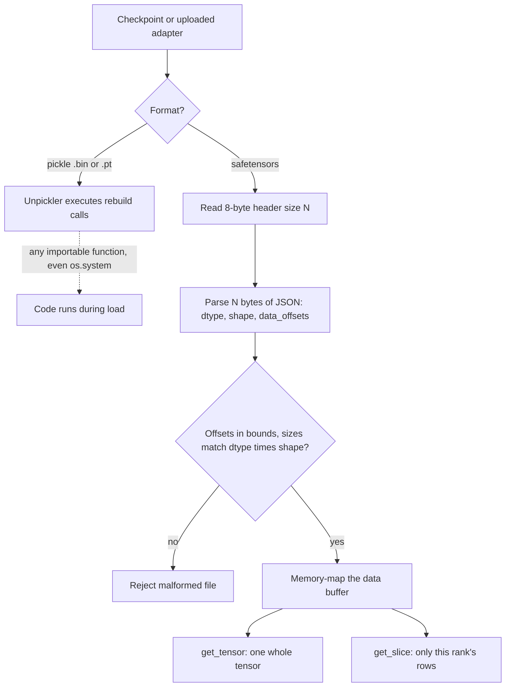

## TL;DR
safetensors is the weights format behind the open models and LoRA adapters your agents run: a JSON
header plus raw bytes. Loading it runs no code, and it memory-maps, so model servers cold-start faster and
uploaded adapters cannot execute on load.

## For agent builders
- **Why it matters for agents.** If you self-host an agent model, serve per-tenant LoRA adapters, or let
  an agent platform pull models from a hub, every load is a supply-chain decision. A pickle checkpoint is
  a program; a safetensors file is data.
- **Where it shows up in your stack.** `model.safetensors` and shard index files in every Hub repo,
  `adapter_model.safetensors` written by PEFT, and the weights vLLM, SGLang and Text Embeddings Inference
  load when your agent's model server starts or scales out.
- **What you control.** Requiring safetensors at load (`use_safetensors=True`), rejecting pickle uploads,
  converting legacy files in a sandbox, stamping provenance metadata, and staging weights on local disk
  for fast autoscaling.
- **What you can skip.** The byte layout details and writing loaders yourself. Remember three facts: no
  code on load, lazy memory-mapped reads, and "safe to load" is not "safe to run".

## Why it exists
- **Pickle checkpoints are programs.** `torch.save` uses Python's `pickle`, which is not a data format: it
  is a small program the unpickler executes to rebuild objects, and it can call any importable function,
  including `os.system`. A downloaded `.bin` or `.pt` checkpoint is executable code.
- **Hubs made that routine.** Once pulling weights from strangers was normal, "load a model" became "run
  an untrusted program", and malicious pickles were found in the wild.
- **Pickle loading is also slow and all-or-nothing.** Unpickling copies data into freshly allocated
  memory, sometimes twice when moving to GPU, and you cannot read one tensor without parsing the whole
  file, so partial loading (sharding across GPUs, inspecting one layer) was awkward.
- **`weights_only=True` narrows but does not remove the risk.** `torch.load(..., weights_only=True)`
  restricts the unpickler to an allow-list of types; it is the right default for legacy files (recent
  PyTorch releases made it the default). But it still runs a pickle interpreter over untrusted input, and
  its safety rests on the allow-list having no holes.
- **safetensors removes the interpreter.** The format cannot express code, so there is nothing to
  restrict. (`torch.load(..., mmap=True)` on the newer zip-based checkpoint format narrows the speed gap,
  but not the security one.)

The mechanism fits in four lines: any object can tell pickle how to rebuild it via `__reduce__`, and the
rebuild recipe is "call this function with these arguments".

```python
import pickle
class Payload:
    def __reduce__(self):
        return (print, ("this ran during load",))   # an attacker would return (os.system, ("...",))
pickle.loads(pickle.dumps(Payload()))               # prints: the call happens inside loads()
```

Nothing in a checkpoint file distinguishes "rebuild a tensor" from "call os.system"; both are calls.

## How it works
### What the agent builder does with it
| Situation | Action |
|---|---|
| Serving an open agent model | load only safetensors, staged on local NVMe |
| Tenants upload LoRA adapters | accept only `adapter_model.safetensors`, audit the header, check shapes match the base |
| Taking in a legacy `.bin` | convert in a sandbox job, ship only the result |
| Agent with code execution can download files | never let it `torch.load` an untrusted path; treat it like any untrusted input |
| Autoscaling model replicas | memory-mapped loads plus local disk keep cold start short |

### Background: file layout
1. **8 bytes:** an unsigned little-endian 64-bit integer N, the size of the header.
2. **N bytes:** a UTF-8 JSON object. Each key is a tensor name mapping to
   `{"dtype": "BF16", "shape": [4096, 4096], "data_offsets": [begin, end]}`. An optional `"__metadata__"`
   key holds string-to-string metadata such as the format or training info.
3. **The rest:** one contiguous byte buffer. Each tensor occupies `[begin, end)` relative to the start of
   this buffer, stored row-major with no padding inside a tensor.

- **Aligned data.** The reference writer pads the header with spaces so the data buffer starts 8-byte
  aligned, letting loaders view tensors in place without an alignment copy.
- **JSON can only describe data.** The header has no way to name a function or class to call, so parsing
  it cannot run code, unlike a pickle's rebuild instructions.
- **Validate before touching bytes.** The header is parsed and checked first (offsets in bounds and
  non-overlapping, sizes matching `dtype × shape`), which blocks malformed files that try to trigger
  out-of-bounds reads. The design rule: the loader should only ever read.

### Background: zero-copy, lazy loading and sharding
- **Memory-mapped.** Each tensor sits raw at a known offset, so the OS maps the file into the address space
  and pages in only the bytes actually read.
- **Slices are pure arithmetic.** For a row-major `[rows, cols]` tensor of element size `b` starting at
  `begin`, row `i` lives at bytes `begin + i·cols·b` to `begin + (i+1)·cols·b`; no payload parsing.
- **`safe_open` handles.** `get_tensor(name)` materialises one tensor and `get_slice(name)[a:b]` reads only
  a slice. That is how tensor-parallel loaders give each GPU just its shard of a weight matrix without
  reading the rest.
- **Sharding: several files plus an index:** `model-00001-of-00004.safetensors`, ... and
  `model.safetensors.index.json`, which maps each tensor name to its shard. Loaders read the index, then
  open only the shards they need.
- **Framework neutral.** Raw bytes plus dtype, not Python objects, so one file loads into PyTorch, NumPy,
  JAX/Flax, TensorFlow or Rust code (`safetensors.torch`, `safetensors.numpy`, ...).

### What it deliberately does not store
- **No optimizer state objects, no model class, no arbitrary Python.**
- **No aliases.** Tensors sharing memory (tied embedding weights) cannot be saved as aliases: `save_file`
  refuses them, while helpers such as `save_model` deduplicate them and rely on the loading code to re-tie.

## Diagram
Compare the two load paths an agent model server might take: a pickle checkpoint runs an interpreter
over the file, while a safetensors load only reads, validates and maps bytes.



## Examples
### Intake check for a tenant's LoRA adapter
An agent platform lets each customer upload a LoRA adapter for their agent. Before it reaches the model
server, audit it as plain data with the standard library: no ML library, no code trusted.

```python
import json, struct

ALLOWED_DTYPES = {"BF16", "F16", "F32"}

def audit_adapter(path: str, expected_rank: int, max_bytes: int = 500_000_000) -> dict:
    with open(path, "rb") as f:
        n = struct.unpack("<Q", f.read(8))[0]          # header size
        if n > 10_000_000:
            raise ValueError("header too large")
        header = json.loads(f.read(n))
    meta = header.pop("__metadata__", {})
    total = 0
    for name, t in header.items():
        if "lora_" not in name:
            raise ValueError(f"unexpected tensor {name}")   # adapters hold only LoRA matrices
        if t["dtype"] not in ALLOWED_DTYPES:
            raise ValueError(f"bad dtype {t['dtype']} for {name}")
        if expected_rank not in t["shape"]:
            raise ValueError(f"rank mismatch in {name}: {t['shape']}")
        begin, end = t["data_offsets"]
        total += end - begin
    if total > max_bytes:
        raise ValueError("adapter larger than policy allows")
    return {"tensors": len(header), "bytes": total, "metadata": meta}
```

- **Only `.safetensors` is accepted.** A `.bin` upload is rejected outright, or converted in a sandbox.
- **Passing the audit is not passing review.** The adapter still runs an eval suite (including safety
  prompts) before the router sends that tenant's traffic to it.

### Save, load lazily, and read the header by hand
```python
import json, struct, torch
from safetensors.torch import save_file, load_file
from safetensors import safe_open

weights = {
    "embed.weight": torch.randn(32000, 512, dtype=torch.bfloat16),
    "head.weight": torch.randn(10, 512),
}
save_file(weights, "model.safetensors", metadata={"format": "pt", "run": "exp-42"})

with open("model.safetensors", "rb") as f:            # no library needed to inspect
    n = struct.unpack("<Q", f.read(8))[0]
    header = json.loads(f.read(n))
e = header["embed.weight"]      # {'dtype': 'BF16', 'shape': [32000, 512], 'data_offsets': [begin, end]}
print(e["data_offsets"][1] - e["data_offsets"][0])     # 32768000 bytes

with safe_open("model.safetensors", framework="pt", device="cpu") as f:
    rows = f.get_slice("embed.weight")[:1000]          # reads 1000 rows, not the whole matrix
    print(rows.shape, f.metadata())

full = load_file("model.safetensors")                  # dict[str, Tensor]
```

| Quantity | Value |
|---|---|
| Embedding size | 32,000 × 512 × 2 bytes = 32,768,000 bytes, exactly `end - begin` in its `data_offsets` |
| 1,000-row slice | 1,000 × 512 × 2 = 1,024,000 bytes, about 3% of the tensor |

- **Read offsets, never assume them**, because where each tensor starts depends on the writer's ordering.
- **Lazy loading pays off** when each of eight tensor-parallel ranks needs only an eighth of every matrix.
- **Auditable with the standard library.** `json` and `struct` alone list every tensor, dtype and shape,
  with no ML library installed and no code trusted.

### Convert a legacy checkpoint in a sandbox
The intake step for an external `.bin`: load with the restricted unpickler in an isolated job, write
safetensors, ship only the result.

```python
import torch
from safetensors.torch import save_file

sd = torch.load("pytorch_model.bin", map_location="cpu", weights_only=True)   # allow-list unpickler
sd = {k: v.contiguous() for k, v in sd.items()}        # save_file requires contiguous tensors
save_file(sd, "model.safetensors", metadata={"format": "pt", "source": "pytorch_model.bin"})
# Tied weights raise a shared-tensor error here; for a full model use safetensors.torch.save_model.
```

### Worked scenario: one weight matrix across eight ranks
A `[4096, 4096]` BF16 projection split row-wise for tensor parallelism, as when an agent model is
served across 8 GPUs:

| Item | Bytes |
|---|---|
| Whole matrix: 4096 × 4096 × 2 | 33,554,432 |
| One rank's 512 rows: 512 × 4096 × 2 | 4,194,304 |
| Read by all 8 ranks with `get_slice` | 33,554,432 in total, each byte once |
| Read by all 8 ranks with full loads | 268,435,456, then 7/8 discarded |

## Production patterns
- **Reject external pickles at the door.** CI or the model registry blocks `.bin`/`.pt`/`.pkl` artifacts
  from outside sources, including tenant-uploaded adapters, unless converted in a sandbox (as above).
  Monitor rejection counts and who tried.
- **Force safetensors at load.** Pass `use_safetensors=True` to `from_pretrained` so Transformers errors
  instead of silently falling back to a pickle file in the repo. Fail CI on any `weights_only=False`
  in the codebase, because that is the usual "fix" for a load error.
- **Stage weights on local NVMe.** Copy checkpoints from network or object storage to local disk before
  memory-mapped loading, so a new agent-model replica serves quickly during a traffic spike. Monitor
  cold-start time to first token per storage path.
- **Stamp provenance in metadata.** Write source repo, revision and training run (for example the
  agent-trace dataset version) into `__metadata__` (string-to-string), and read it back with
  `f.metadata()` at deploy time. Fail the deploy if it is missing.
- **Audit headers before promotion.** Parse the header with `json` and `struct`, and check tensor names,
  dtypes and shapes against the expected config. Flag unexpected tensors or dtypes.

## Trade-offs
- **No code on load vs tensors only.** It removes a whole class of supply-chain attacks, but the format
  only holds tensors; tokenizer files, configs and training state need their own (also non-executable)
  formats, and chat templates in tokenizer configs still shape how your agent's tools are rendered.
- **Memory-mapped speed vs slow storage.** Loading is fast and lazy on local disk, but on network
  filesystems or object storage mounts page faults can be slow; copying to local NVMe first often wins
  for large models.
- **Portability vs object graphs.** Framework-neutral raw bytes travel anywhere, but you lose pickling an
  entire object graph; full training checkpoints with optimizer and scheduler state still often use
  `torch.save`.
- **Transformers standard vs GGUF.** safetensors is the standard for Transformers-style checkpoints, but
  llama.cpp-style local inference uses GGUF, which also embeds tokenizer metadata and quantized types;
  conversion is a deployment step.

## Pitfalls
- **Assuming safetensors makes a model trustworthy.** It only guarantees loading runs no code; weights
  can still be backdoored, and `trust_remote_code` model classes can still execute arbitrary Python. A
  backdoored agent model could pick harmful tool calls on a trigger phrase, which only evals reveal.
- **Loading legacy `.bin` files with `weights_only=False` because a load error appeared.** This re-enables
  arbitrary code execution; the symptom you were fixing was the safety check working.
- **Saving tied weights via `save_file` directly.** It raises an error about shared tensors; naive
  workarounds that clone the tensors store the bytes twice, and the tie then survives only if loading code
  re-ties the parameters, which `save_model` / `load_model` handle for you.
- **Forgetting the index file when copying sharded checkpoints.** Loaders fail to find tensors or load only
  part of the model, and the error names a missing key rather than a missing file.

## When to use
- **Use for** any weights you publish, download, mirror or move between teams, including LoRA adapters
  trained on agent traces; convert legacy pickle checkpoints when you take them in.
- **Policy:** "no pickle from outside". CI or the model registry rejects `.bin`/`.pt`/`.pkl` artifacts
  from external sources unless converted in a sandbox.
- **Keep `torch.save` only** for internal training-resume checkpoints holding optimizer state, and never
  load those from untrusted locations.
- **Skip the details when** your agents only call hosted APIs; the format matters once you hold weights.
- **Measure** time to first token after a cold start with memory-mapped local files versus network
  storage, when loading time matters.
- **Interviews:** explain why pickle is unsafe and what memory mapping buys.

## Role lens
- **Engineer:** Saves and loads weights with safetensors, converts legacy checkpoints, and uses
  `safe_open` slices to inspect or shard weights without loading the whole file.
- **Architect:** Sets the model-artifact policy: allowed formats, conversion and scanning in a sandbox,
  provenance metadata, and storage layout that keeps cold-start loading fast.
- **FDE:** Meets customers whose security teams block pickle files, and shows that safetensors
  artifacts can be audited as plain data before they enter the customer's network.

## Check yourself
**Q:** A security reviewer says, "We switched to safetensors, so models from the hub are now safe to
run." What is right and what is wrong about that statement?
**A:** It is right that loading a safetensors file cannot execute code: the format is a JSON header plus
raw bytes, so the pickle-based remote-code-execution path is gone. It is wrong to conclude the model is
safe. Weights can encode backdoors or poisoned behaviour that only an evaluation reveals; repositories
can still require `trust_remote_code`, which runs Python model code; tokenizers and configs come from the
same source; and other files in the repo may still be pickles. A sound policy combines safetensors-only
weights, pinned revisions, disallowing remote code unless reviewed, provenance checks, and behavioural
evaluation before deployment.

## Interview questions
### Why is loading a pickle checkpoint a security risk, and how does safetensors remove it?
- **Pickle is a program, not data:** the unpickler executes rebuild instructions, and `__reduce__` can
  name any importable callable, including `os.system`, so a downloaded `.bin` is executable code.
- **safetensors cannot express code:** an 8-byte header size, a JSON header and raw bytes, validated
  before any tensor is touched.
- **So there is no interpreter to restrict**, unlike `weights_only=True`, which still parses untrusted
  pickle through an allow-list.

### Your agent platform lets each customer upload a LoRA adapter. How do you make that safe?
- **Format gate:** accept only safetensors, so loading cannot run code; reject or sandbox-convert pickles.
- **Header audit:** parse with `json` and `struct`, and check tensor names, dtypes, rank and total size
  against the base model's expected adapter shapes before the server sees the file.
- **Behaviour gate:** run the tenant's agent evals and safety prompts on base plus adapter before routing
  traffic, because a file that loads safely can still behave badly.

### A load fails on a legacy checkpoint and a teammate proposes `weights_only=False`. What do you do?
- **Refuse the quick fix:** it re-enables arbitrary code execution, and the error was the safety check
  working.
- **Convert in a sandbox instead:** load with `weights_only=True` in an isolated job, make tensors
  contiguous, write with `save_file` (or `save_model` for tied weights) and ship only the safetensors file.
- **Then enforce it:** pass `use_safetensors=True` to `from_pretrained` so pickle fallbacks error.

### When is safetensors not the format you ship?
- **Internal training-resume checkpoints:** optimizer and scheduler state are Python objects, which
  safetensors deliberately does not store, so `torch.save` stays common there.
- **Condition:** only for files your own jobs wrote and never for anything from an untrusted location.
- **Local llama.cpp-style inference** uses GGUF instead, which also embeds tokenizer metadata and
  quantized types, so conversion from safetensors is a separate deployment step.

### How many bytes does each of 8 tensor-parallel ranks read for a 4096 by 4096 BF16 matrix?
- **Whole matrix:** 4096 × 4096 × 2 = 33,554,432 bytes.
- **One rank's 512 rows with `get_slice`:** 512 × 4096 × 2 = 4,194,304 bytes, so all 8 ranks read
  33,554,432 bytes in total, each byte once.
- **With full loads** they read 268,435,456 bytes and discard 7/8, which is why offsets plus memory
  mapping matter for cold start.

### New agent-model replicas take minutes to serve during traffic spikes, even with safetensors. Where do you look?
- **Storage path first:** memory-mapped loading pages in bytes on demand, and page faults over network
  filesystems or object storage mounts can be slow.
- **Fix:** stage checkpoints on local NVMe before loading (or bake them into the node image) and compare
  time to first token per storage path.
- **Also check sharding:** a missing `model.safetensors.index.json` makes loaders fail or load only part
  of the model.

## Quiz
### Q: What makes loading a pickle-based PyTorch checkpoint dangerous?
- [ ] Pickle files are not compressed, so they can exhaust disk space
- [x] Unpickling executes instructions that can call arbitrary Python functions
- [ ] Pickle stores tensors in a format GPUs cannot read
- [ ] Pickle files cannot be checksummed
> Pickle is a small program run by the unpickler to rebuild objects, and it may invoke any importable
> callable. safetensors stores only a JSON header and raw bytes, so there is no program to run.

### Q: How does safetensors let each GPU load only its shard of a large weight matrix?
- [ ] It splits every tensor into one file per GPU at save time
- [ ] It compresses tensors so they decompress faster
- [x] Tensors are stored raw at known offsets, so a slice can be read from a memory-mapped file
- [ ] It stores the model class, which knows how to shard itself
> Known offsets plus row-major raw storage let a loader compute and read only the bytes for the requested
> rows. Sharded files exist too, but slicing works within a single tensor.

### Q: Why might you still use `torch.save` inside a training job?
- [ ] Because safetensors cannot store bf16 tensors
- [ ] Because safetensors files cannot exceed 2 GB
- [x] To checkpoint optimizer and scheduler state, which are Python objects rather than plain tensor dicts
- [ ] Because safetensors loads slower than pickle in every case
> safetensors deliberately stores only named tensors. Training-resume checkpoints often include non-tensor
> state, so `torch.save` remains common internally, as long as those files never come from untrusted sources.

## Use cases & projects
### Use cases
- **Self-hosted agent models.** Model servers load `model.safetensors` shards, and memory-mapping speeds
  cold starts when agent traffic scales out.
- **Per-tenant LoRA adapters.** PEFT writes `adapter_model.safetensors`, so accepting adapters from teams or
  customers does not mean running their code on load.
- **Model intake policy.** Agent platforms that pull from a hub can require safetensors and reject pickle
  checkpoints as a supply-chain control.
- **Provenance tracking.** Header metadata can record which trace dataset and run produced a fine-tuned
  agent model.

### Mini project
**Write a safe model intake check for an agent platform (1-2 hours).**
- **Goal:** accept only safe, traceable weights before an agent model server loads them.
- **Steps:** write a script that rejects `.bin`, `.pt` and `.pkl` files in a model folder; for each
  safetensors file, read the header only and list tensor names, dtypes and shapes; require a provenance
  key in the metadata; load the model with `use_safetensors=True`.
- **Done when:** the script passes a clean folder, fails a folder containing a pickle file, and prints a
  short manifest you could attach to a deployment.
