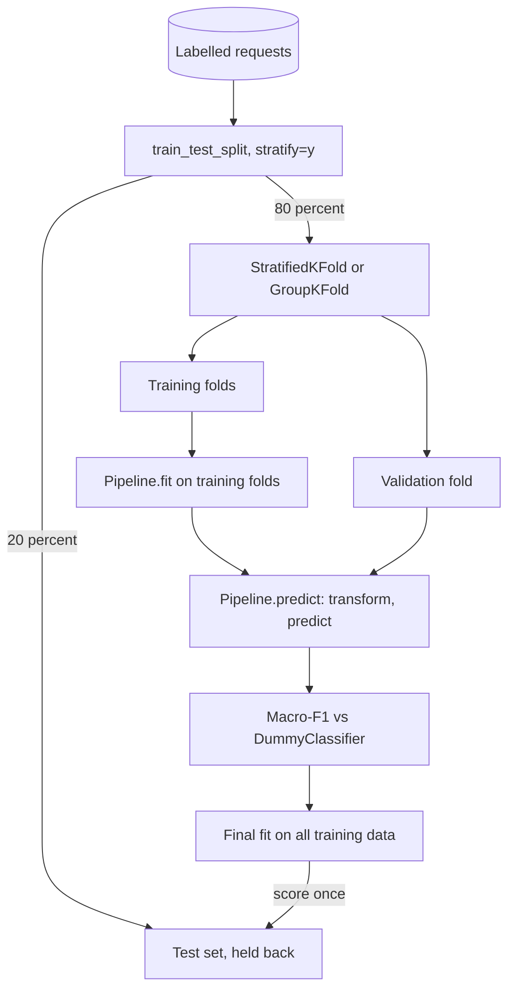

## TL;DR
scikit-learn gives agent builders cheap classifiers and honest metrics behind one `fit`/`predict`
interface: an intent router in front of the agent, a guardrail classifier, and the F1 and agreement
scores inside agent evals. Often good enough that no LLM call is needed.

## For agent builders
- **Why it matters for agents.** Not every decision in an agent needs a model call. Routing a request to
  the right agent or tool set, flagging abuse before the loop starts, or deciding "answer from FAQ vs run
  the agent" can be a logistic regression on embeddings: milliseconds, no tokens, and measurable.
- **Where it shows up in your stack.** A router or guardrail step before the agent graph (for example a
  LangGraph conditional edge that calls a classifier), quality classifiers over agent outputs, and
  `sklearn.metrics` inside eval harnesses for tool-choice accuracy, per-class F1 and judge agreement.
- **What you control.** The pipeline (so evaluation is leak-free), grouped splits by user or
  conversation, the confidence threshold for falling back to the LLM, calibration, and the pinned
  version of the artifact you ship.
- **What you can skip.** Most of the algorithm zoo. Pipelines, logistic regression, splitters, metrics
  and `DummyClassifier` cover the agent use cases.

## Why it exists
- **The same chores in every project.** Scale features, encode categories, vectorize text, fit a model,
  tune hyperparameters, estimate performance on unseen data.
- **Before a common library, glue everywhere.** Each algorithm had its own calling convention, so swapping
  logistic regression for a random forest meant rewriting glue code, and every team rebuilt evaluation
  loops by hand.
- **Hand-rolled glue is where leakage lives.** Fit a scaler or TF-IDF vocabulary on the full dataset, then
  split, and test-row statistics have shaped the training features. The reported score is optimistic, the
  production score is not, and nobody notices until after launch.
- **The answer is an API contract more than an algorithm collection.** Every component exposes the same
  methods, learned state is separate from configuration, and pipelines, cross-validators and grid searches
  treat any estimator uniformly. With preprocessing inside a pipeline, the library refits it per fold, so
  the honest procedure becomes the easy one.
- **The agent questions recur.** Is the LLM router better than a TF-IDF classifier? Can a logistic
  regression on embeddings replace a per-request LLM call for intent detection or tool-set selection?

## How it works
### The estimator contract
- **Constructor = hyperparameters only.** `LogisticRegression(C=1.0, max_iter=1000)` stores settings
  and touches no data, *because* that lets tools clone an estimator and refit it on new folds.
- **`fit(X, y)` learns state** and returns `self`. Learned attributes end with an underscore (`coef_`,
  `classes_`, `vocabulary_`), so you can tell configuration from fitted state at a glance.
- **Predictors** add `predict`, and usually `predict_proba` or `decision_function`; **transformers** add
  `transform` (and `fit_transform`). `X` is a 2-D array-like of shape `(n_samples, n_features)` (NumPy,
  sparse matrices, or pandas frames); `y` is 1-D.

### Pipelines and column transformers
1. **`Pipeline` (or `make_pipeline`)** chains transformers ending in a model, and is itself an estimator.
2. **`fit`** fits each step on the training data and transforms it for the next step.
3. **`predict`** only transforms, then predicts.

- **`ColumnTransformer`** applies different preprocessing per column: one-hot encode `plan_tier`, scale
  `tokens_used`, TF-IDF the `text`.
- **Why one object.** Cross validation and deployment use exactly the same preprocessing, and nothing is
  fit on held-out data; the router your agent calls in production is the one you evaluated.

### Honest evaluation
| Tool | What it guarantees |
|---|---|
| `train_test_split(..., stratify=y)` | Class proportions kept in both splits, which matters with imbalanced intents |
| `cross_val_score` / `cross_validate` with `StratifiedKFold` | A mean and spread across folds, not one lucky split |
| `GridSearchCV` / `RandomizedSearchCV` | Hyperparameters tuned by cross validation on the training set; the test set is touched once, at the end |
| `GroupKFold` | All rows of one customer or conversation on the same side, preventing near-duplicate leakage |

The concepts (leakage, splits, imbalance) are covered in depth in the ML fundamentals module; here the
point is that the library encodes them.

### Background: what the standard text baseline computes
Knowing the math tells you what the baseline can and cannot learn.

- **`TfidfVectorizer`** turns each document into a sparse vector with one dimension per vocabulary term
  (and n-gram).
- **Weights.** Term *t* in document *d* gets `tf(t, d) × idf(t)`. With the default `smooth_idf=True`:

```
idf(t) = ln((1 + n) / (1 + df(t))) + 1      n = training documents, df(t) = documents containing t
```

- **Rare terms get large weights** because they discriminate; terms in every document get weight near 1.
- **`sublinear_tf=True`** replaces raw counts with `1 + ln(tf)`, so a word repeated ten times does not
  count ten times. Each row is then L2-normalized so long tickets do not dominate.
- **Both the vocabulary and *df* are learned state,** which is exactly why fitting the vectorizer on test
  documents leaks.

`LogisticRegression` then learns one weight per (class, feature):

```
z_k = w_k · x + b_k
p_k = exp(z_k) / Σ_j exp(z_j)        (multiclass softmax; predict returns the argmax)
```

- **Regularization.** Fitting minimizes log-loss plus an L2 penalty of strength `1/C`, so a smaller `C`
  means stronger regularization, which matters when n-gram features far outnumber tickets.
- **The ceiling.** The model is linear in word evidence: it cannot represent negation or word order beyond
  the n-grams you gave it. That is where embeddings or an LLM start to earn their cost.

### Metrics and baselines
- **`sklearn.metrics`** provides `classification_report`, `confusion_matrix`, `f1_score`,
  `roc_auc_score`, `precision_recall_curve` and regression metrics; many LLM eval harnesses call them
  underneath rather than reimplementing them. In agent evals they score tool choice (predicted tool vs
  expected tool), refusal decisions, and LLM-judge labels against human labels.
- **`DummyClassifier`** gives the majority-class baseline every result should beat.

### What it is not
- **CPU, mostly in memory,** with no GPU deep learning.
- **Persistence is version-bound.** Saving with `joblib` or pickle ties a model to the library version that
  saved it, and loading untrusted pickles executes code.
- **`skops`** exists to load models without arbitrary code execution when artifacts cross a trust boundary.

## Diagram
Honest evaluation of an agent's intent router: preprocessing is refit on the training folds only, every
fold is scored against a dummy baseline, and the test set is touched once at the end.



## Examples
### A router in front of the agent: classifier first, LLM agent on low confidence
The classifier handles confident, simple intents; only uncertain or complex requests reach the
tool-calling agent.

```python
import numpy as np
from sklearn.calibration import CalibratedClassifierCV
from sklearn.linear_model import LogisticRegression
from sklearn.metrics import classification_report
from sklearn.model_selection import train_test_split

# X: (n_samples, dim) float32 embeddings of past requests; y: routed intent labels
rng = np.random.default_rng(0)
X = rng.standard_normal((4000, 384)).astype(np.float32)
y = rng.choice(["billing", "faq", "order_status", "needs_agent"], size=4000)

X_tr, X_te, y_tr, y_te = train_test_split(X, y, test_size=0.2, stratify=y, random_state=42)
router = CalibratedClassifierCV(
    LogisticRegression(max_iter=1000, class_weight="balanced"), cv=5).fit(X_tr, y_tr)
print(classification_report(y_te, router.predict(X_te)))

THRESHOLD = 0.8          # choose from a precision-vs-coverage curve on validation data

def route(embedding: np.ndarray) -> str:
    p = router.predict_proba(embedding.reshape(1, -1))[0]
    label, conf = router.classes_[p.argmax()], p.max()
    if label == "needs_agent" or conf < THRESHOLD:
        return "agent"           # full tool-calling loop
    return label                 # cheap handler: FAQ answer, status lookup, billing form
```

- **Random data here, real embeddings in practice:** with random features the classifier learns nothing,
  which is itself a useful sanity check that the baseline catches.

### Worked scenario: what the router saves
10,000 requests a day; an agent run averages 4 model calls at an illustrative $0.01 per call.

| Setup | Requests reaching the agent | Model-call cost per day |
|---|---|---|
| Every request runs the agent | 10,000 | 10,000 × 4 × $0.01 = $400 |
| Router handles 60% confidently | 4,000 | 4,000 × 4 × $0.01 = $160 |

- **The quality side.** If precision above the threshold measures 0.95, then 5% of the 6,000 requests
  the router keeps are wrong: 300 bad cheap answers a day to review.
- **The extra cost.** Each request still needs one embedding call for the router, usually a small
  fraction of an agent run; include it in the comparison.
- **The decision is the threshold.** Raising it sends more traffic to the agent (cost) and fewer wrong
  cheap answers (quality). Monitor both.

### Intent classifier baseline for support tickets
An intent classifier for support tickets, the kind of baseline you build before deciding an LLM router
is needed.

```python
import pandas as pd
from sklearn.dummy import DummyClassifier
from sklearn.feature_extraction.text import TfidfVectorizer
from sklearn.linear_model import LogisticRegression
from sklearn.metrics import classification_report
from sklearn.model_selection import StratifiedKFold, cross_val_score, train_test_split
from sklearn.pipeline import make_pipeline

df = pd.read_json("tickets.jsonl", lines=True)          # columns: text, intent
X_tr, X_te, y_tr, y_te = train_test_split(
    df["text"], df["intent"], test_size=0.2, stratify=df["intent"], random_state=42)

pipe = make_pipeline(                                    # vectorizer is refit inside every fold
    TfidfVectorizer(ngram_range=(1, 2), min_df=2, sublinear_tf=True),
    LogisticRegression(max_iter=1000, class_weight="balanced"),
)
cv = StratifiedKFold(n_splits=5, shuffle=True, random_state=42)
f1 = cross_val_score(pipe, X_tr, y_tr, cv=cv, scoring="f1_macro")
base = cross_val_score(DummyClassifier(strategy="most_frequent"), X_tr, y_tr,
                       cv=cv, scoring="f1_macro")
print(f"model macro-F1 {f1.mean():.3f} ± {f1.std():.3f} | baseline {base.mean():.3f}")

pipe.fit(X_tr, y_tr)                                     # final fit on all training data
print(classification_report(y_te, pipe.predict(X_te)))   # test set used once
probs = pipe.predict_proba(["I was charged twice this month"])[0]
print(dict(zip(pipe.classes_, probs.round(2))))
```

Suppose 4,000 tickets across 6 intents, with `billing` at 40% of them:

| Metric for the dummy baseline | Value | Why |
|---|---|---|
| Accuracy | 40% | Always predicts `billing` |
| `billing` F1 | 2 × 0.4 × 1.0 / (0.4 + 1.0) ≈ 0.57 | Precision 0.4, recall 1.0 |
| Other 5 classes F1 | 0 | Never predicted |
| Macro-F1 | ≈ 0.57 / 6, near 0.1 | One class partly right, five wrong |

- **Macro-F1 is the headline metric** for exactly this reason.
- **The decision.** If the pipeline reaches a macro-F1 close to an LLM prompt on the same test set, the
  classifier is the cheaper, faster router.
- **Swapping in embeddings is a small change:** drop `TfidfVectorizer` and pass the `(n_samples, dim)`
  embedding matrix as `X`; splits, scoring and baseline stay identical, as the next example shows.

### Grouped evaluation on precomputed embeddings
Same task with sentence embeddings, evaluated so one customer's tickets never sit on both sides of a
split.

```python
import numpy as np
import pandas as pd
from sklearn.linear_model import LogisticRegression
from sklearn.model_selection import GroupKFold, cross_validate

df = pd.read_parquet("tickets_embedded.parquet")   # columns: customer_id, intent, embedding
X = np.vstack(df["embedding"].to_numpy()).astype(np.float32)   # (n_samples, dim)
y, groups = df["intent"].to_numpy(), df["customer_id"].to_numpy()

clf = LogisticRegression(C=1.0, max_iter=1000, class_weight="balanced")
res = cross_validate(clf, X, y, groups=groups, cv=GroupKFold(n_splits=5),
                     scoring=["f1_macro", "accuracy"])
print(res["test_f1_macro"].mean(), res["test_f1_macro"].std())
```

### Worked TF-IDF weights
Four training documents (`n` = 4), default `smooth_idf=True`:

| Term appears in | idf = ln((1 + 4) / (1 + df)) + 1 |
|---|---|
| 1 document | ln(5/2) + 1 ≈ 1.92 |
| 2 documents | ln(5/3) + 1 ≈ 1.51 |
| All 4 documents | ln(5/5) + 1 = 1.00 |

With `sublinear_tf=True`, a term used 10 times weighs `1 + ln(10)` ≈ 3.30 times its idf before row
normalization, not 10 times.

## Production patterns
- **Classifier gate before the agent loop.** Route confident, simple intents to cheap handlers and send
  the rest to the tool-calling agent, with the threshold set from a validation precision-coverage curve.
  Monitor fallback rate, per-class precision above the threshold, and cost per request.
- **Ship the whole pipeline as one artifact.** Persist the fitted `Pipeline` (vectorizer and model
  together) with `joblib.dump`, and record `sklearn.__version__` beside it. Pin that version in the
  serving image; watch for `InconsistentVersionWarning` at load. Use `skops` when artifacts cross a trust
  boundary.
- **Gate releases on a baseline.** In CI, score the candidate and a `DummyClassifier` on the same frozen
  test set and fail if macro-F1 does not clear the baseline and the previous model. Track per-class F1 from
  `classification_report`, not just the mean.
- **Group and time-aware holdouts.** Split with `GroupKFold` keyed on customer or conversation, and keep a
  holdout of the most recent tickets (`TimeSeriesSplit` for time-ordered data). Monitor the gap between
  offline and live metrics; a widening gap signals leakage or drift.
- **Calibrate before thresholding.** Route requests whose top `predict_proba` is below a threshold to the
  LLM agent, after calibrating with `CalibratedClassifierCV` (needed if you used
  `class_weight="balanced"`). Re-check the threshold whenever the model is retrained.
- **Watch prediction mix in production.** Log predicted intent counts per day and compare with the
  training distribution. A class that suddenly dominates or vanishes is the cheapest drift alarm.

## Trade-offs
- **Uniform API vs in-memory assumptions.** Swapping models is trivial, but the abstractions assume
  in-memory, tabular `X`; data beyond RAM or GPU-scale deep learning needs PyTorch or a distributed
  framework.
- **Fast linear models vs capability ceiling.** Linear models on TF-IDF or embeddings train in seconds and
  are easy to inspect, but cap out on tasks needing reasoning, multi-step tool use or long context, where
  an LLM agent or fine-tuned model wins despite cost.
- **Cross validation vs compute.** It gives a far more honest estimate than one split, at k times the
  training time; for slow models or huge data, a single well-built validation split is acceptable.
- **`class_weight="balanced"` vs calibrated scores.** It raises recall on rare intents but shifts
  predicted probabilities, so scores used as confidence thresholds need recalibration.
- **Classifier router vs LLM router.** A classifier costs nothing per request and is deterministic, but
  needs labelled data and retraining when intents change; an LLM router adapts from a prompt edit at a
  per-request cost.

## Pitfalls
- **Fitting a scaler or vectorizer on all data before splitting.** Symptom: cross-validation scores clearly
  higher than performance on genuinely new data. Fix: put preprocessing in the `Pipeline`.
- **Random row splits when a customer or conversation repeats.** Symptom: near-perfect validation scores
  that collapse in production. Fix: `GroupKFold`.
- **Reporting accuracy on imbalanced classes.** Symptom: a model that "scores 90%" while never predicting
  the rare intents that matter. Fix: macro-F1 against a dummy baseline.
- **Tuning hyperparameters against the test set.** Symptom: a test score that keeps creeping up across
  experiments while live metrics stay flat. Fix: tune by cross validation, touch the test set once.
- **Loading a pickled model with a different scikit-learn version.** Symptom: inconsistent-version
  warnings or subtly different predictions. Fix: pin versions with the artifact.
- **Training the router on the agent's own past routing decisions.** Symptom: the router copies earlier
  mistakes and offline scores look great. Fix: label from outcomes or human review, not from what the
  previous system did.

## When to use
- **Use when:** classification, regression or clustering on features you already have: TF-IDF text,
  embeddings, tabular usage data.
- **In agent products:** intent routing in front of the agent, spam or abuse filters, quality classifiers
  over agent outputs, and baselines any LLM solution must beat on cost and accuracy.
- **Inside agent evals:** use its metrics and splitters even when the model is an LLM, for tool-choice
  accuracy, per-class F1 and judge-vs-human agreement.
- **Avoid when:** training neural networks or data that does not fit in memory.
- **Interviews:** explain pipelines and leakage, and justify a baseline before proposing an LLM.

## Role lens
- **Engineer:** Builds pipeline-based baselines and embedding classifiers, evaluates with stratified or
  grouped cross validation, and uses `sklearn.metrics` inside eval code.
- **Architect:** Decides when a cheap classical model should front or replace an LLM call, and sets
  the evaluation protocol every candidate must pass.
- **FDE:** Trains a quick classifier on a customer's labelled tickets to show what is achievable and to
  quantify where an LLM adds value.

## Check yourself
**Q:** A teammate reports 0.97 macro-F1 for a ticket classifier. They TF-IDF-vectorized all 10,000
tickets, then ran `train_test_split`, and many customers filed several near-identical tickets. Do you
trust the number? What do you change?
**A:** No. Two leaks inflate it. The vectorizer learned vocabulary and IDF weights from test tickets,
so features already encode the test set; putting the vectorizer in a `Pipeline` refits it inside each
fold. Worse, random row splits place a customer's near-duplicate tickets on both sides, so the model is
partly memorizing. Use `GroupKFold` or a group-aware split keyed on customer ID, and ideally a
time-based holdout of the most recent tickets. Report macro-F1 against a `DummyClassifier` baseline. A
real score will be lower but will predict production.

## Interview questions
### What is the scikit-learn estimator contract, and why does it matter?
- **Constructor holds hyperparameters only:** `LogisticRegression(C=1.0)` touches no data, so tools can
  clone an estimator and refit it on each fold.
- **`fit(X, y)` learns state** and returns `self`; learned attributes end with an underscore, such as
  `coef_`, `classes_` and `vocabulary_`.
- **Why it matters:** pipelines, cross-validators and grid searches treat any estimator uniformly, so
  swapping logistic regression for a random forest is a one-line change.

### Would you put a classical classifier in front of a tool-calling agent? How would you design it?
- **Yes, for frequent simple intents:** a logistic regression on request embeddings answers in
  milliseconds with no tokens, and sends only uncertain or complex requests into the agent loop.
- **Design the fallback:** calibrate with `CalibratedClassifierCV`, pick the threshold from a validation
  precision-coverage curve, and include an explicit "needs agent" class.
- **Operate it:** log fallback rate, per-class precision above the threshold and cost per request, and
  retrain when the daily prediction mix drifts from the training distribution.

### Would you build a classical baseline before an LLM router for ticket intents? Why?
- **Yes, first:** a TF-IDF plus logistic regression pipeline trains in seconds, runs on CPU and costs
  nothing per request, and it is the number any LLM solution must beat on cost and accuracy.
- **Know its ceiling:** the model is linear in word evidence, so negation and word order beyond the given
  n-grams are out of reach; that is where embeddings or an LLM earn their cost.
- **Decide on one test set:** if macro-F1 is close to the LLM prompt's, the classifier is the cheaper,
  faster router.

### How would you use scikit-learn to evaluate an agent's tool selection and an LLM judge?
- **Tool choice as classification:** for each eval case compare the tool the agent called first with the
  expected tool, then read `classification_report` and `confusion_matrix` to see which tools get confused.
- **Judge agreement:** score the LLM judge's labels against a human-labelled sample with per-class F1 or
  an agreement statistic, before trusting the judge on the full set.
- **Same discipline as any model:** a frozen test set, a dummy baseline, and per-class numbers, not one
  average.

### Your classifier reports 90% accuracy on imbalanced intents. Is that good?
- **Not by itself:** with `billing` at 40% of 4,000 tickets, a `DummyClassifier` that always predicts it
  already scores 40% accuracy, so accuracy hides classes never predicted.
- **Use macro-F1:** that dummy gets about 0.57 F1 on `billing` and 0 on the other 5 classes, a macro-F1
  near 0.1, which exposes the failure.
- **Report per-class F1** from `classification_report` against the dummy baseline, not just the mean.

### How do you ship a scikit-learn model to production safely, and what can go wrong with `predict_proba` thresholds?
- **One artifact:** persist the fitted `Pipeline` with `joblib.dump`, record `sklearn.__version__`
  beside it, and watch for `InconsistentVersionWarning` at load; use `skops` when artifacts come from
  elsewhere, because loading an untrusted pickle executes code.
- **Shifted probabilities:** `class_weight="balanced"` distorts predicted probabilities, so a fixed
  threshold no longer means what you think; calibrate with `CalibratedClassifierCV` first.
- **Monitor:** fallback rate, per-class precision above the threshold, cost per ticket, and the daily mix
  of predicted intents.

## Quiz
### Q: Why does scikit-learn require that constructors only store hyperparameters and never touch data?
- [ ] It makes estimators smaller when pickled
- [x] Tools such as cross validation and grid search can clone an unfitted estimator and refit it on each fold
- [ ] It forces all data to be passed as NumPy arrays
- [ ] It allows models to train on the GPU
> Cloning works by reading constructor parameters and creating a fresh, unfitted copy. If constructors
> learned from data, every fold would inherit state from data it should never have seen.

### Q: What is the main reason to put a `TfidfVectorizer` inside a `Pipeline` before cross validation?
- [ ] Pipelines run the vectorizer faster in parallel
- [ ] Vectorizers cannot be used outside a pipeline
- [x] The vectorizer is then fit only on each fold's training portion, preventing leakage of test vocabulary and IDF statistics
- [ ] Pipelines automatically choose the best n-gram range
> Fitting the vectorizer on all rows lets held-out documents shape the feature space. Inside a pipeline,
> each fold refits it on its own training data, so the validation score reflects truly unseen text.

### Q: Your intent dataset is 85% one class. Which evaluation choice best reveals whether the model helps?
- [ ] Plain accuracy on a random split
- [ ] Training accuracy, since it has the most data
- [ ] Accuracy averaged over unstratified folds
- [x] Macro-F1 with stratified cross validation, compared against a majority-class dummy baseline
> Accuracy rewards predicting the majority class, which already scores 85%. Macro-F1 weights every class
> equally, stratification keeps rare classes in each fold, and the dummy baseline shows the floor to beat.

## Use cases & projects
### Use cases
- **Request routing.** A logistic regression on embeddings sends each request to the right agent or
  tool set in milliseconds, with no tokens spent.
- **Pre-loop guardrails.** A cheap classifier flags abuse or out-of-scope requests before the agent loop
  starts, falling back to the LLM only when confidence is low.
- **Eval metrics.** `sklearn.metrics` computes tool-choice accuracy, per-class F1 and agreement between
  an LLM judge and human labels.
- **Output quality checks.** A classifier over agent answers flags likely failures for human review.

### Mini project
**Embedding router with an LLM fallback (1-3 hours).**
- **Goal:** route requests to one of four agent skills with a classifier, and hand only uncertain cases to
  the LLM.
- **Steps:** label 400 requests across four routes (draft them with an LLM, then review the labels by
  hand); embed them; build a `Pipeline` with logistic regression; split by user so one user's requests never appear in both train and test; compare macro-F1
  against `DummyClassifier`; pick a probability threshold below which the request goes to the LLM router.
- **Done when:** you report macro-F1 versus the dummy baseline, the share of requests sent to the LLM at
  your threshold, and the accuracy of the requests the classifier keeps.
