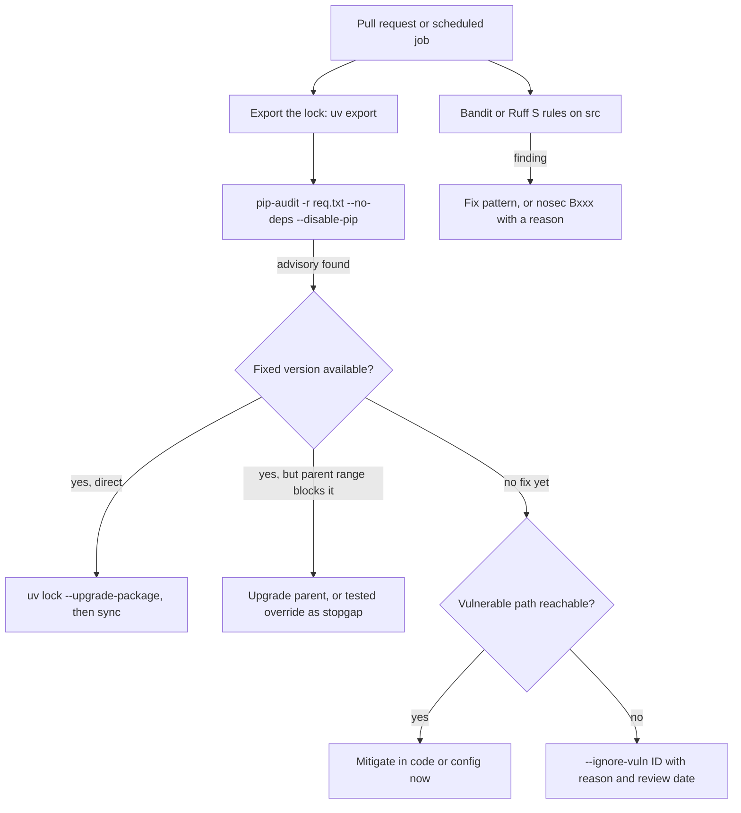

## TL;DR
**pip-audit** checks an agent's exact locked dependencies against vulnerability databases; **Bandit** scans
your agent and tool code for risky patterns like `pickle.load`, `eval`, `shell=True` and hard-coded keys.
Both run in seconds in CI; neither proves an agent safe.

## For agent builders
- **Why it matters for agents.** Agents turn model output into actions: shell commands, SQL, file paths,
  HTTP calls. The patterns Bandit flags (`shell=True`, `eval`, string-built SQL) are exactly where model
  output becomes code execution, and the agent's large dependency graph is where known CVEs hide.
- **Where it shows up in your stack.** LangChain community integrations, MCP server packages, provider
  SDKs, parsers for retrieved documents and model loaders all arrive through your lock; pip-audit runs on
  that lock in CI, Bandit or Ruff `S` rules run on your tool code, and a secret scanner guards the API keys
  agents need.
- **What you control.** Which tool and integration packages are admitted, the CI gate and its expiring
  suppressions, a model-artifact policy (safetensors, pinned revisions), and whether a code-executing
  agent may install packages at runtime, from which index.
- **What you can skip.** Building your own vulnerability database or data-flow analyzer. Prompt
  injection and tool authorization are design problems; scanners will not find them.

## Lab
### Task
Build the CI gate that sits after `pip-audit` on an agent service's exported lock: de-duplicate findings,
turn fixable ones into one upgrade action per package, block unfixed ones, and honor only written
exceptions with a reason and a review date that has not passed. Time box: 45-75 min.
- **Prerequisites:** Lockfiles & dependency pinning; the triage order in How it works below.
- **Setup:** Python 3.11+ (for `tomllib`), `pip install packaging pytest` (checked with packaging 26.3).
  Save the starter as `lab.py`, the tests as `test_lab.py`.
- **Offline by design:** the report is a recorded `pip-audit -f json` output, so the lab needs no
  vulnerability service. The date is injected, so expiry is testable.

### Starter code
```python
"""Lab: a CI vulnerability gate over a recorded pip-audit JSON report. Run: python lab.py"""
from __future__ import annotations
import datetime as dt, json, tomllib
from packaging.version import Version

# Shape recorded from `pip-audit -r req.txt --no-deps --disable-pip -f json` (pip-audit 2.10.1),
# trimmed. The jinja2 entries are real advisories; example-parser and DEMO-2026-0001 are invented.
# pip-audit really did list some jinja2 advisories twice in this run.
REPORT = json.loads('''{
  "dependencies": [
    {"name": "jinja2", "version": "3.1.2", "vulns": [
      {"id": "PYSEC-2026-1473", "fix_versions": ["3.1.3"], "aliases": ["CVE-2024-22195"]},
      {"id": "PYSEC-2026-1474", "fix_versions": ["3.1.4"], "aliases": ["CVE-2024-34064"]},
      {"id": "PYSEC-2026-1471", "fix_versions": ["3.1.6"], "aliases": ["CVE-2025-27516"]},
      {"id": "PYSEC-2026-1473", "fix_versions": ["3.1.3"], "aliases": ["CVE-2024-22195"]}]},
    {"name": "markupsafe", "version": "2.1.5", "vulns": []},
    {"name": "example-parser", "version": "0.9.1", "vulns": [
      {"id": "DEMO-2026-0001", "fix_versions": [], "aliases": []}]}
  ],
  "fixes": []
}''')

EXCEPTIONS = '''
[[exception]]
id = "DEMO-2026-0001"
reason = "only parses PDFs we generate; no untrusted input reaches it"
review_by = 2026-12-01
'''

def load_exceptions(toml_text: str) -> dict[str, dict]:
    # YOUR CODE HERE: {id: entry} from [[exception]] tables; tomllib parses review_by as a date
    # - an entry without a non-empty reason or without review_by -> ValueError naming its id
    raise NotImplementedError

def gate(report: dict, exceptions: dict[str, dict], today: dt.date) -> tuple[int, list[str]]:
    # YOUR CODE HERE: return (exit_code, sorted action lines)
    # - de-duplicate findings by (package, id); an exception matches a finding by id or by any alias
    # - in defer/expired lines, <id> is the exception's own id (the one the team wrote)
    # - exception with review_by >= today: "defer <id> until <review_by>: <reason>"   (passes)
    # - exception past review_by:          "expired <id> (review by <review_by>)"     (fails)
    # - unexcepted findings with fixes:    one "upgrade <pkg> <version> -> <highest fix>" per package
    #   (compare with Version)                                                       (fails)
    # - unexcepted finding with no fix:    "block <pkg> <id>: no fix and no exception" (fails)
    # - exit_code is 1 if any line fails, else 0
    raise NotImplementedError

def ignore_args(exceptions: dict[str, dict], today: dt.date) -> list[str]:
    # YOUR CODE HERE: ["--ignore-vuln", id, ...] for unexpired exceptions only, sorted by id
    raise NotImplementedError

if __name__ == "__main__":
    exc = load_exceptions(EXCEPTIONS)
    for today in (dt.date(2026, 10, 23), dt.date(2027, 1, 4)):
        code, lines = gate(REPORT, exc, today)
        print(f"{today} exit={code}")
        for line in lines:
            print("  " + line)
        print("  pip-audit", " ".join(ignore_args(exc, today)) or "(no ignores)")
```

### Expected output
`python lab.py` with a correct solution prints exactly this. The build fails on both dates: today because
`jinja2` has fixes waiting, later also because the exception expired.

```
2026-10-23 exit=1
  defer DEMO-2026-0001 until 2026-12-01: only parses PDFs we generate; no untrusted input reaches it
  upgrade jinja2 3.1.2 -> 3.1.6
  pip-audit --ignore-vuln DEMO-2026-0001
2027-01-04 exit=1
  expired DEMO-2026-0001 (review by 2026-12-01)
  upgrade jinja2 3.1.2 -> 3.1.6
  pip-audit (no ignores)
```

### Tests
Run `pytest -q test_lab.py`. On the starter all 7 fail with `NotImplementedError`; a correct solution
passes all 7 (Python 3.12, packaging 26.3, pytest 9.1).

```python
import copy, datetime as dt
import pytest
from lab import EXCEPTIONS, REPORT, gate, ignore_args, load_exceptions

TODAY = dt.date(2026, 10, 23)

def test_exceptions_need_reason_and_review_date():
    assert load_exceptions(EXCEPTIONS)["DEMO-2026-0001"]["review_by"] == dt.date(2026, 12, 1)
    with pytest.raises(ValueError, match="X-1"):
        load_exceptions('[[exception]]\nid = "X-1"\nreview_by = 2026-12-01\n')
    with pytest.raises(ValueError, match="X-2"):
        load_exceptions('[[exception]]\nid = "X-2"\nreason = "fine"\n')

def test_gate_upgrades_through_the_highest_fix_and_defers_the_excepted():
    code, lines = gate(REPORT, load_exceptions(EXCEPTIONS), TODAY)
    assert code == 1
    assert lines == [
        "defer DEMO-2026-0001 until 2026-12-01: only parses PDFs we generate; no untrusted input reaches it",
        "upgrade jinja2 3.1.2 -> 3.1.6",
    ]

def test_expired_exception_fails_the_build():
    code, lines = gate(REPORT, load_exceptions(EXCEPTIONS), dt.date(2027, 1, 4))
    assert code == 1 and "expired DEMO-2026-0001 (review by 2026-12-01)" in lines

def test_unexcepted_finding_without_fix_blocks():
    code, lines = gate(REPORT, {}, TODAY)
    assert "block example-parser DEMO-2026-0001: no fix and no exception" in lines

def test_exception_matches_by_alias_and_lowers_the_target():
    exc = load_exceptions(EXCEPTIONS + '''
[[exception]]
id = "CVE-2025-27516"
reason = "sandboxed templates are never rendered from user input"
review_by = 2026-11-30
''')
    code, lines = gate(REPORT, exc, TODAY)
    assert "upgrade jinja2 3.1.2 -> 3.1.4" in lines
    assert any(l.startswith("defer CVE-2025-27516") for l in lines)

def test_clean_report_passes():
    clean = copy.deepcopy(REPORT)
    for dep in clean["dependencies"]:
        dep["vulns"] = []
    assert gate(clean, {}, TODAY) == (0, [])

def test_ignore_args_only_for_live_exceptions():
    exc = load_exceptions(EXCEPTIONS)
    assert ignore_args(exc, TODAY) == ["--ignore-vuln", "DEMO-2026-0001"]
    assert ignore_args(exc, dt.date(2027, 1, 4)) == []
```

### Failure scenarios
- **Skip de-duplication.** Sorted, de-duplicated lines can still look right, but any count you report
  says 4 open `jinja2` findings instead of 3, and an open-findings metric drifts from reality. Print
  `len(vulns)` against `len({v["id"] for v in vulns})` per package on the recorded report.
- **Pick the fix with `max(fix_versions)` on strings.** Works here by luck, then picks `3.1.9` over
  `3.1.10` on a later report. Test `max(["3.1.9", "3.1.10"])` against `max(..., key=Version)`.
- **Match exceptions by advisory ID only.** The alias test fails: the team wrote the CVE number, pip-audit
  reported a `PYSEC` ID, and the finding is treated as unexcepted. Print each finding's
  `[id, *aliases]` next to the exception keys.
- **Let an exception without `review_by` default to "forever".** A deferral nobody revisits becomes a
  permanent hole. The loader test fails; read the offending entry's id from the `ValueError`.

### Submission
- **`lab.py`** with `load_exceptions`, `gate` and `ignore_args` implemented.
- **A green test run** (7 passed) and the output of `python lab.py`.
- **A real run:** export a lock from any uv project (`uv export --format requirements-txt --no-hashes`),
  run `pip-audit -r req.txt --no-deps --disable-pip -f json > audit.json`, and feed it to `gate`.
- **A two-line CI snippet** showing where the gate runs relative to `pip-audit` and what fails the build.
- **Evaluated on:** tests passing, one upgrade line per package at the highest fix, alias matching, and
  expired or reason-less exceptions failing loudly.

## Why it exists
- **An AI service is mostly third-party code:** an LLM SDK, an HTTP stack, a web framework, tokenizers,
  PDF and HTML parsers, often torch and transformers. Vulnerabilities are disclosed in packages like these
  regularly.
- **Locks keep you on the vulnerable version** until someone notices, and nobody reads advisories for a
  hundred transitive packages by hand, so without automation the gap between "fix published" and "fix
  deployed" is unbounded.
- **AI work makes risky code more common.** Model artifacts use pickle-based formats that execute code on
  load; LLM output is tempting to pass to `eval`, a shell or SQL; prototypes hard-code API keys; `yaml.load`
  and `trust_remote_code=True` slip in from tutorials.
- **Careful review does not scale.** "We will review carefully and update dependencies when we remember"
  fails because both problems grow with code volume and dependency count, while attention does not.
- **Cheap, deterministic scanners on every pull request** close the obvious holes.

## How it works
### pip-audit: known vulnerabilities in dependencies
1. **Input:** installed or declared packages: the current environment, `-r requirements.txt`, or a project
   directory. pip-audit is maintained under PyPA.
2. **Resolve** exact versions.
3. **Query** a vulnerability service (PyPI's advisory data by default, or OSV with `-s osv`) for advisories
   affecting each version.
4. **Report** package, version, advisory ID and fixed versions; exit non-zero on findings so CI fails; emit
   JSON or CycloneDX SBOM output on request.

- **`--fix`** upgrades to fixed versions where possible; **`--ignore-vuln ID`** records a deliberate,
  reviewed exception.
- **Exact versions are essential,** *because* advisories are expressed as affected version ranges. Auditing a
  lockfile or exported pinned requirements is meaningful; auditing loose ranges in `pyproject.toml` is not,
  since the answer depends on what would be installed.
- **The lock also reveals transitive exposure:** vulnerable packages you never chose directly.

### Triage: what to do with a finding
A finding is the start of a decision, not the decision. A useful order:
1. **Is a fixed version available?** If yes, upgrade *through the lock*: `uv lock --upgrade-package jinja2`
   (or the Poetry or pip-compile equivalent), then sync. `pip-audit --fix` upgrades the environment it
   is pointed at, which in a locked project just creates drift that the next sync erases.
2. **Is it transitive?** If the vulnerable package is pulled in by another dependency whose declared range
   excludes the fixed version, the real fix is upgrading the parent. If that is not yet possible, a
   constraint or override that forces the fixed version is a stopgap you must test, *because* you are
   now running the parent against a version it did not declare support for.
3. **Is the vulnerable path reachable?** Read the advisory: a flaw in a template sandbox does not matter if
   you never render untrusted templates, while one in the HTTP parser of your public endpoint does.
   Unreachable is a reason to *defer* with a written justification, not to ignore forever.
4. **Record the exception.** `--ignore-vuln ID` with the reason and an expiry or review date next to it, so
   the suppression is visible in review and revisited when a fix ships.

### Bandit: risky patterns in your code
- **How:** parses each Python file into an abstract syntax tree and runs plugins matching known-dangerous
  constructs, each with a test ID, severity and confidence.

| Test ID | Flags | Why |
|---|---|---|
| `B101` | assert used | asserts vanish under `python -O`, so they must not enforce security |
| `B301` | pickle deserialization | executes code on load |
| `B307` | `eval` | runs arbitrary expressions |
| `B506` | unsafe `yaml.load` | full loader builds arbitrary objects |
| `B602` | subprocess with `shell=True` | shell metacharacters from input |
| `B105` | hard-coded password strings | secrets in source |
| `B608` | SQL built by string formatting | SQL injection |

- **Severity floor:** `bandit -r src -ll` reports medium severity and above. Some useful checks are rated low
  (B105 and B101 among them) and disappear under that floor.
- **B105 is a name heuristic:** it fires on literals assigned to names containing words such as `password`,
  `secret` or `token`, so `API_KEY = "sk-..."` slips past it; one more reason to run a real secret scanner.
- **Configure per project:** skips in a config file (passed explicitly); suppress a reviewed line with
  `# nosec B602` plus a reason.
- **Ruff alternative:** Ruff implements many of the same checks as its `S` rules (from flake8-bandit), so
  teams can run them inside the linter they already have.
- **Fast but blind to data flow,** *because* it matches syntax rather than tracking data. It cannot tell
  whether the string reaching `subprocess` came from a constant or from a user, so it produces false
  positives, and it misses vulnerabilities without a recognizable syntactic shape.

### What neither tool covers
| Gap | Mitigation |
|---|---|
| **Malicious or typosquatted packages** with no CVE | locks with hashes, approved indexes or mirrors, reviewing new dependencies |
| **Logic and authorization bugs**, prompt injection, data leakage between tenants | design and review |
| **Over-privileged agent tools** (a shell tool, unrestricted SQL, unscoped API tokens) | least-privilege tool design, allowlists, sandboxes, human approval for writes |
| **Packages an agent installs at runtime**, including hallucinated names an attacker registered | no runtime installs, or an allowlisted internal index inside the sandbox |
| **Secrets already committed** | dedicated secret scanners (gitleaks, trufflehog) search history, which Bandit's string heuristics do not |
| **Model artifacts** | prefer safetensors over pickle-based checkpoints, pin model revisions, avoid `trust_remote_code=True` for unreviewed repositories |
| **Reachability** (vulnerable function present but never called) | tools such as OSV-Scanner, Dependabot alerts, Safety or Snyk differ in databases and triage features; choose by workflow |

## Diagram
The CI gate runs two independent scanners over two different inputs, and every pip-audit finding goes
through the same triage path before it is fixed or deferred with a recorded exception.



## Examples
### What Bandit flags in an agent, and the safer equivalents
The scenario: an agent that loads a classifier, runs a shell tool and stores results.

```python
import pickle, sqlite3, subprocess, shlex
import yaml

API_TOKEN = "sk-live-123"                                # B105 (low severity): hard-coded secret -> env/secrets
clf = pickle.load(open("router.pkl", "rb"))              # B301: executes code from an untrusted file
cfg = yaml.load(open("agent.yaml"), Loader=yaml.Loader)  # B506: full loader can build arbitrary objects

def run_tool(cmd_from_llm: str) -> str:                  # B602: model output reaches a shell
    return subprocess.run(cmd_from_llm, shell=True, capture_output=True, text=True).stdout

def save(db: sqlite3.Connection, user: str, answer: str) -> None:
    db.execute(f"INSERT INTO answers VALUES ('{user}', '{answer}')")   # B608: SQL injection

# Safer versions
ALLOWED = {"ls", "wc"}
def run_tool_safe(cmd_from_llm: str) -> str:
    argv = shlex.split(cmd_from_llm)                     # no shell: no ;, |, $(...) expansion
    if not argv or argv[0] not in ALLOWED:               # arguments (paths) still need validating
        raise PermissionError(f"tool not allowed: {argv[:1]}")
    return subprocess.run(argv, capture_output=True, text=True, timeout=10).stdout

def save_safe(db: sqlite3.Connection, user: str, answer: str) -> None:
    db.execute("INSERT INTO answers VALUES (?, ?)", (user, answer))

cfg_safe = yaml.safe_load(open("agent.yaml"))
# Weights: store as safetensors; for any pickle-based checkpoint, load only from trusted, pinned sources.

# CI (fails the build on findings):
#   uv export --format requirements-txt --no-hashes --no-emit-project > req.txt
#   pip-audit -r req.txt --no-deps --disable-pip   # export is already fully resolved; skip pip install
#   bandit -r src -ll                              # medium+ only: hides B105/B101, so run -l periodically
```

- **Expect low-severity noise on the safe version too:** Bandit still reports `B603` (subprocess without a
  shell) on `run_tool_safe`, plus `B403` for `import pickle`. Both are low severity; review them once rather
  than suppressing them by default.

### Agent scenario: what each control covers in a coding agent
A coding agent with a shell tool, a SQL tool and community integrations. Map each risk to the control
that can actually see it.

| Risk in the agent | pip-audit | Bandit / Ruff `S` | What actually covers it |
|---|---|---|---|
| CVE in an HTTP parser pulled in by an integration | yes, on the exported lock | no | upgrade through the lock, scheduled audits |
| Tool runs model output with `shell=True` | no | yes, `B602` | no shell, argv allowlist, sandbox, timeout |
| SQL tool formats model output into a query | no | yes, `B608` | parameters, read-only DB role, row limits |
| `API_KEY = "sk-..."` in a tool module | no | missed (B105 matches names like `password`) | gitleaks or trufflehog, keys from a secrets manager |
| Agent runs `pip install` for a package name it invented | no | no | block runtime installs, or an allowlisted index in the sandbox |
| Prompt injection in a retrieved page asks the agent to email data | no | no | tool permissions, output filtering, human approval |

### Scanner configuration kept in the repo
Bandit reads `[tool.bandit]` from `pyproject.toml` when you pass the file with `-c` (install `bandit[toml]`);
the Ruff block is the in-linter alternative. Pick one.

```toml
[tool.bandit]
exclude_dirs = ["tests"]          # asserts and fixtures in tests drown real findings

# Alternative: Bandit-style rules inside Ruff
[tool.ruff.lint]
extend-select = ["S"]

[tool.ruff.lint.per-file-ignores]
"tests/**" = ["S101"]             # assert is fine in tests
```

Run it with `bandit -c pyproject.toml -r src`.

### Worked scenario: triaging a transitive finding
pip-audit on the exported lock reports an advisory in `jinja2`, pulled in by a web framework.

| Step | Finding | Action |
|---|---|---|
| Fixed version? | yes, a newer `jinja2` release | try `uv lock --upgrade-package jinja2` |
| Transitive? | the framework's range excludes the fix | upgrade the framework; if blocked, a tested override as a stopgap |
| Reachable? | the flaw is in the template sandbox; the service never renders untrusted templates | allowed to *defer*, with a written justification |
| Record | `--ignore-vuln <ID>` in the CI script with reason and review date | revisit when the framework ships support |

## Production patterns
- **Scan tool code with the strictest settings.** Run Bandit (or Ruff `S` rules) on the agent's tool
  modules without the `-ll` severity floor, because tools are where model output meets subprocess, SQL
  and the filesystem. Review every `# nosec` in a tool module like a permission grant.
- **Admit agent integrations like any dependency.** Review new LangChain integration, MCP server or tool
  packages before adding them (maintainer, release history, what they can reach), lock them with hashes,
  and keep them in the scheduled audit. Track the number of tool packages per agent.
- **No runtime installs from public indexes.** Code-executing agents get a sandbox image with
  preinstalled, audited packages, or an allowlisted internal index; models sometimes suggest package
  names that do not exist, and attackers can register them.
- **Audit the artifact that ships.** In CI export the lock (`uv export --format requirements-txt ...`) and
  run `pip-audit -r req.txt --no-deps --disable-pip`, never the developer's environment. Track open findings
  and time from advisory to fix deployed.
- **Scheduled audits, not just PR audits.** New advisories appear for code that has not changed, so also run
  the same audit daily or weekly against the deployed lock (for example a CI job on a `schedule` trigger) and
  alert the owning team.
- **Expiring, reviewed suppressions.** Keep each `--ignore-vuln ID` and `# nosec Bxxx` next to a reason and a
  review date; count suppressions and review the list monthly so they do not become permanent.
- **Audit evidence as SBOMs.** Emit CycloneDX output from pip-audit (its output-format option) and archive it
  per release; regulated customers often ask for exactly this.
- **Secret scanning on history.** Run gitleaks or trufflehog in CI and as a pre-commit hook, because Bandit's
  B105 misses names like `API_KEY`. Rotate any key a scanner finds; deleting the commit is not enough.
- **Model-artifact policy.** Accept only safetensors, pin model revisions, allowlist sources and keep
  `trust_remote_code=True` behind review, since no dependency scanner looks inside model files.

## Trade-offs
- **Current dependencies vs blocked work.** Failing CI on any pip-audit finding keeps dependencies current but
  blocks unrelated work when an advisory has no fix yet; allow time-boxed, reviewed `--ignore-vuln` entries
  rather than disabling the check.
- **Zero setup vs false positives.** Bandit catches common dangerous calls with near-zero setup, but its
  syntax-only view yields false positives; tune with severity thresholds and justified `nosec` comments, or
  move to a data-flow tool such as Semgrep or CodeQL when signal-to-noise becomes the bottleneck.
- **PR scans vs drift.** Scanning every pull request catches problems early, but new advisories appear for
  unchanged code; also schedule a daily or weekly audit of the deployed lockfile.
- **One tool vs full coverage.** Ruff's `S` rules avoid another tool but may not match Bandit's full plugin
  set and configuration; pick one and keep the rule list explicit.

## Pitfalls
- **A clean scan treated as a safe agent.** Symptom: an agent with green pip-audit and Bandit runs is
  talked by injected text into calling a powerful tool. Fix: least-privilege tools, approval for writes and
  injection tests in the eval suite; scanners do not see tool permissions.
- **Auditing `pyproject.toml` ranges or the developer's environment** instead of the lock that ships.
  Symptom: a clean report while the production image contains a flagged version.
- **Blanket `# nosec` or skipped test IDs** to make the build green. Symptom: a security review finds
  `shell=True` on model output that the scanner reported months earlier.
- **Clean pip-audit treated as "no supply-chain risk".** Symptom: surprise when a malicious lookalike package
  with no CVE is found in the dependency tree.
- **Assuming Bandit understands context.** Symptom: the team ignores its output because findings in tests and
  constant strings drown real ones. Fix: a config excluding tests and a severity floor.
- **`pip-audit --fix` in a lockfile-managed project.** Symptom: a green local audit followed by the same
  finding in CI, because the fix changed the environment but never reached the lock.
- **Pickle-based model files from a public hub** because "it is just weights". Symptom: arbitrary code
  execution on the inference host, which no dependency scanner would report.

## When to use
- **Use when:** an agent has a lockfile and tools that will run with real data or credentials; for agent
  services that is usually the first deployment.
- **Run:** pip-audit against the exact lock on every PR and on a schedule; Bandit (or Ruff `S` rules) on
  source directories, with tests excluded or treated leniently.
- **Measure:** open findings, time from advisory to fix deployed, and the count of suppressions.
- **Regulated customers:** the JSON or CycloneDX output often becomes audit evidence.
- **Interviews:** explain what each tool can and cannot see rather than listing tools.

## Role lens
- **Engineer:** Fixes or justifies each finding, replaces pickle, `eval` and `shell=True` patterns, and keeps
  suppressions narrow with a reason next to them.
- **Architect:** Sets the policy: which scanners gate merges, severity thresholds, exception expiry, approved
  indexes and model-artifact formats.
- **FDE:** Produces SBOMs and audit reports in the format the customer's security team requires, and adapts
  scanning to their private mirrors and air-gapped build systems.

## Check yourself
**Q:** Your service passes pip-audit and Bandit with zero findings. A security reviewer still blocks the
launch, citing the agent's ability to download and load community fine-tuned models. Is the reviewer right?
**A:** Yes. pip-audit only knows published advisories for Python packages, and Bandit only matches syntax in
our source; neither inspects model artifacts. Pickle-based checkpoints, and repositories loaded with
`trust_remote_code=True`, execute code chosen by whoever published the model, so loading community models is
remote code execution by design unless constrained. Mitigations: accept only safetensors, pin model revisions
or checksums, allowlist sources, scan or review artifacts, and run loading in a sandbox with minimal
credentials. Clean scanner output narrows risk; it does not certify the system.

## Interview questions
### What do pip-audit and Bandit each check, and why do you need both?
- **pip-audit:** your exact installed or locked package versions against advisory data (PyPI's by default, OSV
  with `-s osv`), so it finds known vulnerabilities in third-party code.
- **Bandit:** your own source, parsed into a syntax tree, for risky patterns such as `pickle.load`, `eval`,
  `shell=True` and SQL built by string formatting.
- **Different blind spots:** one knows nothing about your code, the other nothing about dependencies.

### pip-audit flags a vulnerability in a transitive dependency and the parent's range excludes the fix. Walk me through it.
- **Prefer upgrading the parent** to a release whose range allows the fixed version, then re-lock.
- **If blocked,** a constraint or override forcing the fixed version is a stopgap that must be tested,
  because the parent now runs against a version it never declared support for.
- **If no fix exists,** check reachability in the advisory and record `--ignore-vuln ID` with a reason and a
  review date.

### Why is a clean pip-audit run not evidence that your supply chain is safe?
- **It only knows published advisories,** so a malicious or typosquatted package with no CVE passes.
- **Defences are elsewhere:** locks with hashes, approved indexes or mirrors, and reviewing new dependencies.
- **It also never looks inside model files,** where pickle-based checkpoints execute code on load.

### Bandit produces so many findings that the team ignores it. How do you restore signal?
- **Exclude tests** (asserts and fixtures drown real findings) via `exclude_dirs` or Ruff per-file ignores.
- **Set a severity floor** such as `-ll` for gating, and run the full set periodically, since B105 and B101
  are rated low.
- **Suppress narrowly** with `# nosec B602` plus a reason, and move to a data-flow tool such as Semgrep or
  CodeQL if false positives remain the bottleneck.

### An agent passes LLM output to `subprocess.run(..., shell=True)`. What do you change?
- **Drop the shell:** split with `shlex.split` and pass an argument list, so `;`, `|` and `$(...)` are not
  expanded.
- **Allowlist commands** and validate arguments such as paths, because a permitted binary can still be misused.
- **Add a timeout and minimal credentials** for the process; Bandit's B602 would have flagged the original.

### Your coding agent can run `pip install` inside its sandbox. What controls do you put in place?
- **Prefer no runtime installs:** bake an audited set of packages into the sandbox image, built from a
  lock and covered by pip-audit.
- **If installs are needed:** point the sandbox at an internal mirror or allowlisted index, never public
  PyPI, because a model can invent a package name that an attacker has registered.
- **Contain the blast radius:** no network beyond that index, no credentials in the sandbox, CPU, memory
  and time limits, and logged install commands per run.

## Quiz
### Q: Why should pip-audit run against the lockfile rather than the version ranges in pyproject.toml?
- [ ] pip-audit cannot parse pyproject.toml files
- [x] Advisories apply to specific versions, so only the exact resolved set says what is actually vulnerable
- [ ] Ranges are always newer than the lockfile and therefore safe
- [ ] The lockfile contains the vulnerability database
> Vulnerability data is expressed as affected version ranges. A range like httpx>=0.27 could install
> many versions; the lock records exactly what ships, including transitive packages, so the audit is meaningful.

### Q: What kind of problem is Bandit structurally unable to detect well?
- [ ] subprocess calls with shell=True
- [ ] use of pickle.load
- [x] whether a value reaching a dangerous call came from untrusted input across functions
- [ ] hard-coded password-like string literals
> Bandit matches patterns in each file's syntax tree; it does not track data flow. It flags the dangerous
> call itself, but cannot tell a constant from user-controlled input reaching it, hence false positives.

### Q: A team wants to defend against a typosquatted package with no CVE. Which measure helps most?
- [ ] Running pip-audit more frequently
- [ ] Lowering Bandit's severity threshold
- [x] Reviewing new dependencies and installing only from a lockfile with hashes from an approved index
- [ ] Adding nosec comments to import statements
> pip-audit only reports known advisories, and Bandit scans your code, not packages. Controlling what
> enters the lock, and verifying hashes from trusted sources, is what stops an unknown malicious package.

## Use cases & projects
### Use cases
- **Auditing an agent's dependency graph.** pip-audit on the lock catches known CVEs in framework
  integrations, MCP server packages, document parsers and provider SDKs before deploy.
- **Reviewing tool code that runs model output.** Bandit or Ruff `S` rules flag `shell=True`, `eval` and
  string-built SQL in exactly the tools where model output becomes execution.
- **Keeping agent API keys out of the repo.** A secret scanner in pre-commit and CI stops provider and tool
  credentials from being committed.
- **Admitting new integrations.** A review gate for new tool and integration packages limits what a
  compromised or typosquatted package can reach.

### Mini project
**Add a security gate to an agent repo (1-2 hours).**
- **Goal:** fail CI on known-vulnerable dependencies and unsafe tool code in a small agent project.
- **Steps:** write one deliberately unsafe tool that passes model output to a shell with `shell=True`;
  add pip-audit against the lock and Bandit on the tools package to CI; add a suppression that must name a
  reason and an expiry; fix the tool by passing an argument list and validating input against an
  allowlist; add a secret scanner to pre-commit.
- **Done when:** CI fails on the unsafe tool and passes after the fix, a planted fake key is blocked, and
  every suppression in the repo has a reason and an expiry date.
