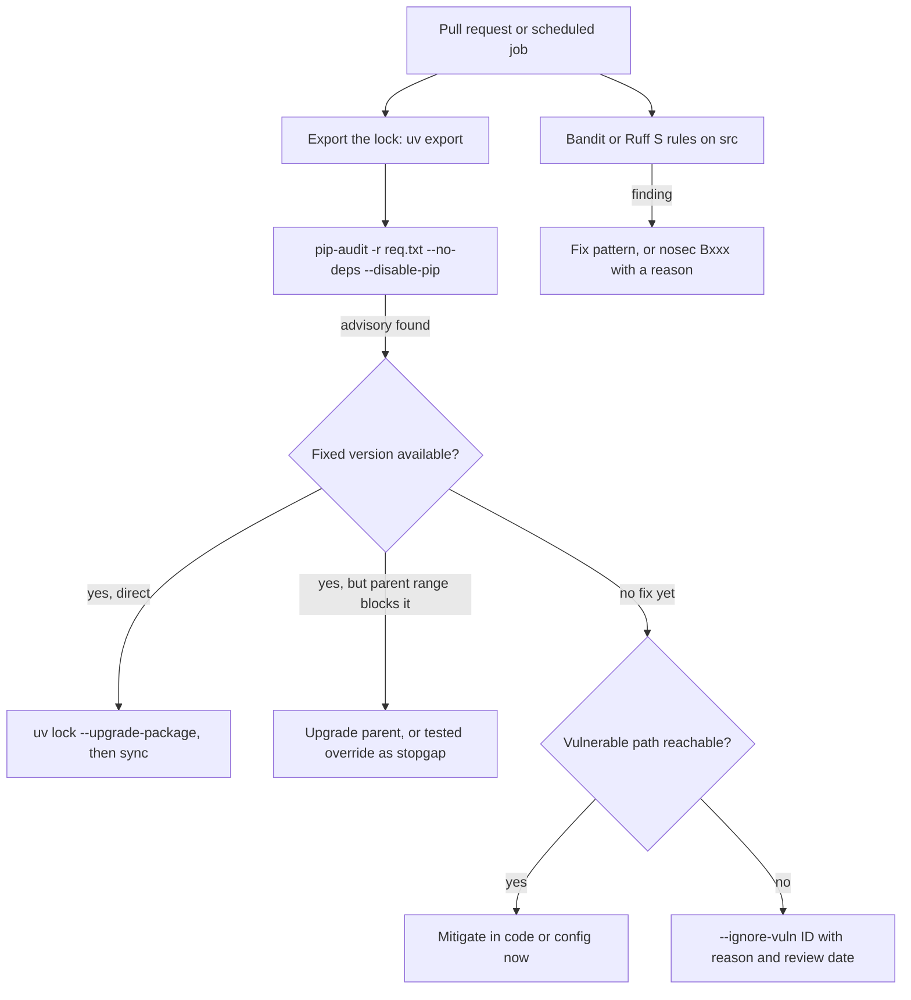

## TL;DR
**pip-audit** checks your exact installed versions against vulnerability databases; **Bandit** scans your
own code for risky patterns like `pickle.load`, `eval`, `shell=True` and hard-coded secrets. Both run in
seconds in CI; neither proves code safe, they free reviewers for design-level risks.

## Why it exists
- **An AI service is mostly third-party code:** an LLM SDK, an HTTP stack, a web framework, tokenizers,
  PDF and HTML parsers, often torch and transformers. Vulnerabilities are disclosed in packages like these
  regularly.
- **Locks keep you on the vulnerable version** until someone notices, and nobody reads advisories for a
  hundred transitive packages by hand, so without automation the gap between "fix published" and "fix
  deployed" is unbounded.
- **AI work makes risky code more common.** Model artifacts use pickle-based formats that execute code on
  load; LLM output is tempting to pass to `eval`, a shell or SQL; prototypes hard-code API keys; `yaml.load`
  and `trust_remote_code=True` slip in from tutorials.
- **Careful review does not scale.** "We will review carefully and update dependencies when we remember"
  fails because both problems grow with code volume and dependency count, while attention does not.
- **Cheap, deterministic scanners on every pull request** close the obvious holes.

## How it works
### pip-audit: known vulnerabilities in dependencies
1. **Input:** installed or declared packages: the current environment, `-r requirements.txt`, or a project
   directory. pip-audit is maintained under PyPA.
2. **Resolve** exact versions.
3. **Query** a vulnerability service (PyPI's advisory data by default, or OSV with `-s osv`) for advisories
   affecting each version.
4. **Report** package, version, advisory ID and fixed versions; exit non-zero on findings so CI fails; emit
   JSON or CycloneDX SBOM output on request.

- **`--fix`** upgrades to fixed versions where possible; **`--ignore-vuln ID`** records a deliberate,
  reviewed exception.
- **Exact versions are essential,** *because* advisories are expressed as affected version ranges. Auditing a
  lockfile or exported pinned requirements is meaningful; auditing loose ranges in `pyproject.toml` is not,
  since the answer depends on what would be installed.
- **The lock also reveals transitive exposure:** vulnerable packages you never chose directly.

### Triage: what to do with a finding
A finding is the start of a decision, not the decision. A useful order:
1. **Is a fixed version available?** If yes, upgrade *through the lock*: `uv lock --upgrade-package jinja2`
   (or the Poetry or pip-compile equivalent), then sync. `pip-audit --fix` upgrades the environment it
   is pointed at, which in a locked project just creates drift that the next sync erases.
2. **Is it transitive?** If the vulnerable package is pulled in by another dependency whose declared range
   excludes the fixed version, the real fix is upgrading the parent. If that is not yet possible, a
   constraint or override that forces the fixed version is a stopgap you must test, *because* you are
   now running the parent against a version it did not declare support for.
3. **Is the vulnerable path reachable?** Read the advisory: a flaw in a template sandbox does not matter if
   you never render untrusted templates, while one in the HTTP parser of your public endpoint does.
   Unreachable is a reason to *defer* with a written justification, not to ignore forever.
4. **Record the exception.** `--ignore-vuln ID` with the reason and an expiry or review date next to it, so
   the suppression is visible in review and revisited when a fix ships.

### Bandit: risky patterns in your code
- **How:** parses each Python file into an abstract syntax tree and runs plugins matching known-dangerous
  constructs, each with a test ID, severity and confidence.

| Test ID | Flags | Why |
|---|---|---|
| `B101` | assert used | asserts vanish under `python -O`, so they must not enforce security |
| `B301` | pickle deserialization | executes code on load |
| `B307` | `eval` | runs arbitrary expressions |
| `B506` | unsafe `yaml.load` | full loader builds arbitrary objects |
| `B602` | subprocess with `shell=True` | shell metacharacters from input |
| `B105` | hard-coded password strings | secrets in source |
| `B608` | SQL built by string formatting | SQL injection |

- **Severity floor:** `bandit -r src -ll` reports medium severity and above. Some useful checks are rated low
  (B105 and B101 among them) and disappear under that floor.
- **B105 is a name heuristic:** it fires on literals assigned to names containing words such as `password`,
  `secret` or `token`, so `API_KEY = "sk-..."` slips past it; one more reason to run a real secret scanner.
- **Configure per project:** skips in a config file (passed explicitly); suppress a reviewed line with
  `# nosec B602` plus a reason.
- **Ruff alternative:** Ruff implements many of the same checks as its `S` rules (from flake8-bandit), so
  teams can run them inside the linter they already have.
- **Fast but blind to data flow,** *because* it matches syntax rather than tracking data. It cannot tell
  whether the string reaching `subprocess` came from a constant or from a user, so it produces false
  positives, and it misses vulnerabilities without a recognizable syntactic shape.

### What neither tool covers
| Gap | Mitigation |
|---|---|
| **Malicious or typosquatted packages** with no CVE | locks with hashes, approved indexes or mirrors, reviewing new dependencies |
| **Logic and authorization bugs**, prompt injection, data leakage between tenants | design and review |
| **Secrets already committed** | dedicated secret scanners (gitleaks, trufflehog) search history, which Bandit's string heuristics do not |
| **Model artifacts** | prefer safetensors over pickle-based checkpoints, pin model revisions, avoid `trust_remote_code=True` for unreviewed repositories |
| **Reachability** (vulnerable function present but never called) | tools such as OSV-Scanner, Dependabot alerts, Safety or Snyk differ in databases and triage features; choose by workflow |

## Diagram
The CI gate runs two independent scanners over two different inputs, and every pip-audit finding goes
through the same triage path before it is fixed or deferred with a recorded exception.



## Examples
### What Bandit flags in an agent, and the safer equivalents
The scenario: an agent that loads a classifier, runs a shell tool and stores results.

```python
import pickle, sqlite3, subprocess, shlex
import yaml

API_TOKEN = "sk-live-123"                                # B105 (low severity): hard-coded secret -> env/secrets
clf = pickle.load(open("router.pkl", "rb"))              # B301: executes code from an untrusted file
cfg = yaml.load(open("agent.yaml"), Loader=yaml.Loader)  # B506: full loader can build arbitrary objects

def run_tool(cmd_from_llm: str) -> str:                  # B602: model output reaches a shell
    return subprocess.run(cmd_from_llm, shell=True, capture_output=True, text=True).stdout

def save(db: sqlite3.Connection, user: str, answer: str) -> None:
    db.execute(f"INSERT INTO answers VALUES ('{user}', '{answer}')")   # B608: SQL injection

# Safer versions
ALLOWED = {"ls", "wc"}
def run_tool_safe(cmd_from_llm: str) -> str:
    argv = shlex.split(cmd_from_llm)                     # no shell: no ;, |, $(...) expansion
    if not argv or argv[0] not in ALLOWED:               # arguments (paths) still need validating
        raise PermissionError(f"tool not allowed: {argv[:1]}")
    return subprocess.run(argv, capture_output=True, text=True, timeout=10).stdout

def save_safe(db: sqlite3.Connection, user: str, answer: str) -> None:
    db.execute("INSERT INTO answers VALUES (?, ?)", (user, answer))

cfg_safe = yaml.safe_load(open("agent.yaml"))
# Weights: store as safetensors; for any pickle-based checkpoint, load only from trusted, pinned sources.

# CI (fails the build on findings):
#   uv export --format requirements-txt --no-hashes --no-emit-project > req.txt
#   pip-audit -r req.txt --no-deps --disable-pip   # export is already fully resolved; skip pip install
#   bandit -r src -ll                              # medium+ only: hides B105/B101, so run -l periodically
```

- **Expect low-severity noise on the safe version too:** Bandit still reports `B603` (subprocess without a
  shell) on `run_tool_safe`, plus `B403` for `import pickle`. Both are low severity; review them once rather
  than suppressing them by default.

### Scanner configuration kept in the repo
Bandit reads `[tool.bandit]` from `pyproject.toml` when you pass the file with `-c` (install `bandit[toml]`);
the Ruff block is the in-linter alternative. Pick one.

```toml
[tool.bandit]
exclude_dirs = ["tests"]          # asserts and fixtures in tests drown real findings

# Alternative: Bandit-style rules inside Ruff
[tool.ruff.lint]
extend-select = ["S"]

[tool.ruff.lint.per-file-ignores]
"tests/**" = ["S101"]             # assert is fine in tests
```

Run it with `bandit -c pyproject.toml -r src`.

### Worked scenario: triaging a transitive finding
pip-audit on the exported lock reports an advisory in `jinja2`, pulled in by a web framework.

| Step | Finding | Action |
|---|---|---|
| Fixed version? | yes, a newer `jinja2` release | try `uv lock --upgrade-package jinja2` |
| Transitive? | the framework's range excludes the fix | upgrade the framework; if blocked, a tested override as a stopgap |
| Reachable? | the flaw is in the template sandbox; the service never renders untrusted templates | allowed to *defer*, with a written justification |
| Record | `--ignore-vuln <ID>` in the CI script with reason and review date | revisit when the framework ships support |

## Production patterns
- **Audit the artifact that ships.** In CI export the lock (`uv export --format requirements-txt ...`) and
  run `pip-audit -r req.txt --no-deps --disable-pip`, never the developer's environment. Track open findings
  and time from advisory to fix deployed.
- **Scheduled audits, not just PR audits.** New advisories appear for code that has not changed, so also run
  the same audit daily or weekly against the deployed lock (for example a CI job on a `schedule` trigger) and
  alert the owning team.
- **Expiring, reviewed suppressions.** Keep each `--ignore-vuln ID` and `# nosec Bxxx` next to a reason and a
  review date; count suppressions and review the list monthly so they do not become permanent.
- **Audit evidence as SBOMs.** Emit CycloneDX output from pip-audit (its output-format option) and archive it
  per release; regulated customers often ask for exactly this.
- **Secret scanning on history.** Run gitleaks or trufflehog in CI and as a pre-commit hook, because Bandit's
  B105 misses names like `API_KEY`. Rotate any key a scanner finds; deleting the commit is not enough.
- **Model-artifact policy.** Accept only safetensors, pin model revisions, allowlist sources and keep
  `trust_remote_code=True` behind review, since no dependency scanner looks inside model files.

## Trade-offs
- **Current dependencies vs blocked work.** Failing CI on any pip-audit finding keeps dependencies current but
  blocks unrelated work when an advisory has no fix yet; allow time-boxed, reviewed `--ignore-vuln` entries
  rather than disabling the check.
- **Zero setup vs false positives.** Bandit catches common dangerous calls with near-zero setup, but its
  syntax-only view yields false positives; tune with severity thresholds and justified `nosec` comments, or
  move to a data-flow tool such as Semgrep or CodeQL when signal-to-noise becomes the bottleneck.
- **PR scans vs drift.** Scanning every pull request catches problems early, but new advisories appear for
  unchanged code; also schedule a daily or weekly audit of the deployed lockfile.
- **One tool vs full coverage.** Ruff's `S` rules avoid another tool but may not match Bandit's full plugin
  set and configuration; pick one and keep the rule list explicit.

## Pitfalls
- **Auditing `pyproject.toml` ranges or the developer's environment** instead of the lock that ships.
  Symptom: a clean report while the production image contains a flagged version.
- **Blanket `# nosec` or skipped test IDs** to make the build green. Symptom: a security review finds
  `shell=True` on model output that the scanner reported months earlier.
- **Clean pip-audit treated as "no supply-chain risk".** Symptom: surprise when a malicious lookalike package
  with no CVE is found in the dependency tree.
- **Assuming Bandit understands context.** Symptom: the team ignores its output because findings in tests and
  constant strings drown real ones. Fix: a config excluding tests and a severity floor.
- **`pip-audit --fix` in a lockfile-managed project.** Symptom: a green local audit followed by the same
  finding in CI, because the fix changed the environment but never reached the lock.
- **Pickle-based model files from a public hub** because "it is just weights". Symptom: arbitrary code
  execution on the inference host, which no dependency scanner would report.

## When to use
- **Use when:** a project has a lockfile and code that will run with real data or credentials; for AI
  services that is usually the first deployment.
- **Run:** pip-audit against the exact lock on every PR and on a schedule; Bandit (or Ruff `S` rules) on
  source directories, with tests excluded or treated leniently.
- **Measure:** open findings, time from advisory to fix deployed, and the count of suppressions.
- **Regulated customers:** the JSON or CycloneDX output often becomes audit evidence.
- **Interviews:** explain what each tool can and cannot see rather than listing tools.

## Role lens
- **Engineer:** Fixes or justifies each finding, replaces pickle, `eval` and `shell=True` patterns, and keeps
  suppressions narrow with a reason next to them.
- **Architect:** Sets the policy: which scanners gate merges, severity thresholds, exception expiry, approved
  indexes and model-artifact formats.
- **FDE:** Produces SBOMs and audit reports in the format the customer's security team requires, and adapts
  scanning to their private mirrors and air-gapped build systems.

## Check yourself
**Q:** Your service passes pip-audit and Bandit with zero findings. A security reviewer still blocks the
launch, citing the agent's ability to download and load community fine-tuned models. Is the reviewer right?
**A:** Yes. pip-audit only knows published advisories for Python packages, and Bandit only matches syntax in
our source; neither inspects model artifacts. Pickle-based checkpoints, and repositories loaded with
`trust_remote_code=True`, execute code chosen by whoever published the model, so loading community models is
remote code execution by design unless constrained. Mitigations: accept only safetensors, pin model revisions
or checksums, allowlist sources, scan or review artifacts, and run loading in a sandbox with minimal
credentials. Clean scanner output narrows risk; it does not certify the system.

## Interview questions
### What do pip-audit and Bandit each check, and why do you need both?
- **pip-audit:** your exact installed or locked package versions against advisory data (PyPI's by default, OSV
  with `-s osv`), so it finds known vulnerabilities in third-party code.
- **Bandit:** your own source, parsed into a syntax tree, for risky patterns such as `pickle.load`, `eval`,
  `shell=True` and SQL built by string formatting.
- **Different blind spots:** one knows nothing about your code, the other nothing about dependencies.

### pip-audit flags a vulnerability in a transitive dependency and the parent's range excludes the fix. Walk me through it.
- **Prefer upgrading the parent** to a release whose range allows the fixed version, then re-lock.
- **If blocked,** a constraint or override forcing the fixed version is a stopgap that must be tested,
  because the parent now runs against a version it never declared support for.
- **If no fix exists,** check reachability in the advisory and record `--ignore-vuln ID` with a reason and a
  review date.

### Why is a clean pip-audit run not evidence that your supply chain is safe?
- **It only knows published advisories,** so a malicious or typosquatted package with no CVE passes.
- **Defences are elsewhere:** locks with hashes, approved indexes or mirrors, and reviewing new dependencies.
- **It also never looks inside model files,** where pickle-based checkpoints execute code on load.

### Bandit produces so many findings that the team ignores it. How do you restore signal?
- **Exclude tests** (asserts and fixtures drown real findings) via `exclude_dirs` or Ruff per-file ignores.
- **Set a severity floor** such as `-ll` for gating, and run the full set periodically, since B105 and B101
  are rated low.
- **Suppress narrowly** with `# nosec B602` plus a reason, and move to a data-flow tool such as Semgrep or
  CodeQL if false positives remain the bottleneck.

### An agent passes LLM output to `subprocess.run(..., shell=True)`. What do you change?
- **Drop the shell:** split with `shlex.split` and pass an argument list, so `;`, `|` and `$(...)` are not
  expanded.
- **Allowlist commands** and validate arguments such as paths, because a permitted binary can still be misused.
- **Add a timeout and minimal credentials** for the process; Bandit's B602 would have flagged the original.

## Quiz
### Q: Why should pip-audit run against the lockfile rather than the version ranges in pyproject.toml?
- [ ] pip-audit cannot parse pyproject.toml files
- [x] Advisories apply to specific versions, so only the exact resolved set says what is actually vulnerable
- [ ] Ranges are always newer than the lockfile and therefore safe
- [ ] The lockfile contains the vulnerability database
> Vulnerability data is expressed as affected version ranges. A range like httpx>=0.27 could install
> many versions; the lock records exactly what ships, including transitive packages, so the audit is meaningful.

### Q: What kind of problem is Bandit structurally unable to detect well?
- [ ] subprocess calls with shell=True
- [ ] use of pickle.load
- [x] whether a value reaching a dangerous call came from untrusted input across functions
- [ ] hard-coded password-like string literals
> Bandit matches patterns in each file's syntax tree; it does not track data flow. It flags the dangerous
> call itself, but cannot tell a constant from user-controlled input reaching it, hence false positives.

### Q: A team wants to defend against a typosquatted package with no CVE. Which measure helps most?
- [ ] Running pip-audit more frequently
- [ ] Lowering Bandit's severity threshold
- [x] Reviewing new dependencies and installing only from a lockfile with hashes from an approved index
- [ ] Adding nosec comments to import statements
> pip-audit only reports known advisories, and Bandit scans your code, not packages. Controlling what
> enters the lock, and verifying hashes from trusted sources, is what stops an unknown malicious package.
