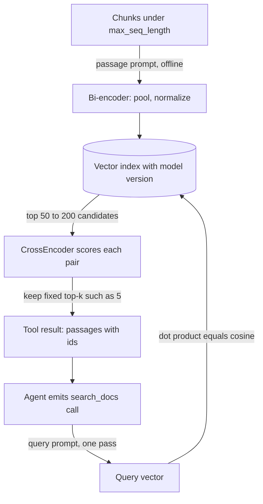

## TL;DR
sentence-transformers powers the retrieval and memory tools of self-hosted agents: bi-encoder embeddings
whose cosine similarity tracks meaning, and cross-encoder reranking. It adds the pooling, normalisation
and training losses that turn a Hugging Face encoder into a usable search model.

## For agent builders
- **Why it matters for agents.** An agent's `search_docs` tool and its long-term memory lookups are only
  as good as the embedder behind them. When the agent cites the wrong passage or "forgets" a stored fact,
  the cause is usually here: a missing prefix, no normalisation, truncation or mixed model versions.
- **Where it shows up in your stack.** Directly in your retrieval tool, behind LangChain's
  `HuggingFaceEmbeddings` and LlamaIndex's Hugging Face embedding wrappers, as the reranker step in RAG
  pipelines, and in embedding servers that load the same models.
- **What you control.** Which model, query versus document prompts, `normalize_embeddings`, chunk size
  versus `max_seq_length`, candidate pool size for reranking, top-k returned to the agent, and whether
  to fine-tune on your own queries.
- **What you can skip.** Writing contrastive losses yourself and the Sentence-BERT paper's details. Know
  bi-encoder versus cross-encoder cost, and why vectors from different models never mix.

## Why it exists
- **Token vectors are not sentence vectors.** A BERT-style encoder emits one vector per token. Taking
  `[CLS]` or averaging tokens from a model trained only on masked-language modelling gives vectors whose
  cosine similarity correlates poorly with meaning; it was never trained to put paraphrases close.
- **Pairwise scoring does not scale.** A cross-encoder (both sentences in one model, classify the pair) is
  accurate but costs a forward pass per pair: a million forward passes per query over a million documents.
- **Sentence-BERT's fix: siamese training.** Two copies with shared weights encode each sentence
  independently, and a simple similarity between the two vectors is trained to reflect relatedness.
- **Independent encoding is the key property.** Document vectors are computed once and stored in a vector
  index; each query (or each agent tool call) costs one forward pass plus a nearest-neighbour lookup.
- **One library prevents silent drift.** It packages loading, pooling, batching, multi-GPU encoding,
  contrastive losses and rerankers. Without it, teams re-implement pooling and small differences (mean vs
  CLS pooling, forgetting to normalise, missing query prefixes) silently degrade retrieval.

## How it works
### Where it sits in an agent
| Agent need | Component | Notes |
|---|---|---|
| `search_docs` tool over a knowledge base | bi-encoder plus vector index, then `CrossEncoder` | retrieve wide, rerank narrow |
| Long-term memory ("what did the user tell me last week") | bi-encoder over stored memories | same versioning rules as documents |
| Tool selection over many tools | embed tool descriptions, pick the closest few | keeps the prompt short when tools number in the dozens |
| Semantic cache of past answers | embed queries, reuse an answer above a tuned threshold | threshold must be re-tuned per model |

### Bi-encoder: `SentenceTransformer`
A model is a pipeline of modules saved together:

| Module | Role |
|---|---|
| Transformer | a Hugging Face encoder with its tokenizer and max sequence length |
| Pooling | mean of token vectors masked by attention, CLS, or last-token for decoder-based embedders |
| Dense (optional) | projection |
| Normalize (optional) | unit length |

`encode(texts, batch_size=..., normalize_embeddings=True)`:
1. Tokenises and sorts inputs by length to reduce padding waste.
2. Runs batches on the chosen device under no-grad.
3. Pools and returns a NumPy array or tensor of shape `[n, dim]`.

- **Normalise for speed.** At unit length, dot product equals cosine similarity, which most vector indexes
  compute fastest.

### Mean pooling and why the mask matters
```
e = Σᵢ mᵢ·hᵢ / Σᵢ mᵢ        hᵢ = token i's output vector, mᵢ = 1 for real tokens, 0 for padding
```

- **Padding vectors are not zero**, so averaging them in would make the same sentence embed differently
  depending on what else was in its batch.
- **Pooling is fixed by training, not a free choice**, which is why the library stores the pooling config
  with the weights instead of asking you to pick.

### Prompts and asymmetry
- **Asymmetric models need prefixes.** Queries and passages get different instructions, for example E5's
  `"query: "` and `"passage: "`.
- **The library applies them.** Prompts live in the model config and are applied via `prompt_name`, and,
  from v5, through `encode_query` / `encode_document`, which pick the right prompt for you.
- **Why bother:** forgetting the prefix measurably hurts retrieval for those models while raising no error.
- **Agent queries are queries.** The search string the LLM writes in its tool call goes through the query
  path; the chunks you indexed went through the document path.

### Cross-encoder: `CrossEncoder`
- **Input:** the concatenated `(query, document)` pair; **output:** one relevance score.
- **More accurate, nothing precomputable.** Attention runs across both texts, capturing interactions a dot
  product cannot.
- **Retrieve-then-rerank.** A bi-encoder fetches the top 50-200 candidates cheaply; a cross-encoder
  rescores only those, and the agent sees only the few that survive.

### Training with contrastive losses
`MultipleNegativesRankingLoss` takes (anchor, positive) pairs and treats every other positive in the batch
as a negative. For anchor `aᵢ` in a batch of B pairs it is a B-way softmax cross-entropy:

```
loss_i = -log( exp(s·cos(aᵢ, pᵢ)) / Σⱼ exp(s·cos(aᵢ, pⱼ)) )      # j = 1..B, s is a scale (default 20)
```

- **Each step asks "pick your true positive out of B candidates".**
- **Batch size matters more than in classification**, because larger batches mean more, and on average
  harder, negatives for free.
- **`CachedMultipleNegativesRankingLoss`** reaches large effective batches without the memory by
  computing embeddings in chunks.
- **Mined hard negatives** (anchor, positive, negative): a passage that looks relevant but is not teaches
  distinctions random in-batch negatives never test.
- **Trap: duplicates become false negatives.** Two pairs with the same positive in a batch; deduplicate.
- **Trainer.** Recent versions use a `SentenceTransformerTrainer` built on the Hugging Face Trainer, with
  evaluators reporting retrieval metrics such as recall@k and NDCG on a held-out set.
- **Agent logs are training data.** The search queries your agent issued, paired with the passage it
  ended up citing in a successful answer, make in-domain (anchor, positive) pairs.

### Matryoshka embeddings
- **Leading dimensions carry the most.** Models trained with `MatryoshkaLoss` let you keep, say, the first
  256 of 768 dimensions (`truncate_dim=256`) for a 3× smaller index and a modest recall loss.
- **Only for models trained that way.** Others degrade badly when truncated; check the model card, and
  re-normalise after truncation.

### Truncation
- **Each model has a `max_seq_length`**; longer inputs are silently truncated.
- **That limit, not the model's theoretical context, decides your chunk size.**

## Diagram
An agent's search tool: documents are embedded once offline, each tool call costs one bi-encoder pass
plus a nearest-neighbour lookup, and only the candidates pay for a cross-encoder pass before a few
passages go back into the agent's context.



## Examples
### A `search_docs` tool for an agent
The function an agent framework registers as a tool: retrieve wide, rerank narrow, return short passages
with ids the agent can cite. `all-MiniLM-L6-v2` produces 384-dimensional vectors.

```python
from sentence_transformers import SentenceTransformer, CrossEncoder

docs = [
    "Refunds are issued within 14 days of a returned item being received.",
    "Our warehouse ships orders Monday to Friday.",
    "To reset your password, use the link on the sign-in page.",
    "Returned items must be unused and in original packaging.",
]
bi = SentenceTransformer("sentence-transformers/all-MiniLM-L6-v2")
ce = CrossEncoder("cross-encoder/ms-marco-MiniLM-L-6-v2")
doc_emb = bi.encode(docs, normalize_embeddings=True, batch_size=64)   # shape (4, 384), computed once

def search_docs(query: str, pool: int = 50, k: int = 2) -> list[dict]:
    """Tool: find passages that answer the query. Returns [{id, text, score}]."""
    q_emb = bi.encode(query, normalize_embeddings=True)
    scores = doc_emb @ q_emb                       # dot product == cosine because vectors are unit length
    cand = scores.argsort()[::-1][:pool]           # cheap first stage
    rr = ce.predict([(query, docs[i]) for i in cand])   # one forward pass per candidate pair
    best = sorted(zip(cand, rr), key=lambda t: -t[1])[:k]
    return [{"id": f"doc-{i}", "text": docs[i], "score": round(float(s), 3)} for i, s in best]

# what the agent receives after calling the tool with its own search string
print(search_docs("how long until I get my money back after returning something"))
print(bi.max_seq_length)                           # inputs beyond this many tokens are truncated
```

- **What to look for:** both refund-related passages score well with the bi-encoder because they share
  the topic of returns. The cross-encoder reads query and passage together, so it should separate the one
  that answers "how long" (the 14-day passage) from the one that only mentions returns.
- **Exact scores vary by model version**; the ordering is the lesson.
- **Cost shape:** with N documents and k candidates, a query costs 1 bi-encoder pass plus k cross-encoder
  passes instead of N. At N = 1,000,000 and k = 50 that is 51 forward passes per query instead of a
  million.

### Worked scenario: retrieval cost and context budget per agent task
A research agent averages 4 `search_docs` calls per task, with a pool of 50 and top 5 returned, and
passages of about 200 tokens (illustrative figures).

| Quantity | Per call | Per task (4 calls) |
|---|---|---|
| Bi-encoder passes | 1 | 4 |
| Cross-encoder passes | 50 | 200 |
| Passages added to context | 5 | 20 |
| Tokens added to the LLM context | ~1,000 | ~4,000, re-sent on every later step |

- **Rerank cost is the pool, not the corpus.** Halving the pool to 25 halves cross-encoder work; check
  recall@25 first, because a passage outside the pool can never be returned.
- **Top-k is an LLM cost lever.** Each passage you return is paid for again on every later step of the
  loop, so 5 well-reranked passages beat 20 loosely ranked ones.

### Fine-tune on in-domain pairs without false negatives
Sentence Transformers v3+ trainer API; the no-duplicates sampler keeps repeated texts out of one batch.
Pairs can come from agent logs: the agent's search query and the passage it cited in a good answer.

```python
from datasets import Dataset
from sentence_transformers import (SentenceTransformer, SentenceTransformerTrainer,
                                   SentenceTransformerTrainingArguments, losses)
from sentence_transformers.training_args import BatchSamplers

model = SentenceTransformer("sentence-transformers/all-MiniLM-L6-v2")
train = Dataset.from_dict({                        # toy data: real runs use thousands of pairs
    "anchor":   ["how long do refunds take", "reset my password"],
    "positive": ["Refunds are issued within 14 days of a returned item being received.",
                 "To reset your password, use the link on the sign-in page."],
})
args = SentenceTransformerTrainingArguments(
    output_dir="out/support-embedder",
    per_device_train_batch_size=64,                 # bigger batch = more in-batch negatives
    batch_sampler=BatchSamplers.NO_DUPLICATES,      # avoid false negatives from duplicates
    num_train_epochs=1,
)
loss = losses.MultipleNegativesRankingLoss(model)
SentenceTransformerTrainer(model=model, args=args, train_dataset=train, loss=loss).train()
```

After training, re-embed the whole corpus with the new model, because its vectors are not comparable with
the old ones.

### Worked scenario: index size with Matryoshka truncation
10 million passages stored as fp32 (4 bytes per dimension), vectors only, before index overhead:

| Dimensions kept | Bytes per vector | Total |
|---|---|---|
| 768 (full) | 3,072 | ~30.7 GB |
| 256 (`truncate_dim=256`) | 1,024 | ~10.2 GB |

The 3× saving is real only for a Matryoshka-trained model; measure recall@k at both sizes on your labelled
queries before switching.

## Production patterns
- **Return ids and short passages from the tool.** The agent's search tool returns a fixed top-k with
  stable passage ids and source metadata, so the agent can cite and you can trace which passage drove an
  answer. Monitor citation rate and how often the cited id was in the reranked top-k.
- **Evaluate retrieval separately from the agent.** Keep a labelled set of real agent search queries with
  their correct passages, and run recall@k and MRR on every embedder or chunking change before running
  end-to-end agent evals. Monitor both; an agent regression with stable recall points elsewhere.
- **Version every vector.** Store the model name and version with each embedding, and re-index into a new
  collection on upgrade, then switch reads over in one step. Monitor that no index mixes versions,
  including the agent's memory store.
- **Retrieve wide, rerank narrow.** Pull the top 50-200 with the bi-encoder, rerank with a `CrossEncoder`,
  keep a fixed top-k such as 5. Monitor recall@50 on labelled queries and p95 rerank latency.
- **Chunk to the real limit.** Count chunk tokens with the model's own tokenizer and keep each under
  `max_seq_length`. Monitor the share of chunks that would be truncated; it should be zero.
- **Let the library apply prompts.** Use `encode_query` / `encode_document` (v5) or `prompt_name` instead
  of hand-written prefixes, so query and passage formats cannot drift apart. Spot-check recall against
  the model card's claim.
- **Batch offline embedding.** Pass whole lists to `encode` with a tuned `batch_size` on GPU, never one
  text per call. Monitor documents per second and GPU utilisation during backfills.

## Trade-offs
- **Precomputed speed vs fine interactions.** Bi-encoders allow precomputed document vectors and
  millisecond search but compress each text to one vector and miss fine query-document interactions; add
  a cross-encoder when top-k precision matters.
- **Reranker latency vs agent step count.** A reranker adds latency to every search call, but better
  top-k often saves the agent a second or third search; measure total task latency, not per-call latency.
- **Local vs hosted.** Running embeddings locally avoids per-token API cost and keeps data in-house, but
  you own GPU capacity and batching; hosted embedding APIs win when volume is small or ops capacity scarce.
- **Small and fast vs larger and better.** MiniLM-class models are fast enough for CPU, but larger or
  instruction-tuned embedders usually retrieve better; measure the gap on your queries, not a public
  leaderboard.
- **Fine-tuned vs bigger generic.** Fine-tuning on in-domain pairs often beats a bigger generic model but
  requires re-embedding the whole corpus, since vectors from different models are not comparable.

## Pitfalls
- **Forgetting `normalize_embeddings=True` with a dot-product index**, on a model that does not already end
  in a Normalize module. Large-magnitude vectors get inflated scores. Symptom: the same few documents win
  for every query, so the agent cites the same passage for unrelated questions.
- **Omitting a model's required query or passage prefix.** No error, just noticeably worse recall than the
  model card claims.
- **Chunks longer than `max_seq_length`.** The tail is silently dropped, so facts near the end of a chunk
  are never retrievable.
- **Mixing vectors from two model versions in one index after an upgrade.** Similarity scores become
  meaningless. Symptom: a sudden, unexplained retrieval quality drop, or an agent that stops recalling
  memories written before the upgrade.
- **Thresholding cross-encoder scores ("keep passages scoring above 0.5") then swapping the model.** Scores
  are model-specific logits or sigmoid outputs, not calibrated probabilities, so the reranker suddenly
  keeps nothing or everything. Fix: re-tune thresholds per model, or keep a fixed top-k.
- **Encoding one text at a time in a loop.** Throughput collapses because the GPU processes batches of
  one; pass lists and let `encode` batch.

## When to use
- **Use when** you need embeddings or reranking from open models: a self-hosted agent search tool or
  memory, data that cannot leave the network, high-volume offline embedding where API costs add up,
  semantic deduplication, clustering, or fine-tuning an embedder on your domain.
- **Prefer a hosted embedding API when** volume is modest and you do not want to run GPUs.
- **Measure before choosing:** build a small labelled set of real queries with their correct passages,
  measure recall@k and MRR for two or three candidates, choose on that, and record the model name and
  version alongside every stored vector.
- **Interviews:** explain bi-encoder versus cross-encoder cost and why in-batch negatives make batch size
  matter.

## Role lens
- **Engineer:** Embeds corpora in batches, applies correct prefixes and normalisation, adds a
  cross-encoder reranker, and fine-tunes with contrastive loss when generic models miss domain terms.
- **Architect:** Owns the embedding model choice and versioning policy, the re-index plan for upgrades,
  and the decision between self-hosted encoders and a hosted embedding API.
- **FDE:** Runs local embedding inside a customer's network when documents cannot be sent to an API,
  and evaluates candidate models on the customer's own queries before committing.

## Check yourself
**Q:** Your RAG system uses a bi-encoder for top-5 retrieval. Users complain answers cite related but
wrong passages. Why might adding a cross-encoder fix this, and how would you size it?
**A:** A bi-encoder compresses each passage into one vector before seeing the query, so it ranks by
topical closeness and can miss which passage actually answers the specific question. A cross-encoder
reads query and passage together, so attention can match details such as the exact entity, date or
negation. I would retrieve a larger candidate set, say top 50, with the bi-encoder to protect recall,
rerank with a cross-encoder and keep the top 5. Latency grows with the candidate count, so I would
measure recall@50 to make sure the right passage is in the pool, then tune the pool size against p95
latency and a precision metric on labelled queries.

## Interview questions
### Why can't you just mean-pool a plain BERT model to get sentence embeddings?
- **It was never trained for it:** a masked-language-modelling encoder was not trained to put paraphrases
  close, so pooled `[CLS]` or averaged token vectors give cosine scores that correlate poorly with meaning.
- **Siamese contrastive training fixes that:** Sentence-BERT trains shared-weight encoders so a simple
  similarity between independently encoded vectors reflects relatedness.
- **Pooling is fixed by training**, so the library stores the pooling config with the weights.

### After an embedder upgrade, your agent stops recalling facts users told it weeks ago. What do you check?
- **Mixed vector versions:** old memories were embedded with the previous model and new queries with the
  new one, so similarities are meaningless; check that every stored vector carries its model name and
  version.
- **Prompts and normalisation:** confirm the new model's required query and passage prefixes are applied
  and that `normalize_embeddings=True` is set if the index uses dot product.
- **Fix:** re-embed memories and documents into a new collection, measure recall@k on labelled queries,
  then switch reads over in one step.

### How would you design the retrieval tool an agent calls, and what would you measure?
- **Shape:** the tool takes the agent's query string, retrieves 50 candidates with a bi-encoder, reranks
  with a cross-encoder and returns a fixed top-k such as 5, each with an id and source.
- **Measure retrieval alone:** recall@50 and MRR on labelled agent queries, plus p95 tool latency.
- **Measure in the loop:** searches per task, citation correctness and context tokens added, because
  every returned passage is re-sent on later steps.

### When is a cross-encoder reranker not worth adding?
- **When top-k precision is already fine:** if the right passage already ranks in the top few, a reranker
  adds latency for little gain.
- **When the candidate pool misses the answer:** reranking cannot recover a passage the bi-encoder never
  retrieved, so fix recall@50 first.
- **When latency budgets are tight:** cost grows with candidate count because each pair is one forward
  pass; measure p95 rerank latency against the precision gained.

### Why does batch size matter so much when training with `MultipleNegativesRankingLoss`?
- **In-batch negatives:** every other positive in the batch is a negative, so a batch of B pairs makes
  each step a B-way softmax.
- **Bigger batches give more and harder negatives for free**; `CachedMultipleNegativesRankingLoss`
  reaches large effective batches without the memory.
- **Duplicates become false negatives**, so use the no-duplicates batch sampler.

### How much storage does a 10M-passage index need, and how would you shrink it?
- **Full 768 dimensions in fp32:** 3,072 bytes per vector, about 30.7 GB before index overhead.
- **Matryoshka truncation to 256 dimensions:** 1,024 bytes per vector, about 10.2 GB, a 3× saving, but
  only for a model trained with `MatryoshkaLoss` and only after measuring recall@k at both sizes.
- **Re-normalise after truncation**, because the shorter vector is no longer unit length.

## Quiz
### Q: Why can a bi-encoder search a million documents quickly while a cross-encoder cannot?
- [ ] Bi-encoders use smaller transformer models than cross-encoders
- [x] Bi-encoders encode documents independently of the query, so document vectors are precomputed once
- [ ] Cross-encoders cannot run on GPUs
- [ ] Bi-encoders skip tokenisation entirely
> Independent encoding lets you store document vectors and answer queries with one forward pass plus a
> vector lookup. A cross-encoder needs the query and each document together, so nothing can be precomputed.

### Q: With `MultipleNegativesRankingLoss`, why does increasing batch size often improve the embedder?
- [ ] Larger batches reduce the learning rate automatically
- [ ] Larger batches prevent truncation of long inputs
- [x] Every other positive in the batch acts as a negative, so larger batches supply more negatives per example
- [ ] Larger batches make embeddings higher-dimensional
> The loss contrasts each anchor with its positive against all other in-batch positives. More items per
> batch means a harder, more informative contrast; dimension and truncation are fixed by the model.

### Q: Dot-product scores in your index favour the same few documents regardless of the query. What is the likely cause?
- [ ] The cross-encoder was trained on short texts
- [ ] The model's max sequence length is too large
- [x] Embeddings were not normalised, so vector magnitude influences the score
- [ ] The tokenizer is case-sensitive
> Without unit normalisation, dot product mixes direction with magnitude, and magnitude can correlate
> with text properties such as length or rarity, so high-norm documents win everywhere. Normalising makes dot product equal cosine similarity, which compares direction only.
