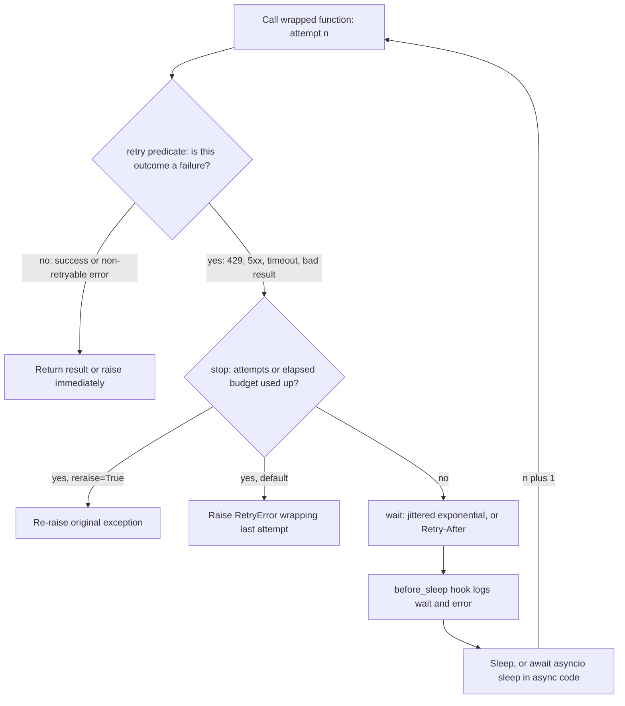

## TL;DR
tenacity declares a retry policy (stop, wait, what to retry, what to log) for an agent's model and tool
calls. 429s, 5xx and timeouts are routine in long agent runs; it cannot make an unsafe tool call safe to
repeat.

## For agent builders
- **Why it matters for agents.** A 20-step agent run makes dozens of model and tool calls. If 1 in
  100 calls fails transiently, a 40-call run fails about a third of the time (1 − 0.99^40 ≈ 0.33) unless
  something retries. Retries in the
  wrong place multiply load or create duplicate side effects, such as two tickets from one tool call.
- **Where it shows up in your stack.** Vendor SDKs retry internally via `max_retries`; LangChain runnables
  offer a retry wrapper and LangGraph lets you attach a retry policy to a node; your own tool adapters use
  tenacity. Pick one owner per call path, and trace retries in LangSmith or your logs.
- **What you control.** Which errors are transient (retry) versus permanent (fail or hand back to the
  model), the time budget per step under the run's deadline, jitter, `Retry-After` handling, and
  idempotency keys on write tools.
- **What you can skip.** Writing custom backoff math. `wait_random_exponential` plus a stop budget covers
  almost every agent call.

## Why it exists
- **Remote calls fail transiently, constantly.** A production AI service makes thousands of chat
  completions, embeddings, vector-store queries and tool calls. Rate limits, overloaded upstreams and
  dropped connections go away on their own; without retries each is a user-facing error or a dead agent
  run.
- **The naive loop retries everything.** `for i in range(3): try: ... except Exception: time.sleep(1)`
  also retries a 400 for a malformed request or a 401 for a bad key, wasting time and quota on errors that
  never succeed.
- **Fixed waits cause a thundering herd.** When a provider rate-limits a fleet, every worker comes back at
  the same instant and gets limited again.
- **No total deadline, no visibility.** Three attempts with long timeouts can outlive the caller's own
  timeout, and no log says a call needed four attempts, so a degrading dependency looks healthy until it
  falls over.
- **tenacity fills the gap:** the correct policy, declared once, identical for sync and async code.

## How it works
A policy is four composable pieces passed to `@retry` (or to the `Retrying` / `AsyncRetrying` objects).

| Piece | Question | Default |
|---|---|---|
| `stop` | when to give up | **never stop**, so a bare `@retry` loops forever |
| `wait` | how long between attempts | no wait at all |
| `retry` | which outcomes count as failures | any exception |
| hooks | what to log, what to raise at the end | `RetryError` on final failure |

### stop: when to give up
- **Building blocks:** `stop_after_attempt(5)`, `stop_after_delay(30)` (seconds since the first attempt),
  combined with `|` ("whichever comes first").
- **Use a time-based stop** *because* the caller has its own deadline; attempt counts alone do not bound
  latency.
- **`stop_after_delay` is a soft budget.** Stop conditions are evaluated only after an attempt fails, so an
  attempt starting at 29 s still runs to completion (or its own timeout). True worst case ≈ the delay plus
  one wait plus one attempt timeout.
- **Recent releases add `stop_before_delay`,** which also refuses an attempt that would begin past the
  budget. Either way, keep the per-attempt timeout small relative to the budget.

### wait: how long between attempts
- **Options:** `wait_fixed`, `wait_random`, `wait_exponential(multiplier=, min=, max=)`, and jittered
  variants such as `wait_random_exponential` (random wait up to an exponentially growing cap) and
  `wait_exponential_jitter`.
- **Waits add together:** `wait_fixed(1) + wait_random(0, 2)`.
- **Why both:** exponential growth backs off from an overloaded server; jitter spreads clients so retries
  do not arrive in synchronized waves.

The arithmetic, once:

```
wait_exponential(multiplier=m, max=c):  wait after n-th failure = min(m · 2^(n−1), c)
```

| After attempt | `wait_exponential`, m=1 | `wait_random_exponential` ("full jitter") |
|---|---|---|
| 1 | 1 s | uniform in [0, 1] s |
| 2 | 2 s | [0, 2] s |
| 3 | 4 s | [0, 4] s |
| 4 | 8 s | [0, 8] s |
| 5 | 16 s | — |
| Total before 5th attempt | exactly 15 s | about 7.5 s in expectation |

- **Effect:** two hundred workers rate-limited in the same second return spread over seconds, not as one
  spike (the scheme from Brooker's analysis).
- **Cost:** one unlucky client can draw near-zero waits and retry almost immediately; the cap and the
  attempt limit bound the harm.

### retry: which outcomes count as failures
- **Predicates:** `retry_if_exception_type((RateLimitError, APITimeoutError))`,
  `retry_if_exception(predicate)`, or `retry_if_result(lambda r: r is None)` for "successful" responses
  that are actually bad; combine with `|` and `&`.
- **Encode the classification here:** retry 429, 5xx and timeouts; never retry 400, 401, 403 or validation
  errors.
- **The default retries on any exception,** which is exactly the classification bug above.

### hooks and the final failure
- **Log every retry:** `before_sleep=before_sleep_log(logger, logging.WARNING)` logs the function name, the
  upcoming wait and the exception (or bad result) that triggered it. For the attempt number, write a small
  hook that reads `retry_state.attempt_number`.
- **Final failure:** when the stop fires, tenacity raises `RetryError` wrapping the last attempt. With
  `reraise=True` it re-raises the original exception, which callers and error handlers usually expect.
- **`RetryCallState`:** every callback receives it (attempt number, elapsed time, `outcome`). Any callable
  taking the state and returning seconds is a valid `wait`, so a custom wait can honor `Retry-After`:

```python
fallback = wait_random_exponential(multiplier=1, max=20)
def wait_retry_after(state):
    exc = state.outcome.exception()
    hdr = getattr(getattr(exc, "response", None), "headers", {}).get("retry-after")
    return min(float(hdr), 60) if hdr and hdr.isdigit() else fallback(state)
```

- **Why it is safe:** the server knows its own rate window, so its hint beats any guess. The `min` cap stops
  a hostile or buggy header parking a worker for an hour; the `isdigit` check skips the HTTP-date form.
- **Per-call control:** decorated functions expose `.retry_with(...)` to override the policy per call site,
  and `.statistics` (attempt number, idle time) after a call. Older releases documented
  `.retry.statistics`; in tenacity 9 that dict stays empty because each call runs on a copy.

### Async and code blocks
- **`async def` works directly:** tenacity detects the coroutine and sleeps with the event loop rather than
  blocking it.
- **Retry a block, not a function:** `for attempt in Retrying(...): with attempt: ...`.

### Retries inside an agent loop
An agent has three places a failure can be handled, and each suits a different error class:

| Error class | Handle it | Because |
|---|---|---|
| Transient transport error (429, 5xx, timeout) | tenacity around the model or tool adapter | the same request will likely succeed shortly |
| Permanent tool error (404 order, bad arguments) | return it to the model as the tool result | the model can fix its arguments or choose another tool |
| Bad model output (invalid JSON, unknown tool) | re-prompt with the validation error | the identical prompt tends to reproduce the same output |
| Sustained outage | circuit breaker, then a clear failure | retries only multiply load |

- **Budget per step, not per call.** The run has a deadline; give each step a slice of it and set
  `stop_after_delay` from that slice.
- **Write tools need idempotency keys** before any retry, because a timeout does not prove the write failed.

### Alternatives
| Tool | Scope |
|---|---|
| `backoff` | similar decorator library |
| `stamina` | thin, opinionated wrapper over tenacity with safer defaults |
| `urllib3.Retry`, httpx transports | HTTP layer only |
| Vendor SDKs (OpenAI, Anthropic) | retry some errors internally via a `max_retries` setting; account for it before adding your own layer |

## Diagram
Each attempt's outcome goes through the `retry` predicate first, then the `stop` check, and only if it does
not stop does tenacity sleep the `wait`; the stop is evaluated after a failure, which is why a time budget
is soft.



## Examples
### Chat-completion policy with one retry layer
Retry only transient errors, jittered exponential backoff, a 30-second retry budget, a log line per retry,
and the original exception re-raised. The SDK's own retries are switched off so attempts do not multiply.

```python
import logging
from openai import OpenAI, RateLimitError, APITimeoutError, APIConnectionError, InternalServerError
from tenacity import (retry, stop_after_attempt, stop_after_delay, wait_random_exponential,
                      retry_if_exception_type, before_sleep_log)

log = logging.getLogger("llm")
client = OpenAI(max_retries=0, timeout=20.0)   # one retry layer only: ours

TRANSIENT = (RateLimitError, APITimeoutError, APIConnectionError, InternalServerError)

@retry(
    retry=retry_if_exception_type(TRANSIENT),            # 400/401/422 fail immediately
    wait=wait_random_exponential(multiplier=1, max=20),  # jittered, capped backoff
    stop=stop_after_attempt(5) | stop_after_delay(30),   # whichever comes first
    before_sleep=before_sleep_log(log, logging.WARNING),
    reraise=True,                                        # caller sees RateLimitError, not RetryError
)
def summarize(text: str) -> str:
    r = client.chat.completions.create(
        model="gpt-4o-mini",
        messages=[{"role": "user", "content": f"Summarize:\n{text}"}],
    )
    return r.choices[0].message.content

# Per-call override, e.g. a batch job that can wait longer:
# summarize.retry_with(stop=stop_after_attempt(10))(doc)
```

Worst-case latency of this policy, because the budget is checked between attempts:

| Component | Bound |
|---|---|
| An attempt fails just before the budget, so the stop check passes | just under 30 s elapsed |
| One more wait | at most 8 s (five attempts allow only four waits, windows 1, 2, 4 and 8 s) |
| One more attempt, running to its timeout | 20 s |
| Total | just under a minute |

Need a strict ceiling? Shrink the per-attempt timeout or enforce an outer deadline.

### Retry on a bad result, test-friendly
Needs only `pip install tenacity`. A "successful" `None` counts as a failure, and `wait_none()` keeps the
test instant; production would use the jittered wait above.

```python
from tenacity import retry, stop_after_attempt, wait_none, retry_if_exception_type, retry_if_result

calls = {"n": 0}

@retry(
    retry=retry_if_exception_type(ConnectionError) | retry_if_result(lambda r: r is None),
    stop=stop_after_attempt(4),
    wait=wait_none(),
    reraise=True,
)
def lookup():
    calls["n"] += 1
    if calls["n"] == 1:
        raise ConnectionError("dropped")      # transient: retried
    if calls["n"] == 2:
        return None                           # bad result: retried
    return {"ok": True}

assert lookup() == {"ok": True} and calls["n"] == 3
```

### Agent scenario: transient errors retried, permanent errors handed to the model
The tool adapter retries only transport errors; a permanent error becomes a tool result the model can act
on, so the loop never burns attempts on a 404. Needs only `pip install tenacity`.

```python
from tenacity import retry, stop_after_attempt, stop_after_delay, wait_random_exponential
from tenacity import retry_if_exception_type

class Transient(Exception): ...          # adapters map 429, 5xx, timeouts to this
class ToolError(Exception): ...          # adapters map 4xx to this: the model should see it

attempts = {"n": 0}

@retry(retry=retry_if_exception_type(Transient),
       wait=wait_random_exponential(multiplier=0.01, max=0.05),   # tiny for the demo
       stop=stop_after_attempt(4) | stop_after_delay(10), reraise=True)
def get_order(order_id: str) -> str:
    attempts["n"] += 1
    if attempts["n"] < 3:
        raise Transient("503 from orders API")
    if order_id == "Z99":
        raise ToolError("order Z99 not found")
    return f"order {order_id}: shipped"

def run_tool(name: str, args: dict) -> dict:
    try:
        return {"role": "tool", "name": name, "content": get_order(**args)}
    except ToolError as e:                # permanent: hand back to the model, no retry
        return {"role": "tool", "name": name, "content": f"error: {e}", "is_error": True}
    # Transient that exhausted retries propagates: the step fails, the run can checkpoint and stop

print(run_tool("get_order", {"order_id": "A17"}), attempts)   # succeeded on attempt 3
print(run_tool("get_order", {"order_id": "Z99"}))             # 1 attempt, error shown to the model
```

### Worked scenario: stacked retry layers
Each layer makes up to 3 attempts: the agent loop re-runs a failed tool up to 3 times, the tool function has
`@retry(stop=stop_after_attempt(3))`, and the SDK makes up to 3 attempts internally.

| Layers retrying | Upstream calls per user action, worst case |
|---|---|
| SDK only | 3 |
| SDK + function | 3 × 3 = 9 |
| SDK + function + agent loop | 3 × 3 × 3 = 27 |

Under a rate limit, those 27 calls make the limit worse. Fix: `max_retries=0` on the SDK, one tenacity
policy, and the agent loop treats the re-raised error as final.

## Production patterns
- **Classify failures at the tool adapter.** Map transport errors to one transient type that tenacity
  retries, and permanent errors to a tool-error result the model sees, so the agent can correct its
  arguments. Monitor tool error rate by tool and class; a spike in permanent errors usually means a
  prompt or schema regression, not an outage.
- **Retry the step, not the run.** Checkpoint agent state after each completed step (LangGraph
  checkpointers do this) so an exhausted retry fails one step and the run resumes from there instead of
  repeating paid model calls and side effects. Monitor resumed runs and repeated tool calls per run.
- **Exactly one retry layer per call path.** Disable SDK retries (`OpenAI(max_retries=0)`) or HTTP-transport
  retries when you add tenacity, and document which layer owns the policy. Monitor upstream calls per user
  action.
- **Retry budget below the caller's deadline.** Set `stop_after_delay` plus one attempt timeout plus one max
  wait under the gateway or proxy timeout; for user-facing paths tighten it, for batch jobs use
  `.retry_with(...)` to allow more. Monitor p99 latency and timeouts at the proxy.
- **Honor `Retry-After`, capped.** Use a custom wait like `wait_retry_after` above with a jittered fallback,
  so you obey the provider's window without trusting it blindly. Monitor 429 rate per provider.
- **Log and count every retry.** `before_sleep=before_sleep_log(log, logging.WARNING)` (or a hook that
  increments a metric tagged by dependency). Alert on a rising retry rate, the early warning that a
  provider is degrading.
- **Idempotency keys before retries on side effects.** For "create ticket" or "send email" tools, send a
  client-generated ID the server deduplicates on, and restrict `retry=` to errors that guarantee the request
  was not processed. Monitor duplicate-record counts.
- **Circuit breaker after a few attempts.** Under a sustained outage, fail fast instead of multiplying load;
  retries handle blips, breakers handle outages. Monitor breaker open time.

## Trade-offs
- **Errors vs latency.** Retries convert transient failures into latency, right for background jobs but able
  to blow a user-facing p99; tighten `stop_after_delay` when a person is waiting.
- **Upstream protection vs predictability.** Jittered exponential backoff protects a struggling upstream but
  makes worst-case latency less predictable than a fixed wait; predictability wins only with a single
  client, not a fleet.
- **One policy place vs duplication.** Retrying in your code centralizes policy and logging but duplicates
  what SDKs and HTTP transports already do; it pays off when you disable the inner layers or retry at a
  higher level (a whole tool call).
- **Blips vs outages.** Per-call retries handle blips, but under a sustained outage they multiply load;
  beyond a few attempts a circuit breaker that fails fast is the better tool.

## Pitfalls
- **Retrying a whole agent run on any failure.** Symptom: one flaky tool at step 9 replays eight paid
  model calls and repeats earlier side effects. Fix: retry at the call, checkpoint each step, and resume
  the run from the last completed step.
- **Bare `@retry` with no arguments.** Symptom: a request hangs forever, spinning with no wait, against an
  endpoint returning a permanent error. Fix: always set stop, wait and retry.
- **Retrying non-idempotent operations** ("send email", "create ticket") without an idempotency key.
  Symptom: duplicate side effects after a timeout that actually succeeded upstream. Fix: an idempotency key,
  and retry only errors that prove the request was not processed.
- **Stacked retries** in the SDK, your function and the agent loop. Symptom: with 3 layers of 3 attempts, up
  to 27 upstream calls per user action and rate limits that get worse under load. Fix: one retry layer.
- **Forgetting `reraise=True`.** Symptom: handlers catching `RateLimitError` never fire because the
  exception arriving is a `tenacity.RetryError`. Fix: set `reraise=True`.
- **Retrying a bad LLM *result*** (invalid JSON, failed schema) with the identical prompt at temperature 0.
  Symptom: every attempt fails the same way, because the same input tends to reproduce the same output. Fix:
  feed the validation error back into the next attempt, as Instructor does, or change something.
- **Retrying on `Exception`, and thereby on your own bugs.** Symptom: a `KeyError` in response parsing costs
  five paid API calls before surfacing. Fix: an explicit `retry_if_exception_type(...)` list.

## When to use
- **Use when:** agent code calls something remote that fails transiently and the operation is safe to repeat:
  LLM and embedding calls, vector-store queries, idempotent tool APIs, downloads.
- **Prefer SDK retries when:** they already cover your error classes and you only need to tune a count.
- **Prefer tenacity when:** you need custom classification (retry on a bad *result*, such as invalid JSON),
  a time budget, logging, or retries around a multi-step block.
- **Avoid when:** papering over permanent errors or sustained outages.
- **Measure:** attempts per call and retry rate per dependency; a rising retry rate is an early warning
  that a provider is degrading.

## Role lens
- **Engineer:** Writes the stop/wait/retry policy per dependency, disables duplicate SDK retries, and adds
  `before_sleep` logging so retries show up in traces.
- **Architect:** Owns the retry budget across layers, which operations are idempotent, and where circuit
  breakers take over from retries.
- **FDE:** Tunes backoff to the customer's actual provider quota and gateway timeouts so retries fit inside
  their proxy's deadline instead of being cut off mid-attempt.

## Check yourself
**Q:** An agent's tool calls a customer's ticketing API through a function decorated with
`@retry(stop=stop_after_attempt(3))`. Customers report duplicate tickets. What is happening and how do you fix it?
**A:** Creating a ticket is not idempotent. When a request times out after the server has already created
the ticket, tenacity retries on the exception and creates a second one; the policy also retries on any
exception with no wait. Fixes, in order: send an idempotency key (or a client-generated ticket ID) so the
server deduplicates; restrict `retry=` to errors that guarantee the request was not processed, such as
connection refused or explicit 429/503; add jittered backoff and a time budget; and check whether the HTTP
client or SDK also retries, so attempts are not multiplied across layers.

## Interview questions
### Which errors from an LLM API should you retry, and which should you never retry?
- **Retry transient ones:** 429 rate limits, 5xx server errors, timeouts and dropped connections, because
  they usually go away on their own.
- **Never retry permanent ones:** 400 malformed requests, 401 or 403 auth failures and validation errors,
  because every attempt fails the same way and burns time and quota.
- **Encode it in `retry=`** with `retry_if_exception_type(...)`, since the default retries on any exception.

### Why exponential backoff with jitter rather than a fixed wait?
- **Exponential growth** backs off from an overloaded upstream: with `wait_exponential(multiplier=1)` the
  waits are 1, 2, 4, 8 s.
- **Jitter desynchronizes a fleet:** two hundred workers rate-limited in the same second come back spread
  over seconds instead of as one spike that triggers the limit again.
- **Cost:** worst-case latency is less predictable, so cap the wait with `max=` and bound attempts.

### Your service's p99 jumped to a minute during a provider incident although `stop_after_delay(30)` is set. Explain.
- **The stop is checked only after a failed attempt,** so an attempt starting at 29 s still runs to its own
  timeout.
- **Worst case is the budget plus one wait plus one attempt timeout:** with the example policy, just under
  30 s plus up to 8 s plus 20 s, so just under a minute.
- **Fix:** shrink the per-attempt timeout, use `stop_before_delay` where your tenacity version has it, or
  enforce an outer deadline.

### When is retrying the wrong tool?
- **Non-idempotent side effects** without an idempotency key: a timeout that actually succeeded upstream
  becomes a duplicate ticket or email.
- **Sustained outages:** per-call retries multiply load, so a circuit breaker that fails fast is better.
- **Deterministic bad results:** retrying invalid JSON with the identical prompt at temperature 0 tends to
  fail identically; feed the validation error back instead.

### In an agent, when should a tool failure be retried and when should it go back to the model?
- **Retry transient transport errors** (429, 5xx, timeouts) in the adapter with tenacity, because the
  same request will likely succeed and the model learns nothing from them.
- **Return permanent errors as the tool result** (not found, invalid arguments), so the model can fix its
  call or pick another tool instead of the loop wasting attempts.
- **Never blindly retry write tools:** require an idempotency key first, since a timeout may hide a
  write that succeeded.

### How many upstream calls can one user action cause if the SDK, your function and the agent loop each retry 3 times?
- **Multiply the layers:** 3 × 3 × 3 = 27 calls in the worst case, which makes a rate limit worse.
- **Fix:** keep exactly one retry layer, for example `OpenAI(max_retries=0)` plus one tenacity policy, and
  have the agent loop treat the re-raised error as final.
- **Monitor** upstream calls per user action and retry rate per dependency.

## Quiz
### Q: What does `@retry` with no arguments do when the wrapped function keeps raising?
- [ ] Retries three times with exponential backoff, then re-raises
- [x] Retries indefinitely with no wait between attempts
- [ ] Retries once, then raises RetryError
- [ ] Retries only on network-related exceptions
> tenacity's defaults are stop-never, no wait, and retry on any exception. That is why every real policy
> sets stop, wait and retry explicitly; the "three attempts with backoff" behaviour must be configured.

### Q: Why add jitter to exponential backoff when many workers call the same LLM API?
- [ ] Jitter reduces the total number of attempts each worker makes
- [ ] Jitter is required for tenacity to work with asyncio
- [x] It desynchronizes clients so retries do not arrive together and trigger the rate limit again
- [ ] It makes the latency of each retry predictable for SLOs
> Without jitter, workers limited at the same moment back off by identical amounts and return in a wave.
> Randomizing the wait spreads the load; it makes individual latency less predictable, not more.

### Q: Your error handler catches `openai.RateLimitError`, but after retries are exhausted it never fires. Likely cause?
- [ ] The SDK swallows rate-limit errors after retries
- [ ] tenacity converts all exceptions to TimeoutError
- [x] Without reraise=True, tenacity raises RetryError wrapping the last attempt instead of the original exception
- [ ] before_sleep_log suppresses the final exception
> When the stop condition fires, tenacity raises RetryError by default. Setting reraise=True re-raises the
> last underlying exception, so existing except clauses for the SDK's error types keep working.

## Use cases & projects
### Use cases
- **Flaky tool APIs inside agent runs.** Retrying transient search, CRM or database errors keeps a long
  run from failing on one bad call, while permanent errors go back to the model as a tool result.
- **Rate-limited model calls under load.** Jittered exponential backoff that honours `Retry-After` spreads
  retries from many concurrent agent sessions instead of hammering the provider in sync.
- **Write tools with side effects.** Retrying a "create ticket" or "send email" tool only with an
  idempotency key prevents duplicates when the first attempt actually succeeded.
- **Step budgets under a run deadline.** A stop on total delay keeps one retried step from consuming the
  whole run's latency budget.

### Mini project
**Add a retry policy to an agent's tool layer (1-2 hours).**
- **Goal:** make a two-tool agent survive injected transient failures without duplicate side effects.
- **Steps:** wrap a fake search tool that fails randomly with a timeout or a 429, and a fake "create
  ticket" tool; add tenacity with `wait_random_exponential`, a stop on attempts and total delay,
  `reraise=True` and retry only on transient types; give the write tool an idempotency key; log each retry
  with the run and step; run 100 simulated agent runs with and without the policy.
- **Done when:** you have a table of run success rate and total retries for both settings, no run creates
  a duplicate ticket, and permanent errors reach the model instead of being retried.
