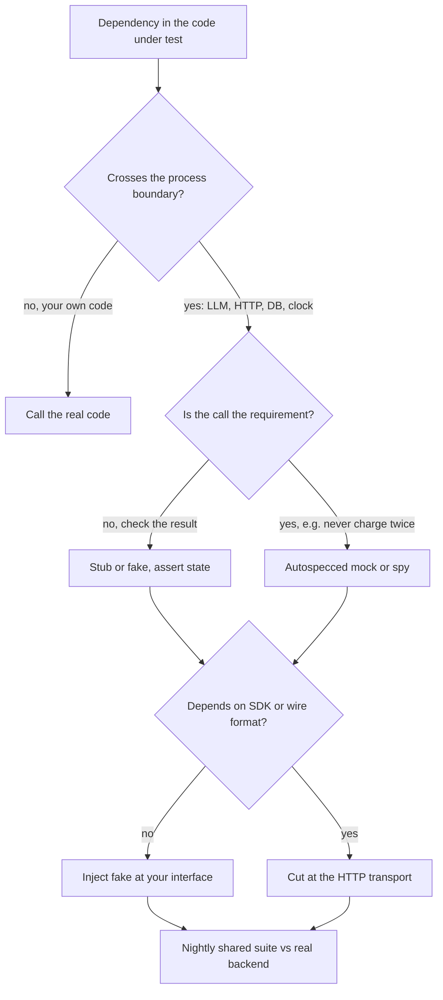

## TL;DR
An agent touches a model, tools, a vector store and memory; a test double (dummy, stub, spy, mock or
fake) stands in for each so tests are fast, deterministic and free. Fixtures build them. Pick the kind
by what you verify: result or interaction.

## For agent builders
- **Why it matters for agents.** Agent bugs live in the branches a live model rarely takes: a malformed
  tool call, an empty reply, a timeout on the second attempt, a destructive tool requested without
  approval. Doubles let you trigger each one on demand, for free, in milliseconds.
- **Where it shows up in your stack.** A scripted "fake LLM" that emits tool-call messages, fake tools
  that record their arguments, an in-memory vector store for RAG tests, `AsyncMock` for async SDK
  clients, and `httpx.MockTransport` or cassettes under the provider SDK.
- **What you control.** Where the seam sits (your client interface, the HTTP transport or a fake
  server), whether a test checks the outcome or the call, and whether stub replies look like real model
  output, mess included.
- **What you can skip.** Arguing taxonomy. Know the difference between replaying and computing, and
  between asserting on state and on calls; that decides every test.

## Lab
### Task
An agent step has two defects that a live model would trigger only occasionally: it runs a destructive
tool before asking for approval, and its retry after a timeout passes a misspelled keyword to the real
client. You will expose both with the right double for each, then fix the code.
- **Time box:** 40-60 minutes.
- **Prerequisites:** pytest (fixtures) and this lesson's State vs behaviour verification and
  unittest.mock mechanics sections.
- **Setup:** Python 3.10+, `pip install pytest` (checked against pytest 9.1.1 on Python 3.12). Save the
  starter as `agent_step.py` and the tests as `test_agent_step.py`.
- **Goal:** a denied destructive tool records zero runs, and the retry call matches the real
  `LLMClient.complete` signature.

### Starter code
```python
"""agent_step.py: one agent step with an approval gate, and a model call with one retry."""


class LLMClient:
    """The real client's interface (the SDK wrapper used in production)."""

    def complete(self, messages: list[dict], *, model: str, temperature: float = 1.0) -> str:
        raise NotImplementedError("network call: never used in unit tests")


def run_step(action, tools, approve):
    """Run the tool the model asked for; destructive tools need approval first."""
    tool = tools.get(action["tool"])
    if tool is None:
        return {"error": f"unknown tool {action['tool']}"}
    result = tool(**action["args"])                     # EXERCISE: check approval before running
    if tool.destructive and not approve(action):
        return {"error": "denied by approval policy"}
    return {"result": result}


def ask(client, question, *, model="large"):
    """Ask the model; on a timeout, retry once at temperature 0."""
    messages = [{"role": "user", "content": question}]
    try:
        return client.complete(messages, model=model)
    except TimeoutError:
        return client.complete(messages, model=model, temprature=0)   # EXERCISE: a real-client bug


if __name__ == "__main__":
    class Tool:
        def __init__(self, fn, destructive=False):
            self.fn, self.destructive = fn, destructive

        def __call__(self, **kw):
            return self.fn(**kw)

    deleted = []
    tools = {"search": Tool(lambda q: [f"doc about {q}"]),
             "delete_file": Tool(lambda path: deleted.append(path) or "deleted", destructive=True)}
    print(run_step({"tool": "search", "args": {"q": "refunds"}}, tools, approve=lambda a: True))
    print(run_step({"tool": "delete_file", "args": {"path": "/data/a.csv"}}, tools, approve=lambda a: False))
    print("files actually deleted:", deleted)
```

### Expected output
`python agent_step.py` after the fix. The starter prints the same denial but
`files actually deleted: ['/data/a.csv']`: the step said no after the damage was done.

```text
{'result': ['doc about refunds']}
{'error': 'denied by approval policy'}
files actually deleted: []
```

`pytest -v` then reports `5 passed`.

### Tests
On the starter, 2 of 5 fail: the approval test with `assert [{'path': '/data/a.csv'}] == []`, and the
retry test with `TypeError: got an unexpected keyword argument 'temprature'` raised by the autospec.
The last test passes on both versions on purpose: it shows the bare `MagicMock` hiding the bug.

```python
from unittest.mock import MagicMock, create_autospec

import pytest

from agent_step import LLMClient, ask, run_step


class FakeTool:
    """Fake plus spy: returns a canned result and records every call."""

    def __init__(self, result, destructive=False):
        self.result, self.destructive, self.runs = result, destructive, []

    def __call__(self, **kwargs):
        self.runs.append(kwargs)
        return self.result


def test_read_tool_result_is_returned():
    search = FakeTool(["doc-7", "doc-2"])
    out = run_step({"tool": "search", "args": {"q": "refund policy"}}, {"search": search}, approve=lambda a: True)
    assert out == {"result": ["doc-7", "doc-2"]}
    assert search.runs == [{"q": "refund policy"}]


def test_destructive_tool_never_runs_without_approval():
    delete = FakeTool("deleted", destructive=True)
    action = {"tool": "delete_file", "args": {"path": "/data/a.csv"}}
    out = run_step(action, {"delete_file": delete}, approve=lambda a: False)
    assert out == {"error": "denied by approval policy"}
    assert delete.runs == []                     # the interaction is the requirement


def test_approved_destructive_tool_gets_its_arguments():
    delete = FakeTool("deleted", destructive=True)
    action = {"tool": "delete_file", "args": {"path": "/data/a.csv"}}
    assert run_step(action, {"delete_file": delete}, approve=lambda a: True) == {"result": "deleted"}
    assert delete.runs == [{"path": "/data/a.csv"}]


@pytest.fixture
def client():
    llm = create_autospec(LLMClient, instance=True)   # rejects calls the real class would reject
    llm.complete.side_effect = [TimeoutError(), "ok"]  # timeout, then success
    return llm


def test_retry_after_timeout_uses_temperature_zero(client):
    assert ask(client, "hi", model="small") == "ok"
    assert client.complete.call_count == 2
    assert client.complete.call_args.kwargs == {"model": "small", "temperature": 0}


def test_bare_magicmock_would_hide_the_bug():
    llm = MagicMock()                                  # accepts any keyword: the anti-pattern
    llm.complete.side_effect = [TimeoutError(), "ok"]
    assert ask(llm, "hi") == "ok"                      # passes on the starter and the fix alike
```

### Failure scenarios
- **Inject: `MagicMock()` in the `client` fixture.** The retry test now fails only on the kwargs
  assertion, not at the call. Delete that assertion and the typo passes. Debug: this is why every client
  double is autospecced; the signature check must not depend on someone remembering an assertion.
- **Inject: `side_effect=TimeoutError()` instead of a list.** The exception is raised on every call, so
  the retry raises too. Debug: an iterable is consumed one item per call; an exception instance is
  raised each time.
- **Inject: move `runs = []` to a class attribute of `FakeTool`.** The denial test fails or passes
  depending on test order, because runs leak between instances. Debug: run it alone with `-k`, then the
  whole file; keep recording state on the instance.
- **Inject: assert the exact call sequence of `approve` and the tool.** A harmless reorder breaks the
  test. Debug: keep behaviour checks only where the call is the requirement, as in `delete.runs == []`.

### Submission
- **The fixed `agent_step.py`** with the given tests unchanged and all 5 passing.
- **The starter's failing log**, showing the list diff and the autospec `TypeError`.
- **One more test of your own** for an unknown tool name, using state verification only.
- **A short note** classifying each double used here (fake, spy, autospecced mock, bare mock) and why it
  fits what that test verifies.
- **Evaluated by:** no network or key needed, a denied tool records zero runs, and no bare `MagicMock`
  stands in for a client outside the demonstration test.

## Why it exists
- **Real dependencies are unaffordable in unit tests.** A real LLM call costs money, takes hundreds of
  milliseconds to seconds, returns different text each run, rate-limits you in CI, and needs a secret
  the runner may not have. A vector database needs a server; a payment or ticketing API has side effects.
- **Through the real thing, the suite dies.** Tests of retry logic, prompt assembly or tool dispatch get
  slow, flaky and expensive, and people stop running them.
- **You cannot make a live service misbehave on demand.** "The model returned an empty string", "the API
  timed out on the second attempt", "the tool returned malformed JSON" are the branches that matter most
  and the ones a live service rarely produces when you want.
- **Patching everything with `MagicMock` fails differently.** A bare mock accepts any attribute and call,
  so a test passes while code calls a method the real client lacks; asserting on every internal call
  breaks on every refactor even when behaviour is unchanged.
- **The vocabulary picks the smallest stand-in** that verifies what you actually care about.

## How it works
### The kinds of double
Meszaros's taxonomy, which most of the industry uses loosely:

| Kind | What it does | Example |
|---|---|---|
| **Dummy** | fills a parameter; never used | `client=None` when the path under test does not touch the client |
| **Stub** | returns canned answers to drive a branch; you assert on the code's output | "Whatever you are asked, reply `'{"label": "spam"}'`." |
| **Spy** | a stub that also records calls, checked afterwards | "was the second attempt sent with a lower temperature?" |
| **Mock** | pre-programmed with call expectations; fails if interactions differ | `unittest.mock.Mock` is technically a spy you assert on after the fact |
| **Fake** | a working, simplified implementation | in-memory vector store ranking by cosine similarity; dict cache with real TTL; a model server speaking the provider's HTTP API |

- **Fakes cost more code** but make tests read like usage and can be shared across suites.
- **The "fake LLM" naming caveat.** One that pops scripted replies off a list is strictly a stub that
  records calls (a spy); it has no behaviour of its own. Teams call it a fake anyway. The real question:
  does this double *compute* anything, or only replay what the test told it?

### Doubles in an agent stack
| Dependency | Usual double | Verify |
|---|---|---|
| The model | scripted stub-with-spy emitting tool calls and final answers | the loop's outcome and the transcript it sent |
| Read-only tools (search, fetch) | fake returning canned results, recording arguments | the result reached the model |
| Side-effecting tools (send, delete, pay) | spy or autospecced mock | the call happened, or never happened, as required |
| Vector store | in-memory fake ranking by cosine similarity | retrieved chunks and their order |
| Memory store | dict-backed fake with the real interface | what was written and read back |
| Clock, ids, randomness | injected callables | timeouts, retries, stable ids |

### State vs behaviour verification
| | Doubles | Test checks | Survives refactoring? |
|---|---|---|---|
| **State verification** | stubs, fakes | the result | yes |
| **Behaviour verification** | mocks, spies | the calls | no; right only when the call *is* the behaviour |

Calls that *are* the behaviour: an email was sent, a tool was invoked with these arguments, a charge was
not made twice.

### unittest.mock mechanics
- **`Mock` / `MagicMock`** create attributes on access and record every call in `call_args_list`.
  `MagicMock` also supports dunder methods (`len`, iteration, context managers). `AsyncMock` returns
  awaitables, for async clients.
- **Scripting.** `return_value` and `side_effect`; `side_effect` can be an exception (raised every call),
  a callable, or an iterable consumed one item per call in which any exception item is raised.
  `side_effect=[TimeoutError(), "ok"]` simulates "timeout, then success".
- **Spec it.** `Mock(spec_set=RealClass)` rejects attributes the real class lacks (and assignment of new
  ones); `create_autospec(RealClass, instance=True)` also checks method call signatures. This matters
  because an unspecced mock happily accepts `client.compelte(...)` and the typo ships.
- **`patch("pkg.module.name")` replaces a name *where it is looked up*.** If `app/summarize.py` does
  `from app.llm import call_llm`, patch `app.summarize.call_llm`; patching `app.llm.call_llm` changes
  nothing the code sees, because `from x import y` copies a reference into the importing namespace at
  import time and `patch` rebinds only one entry.
- **`patch.object(obj, "attr")`** avoids the string path entirely.
- **`Mock(wraps=real)` is Python's true spy.** Calls go through to the real object and are recorded:
  "did the retry wrapper call the real tokenizer exactly once?"

### Fixtures
- **Injection.** A pytest fixture's return (or `yield`ed) value is injected into any test naming it as a
  parameter. Code after `yield` is teardown and runs even if the test fails.
- **Scope** (`function`, `class`, `module`, `package`, `session`) sets how often it is rebuilt: wide for
  expensive immutable things (a loaded tokenizer), function scope for anything a test can mutate.
- **`conftest.py`** fixtures are shared by every test below that directory.
- **Factory fixture.** Returns a function, so each test builds its own variant ("an LLM that replies with
  these three strings").
- **Built-ins:** `monkeypatch` sets env vars and attributes and undoes them; `tmp_path` gives an isolated
  directory.

### Prefer injection over patching
- **Injected client, no patching.** If a function (or constructor) takes its client as a parameter, the
  test passes a fake.
- **Patching is for code you cannot restructure**; dependency injection is what makes doubles cheap.

### Where to put the seam
For an LLM call there are three places to cut, and each decides what the test still exercises:
1. **Your own interface** (`LLMClient.complete`): a fake replaces everything below it. Fastest and
   simplest, but the SDK, request building, retries and response parsing are not tested at all.
2. **The HTTP transport**: `respx` (for httpx) or recorded cassettes (vcrpy, pytest-recording) intercept
   requests below the SDK. The real SDK serialises your request and parses a realistic response, so a
   wrong field name or a changed response shape fails here.
3. **A fake server process**: the code talks to a real socket. This is the integration level, covered in
   the integration-testing lesson.

Cut as high as the test allows, because higher seams are faster and less brittle. Move the seam down
only for code whose correctness depends on what is below it, such as response parsing.

## Diagram
The decision path for one agent dependency (the model, a tool, a store): first ask whether to double it
at all, then what you verify, then where to cut the seam (the transport seam means `httpx.MockTransport`,
`respx` or cassettes). Every doubled path ends at the same honesty check: one shared suite run nightly against the
real backend.



## Examples
### Agent scenario: tool dispatch with a scripted model and recording tools
The model is a scripted stub; tools are fakes that record what they ran with. State checks cover the
normal path; a call check covers the one requirement that is an interaction: a destructive tool never
runs without approval.

```python
class FakeTool:
    def __init__(self, result, destructive=False):
        self.result, self.destructive, self.runs = result, destructive, []
    def __call__(self, **kwargs):
        self.runs.append(kwargs)
        return self.result

class ScriptedLLM:
    def __init__(self, *actions): self.actions, self.seen = list(actions), []
    def next_action(self, transcript):
        self.seen.append(list(transcript))
        return self.actions.pop(0)

def run_step(llm, tools, transcript, approve):
    action = llm.next_action(transcript)
    tool = tools.get(action["tool"])
    if tool is None:
        return {"error": f"unknown tool {action['tool']}"}
    if tool.destructive and not approve(action):
        return {"error": "denied by approval policy"}
    return {"result": tool(**action["args"])}

def test_read_tool_result_is_returned():
    search = FakeTool(["doc-7", "doc-2"])
    llm = ScriptedLLM({"tool": "search", "args": {"q": "refund policy"}})
    assert run_step(llm, {"search": search}, [], approve=lambda a: True) == {"result": ["doc-7", "doc-2"]}
    assert search.runs == [{"q": "refund policy"}]

def test_destructive_tool_never_runs_without_approval():
    delete = FakeTool("deleted", destructive=True)
    llm = ScriptedLLM({"tool": "delete_file", "args": {"path": "/data/a.csv"}})
    out = run_step(llm, {"delete_file": delete}, [], approve=lambda a: False)
    assert out == {"error": "denied by approval policy"}
    assert delete.runs == []                 # the interaction is the requirement

def test_hallucinated_tool_is_an_error_result():
    llm = ScriptedLLM({"tool": "rm_rf", "args": {}})
    assert run_step(llm, {}, [], approve=lambda a: True) == {"error": "unknown tool rm_rf"}
```

- **No mocks of the registry or the loop:** the real dispatch code runs, so refactoring it does not
  break these tests unless behaviour changes.
- **One behaviour assertion, on purpose:** `delete.runs == []` is the safety property itself.

### Summarizer: scripted fake, autospec mock, monkeypatch
A summarizer retries once on empty output and truncates to a limit read from the environment. Three
doubles: a scripted stub-with-spy (what most teams call a fake LLM) for state checks, an autospecced
mock for one interaction that matters, and `monkeypatch` for configuration.

```python
import os
import pytest
from unittest.mock import create_autospec

class LLMClient:                                   # the real client's interface
    def complete(self, messages: list[dict], *, model: str) -> str: ...

def summarize(text: str, *, client, model: str = "large") -> str:
    limit = int(os.environ.get("SUMMARY_MAX_CHARS", "500"))
    for _ in range(2):
        out = client.complete([{"role": "user", "content": f"Summarize: {text}"}], model=model)
        if out.strip():
            return out[:limit]
    raise RuntimeError("model returned empty output twice")

class FakeLLM:                                     # stub + spy: scripted replies, records calls
    def __init__(self, replies): self.replies, self.calls = list(replies), []
    def complete(self, messages, *, model):
        self.calls.append((messages, model))
        return self.replies.pop(0)

@pytest.fixture
def make_llm():                                    # factory fixture
    return lambda *replies: FakeLLM(replies)

def test_retries_once_on_empty(make_llm):
    llm = make_llm("", "a summary")
    assert summarize("long text", client=llm) == "a summary"
    assert len(llm.calls) == 2

def test_gives_up_after_two_empties(make_llm):
    with pytest.raises(RuntimeError):
        summarize("x", client=make_llm("", "  "))

def test_forwards_model_name():
    llm = create_autospec(LLMClient, instance=True)    # rejects calls the real class would reject
    llm.complete.return_value = "ok"
    summarize("text", client=llm, model="small")
    assert llm.complete.call_args.kwargs["model"] == "small"

def test_truncates_to_env_limit(monkeypatch, make_llm):
    monkeypatch.setenv("SUMMARY_MAX_CHARS", "5")       # undone after the test
    assert summarize("x", client=make_llm("abcdefgh")) == "abcde"
```

None of these tests hit the network, and none breaks if `summarize` changes how it builds its prompt.

### Transport seam: `httpx.MockTransport` scripts a 429, then a reply
Cutting at the HTTP layer exercises request building, status handling and response parsing. Runnable
with `pip install httpx pytest`.

```python
import httpx
import pytest

def classify(text: str, http: httpx.Client) -> str:
    for attempt in range(3):
        r = http.post("/v1/chat", json={"messages": [{"role": "user", "content": text}]})
        if r.status_code == 429 and attempt < 2:
            continue                                   # real code would back off here
        r.raise_for_status()
        return r.json()["choices"][0]["message"]["content"].strip().lower()
    raise AssertionError("unreachable")

def scripted(*responses):
    seen, queue = [], list(responses)
    def handler(request: httpx.Request) -> httpx.Response:
        seen.append(request)
        return queue.pop(0)
    return httpx.MockTransport(handler), seen

def reply(content):
    return httpx.Response(200, json={"choices": [{"message": {"content": content}}]})

def test_retries_rate_limit_then_parses():
    transport, seen = scripted(httpx.Response(429), reply("  SPAM\n"))
    with httpx.Client(transport=transport, base_url="https://llm.test") as http:
        assert classify("win a prize", http) == "spam"
    assert len(seen) == 2
    assert seen[0].url.path == "/v1/chat"

def test_gives_up_after_three_429s():
    transport, _ = scripted(*[httpx.Response(429)] * 3)
    with httpx.Client(transport=transport, base_url="https://llm.test") as http:
        with pytest.raises(httpx.HTTPStatusError):
            classify("x", http)
```

### Worked scenario: which patch target?
| Code under test in `app/summarize.py` | Lookup at call time | Correct target |
|---|---|---|
| `from app.llm import call_llm` then `call_llm(...)` | `app.summarize` namespace | `app.summarize.call_llm` |
| `import app.llm` then `app.llm.call_llm(...)` | `app.llm` module attribute | `app.llm.call_llm` |
| `self.client.complete(...)` with injected client | the object passed in | no patch: pass a fake |

The wrong target in row 1 shows up as a test that still makes real network calls or fails with a missing
API key despite the patch.

## Production patterns
- **One shared fake client.** Keep a `FakeLLM` and a factory fixture (`make_llm`) in the root
  `conftest.py`, scripting replies, exceptions and timeouts (`AsyncMock(side_effect=[TimeoutError(),
  "ok"])` for async). Every new branch test then costs one line. Watch for teams forking their own fakes.
- **Autospec by default.** Use `create_autospec(RealClient, instance=True)` (or `spec_set=`) for any
  remaining mock, and flag bare `MagicMock()` for clients in review. Monitor production `AttributeError`
  or `TypeError` from client calls that tests missed.
- **Record real responses, replay in CI.** With pytest-recording, mark tests `@pytest.mark.vcr`, record
  once locally, and run CI with `--record-mode=none` so any unrecorded request fails. Strip secrets via a
  `vcr_config` fixture returning `{"filter_headers": ["authorization"]}`. Re-record on SDK upgrades.
- **Realistic stub data.** Store sanitised real model outputs (fenced JSON, preambles, trailing prose)
  as fixture files and feed parsers from them, so stubs look like what models return, mess included.
  Add every production parse failure as a new fixture file.
- **Keep fakes honest.** Run one behaviour suite parametrized over `["fake", "real"]`, with the real
  backend marked `integration` and run nightly. A fake that drifts fails the shared suite.
- **Turn agent traces into scripts.** When a production run misbehaves, export its model replies and
  tool results from your tracing tool and feed them to the scripted fake and fake tools, so the exact
  run replays offline as a regression test. Track how many tests came from traces.

## Trade-offs
- **Fakes: readable vs drift.** They make tests readable and refactor-proof, but are code you maintain
  and can drift from the real service; pair them with a contract or integration test once drift has
  bitten you.
- **Mocks: precise vs coupled.** They verify interactions precisely but couple tests to implementation;
  they flip from liability to asset only when the interaction is the requirement, such as "never call
  the payment API twice".
- **Wide fixture scope: fast vs leaky.** Suites get faster, but one test's mutation leaks into another;
  use wide scope only for objects nothing mutates, and function scope for everything else.
- **Patching: reach vs hidden dependency.** It lets you test code you cannot restructure but hides the
  dependency; when you own the code, injecting the collaborator removes the need for patching.
- **Scripted model vs real model judgement.** A scripted fake makes loop and dispatch tests exact, but it
  cannot tell you whether the model picks the right tool; that question belongs to an eval suite, not
  a unit test.

## Pitfalls
- **Unspecced `MagicMock` as a client.** Symptom: a green test while production raises `AttributeError`
  or `TypeError` because the method name or signature is wrong. Fix: autospec.
- **Patching where defined, not where imported.** Symptom: a test that still makes real network calls or
  fails with a missing API key despite the patch.
- **Asserting on every call and argument.** Symptom: dozens of tests fail after a refactor that changed
  no behaviour, so the team learns to update assertions without reading them.
- **Idealised LLM stubs.** Perfect JSON, no fences, no preamble. Symptom: a parser that passes every test
  and fails on the first real response wrapped in markdown fences.
- **Hand-typed tool-call messages.** A scripted reply whose shape differs from the provider's real
  tool-call format (wrong key, arguments as a dict instead of a JSON string). Symptom: dispatch tests pass
  and production fails to parse the first real call. Fix: build scripted replies from recorded ones.
- **Mutating a session-scoped fixture.** Symptom: tests that pass alone and fail depending on order, or
  only under parallel runs.
- **Plain `Mock` for an async client.** Awaiting its result raises
  `TypeError: object Mock can't be used in 'await' expression`, or, worse, code that never awaits passes
  silently. Use `AsyncMock` or autospec, which creates async methods for coroutine functions.

## When to use
- **Use doubles at the process boundary:** model APIs, tools that call out, HTTP services, databases,
  clocks and randomness.
- **Do not double your own code:** call your pure functions and value objects directly.
- **Default:** fakes and stubs with state assertions; spec'd mocks only when the call is the
  requirement; recorded real model responses as stub data, including their mess.
- **Back the important doubles:** every double is a claim about the real dependency, so cover key ones
  with a contract or integration test.
- **Interviews:** for "how do you test code that calls an LLM?", separate deterministic logic tested
  with doubles from model quality measured with evals.

## Role lens
- **Engineer:** Builds a shared fake LLM client and factory fixtures so every test can script model
  replies, failures and timeouts without network access or keys.
- **Architect:** Defines client interfaces and injection points so doubles are cheap, and decides which
  boundaries also need contract or integration tests to keep fakes honest.
- **FDE:** Captures real responses from the customer's systems (sanitised) and turns them into stub data,
  so a failure seen on site becomes a fast local regression test.

## Check yourself
**Q:** A teammate's tests for an agent's tool dispatcher mock the LLM, the tool registry and every tool,
then assert the exact sequence of calls. They break weekly. What would you change, and what would you
keep?
**A:** Those tests verify implementation, not behaviour, so any refactor of call order breaks them. I
would replace the mocked LLM with a scripted fake that emits specific tool-call messages, use real tool
registry code, and use fake tools that record what they received. Tests then assert outcomes: the right
tool ran with validated arguments, malformed arguments were rejected, the final answer included the
tool result. I would keep interaction assertions only where the call is the requirement, such as a
destructive tool never running without approval, and spec every remaining mock against the real class.

## Interview questions
### What is the difference between a stub, a mock and a fake?
- **Stub:** returns canned answers to drive a branch, and the test asserts on the code's output (state
  verification).
- **Mock:** pre-programmed with call expectations and fails if interactions differ (behaviour
  verification); Python's `Mock` is really a spy you assert on afterwards.
- **Fake:** a working, simplified implementation, such as an in-memory vector store that really ranks by
  cosine similarity. The question to ask is whether the double computes anything or only replays.

### You patched call_llm but the test still makes a real network call. What went wrong?
- **Most likely the wrong patch target.** If `app/summarize.py` does `from app.llm import call_llm`, the
  name is looked up in `app.summarize`, so patch `app.summarize.call_llm`, not `app.llm.call_llm`.
- **Why:** `from x import y` copies a reference at import time and `patch` rebinds only one entry.
- **Better fix:** inject the client as a parameter or use `patch.object`, so no string path is needed.

### When would you deliberately assert on calls instead of results?
- **Only when the interaction is the requirement:** an email was sent, a tool ran with these arguments, a
  charge was not made twice, a destructive tool never ran without approval.
- **Otherwise prefer state checks**, because asserting on every internal call breaks on refactors that
  change no behaviour, and teams learn to update assertions without reading them.
- **Spec the mock** with `create_autospec(..., instance=True)` so signature mistakes still fail.

### How do you test that an agent never runs a destructive tool without approval?
- **Run the real dispatcher** with a scripted model that requests the destructive tool, and an approval
  callback that denies.
- **Make the tool a recording fake** and assert it has no recorded runs and the step returned an error
  result; here the absence of a call is the requirement, so a behaviour check is right.
- **Add the approved case too**, asserting the arguments reached the tool unchanged.

### How would you test a parser for LLM output so it survives real responses?
- **Feed it realistic stub data:** sanitised real outputs with markdown fences, preambles and trailing
  prose, stored as fixture files, because idealised stubs hide exactly the cases that fail in production.
- **Add each production parse failure as a new fixture file**, so the suite grows from incidents.
- **Cut at the transport when the SDK parses the response**, using `httpx.MockTransport` or recorded
  cassettes, so a changed response shape fails the test.

### How do you stop a shared fake LLM from drifting away from the real provider?
- **Run one behaviour suite against both:** parametrize a fixture over `["fake", "real"]`, mark the real
  backend `integration` and run it nightly, so drift fails the shared suite.
- **Back key doubles with contract or recorded-response tests**, re-recording cassettes on SDK upgrades.
- **Monitor production `AttributeError` or `TypeError` from client calls** that the tests missed; each one
  is a hole in a double.

## Quiz
### Q: Which double is best described as a working, simplified implementation?
- [ ] A stub that always returns the same canned response
- [x] A fake, such as an in-memory vector store that really ranks documents by similarity
- [ ] A mock configured with expected calls
- [ ] A dummy passed only to satisfy a parameter
> A fake actually behaves like the dependency, just simplified. A stub only returns canned answers and
> does not model behaviour, which is why fakes read more like real usage in tests.

### Q: `app/agent.py` does `from app.llm import call_llm`. Which patch target replaces it for code in agent.py?
- [ ] app.llm.call_llm
- [x] app.agent.call_llm
- [ ] call_llm
- [ ] app.llm
> The import copied a reference into app.agent's namespace, so that is where the name is looked up.
> Patching app.llm.call_llm rebinds the original module's name, which agent.py no longer consults.

### Q: Why prefer `create_autospec(RealClient, instance=True)` over a bare `MagicMock()` for a client?
- [ ] It runs faster than MagicMock
- [ ] It automatically records real responses from the API
- [x] It rejects attributes and call signatures the real class does not have
- [ ] It makes the test independent of the client's interface
> An autospecced double mirrors the real interface, so a typo or wrong argument fails the test. A bare
> MagicMock accepts anything, letting interface mistakes pass tests and fail in production.

## Use cases & projects
### Use cases
- **Scripted fake LLM.** A fake that emits a fixed sequence of tool-call and text messages drives the
  agent loop through rare branches (malformed call, empty reply, refusal) on every run.
- **Recording fake tools.** Fake tools store the arguments they received, so a test asserts that a
  destructive tool was never called without approval.
- **In-memory retrieval.** A small in-memory vector store makes RAG prompt-assembly tests fast and
  deterministic, with real stores left to integration tests.
- **Transport-level doubles.** `httpx.MockTransport` or cassettes under the provider SDK test retries,
  rate-limit handling and response parsing without a network.

### Mini project
**Build a fake-LLM harness for an approval-gated agent (2-3 hours).**
- **Goal:** test an agent that must ask for approval before calling a `delete_record` tool.
- **Steps:** define a client interface and a scripted fake that implements it; write fake tools that
  record calls; add tests where the model requests the delete with and without prior approval, returns
  malformed arguments, and times out on the second attempt; use an autospecced double for one SDK
  client and confirm a misspelled method fails the test.
- **Done when:** each test asserts on outcome or recorded tool calls, not on internal call order, and
  removing the approval check from the agent makes exactly the approval tests fail.
