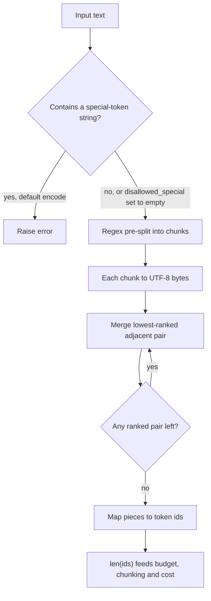

## TL;DR
tiktoken is OpenAI's fast byte-pair-encoding tokenizer (Rust core, Python bindings) that yields exactly
the token ids OpenAI models see. Use it locally to count, budget, chunk and estimate cost; for other model
families its counts are only an approximation.

## Why it exists
- **Every API limit is in tokens.** The context window, maximum output, rate limits (tokens per minute)
  and the bill are all measured in tokens, not characters or words.
- **Counting after the request is too late.** The response's usage field cannot prevent a prompt that
  overflows the window and is rejected, retrieved context that crowds out the answer budget, or a batch
  job whose cost you could not estimate in advance.
- **"About four characters per token" breaks where it hurts.** It is a fair average for English prose,
  but code, JSON, URLs, numbers and most non-English scripts produce many more tokens per character. A
  heuristic fine for a blog post overflows on a stack trace or a Japanese contract.
- **Counting via an API** adds latency and a network dependency to every prompt you assemble.
- **tiktoken ships the exact vocabulary and merge ranks** for OpenAI encodings and applies them locally,
  fast enough for every request and for whole corpora during chunking.

## How it works
### Byte-level BPE
1. **Pre-split.** A regular expression splits text into chunks (words, numbers, punctuation, whitespace
   runs) in an encoding-specific way.
2. **Bytes.** Each chunk becomes UTF-8 bytes.
3. **Merge.** Repeatedly merge the adjacent pair with the lowest rank in the learned merge table until no
   mergeable pair remains.
4. **Map.** Each final piece is one token id.

- **No unknown token.** Every byte is in the base vocabulary, so any string, including emoji or
  invalid-looking input, encodes without a fallback.

### Toy walk-through (made-up ranks)
Ranks: `(l, o)` = 1, `(lo, w)` = 2, `(e, r)` = 3. Chunk: `lower`.

| Step | Lowest-ranked pair present | Result |
|---|---|---|
| start | — | `l o w e r` |
| 1 | `(l, o)` | `lo w e r` |
| 2 | `(lo, w)` | `low e r` |
| 3 | `(e, r)` | `low er` |
| stop | (`low`, `er`) has no rank | two tokens |

- **Ranks come from training.** The most frequent pairs in the training corpus merged first, so common
  words collapse into single tokens and rare strings stay in many small pieces.
- **That is why counts depend on how "typical" your text is.**

### Why the regex pre-split exists
Merges never cross certain boundaries:
- **Leading spaces attach to the next word:** `" world"` is one token, not a space plus `world`.
- **Punctuation does not fuse onto words.**
- **Digits are grouped:** in `cl100k_base` and `o200k_base` digit runs split into groups of at most three.
- **Without it**, the vocabulary would waste entries on cross-word fragments and numbers would tokenise
  unpredictably.

### Encodings
An encoding is the regex plus the merge ranks plus special tokens.

| Encoding | Models |
|---|---|
| `r50k_base`, `p50k_base` | GPT-2/GPT-3-era |
| `cl100k_base` | GPT-3.5/GPT-4 generation |
| `o200k_base` | GPT-4o and later |

- **Use `tiktoken.encoding_for_model(name)`**, not a hard-coded encoding, because newer models may use a
  different one.
- **Larger vocabularies** tend to encode the same text in fewer tokens, especially non-English text.

### API surface
| Call | Does |
|---|---|
| `enc.encode(text)` | list of ints |
| `enc.decode(ids)` | text |
| `enc.encode_ordinary(text)` | ignores special tokens entirely |
| `encode_batch` | parallelises over many strings |

- **Special tokens raise by default.** `encode` errors if text contains a special-token string such as
  `<|endoftext|>`. This is deliberate: silently encoding user text as a real control token would let
  input inject document boundaries.
- **Opt in** with `allowed_special`, or treat them as plain text with `disallowed_special=()`.

### Chat overhead
- **Messages add tokens you did not write:** role markers and separators.
- **Not a stable public contract.** The overhead depends on the model, so treat local content counts as
  close estimates and reconcile against the `usage` field the API returns.

### Caching
- **First use downloads the rank file** and caches it on disk (set the location with the
  `TIKTOKEN_CACHE_DIR` environment variable).
- **Air-gapped environments** fail on the first call unless the file is pre-placed in that cache.

## Diagram
How one string becomes token ids, and where the special-token check sits: the regex split and the rank
table decide the count, and every byte is covered, so nothing falls back to an unknown token.



## Examples
### Budgeting a RAG prompt so chunks never crowd out the answer
```python
import tiktoken

enc = tiktoken.encoding_for_model("gpt-4o")      # resolves to o200k_base
CONTEXT, RESERVED_OUTPUT, OVERHEAD = 128_000, 4_000, 200   # overhead: rough allowance for chat formatting

def n_tokens(s: str) -> int:
    return len(enc.encode(s, disallowed_special=()))   # treat '<|endoftext|>' in user text as plain text

def pack(system: str, question: str, chunks: list[str]) -> list[str]:
    budget = CONTEXT - RESERVED_OUTPUT - OVERHEAD - n_tokens(system) - n_tokens(question)
    kept = []
    for c in chunks:                              # chunks already sorted by relevance
        cost = n_tokens(c)
        if cost > budget:
            break
        kept.append(c)
        budget -= cost
    return kept

for s in ["hello world", '{"user_id": 98213, "ok": true}', "東京都の天気"]:
    ids = enc.encode(s)
    print(len(s), "chars ->", len(ids), "tokens", [enc.decode_single_token_bytes(t) for t in ids])
# "hello world" -> [b'hello', b' world']: the space belongs to the second token.
# For the Japanese string some pieces may be partial UTF-8 byte sequences, not whole characters.
# The chars-to-tokens ratio differs sharply between English, JSON and Japanese; that spread is
# exactly why a fixed chars/4 heuristic misbudgets prompts.
```

- **Truncating by tokens can split a character.** `enc.decode(ids[:n])` may cut a multi-byte character
  in half, and the decoder then emits a replacement character; truncate on chunk or sentence boundaries
  where possible.

### The merge loop in pure Python
Runnable without tiktoken; it reproduces the toy walk-through above.

```python
RANKS = {("l", "o"): 1, ("lo", "w"): 2, ("e", "r"): 3}   # toy merge table, lower rank merges first

def bpe(chunk: str) -> list[str]:
    parts = list(chunk)                                   # real BPE starts from UTF-8 bytes
    while True:
        pairs = [(RANKS.get((a, b)), i) for i, (a, b) in enumerate(zip(parts, parts[1:]))]
        ranked = [(r, i) for r, i in pairs if r is not None]
        if not ranked:
            return parts                                  # no mergeable pair left
        _, i = min(ranked)                                # lowest rank wins
        parts[i:i + 2] = [parts[i] + parts[i + 1]]
        print(" ".join(parts))

print(bpe("lower"))    # lo w e r -> low e r -> low er -> ['low', 'er']
print(bpe("slower"))   # 's' never merges: ['s', 'low', 'er']
```

### Worked scenario: how many chunks fit
Using the constants above, with an illustrative 1,500-token system prompt, a 300-token question and
800-token chunks:

| Line item | Tokens |
|---|---|
| Context window | 128,000 |
| − reserved output | 4,000 |
| − chat overhead allowance | 200 |
| − system prompt | 1,500 |
| − question | 300 |
| **= chunk budget** | **122,000** |
| Chunks of 800 tokens that fit | 152 |

If those chunks were sized with chars/4 on code or Japanese, each would really cost far more than 800
tokens and far fewer would fit; count with the real encoder.

## Production patterns
- **Count before you send.** Run `pack`-style budgeting on every dynamically assembled prompt and trim or
  reject before the call. Log local count next to the API's reported input tokens and alert when the gap
  grows.
- **Resolve the encoding, with a deliberate fallback.** Call `tiktoken.encoding_for_model(model)` and
  catch `KeyError` for names it does not know, falling back to an explicitly chosen encoding such as
  `o200k_base`. Log every fallback so new models get checked.
- **Pre-seed the cache at build time.** Set `TIKTOKEN_CACHE_DIR` in the image and call
  `tiktoken.get_encoding("o200k_base")` during the build, so the rank file ships with the container.
  Monitor first-request failures in offline environments.
- **Treat user text as plain text.** Pass `disallowed_special=()` (or use `encode_ordinary`) for any
  untrusted input. Never put `<|endoftext|>` into `allowed_special` for user content.
- **Batch corpus counting.** Use `enc.encode_batch(texts)` when chunking or costing large corpora, and load
  the encoding once at module level rather than per request. Monitor chunking throughput.

## Trade-offs
- **Exact and free vs OpenAI-only.** Local counts are fast and exact for OpenAI models, but only
  estimates for Anthropic, Gemini or open models; use those providers' own token-counting endpoints or
  tokenizers when exactness matters.
- **Prevention vs CPU per request.** Counting every prompt prevents context-overflow errors before they
  happen; the CPU cost is negligible for chat, but batch with `encode_batch` over large corpora.
- **Predictable chunk sizes vs sentence integrity.** Token-based chunking fits model limits reliably but
  cuts across sentences unless combined with structural splitting, which can hurt retrieval quality.
- **Local estimate vs `usage` field.** `usage` is authoritative and free but arrives after the money is
  spent; use local counts for admission control and `usage` for billing and reconciliation.

## Pitfalls
- **Budgeting a non-OpenAI model with tiktoken.** Prompts that "fit" get rejected or truncated by the
  provider, especially for code and non-English text where tokenizers diverge most.
- **Hard-coding `cl100k_base` for every model.** Counts drift for newer models on a different encoding.
  Symptom: cost estimates that disagree with billed usage.
- **`encode` on raw user input without special-token handling.** A document containing `<|endoftext|>`
  raises an exception and the request fails with a confusing error.
- **Forgetting chat-format and tool-schema overhead.** Requests near the limit fail even though your
  content-only count said they fit, because tool definitions and role markers also consume tokens.
- **Deploying without internet access.** The first encode call fails trying to download the encoding
  file, unless the cache directory was pre-populated.

## When to use
- **Use when** you assemble prompts dynamically for OpenAI models: packing retrieved context, trimming
  conversation history, enforcing per-user token limits, chunking documents to a token size, and
  estimating cost for a batch job before you run it.
- **Other providers:** only as a rough estimate; prefer their official counter, or the Hugging Face
  tokenizer for an open model.
- **Measure** the gap between your local estimate and the API's reported input count
  (`usage.prompt_tokens` in Chat Completions, `usage.input_tokens` in the Responses API) on real traffic.
  A stable small gap is chat overhead; a large or growing gap means the wrong encoding.
- **Interviews:** why character heuristics fail for code and non-English text.

## Role lens
- **Engineer:** Counts tokens to pack context, trims history to a budget, and chunks corpora by
  token length using the encoding that matches the target model.
- **Architect:** Sets context-budget policy (reserved output tokens, retrieval share) and decides where
  local estimates suffice versus where provider-reported usage drives billing.
- **FDE:** Estimates a customer's monthly token spend from a sample of their real documents, and
  pre-seeds the tiktoken cache for offline deployments.

## Check yourself
**Q:** A team estimates monthly cost for a code-review assistant by counting characters in sample
diffs and dividing by four. Actual bills come in much higher. Explain why and how you would fix the
estimate.
**A:** The four-characters-per-token rule is an average for English prose. Code has short identifiers,
symbols, indentation runs and numbers that BPE splits into more tokens per character, so the heuristic
undercounts. The fix is to tokenise a representative sample of real diffs with the target model's
encoding, via `encoding_for_model`, measure the actual token distribution including system prompt,
tool definitions and chat overhead, and multiply by expected volume and output length. Then reconcile
with `usage` numbers from a pilot week, because billed input also includes formatting and any retries.

## Interview questions
### What is byte-level BPE, and why do token counts depend on the kind of text?
- **Definition:** text is pre-split by a regex, turned into UTF-8 bytes, and adjacent pairs are merged in
  order of learned rank until no ranked pair remains; each final piece is one token id.
- **Ranks come from corpus frequency**, so common English words collapse into single tokens while code,
  numbers and many non-English scripts stay in more, smaller pieces.
- **No unknown token exists**, because every byte is in the base vocabulary.

### A request fails with a context-length error although your local count said it fit. How do you debug it?
- **Check the encoding first:** hard-coded `cl100k_base` on a newer `o200k_base` model, or tiktoken used
  for a non-OpenAI model, gives the wrong count.
- **Then check what you did not count:** role markers, separators and tool definitions also consume
  tokens, so content-only counts run low near the limit.
- **Confirm with data:** log the local count next to the API's reported input tokens and inspect the gap.

### When would you not use tiktoken to count tokens?
- **For Anthropic, Gemini or open models:** tiktoken counts are only an approximation there; use the
  provider's token-counting endpoint or the model's Hugging Face tokenizer.
- **For billing:** the `usage` field returned by the API is authoritative, so use local counts for
  admission control and `usage` for reconciliation.
- **When a rough number is enough:** a one-off cost guess for English prose may not need exact counting.

### With a 128,000-token window, how many 800-token chunks fit in a RAG prompt?
- **Subtract fixed costs:** 4,000 reserved output, a 200-token chat overhead allowance, a 1,500-token
  system prompt and a 300-token question leave a 122,000-token chunk budget.
- **Divide:** 122,000 ÷ 800 gives 152 chunks that fit.
- **Caveat:** chunks sized with chars/4 on code or Japanese really cost far more than 800 tokens, so far
  fewer would fit; count each chunk with the real encoder.

### Why does `encode` reject `<|endoftext|>` by default, and what do you do with untrusted input?
- **Security reason:** encoding user text as the real control token would let input inject document
  boundaries, so tiktoken raises instead of guessing.
- **For untrusted input** pass `disallowed_special=()` or call `encode_ordinary`, which treat the string
  as plain text.
- **Never** put `<|endoftext|>` into `allowed_special` for user content.

## Quiz
### Q: Why does tiktoken's `encode` raise an error by default when text contains `<|endoftext|>`?
- [ ] Because that string cannot be represented in UTF-8
- [x] To avoid silently turning user-supplied text into a real control token
- [ ] Because special tokens are only valid in the output, never the input
- [ ] Because the encoding file does not contain special tokens
> Encoding the string as the actual special token would let untrusted text insert document boundaries.
> The default forces you to choose: allow it explicitly, or treat it as ordinary text.

### Q: Your tiktoken count says a prompt is 7,500 tokens, but a non-OpenAI model reports 9,000. What is the most likely explanation?
- [ ] tiktoken skips whitespace when counting
- [ ] The provider double-counts the system prompt
- [x] The other model uses a different tokenizer, so the same text produces a different number of tokens
- [ ] tiktoken counts only the last message in a conversation
> Token counts are a property of a specific vocabulary and merge table. tiktoken is exact only for OpenAI
> encodings; for other providers, use their own token-counting tool when the number matters.

### Q: Why does byte-level BPE never need an "unknown token"?
- [ ] Because its vocabulary includes every word in every language
- [ ] Because unknown characters are removed before encoding
- [x] Because every possible byte is in the base vocabulary, so any string can be encoded
- [ ] Because it falls back to character-level encoding using Unicode code points
> Text is converted to UTF-8 bytes and all 256 byte values are base tokens, so any input decomposes into
> known pieces. Merges only make common sequences shorter; they are never required for coverage.
