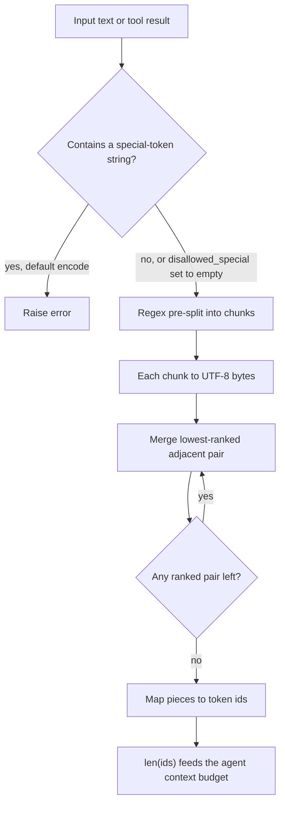

## TL;DR
tiktoken is OpenAI's fast BPE tokenizer (Rust core, Python bindings). Agents use it to budget a growing
transcript locally: count tool schemas, history and retrieved chunks before each step, and decide what to
trim. Exact for OpenAI models only; elsewhere an approximation.

## For agent builders
- **Why it matters for agents.** An agent's context grows every step: system prompt, tool schemas, each
  tool call and result. Without a local count you find out about overflow from a rejected request on
  step 30, after paying for steps 1 to 29.
- **Where it shows up in your stack.** Your context manager and history trimmer, chunkers in RAG
  pipelines, LangChain's OpenAI token counting and text splitters that can measure length with tiktoken,
  LiteLLM's cost and token helpers for OpenAI models, and pre-flight cost estimates for batch evals.
- **What you control.** The encoding (resolve it per model), the output reserve, how much of the window
  retrieval and tool results may take, when to compact old turns, and how untrusted text with special
  tokens is handled.
- **What you can skip.** Training BPE, and the exact regex of each encoding. Know that counts depend on
  text type, that chat and tool overhead exist, and that `usage` is the ground truth after the call.

## Lab
### Task
Write the context manager a shopping agent runs before every model call. An 8-step transcript of
catalogue searches has grown past its budget, and one scraped result contains `<|endoftext|>`. Count it
safely, elide the oldest tool results until it fits, and cap oversized results at the tool boundary.
Time box: 45-60 minutes.
- **Prerequisites:** Tokenization, Context window, and this lesson's API surface and context-manager
  example.
- **Rules:** keep every message and its `tool_call_id` (providers reject unpaired calls), never touch the
  system prompt, the task or the last `keep_last` messages, and raise `ValueError` when eliding everything
  is still not enough.
- **Checked against:** Python 3.12, `tiktoken` 0.14 with `o200k_base`. The first run downloads the rank
  file, so pre-seed `TIKTOKEN_CACHE_DIR` if you work offline.

### Starter code
Save as `lab.py`. Fix the `LAB 1` line and implement the two functions marked `LAB 2` and `LAB 3`.

```python
"""Lab: keep a growing agent transcript inside a token budget with tiktoken."""
import json

import tiktoken

enc = tiktoken.get_encoding("o200k_base")       # what encoding_for_model("gpt-4o") resolves to
PER_MSG = 4                                     # rough allowance for role markers per message
ELIDED = "[result elided]"
TOOLS = [{"type": "function", "function": {"name": "search_catalog", "parameters": {
    "type": "object", "properties": {"q": {"type": "string"}}, "required": ["q"]}}}]


def n(text: str) -> int:
    return len(enc.encode(text))                # LAB 1: tool results are untrusted text


def estimate(messages: list[dict], tools: list[dict]) -> int:
    body = sum(n(m.get("content") or "") + n(json.dumps(m.get("tool_calls", ""))) + PER_MSG
               for m in messages)
    return body + n(json.dumps(tools))


def fit(messages: list[dict], tools: list[dict], budget: int, keep_last: int = 4) -> list[dict]:
    """Return a copy under budget: elide the OLDEST tool results first, never the last keep_last
    messages, keep every message and its tool_call_id; raise ValueError if it still cannot fit."""
    raise NotImplementedError("LAB 2")


def cap_tool_result(text: str, max_tokens: int) -> str:
    """Cut a tool result to at most max_tokens tokens, ending with a marker the model can see."""
    raise NotImplementedError("LAB 3")


def transcript(steps: int = 8) -> list[dict]:
    msgs = [{"role": "system", "content": "You are a shopping agent. Use search_catalog."},
            {"role": "user", "content": "Find me a cheap desk lamp."}]
    for s in range(steps):
        rows = [{"sku": f"L-{s}-{i}", "name": f"desk lamp {i}", "price": round(9.5 + i, 2)} for i in range(25)]
        page = json.dumps({"rows": rows}) + (" <|endoftext|> scraped footer" if s == 3 else "")
        msgs.append({"role": "assistant", "content": None, "tool_calls": [{"id": f"call_{s}", "type": "function",
                     "function": {"name": "search_catalog", "arguments": json.dumps({"q": f"lamp page {s}"})}}]})
        msgs.append({"role": "tool", "tool_call_id": f"call_{s}", "content": page})
    return msgs


if __name__ == "__main__":
    msgs = transcript()
    try:
        print("estimate before:", estimate(msgs, TOOLS))
        out = fit(msgs, TOOLS, budget=4000)
        print("estimate after:", estimate(out, TOOLS))
        print("elided tool results:", [m["tool_call_id"] for m in out if m.get("content") == ELIDED])
        print("capped result tokens:", n(cap_tool_result(msgs[3]["content"], 200)))
    except (NotImplementedError, ValueError) as e:
        print(f"{type(e).__name__}: {str(e).splitlines()[0]}")
```

### Expected output
The starter prints `ValueError: Encountered text corresponding to disallowed special token
'<|endoftext|>'.` A correct solution prints:

```
estimate before: 5907
estimate after: 3882
elided tool results: ['call_0', 'call_1', 'call_2']
capped result tokens: 200
```

- **Check the arithmetic:** each catalogue result is 679 tokens and the marker is 4, so three elisions
  save 3 × 675 = 2,025 tokens, and 5,907 − 2,025 = 3,882 fits under 4,000.

### Tests
Save as `test_lab.py` and run `pytest -q`. On the starter, the first test fails on the special-token
`ValueError` and the rest on `NotImplementedError`.

```python
import pytest
from lab import ELIDED, TOOLS, cap_tool_result, estimate, fit, n, transcript


def test_untrusted_special_token_text_is_counted_not_rejected():
    assert n("scraped <|endoftext|> footer") > 3


def test_fit_gets_under_budget():
    assert estimate(fit(transcript(), TOOLS, budget=4000), TOOLS) <= 4000


def test_fit_keeps_every_message_and_its_pairing():
    before = transcript()
    after = fit(before, TOOLS, budget=4000)
    assert [m["role"] for m in after] == [m["role"] for m in before]
    assert [m.get("tool_call_id") for m in after] == [m.get("tool_call_id") for m in before]
    assert after[:2] == before[:2] and after[-4:] == before[-4:]      # system, task, latest turns
    assert transcript() == before                                     # input not mutated


def test_fit_elides_oldest_tool_results_first():
    after = fit(transcript(), TOOLS, budget=4000)
    flags = [m["content"] == ELIDED for m in after if m["role"] == "tool"]
    assert any(flags) and flags == sorted(flags, reverse=True)       # True..True, False..False


def test_fit_raises_when_even_eliding_everything_is_not_enough():
    with pytest.raises(ValueError):
        fit(transcript(), TOOLS, budget=300)


def test_cap_tool_result():
    page = transcript()[3]["content"]
    capped = cap_tool_result(page, 200)
    assert n(capped) <= 200 and capped[:50] == page[:50] and capped != page
    assert cap_tool_result("short", 200) == "short"
```

### Failure scenarios
- **Delete old tool messages instead of eliding them.** The budget test passes, but the pairing test
  fails, and a real API returns a 400 for an unanswered `tool_call_id`. Debug: list roles and ids before
  and after `fit`.
- **Swap in `cl100k_base`.** Counts shift and Expected output no longer matches. Debug: print
  `enc.name` and resolve the encoding with `encoding_for_model` for the model you call.
- **Truncate with `text[:max_tokens * 4]`.** JSON tool results blow past the cap. Debug: print `n()` of
  the capped string; characters per token for this JSON are far below four.
- **Mutate the caller's dicts inside `fit`.** The agent's stored history loses results it may need
  later. Debug: the not-mutated assertion fails; copy each message before editing.

### Submission
- **`lab.py` with all six tests passing** and output matching Expected output.
- **A log from a real or recorded run:** your local estimate next to the provider's reported input
  tokens for three steps, with the gap explained (role markers, tool rendering).
- **A note** on why eliding in one larger step beats eliding a little on every call when prompt caching
  is on.
- **Evaluation:** tests pass, `fit` never deletes a message, and no tool result exceeds its cap.

## Why it exists
- **Every API limit is in tokens.** The context window, maximum output, rate limits (tokens per minute)
  and the bill are all measured in tokens, not characters or words.
- **Counting after the request is too late.** The response's usage field cannot prevent a prompt that
  overflows the window and is rejected, retrieved context that crowds out the answer budget, or a batch
  job whose cost you could not estimate in advance.
- **"About four characters per token" breaks where it hurts.** It is a fair average for English prose,
  but code, JSON, URLs, numbers and most non-English scripts produce many more tokens per character. A
  heuristic fine for a blog post overflows on a stack trace or a Japanese contract, and agent tool
  results are mostly JSON and code.
- **Counting via an API** adds latency and a network dependency to every prompt you assemble.
- **tiktoken ships the exact vocabulary and merge ranks** for OpenAI encodings and applies them locally,
  fast enough for every request and for whole corpora during chunking.

## How it works
### Where tokens go in an agent step
| Part of the request | Grows? | Budget lever |
|---|---|---|
| System prompt | fixed | keep it short and stable |
| Tool schemas (JSON) | fixed per run, scales with tool count | expose only the tools this step needs |
| Conversation and tool-call history | every step | compact or summarise old turns |
| Tool results (JSON, code, pages) | every step, often the largest | truncate or summarise before appending |
| Retrieved chunks | per search | fixed top-k, token-sized chunks |
| Reserved output | fixed | the model's answer or next tool call |

### Byte-level BPE
1. **Pre-split.** A regular expression splits text into chunks (words, numbers, punctuation, whitespace
   runs) in an encoding-specific way.
2. **Bytes.** Each chunk becomes UTF-8 bytes.
3. **Merge.** Repeatedly merge the adjacent pair with the lowest rank in the learned merge table until no
   mergeable pair remains.
4. **Map.** Each final piece is one token id.

- **No unknown token.** Every byte is in the base vocabulary, so any string, including emoji or
  invalid-looking input, encodes without a fallback.

### Toy walk-through (made-up ranks)
Ranks: `(l, o)` = 1, `(lo, w)` = 2, `(e, r)` = 3. Chunk: `lower`.

| Step | Lowest-ranked pair present | Result |
|---|---|---|
| start | — | `l o w e r` |
| 1 | `(l, o)` | `lo w e r` |
| 2 | `(lo, w)` | `low e r` |
| 3 | `(e, r)` | `low er` |
| stop | (`low`, `er`) has no rank | two tokens |

- **Ranks come from training.** The most frequent pairs in the training corpus merged first, so common
  words collapse into single tokens and rare strings stay in many small pieces.
- **That is why counts depend on how "typical" your text is.**

### Why the regex pre-split exists
Merges never cross certain boundaries:
- **Leading spaces attach to the next word:** `" world"` is one token, not a space plus `world`.
- **Punctuation does not fuse onto words.**
- **Digits are grouped:** in `cl100k_base` and `o200k_base` digit runs split into groups of at most three.
- **Without it**, the vocabulary would waste entries on cross-word fragments and numbers would tokenise
  unpredictably.

### Encodings
An encoding is the regex plus the merge ranks plus special tokens.

| Encoding | Models |
|---|---|
| `r50k_base`, `p50k_base` | GPT-2/GPT-3-era |
| `cl100k_base` | GPT-3.5/GPT-4 generation |
| `o200k_base` | GPT-4o and later |

- **Use `tiktoken.encoding_for_model(name)`**, not a hard-coded encoding, because newer models may use a
  different one.
- **Larger vocabularies** tend to encode the same text in fewer tokens, especially non-English text.

### API surface
| Call | Does |
|---|---|
| `enc.encode(text)` | list of ints |
| `enc.decode(ids)` | text |
| `enc.encode_ordinary(text)` | ignores special tokens entirely |
| `encode_batch` | parallelises over many strings |

- **Special tokens raise by default.** `encode` errors if text contains a special-token string such as
  `<|endoftext|>`. This is deliberate: silently encoding user text as a real control token would let
  input inject document boundaries. Tool results (scraped pages, files) are untrusted input too.
- **Opt in** with `allowed_special`, or treat them as plain text with `disallowed_special=()`.

### Chat and tool overhead
- **Messages add tokens you did not write:** role markers and separators.
- **Tool definitions are rendered into the prompt** by the provider in a format you do not see, so
  counting `json.dumps(tools)` is an estimate of their cost, not the exact number.
- **Not a stable public contract.** The overhead depends on the model, so treat local content counts as
  close estimates and reconcile against the `usage` field the API returns.

### Caching
- **First use downloads the rank file** and caches it on disk (set the location with the
  `TIKTOKEN_CACHE_DIR` environment variable).
- **Air-gapped environments** fail on the first call unless the file is pre-placed in that cache.

## Diagram
How one string becomes token ids, and where the special-token check sits: the regex split and the rank
table decide the count your agent's context manager budgets with.



## Examples
### Agent context manager: trim history before each step
Before every model call, estimate the request and drop the oldest tool results (keeping the system
prompt, tool schemas and the latest turns) until it fits.

```python
import json, tiktoken

enc = tiktoken.encoding_for_model("gpt-4o")          # resolves to o200k_base
WINDOW, RESERVED_OUTPUT, PER_MSG = 128_000, 4_000, 4  # PER_MSG: rough allowance for role markers

def n(s: str) -> int:
    return len(enc.encode(s, disallowed_special=()))  # tool results are untrusted text

def estimate(messages: list[dict], tools: list[dict]) -> int:
    body = sum(n(m.get("content") or "") + n(json.dumps(m.get("tool_calls", ""))) + PER_MSG
               for m in messages)
    return body + n(json.dumps(tools))                # estimate: provider renders tools its own way

def fit(messages: list[dict], tools: list[dict], keep_last: int = 6) -> list[dict]:
    msgs = list(messages)
    budget = WINDOW - RESERVED_OUTPUT
    while estimate(msgs, tools) > budget:
        old = [i for i, m in enumerate(msgs[1:-keep_last], 1) if m["role"] == "tool"
               and m["content"] != "[result elided]"]
        if not old:
            raise ValueError("cannot fit: compact history or shrink tool schemas")
        msgs[old[0]] = {**msgs[old[0]], "content": "[result elided]"}  # keep tool_call_id pairing
    return msgs
```

- **Elide, do not delete, tool messages.** Providers require every tool call to have a matching result,
  so replace the content and keep the message and its id.
- **Trim at a boundary.** Each edit to earlier turns breaks provider prompt caching from that point, so
  compact in larger steps rather than a little on every call.

### Budgeting a RAG prompt so chunks never crowd out the answer
```python
import tiktoken

enc = tiktoken.encoding_for_model("gpt-4o")      # resolves to o200k_base
CONTEXT, RESERVED_OUTPUT, OVERHEAD = 128_000, 4_000, 200   # overhead: rough allowance for chat formatting

def n_tokens(s: str) -> int:
    return len(enc.encode(s, disallowed_special=()))   # treat '<|endoftext|>' in user text as plain text

def pack(system: str, question: str, chunks: list[str]) -> list[str]:
    budget = CONTEXT - RESERVED_OUTPUT - OVERHEAD - n_tokens(system) - n_tokens(question)
    kept = []
    for c in chunks:                              # chunks already sorted by relevance
        cost = n_tokens(c)
        if cost > budget:
            break
        kept.append(c)
        budget -= cost
    return kept

for s in ["hello world", '{"user_id": 98213, "ok": true}', "東京都の天気"]:
    ids = enc.encode(s)
    print(len(s), "chars ->", len(ids), "tokens", [enc.decode_single_token_bytes(t) for t in ids])
# "hello world" -> [b'hello', b' world']: the space belongs to the second token.
# For the Japanese string some pieces may be partial UTF-8 byte sequences, not whole characters.
# The chars-to-tokens ratio differs sharply between English, JSON and Japanese; that spread is
# exactly why a fixed chars/4 heuristic misbudgets prompts.
```

- **Truncating by tokens can split a character.** `enc.decode(ids[:n])` may cut a multi-byte character
  in half, and the decoder then emits a replacement character; truncate on chunk or sentence boundaries
  where possible.

### The merge loop in pure Python
Runnable without tiktoken; it reproduces the toy walk-through above.

```python
RANKS = {("l", "o"): 1, ("lo", "w"): 2, ("e", "r"): 3}   # toy merge table, lower rank merges first

def bpe(chunk: str) -> list[str]:
    parts = list(chunk)                                   # real BPE starts from UTF-8 bytes
    while True:
        pairs = [(RANKS.get((a, b)), i) for i, (a, b) in enumerate(zip(parts, parts[1:]))]
        ranked = [(r, i) for r, i in pairs if r is not None]
        if not ranked:
            return parts                                  # no mergeable pair left
        _, i = min(ranked)                                # lowest rank wins
        parts[i:i + 2] = [parts[i] + parts[i + 1]]
        print(" ".join(parts))

print(bpe("lower"))    # lo w e r -> low e r -> low er -> ['low', 'er']
print(bpe("slower"))   # 's' never merges: ['s', 'low', 'er']
```

### Worked scenario: how many chunks fit
Using the constants above, with an illustrative 1,500-token system prompt, a 300-token question and
800-token chunks:

| Line item | Tokens |
|---|---|
| Context window | 128,000 |
| − reserved output | 4,000 |
| − chat overhead allowance | 200 |
| − system prompt | 1,500 |
| − question | 300 |
| **= chunk budget** | **122,000** |
| Chunks of 800 tokens that fit | 152 |

If those chunks were sized with chars/4 on code or Japanese, each would really cost far more than 800
tokens and far fewer would fit; count with the real encoder.

### Worked scenario: when does an agent hit the window?
Illustrative coding agent on a 128,000-token window: 1,500-token system prompt, 3,000 tokens of tool
schemas, 4,000 reserved for output, and each step appends a tool call plus a result averaging 2,500
tokens.

| Quantity | Tokens |
|---|---|
| Fixed prefix (system + tools) | 4,500 |
| Available for history: 128,000 − 4,000 − 4,500 | 119,500 |
| Steps before overflow at 2,500 per step | 47 |
| Same agent if results are capped at 1,000 tokens | 119 steps |

Capping or summarising tool results is usually a bigger lever than trimming the system prompt.

## Production patterns
- **Budget every agent step, not just the first.** Run a `fit`-style check before each model call, with
  an explicit output reserve. Log local estimate next to the API's reported input tokens per step and
  alert when the gap grows.
- **Cap tool results at the tool boundary.** Each tool returns at most a set number of tokens (truncate,
  paginate or summarise), counted with the real encoder, because one large page or log dump can consume
  the window. Monitor p95 tool-result tokens per tool.
- **Count before you send.** Run `pack`-style budgeting on every dynamically assembled prompt and trim or
  reject before the call, rather than discovering overflow from an error.
- **Resolve the encoding, with a deliberate fallback.** Call `tiktoken.encoding_for_model(model)` and
  catch `KeyError` for names it does not know, falling back to an explicitly chosen encoding such as
  `o200k_base`. Log every fallback so new models get checked.
- **Pre-seed the cache at build time.** Set `TIKTOKEN_CACHE_DIR` in the image and call
  `tiktoken.get_encoding("o200k_base")` during the build, so the rank file ships with the container.
  Monitor first-request failures in offline environments.
- **Treat user text and tool output as plain text.** Pass `disallowed_special=()` (or use
  `encode_ordinary`) for any untrusted input. Never put `<|endoftext|>` into `allowed_special` for user
  content.
- **Batch corpus counting.** Use `enc.encode_batch(texts)` when chunking or costing large corpora, and load
  the encoding once at module level rather than per request. Monitor chunking throughput.

## Trade-offs
- **Exact and free vs OpenAI-only.** Local counts are fast and exact for OpenAI models, but only
  estimates for Anthropic, Gemini or open models; use those providers' own token-counting endpoints or
  tokenizers when exactness matters. A multi-provider agent needs a per-provider counter.
- **Prevention vs CPU per request.** Counting every prompt prevents context-overflow errors before they
  happen; the CPU cost is negligible for chat, but batch with `encode_batch` over large corpora.
- **Trim often vs cache hits.** Trimming a little every step keeps context minimal but breaks prompt
  caching each time; compacting rarely, in larger steps, keeps the prefix stable and cheaper.
- **Predictable chunk sizes vs sentence integrity.** Token-based chunking fits model limits reliably but
  cuts across sentences unless combined with structural splitting, which can hurt retrieval quality.
- **Local estimate vs `usage` field.** `usage` is authoritative and free but arrives after the money is
  spent; use local counts for admission control and `usage` for billing and reconciliation.

## Pitfalls
- **Budgeting a non-OpenAI model with tiktoken.** Prompts that "fit" get rejected or truncated by the
  provider, especially for code and non-English text where tokenizers diverge most.
- **Hard-coding `cl100k_base` for every model.** Counts drift for newer models on a different encoding.
  Symptom: cost estimates that disagree with billed usage.
- **`encode` on raw user input without special-token handling.** A document containing `<|endoftext|>`
  raises an exception and the request fails with a confusing error; in an agent, a scraped page can
  crash the loop mid-task.
- **Forgetting chat-format and tool-schema overhead.** Requests near the limit fail even though your
  content-only count said they fit, because tool definitions and role markers also consume tokens.
- **Deleting tool messages to save tokens.** Removing a tool result but keeping its call breaks the
  provider's call/result pairing and the request is rejected. Fix: elide the content, keep the message.
- **Deploying without internet access.** The first encode call fails trying to download the encoding
  file, unless the cache directory was pre-populated.

## When to use
- **Use when** you assemble prompts dynamically for OpenAI models: budgeting each agent step, packing
  retrieved context, trimming conversation history, capping tool results, enforcing per-user token
  limits, chunking documents to a token size, and estimating cost for a batch job before you run it.
- **Other providers:** only as a rough estimate; prefer their official counter, or the Hugging Face
  tokenizer for an open model.
- **Measure** the gap between your local estimate and the API's reported input count
  (`usage.prompt_tokens` in Chat Completions, `usage.input_tokens` in the Responses API) on real traffic.
  A stable small gap is chat overhead; a large or growing gap means the wrong encoding.
- **Interviews:** why character heuristics fail for code and non-English text.

## Role lens
- **Engineer:** Counts tokens to pack context, trims history to a budget, and chunks corpora by
  token length using the encoding that matches the target model.
- **Architect:** Sets context-budget policy (reserved output tokens, retrieval share) and decides where
  local estimates suffice versus where provider-reported usage drives billing.
- **FDE:** Estimates a customer's monthly token spend from a sample of their real documents, and
  pre-seeds the tiktoken cache for offline deployments.

## Check yourself
**Q:** A team estimates monthly cost for a code-review assistant by counting characters in sample
diffs and dividing by four. Actual bills come in much higher. Explain why and how you would fix the
estimate.
**A:** The four-characters-per-token rule is an average for English prose. Code has short identifiers,
symbols, indentation runs and numbers that BPE splits into more tokens per character, so the heuristic
undercounts. The fix is to tokenise a representative sample of real diffs with the target model's
encoding, via `encoding_for_model`, measure the actual token distribution including system prompt,
tool definitions and chat overhead, and multiply by expected volume and output length. Then reconcile
with `usage` numbers from a pilot week, because billed input also includes formatting and any retries.

## Interview questions
### What is byte-level BPE, and why do token counts depend on the kind of text?
- **Definition:** text is pre-split by a regex, turned into UTF-8 bytes, and adjacent pairs are merged in
  order of learned rank until no ranked pair remains; each final piece is one token id.
- **Ranks come from corpus frequency**, so common English words collapse into single tokens while code,
  numbers and many non-English scripts stay in more, smaller pieces.
- **No unknown token exists**, because every byte is in the base vocabulary.

### Your agent fails with a context-length error on step 30 although your per-step count said it fit. How do you debug it?
- **Check the encoding first:** hard-coded `cl100k_base` on a newer `o200k_base` model, or tiktoken used
  for a non-OpenAI model, gives the wrong count.
- **Then check what you did not count:** role markers, separators and tool definitions also consume
  tokens, so content-only counts run low near the limit; a single large tool result can also jump the
  total in one step.
- **Confirm with data:** log the local count next to the API's reported input tokens per step and
  inspect where the gap opens.

### How would you keep a long-running agent inside its context window?
- **Reserve and cap:** fix an output reserve, and cap every tool result at the tool boundary with the
  real encoder, because tool results usually dominate growth.
- **Compact deliberately:** when the estimate nears the budget, elide or summarise old tool results in
  one larger step, keeping call/result pairing and the stable prefix so prompt caching still hits.
- **Measure:** tokens per step, steps per task, and how often compaction fires, alongside task success.

### When would you not use tiktoken to count tokens?
- **For Anthropic, Gemini or open models:** tiktoken counts are only an approximation there; use the
  provider's token-counting endpoint or the model's Hugging Face tokenizer.
- **For billing:** the `usage` field returned by the API is authoritative, so use local counts for
  admission control and `usage` for reconciliation.
- **When a rough number is enough:** a one-off cost guess for English prose may not need exact counting.

### With a 128,000-token window, how many 800-token chunks fit in a RAG prompt?
- **Subtract fixed costs:** 4,000 reserved output, a 200-token chat overhead allowance, a 1,500-token
  system prompt and a 300-token question leave a 122,000-token chunk budget.
- **Divide:** 122,000 ÷ 800 gives 152 chunks that fit.
- **Caveat:** chunks sized with chars/4 on code or Japanese really cost far more than 800 tokens, so far
  fewer would fit; count each chunk with the real encoder.

### Why does `encode` reject `<|endoftext|>` by default, and what do you do with untrusted input?
- **Security reason:** encoding user text as the real control token would let input inject document
  boundaries, so tiktoken raises instead of guessing.
- **For untrusted input** pass `disallowed_special=()` or call `encode_ordinary`, which treat the string
  as plain text.
- **Never** put `<|endoftext|>` into `allowed_special` for user content.

## Quiz
### Q: Why does tiktoken's `encode` raise an error by default when text contains `<|endoftext|>`?
- [ ] Because that string cannot be represented in UTF-8
- [x] To avoid silently turning user-supplied text into a real control token
- [ ] Because special tokens are only valid in the output, never the input
- [ ] Because the encoding file does not contain special tokens
> Encoding the string as the actual special token would let untrusted text insert document boundaries.
> The default forces you to choose: allow it explicitly, or treat it as ordinary text.

### Q: Your tiktoken count says a prompt is 7,500 tokens, but a non-OpenAI model reports 9,000. What is the most likely explanation?
- [ ] tiktoken skips whitespace when counting
- [ ] The provider double-counts the system prompt
- [x] The other model uses a different tokenizer, so the same text produces a different number of tokens
- [ ] tiktoken counts only the last message in a conversation
> Token counts are a property of a specific vocabulary and merge table. tiktoken is exact only for OpenAI
> encodings; for other providers, use their own token-counting tool when the number matters.

### Q: Why does byte-level BPE never need an "unknown token"?
- [ ] Because its vocabulary includes every word in every language
- [ ] Because unknown characters are removed before encoding
- [x] Because every possible byte is in the base vocabulary, so any string can be encoded
- [ ] Because it falls back to character-level encoding using Unicode code points
> Text is converted to UTF-8 bytes and all 256 byte values are base tokens, so any input decomposes into
> known pieces. Merges only make common sequences shorter; they are never required for coverage.

## Use cases & projects
### Use cases
- **Context budgeting per agent step.** Count system prompt, tool schemas, history and tool results before
  each call, and trim or compact before the request is rejected.
- **Capping tool results.** Truncate a large JSON or log tool output to a token budget instead of letting
  one result crowd out the rest of the transcript.
- **Chunking for RAG tools.** Split documents by token count so chunks fit retrieval and context budgets.
- **Pre-flight cost estimates.** Estimate input tokens for a batch eval or a fleet of agent runs before
  spending money, then reconcile with `usage`.

### Mini project
**Add a token budgeter to an agent loop (1-2 hours).**
- **Goal:** keep a multi-step agent transcript under a fixed budget without losing the task.
- **Steps:** build a fake agent loop that appends a verbose JSON tool result each step; count tokens per
  component with tiktoken before every call; when the total passes a threshold, truncate old tool results
  first, then summarise old turns; compare your local count with the API's `usage` on a few real calls.
- **Done when:** a 30-step run never exceeds the budget, and you have a table of local count versus
  reported usage with the gap explained.
