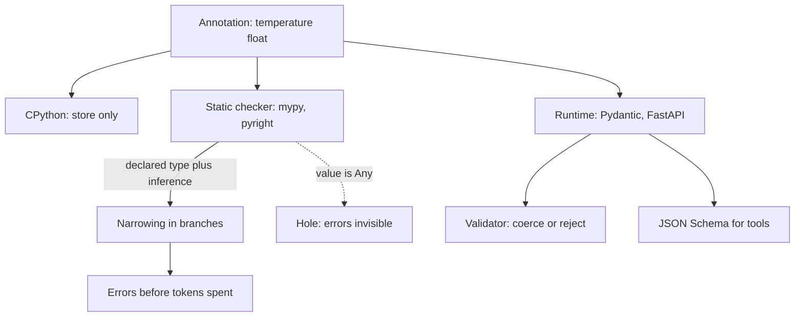

## TL;DR
Type hints describe what a value should be. The interpreter ignores them; mypy, pyright, Pydantic and
FastAPI read them. AI code is glue between untyped JSON and SDKs, so catching a shape mismatch before
the run beats a failed thirty-minute batch job.

## Why it exists
- **Python is dynamically typed.** A name can hold anything, and a function discovers what it got only
  when it uses it. Fine for a fifty-line script; it falls apart in AI pipelines.
- **AI glue code fails late.** Dicts of dicts flow from a provider SDK through five helpers into a prompt
  template. The first symptom is `KeyError: 'content'` inside a retry loop, or a `TypeError` about
  concatenating `str` and `NoneType` two hours into an eval run.
- **Docstrings do not hold.** They drift, nobody checks them, and a refactor that renames a field
  silently breaks every caller.
- **Runtime assertions everywhere are not enough.** They catch the error only on the path that executes,
  and clutter every function with checks that belong to the contract, not the logic.
- **One machine-readable contract serves three readers.** A checker walks the call graph without running
  anything and flags every `Message | None` flowing into a `Message` parameter. Pydantic builds
  validators, FastAPI builds parsers and OpenAPI schemas, and typed OpenAI and Anthropic SDKs tell your
  editor `response.choices[0].message.content` can be `None`.

## How it works
### What the interpreter does with an annotation
- **It stores metadata, nothing more.** `def f(x: int) -> str` records `int` and `str` in
  `f.__annotations__`, a dict `{"x": int, "return": str}`.
- **Class and module scope too.** `name: list[str] = []` stores the type in that scope's
  `__annotations__`.
- **No checking.** `f("hello")` runs normally, because CPython performs no checking. This is deliberate:
  near-zero runtime cost and full backward compatibility, with enforcement left to tools.

### When the annotation is evaluated
| Python version | Behaviour | Forward reference to a later class |
|---|---|---|
| Up to 3.13 | Eager, at definition time | `NameError` unless quoted (`"Message"`) or the module uses `from __future__ import annotations` |
| Any version, with the future import | Postponed: every annotation stored as a string | Libraries that need the real type resolve strings with `typing.get_type_hints(obj)` |
| 3.14 (PEP 649 and PEP 749) | Lazy: computed when something first reads `__annotations__` (or calls `annotationlib.get_annotations`) | No failure at `def` time, but can still fail later if the name is undefined when a library inspects it |

Check which version your project runs when a library complains about unresolved forward references.

### What a checker does with it
1. **Builds a type for every expression** from annotations plus inference.
2. **Applies the gradual-typing rule.** Any unannotated value has type `Any`, and `Any` is compatible with
   everything in both directions. This exists *because* typing had to be adoptable one function at a
   time in a huge untyped ecosystem; a checker that refused partially typed code would never have been
   adopted.
3. **Pays for it with holes.** Once a value is `Any`, every downstream error is invisible. Most "mypy
   said it was fine" surprises trace back to an `Any` from `json.loads`, an untyped library or a
   missing annotation.

### The vocabulary that matters
- **`X | None` (older spelling `Optional[X]`)** says the value may be absent; the checker forces you to
  narrow it with `if x is not None` before use. Provider SDK responses are full of these.

| Spelling | Meaning | Why you care in AI code |
|---|---|---|
| `list[str]`, `dict[str, float]`, `tuple[int, ...]` | Built-in generic containers | Prefer abstract inputs (`Sequence[str]`, `Mapping[str, float]`, `Iterable[str]`) and concrete outputs (`list[str]`) so callers can pass tuples or generators |
| `Callable[[str, int], bool]` | A function value | Typing callbacks and handlers |
| `Awaitable[T]`, `Coroutine` | Async results | Matters when wrapping an async client |
| `Any` | Opt out of checking | Every use is a hole |
| `object` | Anything, but you may only use what every object supports until you narrow it (for example with `isinstance`) | Choosing `object` over `Any` for genuinely unknown inputs keeps the hole small |
| `Annotated[T, meta]` | Extra data on a type without changing it | Pydantic's `Field` and FastAPI's `Depends` carry runtime constraints alongside the static type |
| `TYPE_CHECKING` | Import a type only for the checker | Breaks import cycles; avoids loading torch or transformers just for an annotation |
| `cast(T, value)` | "Trust me", no runtime effect | Escape hatch; use sparingly |
| `reveal_type(x)` | Prints what the checker thinks `x` is | Fastest way to debug an inference surprise |

### Narrowing: how the checker learns more inside a branch
- **A declared type is an upper bound.** After `if msg.content is not None:`, `msg.content` is `str` in
  that block, *because* the checker treats the test as evidence.
- **Tests that narrow:** `isinstance(x, ToolCall)`, `if not x: return`, `assert x is not None`, and a
  `match` case. You pay one explicit check and the rest of the block is precise, which is what makes
  `X | None` usable rather than a nuisance.
- **Helpers do not narrow by default.** The checker cannot see inside `def is_tool_turn(m) -> bool`.
  Annotate it `-> TypeIs[ToolTurn]` (3.13, or `typing_extensions`) or the older
  `-> TypeGuard[ToolTurn]` so a call narrows like an `isinstance`.
- **Narrowing ends** when the name is reassigned. Checkers are conservative about carrying it into a
  nested function or lambda that runs later, which is why you sometimes copy `msg.content` into a local
  first.

### Where types come from for libraries you did not write
- **Inline types** with a `py.typed` marker file (PEP 561).
- **Stub packages** such as `types-requests` or `types-PyYAML`, containing signature-only `.pyi` files.
- **Neither:** every import from the package is `Any`, silently. mypy reports "missing library stubs or
  py.typed marker"; silencing it with `ignore_missing_imports` hides the error and keeps the hole.
- **In practice:** the major LLM SDKs ship inline types; many older data and ML packages are partially
  typed or not at all, so that boundary is where your own typed wrapper goes.

### Why runtime libraries read them
- **Who reads them:** Pydantic, dataclasses and `attrs` at class creation; FastAPI when a route is
  registered; libraries such as `instructor` reuse Pydantic's models.
- **What it buys:** a `BaseModel` with `temperature: float = 0.7` becomes a validator that coerces `"0.7"`
  to `0.7` and rejects `"hot"`.
- **The bridge:** the annotation you wrote for the checker becomes the schema that validates a model's
  JSON output and the JSON Schema you hand to a tool-calling API. Write the type once, get all three
  behaviours; that is the main practical payoff in AI work.

## Diagram
One annotation, three readers: the interpreter only stores it in `__annotations__`, a checker reads it
before the run, and runtime libraries turn it into a validator (coerce `"0.7"`, reject `"hot"`) and a
JSON Schema for tools and OpenAPI. Follow the dotted `Any` edge to see where checking stops.



## Examples
### A typed wrapper around a chat completion
The checker flags any caller that forgets `content` can be `None`, and `Annotated` carries a constraint
Pydantic enforces at runtime.

```python
from __future__ import annotations
from collections.abc import Sequence
from typing import Annotated, Any, Literal
from pydantic import BaseModel, Field

Role = Literal["system", "user", "assistant"]

class Message(BaseModel):
    role: Role
    content: str

class GenConfig(BaseModel):
    model: str
    temperature: Annotated[float, Field(ge=0.0, le=2.0)] = 0.7
    max_tokens: Annotated[int, Field(gt=0)] = 512

def to_wire(messages: Sequence[Message]) -> list[dict[str, str]]:
    # Sequence accepts list or tuple; the return is a concrete list for the SDK.
    return [m.model_dump() for m in messages]

def first_text(response: Any) -> str | None:
    # SDK responses are typed in the real SDK; Any here stands in for "unknown JSON".
    choice = response["choices"][0]
    return choice["message"].get("content")   # may be None for tool-call turns

def reply(messages: Sequence[Message], cfg: GenConfig, response: Any) -> str:
    text = first_text(response)
    if text is None:                 # the checker forces this narrowing
        raise ValueError("model returned no text content")
    return text.strip()

raw = {"model": "gpt-4o-mini", "temperature": "0.2"}       # e.g. parsed from a YAML config
cfg = GenConfig.model_validate(raw)                        # "0.2" coerced to 0.2 by Pydantic
print(cfg.temperature, type(cfg.temperature))            # 0.2 <class 'float'>
# GenConfig(model="x", temperature=3.0) raises a ValidationError: le=2.0
```

### Worked experiment: the `Any` hole in one file
Run `mypy` on the file above after each edit.

| Edit | mypy result | Why |
|---|---|---|
| Delete the `if text is None` branch | Error: the optional string has no attribute `strip` | The value proposition, delivered before the first API call |
| Keep it deleted and also delete `first_text`'s return annotation | Silent | A missing return annotation defaults to `Any` (a fully unannotated function is not checked at all); `Any.strip()` is accepted |
| Call `GenConfig(model="x", temperature="0.2")` directly | Runs fine (Pydantic coerces) | A checker that understands Pydantic's `__init__` through `dataclass_transform` flags the `str` argument |
| Same call with Pydantic's mypy plugin enabled | Silent by default | The plugin deliberately types `__init__` parameters as `Any` unless you set `init_typed = True` |

- **The first error is the whole point:** `str | None` has no attribute `strip`, reported before any
  tokens are spent.
- **Lesson 1:** the annotation on the function that touches raw JSON matters more than any other.
- **Lesson 2:** untyped input goes through `model_validate` at the boundary, not through `__init__`.

### Narrowing helper with `TypeIs`
Without `TypeIs` the checker cannot see inside the helper, so `turn.tool_name` would still be an error.

```python
from dataclasses import dataclass
from typing_extensions import TypeIs   # typing.TypeIs on 3.13+

@dataclass
class TextTurn:
    text: str

@dataclass
class ToolTurn:
    tool_name: str
    args: dict[str, object]

def is_tool_turn(t: TextTurn | ToolTurn) -> TypeIs[ToolTurn]:
    return isinstance(t, ToolTurn)

def describe(turn: TextTurn | ToolTurn) -> str:
    if is_tool_turn(turn):
        return f"call {turn.tool_name}"    # narrowed to ToolTurn
    return turn.text                       # narrowed to TextTurn in the else branch

print(describe(ToolTurn("search", {"q": "kv cache"})))   # call search
```

## Production patterns
- **Strict at the edges, gradual inside.** Turn on `strict = true` under `[tool.mypy]` for the packages
  that touch SDKs and tool handlers, and use `[[tool.mypy.overrides]]` with a `module` pattern to relax
  legacy code. Track the count of overridden modules and shrink it each sprint.
- **Validate at the boundary.** Parse every `json.loads` result or raw SDK dict with
  `Model.model_validate(...)` (or `TypeAdapter(list[Message]).validate_python(...)`) in the first
  function that receives it. Monitor validation-error rate per provider; a spike means an API changed
  shape.
- **Hunt `Any` leaks in CI.** Enable `warn_return_any` and `disallow_any_generics`, and run
  `mypy --strict` on new packages. Watch the error count; a jump after adding a dependency usually means
  missing stubs, so install the `types-*` package rather than `ignore_missing_imports`.
- **Enable the Pydantic mypy plugin deliberately.** In `pyproject.toml` add `plugins = ["pydantic.mypy"]`
  under `[tool.mypy]` and `init_typed = true` under `[tool.pydantic-mypy]` if you want constructor
  arguments checked. Without that setting the plugin treats `__init__` parameters as `Any`, so
  `GenConfig(temperature="0.2")` passes the checker.
- **Keep heavy imports behind `TYPE_CHECKING`.** Wrap torch or transformers imports used only in
  annotations in `if TYPE_CHECKING:`. Measure import time of your CLI or worker (`python -X importtime`)
  before and after.

## Trade-offs
- **Early detection vs annotation effort.** You catch shape bugs across the call graph before running,
  but pay effort up front. The payoff flips negative for throwaway notebooks and one-off scripts whose
  whole life is a single run, where the runtime error *is* the cheapest check.
- **Gradual adoption vs leaks.** You can adopt incrementally, but every `Any` leak silently disables
  checking downstream, so a codebase "typed" at 60% often catches far fewer bugs than it looks.
- **One source of truth vs library coupling.** Annotations double as Pydantic and FastAPI schemas, saving
  duplicated validation code. But your static types are now coupled to a library's interpretation (for
  example, how a `float` field coerces strings), which can surprise you on a major version change.
- **Precise SDK types vs verbosity.** They make the editor useful and catch `None` cases, but deeply
  nested unions make simple code verbose. Wrapping them in your own small models pays off once the same
  response shape is consumed in more than one place.

## Pitfalls
- **Over-specific parameters.** Annotating `list[str]` when callers pass tuples or generators gives a wall
  of checker errors at call sites. Fix: accept `Sequence[str]` or `Iterable[str]`.
- **Treating annotations as enforcement.** A function typed `-> int` happily returns a string at runtime
  because nothing checked it; you find out much later in a `TypeError`.
- **Letting `json.loads` output (typed `Any`) flow untouched.** Symptom: a clean mypy run, then
  `KeyError` in production, because `Any` suppressed every downstream error. Fix: validate at the
  boundary with Pydantic or a `TypedDict` so the type becomes concrete.
- **Forward-reference `NameError` at import time** (Python 3.13 and earlier) when one class annotates a
  field with a class defined below it. Fix: quote the name or use `from __future__ import annotations`,
  and know some runtime libraries then need `get_type_hints` to resolve the strings.
- **Expecting a `bool` helper to narrow.** After `if is_valid(x):` with `is_valid(x) -> bool`, you get the
  same "may be None" error. Fix: annotate the helper with `TypeIs`/`TypeGuard` or inline the test.
- **Reading `Optional[X]` as "optional argument".** `Optional` only means "may be None"; without a
  default, the checker still requires the argument be passed.

## When to use
- **Always annotate boundaries:** public module functions, anything taking or returning provider SDK
  objects, tool handlers an agent calls, and data structures that get serialized.
- **Skip inside tight private helpers:** inference is usually enough.
- **Run a checker in CI once annotations exist:** hints without a checker are documentation that rots.
- **Measure the `Any` surface:** mypy's `--strict` flag or `warn_return_any` shows where typing leaks.
- **Day to day:** type hints let you refactor a prompt-assembly pipeline with confidence and make
  Pydantic models and tool schemas possible at all.
- **Interviews:** know that annotations are inert at runtime, how gradual typing and `Any` interact, and
  how Pydantic turns an annotation into a validator and a JSON Schema.

## Role lens
- **Engineer:** Writes typed wrappers around SDK calls and tool handlers so mypy catches `None`
  content and wrong field names before an eval run burns tokens.
- **Architect:** Sets the policy: which boundaries must be fully typed, whether CI blocks on the
  checker, and that shared message and tool schemas live in one typed package.
- **FDE:** Reads a customer's untyped integration code and adds annotations at the seams first,
  turning vague "it sometimes breaks" reports into concrete checker errors within a day.

## Check yourself
**Q:** A colleague says "we added type hints everywhere and mypy passes, but we still get
`KeyError` and `AttributeError: 'NoneType'` in production from our LLM pipeline". What is the most
likely cause and how would you fix it?
**A:** Passing mypy with those runtime errors almost always means `Any` is leaking. The provider
response or `json.loads` output enters as `Any`, so every attribute access and key lookup
downstream is unchecked; the pipeline is "typed" syntactically but not semantically. The fix is to
make the boundary concrete: parse the raw response into a Pydantic model or a `TypedDict`
immediately, with `content: str | None` where the API can omit it, then let the checker force
narrowing. Enable `warn_return_any` and `disallow_any_generics` to find remaining holes, and check
that third-party stubs are installed so SDK calls are not silently `Any` either.

## Interview questions
### What do type hints actually do at runtime in Python, and why were they designed that way?
- **Almost nothing.** CPython stores annotations in `__annotations__` and never checks them, so a
  function typed `-> int` can return a string without complaint.
- **Deliberately so:** near-zero runtime cost and full backward compatibility, with enforcement left to
  static checkers and to libraries such as Pydantic that choose to read the annotations.

### You call `if is_tool_turn(turn):` and mypy still says `turn` has no attribute `tool_name`. Why, and what is the fix?
- **The checker does not look inside helpers.** A `-> bool` return says nothing about the argument, so
  `turn` keeps its declared union type inside the branch.
- **Annotate the helper `-> TypeIs[ToolTurn]`** (3.13, or `typing_extensions`). It narrows like
  `isinstance`: to `ToolTurn` in the true branch and to the remaining members in the else branch.
- **`TypeGuard` is the older form:** it narrows only the true branch, and does not require the guarded
  type to be a subtype of the input, so prefer `TypeIs` for plain type tests.

### When would you choose `object` over `Any` for an unknown input?
- **`object` keeps checking on.** You may only use what every object supports until you narrow it with
  `isinstance`, so mistakes are still caught.
- **`Any` turns checking off** in both directions for that value and everything derived from it.
- **Use `Any` only** as a temporary escape hatch at an untyped library seam, and wrap it quickly.

### How would you introduce type checking into a 50,000-line untyped AI service without stopping feature work?
- **Gradual by design:** unannotated code is `Any`, so you can start with zero errors and tighten module
  by module.
- **Order:** type the boundaries first (SDK wrappers, tool handlers, serialized models), set
  `strict = true` for those packages, and relax legacy modules with `[[tool.mypy.overrides]]`.
- **Track progress** by the number of overridden modules and the `Any` surface, not by the share of
  functions with annotations.

### Why might a forward reference to a class break at import time, and how does Python 3.14 change that?
- **Up to 3.13 annotations are evaluated eagerly** at definition time, so naming a class defined further
  down raises `NameError` unless quoted or the module uses `from __future__ import annotations`.
- **3.14 evaluates lazily** (PEP 649 and PEP 749), on first read of `__annotations__`, so the `def` no
  longer fails, but a library inspecting the annotation can still fail if the name is undefined then.

## Quiz
### Q: What does CPython do with the annotation in `def f(x: int) -> str` when `f("a")` is called?
- [ ] Raises TypeError because "a" is not an int
- [ ] Coerces "a" to int if possible, otherwise raises
- [x] Nothing; the annotation is stored in `f.__annotations__` and never checked
- [ ] Emits a RuntimeWarning about a type mismatch
> Annotations are inert metadata (evaluated at definition time up to 3.13, lazily from 3.14). Enforcement is the job of static
> checkers or libraries that explicitly read the annotations, never the interpreter itself.

### Q: Why can a fully "type-hinted" codebase still let shape bugs through mypy?
- [ ] mypy only checks functions that have docstrings
- [x] Values typed `Any` (from `json.loads`, untyped libraries or missing stubs) disable checking downstream
- [ ] mypy ignores `Optional` types by default
- [ ] Type hints are only checked inside classes, not module-level functions
> Gradual typing makes `Any` compatible with everything, so once a value is `Any` every operation
> on it is accepted. Untyped JSON and missing stubs are the usual sources.

### Q: Which annotation best fits a parameter that will only be iterated over, so callers may pass a list, tuple or generator?
- [ ] `list[str]`
- [ ] `Any`
- [x] `Iterable[str]`
- [ ] `dict[str, str]`
> `Iterable[str]` is the least demanding contract that still guarantees iteration, so all those
> callers type-check. `list[str]` rejects tuples and generators; `Any` discards checking entirely.
