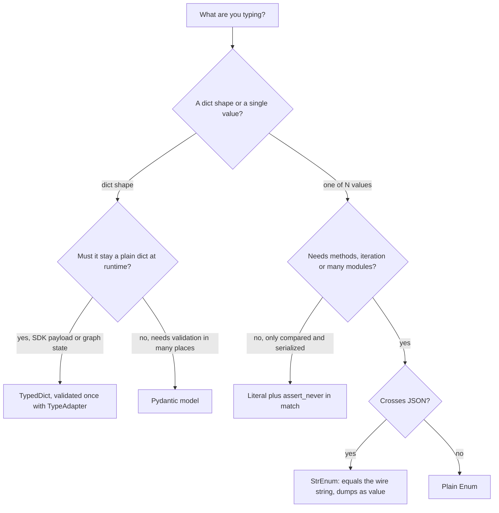

## TL;DR
`TypedDict` types a plain dict with fixed keys; `Literal` limits a value to a few constants at zero
runtime cost; `Enum` makes such a set real objects with methods. Together they guard AI wire dicts and
vocabularies (roles, finish reasons, tool names).

## Why it exists
- **Wire data arrives as dicts.** Provider responses, tool-call arguments and agent state typed as
  `dict[str, Any]` let the checker accept `msg["contnt"]` and `msg["role"] = "User"`. Both surface as a
  400 from the API or a silently skipped branch.
- **Classes are often the wrong fix.** Converting every dict to a class costs allocations and conversion
  both ways, while the dict *is* what the SDK consumes, what graph state stores and what gets logged.
  What is missing is "a dict with exactly these keys and value types": `TypedDict`.
- **Small vocabularies need names.** `role: str` admits `"User"`, `"assistant "` and `"function"`;
  `finish_reason: str` admits anything. The checker cannot flag a typo, a missing `match` case or a
  fourth invented role. `Literal` names the set with no runtime object, the right cost for wire-only
  strings.
- **Some vocabularies need behaviour.** Mapping each finish reason to an action, attaching a retry policy
  per error class, or referring to the set from twenty modules needs somewhere to hang methods. Literal
  values are plain strings, so the mapping lives in a separate dict that drifts. `Enum` members are
  singleton objects with a name, value and methods, at the cost of a conversion at the JSON boundary.

## How it works
### TypedDict: a dict with a declared shape
- **Nothing exists at runtime.** `Message(role="user", content="hi")` returns an ordinary `dict`, and
  `isinstance(x, Message)` raises `TypeError`. The class exists only so the checker knows keys and value
  types.
- **Why:** the point is to type data you already hold as dicts without changing a single runtime object;
  a wrapper class would defeat that.
- **No validation.** A dict from `json.loads` (typed `Any`) is simply trusted, because the checker accepts
  `Any` wherever a `TypedDict` is expected without complaint. Validate it with something, for example
  Pydantic's `TypeAdapter`.

| Feature | Spelling | Use |
|---|---|---|
| All keys required | default | Fixed payloads |
| All keys optional | `total=False` | Sparse patches |
| Per-key optional or required | `NotRequired[T]`, `Required[T]` (3.11) | `tool_calls` present only on some turns |
| Read an optional key | `d.get("k")` yields an optional value | Checker forces a narrowing branch |
| Must not be assigned | `ReadOnly[T]` (3.13) | Shared state slices |
| Non-identifier keys (`"content-type"`) | functional form `TypedDict("Headers", {...})` | HTTP headers |

- **Structural assignability.** A TypedDict with a superset of keys is assignable where the subset is
  expected, provided shared keys have the same value types and required-ness. A generic `Message`
  function can therefore accept richer provider-specific dicts.

### Literal: a finite set, checked statically
- **Exact inhabitants.** `Literal["system", "user", "assistant"]` admits only those strings (ints, bools,
  bytes and enum members are also allowed).
- **Narrowing on comparison.** Inside `if role == "user":` the type of `role` is `Literal["user"]`.
- **Exhaustiveness is the payoff.** In a `match` over a Literal (or an Enum), a final
  `case _: assert_never(x)` makes the checker report any unhandled member, so you learn at check time,
  not in production, that a new role was added and a handler forgot it.
- **Values vanish at runtime.** `role` is just a `str`, so nothing stops `"robot"` arriving from JSON
  unless something validates it.
- **The alias survives.** `typing.get_args(Role)` returns `("system", "user", "assistant")`; that is how Pydantic turns a Literal into a schema `enum`,
  and how you iterate when you must, though the checker sees the tuple only as `tuple[Any, ...]`.
- **Hence Literal suits** values that are only compared and serialized.

### Enum: a finite set of runtime objects
- **Singleton members.** `class Reason(Enum): STOP = "stop"`; each member has `.name` (`"STOP"`) and
  `.value` (`"stop"`).
- **Lookup and iteration.** `Reason("stop")` by value, `Reason["STOP"]` by name, and `for r in Reason`
  iterates members in definition order. Identity comparison (`r is Reason.STOP`) works because there is
  exactly one object per member.
- **Duplicate values become aliases**, not new members, so iteration skips them; a documented feature
  that surprises people.
- **`auto()`** assigns values when you do not care what they are.
- **Methods live with the vocabulary.** Members are objects, so you attach methods and properties
  (`reason.action`) instead of scattering `if` chains.

### Plain Enum versus StrEnum
| Behaviour | Plain `Enum` | `StrEnum` (3.11) / `IntEnum` |
|---|---|---|
| `Reason.STOP == "stop"` | `False` | `True` |
| `json.dumps` of a member | raises `TypeError` | serializes as its value |
| Use at a JSON boundary | needs `.value` everywhere | transparent |

`StrEnum` and `IntEnum` mix in the primitive type, which is what you want for any enum crossing JSON.

### Choosing
| Need | Pick |
|---|---|
| Dict-shaped data whose runtime form must stay a dict (SDK payloads, graph state, tool arguments) | `TypedDict` |
| Validation, or a shape consumed in many places | a Pydantic model |
| Small string set, only compared and serialized | `Literal` |
| Iteration, identity, methods, or one value referenced from many modules | `Enum`; prefer `StrEnum` when it meets JSON |

- **The model barely notices the choice.** Pydantic accepts all three and renders both Literal and Enum
  as JSON Schema `enum` constraints: an Enum as a named entry under `$defs` referenced by `$ref`, a
  multi-value Literal inline, and a single-value Literal as `const`.

## Diagram
The decision path from the Choosing table: first ask whether you are typing a dict's shape or one
value's vocabulary, then how much runtime behaviour you need.



## Examples
### Wire message, behavioural StrEnum, exhaustive match
An optional key, a `StrEnum` carrying behaviour, and an exhaustive `match` the checker polices. Requires
Python 3.11+ for `NotRequired`, `StrEnum` and `assert_never`.

```python
import json
from enum import StrEnum
from typing import Literal, NotRequired, TypedDict, assert_never

Role = Literal["system", "user", "assistant", "tool"]

class ToolCall(TypedDict):
    id: str
    name: str
    arguments: str                 # JSON text, exactly as the API sends it

class ChatMessage(TypedDict):
    role: Role
    content: str | None
    tool_calls: NotRequired[list[ToolCall]]

class FinishReason(StrEnum):
    STOP = "stop"
    LENGTH = "length"
    TOOL_CALLS = "tool_calls"
    CONTENT_FILTER = "content_filter"

    @property
    def truncated(self) -> bool:
        return self is FinishReason.LENGTH

def next_action(reason: FinishReason) -> Literal["return", "continue", "call_tools", "refuse"]:
    match reason:
        case FinishReason.STOP: return "return"
        case FinishReason.LENGTH: return "continue"
        case FinishReason.TOOL_CALLS: return "call_tools"
        case FinishReason.CONTENT_FILTER: return "refuse"
        case _: assert_never(reason)   # add a member above without a case: checker error here

msg: ChatMessage = {"role": "assistant", "content": None,
                    "tool_calls": [{"id": "c1", "name": "search", "arguments": '{"q": "kv cache"}'}]}
print(type(msg))                                   # <class 'dict'>: no wrapper object exists
reason = FinishReason("tool_calls")                # lookup by wire value
print(reason.truncated, next_action(reason))       # False call_tools
print(json.dumps({"finish": reason}))              # {"finish": "tool_calls"}: StrEnum is a str
# msg["role"] = "robot"   -> checker error: "robot" is not a Role
```

- **Exhaustiveness in action:** remove the `CONTENT_FILTER` case and mypy or pyright reports that
  `assert_never` received `Literal[FinishReason.CONTENT_FILTER]` (the member left over after
  narrowing), not `Never`.

### Validating a TypedDict at the boundary
`json.loads` returns `Any`, so the checker would trust any shape. A `TypeAdapter` turns it into a
checked dict and still returns plain dicts.

```python
import json
from typing import Literal, NotRequired, TypedDict
from pydantic import TypeAdapter, ValidationError

class ToolCall(TypedDict):
    id: str
    name: str
    arguments: str

class ChatMessage(TypedDict):
    role: Literal["system", "user", "assistant", "tool"]
    content: str | None
    tool_calls: NotRequired[list[ToolCall]]

messages = TypeAdapter(list[ChatMessage])        # build once at import time, reuse per request

raw = json.loads('[{"role": "assistant", "content": "hi"}, {"role": "robot", "content": null}]')
try:
    messages.validate_python(raw)
except ValidationError as e:
    print(e.error_count(), e.errors()[0]["loc"])  # 1 (1, 'role')

ok = messages.validate_python(raw[:1])
print(type(ok[0]), ok[0])                         # <class 'dict'> {'role': 'assistant', 'content': 'hi'}
```

## Production patterns
- **One shared vocabulary package.** Put roles, finish reasons and error classes as `StrEnum`s in a
  common package that every service imports, and generate tool and output schemas from the same
  definitions. Monitor for raw string literals of those values in code review or a lint rule.
- **`assert_never` in every handler over a closed set.** Each `match` on a role, finish reason or state
  ends with `case _: assert_never(x)`, so adding a member fails CI at every unhandled site. Track how
  many sites a new member breaks; that is your blast radius.
- **Validate once, then trust the TypedDict.** Build `TypeAdapter(ChatMessage)` once at module import
  and call `validate_python` where provider JSON enters. Downstream code keeps plain dicts with no
  conversion. Log validation failures with the field `loc` and provider name.
- **Read-only helpers take `Mapping[str, object]`.** Logging, redaction and metrics helpers accept any
  TypedDict through `Mapping`, because a `dict[str, Any]` parameter is rejected (it could insert keys).
- **Unknown-value fallback at the edge.** When a provider may add a finish reason before you do, map
  unknown wire values to a logged `UNKNOWN` path at the parsing boundary instead of crashing mid-run.
  Alert on its count.

## Trade-offs
- **TypedDict: free at runtime vs no checks.** It keeps data SDK-ready, but gives no validation or
  methods; once the same shape is consumed in several modules, a Pydantic model's validation pays for
  itself.
- **Literal: free exhaustiveness vs no behaviour.** Values are bare strings and iterating means `get_args`
  on the alias; once you want methods, per-member data or the set referenced from many modules, switch
  to an Enum.
- **Enum: identity and methods vs boundary friction.** A plain Enum needs `.value` at every JSON boundary
  and compares unequal to raw strings; `StrEnum` removes that cost for string vocabularies.
- **`NotRequired`: precision vs narrowing noise.** It models optional payload fields precisely, but every
  `.get()` returns `T | None` and forces narrowing; when the field is always present but nullable, a
  required `T | None` key is simpler.

## Pitfalls
- **`isinstance(x, SomeTypedDict)` as validation.** It raises `TypeError` at runtime because TypedDict is
  not a real class. Validate with Pydantic or check keys explicitly.
- **Comparing a plain `Enum` member to the wire string.** `reason == "stop"` is always `False`; the
  symptom is a branch that never executes. Use `StrEnum` or compare `.value`.
- **Plain Enum into `json.dumps`.** Fails with "Object of type ... is not JSON serializable", typically
  deep inside a logging or request-serialization call.
- **Assigning `json.loads(...)` straight to a TypedDict variable.** The result is `Any`, so the checker
  silently trusts an unverified shape and the `KeyError` comes later. Validate with
  `TypeAdapter(ChatMessage).validate_python(...)` at the boundary.
- **The pre-3.11 idiom `class Reason(str, Enum)` in prompts or logs.** On 3.11+ `f"{Reason.STOP}"` renders
  `Reason.STOP`, not `stop`, so a prompt says "finish reason Reason.STOP". `StrEnum` formats as its value;
  or interpolate `.value` explicitly.
- **Passing a TypedDict to a helper typed `dict[str, Any]`.** The checker rejects it, because the helper
  could insert arbitrary keys. Type read-only helpers as `Mapping[str, object]`.
- **Two Enum members with the same value.** The second silently becomes an alias and disappears from
  iteration, which looks like a "missing" member in a dropdown or a prompt listing valid options.
- **New member without an `assert_never` guard.** Nothing warns, and the new value falls through to a
  default branch at runtime.

## When to use
- **`TypedDict`:** messages, tool-call records and state dicts flowing into and out of provider SDKs and
  agent frameworks, where the dict is the runtime truth and validation already happened at the boundary.
- **`Literal`:** roles, modes and finish reasons that are compared and serialized but never iterated;
  pair every `match` over them with `assert_never`.
- **`Enum` (usually `StrEnum`):** when a vocabulary needs behaviour, iteration or one definition shared
  across modules, and when the same set appears in prompts, schemas and code.
- **Measure:** count the `str` parameters that really mean "one of N values"; each is a latent typo.
- **Interviews:** why TypedDict has no runtime, why Literal gives exhaustiveness, and what `StrEnum`
  changes about equality and JSON.

## Role lens
- **Engineer:** Types the chat-message and tool-call dicts as TypedDicts and the role and finish
  reason fields as Literals, so a typo fails in CI instead of as an API 400.
- **Architect:** Decides which vocabularies become shared Enums in a common package, so every
  service agrees on the same finish-reason and error-class names and schemas.
- **FDE:** Maps a customer's status codes and category strings onto Enums with behaviour, turning
  their undocumented string conventions into one checked, iterable definition.

## Check yourself
**Q:** An agent's `finish_reason` field is a plain `str`. You want the checker to catch unhandled
values when a provider adds a new one, you need to serialize it to JSON in logs, and one module
needs to map each value to a retry policy. Which of TypedDict, Literal or Enum do you pick and why?
**A:** A `StrEnum`. Literal would give exhaustiveness checking, but its members are bare strings,
so the retry-policy mapping would live in a separate dict keyed by those strings that can drift
from the type (a checker will not tell you the dict lacks a new key). A plain
Enum carries the mapping as a method or property but fails `json.dumps` and compares unequal to the
wire string, costing a conversion at every boundary. `StrEnum` members are strings, so they
serialize and compare transparently, you can still `match` over them with `assert_never` for
exhaustiveness, and the policy lives on the member. TypedDict is irrelevant here: it types a
dict's shape, not a single value's vocabulary.

## Interview questions
### What is a TypedDict, and why does it have no runtime presence?
- **Definition:** a static declaration of a dict's keys and value types; constructing one returns an
  ordinary `dict`, and `isinstance` against it raises `TypeError`.
- **Why:** the goal is to type data you already hold as dicts (SDK payloads, agent state) without
  changing a single runtime object, so there is nothing to convert or allocate.
- **Consequence:** it validates nothing, so `json.loads` output must be checked at the boundary.

### A branch handling `finish_reason == "stop"` never runs after a refactor to Enum. What happened?
- **Likely cause:** the vocabulary became a plain `Enum`, and a plain member compares unequal to the raw
  wire string, so `reason == "stop"` is always `False`.
- **Fix:** switch to `StrEnum` (3.11), whose members are strings, or compare `.value`.
- **Also check** logging: a plain Enum member in `json.dumps` raises `TypeError`.

### When would you pick Literal over Enum, and when does that flip?
- **Literal** costs nothing at runtime and still gives narrowing and `assert_never` exhaustiveness, ideal
  for roles and modes that are only compared and serialized.
- **Flip to Enum** when you need methods or per-member data (a retry policy per error class), iteration
  as a first-class operation, or one definition referenced from many modules.

### How do you make sure every handler is updated when a provider adds a new finish reason?
- **Statically:** end every `match` over the set with `case _: assert_never(x)`, so adding the member to
  the Enum or Literal fails CI at each unhandled site.
- **At runtime:** the provider may ship the value before you add it, so map unknown wire values to a
  logged fallback path at the parsing boundary and alert on its count, instead of crashing mid-run.

### Why does passing a TypedDict to a helper typed `dict[str, Any]` fail, and what do you use instead?
- **Because** the helper could insert arbitrary keys or values, breaking the declared shape the caller
  relies on, so the checker rejects it.
- **Use `Mapping[str, object]`** for read-only helpers such as logging or redaction; it accepts any
  TypedDict because it promises no writes.

## Quiz
### Q: What does `Message(role="user", content="hi")` return at runtime if `Message` is a TypedDict?
- [ ] An instance of `Message` with attribute access
- [x] A plain `dict`; the TypedDict class exists only for the type checker
- [ ] A frozen mapping that rejects new keys
- [ ] A `types.SimpleNamespace`
> TypedDict adds no runtime type. The checker uses the declaration to verify keys and values, but
> the object you hold is an ordinary dict, which is why `isinstance` against it fails.

### Q: Why does `match` with a final `case _: assert_never(x)` help when `x` is a Literal or Enum?
- [ ] It raises at runtime for any unexpected value, replacing validation
- [ ] It makes the match statement faster by skipping unreachable cases
- [x] The checker reports an error if any member of the set is not handled by an earlier case
- [ ] It converts the Literal into an Enum automatically
> After every member is matched, the checker narrows `x` to `Never`; if one is missing, `x` still has
> a type and `assert_never` is a static error. It documents and enforces exhaustiveness.

### Q: Which statement about a plain `Enum` member such as `Reason.STOP = "stop"` is correct?
- [ ] `Reason.STOP == "stop"` is `True` because the value is a string
- [ ] `json.dumps(Reason.STOP)` produces `"stop"`
- [x] `Reason("stop")` returns the member, and two members with the same value are aliases of one
- [ ] Members can be created at runtime by assignment, such as `Reason.NEW = "new"`
> Lookup by value is supported and duplicate values create aliases. Equality with the raw string and
> direct JSON serialization only hold for `StrEnum`, which mixes in `str`.
