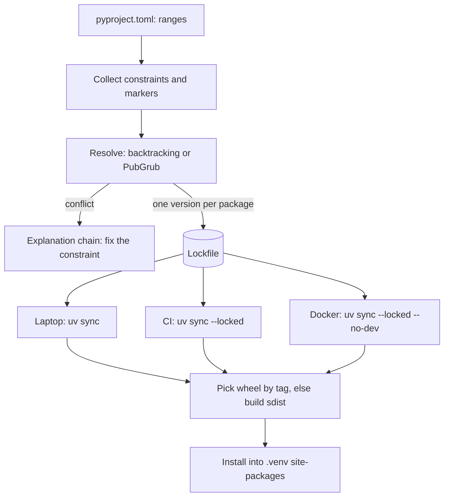

## TL;DR
pip installs packages; Poetry and uv manage projects: `pyproject.toml`, a lockfile, environments and builds.
Agent stacks (LangChain, LangGraph, provider SDKs) move weekly, so an unlocked agent behaves differently per
machine. uv covers pip, pip-tools, virtualenv, pyenv and pipx, much faster.

## For agent builders
- **Why it matters for agents.** An agent's behaviour depends on library versions you did not write:
  `langchain-core`, `langgraph`, `openai`, `anthropic`, tokenizers. A minor bump can change tool-call
  parsing, default retries or message formats, so the agent that passed evals must run on exactly the
  versions it was evaluated with.
- **Where it shows up in your stack.** `uv add langgraph langchain-openai langsmith` writes ranges to
  `pyproject.toml` and exact versions to `uv.lock`; `uv sync --locked` rebuilds that environment in CI,
  in the agent's Docker image and in eval runners. `uvx` and PEP 723 scripts give code-executing agents a
  throwaway environment per script.
- **What you control.** Which packages are direct dependencies, dependency groups for dev and evals,
  per-package indexes (CUDA `torch` for a self-hosted embedder), the tool version, and when upgrades
  happen: in their own pull request, gated on the eval suite.
- **What you can skip.** Resolver internals beyond "constraints, markers, wheel tags". Poetry versus uv
  arguments; pick one and lock.

## Why it exists
- **A project needs four things.** A list of what it depends on, an exact resolved set of versions satisfying
  all constraints, an isolated environment holding them, and a way to build and publish itself. An AI
  service's stack (SDKs, torch, tokenizers) is deep and fast-moving, so drift between machines is the norm.
- **pip historically did only the install step.** It has a real backtracking resolver, but out of the box it
  records no lockfile, creates no environments, and does not distinguish "what I asked for" from "what I
  ended up with".
- **Standard locking is new.** `pylock.toml` was accepted as PEP 751 only in 2025, and pip's `pip lock`
  command that writes it is still marked experimental; most teams get locking from pip-tools, Poetry or uv.
- **`pip freeze > requirements.txt` mixes concerns.** It captures whatever is installed, including experiment
  leftovers, for one OS and one Python version, with no record of which packages were direct requirements.
  Upgrading one library means hand-editing pins and hoping the set is still consistent.
- **The fix is separation.** pip-tools, Poetry and uv separate *intent* (ranges in `pyproject.toml`) from
  *resolution* (an exact lockfile), and make recreating the environment one deterministic command.

## How it works
### What every tool is doing underneath
All three run the same pipeline, and knowing it explains most failures:
1. **Collect constraints.** Your direct requirements (`openai>=1.40`) plus, recursively, each candidate
   version's own declared dependencies and environment markers (`; sys_platform == "linux"`).
2. **Resolve.** Choose one version per package so every constraint holds at once. This is a search
   problem, NP-hard in general, so resolvers backtrack: pick the newest candidate, follow its
   dependencies, and on a conflict undo choices and try older versions. pip uses the `resolvelib`
   backtracking resolver; Poetry and uv both use PubGrub-style solvers, which record *why* a conflict
   happened so they can skip whole families of doomed versions and print an explanation chain.
3. **Pick artifacts.** For each chosen version, find a wheel whose tags match the interpreter and platform
   (a filename such as `...-cp312-cp312-manylinux_2_17_x86_64.whl` encodes Python ABI and OS), else fall
   back to the source distribution and build it locally.
4. **Install.** Unpack into the environment's `site-packages` and write the record of what was installed.

Two consequences follow:
- **Resolution is slow when metadata is expensive.** An sdist with a dynamic `setup.py` must be *built* just
  to learn its dependencies, which is why a resolve can stall on one old package.
- **The answer depends on the platform,** *because* markers and available wheels differ between a Mac laptop
  and a Linux container: the root of "the lock works for me but not in CI".

### pip (+ venv, + pip-tools)
- **Environment:** `python -m venv .venv` creates an isolated interpreter environment.
- **Install:** `pip install -r requirements.txt` resolves and installs from PyPI or another index.
- **Wheels first:** pip prefers wheels (pre-built archives) and falls back to building source distributions,
  which is where compiler and CUDA errors come from.
- **pip-tools:** `pip-compile` turns a short `requirements.in` (or `pyproject.toml`) into a fully pinned,
  optionally hashed `requirements.txt`; `pip-sync` makes the environment match it exactly.
- **Role:** the minimal, widely understood baseline; every other tool can export to it.

### Poetry
| Command | Effect |
|---|---|
| `poetry add httpx` | updates `pyproject.toml`, re-resolves, writes `poetry.lock` |
| `poetry install` | creates or reuses a venv, installs exactly what the lock says |
| dependency groups | separate dev and test tools |
| `poetry build` / `poetry publish` | packaging |

- **Standards:** recent major versions read PEP 621 `[project]` metadata, not only `[tool.poetry]` tables.
- **Strength:** a mature, integrated workflow for libraries and applications.
- **Historical weaknesses:** resolution speed on large graphs and friction with non-PyPI wheel indexes.

### uv
uv, from Astral, is written in Rust and covers the whole toolchain:

| Area | Commands and behaviour |
|---|---|
| **Project workflow** | `uv init`, `uv add`, `uv lock` (writes `uv.lock`), `uv sync` (makes `.venv` match the lock), `uv run <cmd>` (syncs if needed, then runs in the environment) |
| **CI flags** | `uv sync --locked` fails if the lock is out of date with `pyproject.toml`; `--frozen` uses the lock without checking |
| **Universal lockfile** | `uv.lock` records resolutions for all platforms and Python versions the project supports, so one lock serves macOS laptops and Linux containers |
| **Python versions** | `uv python install 3.12` downloads interpreters, replacing pyenv for many teams |
| **pip-compatible interface** | `uv pip install`, `uv pip compile`, `uv pip sync` are drop-ins for requirements-based projects, so adoption is incremental |
| **Tools and scripts** | `uvx ruff` runs a CLI in a throwaway environment; `uv run script.py` honors inline script metadata (PEP 723) |
| **Indexes** | per-package index pinning (`[tool.uv.sources]`) installs `torch` from a CUDA-specific index while everything else comes from PyPI |

uv is fast *because* of:
- a parallel resolver and downloader;
- a global cache whose files are cloned (copy-on-write, the default on macOS), hard-linked (the default on
  Linux) or copied into environments instead of being re-downloaded and re-unpacked;
- reading wheel metadata without fetching whole wheels where indexes allow.

Effect: recreating an environment is cheap enough to do on every CI run and in every Docker build.

## Diagram
Humans edit intent, a resolver turns it into an exact lock (`uv.lock`, `poetry.lock` or a pinned
`requirements.txt`), and every environment (laptop, CI, Docker) is built only from that lock; markers and
wheel tags are what make the resolve and the artifact choice platform-specific.



## Examples
### The same project, three ways
A FastAPI RAG service needs `openai`, `httpx` and `torch` (CPU wheels in CI), plus `pytest` as a dev
dependency.

| | pip + pip-tools | Poetry | uv |
|---|---|---|---|
| Declare | `requirements.in` with `openai>=1.40`, `httpx`, `torch`; `dev.in` with `-c requirements.txt` and `pytest` | `poetry add openai httpx torch`; `poetry add --group dev pytest` | `uv init`; `uv add openai httpx torch`; `uv add --dev pytest` |
| Lock | `pip-compile --generate-hashes requirements.in` → pinned, hashed `requirements.txt` | `poetry.lock` | `uv.lock` |
| CI | `python -m venv .venv` then `pip install --require-hashes -r requirements.txt` | `poetry install` | `uv sync --locked` then `uv run pytest` |
| Torch CPU index | an index option in the requirements file; pip cannot scope an index to one package | a configured source and an explicit source on that dependency | `[tool.uv.sources]` (below) |
| Catch | two files per environment; a Mac developer needing different wheels may need a separately compiled file | slower resolves on large graphs | pin the uv version, since features move quickly |

Route only `torch` to the PyTorch CPU index with uv:

```toml
[[tool.uv.index]]
name = "pytorch-cpu"
url = "https://download.pytorch.org/whl/cpu"
explicit = true            # used only by packages that name it, never as a general fallback

[tool.uv.sources]
torch = { index = "pytorch-cpu" }
```

- **`explicit = true` matters** *because* an index searched for every package lets a same-named package on it
  shadow the PyPI one, the dependency-confusion pattern.
- **Commit** `pyproject.toml` and `uv.lock`. The Docker build copies those two files first and runs
  `uv sync --locked --no-dev`, so the dependency layer is cached until the lock changes.
- **The rule in all three:** humans edit ranges, a tool writes the exact lock, and CI and production install
  only from the lock.

### Docker build that caches the dependency layer
A common uv layout: dependencies install from the two lock files before the source is copied, so code
changes do not reinstall packages.

```dockerfile
FROM python:3.12-slim
# pin an exact uv release
COPY --from=ghcr.io/astral-sh/uv:0.5.11 /uv /uvx /bin/
WORKDIR /app
ENV UV_COMPILE_BYTECODE=1 UV_LINK_MODE=copy
# dependency layer: rebuilt only when the lock changes
COPY pyproject.toml uv.lock ./
RUN --mount=type=cache,target=/root/.cache/uv \
    uv sync --locked --no-dev --no-install-project
# the project itself (list .venv in .dockerignore so a local venv is not copied over)
COPY . .
RUN --mount=type=cache,target=/root/.cache/uv \
    uv sync --locked --no-dev
CMD ["/app/.venv/bin/python", "-m", "myapp.entrypoints.api"]
```

### A one-file script that declares its own dependencies
PEP 723 inline metadata; `uv run fetch_version.py` creates a throwaway environment with `httpx` and runs it.

```python
# /// script
# requires-python = ">=3.12"
# dependencies = ["httpx>=0.27"]
# ///
import httpx

info = httpx.get("https://pypi.org/pypi/openai/json", timeout=10).json()["info"]
print(info["name"], info["version"])
```

### Agent scenario: one lock for the service, the evals and the sandbox
An agent service built on LangGraph keeps runtime, dev and eval dependencies apart, so the production image
stays small while eval runners use the identical runtime versions. Package names are real; version ranges
are illustrative.

```toml
[project]
name = "support-agent"
requires-python = ">=3.12"
dependencies = [
    "langgraph>=0.2",
    "langchain-openai>=0.2",
    "httpx>=0.27",
    "structlog>=24",
]

[dependency-groups]
dev = ["pytest>=8", "ruff>=0.6"]
evals = ["langsmith>=0.1", "pandas>=2"]
```

| Where | Command | Gets |
|---|---|---|
| Production image | `uv sync --locked --no-dev` | runtime dependencies only, exact lock versions |
| CI unit tests | `uv sync --locked` then `uv run pytest` | runtime plus the default `dev` group |
| Eval runner | `uv sync --locked --group evals` | runtime plus eval tooling, same runtime versions as production |
| Agent-generated script | `uv run --with pandas analysis.py` in the sandbox | a throwaway environment, nothing added to the service |
| Framework upgrade | `uv lock --upgrade-package langgraph` in its own pull request | one package moved, eval suite decides whether it merges |

### Worked scenario: reading a resolution failure
Read the explanation rather than loosening pins at random. Illustrative case:

| Step | What happens |
|---|---|
| Constraint A | the service needs `pydantic>=2` |
| Constraint B | an older internal helper library declares `pydantic<2` |
| Resolver | no assignment satisfies both; a PubGrub-style resolver reports the chain ("because helper==0.3 depends on pydantic<2 and you require pydantic>=2, helper==0.3 cannot be used...") |
| Fix 1 (best) | upgrade the helper to a release that supports pydantic 2 |
| Fix 2 | drop the helper |
| Fix 3 (last resort) | an override, owning the risk of running it against a version it never declared support for |

## Production patterns
- **Upgrade agent frameworks one at a time, behind evals.** Move `langgraph`, `langchain-*` or a provider
  SDK with a targeted lock upgrade in its own pull request, run the agent eval suite on it, and merge only
  if task success and tool-call validity hold. Track which framework versions each deployed agent runs.
- **Separate groups for evals and dev.** Keep eval tooling (LangSmith client, dataframes, notebooks) in a
  dependency group so the production image stays lean while evals run the identical runtime lock.
- **Locked installs everywhere.** CI runs `uv sync --locked` (or `poetry install` / `pip-sync` from a
  compiled file) so an edited `pyproject.toml` without a re-lock fails the build. Monitor for lock drift
  failures as a signal that developers skip `uv lock`.
- **Pin the tool, not just the packages.** Pin the uv (or Poetry) version in CI and in the Docker image, for
  example via the version input of the setup action or an exact image tag, so a tool upgrade does not change
  lock behaviour under you. Upgrade it deliberately in its own pull request.
- **Explicit per-package indexes.** Route `torch` and private packages to named indexes with
  `explicit = true` instead of `--extra-index-url`. Check images for the expected wheel variant
  (`torch.cuda.is_available()` on GPU hosts, image size on CPU ones).
- **Export for platforms that want requirements files.** Keep uv or Poetry as the source of truth and
  generate a pinned `requirements.txt` for the customer's mirror or platform from the lock, never by
  hand.
- **Lowest-bound CI job for libraries.** Run tests once with `--resolution lowest-direct` so declared lower
  bounds are real. Watch it like any other required check.
- **Refuse installs outside a venv.** Set `PIP_REQUIRE_VIRTUALENV=1` on developer machines and build hosts so
  pip refuses to install into a system or base interpreter.

## Trade-offs
- **pip + pip-tools: portable vs assembled by hand.** Universally understood, but you assemble venv, pinning,
  syncing and Python versions yourself; wins when tooling is already built around requirements files.
- **Poetry: integrated vs slower.** A mature workflow with good publishing support, but slower on large graphs
  and with its own conventions; reasonable for teams already standardized on it.
- **uv: fast vs young.** Dramatically faster and replaces several tools, but new features have evolved
  quickly; pin the uv version in CI so a tool upgrade does not change lock behaviour under you.
- **Newest versions vs tested lower bounds.** Resolving to the newest allowed versions is right for
  applications, but a library's lower bounds are then never tested; run CI once with uv's
  `--resolution lowest-direct` so `httpx>=0.23` means what it claims.
- **Universal lock vs extra conflicts.** One file serves every platform, but resolves for platforms you may
  never deploy to, which can surface conflicts (often around CUDA wheels) a single-platform lock never hits.

## Pitfalls
- **Upgrading `langchain`, `langgraph` and provider SDKs in one sweep.** Symptom: an eval regression
  nobody can attribute to a single package. Fix: one framework per upgrade pull request, each gated on the
  agent eval suite.
- **Installing into the system or base conda interpreter.** Symptom: one project's upgrade breaks another,
  permission errors on `pip install`, or (on distro and Homebrew Pythons that adopt PEP 668) pip refusing
  with `externally-managed-environment`. Fix: a project environment.
- **Committing `pyproject.toml` but not the lockfile** for an application. Symptom: CI and production resolve
  newer transitive versions than developers tested. Fix: commit the lock and install with `--locked`.
- **Mixing tools in one project** (`pip install` inside a uv- or Poetry-managed venv). Symptom: the
  environment drifts from the lock and is silently reset, or reports a different set, on the next sync.
  Fix: add packages through the project tool (`uv add`, `poetry add`).
- **`--extra-index-url` for one private package.** Symptom: public and private indexes are treated as equals,
  so a public package with the same name (and a higher version) can replace yours. Fix: a named index with
  `explicit = true`, pinned per package.
- **Letting the default index provide `torch`.** Symptom: a multi-gigabyte CUDA wheel in a CPU-only image, or
  a CPU-only build on a GPU host, discovered as slow images or `torch.cuda.is_available()` being False. Fix:
  route `torch` to the matching PyTorch index via `[tool.uv.sources]`.

## When to use
- **New agent service or application:** uv is a strong default: one tool for Python versions, environments,
  locking and running, fast enough for CI and Docker.
- **Team already on Poetry:** keep it if used well; migrating buys speed but costs churn.
- **Platform expects requirements files:** pip with pip-tools, or uv's pip interface.
- **Measure:** a fresh clone plus one command reproduces the exact environment CI tested.
- **Interviews:** explain the separation of intent from resolution rather than tool preferences.

## Role lens
- **Engineer:** Uses `uv add`/`uv sync` daily, keeps dev tools in a dev group, and configures the torch index
  so local and CI environments get the right wheels.
- **Architect:** Chooses one toolchain across repos and defines how locks are updated, reviewed and consumed
  in CI and container builds.
- **FDE:** Works inside whatever the customer mandates, often pip against a private mirror, and exports a
  pinned requirements file from uv or Poetry when that is the only accepted format.

## Check yourself
**Q:** Your service's CI installs with `pip install -r requirements.txt` generated by `pip freeze` on a
developer's Mac. Linux builds fail intermittently and images contain unexpected packages. What would you
change, and why does it fix both symptoms?
**A:** A freeze captures one machine's whole environment: experiment leftovers, macOS-specific packages and
markers, and no distinction between direct and transitive dependencies. I would declare direct dependencies
with ranges in `pyproject.toml`, generate a lock with a resolver (uv lock, Poetry, or pip-compile run for
the target platform), commit it, and have CI install only from it (`uv sync --locked`). The lock contains
only what the declared dependencies need, so stray packages disappear, and it is resolved for Linux, so
platform mismatches stop.

## Interview questions
### What is the difference between declaring dependencies and locking them?
- **Declaring is intent:** ranges such as `openai>=1.40` in `pyproject.toml`, edited by humans.
- **Locking is resolution:** one exact version (and usually hashes) for every direct and transitive package,
  written by a tool into `uv.lock`, `poetry.lock` or a compiled `requirements.txt`.
- **Why separate them:** upgrades re-resolve a consistent set in one command, and CI and production install
  exactly what was tested.

### Why might a lock that works on your Mac fail in a Linux CI container?
- **Markers and wheels differ by platform:** a dependency may apply only on one OS, and the available wheel
  tags (for example `manylinux_2_17_x86_64`) differ between machines.
- **A single-platform lock** (such as a `pip freeze` or a pip-compile run on macOS) encodes the Mac answer.
- **Fixes:** a universal `uv.lock`, or compile the requirements file for the target platform.

### Your Docker image is several gigabytes larger than expected after adding `torch`. What happened and how do you fix it?
- **Likely cause:** the default index supplied the CUDA build of `torch` in a CPU-only image.
- **Fix with uv:** declare the PyTorch CPU index with `explicit = true` and route only `torch` to it via
  `[tool.uv.sources]`.
- **Avoid `--extra-index-url`** for this, because it treats both indexes as equals and opens the
  dependency-confusion path.

### An agent passed evals last week, but the same commit misbehaves in a fresh deploy. How do you check whether dependencies are the cause?
- **Compare environments:** was the deploy built with `uv sync --locked` from the committed `uv.lock`,
  or did it resolve fresh and pick newer `langchain-core`, `openai` or tokenizer versions?
- **Diff installed versions** between the eval runner and the image (`uv pip list` or `pip freeze` in
  each), focusing on the framework and provider SDKs.
- **Fix the process:** install only from the lock everywhere, and run framework upgrades as their own
  pull requests gated on the eval suite.

### When would you not migrate a team from Poetry to uv?
- **When Poetry is used well:** locks committed, CI installs from them, and builds are fast enough; migration
  buys speed but costs churn across repos and habits.
- **When the platform dictates the format:** if a customer mirror accepts only requirements files, the
  export step matters more than the tool.
- **Migrate when** resolution speed, Python version management or per-package indexes are real pain.

### How do you keep an agent service's Docker builds fast when dependencies rarely change?
- **Copy only `pyproject.toml` and `uv.lock` first** and run `uv sync --locked --no-dev --no-install-project`,
  so that layer is cached until the lock changes.
- **Copy the source afterwards** and run the final sync, so code edits do not reinstall packages.
- **Use a cache mount** for the uv cache and pin an exact uv image tag so tool upgrades are deliberate.

## Quiz
### Q: What does `uv sync --locked` do in CI that plain `uv sync` does not?
- [ ] It skips installing dev dependencies
- [x] It fails if uv.lock is out of date with pyproject.toml instead of silently re-locking
- [ ] It installs packages globally instead of into .venv
- [ ] It upgrades every dependency to the newest allowed version
> --locked asserts the lockfile already matches the declared dependencies, so a developer who edited
> pyproject.toml without re-locking gets a failing build rather than CI resolving a new, untested set.

### Q: Why is `pip freeze > requirements.txt` a poor lockfile for a deployed service?
- [ ] pip freeze cannot output version numbers
- [ ] pip refuses to install files generated by freeze
- [x] It captures the whole local environment for one platform, without separating direct from transitive dependencies
- [ ] It always includes hashes that break installation on other machines
> A freeze records whatever is installed, including unrelated packages, resolved on one OS and Python
> version. A resolver-generated lock is derived from declared requirements and can target the deploy platform.

### Q: A main reason uv installs are fast on repeated builds is that it:
- [ ] Skips dependency resolution entirely
- [ ] Downloads only source distributions and compiles in parallel
- [x] Reuses a global cache, linking or copying files into environments instead of re-downloading them
- [ ] Installs packages without metadata
> uv still resolves, but caches packages globally and materializes them into each environment cheaply,
> alongside parallel downloads. Building from source would be slower, not faster.
