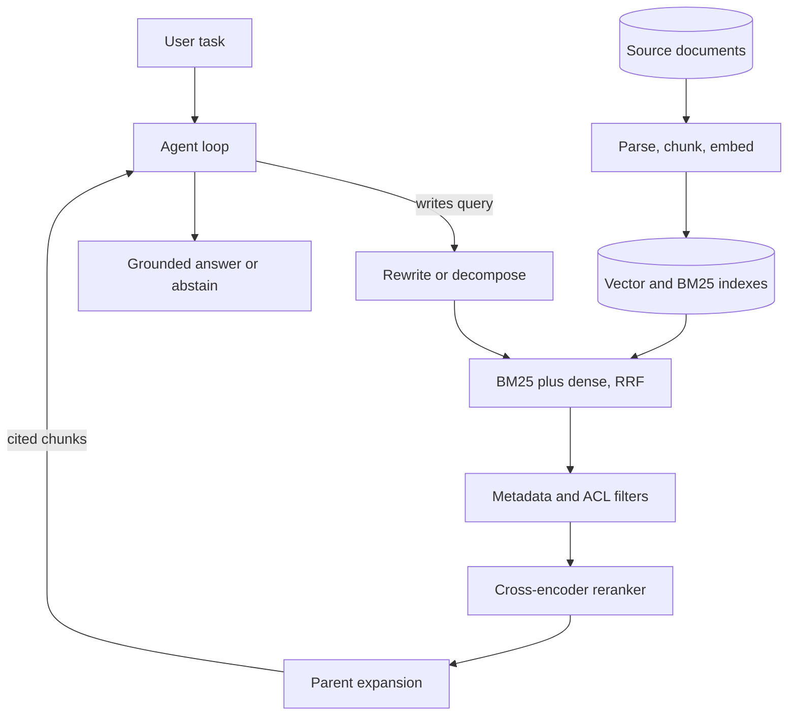

## Overview
This module is about getting the right evidence in front of a model, and only that evidence, so its
answers come from your documents instead of its memory. For an agent builder that evidence arrives
through a search tool the agent calls several times per task, and every result stays in its context.

It follows one document through the whole system. Parsing turns PDFs, scans and tables into clean
ordered text. Chunking, overlap and granularity decide what counts as a retrievable unit. Embedding
models, similarity metrics, normalization, ANN indexes and vector databases make dense search fast.

An idempotent embedding pipeline keeps the index in step with its sources. Inverted indexes and BM25
provide the lexical half. Dense-versus-sparse analysis, hybrid fusion and cross-encoder reranking
combine the two arms into a staged pipeline tuned on recall and precision.

Metadata and ACL filters make certain results impossible to return. Parent-document and contextual
retrieval repair chunks that lost their context. Query rewriting, HyDE, decomposition and multi-hop
loops repair queries that were never going to match, which in an agent are the queries the model wrote.

On the generation side the module covers lost-in-the-middle position effects, grounding with citations,
and measuring whether each citation actually supports its claim. It closes with production concerns:
freshness, deletion and index consistency, staged failure diagnosis, the long-context-versus-RAG
decision, knowledge graphs, GraphRAG and agentic RAG.

**What this module gives an agent builder:**
- **A search tool you can trust.** Hybrid retrieval, reranking and filters behind one tool, returning a few cited chunks instead of ten mixed ones.
- **Safe evidence.** ACL enforcement inside the search, so neither a user nor a prompt injection can steer the agent into restricted documents.
- **A debugging method.** A staged trace that finds where the gold evidence was lost, including the agent-only stages: never searched, bad query, wrong index, stopped too early.

**Core for agents (you use these directly):** chunking-strategies, retrieval-granularity,
embedding-models, similarity-search, vector-databases, dense-vs-sparse-retrieval, hybrid-search,
recall-vs-precision-trade-off, reranking, metadata-filtering, acl-aware-retrieval,
parent-document-retrieval, query-rewriting, query-decomposition, multi-hop-retrieval,
lost-in-the-middle, citations-grounding, long-context-vs-rag, retrieval-failure-diagnosis and agentic-rag.

**Useful (you meet these when building ingestion or operating agents):** document-parsing,
chunk-overlap, embedding-dimension-and-normalization, ann-indexes, embedding-pipelines, bm25-internals,
contextual-retrieval, hyde, citation-correctness, freshness-document-deletion-index-consistency,
knowledge-graphs and graphrag. **Background:** inverted-indexes.

**What you can build afterwards:**
- **A production retrieval system.** Design, build, measure and debug it, and defend each stage with a number.
- **A grounded agent.** A bounded tool-calling loop over search, fetch and query tools that cites a source for every claim or abstains.
- **A permission-correct knowledge base.** One that stays current, deletion-safe and in step with its sources, including agent memory.

It matters most for AI Engineers, who spend most of their RAG time in these stages, and for FDEs, who
have to make retrieval work on a customer's messy, permissioned corpus.

## Why it matters
- **Engineer:** You build the ingestion pipeline behind the agent's search tool with content-hashed chunk ids and query-time parity, run BM25 and dense arms fused with RRF in front of a reranker, and, when an agent answer is wrong, trace the gold chunk stage by stage through its tool calls instead of swapping the embedding model on a hunch.
- **Architect:** You choose the vector store from vector count, dimension, filter selectivity and operational capacity, place ACL enforcement inside the search rather than in the prompt, set freshness and deletion SLOs per content class, and decide from arithmetic and evals when long context, a knowledge graph, GraphRAG or an agent loop earns its cost over plain hybrid retrieval.
- **FDE:** You open the customer's parsed text before tuning anything, map their SharePoint or Confluence permissions into per-chunk principals the agent's tools enforce, build a labelled query set from their own users' questions, and show recall@k and citation correctness on their documents so sign-off rests on measurements rather than a polished demo.

## Mental model
Picture retrieval as a funnel with a leak test at every stage. The whole corpus goes in at the top. The
parser decides what text exists. The chunker decides what a hit means. The index (dense vectors and an
inverted index side by side) decides what can be found. Filters remove what this user must never see.

A wide first stage keeps a few dozen candidates for recall, a reranker keeps a few for precision, and
the prompt builder decides where they sit and how they are cited. Each stage can only lose evidence; no
later stage can recover what an earlier one dropped.

The techniques in this module either widen a stage that loses too much (hybrid, rewriting, HyDE,
decomposition, multi-hop, contextual chunks) or narrow one that lets too much through (reranking,
filtering, a smaller k). So you diagnose by finding the first stage where the gold evidence disappears,
fix that stage, and measure it with its own metric.

Around the funnel runs a sync loop that keeps the index a faithful, current, permission-correct copy of
its sources. In an agent, the funnel sits behind a search tool: the model writes the query, and the
results land in a transcript it re-reads on every later step.

| Funnel stage | Widen or narrow | Its own metric |
|---|---|---|
| Parse and chunk | Decides what can exist | OCR character error rate, table cell accuracy |
| Hybrid first stage | Widen | recall@50 |
| Filters and ACL | Narrow, hard | Zero restricted-chunk leaks |
| Reranker | Narrow | recall@5 after reranking, MRR |
| Prompt builder and citations | Order and cite | Gold-in-context rate, citation precision |

The agent loop calls the funnel as a tool; the sync loop at the bottom keeps the indexes current.

## Suggested order
1. chunking-strategies — defines the retrievable unit and why whole documents embed as blurry averages.
2. retrieval-granularity — separates the unit you match on from the unit you return, framing later small-to-big work.
3. embedding-models — explains bi-encoders, prefixes and versioning, the basis of dense retrieval.
4. similarity-search — shows how dot product, cosine and Euclidean relate and why the trained metric must be used.
5. vector-databases — maps pgvector, Qdrant, Weaviate, Milvus, Pinecone and Chroma onto the store behind the agent's search tool and memory.
6. dense-vs-sparse-retrieval — compares the two families' structural failure modes to motivate combining them.
7. hybrid-search — fuses the BM25 and dense arms by rank and verifies the gain with recall@k.
8. recall-vs-precision-trade-off — frames retrieval as a wide recall stage followed by a narrow precision stage.
9. reranking — supplies the cross-encoder precision stage that the trade-off calls for.
10. metadata-filtering — places hard predicates inside the search and explains why post-filtering returns too few results.
11. acl-aware-retrieval — applies filtering to per-user permissions, the security requirement of every enterprise deployment.
12. parent-document-retrieval — implements small-to-big retrieval so matching and answering use different units.
13. query-rewriting — repairs the query side: follow-ups, vocabulary mismatch and pasted noise.
14. query-decomposition — splits compound questions so each facet gets its own retrieval.
15. multi-hop-retrieval — chains dependent sub-questions through bridging facts under a hop limit.
16. lost-in-the-middle — shows why more context can lower accuracy and how to order evidence in the prompt.
17. citations-grounding — constrains the answer to the sources with stable ids, per-claim citations and abstention.
18. long-context-vs-rag — decides with cost and accuracy arithmetic when retrieval is needed at all.
19. retrieval-failure-diagnosis — ties the funnel together as a staged trace that finds where evidence was lost.
20. agentic-rag — puts retrieval tools in a bounded loop, earned only when the eval set shows the simpler pipelines fall short.
21. document-parsing — every stage sees only what the parser produced, so learn to inspect parsed text before building ingestion.
22. chunk-overlap — a cheap patch for boundary damage, best understood after the splitters it patches.
23. embedding-dimension-and-normalization — adds the storage arithmetic, normalization, truncation and quantization behind index sizing.
24. ann-indexes — explains HNSW and IVF-PQ and the recall–latency knobs once exact search stops fitting.
25. embedding-pipelines — turns one-off indexing into an idempotent, incremental, versioned job.
26. inverted-indexes — introduces posting lists, the data structure underneath lexical search.
27. bm25-internals — explains IDF, saturation and length normalization, the lexical baseline every retriever must beat.
28. contextual-retrieval — repairs chunks that lost their subject by enriching them at ingestion.
29. hyde — bridges the question-versus-passage gap in embedding space with a hypothetical answer.
30. citation-correctness — measures whether each citation actually supports its claim, the check on citations-grounding.
31. freshness-document-deletion-index-consistency — keeps the index current, deletion-safe and version-consistent in production.
32. knowledge-graphs — adds typed entities and relationships for questions that are joins and aggregations.
33. graphrag — builds community summaries over an extracted graph for corpus-wide and thematic questions.

## Capstone
### Brief
**Use case:** an internal knowledge agent that employees ask about policies, products and procedures,
which must answer only from documents each employee is allowed to see. Build it as a
permission-aware question-answering agent whose search tool sits on top of the pipeline below.

The corpus is realistic: 500 to 2,000 documents mixing born-digital PDFs, at least a few scanned pages,
table-heavy spreadsheets or reports, and wiki pages. Each document is assigned to one of three or four
access groups.

- **Parse first.** Parse a sample of every document type and fix what breaks.
- **Ingest.** Build an idempotent pipeline with structure-aware chunking, content-hashed chunk ids, contextual prefixes, and per-chunk metadata holding source, version, date and allowed principals.
- **Retrieve.** Index each chunk in both a vector store and a BM25 index, fuse the two arms with reciprocal rank fusion, rerank the top 30 to 50 with a cross-encoder, and return parent sections.
- **Generate.** The generator must cite a source id for every claim or abstain.
- **Repair queries.** Add a query rewriter for conversational follow-ups and decomposition for compare-style questions.
- **Measure.** Build a labelled golden set of at least 100 questions, sliced into lookup, identifier, paraphrase, compound, multi-hop and unanswerable types, and measure each stage.
- **Survive change.** Edit, revoke and delete documents and prove that retrieval reflects each change within a stated lag.

Finish with a written analysis of when long context or GraphRAG would beat what you built on this corpus.

### Deliverables
- A parsing report with sampled pages per document type, the observed failures, the fixes applied, and OCR character error rate and table cell accuracy on a hand-checked subset.
- The ingestion pipeline, runnable from one command, whose second run on an unchanged corpus re-embeds nothing, plus a CI golden-vector test proving the index-time and query-time embed paths match.
- The retrieval service, exposed as the agent's search tool, with BM25, dense, RRF fusion, reranking, metadata and ACL filters, parent expansion, query rewriting and decomposition, each stage switchable by configuration.
- The labelled golden set and an evaluation report giving recall@50, recall@5 after reranking, MRR, citation recall and precision, and abstention rate, per slice and per ablation (BM25 only, dense only, hybrid, plus reranker, plus contextual prefixes).
- A freshness and deletion test suite that edits, revokes and deletes documents and reports staleness lag, deleted-document leak probes and orphan counts from a reconciliation job.
- A failure-diagnosis sheet of at least 30 wrong answers, each labelled with the first stage where the gold evidence was lost, with counts per stage and the fix chosen for the largest bucket.
- A two-page design memo on long context versus RAG and on whether GraphRAG or an agent loop is warranted for this corpus, with cost-per-query and accuracy arithmetic.

### Rubric
- A red-team query run as a low-privilege test user never returns a chunk from a restricted document, and the same holds within the stated lag after a permission is revoked at the source.
- The ablation table shows the measured contribution of each stage, and any stage that does not improve its target metric on the golden set is either removed or justified in writing.
- Recall at candidate depth, recall after reranking, and gold-in-context rate are reported separately, so a generation failure is never misread as a retrieval failure.
- Every cited source id in a sampled set of answers resolves to a passage that supports its claim, as checked by an entailment model or calibrated judge whose agreement with human labels is reported.
- Deleting a source document removes every derived chunk from both indexes, which is verified by a probe query and a reconciliation run reporting zero orphans.
- The diagnosis sheet's largest failure bucket is the one the final change targeted, and the before-and-after numbers for that slice are shown.
