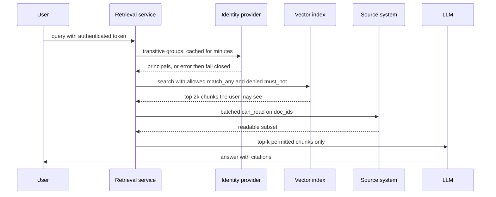

## TL;DR
ACL-aware retrieval turns the user's authenticated identity into a hard predicate over each chunk's
allowed principals, inside the search. Hard parts: capturing ACLs at ingestion, expanding groups at query
time, and keeping both fresh.

## Why it exists
- **The index flattens permissions.** It puts documents with very different permissions into one
  searchable bag. The crawler over SharePoint, Confluence and Google Drive runs as a service account that
  can read everything, because it has to in order to index everything.
- **The default outcome is a leak.** An intern asks "what is the CFO's compensation?", the top-k returns a
  board-deck chunk, and the model summarizes it politely. The source systems enforced that permission for
  years; the index threw it away in one afternoon. That is the default for RAG without an authorization
  model, not an edge case.
- **Prompt and output defenses fail.** "Do not reveal documents the user is not allowed to see" fails: the
  model does not know the user's permissions, has already consumed the text, and follows instructions only
  probabilistically. Scanning the answer fails because the content already shaped it, and even "there is a
  document about that, but I cannot share it" leaks existence.
- **Post-filtering fails twice.** It inherits the selectivity problem from metadata filtering, so
  low-privilege users, who are most users, get empty results. And it is a per-call-site discipline: the
  debug endpoint, eval script, agent tool and semantic cache must each remember to filter, and the one that
  forgets is the breach.
- **The fix: authorization is a property of the retrieval query.** Derived from authenticated identity,
  enforced in one place, applied inside the search, failing closed. Filtering after generation is too late,
  because the model cannot be trusted to withhold what it has already read.

## How it works
### 1. Capture permissions at ingestion
Every source has its own permission model:

| Source | Permission model |
|---|---|
| SharePoint | sites, libraries and items with users and groups |
| Google Drive | per-file sharing to users, groups, the whole domain, or anyone with the link |
| Confluence | space permissions plus page restrictions |
| Slack | channel membership |
| Databases | row-level security |

- **Translate to one canonical vocabulary.** The connector reads the ACL alongside the content and maps it
  to principals such as `user:alice@acme.com`, `group:<id>`, `domain:acme.com`, `public`.
- **Materialize the *effective* permission set**, not the inheritance chain (folder grants roll down),
  because the query-time predicate cannot walk chains.
- **Store principals on every chunk payload.** Chunks inherit their document's ACL, so the predicate is a
  single field match rather than a join the vector database cannot do.
- **Store explicit denies** as a `denied` list if the source has them.
- **Store groups, not their members.** A document shared with a 50,000-person group carries one principal,
  not 50,000; membership changes then never touch the index.

### 2. Expand the user's principals at query time
1. Authenticated user → identity provider (Entra ID, Okta, Google Workspace).
2. Fetch transitive group memberships, including nested groups: often dozens to a few hundred principals.
3. Add the built-ins: the user's own id, their domain, and `public`.
4. Cache with a short TTL (minutes), so a removal propagates quickly without a directory call per query.

### 3. The predicate is a set intersection
A chunk is visible when `allowed ∩ principals ≠ ∅` and `denied ∩ principals = ∅`.

| Store | Expression |
|---|---|
| Vector database | `must: match_any(allowed, principals)` plus `must_not: match_any(denied, principals)` over a keyword-indexed array field |
| Elasticsearch | a `terms` filter, or document-level security roles |

Apply it as a pre-filter or filtered traversal (metadata filtering lesson), identically in every arm of
hybrid search and before reranking, so no ranking stage ever scores a chunk the user cannot see.

### 4. Early binding versus late binding
| | Early binding | Late binding |
|---|---|---|
| What | index the permissions with the content | ask the source system per candidate at query time |
| Speed | fast, scales | one source-API call per candidate, hits rate limits |
| Freshness | only as fresh as the last ACL sync: a user removed from a group at 09:00 keeps seeing results until payloads update | always correct |
| Alone? | yes, with a freshness gap | no, because of the post-filter selectivity problem |

The practical design is a hybrid:
- **Early-bound predicate for retrieval**, then a **late-bound check on the final top-k** when the data
  warrants it. It is cheap because k is small (5 to 10 documents) and many sources accept batched
  permission queries.
- **Subscribe to the change feed** (webhooks, delta queries) to update ACL payloads without re-embedding,
  and run a periodic full re-sync to catch missed events.
- **Group changes are fast anyway.** Groups are expanded at query time, so membership changes take effect
  within the principal-cache TTL (plus any identity-provider propagation delay). Sync lag only applies to
  direct shares and new restrictions.

### 5. Revocation and deletion
- A document that becomes restricted or is deleted must disappear for everyone immediately: tombstone or
  delete all its chunks by `doc_id`.
- Same machinery as index freshness, with a stricter SLO.

### 6. One enforcement point, failing closed
- **The retrieval service computes the principal set itself** from an authenticated identity. It never
  accepts a principal list or a raw filter from the caller.
- **Fail closed.** If the principal set is empty or the directory lookup fails, return nothing, not
  everything.
- **Agents and MCP servers call retrieval with the end user's identity** (on-behalf-of tokens), not a
  service account, so a tool call cannot escalate privileges on the user's behalf.

### 7. Side channels
All of these carry content and must be scoped by the same principals:
- result counts, "related documents", autocomplete suggestions;
- snippets in logs and eval dumps;
- answers cached by a semantic cache keyed on the query alone: key on (principal-set hash, query) or cache
  only public results;
- summaries an agent stores into shared memory, and LLM-generated documents written back into the index.

Make "not found" and "forbidden" responses indistinguishable.

### 8. Derived content inherits the most restrictive ACL
- **Rule:** anything built *from* several documents (a parent-section summary, a contextual-retrieval
  prefix, a GraphRAG community report, a knowledge-graph entity description, an agent's memory note) may
  only be shown to someone who could read every input. A summary of a board deck and a public FAQ leaks
  the board deck.
- **The tempting shortcut is wrong.** Intersecting the two `allowed` lists fails when they hold groups:
  `[group:finance] ∩ [group:legal]` is empty as strings, yet a user in both groups may read both sources.
- **Store a conjunction instead:** the list of source ACLs, each of which the user's principals must
  match, enforced with nested filters or a late-bound check.
- **Or, more simply, build derived artifacts within one permission domain**, for example per site or per
  space.
- Either way, rebuild or tombstone the derived item when any source ACL tightens.

## Diagram
Trace one query: identity becomes principals server-side, the predicate runs inside the search, and a
late-bound check on the small top-k closes the sync gap before anything reaches the model.



## Examples
### Filtered search with late binding (Qdrant client shape)
Ingestion stores effective principals on each chunk; query time expands the user's groups, builds the
predicate, runs a filtered search and late-binds a check on the survivors. The vector-store calls follow
the Qdrant client's shape; the identity and source clients are the customer's directory and document
system.

```python
from qdrant_client import QdrantClient, models

client = QdrantClient("http://localhost:6333")
# Ingestion wrote, per chunk: payload={"doc_id": "d17", "allowed": ["group:finance", "user:cfo@acme.com"],
#                                     "denied": []}
client.create_payload_index("docs", field_name="allowed", field_schema="keyword")
client.create_payload_index("docs", field_name="denied", field_schema="keyword")

def principals_for(user, directory):
    """Authenticated identity -> transitive groups. Cache for a few minutes; never trust the client."""
    groups = directory.transitive_groups(user.id)                 # e.g. 60 group ids, nested included
    return [f"user:{user.email}", f"domain:{user.domain}", "public", *[f"group:{g}" for g in groups]]

def retrieve(user, query_vec, directory, source, k=8):
    try:
        who = principals_for(user, directory)
    except Exception:                                             # directory down: fail closed, never open
        return []
    flt = models.Filter(
        must=[models.FieldCondition(key="allowed", match=models.MatchAny(any=who))],
        must_not=[models.FieldCondition(key="denied", match=models.MatchAny(any=who))],
    )
    # Fetch a little extra: the late-bound check below may drop a few stale grants.
    hits = client.query_points("docs", query=query_vec, query_filter=flt, limit=2 * k).points
    # Late binding on the few survivors closes the window between ACL syncs for direct shares.
    doc_ids = {h.payload["doc_id"] for h in hits}
    readable = source.can_read(user.id, doc_ids)                  # one batched permission check
    return [h for h in hits if h.payload["doc_id"] in readable][:k]
```

### Worked numbers: predicate cost and revocation window
| Situation | Result |
|---|---|
| 2 million chunks, user in 60 groups | a 63-value `match_any` against a keyword index: a bitmap union, about the cost of any other payload filter |
| Nightly ACL sync at 02:00 only; direct share revoked at 10:00 | stays visible for 16 hours |
| Revocation made just after the sync | visible up to 24 hours |
| Same, with the late-binding check | window closes at the next query |

### Runnable check: visibility for a derived chunk stored as a conjunction
Pure Python, showing why intersecting group lists is wrong and the conjunction is right.

```python
def visible(acl, principals):
    return bool(set(acl["allowed"]) & principals) and not set(acl.get("denied", [])) & principals

def visible_derived(source_acls, principals):
    return all(visible(acl, principals) for acl in source_acls)   # must read EVERY input

finance = {"allowed": ["group:finance"]}
legal = {"allowed": ["group:legal"]}
both = {"user:ana@acme.com", "group:finance", "group:legal", "public"}
only_fin = {"user:bo@acme.com", "group:finance", "public"}

naive = {"allowed": sorted(set(finance["allowed"]) & set(legal["allowed"]))}   # [] -> nobody
print(visible(naive, both))                       # False: shortcut wrongly hides it from Ana
print(visible_derived([finance, legal], both))    # True: Ana can read both sources
print(visible_derived([finance, legal], only_fin))  # False: Bo cannot read the legal input
```

## Production patterns
- **Leakage canaries in CI.** Seed a restricted canary document per data class, then run red-team queries
  as a low-privilege test user on every deploy. Fail the build if any canary chunk is retrieved or quoted.
  Monitor canary hits in production probes too.
- **Directory-backed principal cache.** Expand groups server-side from the identity provider (for Entra ID,
  Microsoft Graph's transitive membership endpoint rather than the token's group claim), cache per user for
  minutes, and invalidate on directory change events. Monitor cache age and directory-lookup failures,
  which must return empty results.
- **Late-bound check by data class.** Turn on the batched source permission check for the final top-k only
  for HR, legal and M&A-style collections where revocation must be immediate. Monitor drop rate: a rising
  share of hits removed late means the change feed is lagging.
- **Change-feed ACL patching plus nightly reconcile.** Subscribe to source permission webhooks or delta
  queries, patch `allowed`/`denied` payloads without re-embedding, and run a full re-sync to catch missed
  events. Monitor p95 ACL sync lag against the SLO.
- **Principal-scoped caches.** Key semantic and response caches on (principal-set hash, query), or cache
  only results whose chunks are `public`. Monitor cross-user cache hits in an audit log.
- **On-behalf-of identity for tools.** Agents and MCP servers pass the end user's token to retrieval;
  service-account calls are rejected at the retrieval service. Monitor calls with no user identity.

## Trade-offs
- **Early binding: speed vs freshness.** Fast, scales to millions of chunks, but freshness is bounded by
  ACL sync lag. It flips to unacceptable when revocations must be immediate (HR, legal, M&A), which is when
  you add late-binding checks on the top-k.
- **Late binding: correctness vs cost.** Always correct, but costs per-query calls to rate-limited source
  APIs and cannot stand alone when a user sees only a sliver of the corpus. It flips to impractical at high
  query volume without batching and caching.
- **Principals on every chunk: one indexed field vs duplication.** Duplicates ACL data (storage, update
  fan-out per document) but makes the predicate one indexed field; normalizing into a document table would
  need a join the vector store cannot perform.
- **Shared index vs index per security domain.** A shared index with an ACL predicate is simpler and
  cheaper; per-domain indexes give blast-radius containment. The flip comes when a tenant demands physical
  isolation or data residency.
- **Query-time vs index-time group expansion.** Query time costs a (cached) directory round trip but makes
  membership changes instant; index time (storing users) removes the round trip but forces a re-index on
  every membership change.

## Pitfalls
- **Crawling with a service account and never capturing ACLs.** Symptom: the first security review, or the
  first user who finds payroll data in a chat answer.
- **Accepting principal lists or filters from the client or an agent's tool call.** Symptom: a trivially
  forged request body reads everything.
- **Post-filtering after an unfiltered ANN search.** Symptom: low-privilege users get empty answers to
  questions whose sources they are allowed to read.
- **Storing individual users on widely shared documents.** Symptom: payloads with tens of thousands of
  entries and re-index jobs triggered by routine membership changes.
- **A semantic or response cache keyed on query text alone.** Symptom: user B receives user A's cached
  answer that drew on a restricted document.
- **Debug, eval and agent paths querying the index directly.** Symptom: a log line showing a "test"
  endpoint returning documents with no principal set attached.
- **No change feed and no late-binding check.** Symptom: an offboarded employee's direct shares still
  surface hours later, found during an audit.
- **Different responses for "not in the index" and "not permitted".** Symptom: users discover documents'
  existence by probing.
- **Taking group memberships from the sign-in token's group claim.** Identity providers cap or omit that
  claim for users in many groups (Entra ID switches to an "overage" indicator). Symptom: heavily grouped
  users, often managers and admins, suddenly see far less than they should.
- **Derived content built across different ACLs.** Summaries, contextual prefixes or graph reports mixing
  sources; symptom: a restricted fact surfaces in a chunk whose own `allowed` list looks harmless.

## When to use
- **Use when** the data has per-user permissions, which means almost every enterprise deployment.
- **Exemption:** a corpus uniformly public to every user of the app; even then tenant isolation still
  applies.
- **Decide early:** retrofitting ACL capture into a connector is a rewrite.
- **Measure:** ACL sync lag (p95 time from a permission change to the index reflecting it), leakage tests
  (seed a restricted document, run red-team queries as a low-privilege test user in CI), filtered recall
  for low-privilege users, and the latency overhead of principal expansion.
- **Interviews:** expect how a revoked permission propagates, how groups are expanded, where enforcement
  lives, and which side channels you would close. Early versus late binding is the vocabulary the strong
  answer uses.

## Role lens
- **Engineer:** Builds connector-side ACL capture, cached principal expansion and the filter builder, and
  writes leakage tests that run restricted-document probes as low-privilege users in CI.
- **Architect:** Owns the authorization boundary: end-to-end identity propagation with on-behalf-of
  tokens, a single enforcement point, the ACL freshness SLO, and which data classes require late-binding
  checks.
- **FDE:** Discovers the customer's permission model in the first week (nested groups, external shares,
  site-level versus item-level grants), secures read access to ACL metadata, and proves to the security
  team with a live demo that a low-privilege account cannot surface restricted content.

## Check yourself
**Q:** A customer wants a chat assistant over Google Drive. The connector runs as a Workspace admin. A
document is shared with a 2,000-member group; a user is removed from that group at 10:00, and the ACL
re-sync runs nightly at 02:00. Design retrieval so the user cannot see the document at 10:05, and state
what it costs.
**A:** Store `group:<id>` on the chunks rather than the 2,000 members, and expand the user's groups at
query time from the Workspace directory with a cache TTL shorter than the five-minute window (or
invalidate the cache on directory change events). At 10:05 the user's principal set no longer contains
the group, so the predicate excludes the document with no re-index at all. Direct
per-user shares stay early-bound and would be stale until 02:00, so cover them two ways: subscribe to
Drive change notifications and patch the `allowed` payload on permission changes, and run a late-binding
permission check on the final top-k before answering. Costs: one cached directory call per user per TTL,
one batched permission check on at most k documents per query, and the engineering of the change feed.
Fail closed if the directory lookup fails, and key any answer cache on the principal set.

## Interview questions
### Why must permissions be enforced inside retrieval rather than in the prompt or on the answer?
- **The model cannot withhold what it has read.** It does not know the user's permissions, and once a
  restricted chunk is in context it shapes the answer; instructions are followed only probabilistically.
- **Output scanning is too late.** Even "a document exists but I cannot share it" leaks existence, so the
  predicate must be part of the search, derived from authenticated identity and failing closed.

### A security review finds that an eval script returned HR documents to a test account. How do you fix the system, not just the script?
- **Find the bypass.** The script queried the index directly instead of going through the retrieval
  service, so it never received a principal set.
- **Make one enforcement point.** Only the retrieval service may query the index; it computes principals
  from identity and never accepts a filter or principal list from the caller.
- **Prove it continuously.** Add restricted canary documents and low-privilege red-team queries to CI, and
  alert on any index call with no user identity.

### When is early binding alone acceptable, and when do you add a late-bound check?
- **Early binding alone** when the freshness gap for direct shares (bounded by the change feed or nightly
  sync) is acceptable for the data class, because it is fast and scales.
- **Add late binding** on the final top-k for HR, legal or M&A-style data where a revocation must take
  effect at the next query. It is cheap because k is small (5 to 10 documents) and checks can be batched.
- **Never late binding alone**, because post-filtering leaves low-privilege users with empty results.

### How would you build a summary that draws on two documents with different ACLs?
- **Do not intersect the `allowed` lists.** `[group:finance] ∩ [group:legal]` is empty as strings, yet a
  user in both groups may read both sources.
- **Store a conjunction** of source ACLs and require the user to match each one, via nested filters or a
  late-bound check, or build derived artifacts within one permission domain.
- **Rebuild or tombstone** the derived item whenever any source ACL tightens.

### A user in 600 groups suddenly sees almost no results after an SSO change. What is likely wrong?
- **The group claim overflowed.** Identity providers cap or omit the token's group claim for users in many
  groups (Entra ID switches to an overage indicator), so the principal set shrank to the user id.
- **Fix:** expand groups server-side from the directory (Microsoft Graph transitive membership for Entra
  ID), cache for minutes, and alert when a principal set is unexpectedly small.

## Quiz
### Q: Why is instructing the model "do not reveal documents the user cannot access" not a security control?
- [ ] Models cannot follow negative instructions reliably
- [x] The model does not know the user's permissions, has already read the content, and instructions can be bypassed
- [ ] System prompts are not sent to the model with retrieved chunks
- [ ] It works, but only for models with large context windows
> Authorization must be decided before content reaches the model, from authenticated identity. Once a
> restricted chunk is in the context it shapes the answer, and prompt instructions are probabilistic.

### Q: Which statement about early and late binding of ACLs is correct?
- [ ] Late binding indexes permissions with the content and is therefore faster
- [x] Early binding indexes permissions with the content and is fast but stale until re-sync; late binding checks the source per query and is fresh but expensive
- [ ] Early binding requires calling the source system for every candidate
- [ ] They are equivalent as long as the index is rebuilt weekly
> Early binding makes the permission a payload field evaluated inside the search; late binding asks the
> source at query time. Production systems combine them: filter early, verify the few survivors late.

### Q: A document is shared with a 10,000-member group. How should its ACL be stored in the index?
- [ ] List all 10,000 user ids on each chunk so lookups are exact
- [x] Store the group principal on the chunks and expand the user's group memberships at query time
- [ ] Store nothing and rely on the source system to filter the answer afterwards
- [ ] Embed the group name into the chunk text so the embedding carries it
> Group principals keep payloads small and make membership changes instant through query-time
> expansion. Listing users forces a re-index on every change, and embeddings cannot enforce a predicate.
