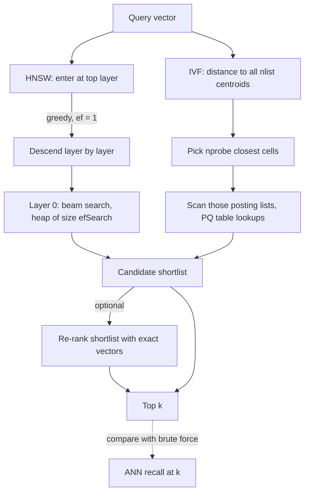

## TL;DR
The vector store behind an agent's search tool and memory usually runs an ANN index. HNSW walks a layered
graph, IVF probes the nearest clusters; their knobs (ef, nprobe) and your tenant filters decide what the
agent can find.

## For agent builders
- **Why it matters for agents.** Agents call retrieval many times per task, so per-call latency is
  multiplied; and agents filter heavily (per user, per tenant, per conversation memory), which is exactly
  where ANN indexes quietly return fewer than k results.
- **Where it shows up in your stack.** pgvector `hnsw.ef_search`, Qdrant or Weaviate HNSW parameters,
  managed stores such as Pinecone that hide the index, and framework wrappers (LangChain and LlamaIndex
  vector stores) that pass only k and a filter, leaving the knobs at engine defaults.
- **What you control.** Index type, `M`/`ef_construction` at build time, `ef_search` or `nprobe` per
  query, how tenant and user filters are applied, and when to rebuild after memory churn.
- **What you can skip.** The HNSW layer-assignment math and PQ codebook training details. Know the knobs,
  the filter failure mode and how to measure ANN recall against brute force.

## Why it exists
- **Exact search reads everything.** A brute-force scan is O(N·d) per query and reads the whole vector
  matrix each time: 3 GB per query at one million 768-dimensional fp32 vectors, 300 GB at one hundred
  million. No single machine streams that in the tens of milliseconds a chat product, or an agent making
  several tool calls, can spare.
- **More threads do not keep up.** Parallelism helps linearly; the corpus grows faster.
- **Classical spatial indexes fail.** k-d trees and R-trees prune by splitting coordinates, and in a few
  hundred dimensions nearly every split boundary is close to every point, so the tree visits most leaves
  anyway. That is the curse of dimensionality in practice.
- **Approximation is affordable.** Retrieval feeds an LLM that tolerates imperfect context, and the
  embedding is already a lossy proxy for relevance, so losing a couple of percent of true neighbors
  usually costs nothing measurable downstream.
- **Two families result.** Navigable graphs hop toward the query in a logarithmic number of steps (HNSW);
  partitioned spaces examine only a handful of cells (IVF).

## How it works
### HNSW: a skip list over a proximity graph
Every vector is a node; edges connect near neighbors. Search is greedy: move to whichever neighbor is
closest to the query, repeat until nothing improves. Two ideas make the walk converge:

1. **Hierarchy.** Each node gets a random maximum layer `l = ⌊−ln(U) · mL⌋`, U uniform in (0, 1), with
   the paper's suggested `mL = 1/ln(M)`.
   - Each layer holds roughly 1/M of the layer below; layer 0 holds everything; layer count grows like log N.
   - Search starts at the top layer, where long edges cross the space in a few hops, and descends using
     the best node so far as the next entry point.
   - This skip-list trick makes search cost grow roughly logarithmically with N instead of linearly.
2. **Beam search with ef.** At layer 0 the walk keeps a candidate heap of size `ef`, exploring the `ef`
   closest unvisited nodes before stopping.
   - Larger `ef` means more distance computations and higher recall; `ef` must be at least k.
   - `efConstruction` is used while inserting (graph quality); `efSearch` at query time (the live
     recall–latency knob).

The layer-0 search, where the stopping rule is what makes `ef` matter:

```
search_layer(q, entry, ef):
  C = min-heap of candidates by distance to q, starting with entry
  W = max-heap of the best ef results found so far, starting with entry
  while C not empty:
    c = pop closest from C
    if dist(c, q) > dist(furthest in W, q): break   # nothing left can improve W
    for n in neighbors(c) not yet visited:
      if |W| < ef or dist(n, q) < dist(furthest in W, q):
        push n to C and W; if |W| > ef: drop furthest from W
  return W                                          # caller takes its k closest
```

- **Upper layers** run the same routine with ef = 1 (pure greedy descent).
- **Cost per query** is roughly nodes expanded × their degree, so it rises with both `ef` and `M`.
- **Why small ef misses:** a small `W` stops as soon as the local neighborhood looks exhausted, exactly
  when a true neighbor one hop beyond a mediocre node gets missed.

### HNSW build and memory
- **`M`** is the number of links each node keeps per layer (layer 0 commonly allows 2M).
- **Insert:** search for the nearest `efConstruction` candidates, then select `M` with a heuristic that
  prefers neighbors in different directions over a cluster of near-duplicates, because diverse edges keep
  the graph navigable.
- **Links are bidirectional;** if a neighbor exceeds its limit, its weakest link is pruned.
- **Memory is the price.** Each node stores its vector plus roughly 2M 4-byte neighbor ids at layer 0:
  with M = 16 about 128 bytes of graph on top of a 3 KB vector. It must all live in RAM, since greedy
  traversal is random access.
- **Deletes are tombstones,** not removals, because cutting a node can disconnect the graph; a heavily
  churned index needs periodic rebuilding. Agent memory stores that overwrite and forget facts are
  exactly this workload.

### IVF: cluster, then probe
1. Run k-means over a training sample to get `nlist` centroids.
2. Assign every vector to its nearest centroid: `nlist` posting lists, shaped like a text inverted index
   but keyed by cluster.
3. At query time, compute distance to all centroids (cheap: nlist is thousands, not millions).
4. Pick the `nprobe` closest and scan only those lists exhaustively.

- **The approximation is at the boundary:** a true neighbor just across a cell edge is missed unless
  `nprobe` reaches its cell.
- **Cost vs recall:** scan cost grows roughly linearly with `nprobe` (each probe adds about N/nlist
  vectors) while recall rises fast then saturates, so the useful setting is a small fraction of `nlist`.
- **Sizing rule of thumb:** `nlist` on the order of √N up to a few multiples of it, with at least tens of
  training vectors per centroid so k-means has something to fit.
- **Drift:** centroids are fixed at training time, so IVF degrades when the distribution drifts (new
  product lines, new languages) and needs re-training, whereas HNSW adapts incrementally.

### Product quantization: trading bytes for bits
- **Encode.** Split each d-dimensional vector into `m` sub-vectors; replace each with the id of its
  nearest centroid in a 256-entry codebook (k-means per subspace). A 768-dim fp32 vector (3,072 bytes)
  becomes `m` bytes: 96 bytes at m = 96, a 32× compression.
- **Asymmetric distance.** The query stays exact. The engine precomputes an m × 256 table of distances
  from each query sub-vector to each sub-centroid; a candidate's distance is the sum of `m` table reads,
  no multiplications.
- **Residuals.** Inside IVF, PQ usually encodes vector minus its cell centroid, because residuals are
  smaller and spread more evenly, so the same 8 bits per subspace capture them more precisely.
- **Payoff and cost.** This makes billion-scale search fit in memory or on GPU; recover the recall loss
  partly by re-ranking the top few hundred PQ candidates with exact vectors.

### Choosing between them
| Index | Strengths | Costs |
|---|---|---|
| HNSW | best recall at a given latency, incremental inserts, no training | most RAM, longest build |
| IVF-Flat | faster to build, simpler | needs training and periodic re-training; at equal recall usually more distances per query, because whole cells are scanned |
| IVF-PQ | smallest footprint by far, GPU-friendly | lowest raw recall, so pair with exact re-ranking |

- **Agent memory and live tool corpora** get writes all day, which favors HNSW's incremental inserts.
- **Large static knowledge bases** an agent only reads can take IVF-PQ and scheduled re-training.

### pgvector settings (checked on 0.8)
| Index | Build time | Query time (per session) |
|---|---|---|
| HNSW | `m` and `ef_construction` (defaults 16 and 64) | `hnsw.ef_search` (default 40) |
| IVFFlat | `lists`: rows/1000 up to a million rows, √rows beyond | `ivfflat.probes` (start near √lists) |

- **`ef_search` caps rows.** It bounds the candidate list, so a plain HNSW scan returns at most that many
  rows: `LIMIT 100` with the default can quietly yield 40. Raise `ef_search`, or enable the iterative
  index scans added in pgvector 0.8 (`hnsw.iterative_scan = relaxed_order`; off by default).
- **Build IVFFlat after loading representative data,** since centroids come from the rows present at
  build time.

### Filters interact badly with both
- **The problem:** a filter keeping 1% of vectors breaks the assumptions. HNSW's walk cannot reach the few
  allowed nodes if the path runs through disallowed ones; an IVF probe may find zero allowed vectors in
  the chosen cells.
- **Agents hit this constantly.** A shared memory table filtered by `user_id`, or a multi-tenant
  knowledge base filtered by tenant, keeps a tiny fraction of rows per query.
- **Engine strategies:** filtered traversal (check the filter during the walk and widen ef), pre-filtering
  to an id set with a brute-force fallback when it is small, or partitioning the index by the filter key.
- **Classic symptom:** "search returns fewer than k results". Know which strategy your engine uses.

## Diagram
Compare the two query paths an agent's search call can take: HNSW descends layers greedily and then
beam-searches layer 0 with `ef`, while IVF ranks centroids and scans only `nprobe` lists; both feed an
optional exact re-rank.



## Examples
### Worked scenario: per-user agent memory that forgets
An assistant agent stores memories in one pgvector table shared by 20,000 users and recalls with
`WHERE user_id = $1 ORDER BY embedding <=> $2 LIMIT 10` (illustrative numbers).

| Quantity | Value |
|---|---|
| Rows in the table | 10 million memories |
| Rows for a typical user | ~500, so the filter keeps 0.005% |
| HNSW candidate list | `hnsw.ef_search` default 40 |
| Allowed rows among the 40 nearest overall | often none, at best a few |
| Agent sees | 0-2 memories, then "I don't have that information" |

- **Diagnosis.** The walk collects the 40 globally nearest memories, the filter discards nearly all of
  them, and the agent concludes it never knew the fact.
- **Fixes.** For a user with ~500 rows, an exact scan on a B-tree `user_id` index is cheap and loses no
  recall; confirm with `EXPLAIN` that the planner picks it over the HNSW index. Otherwise use iterative index scans (pgvector 0.8), a partial index per large tenant, or an
  engine with filtered traversal.
- **Measure.** Count tool calls where returned rows are fewer than `LIMIT`, per user bucket.

### Recall–latency sweep in FAISS
Build an exact index as the recall reference, then HNSW and IVF over the same vectors, and sweep each
search knob. Random Gaussian data is the worst case for ANN (no cluster structure), so recall will be
lower than on real embeddings at the same settings; look at the shape of the curve.

```python
import numpy as np, faiss, time
rng = np.random.default_rng(0)
N, d, k = 200_000, 128, 10
xb = rng.standard_normal((N, d)).astype("float32")
xq = rng.standard_normal((500, d)).astype("float32")

flat = faiss.IndexFlatL2(d); flat.add(xb)
_, truth = flat.search(xq, k)                        # exact top-10 = the recall reference

hnsw = faiss.IndexHNSWFlat(d, 32)                    # M = 32 links per node per layer
hnsw.hnsw.efConstruction = 200
hnsw.add(xb)                                         # no training; inserts one by one

nlist = 1024                                         # ~2.3 * sqrt(N) cells
quantizer = faiss.IndexFlatL2(d)                     # holds the centroids; keep a reference
ivf = faiss.IndexIVFFlat(quantizer, d, nlist)
ivf.train(xb[:50_000]); ivf.add(xb)                  # k-means needs a training sample first

def report(index):
    t = time.perf_counter(); _, I = index.search(xq, k)
    ms = (time.perf_counter() - t) * 1e3 / len(xq)
    recall = np.mean([len(set(I[i]) & set(truth[i])) / k for i in range(len(xq))])
    return f"recall@10={recall:.3f}  {ms:.2f} ms/query"

for ef in (16, 64, 256):
    hnsw.hnsw.efSearch = ef;  print("HNSW efSearch", ef, report(hnsw))
for nprobe in (1, 8, 64):
    ivf.nprobe = nprobe;      print("IVF  nprobe  ", nprobe, report(ivf))
print("flat", report(flat))
```

- **Expect** recall and per-query time to climb with `efSearch` or `nprobe`, and `flat` at exactly 1.0.
  One faiss-cpu 1.13 run gave HNSW 0.28 → 0.87 and IVF 0.02 → 0.43; random data is hard, so these
  are not typical.
- **Timings are throughput,** batch time divided by 500 (FAISS parallelizes across queries), not
  single-query latency, which is what an agent's one-at-a-time tool calls pay.
- **Flat looks competitive here** because batched flat search is one BLAS matrix multiply and 200k vectors
  is small. That is the point of "start with exact search"; the gap opens as N grows, because flat cost is
  linear in N.

### Production snippet: pgvector HNSW with explicit knobs
```sql
CREATE INDEX ON chunks USING hnsw (embedding vector_cosine_ops)
  WITH (m = 16, ef_construction = 64);          -- the defaults, stated explicitly

BEGIN;
SET LOCAL hnsw.ef_search = 200;                 -- >= LIMIT, raised for this query only
SELECT id FROM chunks ORDER BY embedding <=> $1 LIMIT 100;
COMMIT;

-- IVFFlat alternative, built after the data is loaded
CREATE INDEX ON chunks USING ivfflat (embedding vector_cosine_ops) WITH (lists = 1000);
SET ivfflat.probes = 32;                        -- about sqrt(lists)
```

### Worked scenario: memory for 10 million 768-dim vectors
| Layout | Per vector | Total | Fits a 16 GB node? |
|---|---|---|---|
| Flat fp32 | 3,072 bytes | ~30.7 GB | no |
| HNSW fp32, M = 16 | 3,072 + ~128 bytes of links | ~32 GB | no |
| IVF-PQ, m = 96 | 96 bytes of codes (+ ids) | ~1 GB | yes, with room for exact re-rank metadata |

HNSW's graph adds only ~4% here; the vector itself dominates, so shrinking the vector (PQ or int8), not
the graph, is what makes the corpus fit.

## Production patterns
- **Expose the knob as config and sweep it.** Keep `efSearch` or `nprobe` in configuration, not code, and
  run a recall@10 vs latency sweep against brute force on a few hundred real agent tool queries (pulled
  from traces) each release. Monitor ANN recall@10 and p99 tool-call latency together; pick the cheapest
  point where agent task success stays flat.
- **Set ef per query, not globally.** In pgvector use `SET LOCAL hnsw.ef_search` inside the transaction,
  always at least the `LIMIT`. Framework retrievers rarely set it, so wrap the tool's SQL yourself.
  Monitor queries that return fewer rows than requested.
- **Handle selective filters explicitly.** For tenant, user or category filters on agent memory, use the
  engine's filtered traversal, pgvector 0.8 iterative scans, or a partial index per large tenant; send
  tiny id sets to an exact scan. Monitor result-count shortfall per filter value.
- **Two-stage IVF-PQ with exact re-rank.** When vectors outgrow RAM, search PQ codes for a few hundred
  candidates, then re-score them with exact vectors (FAISS `IndexRefineFlat` wraps this). Monitor recall
  of the final top-k, measured on the quantized configuration.
- **Scheduled rebuilds.** Rebuild churned HNSW indexes (Postgres `REINDEX INDEX CONCURRENTLY`) and
  re-train IVF centroids when the content mix shifts; agent memory with frequent updates and deletes
  needs this most. Monitor deleted-row fraction and recall on newly added content separately from old.

## Trade-offs
- **HNSW: best recall per millisecond, incremental updates.** Every vector plus its links must sit in RAM;
  once the corpus outgrows memory you move to IVF-PQ or a disk-oriented graph index.
- **IVF: faster build, quantizes well.** Its training step yields centroids that go stale as data drifts;
  the trade flips against IVF when documents arrive continuously and re-training windows are hard to
  schedule, as with agent memory.
- **Product quantization: an order of magnitude or more smaller,** and GPU search becomes feasible. Raw PQ
  recall is noticeably lower; it only pays when you re-rank the PQ shortlist with exact vectors.
- **Higher `efSearch` or `nprobe`: more recall, roughly linear latency.** Once recall@k exceeds what
  downstream answer quality can detect, further increases are waste; spend the budget on the reranker.
- **One shared index vs one per tenant.** A shared index is simpler to operate but starves under
  selective filters; per-tenant partitions or exact scans for small tenants cost more objects to manage.

## Pitfalls
- **Trusting the vendor's benchmark recall.** Symptom: works in demos, misses obvious documents in
  production, because your embeddings and filters are not theirs. Diagnose: overlap of the ANN top 10
  with a brute-force top 10 on sampled real queries. Fix: tune the knob on your data.
- **Selective filter plus HNSW.** Symptom: fewer than k results, or results that ignore the filter, and an
  agent that claims it has no memory of something the user told it. Diagnose: log returned rows vs
  `LIMIT` per filter value. Fix is engine-specific (filtered traversal, pre-filtering, partitioned indexes).
- **Heavy churn without rebuilding.** Tombstones accumulate, recall drifts down and memory never shrinks.
  Diagnose: slowly rising latency at the same `efSearch` and a growing deleted-row fraction. Fix: rebuild.
- **Training IVF on a non-representative sample** (say, only English before a multilingual launch).
  Symptom: good recall on old content, poor on new at identical settings. Diagnose: measure recall
  separately by content cohort. Fix: re-train on a current sample.
- **`efSearch` below k.** Some libraries silently clamp, others return fewer results than requested;
  either way recall numbers look wrong for no visible reason.

## When to use
- **Stay exact** while the corpus fits in memory and a scan meets your latency budget, typically up to a
  low number of millions of vectors on a modern CPU. Per-user agent memories are often far smaller. It is
  simpler, loses no recall and is the reference you need anyway.
- **Move to HNSW** when latency forces it and the data fits in RAM; pgvector, Lucene, Qdrant, Weaviate and
  most managed services offer it first.
- **Move to IVF-PQ** when the vector set outgrows memory or must run on GPU at very high throughput.
- **Measure two things separately.** ANN recall@k is overlap with the exact top k on real queries: no
  labels, only a brute-force run, and it isolates what the index loses. Retrieval quality needs labels and
  mostly reflects the embedding model; 0.99 ANN recall cannot rescue a model that ranks the wrong chunk first.
- **Configure, do not hard-code,** the search knob, because the right operating point changes with
  traffic and content.

## Exercise
**Goal:** choose and defend an index configuration for a filtered agent memory store, with measured
evidence. No solution is given.
- **Inputs:** 200k+ real or public embeddings (not random Gaussians), a synthetic `user_id` giving most
  users 100-1,000 rows, and 200 held-out queries; FAISS, pgvector or Qdrant.
- **Deliver:** recall@10 against brute force and p95 single-query latency for HNSW at three `efSearch`
  values and IVF at three `nprobe` values, unfiltered and filtered to one user; RAM per index.
- **Acceptance:** the chosen setting meets recall@10 of at least 0.95 filtered and unfiltered; no
  filtered query returns fewer than 10 rows when the user has 10; latency is single-query, not batched.

## Role lens
- **Engineer:** Picks index type and parameters, writes the recall-versus-latency sweep, and tunes
  `efSearch` or `nprobe` per collection rather than accepting library defaults.
- **Architect:** Decides memory-versus-recall policy at fleet level: which collections must be in-RAM
  HNSW, which can be quantized, and how re-indexing fits release and drift schedules.
- **FDE:** Explains to a customer why their filtered search returns three results instead of ten, and
  chooses the filtering strategy their engine supports before promising recall numbers.

## Check yourself
**Q:** A team indexes 50 million 1024-dimensional fp32 embeddings and wants p99 retrieval under 50 ms on
a single 128 GB server, with new documents arriving all day. Walk through which index you would choose
and why, including what you would measure.
**A:** The raw vectors are 50M × 4 KB ≈ 200 GB, so an in-RAM HNSW over full-precision vectors does not
fit; even before graph overhead it exceeds the server. Options: reduce vector storage with scalar or
product quantization so an HNSW over compressed vectors fits (several engines support HNSW on int8 or PQ
codes), use IVF-PQ, which fits easily at tens of bytes per vector, or shard across machines. Continuous
inserts favor HNSW's incremental build over IVF's trained centroids, so a quantized HNSW with periodic
rebuilds, or IVF-PQ with scheduled re-training, are the realistic choices. In every case I would re-rank
the top few hundred candidates with exact vectors fetched from disk, and measure recall@10 against a
brute-force scan on a sample of real queries while sweeping ef or nprobe, then confirm on labeled
queries that the chosen point keeps downstream answer quality flat. I would also note that
quantization error and graph approximation compound, so the sweep must be run on the final quantized
configuration, not on a full-precision prototype.

## Interview questions
### Why do k-d trees fail for embeddings, and what do HNSW and IVF do instead?
- **Curse of dimensionality:** in a few hundred dimensions nearly every split boundary is close to every
  point, so a coordinate-splitting tree visits most leaves and degrades to a scan.
- **HNSW** walks a layered proximity graph in roughly logarithmic hops; **IVF** clusters with k-means and
  scans only the `nprobe` nearest cells, both trading a few percent of recall for sublinear search.

### Your agent says it has no memory of facts users clearly told it. The memory table uses HNSW. How do you debug it?
- **Suspect the filter first:** recall filtered by `user_id` keeps a tiny fraction of rows, so the
  greedy walk's candidate list fills with other users' memories and the filter discards them; allowed
  nodes are only reachable through disallowed ones and the `ef`-sized list runs dry.
- **Also check `ef_search`:** in pgvector a plain HNSW scan returns at most `hnsw.ef_search` rows, so
  `LIMIT 100` with the default 40 yields 40.
- **Fix:** exact scan for small per-user sets, iterative scans (pgvector 0.8), filtered traversal with a
  wider ef, or partitioning by the filter key; track tool calls returning fewer rows than requested.

### Your agent rewrites and deletes memories all day. What happens to its HNSW index over time?
- **Deletes are tombstones:** removing a node could disconnect the graph, so engines mark it deleted and
  keep routing through it; memory never shrinks and the walk wastes steps on dead nodes.
- **Symptom:** recall on recent memories drifts down and latency rises slowly at the same `efSearch`.
- **Fix:** schedule rebuilds (`REINDEX INDEX CONCURRENTLY` in Postgres) and track the deleted-row
  fraction and recall on new versus old memories separately.

### When would you choose IVF-PQ over HNSW, and what do you give up?
- **Choose IVF-PQ** when vectors outgrow RAM or must run on GPU: at m = 96 a 768-dim fp32 vector shrinks
  from 3,072 bytes to 96, a 32× compression.
- **You give up** raw recall and incremental freshness: PQ is lossy, so re-rank a few hundred candidates
  with exact vectors, and centroids go stale as data drifts, so schedule re-training.

### How do you pick efSearch or nprobe for an agent's retrieval tool?
- **Sweep, do not guess:** run recall@10 against a brute-force scan on a few hundred real tool queries
  from agent traces while stepping the knob, and record p99 latency at each point.
- **Pick the cheapest point** where agent task success stays flat, because past that, extra recall is
  invisible and costs roughly linear latency, paid on every one of the agent's searches.
- **Keep it in config** and set it per query (`SET LOCAL hnsw.ef_search`), always at least k.

## Quiz
### Q: In HNSW, what does raising `efSearch` do, and why does it help recall?
- [ ] It adds more links per node, so the graph becomes denser at query time
- [x] It widens the candidate beam kept during the greedy walk, so the search explores more near-miss nodes before stopping
- [ ] It increases the number of layers traversed, so the search starts closer to the query
- [ ] It forces the index to fall back to exact search for the final k results
> `efSearch` is the size of the dynamic candidate list at layer 0; a larger beam visits more nodes and is
> less likely to stop in a local minimum. Links per node (M) and the layer count are fixed at build time
> and cannot change per query.

### Q: Why is IVF typically combined with product quantization, while HNSW usually keeps full vectors?
- [ ] IVF requires integer codes to run k-means, while HNSW does not
- [ ] HNSW cannot compute distances on compressed vectors
- [x] IVF targets the memory and throughput regime where vectors must shrink to fit, and its list scans use PQ lookup tables efficiently, whereas HNSW's advantage is recall at a scale where RAM allows exact vectors
- [ ] Product quantization breaks the graph's navigability, so it is mathematically incompatible with HNSW
> The pairing is about operating points, not impossibility: HNSW over quantized vectors exists in several
> engines. IVF-PQ is the structure of choice when billions of vectors must fit in memory or on GPU, and
> its sequential list scans suit PQ's table-based distance computation.

### Q: A search with a metadata filter that matches 0.5% of documents returns only two of the requested ten results from an HNSW index. What is the most likely cause?
- [ ] The filter is applied before embedding, so most queries have no vector to compare
- [ ] The index was built with a cosine metric but the filter requires L2
- [x] The greedy traversal cannot reach enough allowed nodes because paths run through filtered-out neighbors, and the engine stops after exhausting its candidate list
- [ ] The filter key was not included in the k-means training sample
> Restrictive filters starve graph traversal: allowed nodes may only be reachable through disallowed
> ones, and a fixed-size candidate list runs dry. Engines address this with filtered traversal,
> pre-filtering to an id set with a brute-force fallback, or partitioned indexes; k-means is an IVF
> concept, not HNSW.

## Mastery test
**Problem:** a legal-research agent searches 400 million 384-dim fp32 chunks on GPUs with 80 GB each.
Matters are loaded nightly in bulk; each query filters to one client, and clients range from 2,000 to
40 million chunks. Pick an index design and say what you would measure.

**A strong answer:**
- sizes the raw vectors at about 600 GB, so full-precision in-RAM HNSW needs many GPUs, while IVF-PQ at
  tens of bytes per vector fits;
- matches nightly bulk loads to IVF re-training and adds exact re-ranking of a few hundred PQ candidates;
- handles the filter by size: exact scan for small clients, partitions for the largest;
- sweeps `nprobe` on the final quantized setup and tracks result shortfall per client.

## Use cases & projects
### Use cases
- **Multi-step research agents.** An agent that makes several retrieval calls per task needs each one
  fast, so the ANN search knobs set a large share of end-to-end latency.
- **Per-user and per-tenant memory.** Agent memory stores filter by user, tenant or conversation, which is
  where filtered HNSW searches can silently return fewer than k results.
- **Memory churn.** Agents that write and delete memories constantly leave stale graph links behind, so
  rebuild or compaction schedules become an operations task.
- **Latency-recall tuning.** Teams raise or lower the query-time search width per tool to trade a few
  milliseconds for recall on high-stakes lookups.

### Mini project
**Measure ANN recall and filtered starvation for an agent memory store (2-3 hours).**
- **Goal:** quantify how the query-time search width and a restrictive user filter affect what an agent's
  memory tool returns.
- **Steps:** load 50k-100k embeddings with a `user_id` field into pgvector or Qdrant with HNSW; compute
  brute-force top-10 as ground truth for 100 queries; sweep `ef_search` (or the engine's equivalent) and
  record recall@10 and p95 latency; repeat with a filter that keeps about 1% of rows and count queries
  that return fewer than 10 results.
- **Done when:** you have a recall-versus-latency table for both the unfiltered and filtered runs, and a
  chosen setting for the memory tool with a one-paragraph justification.
