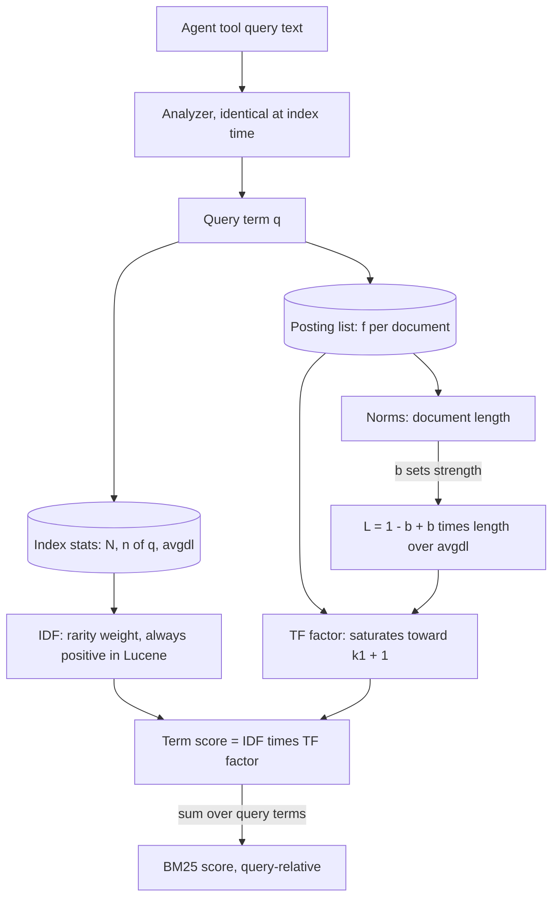

## TL;DR
BM25 is the keyword arm of most agent retrieval tools: it sums, over query terms, a rarity weight (IDF)
times a saturating, length-normalized term frequency. Knowing k1, b and the analyzer explains most "the
agent searched and found nothing" bugs.

## For agent builders
- **Why it matters for agents.** The sparse arm is what finds the ids, error codes and names agents pass
  between tools. Agent-written queries also differ from human ones (longer, more terms, copied
  fragments), and BM25 scores scale with query length, so thresholds tuned on humans break on agents.
- **Where it shows up in your stack.** Elasticsearch and OpenSearch (BM25 by default), LangChain's
  `BM25Retriever` built on `rank_bm25`, BM25 extensions for Postgres, and the keyword half of hybrid
  modes in vector databases. Postgres's built-in `ts_rank` is not BM25.
- **What you control.** The analyzer (tokenization of identifiers, stemming, stopwords), k1 and b, field
  boosts, and how the search tool turns raw scores into something the agent or fusion layer can use.
- **What you can skip.** The two-Poisson derivation. Keep the three failures BM25 fixes and the fact that
  scores are query-relative.

## Why it exists
- **Common words swamp raw counts.** "the" appears everywhere, so the query "the indemnification cap" is
  dominated by a term that carries no information. IDF fixes this, which matters when an LLM writes
  wordy, natural-language queries.
- **Raw counts scale without limit.** A document mentioning "cap" fifty times scores ten times one that
  mentions it five times, although the second is clearly about caps and the first is probably a glossary.
  Saturation (k1) stops a term repeated 50 times beating one repeated 5 times by 10×.
- **Long documents win by default.** A 400-page manual mentions almost every term more often than a
  focused two-page note simply because it has more words. Length normalization (b) fixes this.
- **TF-IDF was a heuristic.** It weighted terms by inverse document frequency and partly tamed counts with
  a logarithm, but derived from no model of relevance.
- **BM25 is principled and cheap.** It came from the probabilistic relevance framework (Robertson, Spärck
  Jones and colleagues, tested at TREC in the 1990s): approximate the probability-of-relevance ranking with
  a two-parameter function that behaves sensibly at the extremes. It is cheap from an inverted index and
  has been the default in Lucene, Elasticsearch and OpenSearch for years, because it is hard to beat
  without training data.

## How it works
### The formula
For query Q with terms q₁…qₙ and document D:

```
score(D, Q) = Σᵢ IDF(qᵢ) ·            f(qᵢ, D) · (k1 + 1)
                            ─────────────────────────────────────────
                            f(qᵢ, D) + k1 · (1 − b + b · |D| / avgdl)
```

- `f(qᵢ, D)` is the term's count in D.
- `|D|` is D's length in tokens.
- `avgdl` is the mean document length in the collection.
- N is the number of documents and n(q) the number containing q.

IDF in Lucene's form:

```
IDF(q) = ln( (N − n(q) + 0.5) / (n(q) + 0.5) + 1 )
```

- Recent Lucene versions drop the constant `(k1 + 1)` from the numerator. It scales every score equally,
  so it never changes the ranking, but it is why Lucene's raw scores are smaller than a textbook
  implementation's.
- Each piece answers one of the three failures above.

### IDF: rarity as information
- **Goal:** a term in nearly every document should weigh near zero; a term in a handful should carry most
  of the score.
- **The ratio** (N − n + 0.5)/(n + 0.5) is large for n ≪ N and below one for n ≈ N. The 0.5 terms smooth
  the estimate for very small counts.
- **Why Lucene adds 1:** the original Robertson–Spärck Jones form goes negative for terms in more than half
  the documents, letting a matching term lower a score. With +1 inside the log, IDF is always positive and
  such terms contribute almost nothing.

| N = 1,000; term appears in | IDF |
|---|---|
| 10 documents | ln(95.3) ≈ 4.56 |
| 600 documents | ln(1.67) ≈ 0.51 |
| all 1,000 | ln(1.0005) ≈ 0.0005 |

### Term-frequency saturation: k1
Write L for the length factor `1 − b + b·|D|/avgdl`. The fraction `f·(k1 + 1) / (f + k1·L)`:
- is zero at f = 0, equals 1 at f = 1 when L = 1, and rises toward k1 + 1 as f → ∞;
- saturates: the second occurrence adds a lot, the twentieth almost nothing, because once a document is
  clearly about a term, more repetitions are weak extra evidence;
- k1 sets how fast saturation sets in. k1 = 0 makes term frequency irrelevant (a binary "contains"
  model); a large k1 approaches raw counts.

| f (k1 = 1.2, Lucene's default; L = 1) | 1 | 2 | 5 | 10 | 50 |
|---|---|---|---|---|---|
| TF factor | 1.00 | 1.38 | 1.77 | 1.96 | 2.15 |

The curve is already flat by ten.

### Length normalization: b
- **L = 1 − b + b·|D|/avgdl** rescales the denominator by length relative to average; at average length
  L = 1.
- **Twice the average with b = 0.75** gives L = 1.75: each count is effectively divided by 1.75 before
  saturation, so five mentions in a long document count less than in a short one.
- **b = 0** switches normalization off (counts are absolute); **b = 1** makes it fully proportional.
- **Why 0.75 by default:** long documents are partly long because they cover more topics (discount their
  counts) and partly because they say more about the same topic (so not fully).

### Background: where the shape comes from
- **IDF factor:** the Robertson–Spärck Jones term weight with no relevance information: log-odds that a
  term appears in relevant vs non-relevant documents, assuming almost every document is non-relevant.
- **TF factor:** the "eliteness" idea. A document is about a term or not; counts are modelled as a mixture
  of two Poisson distributions, one for elite and one for non-elite documents.
- **The approximation:** the exact weight has no usable closed form, but its shape is known: zero at
  f = 0, increasing, bounded. `f/(f + k1)` is the simplest function with that shape, and length
  normalization rescales k1.
- **Why it matters:** this lineage is why BM25 has so few parameters and why saturation is not an
  arbitrary engineering hack.

### How an engine evaluates it
Nothing needs the document text at query time:
- **Posting lists** store, per document, the term frequency f.
- **Norms** hold |D| per field; Lucene encodes it lossily into a single byte, so long lengths are
  approximate.
- **Index statistics** give N, n(q) and avgdl.
- **Scoring** walks the query terms' postings, adding one precomputable IDF times one small expression
  per matching document.
- **Pruning:** each term's contribution is bounded by IDF × (k1 + 1), so the engine knows the most any
  document can gain from a term. Dynamic pruning (WAND, MaxScore; see inverted indexes) uses this to skip
  documents that cannot reach the top k.

### What BM25 does not do
- **Terms are independent;** order and proximity are ignored (phrase matching is a separate query feature
  over positions); there is no synonymy.
- **Semantics live in the analyzer** (tokenization, lowercasing, stemming, stopword removal), which runs
  before scoring. Because it defines what a "term" is, index-time and query-time analysis must be
  identical; most "BM25 is broken" bugs are analyzer mismatches.
- **Multi-field documents** (title, body): score fields separately and combine with boosts, or use BM25F,
  which merges field counts with per-field weights before saturation so a title hit is not saturated away
  by body mentions.

### Scores are query-relative
- A score is a sum over query terms of unbounded positive quantities, not normalized.
- A three-term query produces larger numbers than a one-term query, and scores from different indexes or
  corpora are not comparable.
- So fusing BM25 with dense scores needs rank-based methods or per-query normalization.
- **Agent consequence:** never hand raw BM25 scores to the model as "confidence", and never gate a tool's
  results on a fixed raw cutoff, because the same agent writes one-term and eight-term queries.

## Diagram
Follow one term of an agent's tool query through scoring: the analyzer defines the term, IDF comes from
index statistics, and the TF factor combines the posting's count with the length factor L before the
per-term scores sum.



## Examples
### Worked scenario: a raw-score cutoff that breaks on agent queries
A support agent's keyword tool drops hits below a raw BM25 score of 8.0, tuned on the agent's own wordy
queries. Collection as in the IDF table: N = 1,000, each hit at average length with f = 1, so the TF
factor is 1.0 and each matching term adds its IDF (illustrative).

| Query | Matching terms and IDF | Score of the right document | Passes 8.0? |
|---|---|---|---|
| Agent: "error E4012 fuser overheating printer" | E4012 4.56, fuser 4.56, error 0.51, printer 0.0005 | ≈ 9.6 | yes |
| Agent retry, short: "E4012" | E4012 4.56 | ≈ 4.56 | no, tool returns nothing |
| Agent query reworded: "E4012 meaning" | E4012 4.56, meaning ~0 | ≈ 4.6 | no |

- **The right document is top-ranked in all three,** yet the tool hides it in two, and the agent reports
  that no documentation exists.
- **Fix.** Return the top k by rank, normalize per query before any cutoff, or let a reranker decide.

### Agent keyword tool that reports evidence, not raw scores
The tool returns rank, a per-query normalized score and the matched terms, so the agent (and your traces)
can see why a hit came back. It reuses the analyzer from the from-scratch example below.

```python
import re

analyze = lambda s: re.findall(r"[a-z0-9]+", s.lower())   # same analyzer as the index

def keyword_search(query, docs, bm25, k=5):
    """docs: {id: text}; bm25(query, doc_id) -> raw score."""
    raw = {d: bm25(query, d) for d in docs}
    ranked = [d for d in sorted(raw, key=raw.get, reverse=True) if raw[d] > 0][:k]
    if not ranked:
        return {"results": [], "note": "No keyword matches. Try synonyms or semantic_search."}
    top = raw[ranked[0]]
    q_terms = set(analyze(query))
    return {"results": [
        {"id": d, "rank": i + 1,
         "relative_score": round(raw[d] / top, 2),           # 1.0 = best for THIS query only
         "matched_terms": sorted(q_terms & set(analyze(docs[d])))}
        for i, d in enumerate(ranked)]}
```

### BM25 from scratch
Three short contract passages make every term visible. The analyzer is deliberately trivial (lowercase,
alphanumerics) and shared by index and query; change it in one place and both sides change together.

```python
import math, re
from collections import Counter

docs = {
    "A": "indemnification cap: the indemnification obligations are capped at fees paid",
    "B": "this agreement is a contract between the parties; the contract term is one year",
    "C": "limitation of liability and indemnification survive termination of the contract",
}
analyze = lambda s: re.findall(r"[a-z0-9]+", s.lower())     # must be identical at query time
tf = {d: Counter(analyze(t)) for d, t in docs.items()}       # term counts per document
dl = {d: sum(c.values()) for d, c in tf.items()}             # document lengths
N, avgdl = len(docs), sum(dl.values()) / len(docs)
df = Counter(term for c in tf.values() for term in c)        # documents containing each term

def idf(term):                                               # Lucene form: +1 keeps it positive
    n = df.get(term, 0)
    return math.log((N - n + 0.5) / (n + 0.5) + 1)

def bm25(query, d, k1=1.2, b=0.75):
    score = 0.0
    for term in analyze(query):
        f = tf[d].get(term, 0)
        if f == 0:
            continue
        length_factor = 1 - b + b * dl[d] / avgdl              # >1 for long docs, <1 for short
        score += idf(term) * f * (k1 + 1) / (f + k1 * length_factor)
    return score

for q in ["indemnification cap", "contract term", "the"]:
    ranked = sorted(docs, key=lambda d: -bm25(q, d))
    print(f"{q!r:24}", [(d, round(bm25(q, d), 2)) for d in ranked])
```

- **"the"** scores every document low and nearly equally, because it appears in all three.
- **"indemnification cap"** prefers A (two occurrences of a rarer term plus the only "cap") over C.
- **"contract term"** prefers B. Set `k1=0` and watch A's advantage from repetition disappear.

### Worked scenario: one term, three documents
N = 1,000 documents, avgdl = 200 tokens, k1 = 1.2, b = 0.75 (so k1 + 1 = 2.2).

| Document | Term, IDF | Length, count | L | Denominator | Term score |
|---|---|---|---|---|---|
| A | "indemnification" (in 10 docs), 4.56 | 100 tokens, f = 3 | 1 − 0.75 + 0.75·0.5 = 0.625 | 3 + 1.2·0.625 = 3.75 | 4.56 × 6.6 / 3.75 ≈ 8.0 |
| B | same, 4.56 | 400 tokens, f = 3 | 1.75 | 3 + 2.1 = 5.1 | 4.56 × 6.6 / 5.1 ≈ 5.9 |
| C | "contract" (in 600 docs), 0.51 | average length, f = 10 | 1 | TF factor 1.96 | 0.51 × 1.96 ≈ 1.0 |

- Same counts, roughly a quarter lower score for the document four times longer.
- A common word repeated ten times is worth an eighth of a rare word mentioned three times.

### Production snippet: tuning k1 and b in Elasticsearch
A custom similarity is declared in index settings and assigned per field; `explain` shows the IDF and TF
pieces for one hit.

```json
PUT /manuals
{
  "settings": {
    "index": {
      "similarity": { "short_sections": { "type": "BM25", "k1": 1.2, "b": 0.3 } }
    }
  },
  "mappings": {
    "properties": {
      "title": { "type": "text" },
      "body":  { "type": "text", "similarity": "short_sections" }
    }
  }
}

GET /manuals/_search
{
  "explain": true,
  "query": { "multi_match": { "query": "PX-200 fuser", "fields": ["title^3", "body"] } }
}
```

## Production patterns
- **Grid-search k1 and b on labeled agent queries.** When the corpus is unlike TREC-style news (tweets,
  200-page manuals, short snippets), sweep k1 over roughly 0.5 to 2 and b over 0 to 1 offline, using
  queries the agent actually issued, and record the values with the experiment. Monitor recall@k per
  query type before and after any change on a live index.
- **Debug agent misses with explain and the analyzer API.** When a trace shows a keyword search that
  returned nothing, replay it with `explain` on the expected hit to see each term's IDF and TF factor,
  and with Elasticsearch's `_analyze` endpoint to compare index-time and query-time tokens. Monitor
  zero-result rate for tool queries containing identifiers.
- **Index sections, boost identity fields.** Split long manuals into sections near average length, and put
  "this is the manual for X" into a title or product field with a boost (`"title^3"`) or BM25F instead of
  bending b. Monitor where the canonical document ranks for its own product name.
- **Use global statistics where shards are small or uneven.** Run tests and small indexes on one shard, or
  use the `dfs_query_then_fetch` search type when per-shard IDF skews results. Per-tenant agent indexes
  are often small enough for this to bite. Monitor score drift for the same document across shards.
- **Normalize before fusion or cutoffs.** Never threshold or add raw BM25 scores to cosine scores; fuse by
  rank or normalize per query first, and give the agent ranks or relative scores. Monitor fused-result
  overlap with each arm alone.

## Trade-offs
- **No training data, no GPU.** BM25 is the cheapest retriever to stand up and the easiest to debug; it
  becomes insufficient once queries stop sharing vocabulary with documents, which no parameter tuning fixes.
- **Saturation resists keyword stuffing and repetitive documents,** but caps the signal from genuinely
  term-dense passages; raise k1 for corpora of short, focused snippets where repetition is meaningful.
- **b = 0.75 suits mixed-length prose.** Where length is itself a quality signal (full articles versus
  stubs), lowering b stops penalizing the complete documents.
- **Field-aware scoring (BM25F or boosted fields)** lets a title match outrank a body mention, at the cost
  of boosts that must be tuned per corpus and re-validated whenever the document schema changes.
- **Verbose agent queries vs short ones.** Extra terms add recall for documents that match them, but
  common filler adds noise and inflates scores; prompting the agent for keyword-style queries helps BM25
  but can hurt the dense arm, so measure both.

## Pitfalls
- **Index and query analyzers differ** (stemming on one side, a different tokenizer, or hyphen handling).
  Symptom: exact phrases copied from a document, or ids copied from another tool's output, return zero
  results. Diagnose: run the text through `_analyze` with both analyzers and diff the tokens. Fix: one
  analyzer for both sides.
- **Wrong stopword policy.** Keeping them where meaningless or stripping them where meaningful ("the Who",
  "to be or not to be"). Symptom: noisy hits or impossible queries; IDF does not fully compensate.
- **Thresholding BM25 scores as absolute relevance.** Symptom: a cutoff that works for three-word queries
  rejects everything for one-word queries, because the score scales with query length. Diagnose: plot
  top-1 raw score against query term count from traces. Fix: cut by rank or per-query normalized score.
- **Changing k1 or b on a live index without re-measuring.** The defaults were chosen on TREC-style
  collections; tweets or 200-page manuals can want very different values. Symptom: a silent shift in
  which documents win. Diagnose: recall@k per query type before and after, on labeled queries.
- **Forgetting avgdl and IDF are collection statistics.** In sharded engines each shard may compute its own
  unless the engine fetches global statistics first (Elasticsearch's `dfs_query_then_fetch` search type
  does this at extra cost). Symptom: the same document scores differently by shard, most visible on small
  or uneven shards and in tests with few documents. Diagnose: `explain` the same hit on two shards and
  compare IDF.

## When to use
- **Always first:** BM25 is the right first retriever for any corpus an agent searches and the baseline
  every other retriever must beat on your labeled queries before it earns its cost.
- **Sole retriever when** queries are identifier-heavy, the corpus churns fast or the serving budget is
  CPU-only; **one arm of hybrid** everywhere else.
- **Measure:** recall@k on labeled queries by query type, with the analyzer and the k1, b values recorded
  as part of the experiment.
- **Day to day,** the formula explains why a long document ranks low, why a repeated keyword stopped
  helping, or why a fused score needs normalization.

## Exercise
**Goal:** implement BM25 yourself, match a reference implementation, then tune it for agent queries. No
solution is given.
- **Inputs:** 1,000+ documents of mixed length (manual sections, tickets) and 20 agent-style queries with
  labeled answers, several containing hyphenated or dotted ids.
- **Deliver:** your own BM25 (Lucene IDF, k1, b exposed); a check against `rank_bm25` or Elasticsearch
  `explain` with the same analyzer; recall@5 over a small k1 by b grid; a tool that returns ranks and
  matched terms.
- **Acceptance:** your scores match the reference up to the constant `(k1 + 1)` factor, or you can name the
  formula difference; one hand-computed term score matches your code; your id-preserving analyzer raises
  recall on the id queries.

## Role lens
- **Engineer:** Configures analyzers consistently across index and query, exposes k1 and b as tunables,
  and writes the per-query-type recall test that catches analyzer regressions.
- **Architect:** Treats BM25 as the system's mandatory baseline retriever and decides how its
  unnormalized scores combine with dense scores in the fusion layer.
- **FDE:** Reproduces a customer's "exact phrase returns nothing" complaint by diffing their index and
  query analyzers, then explains length normalization when a 300-page PDF ranks below a memo.

## Check yourself
**Q:** A customer indexes product manuals that range from two pages to four hundred pages. Users complain
that the complete manual for a product ranks below a short FAQ stub that mentions the product name once.
Using the BM25 formula, explain why and what you would change.
**A:** BM25 rewards term *density*, not completeness. Put numbers on it with k1 = 1.2, b = 0.75 and
look only at the product-name term (IDF is identical for both documents, so it cancels). The stub is a
fifth of average length with one mention: L = 0.25 + 0.75 × 0.2 = 0.40, so the term factor is
2.2 / (1 + 0.48) ≈ 1.49. The manual is twenty times average length with thirty mentions: L = 0.25 +
0.75 × 20 = 15.25, so the factor is 66 / (30 + 18.3) ≈ 1.37. The manual's thirty mentions, spread over a
document twenty times longer, are a lower density than the stub's one, and saturation means no count can
push either past (k1 + 1) = 2.2. Raising k1 does not help: it moves the curve toward length-normalized
raw counts, f / L, where the stub is still denser (with k1 = 2 the factors become 1.67 versus 1.49).
Lowering b does: at b = 0.3 the stub's L rises to 0.76 and the manual's falls to 6.7, giving 1.15 versus
1.74. But I would first question the unit. Indexing sections or pages as documents brings each near
average length and lets the section that actually discusses the product win. If whole manuals must rank,
the signal "this document is the manual for X" is not a term-density fact at all; put it where BM25 can
see it, in a title or product field with its own boost (or BM25F), rather than bending b until the body
text happens to agree. Then re-measure recall on labeled queries, because lowering b also helps every
long, loosely relevant document.

## Interview questions
### Explain the three components of BM25 and the failure each one fixes.
- **IDF** down-weights terms found in most documents, so "the" in "the indemnification cap" carries
  almost nothing while the rare term carries most of the score.
- **TF saturation (k1)** makes the second occurrence count a lot and the twentieth almost nothing, so
  repetition and keyword stuffing cannot dominate.
- **Length normalization (b)** divides counts by length relative to `avgdl`, so a long manual does not win
  just by containing more words.

### An agent's trace shows it searched for an error code copied from a log tool and got zero results. How do you debug it?
- **Suspect the analyzer first:** most "BM25 is broken" bugs are index-time and query-time analysis that
  differ, for example stemming on one side or different hyphen handling of codes like `E-4012`.
- **Replay the exact tool query:** compare tokens with Elasticsearch's `_analyze` endpoint for both
  analyzers, then use `explain` on a document that should match to see which terms contributed.
- **Check the tool wrapper:** a raw-score cutoff in the tool can hide a top-ranked hit for a short query.

### What should a keyword search tool return to an agent, and why not the raw BM25 score?
- **Return rank and evidence:** the top k by rank, a per-query relative score, and the matched terms, so
  the agent can judge relevance and your traces show why each hit came back.
- **Raw scores mislead:** they scale with query length and corpus statistics, so the model treats 9.6 as
  better than 4.56 even when both are the right document for different queries.

### When would you change k1 or b from the defaults of 1.2 and 0.75?
- **Lower b** when length is itself a quality signal (complete articles versus stubs), so complete
  documents stop being penalized.
- **Raise k1** for short, focused snippets where repetition is meaningful evidence.
- **Only after a grid search** on labeled queries per query type, because the defaults came from
  TREC-style collections and a change silently shifts which documents win.

## Quiz
### Q: Why does BM25 saturate term frequency instead of using raw counts?
- [ ] To make scores comparable across queries of different lengths
- [x] Because once a document clearly contains a term, each additional occurrence is weaker evidence of relevance, and unbounded counts would let repetition dominate
- [ ] Because inverted indexes store term frequency as a single bit
- [ ] To compensate for stopwords that were removed by the analyzer
> The saturating fraction rises steeply from zero to one occurrence and flattens toward k1 + 1, so a
> term repeated fifty times scores only slightly above one repeated five times. Score comparability
> across queries is not something BM25 provides at all, and inverted indexes store full counts.

### Q: With b = 0.75, how does a document twice the average length have its term counts treated?
- [ ] Counts are doubled to reward the extra coverage
- [ ] Counts are unchanged because b only affects IDF
- [x] Counts are effectively divided by 1.75 before saturation, so the same number of mentions scores lower than in an average-length document
- [ ] The document is excluded from results unless every query term matches
> The length factor is 1 − b + b·|D|/avgdl = 0.25 + 0.75·2 = 1.75, which multiplies k1 in the
> denominator and acts like dividing the count. IDF depends only on document frequency, not length.

### Q: Why does Lucene's BM25 add 1 inside the IDF logarithm?
- [ ] To make IDF proportional to document length
- [ ] To ensure every term in the query contributes exactly one point
- [x] To keep IDF positive for terms that occur in more than half the documents, so a matching term never lowers a document's score
- [ ] To correct for shards computing different average document lengths
> The classic form ln((N − n + 0.5)/(n + 0.5)) goes negative when n exceeds about half of N, meaning a
> document could be penalized for containing a query term. Adding 1 inside the log bounds IDF below by
> zero while leaving rare-term weights nearly unchanged.

## Mastery test
**Problem:** an on-call agent's keyword tool indexes 50,000 Slack messages of about 15 tokens and 300 CI
logs of about 3,000 tokens, each log saying "deploy" about 40 times. For "deploy failed" it returns
one-line chats, never the log. A teammate proposes k1 = 5. Predict the effect, then propose a fix.

**A strong answer:**
- computes avgdl ≈ 33, so a log's L ≈ 69 and a message's ≈ 0.59 at b = 0.75: TF factors about 0.72
  versus 1.29;
- shows k1 = 5 makes it worse (about 0.62 versus 1.51), because it moves toward density f / L;
- notes b = 0.3 flips this narrowly (about 1.19 versus 1.10) but also lifts every long, loosely related log;
- prefers chunking logs or a separate log index with its own statistics, then re-measures on labeled queries.

## Use cases & projects
### Use cases
- **Identifier lookups for agents.** Agents pass ticket ids, error codes and function names between tools,
  and BM25 with a well-chosen analyzer is what finds them reliably.
- **Keyword arm of hybrid search.** BM25 is the sparse half that fusion combines with dense retrieval in
  most agent RAG stacks.
- **Score handling in search tools.** Because BM25 scores are query-relative and grow with query length,
  teams turn them into ranks or calibrated signals before an agent or threshold uses them.
- **Field-boosted enterprise search.** Boosting titles or headings over body text helps an agent land on
  the right policy or runbook section.

### Mini project
**Tune BM25 for agent-written queries (1-2 hours).**
- **Goal:** see how analyzer choices and k1/b change results for the long, fragment-heavy queries agents
  write.
- **Steps:** index 1k-5k docs with `rank_bm25` or a local search engine; collect 20 agent-style queries
  with labeled answers, including ids with hyphens or dots; compare a default analyzer with one that keeps
  identifiers whole; sweep k1 and b over a small grid; log top-1 scores per query to see how they scale
  with query length.
- **Done when:** you have recall@5 per analyzer and parameter setting, a plot of top score versus query
  length, and a written rule for how your search tool will expose scores to the agent.
